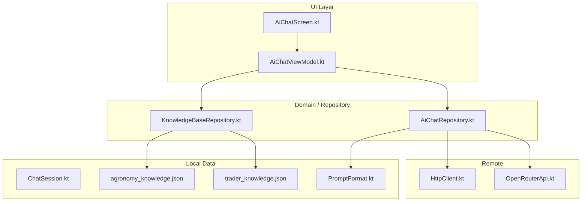
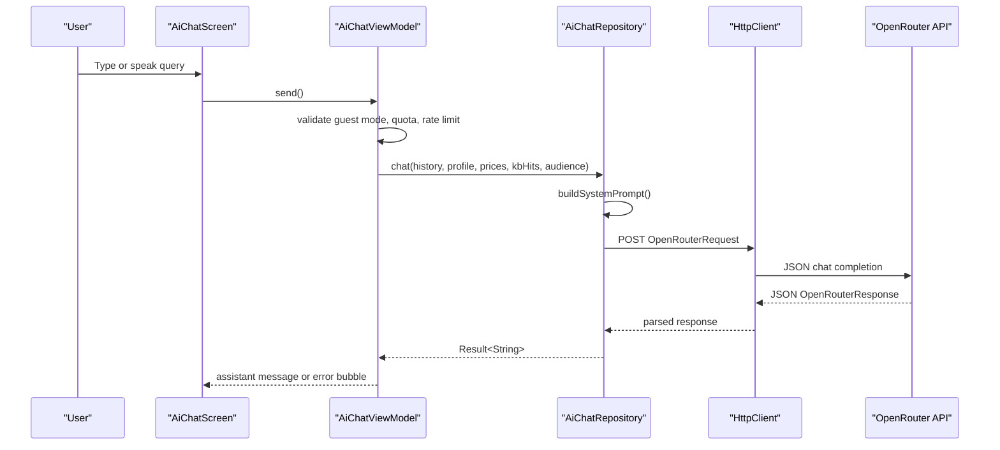
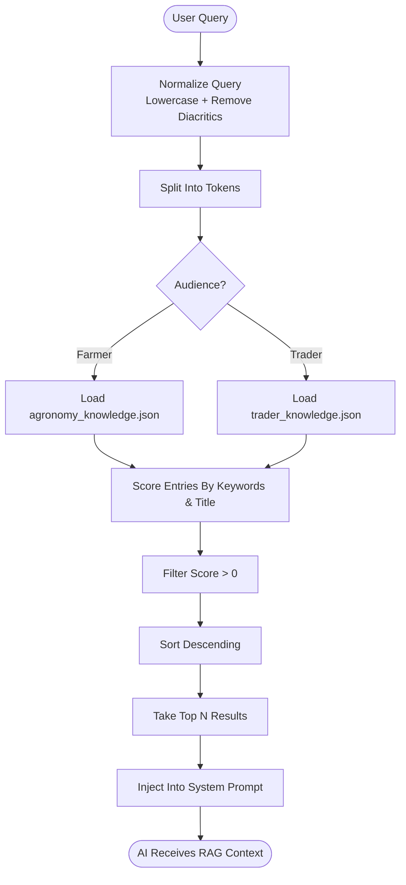
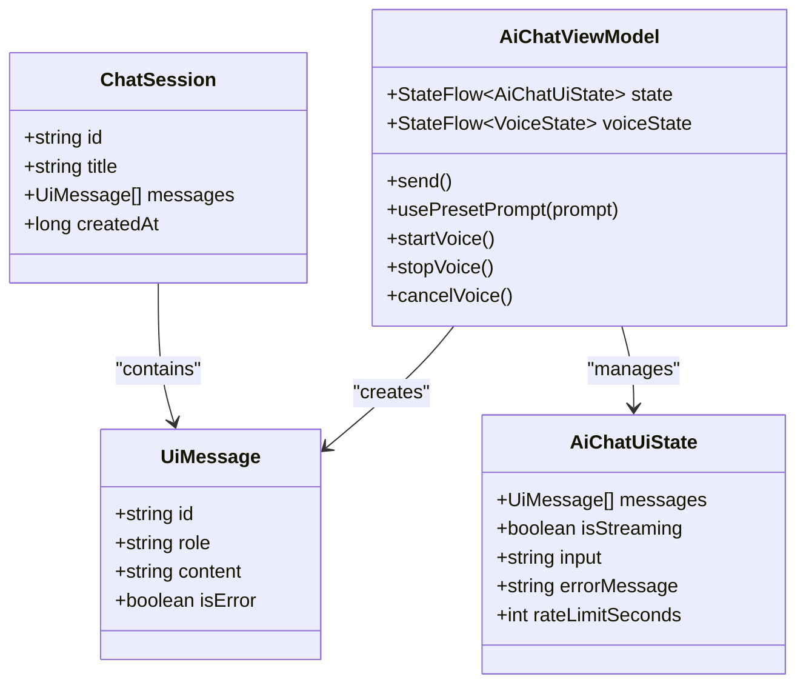
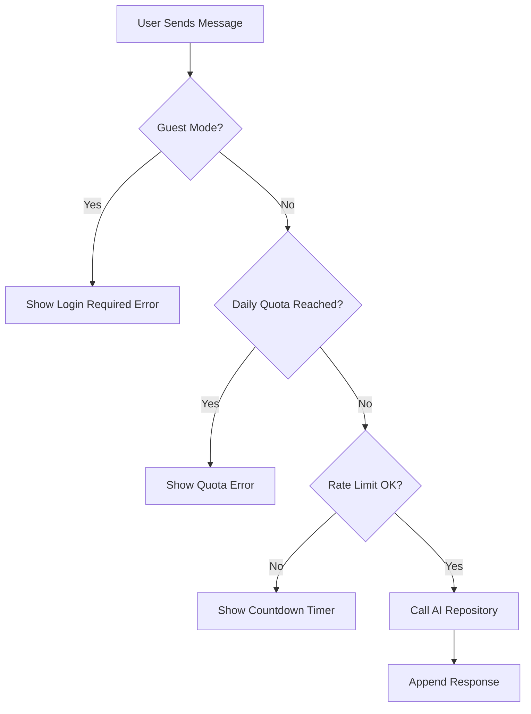
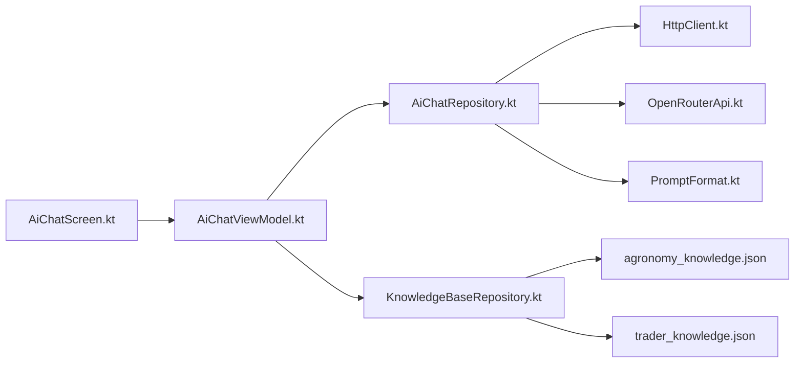

# AI Services Integration

<cite>
**Referenced Files in This Document**
- [OpenRouterApi.kt](file://app/src/main/java/com/giathinh/canlua/data/remote/ai/OpenRouterApi.kt)
- [AiChatRepository.kt](file://app/src/main/java/com/giathinh/canlua/repository/AiChatRepository.kt)
- [HttpClient.kt](file://app/src/main/java/com/giathinh/canlua/data/remote/HttpClient.kt)
- [KnowledgeBaseRepository.kt](file://app/src/main/java/com/giathinh/canlua/repository/KnowledgeBaseRepository.kt)
- [agronomy_knowledge.json](file://app/src/main/assets/agronomy_knowledge.json)
- [trader_knowledge.json](file://app/src/main/assets/trader_knowledge.json)
- [AiChatViewModel.kt](file://app/src/main/java/com/giathinh/canlua/ui/viewmodel/AiChatViewModel.kt)
- [AiChatScreen.kt](file://app/src/main/java/com/giathinh/canlua/ui/screen/aichat/AiChatScreen.kt)
- [ChatSession.kt](file://app/src/main/java/com/giathinh/canlua/data/model/ChatSession.kt)
- [PromptFormat.kt](file://app/src/main/java/com/giathinh/canlua/util/PromptFormat.kt)
</cite>

## Table of Contents
1. [Introduction](#introduction)
2. [Project Structure](#project-structure)
3. [Core Components](#core-components)
4. [Architecture Overview](#architecture-overview)
5. [Detailed Component Analysis](#detailed-component-analysis)
6. [Dependency Analysis](#dependency-analysis)
7. [Performance Considerations](#performance-considerations)
8. [Troubleshooting Guide](#troubleshooting-guide)
9. [Conclusion](#conclusion)

## Introduction
This document explains how the Android app integrates OpenRouter to power an AI chat assistant using the Gemini Flash family through the `openrouter/free` model. The implementation follows a Kotlin 2.3 / Jetpack Compose offline-first architecture with MVVM, Room persistence, and unidirectional data flow via StateFlow and coroutines.

The AI layer is intentionally simple: it builds a context-aware system prompt from user profile, rice prices, and local knowledge base JSON files, then calls OpenRouter’s OpenAI-compatible chat completion endpoint. Responses are returned as complete JSON blocks rather than true Server-Sent Events streaming; however, the UI simulates a streaming-like experience by showing typing indicators and rendering Markdown incrementally.

Key responsibilities covered here include:
- OpenRouter request/response schemas and authentication.
- Context-aware RAG using agronomy and trader knowledge JSON files.
- Conversation session management and message formatting.
- Prompt engineering for farmer and trader audiences.
- Rate limiting, quota handling, and error/fallback strategies.
- Practical examples for farming queries and conversation history.

## Project Structure
The AI chat feature spans UI, ViewModel, repository, remote API, and local assets:

**Diagram sources**
- [AiChatScreen.kt:103-205](file://app/src/main/java/com/giathinh/canlua/ui/screen/aichat/AiChatScreen.kt#L103-L205)
- [AiChatViewModel.kt:55-237](file://app/src/main/java/com/giathinh/canlua/ui/viewmodel/AiChatViewModel.kt#L55-L237)
- [AiChatRepository.kt:36-169](file://app/src/main/java/com/giathinh/canlua/repository/AiChatRepository.kt#L36-L169)
- [KnowledgeBaseRepository.kt:20-81](file://app/src/main/java/com/giathinh/canlua/repository/KnowledgeBaseRepository.kt#L20-L81)
- [HttpClient.kt:16-74](file://app/src/main/java/com/giathinh/canlua/data/remote/HttpClient.kt#L16-L74)
- [OpenRouterApi.kt:7-26](file://app/src/main/java/com/giathinh/canlua/data/remote/ai/OpenRouterApi.kt#L7-L26)
- [agronomy_knowledge.json:1-71](file://app/src/main/assets/agronomy_knowledge.json#L1-L71)
- [trader_knowledge.json:1-65](file://app/src/main/assets/trader_knowledge.json#L1-L65)
- [ChatSession.kt:11-17](file://app/src/main/java/com/giathinh/canlua/data/model/ChatSession.kt#L11-L17)
- [PromptFormat.kt:12-33](file://app/src/main/java/com/giathinh/canlua/util/PromptFormat.kt#L12-L33)

**Section sources**
- [AiChatScreen.kt:103-205](file://app/src/main/java/com/giathinh/canlua/ui/screen/aichat/AiChatScreen.kt#L103-L205)
- [AiChatViewModel.kt:55-237](file://app/src/main/java/com/giathinh/canlua/ui/viewmodel/AiChatViewModel.kt#L55-L237)
- [AiChatRepository.kt:36-169](file://app/src/main/java/com/giathinh/canlua/repository/AiChatRepository.kt#L36-L169)
- [KnowledgeBaseRepository.kt:20-81](file://app/src/main/java/com/giathinh/canlua/repository/KnowledgeBaseRepository.kt#L20-L81)
- [HttpClient.kt:16-74](file://app/src/main/java/com/giathinh/canlua/data/remote/HttpClient.kt#L16-L74)
- [OpenRouterApi.kt:7-26](file://app/src/main/java/com/giathinh/canlua/data/remote/ai/OpenRouterApi.kt#L7-L26)
- [agronomy_knowledge.json:1-71](file://app/src/main/assets/agronomy_knowledge.json#L1-L71)
- [trader_knowledge.json:1-65](file://app/src/main/assets/trader_knowledge.json#L1-L65)
- [ChatSession.kt:11-17](file://app/src/main/java/com/giathinh/canlua/data/model/ChatSession.kt#L11-L17)
- [PromptFormat.kt:12-33](file://app/src/main/java/com/giathinh/canlua/util/PromptFormat.kt#L12-L33)

## Core Components
- **OpenRouter API models**: Define the OpenAI-compatible request and response structures used by OpenRouter.
- **HTTP client**: Lightweight OkHttp + Gson client that posts JSON and throws typed HTTP exceptions.
- **AI chat repository**: Builds prompts, injects RAG context, calls OpenRouter, sanitizes output, and maps errors to friendly Vietnamese messages.
- **Knowledge base repository**: Loads local JSON knowledge corpora and scores entries against user queries.
- **ViewModel**: Manages UI state, rate limits, premium quotas, voice input, and conversation history.
- **UI screen**: Renders messages, preset prompts, typing indicator, and input bar.
- **Chat session model**: In-memory representation of a conversation session.
- **Prompt format utility**: Formats numbers, money, percentages, and deltas consistently for prompts.

**Section sources**
- [OpenRouterApi.kt:7-26](file://app/src/main/java/com/giathinh/canlua/data/remote/ai/OpenRouterApi.kt#L7-L26)
- [HttpClient.kt:16-74](file://app/src/main/java/com/giathinh/canlua/data/remote/HttpClient.kt#L16-L74)
- [AiChatRepository.kt:36-169](file://app/src/main/java/com/giathinh/canlua/repository/AiChatRepository.kt#L36-L169)
- [KnowledgeBaseRepository.kt:20-81](file://app/src/main/java/com/giathinh/canlua/repository/KnowledgeBaseRepository.kt#L20-L81)
- [AiChatViewModel.kt:55-237](file://app/src/main/java/com/giathinh/canlua/ui/viewmodel/AiChatViewModel.kt#L55-L237)
- [AiChatScreen.kt:103-205](file://app/src/main/java/com/giathinh/canlua/ui/screen/aichat/AiChatScreen.kt#L103-L205)
- [ChatSession.kt:11-17](file://app/src/main/java/com/giathinh/canlua/data/model/ChatSession.kt#L11-L17)
- [PromptFormat.kt:12-33](file://app/src/main/java/com/giathinh/canlua/util/PromptFormat.kt#L12-L33)

## Architecture Overview
The AI chat flow is a clean separation between UI, business logic, and remote integration:

**Diagram sources**
- [AiChatScreen.kt:103-205](file://app/src/main/java/com/giathinh/canlua/ui/screen/aichat/AiChatScreen.kt#L103-L205)
- [AiChatViewModel.kt:158-237](file://app/src/main/java/com/giathinh/canlua/ui/viewmodel/AiChatViewModel.kt#L158-L237)
- [AiChatRepository.kt:52-169](file://app/src/main/java/com/giathinh/canlua/repository/AiChatRepository.kt#L52-L169)
- [HttpClient.kt:32-74](file://app/src/main/java/com/giathinh/canlua/data/remote/HttpClient.kt#L32-L74)
- [OpenRouterApi.kt:7-26](file://app/src/main/java/com/giathinh/canlua/data/remote/ai/OpenRouterApi.kt#L7-L26)

## Detailed Component Analysis

### OpenRouter Request and Response Schemas
The app uses OpenAI-compatible schemas for OpenRouter:

- **Request schema**:
  - `model`: fixed to `openrouter/free`.
  - `messages`: list of `ChatMessage` objects with `role` and `content`.
  - `temperature`: default 0.6.
  - `max_tokens`: increased to 1500 to accommodate longer system prompts and Markdown outputs.

- **Response schema**:
  - `id`, `model`, `choices`, `error`.
  - Each `Choice` contains a `message` and `finish_reason`.
  - `OpenRouterError` carries optional `message` and `code`.

These models are consumed directly by the repository when calling the OpenRouter endpoint.

**Section sources**
- [OpenRouterApi.kt:7-26](file://app/src/main/java/com/giathinh/canlua/data/remote/ai/OpenRouterApi.kt#L7-L26)

### Authentication and Network Layer
Authentication is performed via Bearer token:
- The API key is read from `BuildConfig.OPENROUTER_API_KEY`, decoded through `ApiKeyObfuscator`, and attached as `Authorization: Bearer <key>`.
- Additional headers include `HTTP-Referer` and `X-Title`.
- The network call is wrapped in a 30-second timeout.
- `HttpClient.postJson` serializes the request body, handles redirects for Google Apps Script scenarios, and throws `HttpException` on non-2xx responses or JSON parse failures.

Important note: the current Android implementation does not implement true SSE streaming. It performs a single synchronous JSON request and returns the full response content.

**Section sources**
- [AiChatRepository.kt:99-169](file://app/src/main/java/com/giathinh/canlua/repository/AiChatRepository.kt#L99-L169)
- [HttpClient.kt:32-74](file://app/src/main/java/com/giathinh/canlua/data/remote/HttpClient.kt#L32-L74)

### Context-Aware RAG Using Knowledge Base JSON
The app implements lightweight Retrieval-Augmented Generation by injecting relevant local knowledge into the system prompt:

- Two knowledge corpora exist under `assets`:
  - `agronomy_knowledge.json`: agronomy guidance for farmers.
  - `trader_knowledge.json`: market, logistics, pricing, and negotiation guidance for traders.
- `KnowledgeBaseRepository` loads these JSON files lazily and scores entries based on normalized keywords and tokens from the user query.
- The top matching entries are injected into the system prompt as “internal reference documents”.
- If asset loading fails, the repository falls back to an empty list so AI still runs without RAG context.

**Diagram sources**
- [KnowledgeBaseRepository.kt:38-81](file://app/src/main/java/com/giathinh/canlua/repository/KnowledgeBaseRepository.kt#L38-L81)
- [agronomy_knowledge.json:1-71](file://app/src/main/assets/agronomy_knowledge.json#L1-L71)
- [trader_knowledge.json:1-65](file://app/src/main/assets/trader_knowledge.json#L1-L65)

**Section sources**
- [KnowledgeBaseRepository.kt:20-106](file://app/src/main/java/com/giathinh/canlua/repository/KnowledgeBaseRepository.kt#L20-L106)
- [agronomy_knowledge.json:1-71](file://app/src/main/assets/agronomy_knowledge.json#L1-L71)
- [trader_knowledge.json:1-65](file://app/src/main/assets/trader_knowledge.json#L1-L65)

### Prompt Engineering and Audience Targeting
The repository constructs different base prompts for farmers and traders:

- **Farmer base prompt**:
  - Acts as an agricultural advisory assistant for Mekong Delta rice farmers.
  - Emphasizes practical, easy-to-understand Vietnamese language.
  - Enforces strict rules about price data usage, avoiding fabricated technical advice, and personalizing tone.

- **Trader base prompt**:
  - Acts as a rice market specialist for traders.
  - Focuses on market analysis, risk, actionable steps, and realistic profit margins.
  - Uses trader-friendly units and avoids overly financial jargon unless explained.

Additional context blocks include:
- Conversation timestamp.
- User profile (name, role, region, notes).
- Today’s rice prices with trend icons and freshness indicators.
- Knowledge base hits formatted as numbered references.

The system also includes a season analysis prompt tailored for dashboard insights, with structured Markdown sections and strict accuracy rules.

**Section sources**
- [AiChatRepository.kt:171-225](file://app/src/main/java/com/giathinh/canlua/repository/AiChatRepository.kt#L171-L225)
- [AiChatRepository.kt:227-296](file://app/src/main/java/com/giathinh/canlua/repository/AiChatRepository.kt#L227-L296)
- [AiChatRepository.kt:298-362](file://app/src/main/java/com/giathinh/canlua/repository/AiChatRepository.kt#L298-L362)

### Conversation Session Management and Message Formatting
Conversation state is managed at the ViewModel level:

- `UiMessage` represents displayed messages with role, content, and error flag.
- `AiChatUiState` holds messages, streaming flag, input text, error message, and rate-limit countdown.
- `ChatSession` is an in-memory model representing a conversation with id, title, messages, and creation time.
- The ViewModel filters out error messages when building the history sent to AI, ensuring only valid user/assistant exchanges are included.
- Welcome messages are inserted automatically based on the user’s role (farmer or trader).

**Diagram sources**
- [AiChatViewModel.kt:33-53](file://app/src/main/java/com/giathinh/canlua/ui/viewmodel/AiChatViewModel.kt#L33-L53)
- [ChatSession.kt:11-17](file://app/src/main/java/com/giathinh/canlua/data/model/ChatSession.kt#L11-L17)
- [AiChatViewModel.kt:55-237](file://app/src/main/java/com/giathinh/canlua/ui/viewmodel/AiChatViewModel.kt#L55-L237)

**Section sources**
- [AiChatViewModel.kt:33-53](file://app/src/main/java/com/giathinh/canlua/ui/viewmodel/AiChatViewModel.kt#L33-L53)
- [AiChatViewModel.kt:132-146](file://app/src/main/java/com/giathinh/canlua/ui/viewmodel/AiChatViewModel.kt#L132-L146)
- [AiChatViewModel.kt:196-237](file://app/src/main/java/com/giathinh/canlua/ui/viewmodel/AiChatViewModel.kt#L196-L237)
- [ChatSession.kt:11-17](file://app/src/main/java/com/giathinh/canlua/data/model/ChatSession.kt#L11-L17)

### Streaming Behavior and Real-Time UX
Although the backend call is a single JSON request, the UI provides a streaming-like experience:

- The ViewModel sets `isStreaming = true` while waiting for the AI response.
- The screen shows a typing indicator while streaming.
- Assistant responses are rendered as Markdown using `AiMarkdownText`.
- There is no incremental token stream from OpenRouter in this implementation; the full response is appended once received.

If future requirements require true SSE streaming, the current `HttpClient.postJson` would need to be replaced with a streaming-capable HTTP client that reads `text/event-stream` chunks and updates the ViewModel incrementally.

**Section sources**
- [AiChatViewModel.kt:196-237](file://app/src/main/java/com/giathinh/canlua/ui/viewmodel/AiChatViewModel.kt#L196-L237)
- [AiChatScreen.kt:163-169](file://app/src/main/java/com/giathinh/canlua/ui/screen/aichat/AiChatScreen.kt#L163-L169)
- [AiChatScreen.kt:229-276](file://app/src/main/java/com/giathinh/canlua/ui/screen/aichat/AiChatScreen.kt#L229-L276)

### Rate Limiting and Quota Strategies
Two layers protect the AI service:

1. **Client-side rate limiting**:
   - Maximum 10 messages per 60-second window.
   - Minimum 1 second between sends.
   - A countdown timer displays remaining cooldown seconds.

2. **Premium quota enforcement**:
   - Free users have a limited number of daily AI queries.
   - Premium users have higher or unlimited daily queries depending on configuration.
   - The ViewModel checks `PremiumState` before sending and shows a friendly error if the limit is reached.

**Diagram sources**
- [AiChatViewModel.kt:81-100](file://app/src/main/java/com/giathinh/canlua/ui/viewmodel/AiChatViewModel.kt#L81-L100)
- [AiChatViewModel.kt:158-194](file://app/src/main/java/com/giathinh/canlua/ui/viewmodel/AiChatViewModel.kt#L158-L194)

**Section sources**
- [AiChatViewModel.kt:81-100](file://app/src/main/java/com/giathinh/canlua/ui/viewmodel/AiChatViewModel.kt#L81-L100)
- [AiChatViewModel.kt:168-194](file://app/src/main/java/com/giathinh/canlua/ui/viewmodel/AiChatViewModel.kt#L168-L194)

### Error Handling and Fallback Mechanisms
The repository centralizes error handling and converts technical failures into user-friendly Vietnamese messages:

- **API errors**:
  - 401/403: invalid API key.
  - 402: free tier quota exceeded.
  - 429: rate-limited or overloaded.
  - 5xx: temporary AI failure.
  - Other codes: generic fallback message.

- **Network errors**:
  - Timeout: connection too slow.
  - IOException: no network connectivity.
  - Unexpected exceptions: logged via Crashlytics and shown as a generic error.

- **Empty or truncated responses**:
  - Empty content triggers a friendly retry message.
  - Truncated responses append a note indicating length-based cutoff.

- **Content sanitization**:
  - Removes control characters and Unicode replacement markers.
  - Caps maximum response length to prevent UI OOM.

There is no automatic model fallback in the Android code; the model is hardcoded to `openrouter/free`.

**Section sources**
- [AiChatRepository.kt:99-169](file://app/src/main/java/com/giathinh/canlua/repository/AiChatRepository.kt#L99-L169)
- [AiChatRepository.kt:345-362](file://app/src/main/java/com/giathinh/canlua/repository/AiChatRepository.kt#L345-L362)

### Examples: Farming Queries and Conversation History
Typical farming interactions include:
- Asking about rice prices for specific varieties.
- Seeking pest or disease advice.
- Requesting fertilizer schedules for ST25 or OM varieties.
- Getting guidance on flooding, spraying timing, or harvest timing.

The ViewModel builds the AI history by filtering out error messages and mapping `UiMessage` to `ChatMessage`. The repository then prepends a system prompt containing profile, prices, and knowledge base hits before sending the request.

Example flow:
1. User asks: “Giá lúa ST25 hôm nay là bao nhiêu?”
2. ViewModel adds user message to history.
3. Knowledge base search finds agronomy entries related to ST25.
4. Repository builds system prompt with today’s prices and ST25 agronomy context.
5. OpenRouter returns a Vietnamese answer referencing provided data.
6. ViewModel appends assistant message and clears streaming state.

**Section sources**
- [AiChatViewModel.kt:206-237](file://app/src/main/java/com/giathinh/canlua/ui/viewmodel/AiChatViewModel.kt#L206-L237)
- [AiChatRepository.kt:52-67](file://app/src/main/java/com/giathinh/canlua/repository/AiChatRepository.kt#L52-L67)
- [agronomy_knowledge.json:28-37](file://app/src/main/assets/agronomy_knowledge.json#L28-L37)

## Dependency Analysis
The AI integration has clear dependency boundaries:

Coupling characteristics:
- UI depends only on ViewModel state flows.
- ViewModel depends on repositories and external services but remains UI-agnostic.
- Repository encapsulates all OpenRouter networking and prompt construction.
- Knowledge base is decoupled from AI logic and can be extended independently.
- HTTP client is reusable across features beyond AI.

Potential risks:
- Hardcoded model name reduces flexibility if `openrouter/free` becomes unavailable.
- No SSE streaming means long responses block the coroutine until completion.
- Local keyword-based RAG may degrade with large knowledge bases.

**Diagram sources**
- [AiChatScreen.kt:103-205](file://app/src/main/java/com/giathinh/canlua/ui/screen/aichat/AiChatScreen.kt#L103-L205)
- [AiChatViewModel.kt:55-237](file://app/src/main/java/com/giathinh/canlua/ui/viewmodel/AiChatViewModel.kt#L55-L237)
- [AiChatRepository.kt:36-169](file://app/src/main/java/com/giathinh/canlua/repository/AiChatRepository.kt#L36-L169)
- [KnowledgeBaseRepository.kt:20-81](file://app/src/main/java/com/giathinh/canlua/repository/KnowledgeBaseRepository.kt#L20-L81)
- [HttpClient.kt:16-74](file://app/src/main/java/com/giathinh/canlua/data/remote/HttpClient.kt#L16-L74)
- [OpenRouterApi.kt:7-26](file://app/src/main/java/com/giathinh/canlua/data/remote/ai/OpenRouterApi.kt#L7-L26)
- [agronomy_knowledge.json:1-71](file://app/src/main/assets/agronomy_knowledge.json#L1-L71)
- [trader_knowledge.json:1-65](file://app/src/main/assets/trader_knowledge.json#L1-L65)
- [PromptFormat.kt:12-33](file://app/src/main/java/com/giathinh/canlua/util/PromptFormat.kt#L12-L33)

**Section sources**
- [AiChatScreen.kt:103-205](file://app/src/main/java/com/giathinh/canlua/ui/screen/aichat/AiChatScreen.kt#L103-L205)
- [AiChatViewModel.kt:55-237](file://app/src/main/java/com/giathinh/canlua/ui/viewmodel/AiChatViewModel.kt#L55-L237)
- [AiChatRepository.kt:36-169](file://app/src/main/java/com/giathinh/canlua/repository/AiChatRepository.kt#L36-L169)
- [KnowledgeBaseRepository.kt:20-81](file://app/src/main/java/com/giathinh/canlua/repository/KnowledgeBaseRepository.kt#L20-L81)
- [HttpClient.kt:16-74](file://app/src/main/java/com/giathinh/canlua/data/remote/HttpClient.kt#L16-L74)
- [OpenRouterApi.kt:7-26](file://app/src/main/java/com/giathinh/canlua/data/remote/ai/OpenRouterApi.kt#L7-L26)
- [agronomy_knowledge.json:1-71](file://app/src/main/assets/agronomy_knowledge.json#L1-L71)
- [trader_knowledge.json:1-65](file://app/src/main/assets/trader_knowledge.json#L1-L65)
- [PromptFormat.kt:12-33](file://app/src/main/java/com/giathinh/canlua/util/PromptFormat.kt#L12-L33)

## Performance Considerations
- **Single JSON request**: The current implementation waits for the full OpenRouter response, which can delay UI responsiveness for long answers.
- **Timeout protection**: A 30-second timeout prevents indefinite hangs.
- **Response size cap**: Sanitization caps response length to avoid UI memory issues.
- **RAG scoring**: Keyword scoring is efficient for small corpora but may become slower as knowledge grows.
- **Number formatting**: `PromptFormat` creates `NumberFormat` instances per call to avoid thread-safety issues.
- **Caching**: Season analysis results are cached in-memory during the process lifetime to avoid redundant API calls.

Recommendations:
- Introduce streaming HTTP client support for true SSE if real-time token updates are required.
- Consider embedding-based retrieval if knowledge base grows beyond ~100 entries.
- Add server-side caching or precomputed insights for common queries.
- Monitor OpenRouter model availability and consider configurable model selection.

[No sources needed since this section provides general guidance]

## Troubleshooting Guide
Common issues and their handling:

- **Missing API key**:
  - Symptom: AI chat blocked with configuration error.
  - Cause: Decoded `OPENROUTER_API_KEY` is empty.
  - Resolution: Configure build-time API key correctly.

- **Invalid or expired API key**:
  - Symptom: 401/403 error mapped to friendly Vietnamese message.
  - Resolution: Refresh API key and rebuild.

- **Free tier quota exceeded**:
  - Symptom: 402 error or ViewModel quota check blocks requests.
  - Resolution: Upgrade premium or wait for next day.

- **Rate limiting**:
  - Symptom: Cooldown timer appears; sends blocked for several seconds.
  - Resolution: Wait for cooldown or reduce rapid repeated sends.

- **Network failure**:
  - Symptom: IOException or timeout error.
  - Resolution: Check internet connection, retry after reconnect.

- **Empty AI response**:
  - Symptom: Friendly retry message instead of content.
  - Resolution: Rephrase query or try again later.

- **Truncated response**:
  - Symptom: Answer ends with truncation note.
  - Resolution: Ask shorter or more focused questions.

- **Knowledge base missing or malformed**:
  - Symptom: RAG context absent; AI still works without local references.
  - Resolution: Validate JSON structure and asset filenames.

**Section sources**
- [AiChatRepository.kt:59-63](file://app/src/main/java/com/giathinh/canlua/repository/AiChatRepository.kt#L59-L63)
- [AiChatRepository.kt:115-169](file://app/src/main/java/com/giathinh/canlua/repository/AiChatRepository.kt#L115-L169)
- [AiChatRepository.kt:345-362](file://app/src/main/java/com/giathinh/canlua/repository/AiChatRepository.kt#L345-L362)
- [KnowledgeBaseRepository.kt:45-53](file://app/src/main/java/com/giathinh/canlua/repository/KnowledgeBaseRepository.kt#L45-L53)
- [AiChatViewModel.kt:168-194](file://app/src/main/java/com/giathinh/canlua/ui/viewmodel/AiChatViewModel.kt#L168-L194)

## Conclusion
The AI chat integration provides a robust, offline-first, context-aware assistant for farmers and traders. It combines user profile, live rice prices, and local knowledge base JSON files into carefully engineered prompts, then calls OpenRouter’s OpenAI-compatible endpoint using a lightweight HTTP client. While the current implementation does not use true SSE streaming, it delivers a responsive UI with typing indicators and Markdown rendering.

For production resilience:
- Keep API keys secure and validated at startup.
- Maintain clear error messages for end users.
- Monitor OpenRouter model availability.
- Consider upgrading to streaming HTTP clients if real-time token updates become necessary.
- Expand knowledge base gradually and evaluate embedding-based retrieval when scale demands it.

[No sources needed since this section summarizes without analyzing specific files]