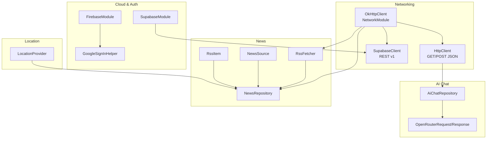
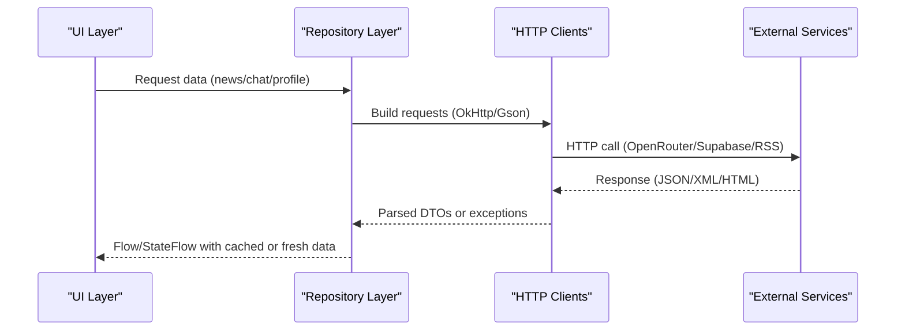
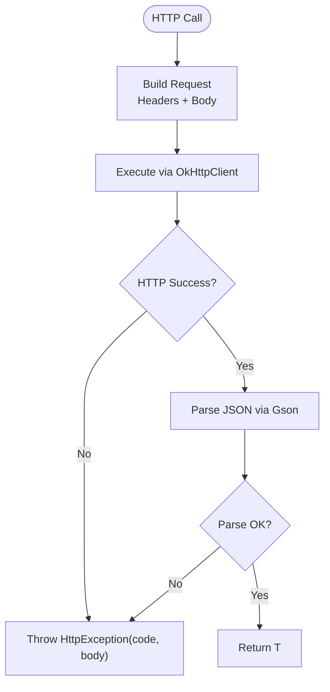
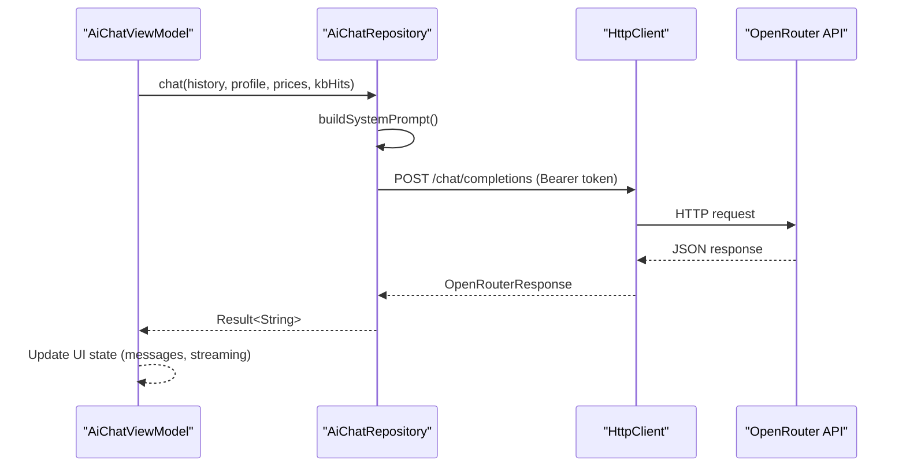
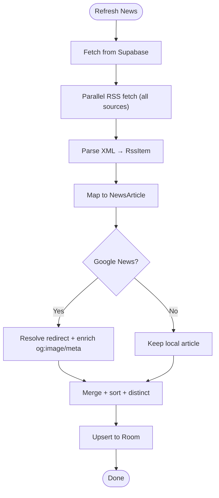
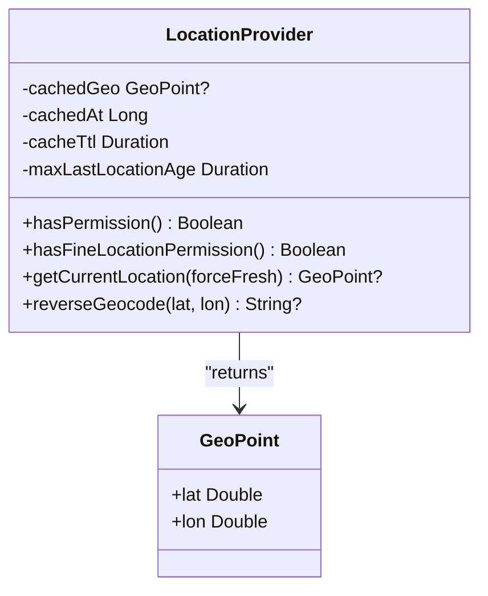
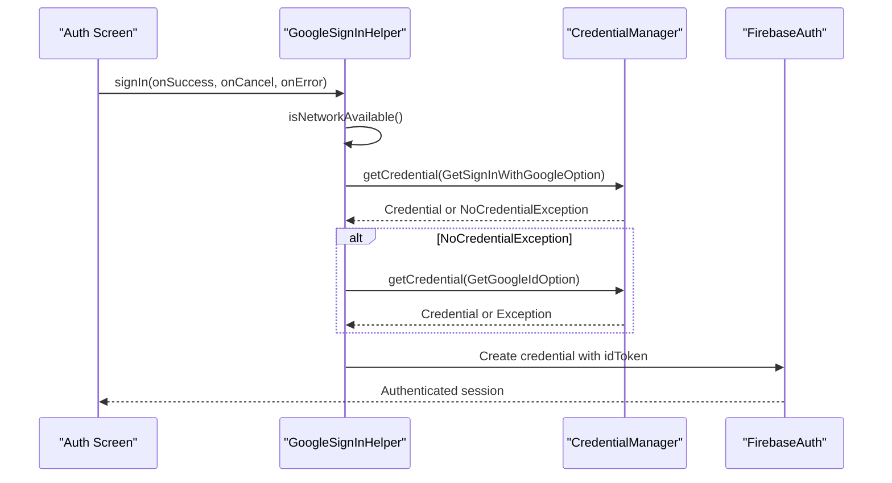
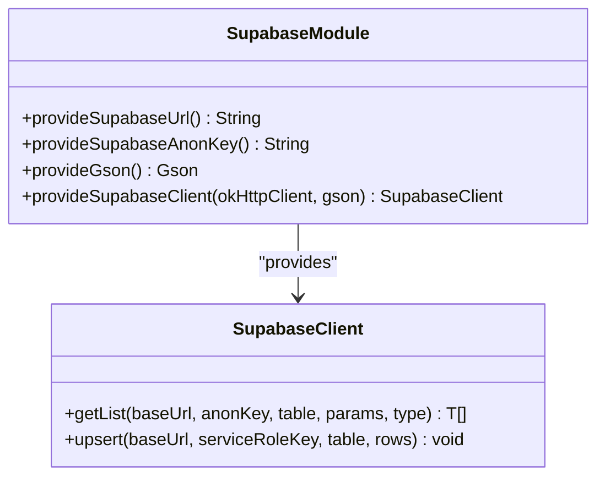
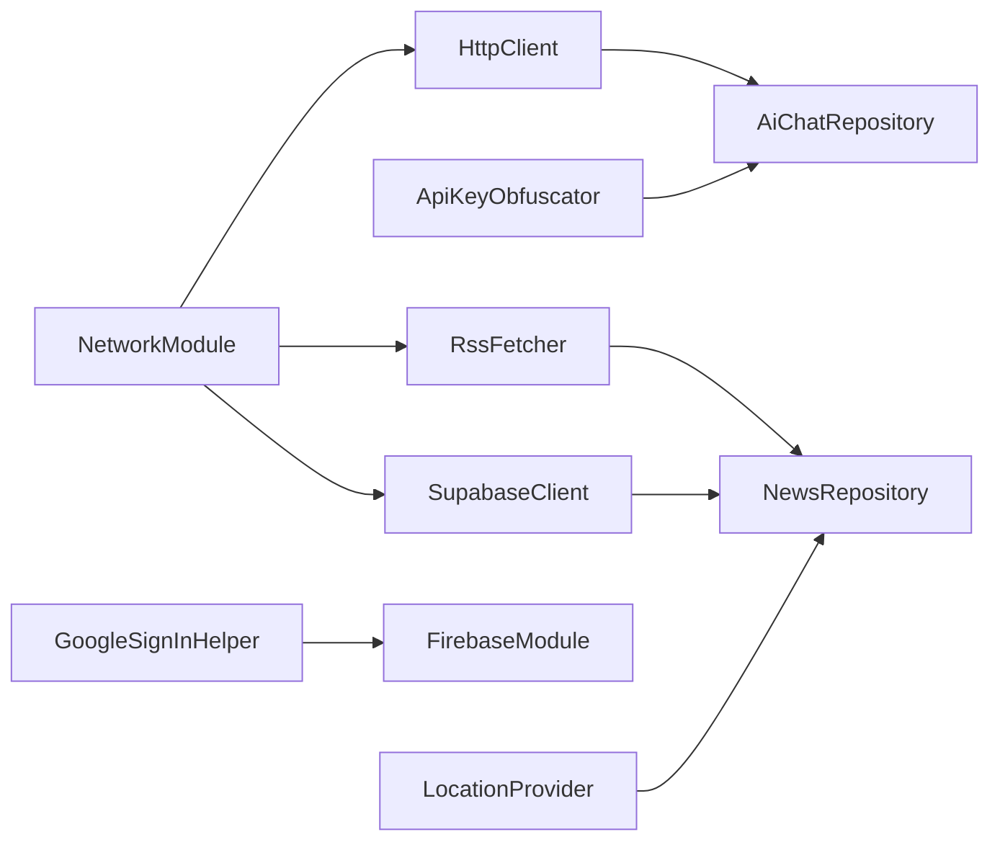

# API Integrations

<cite>
**Referenced Files in This Document**   
- [HttpClient.kt](file://app/src/main/java/com/giathinh/canlua/data/remote/HttpClient.kt)
- [NetworkModule.kt](file://app/src/main/java/com/giathinh/canlua/di/NetworkModule.kt)
- [OpenRouterApi.kt](file://app/src/main/java/com/giathinh/canlua/data/remote/ai/OpenRouterApi.kt)
- [AiChatRepository.kt](file://app/src/main/java/com/giathinh/canlua/repository/AiChatRepository.kt)
- [RssFetcher.kt](file://app/src/main/java/com/giathinh/canlua/data/remote/news/RssFetcher.kt)
- [NewsSource.kt](file://app/src/main/java/com/giathinh/canlua/data/remote/news/NewsSource.kt)
- [RssItem.kt](file://app/src/main/java/com/giathinh/canlua/data/remote/news/RssItem.kt)
- [NewsRepository.kt](file://app/src/main/java/com/giathinh/canlua/repository/NewsRepository.kt)
- [SupabaseClient.kt](file://app/src/main/java/com/giathinh/canlua/data/remote/SupabaseClient.kt)
- [SupabaseModule.kt](file://app/src/main/java/com/giathinh/canlua/di/SupabaseModule.kt)
- [FirebaseModule.kt](file://app/src/main/java/com/giathinh/canlua/di/FirebaseModule.kt)
- [GoogleSignInHelper.kt](file://app/src/main/java/com/giathinh/canlua/auth/GoogleSignInHelper.kt)
- [LocationProvider.kt](file://app/src/main/java/com/giathinh/canlua/data/location/LocationProvider.kt)
- [ApiKeyObfuscator.kt](file://app/src/main/java/com/giathinh/canlua/util/ApiKeyObfuscator.kt)
</cite>

## Table of Contents
1. [Introduction](#introduction)
2. [Project Structure](#project-structure)
3. [Core Components](#core-components)
4. [Architecture Overview](#architecture-overview)
5. [Detailed Component Analysis](#detailed-component-analysis)
6. [Dependency Analysis](#dependency-analysis)
7. [Performance Considerations](#performance-considerations)
8. [Troubleshooting Guide](#troubleshooting-guide)
9. [Conclusion](#conclusion)

## Introduction
This document describes the external service integrations used by Cân Lúa Mobile, focusing on HTTP networking, AI chat via OpenRouter, RSS news aggregation, Google Maps and Location services, Firebase Authentication, and Supabase as an alternative cloud backend. It explains configuration, request/response schemas, authentication, error handling, timeouts, retry policies, caching, offline fallbacks, security considerations, and performance optimization techniques.

The app follows Kotlin 2.3 / Jetpack Compose with MVVM + Clean Architecture, Room for local persistence, and WorkManager for background sync. The system is designed to remain fully functional without network access.

## Project Structure
External integrations are organized under:
- Networking layer: `data.remote` (OkHttp-based clients), `di.NetworkModule` (OkHttp configuration)
- AI integration: `data.remote.ai`, `repository.AiChatRepository`
- News aggregation: `data.remote.news`, `repository.NewsRepository`
- Cloud backends: `di.FirebaseModule`, `auth.GoogleSignInHelper`, `data.remote.SupabaseClient`, `di.SupabaseModule`
- Location services: `data.location.LocationProvider`
- Security utilities: `util.ApiKeyObfuscator`

**Diagram sources**
- [NetworkModule.kt:17-76](file://app/src/main/java/com/giathinh/canlua/di/NetworkModule.kt#L17-L76)
- [HttpClient.kt:12-90](file://app/src/main/java/com/giathinh/canlua/data/remote/HttpClient.kt#L12-L90)
- [SupabaseClient.kt:14-101](file://app/src/main/java/com/giathinh/canlua/data/remote/SupabaseClient.kt#L14-L101)
- [AiChatRepository.kt:27-169](file://app/src/main/java/com/giathinh/canlua/repository/AiChatRepository.kt#L27-L169)
- [OpenRouterApi.kt:1-26](file://app/src/main/java/com/giathinh/canlua/data/remote/ai/OpenRouterApi.kt#L1-L26)
- [RssFetcher.kt:18-63](file://app/src/main/java/com/giathinh/canlua/data/remote/news/RssFetcher.kt#L18-L63)
- [NewsRepository.kt:28-121](file://app/src/main/java/com/giathinh/canlua/repository/NewsRepository.kt#L28-L121)
- [NewsSource.kt:5-133](file://app/src/main/java/com/giathinh/canlua/data/remote/news/NewsSource.kt#L5-L133)
- [RssItem.kt:1-18](file://app/src/main/java/com/giathinh/canlua/data/remote/news/RssItem.kt#L1-L18)
- [FirebaseModule.kt:12-33](file://app/src/main/java/com/giathinh/canlua/di/FirebaseModule.kt#L12-L33)
- [GoogleSignInHelper.kt:23-100](file://app/src/main/java/com/giathinh/canlua/auth/GoogleSignInHelper.kt#L23-L100)
- [SupabaseModule.kt:14-40](file://app/src/main/java/com/giathinh/canlua/di/SupabaseModule.kt#L14-L40)
- [LocationProvider.kt:33-142](file://app/src/main/java/com/giathinh/canlua/data/location/LocationProvider.kt#L33-L142)

**Section sources**
- [NetworkModule.kt:17-76](file://app/src/main/java/com/giathinh/canlua/di/NetworkModule.kt#L17-L76)
- [HttpClient.kt:12-90](file://app/src/main/java/com/giathinh/canlua/data/remote/HttpClient.kt#L12-L90)
- [SupabaseClient.kt:14-101](file://app/src/main/java/com/giathinh/canlua/data/remote/SupabaseClient.kt#L14-L101)
- [AiChatRepository.kt:27-169](file://app/src/main/java/com/giathinh/canlua/repository/AiChatRepository.kt#L27-L169)
- [OpenRouterApi.kt:1-26](file://app/src/main/java/com/giathinh/canlua/data/remote/ai/OpenRouterApi.kt#L1-L26)
- [RssFetcher.kt:18-63](file://app/src/main/java/com/giathinh/canlua/data/remote/news/RssFetcher.kt#L18-L63)
- [NewsRepository.kt:28-121](file://app/src/main/java/com/giathinh/canlua/repository/NewsRepository.kt#L28-L121)
- [NewsSource.kt:5-133](file://app/src/main/java/com/giathinh/canlua/data/remote/news/NewsSource.kt#L5-L133)
- [RssItem.kt:1-18](file://app/src/main/java/com/giathinh/canlua/data/remote/news/RssItem.kt#L1-L18)
- [FirebaseModule.kt:12-33](file://app/src/main/java/com/giathinh/canlua/di/FirebaseModule.kt#L12-L33)
- [GoogleSignInHelper.kt:23-100](file://app/src/main/java/com/giathinh/canlua/auth/GoogleSignInHelper.kt#L23-L100)
- [SupabaseModule.kt:14-40](file://app/src/main/java/com/giathinh/canlua/di/SupabaseModule.kt#L14-L40)
- [LocationProvider.kt:33-142](file://app/src/main/java/com/giathinh/canlua/data/location/LocationProvider.kt#L33-L142)

## Core Components
- OkHttp client configuration: connection/read/call timeouts, redirect following, logging interceptor, and a retry interceptor that retries transient failures up to three times with exponential backoff; non-retryable client errors except timeout are passed through.
- Lightweight HTTP client: GET and POST JSON using Gson, with explicit redirect handling for Google Apps Script responses and robust JSON parsing error wrapping.
- OpenRouter AI chat repository: builds system prompts with user profile, rice prices, and knowledge base hits; calls OpenRouter with Bearer token; maps HTTP and IO errors to friendly Vietnamese messages; sanitizes output length and control characters.
- RSS news fetcher: parses RSS 2.0 and Atom feeds with XmlPullParser, supports media tags, content:encoded, summary, and safe text extraction; returns empty lists on parse/network errors.
- News repository: aggregates multiple RSS sources in parallel, enriches Google News items by resolving redirects and extracting og:image/meta description, caches results in Room, and optionally pulls from Supabase.
- Supabase client: reads/writes via REST v1 with apikey and Authorization headers; throws typed exceptions on HTTP errors; supports upsert with merge-duplicates.
- Firebase module: provides FirebaseAuth, FirebaseFirestore, FirebaseStorage singletons.
- Google Sign-In helper: modern Credential Manager flow with GetSignInWithGoogleOption and fallback to GetGoogleIdOption; checks network availability before sign-in; humanizes errors.
- Location provider: FusedLocationProviderClient wrapper with high-accuracy or balanced priority, 8-second timeout, last location fallback within 30 minutes, and reverse geocoding with Geocoder.

**Section sources**
- [NetworkModule.kt:17-76](file://app/src/main/java/com/giathinh/canlua/di/NetworkModule.kt#L17-L76)
- [HttpClient.kt:12-90](file://app/src/main/java/com/giathinh/canlua/data/remote/HttpClient.kt#L12-L90)
- [AiChatRepository.kt:27-169](file://app/src/main/java/com/giathinh/canlua/repository/AiChatRepository.kt#L27-L169)
- [RssFetcher.kt:18-63](file://app/src/main/java/com/giathinh/canlua/data/remote/news/RssFetcher.kt#L18-L63)
- [NewsRepository.kt:28-121](file://app/src/main/java/com/giathinh/canlua/repository/NewsRepository.kt#L28-L121)
- [SupabaseClient.kt:14-101](file://app/src/main/java/com/giathinh/canlua/data/remote/SupabaseClient.kt#L14-L101)
- [FirebaseModule.kt:12-33](file://app/src/main/java/com/giathinh/canlua/di/FirebaseModule.kt#L12-L33)
- [GoogleSignInHelper.kt:23-100](file://app/src/main/java/com/giathinh/canlua/auth/GoogleSignInHelper.kt#L23-L100)
- [LocationProvider.kt:33-142](file://app/src/main/java/com/giathinh/canlua/data/location/LocationProvider.kt#L33-L142)

## Architecture Overview
The application uses a layered architecture:
- UI layer (Compose screens and ViewModels) orchestrates user interactions and state.
- Repository layer coordinates data sources: Room (local), RSS feeds, OpenRouter AI, Supabase, and Firebase.
- Data layer provides lightweight HTTP clients over OkHttp and structured DTOs.
- DI modules configure shared infrastructure: OkHttpClient, Gson, Firebase services, Supabase credentials.

[No sources needed since this diagram shows conceptual workflow, not actual code structure]

## Detailed Component Analysis

### HTTP Client Setup (OkHttp + Retrofit-free)
- OkHttpClient is configured with:
  - connectTimeout: 10 seconds
  - readTimeout: 15 seconds
  - callTimeout: 90 seconds
  - followRedirects and followSslRedirects enabled
  - User-Agent header injection
  - Debug logging via HttpLoggingInterceptor
  - Retry interceptor: up to 3 attempts, exponential backoff, skipping non-retryable 4xx except 408
- HttpClient provides:
  - get(url, headers): generic JSON deserialization
  - postJson(url, body, headers): handles GAS 302 redirects by re-posting the original body
  - Throws HttpException on non-2xx or JSON parse errors

**Diagram sources**
- [HttpClient.kt:23-89](file://app/src/main/java/com/giathinh/canlua/data/remote/HttpClient.kt#L23-L89)
- [NetworkModule.kt:17-76](file://app/src/main/java/com/giathinh/canlua/di/NetworkModule.kt#L17-L76)

**Section sources**
- [NetworkModule.kt:17-76](file://app/src/main/java/com/giathinh/canlua/di/NetworkModule.kt#L17-L76)
- [HttpClient.kt:12-90](file://app/src/main/java/com/giathinh/canlua/data/remote/HttpClient.kt#L12-L90)

### OpenRouter AI Chat Integration
- Endpoint: https://openrouter.ai/api/v1/chat/completions
- Model: openrouter/free
- Authentication: Bearer token derived from Base64-obfuscated key at runtime
- Request schema:
  - model: string
  - messages: list of {role, content}
  - temperature: number (default 0.6)
  - max_tokens: number (default 1500)
- Response schema:
  - id: string?
  - model: string?
  - choices: list of {message: {role, content}, finish_reason: string?}
  - error: {message: string?, code: int?}
- Error handling:
  - Timeout: 30 seconds
  - HTTP codes mapped to friendly messages (e.g., 401/403 invalid key, 402 quota exceeded, 429 rate limited, 5xx server error)
  - IO exceptions mapped to network error message
  - Output sanitized to remove control characters and truncate to 8000 chars
- Rate limiting:
  - App-level throttling in ViewModel: max 10 messages per 60 seconds window, minimum 1 second between sends
  - Server-side rate limits handled via 429 mapping

**Diagram sources**
- [AiChatRepository.kt:52-169](file://app/src/main/java/com/giathinh/canlua/repository/AiChatRepository.kt#L52-L169)
- [OpenRouterApi.kt:1-26](file://app/src/main/java/com/giathinh/canlua/data/remote/ai/OpenRouterApi.kt#L1-L26)
- [ApiKeyObfuscator.kt:5-18](file://app/src/main/java/com/giathinh/canlua/util/ApiKeyObfuscator.kt#L5-L18)

**Section sources**
- [AiChatRepository.kt:27-169](file://app/src/main/java/com/giathinh/canlua/repository/AiChatRepository.kt#L27-L169)
- [OpenRouterApi.kt:1-26](file://app/src/main/java/com/giathinh/canlua/data/remote/ai/OpenRouterApi.kt#L1-L26)
- [ApiKeyObfuscator.kt:5-18](file://app/src/main/java/com/giathinh/canlua/util/ApiKeyObfuscator.kt#L5-L18)

### RSS News Aggregation
- Sources: Multiple Vietnamese news outlets and Google News queries defined in NewsSource enum
- Fetching: RssFetcher uses OkHttp + XmlPullParser to parse RSS 2.0 and Atom feeds
- Parsing features:
  - Title, link, description/summary/content:encoded
  - pubDate/published/updated with RFC-822 support
  - media:thumbnail, media:content, enclosure images
  - Safe text extraction ignoring nested HTML tags
- Enrichment:
  - Google News items: resolve redirects via HEAD (fallback GET), extract og:image and meta description from article page
  - Ensure HTTPS URLs for image loading
- Caching:
  - Articles persisted to Room via NewsArticleDao
  - Refresh strategy: parallel fetch across sources, limit to top 60 candidates, deduplicate by ID
  - Optional Supabase fetch first, then RSS sources
- Offline-first:
  - observe(topic) returns Flow<List<NewsArticle>> from Room
  - Staleness check based on newest cachedAt timestamp

**Diagram sources**
- [NewsRepository.kt:62-121](file://app/src/main/java/com/giathinh/canlua/repository/NewsRepository.kt#L62-L121)
- [RssFetcher.kt:36-84](file://app/src/main/java/com/giathinh/canlua/data/remote/news/RssFetcher.kt#L36-L84)
- [NewsSource.kt:21-133](file://app/src/main/java/com/giathinh/canlua/data/remote/news/NewsSource.kt#L21-L133)
- [RssItem.kt:7-18](file://app/src/main/java/com/giathinh/canlua/data/remote/news/RssItem.kt#L7-L18)

**Section sources**
- [RssFetcher.kt:18-226](file://app/src/main/java/com/giathinh/canlua/data/remote/news/RssFetcher.kt#L18-L226)
- [NewsSource.kt:5-177](file://app/src/main/java/com/giathinh/canlua/data/remote/news/NewsSource.kt#L5-L177)
- [RssItem.kt:1-18](file://app/src/main/java/com/giathinh/canlua/data/remote/news/RssItem.kt#L1-L18)
- [NewsRepository.kt:28-402](file://app/src/main/java/com/giathinh/canlua/repository/NewsRepository.kt#L28-L402)

### Google Maps and Location Services
- LocationProvider wraps FusedLocationProviderClient:
  - Permission checks for ACCESS_FINE_LOCATION and ACCESS_COARSE_LOCATION
  - Priority selection: HIGH_ACCURACY if fine permission granted, else BALANCED_POWER_ACCURACY
  - Timeout: 8 seconds for getCurrentLocation
  - Fallback: lastLocation if age ≤ 30 minutes
  - In-memory cache with TTL 6 hours for non-critical UI usage
  - Reverse geocoding via Geocoder with locale vi-VN and 5-second timeout
- Usage in supply mapping:
  - Rice map screens rely on accurate location for plotting card locations
  - Cache bypassed when forceFresh = true for critical operations

**Diagram sources**
- [LocationProvider.kt:31-142](file://app/src/main/java/com/giathinh/canlua/data/location/LocationProvider.kt#L31-L142)

**Section sources**
- [LocationProvider.kt:33-193](file://app/src/main/java/com/giathinh/canlua/data/location/LocationProvider.kt#L33-L193)

### Firebase Authentication Integration
- FirebaseModule provides FirebaseAuth, FirebaseFirestore, FirebaseStorage singletons
- GoogleSignInHelper implements modern Credential Manager flow:
  - Uses GetSignInWithGoogleOption for primary sign-in
  - Falls back to GetGoogleIdOption with filterByAuthorizedAccounts(false)
  - Checks network connectivity before initiating sign-in
  - Extracts GoogleAccount (idToken, email, displayName, phoneNumber, photoUri)
  - Humanizes errors (network, developer error, no account, failed)
- Session management:
  - IdToken passed to backend services (e.g., Firestore or custom auth)
  - ViewModel integrates with FirestoreRepository for analytics and quota tracking

**Diagram sources**
- [GoogleSignInHelper.kt:44-100](file://app/src/main/java/com/giathinh/canlua/auth/GoogleSignInHelper.kt#L44-L100)
- [FirebaseModule.kt:12-33](file://app/src/main/java/com/giathinh/canlua/di/FirebaseModule.kt#L12-L33)

**Section sources**
- [FirebaseModule.kt:12-33](file://app/src/main/java/com/giathinh/canlua/di/FirebaseModule.kt#L12-L33)
- [GoogleSignInHelper.kt:23-218](file://app/src/main/java/com/giathinh/canlua/auth/GoogleSignInHelper.kt#L23-L218)

### Supabase Client Configuration
- SupabaseModule provides:
  - supabaseUrl from BuildConfig.SUPABASE_URL
  - supabaseAnonKey from BuildConfig.SUPABASE_ANON_KEY
  - Gson singleton
  - SupabaseClient instance
- SupabaseClient methods:
  - getList(baseUrl, anonKey, table, params, type): returns List<T>, throws SupabaseException on HTTP error
  - upsert(baseUrl, serviceRoleKey, table, rows): merges duplicates via Prefer: resolution=merge-duplicates
- Headers:
  - apikey and Authorization: Bearer <key>
  - Accept: application/json
  - Content-Type: application/json

**Diagram sources**
- [SupabaseClient.kt:14-101](file://app/src/main/java/com/giathinh/canlua/data/remote/SupabaseClient.kt#L14-L101)
- [SupabaseModule.kt:14-40](file://app/src/main/java/com/giathinh/canlua/di/SupabaseModule.kt#L14-L40)

**Section sources**
- [SupabaseClient.kt:14-106](file://app/src/main/java/com/giathinh/canlua/data/remote/SupabaseClient.kt#L14-L106)
- [SupabaseModule.kt:14-41](file://app/src/main/java/com/giathinh/canlua/di/SupabaseModule.kt#L14-L41)

## Dependency Analysis
Key dependencies:
- NetworkModule depends on okhttp3.logging.HttpLoggingInterceptor and java.util.concurrent.TimeUnit
- HttpClient depends on okhttp3 and com.google.gson.Gson
- AiChatRepository depends on HttpClient, ApiKeyObfuscator, and FirebaseCrashlytics
- NewsRepository depends on RssFetcher, OkHttpClient, SupabaseClient, and Room DAOs
- GoogleSignInHelper depends on androidx.credentials and com.google.android.libraries.identity.googleid
- LocationProvider depends on com.google.android.gms.location and android.location.Geocoder

**Diagram sources**
- [NetworkModule.kt:17-76](file://app/src/main/java/com/giathinh/canlua/di/NetworkModule.kt#L17-L76)
- [HttpClient.kt:12-90](file://app/src/main/java/com/giathinh/canlua/data/remote/HttpClient.kt#L12-L90)
- [AiChatRepository.kt:27-169](file://app/src/main/java/com/giathinh/canlua/repository/AiChatRepository.kt#L27-L169)
- [NewsRepository.kt:28-121](file://app/src/main/java/com/giathinh/canlua/repository/NewsRepository.kt#L28-L121)
- [GoogleSignInHelper.kt:23-100](file://app/src/main/java/com/giathinh/canlua/auth/GoogleSignInHelper.kt#L23-L100)
- [LocationProvider.kt:33-142](file://app/src/main/java/com/giathinh/canlua/data/location/LocationProvider.kt#L33-L142)

**Section sources**
- [NetworkModule.kt:17-76](file://app/src/main/java/com/giathinh/canlua/di/NetworkModule.kt#L17-L76)
- [HttpClient.kt:12-90](file://app/src/main/java/com/giathinh/canlua/data/remote/HttpClient.kt#L12-L90)
- [AiChatRepository.kt:27-169](file://app/src/main/java/com/giathinh/canlua/repository/AiChatRepository.kt#L27-L169)
- [NewsRepository.kt:28-121](file://app/src/main/java/com/giathinh/canlua/repository/NewsRepository.kt#L28-L121)
- [GoogleSignInHelper.kt:23-100](file://app/src/main/java/com/giathinh/canlua/auth/GoogleSignInHelper.kt#L23-L100)
- [LocationProvider.kt:33-142](file://app/src/main/java/com/giathinh/canlua/data/location/LocationProvider.kt#L33-L142)

## Performance Considerations
- OkHttp connection pooling and timeouts:
  - connectTimeout: 10s, readTimeout: 15s, callTimeout: 90s
  - Redirect following enabled for both HTTP and SSL
- Retry policy:
  - Up to 3 attempts with exponential backoff
  - Skips non-retryable 4xx except 408
- AI chat:
  - 30-second timeout per request
  - Output truncation to 8000 characters to prevent UI OOM
  - Local season analysis cache keyed by summary hash
- News aggregation:
  - Parallel fetching across all RSS sources
  - Semaphore-limited enrichment for Google News (max 5 concurrent)
  - Deduplication by MD5 of resolved URL
  - Staleness check based on newest cachedAt timestamp
- Location services:
  - In-memory cache with 6-hour TTL for non-critical UI
  - Last location fallback within 30 minutes
  - Reverse geocoding timeout of 5 seconds

[No sources needed since this section provides general guidance]

## Troubleshooting Guide
Common issues and resolutions:
- AI chat fails with 401/403:
  - Verify OpenRouter API key is correctly obfuscated and decoded at runtime
  - Check ApiKeyObfuscator.decode returns non-empty string
- AI chat rate limited (429):
  - App-level throttle prevents bursts; wait for cooldown displayed in UI
  - Server-side rate limits require waiting before retry
- News fetch returns empty:
  - Check network connectivity and RSS feed availability
  - Validate XML parsing logs for specific source failures
- Google Sign-In fails:
  - Ensure network connectivity before sign-in attempt
  - Handle NoCredentialException and fallback to GetGoogleIdOption
  - Check developer configuration for web client ID
- Location unavailable:
  - Verify ACCESS_FINE_LOCATION or ACCESS_COARSE_LOCATION permissions
  - Check device GPS availability and network location settings
- Supabase errors:
  - Validate anonKey/serviceRoleKey and table names
  - Inspect SupabaseException code and errorBody for details

**Section sources**
- [AiChatRepository.kt:99-169](file://app/src/main/java/com/giathinh/canlua/repository/AiChatRepository.kt#L99-L169)
- [GoogleSignInHelper.kt:44-100](file://app/src/main/java/com/giathinh/canlua/auth/GoogleSignInHelper.kt#L44-L100)
- [RssFetcher.kt:36-63](file://app/src/main/java/com/giathinh/canlua/data/remote/news/RssFetcher.kt#L36-L63)
- [SupabaseClient.kt:57-101](file://app/src/main/java/com/giathinh/canlua/data/remote/SupabaseClient.kt#L57-L101)
- [LocationProvider.kt:55-142](file://app/src/main/java/com/giathinh/canlua/data/location/LocationProvider.kt#L55-L142)

## Conclusion
Cân Lúa Mobile’s external integrations are built around a robust OkHttp foundation with careful timeout, retry, and redirect handling. AI chat via OpenRouter is secured with runtime-decoded Bearer tokens and includes comprehensive error mapping and output sanitization. RSS news aggregation leverages parallel fetching, intelligent enrichment, and Room caching for offline-first operation. Firebase Authentication provides secure Google Sign-In with modern Credential Manager flows, while Supabase offers an alternative cloud backend for news and other data. Location services integrate seamlessly with FusedLocationProviderClient and Geocoder for accurate GPS functionality. Together, these components deliver a resilient, performant, and user-friendly experience even under poor network conditions.

[No sources needed since this section summarizes without analyzing specific files]