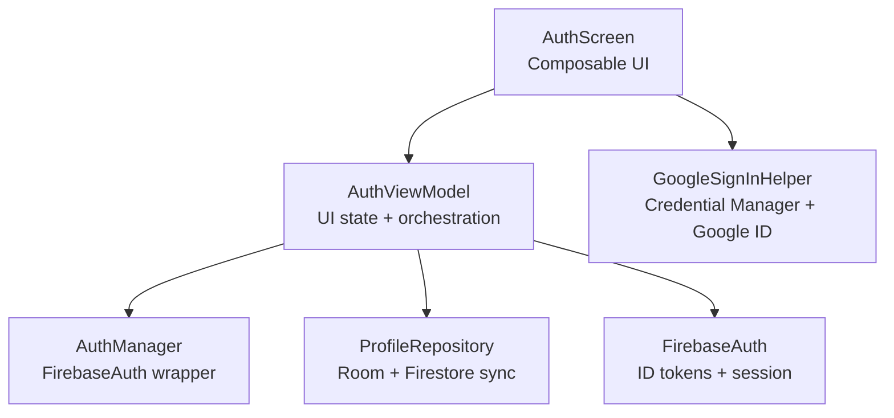
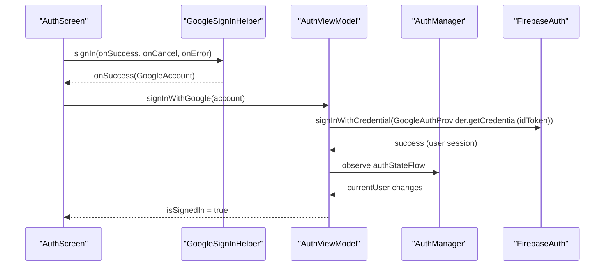
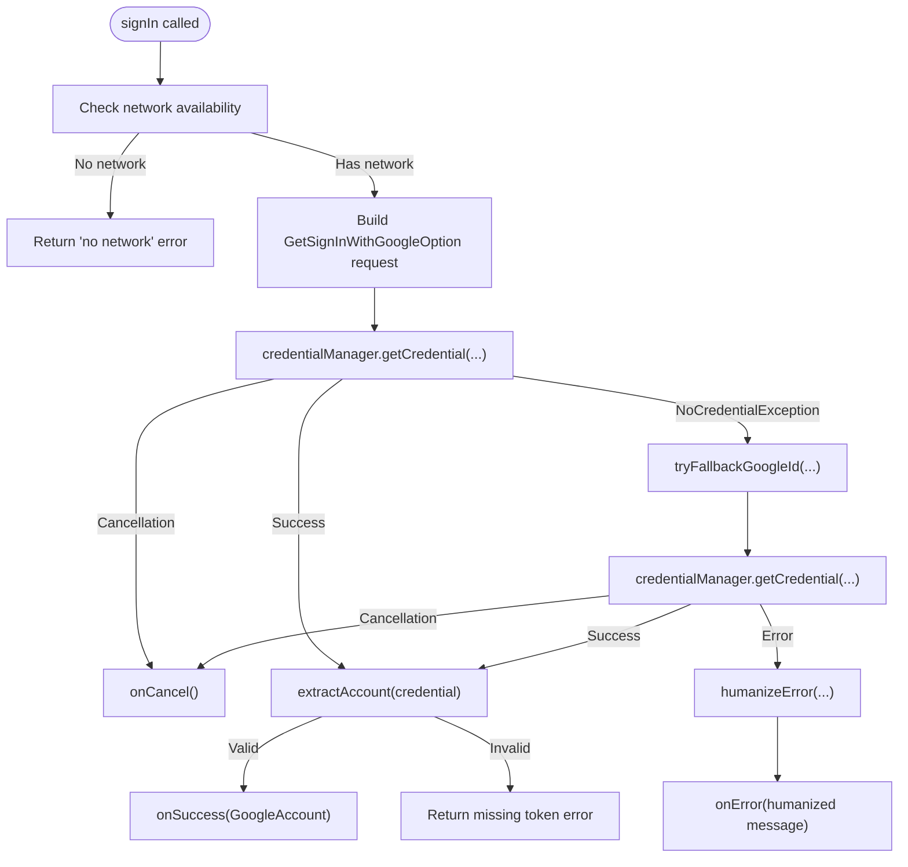
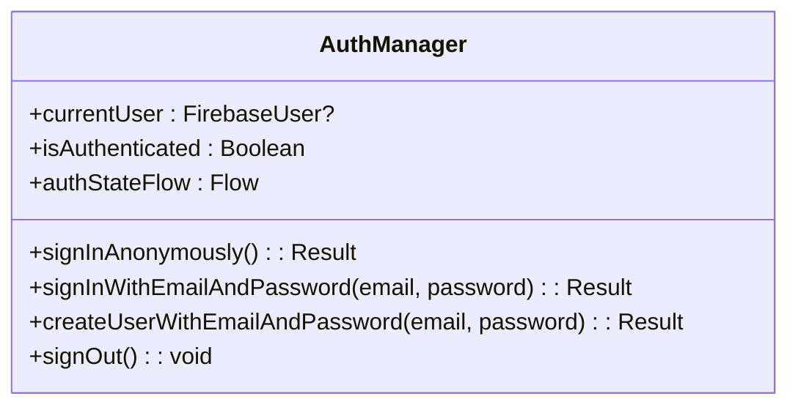
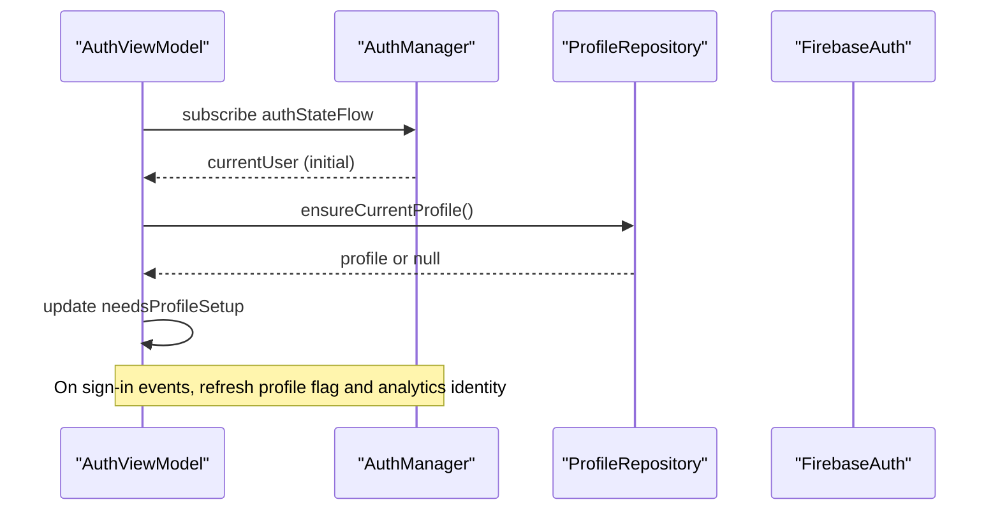
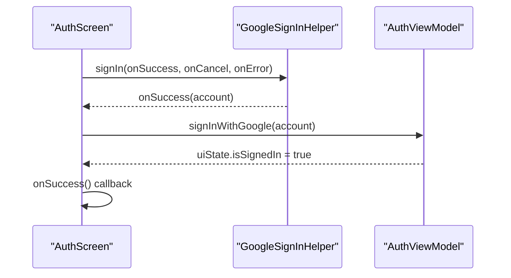
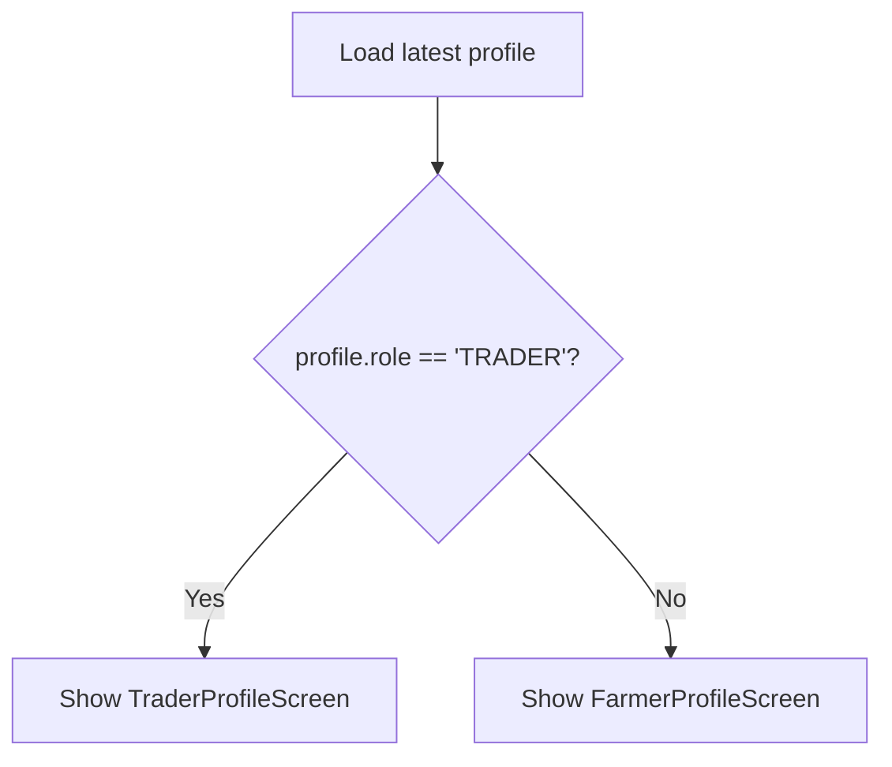
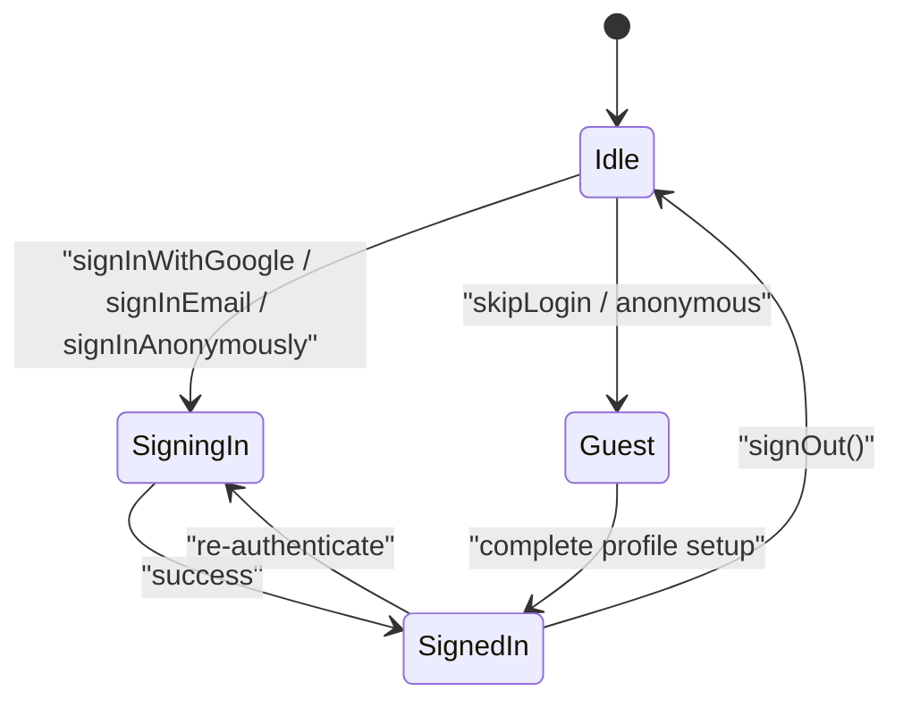
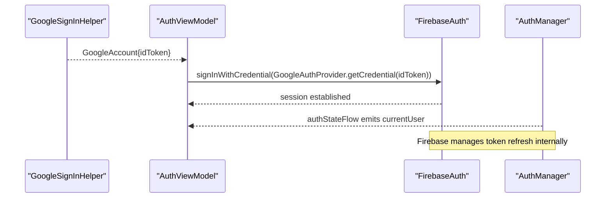

# Firebase Authentication

<cite>
**Referenced Files in This Document**   
- [GoogleSignInHelper.kt](file://app/src/main/java/com/giathinh/canlua/auth/GoogleSignInHelper.kt)
- [AuthManager.kt](file://app/src/main/java/com/giathinh/canlua/repository/AuthManager.kt)
- [AuthViewModel.kt](file://app/src/main/java/com/giathinh/canlua/ui/viewmodel/AuthViewModel.kt)
- [AuthScreen.kt](file://app/src/main/java/com/giathinh/canlua/ui/screen/AuthScreen.kt)
- [Profile.kt](file://app/src/main/java/com/giathinh/canlua/data/model/Profile.kt)
- [AppNavHost.kt](file://app/src/main/java/com/giathinh/canlua/ui/navigation/AppNavHost.kt)
</cite>

## Table of Contents
1. [Introduction](#introduction)
2. [Project Structure](#project-structure)
3. [Core Components](#core-components)
4. [Architecture Overview](#architecture-overview)
5. [Detailed Component Analysis](#detailed-component-analysis)
6. [Role-Based Access Control](#role-based-access-control)
7. [Session Persistence and Automatic Sign-In](#session-persistence-and-automatic-sign-in)
8. [Token Management and Refresh](#token-management-and-refresh)
9. [Security Considerations](#security-considerations)
10. [Error Handling and Troubleshooting](#error-handling-and-troubleshooting)
11. [Performance Considerations](#performance-considerations)
12. [Conclusion](#conclusion)

## Introduction
This document explains the Firebase Authentication integration for Google Sign-In, focusing on:
- The `GoogleSignInHelper` class that handles modern Google credential selection, token extraction, and user profile data.
- The `AuthManager` repository pattern that centralizes authentication state and operations.
- The `AuthViewModel` that coordinates UI state, Google sign-in, email/password flows, anonymous sign-in, and logout.
- Role-based access control for FARMER, TRADER, and GUEST roles.
- Session persistence, automatic sign-in, logout behavior, token refresh, security considerations, and error handling.

The app follows Kotlin 2.3 / Jetpack Compose with MVVM and unidirectional data flow using StateFlow and coroutines. Local persistence uses AndroidX Room; cloud sync is bidirectional to Firebase Firestore and Supabase via WorkManager.

## Project Structure
The authentication-related code spans four layers:
- **UI layer**: `AuthScreen` composable renders login options and triggers actions.
- **ViewModel layer**: `AuthViewModel` exposes `AuthUiState`, orchestrates auth flows, and updates analytics.
- **Repository layer**: `AuthManager` wraps `FirebaseAuth` and emits a single source-of-truth auth state flow.
- **Auth helper layer**: `GoogleSignInHelper` encapsulates Google Identity Credential Manager logic.

**Diagram sources**
- [AuthScreen.kt:114-335](file://app/src/main/java/com/giathinh/canlua/ui/screen/AuthScreen.kt#L114-L335)
- [AuthViewModel.kt:39-94](file://app/src/main/java/com/giathinh/canlua/ui/viewmodel/AuthViewModel.kt#L39-L94)
- [AuthManager.kt:12-35](file://app/src/main/java/com/giathinh/canlua/repository/AuthManager.kt#L12-L35)
- [GoogleSignInHelper.kt:39-100](file://app/src/main/java/com/giathinh/canlua/auth/GoogleSignInHelper.kt#L39-L100)

**Section sources**
- [AuthScreen.kt:114-335](file://app/src/main/java/com/giathinh/canlua/ui/screen/AuthScreen.kt#L114-L335)
- [AuthViewModel.kt:39-94](file://app/src/main/java/com/giathinh/canlua/ui/viewmodel/AuthViewModel.kt#L39-L94)
- [AuthManager.kt:12-35](file://app/src/main/java/com/giathinh/canlua/repository/AuthManager.kt#L12-L35)
- [GoogleSignInHelper.kt:39-100](file://app/src/main/java/com/giathinh/canlua/auth/GoogleSignInHelper.kt#L39-L100)

## Core Components
- `GoogleSignInHelper`: Uses AndroidX Credential Manager and Google Identity APIs to obtain a Google ID token, extract account details, and handle network checks and fallbacks.
- `AuthManager`: A singleton repository exposing `currentUser`, `isAuthenticated`, `authStateFlow`, and methods for anonymous/email/password sign-in and sign-out.
- `AuthViewModel`: Manages `AuthUiState`, subscribes to `AuthManager.authStateFlow`, performs Google sign-in by exchanging the ID token for a Firebase credential, pre-fills local profile data, and handles OTP/email/password flows.
- `AuthScreen`: Renders email/password fields, Google Sign-In button, skip-to-anonymous option, and navigates on successful sign-in.

Key responsibilities:
- Token acquisition and parsing: `GoogleSignInHelper`.
- Firebase credential exchange and session management: `AuthViewModel` + `AuthManager`.
- UI state and navigation decisions: `AuthViewModel` + `AuthScreen`.

**Section sources**
- [GoogleSignInHelper.kt:23-100](file://app/src/main/java/com/giathinh/canlua/auth/GoogleSignInHelper.kt#L23-L100)
- [AuthManager.kt:12-72](file://app/src/main/java/com/giathinh/canlua/repository/AuthManager.kt#L12-L72)
- [AuthViewModel.kt:25-94](file://app/src/main/java/com/giathinh/canlua/ui/viewmodel/AuthViewModel.kt#L25-L94)
- [AuthScreen.kt:114-335](file://app/src/main/java/com/giathinh/canlua/ui/screen/AuthScreen.kt#L114-L335)

## Architecture Overview
The authentication architecture follows MVVM with a clear separation:
- UI calls ViewModel functions.
- ViewModel delegates to repository (`AuthManager`) and Firebase SDK.
- Google Sign-In is handled by a dedicated helper that returns an ID token and profile fields.
- Auth state is centralized via `AuthManager.authStateFlow`, ensuring consistent state across multiple ViewModel instances created by navigation.

**Diagram sources**
- [AuthScreen.kt:263-276](file://app/src/main/java/com/giathinh/canlua/ui/screen/AuthScreen.kt#L263-L276)
- [GoogleSignInHelper.kt:44-100](file://app/src/main/java/com/giathinh/canlua/auth/GoogleSignInHelper.kt#L44-L100)
- [AuthViewModel.kt:199-229](file://app/src/main/java/com/giathinh/canlua/ui/viewmodel/AuthViewModel.kt#L199-L229)
- [AuthManager.kt:27-35](file://app/src/main/java/com/giathinh/canlua/repository/AuthManager.kt#L27-L35)

## Detailed Component Analysis

### GoogleSignInHelper
Responsibilities:
- Check network availability before invoking credential picker.
- Prefer `GetSignInWithGoogleOption`; fall back to `GetGoogleIdOption` if no credential is available.
- Extract `GoogleIdTokenCredential` into a `GoogleAccount` data object containing idToken, email, displayName, phoneNumber, and photoUri.
- Humanize errors based on exception messages and network status.

**Diagram sources**
- [GoogleSignInHelper.kt:44-100](file://app/src/main/java/com/giathinh/canlua/auth/GoogleSignInHelper.kt#L44-L100)
- [GoogleSignInHelper.kt:102-145](file://app/src/main/java/com/giathinh/canlua/auth/GoogleSignInHelper.kt#L102-L145)
- [GoogleSignInHelper.kt:147-174](file://app/src/main/java/com/giathinh/canlua/auth/GoogleSignInHelper.kt#L147-L174)

Implementation notes:
- Network check avoids misleading errors when offline.
- Fallback path allows selecting accounts even when auto-select fails.
- Error mapping distinguishes developer configuration errors from generic failures.

**Section sources**
- [GoogleSignInHelper.kt:23-100](file://app/src/main/java/com/giathinh/canlua/auth/GoogleSignInHelper.kt#L23-L100)
- [GoogleSignInHelper.kt:102-174](file://app/src/main/java/com/giathinh/canlua/auth/GoogleSignInHelper.kt#L102-L174)

### AuthManager Repository Pattern
Responsibilities:
- Provide current user and authenticated state.
- Emit a cold Flow of auth state changes, acting as the single source of truth.
- Wrap Firebase operations with Result types for safe error propagation.
- Support anonymous sign-in, email/password sign-in, registration, and sign-out.

**Diagram sources**
- [AuthManager.kt:12-72](file://app/src/main/java/com/giathinh/canlua/repository/AuthManager.kt#L12-L72)

Behavior highlights:
- `authStateFlow` immediately emits the current user and listens for subsequent changes, including token refresh events.
- All mutating operations return `Result`, enabling ViewModel to map exceptions to user-friendly messages.

**Section sources**
- [AuthManager.kt:12-72](file://app/src/main/java/com/giathinh/canlua/repository/AuthManager.kt#L12-L72)

### AuthViewModel Orchestration
Responsibilities:
- Maintain `AuthUiState` with signed-in flag, loading, error/info messages, user label, verification ID, and profile setup requirement.
- Subscribe to `AuthManager.authStateFlow` to keep all ViewModel instances synchronized.
- Handle Google sign-in by converting the ID token to a Firebase credential and signing in.
- Pre-fill local profile data on first-time Google sign-in.
- Manage email/password registration/sign-in, anonymous sign-in, OTP flows, and logout.

**Diagram sources**
- [AuthViewModel.kt:54-94](file://app/src/main/java/com/giathinh/canlua/ui/viewmodel/AuthViewModel.kt#L54-L94)

Google sign-in flow:
- ViewModel receives `GoogleAccount` from `GoogleSignInHelper`.
- Converts ID token to Firebase credential and signs in.
- If local profile name is blank, pre-fills profile with Google display name, phone, and default role FARMER.
- Updates UI state and refreshes profile setup flag.

Logout flow:
- Calls `AuthManager.signOut()`.
- Resets UI state to not signed-in and clears analytics user identity.

**Section sources**
- [AuthViewModel.kt:39-94](file://app/src/main/java/com/giathinh/canlua/ui/viewmodel/AuthViewModel.kt#L39-L94)
- [AuthViewModel.kt:199-229](file://app/src/main/java/com/giathinh/canlua/ui/viewmodel/AuthViewModel.kt#L199-L229)
- [AuthViewModel.kt:302-310](file://app/src/main/java/com/giathinh/canlua/ui/viewmodel/AuthViewModel.kt#L302-L310)

### AuthScreen Integration
Responsibilities:
- Render email/password input, toggle between register/login, show OTP field for phone mode.
- Trigger Google Sign-In via `GoogleSignInHelper` and pass result to `AuthViewModel.signInWithGoogle`.
- Show snackbar messages for errors and info.
- Navigate on successful sign-in.

**Diagram sources**
- [AuthScreen.kt:263-276](file://app/src/main/java/com/giathinh/canlua/ui/screen/AuthScreen.kt#L263-L276)
- [AuthScreen.kt:129-137](file://app/src/main/java/com/giathinh/canlua/ui/screen/AuthScreen.kt#L129-L137)

**Section sources**
- [AuthScreen.kt:114-335](file://app/src/main/java/com/giathinh/canlua/ui/screen/AuthScreen.kt#L114-L335)

## Role-Based Access Control
Roles:
- FARMER: Default role for new users and most features.
- TRADER: Specialized profile and transaction screens.
- GUEST: Implicit guest state when anonymous or unauthenticated; some screens may be accessible without full profile.

Profile model:
- The `Profile` entity stores `uid`, `name`, `phone`, `region`, `note`, `role`, `cccd`, `username`, `email`, plus admin/system grant metadata.
- Default role is FARMER.

Navigation gating:
- `RoleAwareProfileWrapper` selects between `TraderProfileScreen` and `FarmerProfileScreen` based on `profile.role == "TRADER"`.
- Other screens read `profile.role` to render role-specific UI.

**Diagram sources**
- [Profile.kt:13-26](file://app/src/main/java/com/giathinh/canlua/data/model/Profile.kt#L13-L26)
- [AppNavHost.kt:139-150](file://app/src/main/java/com/giathinh/canlua/ui/navigation/AppNavHost.kt#L139-L150)

Access rules:
- New Google sign-ins default to FARMER unless explicitly changed later.
- TRADER access is typically granted by admin or system processes; the profile model includes fields for tracking who granted the role and when.
- GUEST behavior is implicit through anonymous sign-in or lack of profile; UI should gate sensitive routes accordingly.

**Section sources**
- [Profile.kt:13-26](file://app/src/main/java/com/giathinh/canlua/data/model/Profile.kt#L13-L26)
- [AppNavHost.kt:139-150](file://app/src/main/java/com/giathinh/canlua/ui/navigation/AppNavHost.kt#L139-L150)
- [AuthViewModel.kt:199-229](file://app/src/main/java/com/giathinh/canlua/ui/viewmodel/AuthViewModel.kt#L199-L229)

## Session Persistence and Automatic Sign-In
Automatic sign-in:
- `AuthManager.authStateFlow` emits the current user immediately upon subscription, allowing the app to detect an existing session at startup.
- `AuthViewModel` subscribes to this flow and updates `isSignedIn`, then refreshes profile setup state.
- If a user is already signed in, the app can navigate directly to main screens after verifying profile setup.

Sign-out:
- `AuthViewModel.signOut()` calls `AuthManager.signOut()`, which clears the Firebase session.
- UI state resets to not signed-in, and analytics user identity is cleared.

**Diagram sources**
- [AuthManager.kt:27-35](file://app/src/main/java/com/giathinh/canlua/repository/AuthManager.kt#L27-L35)
- [AuthViewModel.kt:54-94](file://app/src/main/java/com/giathinh/canlua/ui/viewmodel/AuthViewModel.kt#L54-L94)
- [AuthViewModel.kt:302-310](file://app/src/main/java/com/giathinh/canlua/ui/viewmodel/AuthViewModel.kt#L302-L310)

**Section sources**
- [AuthManager.kt:27-35](file://app/src/main/java/com/giathinh/canlua/repository/AuthManager.kt#L27-L35)
- [AuthViewModel.kt:54-94](file://app/src/main/java/com/giathinh/canlua/ui/viewmodel/AuthViewModel.kt#L54-L94)
- [AuthViewModel.kt:302-310](file://app/src/main/java/com/giathinh/canlua/ui/viewmodel/AuthViewModel.kt#L302-L310)

## Token Management and Refresh
Token lifecycle:
- `GoogleSignInHelper` obtains a Google ID token via Credential Manager.
- `AuthViewModel` converts the ID token to a Firebase credential and signs in with `FirebaseAuth`.
- `AuthManager.authStateFlow` observes Firebase auth state changes, which include token refresh events managed by Firebase.

Refresh mechanism:
- Firebase automatically refreshes short-lived tokens behind the scenes; the app does not manually refresh tokens.
- Observing `authStateFlow` ensures the UI reacts to any session changes, including re-authentication after token refresh.

**Diagram sources**
- [GoogleSignInHelper.kt:147-161](file://app/src/main/java/com/giathinh/canlua/auth/GoogleSignInHelper.kt#L147-L161)
- [AuthViewModel.kt:199-229](file://app/src/main/java/com/giathinh/canlua/ui/viewmodel/AuthViewModel.kt#L199-L229)
- [AuthManager.kt:27-35](file://app/src/main/java/com/giathinh/canlua/repository/AuthManager.kt#L27-L35)

**Section sources**
- [GoogleSignInHelper.kt:147-161](file://app/src/main/java/com/giathinh/canlua/auth/GoogleSignInHelper.kt#L147-L161)
- [AuthViewModel.kt:199-229](file://app/src/main/java/com/giathinh/canlua/ui/viewmodel/AuthViewModel.kt#L199-L229)
- [AuthManager.kt:27-35](file://app/src/main/java/com/giathinh/canlua/repository/AuthManager.kt#L27-L35)

## Security Considerations
- Use Credential Manager and Google Identity APIs instead of legacy Google Sign-In to reduce friction and improve security posture.
- Validate network connectivity before initiating sign-in to avoid misleading errors.
- Do not store long-lived tokens in app storage; rely on Firebase session management.
- Avoid logging sensitive tokens or PII; log only non-sensitive identifiers like uid and role for analytics.
- Enforce role checks at both UI and repository levels to prevent unauthorized access.
- Use HTTPS and secure Firebase configuration; ensure web client IDs are correctly configured.

[No sources needed since this section provides general guidance]

## Error Handling and Troubleshooting
Common issues and handling:
- No network: `GoogleSignInHelper` detects offline state and returns a localized "no network" error.
- Missing ID token: When credential extraction fails, a specific error is returned.
- Developer configuration errors: Mapped to a developer error message when detected.
- Firebase sign-in failures: ViewModel maps Firebase exceptions to user-friendly messages for email/password and Google flows.
- Anonymous sign-in failures: ViewModel sets error state with exception message.

Troubleshooting steps:
- Verify internet connectivity before attempting Google Sign-In.
- Check Firebase project configuration and web client ID.
- Inspect Snackbar messages shown by `AuthScreen` for detailed error context.
- Confirm that `AuthManager.authStateFlow` emits expected values during debugging.

**Section sources**
- [GoogleSignInHelper.kt:44-100](file://app/src/main/java/com/giathinh/canlua/auth/GoogleSignInHelper.kt#L44-L100)
- [GoogleSignInHelper.kt:163-174](file://app/src/main/java/com/giathinh/canlua/auth/GoogleSignInHelper.kt#L163-L174)
- [AuthViewModel.kt:109-131](file://app/src/main/java/com/giathinh/canlua/ui/viewmodel/AuthViewModel.kt#L109-L131)
- [AuthViewModel.kt:133-175](file://app/src/main/java/com/giathinh/canlua/ui/viewmodel/AuthViewModel.kt#L133-L175)
- [AuthViewModel.kt:177-193](file://app/src/main/java/com/giathinh/canlua/ui/viewmodel/AuthViewModel.kt#L177-L193)

## Performance Considerations
- `AuthManager.authStateFlow` is a cold flow that emits immediately and removes listeners on close, minimizing memory leaks.
- ViewModel subscribes once and updates UI state efficiently via StateFlow.
- Network checks in `GoogleSignInHelper` avoid unnecessary API calls when offline.
- Profile setup checks are performed asynchronously to avoid blocking UI.

[No sources needed since this section provides general guidance]

## Conclusion
The Firebase Authentication integration combines a modern Google Sign-In helper, a centralized auth repository, and a robust ViewModel that synchronizes UI state with Firebase sessions. Roles FARMER, TRADER, and GUEST are enforced through profile data and navigation wrappers. Session persistence and automatic sign-in are handled via Firebase’s built-in session management and `AuthManager.authStateFlow`. Token refresh is delegated to Firebase, while error handling and network checks provide a resilient user experience. For production, ensure proper Firebase configuration, enforce role checks consistently, and monitor analytics with anonymized identifiers where appropriate.

[No sources needed since this section summarizes without analyzing specific files]