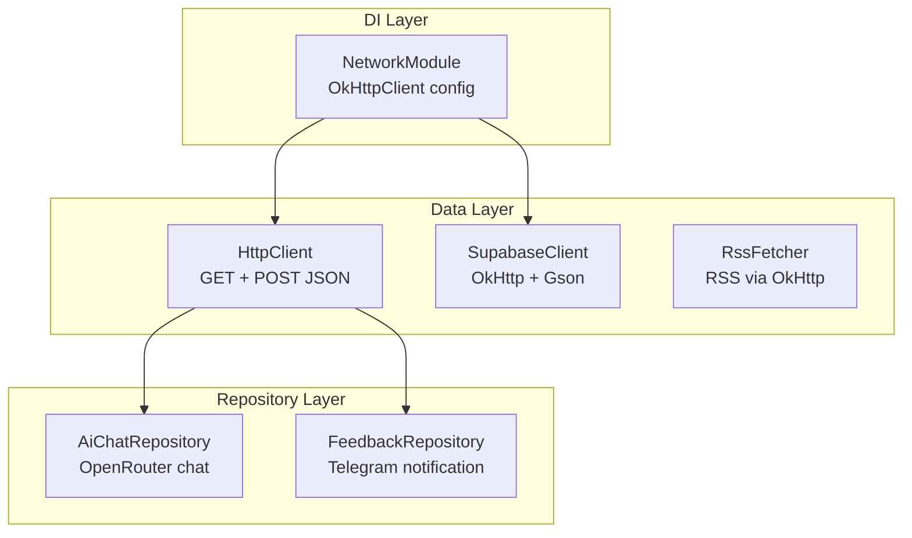
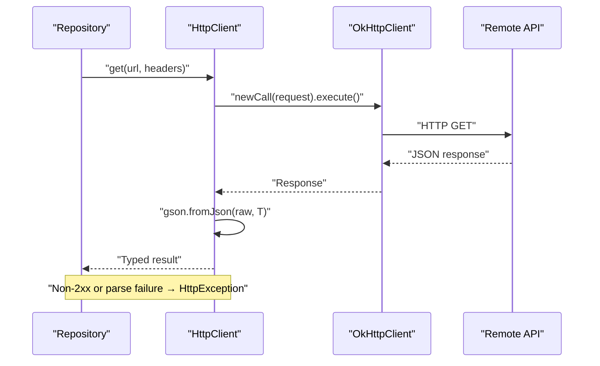
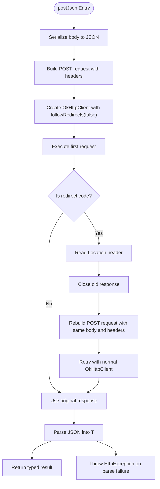
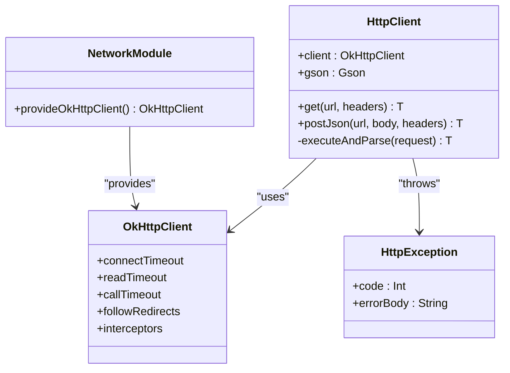
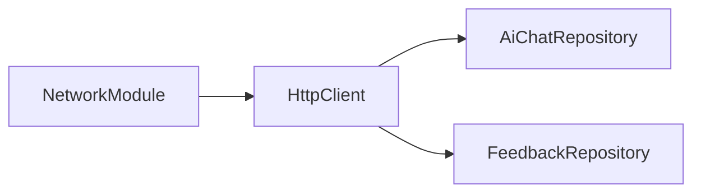

# HTTP Client Setup

<cite>
**Referenced Files in This Document**
- [HttpClient.kt](file://app/src/main/java/com/giathinh/canlua/data/remote/HttpClient.kt)
- [NetworkModule.kt](file://app/src/main/java/com/di/NetworkModule.kt)
- [AiChatRepository.kt](file://app/src/main/java/com/repository/AiChatRepository.kt)
- [FeedbackRepository.kt](file://app/src/main/java/com/repository/FeedbackRepository.kt)
</cite>

## Table of Contents
1. [Introduction](#introduction)
2. [Project Structure](#project-structure)
3. [Core Components](#core-components)
4. [Architecture Overview](#architecture-overview)
5. [Detailed Component Analysis](#detailed-component-analysis)
6. [Dependency Analysis](#dependency-analysis)
7. [Performance Considerations](#performance-considerations)
8. [Troubleshooting Guide](#troubleshooting-guide)
9. [Conclusion](#conclusion)

## Introduction
This document explains the lightweight HTTP client implementation used by the app. It is built on OkHttp and Gson, deliberately avoiding Retrofit to keep the Android bundle small. The core component is a singleton `HttpClient` that provides:

- A generic GET method returning typed JSON responses.
- A POST method for sending JSON payloads with custom headers.
- Special redirect handling for Google Apps Script compatibility.
- Consistent error handling through `HttpException`.
- Integration with a shared OkHttp instance configured for timeouts, redirects, logging, and retry behavior.

The design fits into an offline-first MVVM architecture where repositories call `HttpClient`, convert network errors into user-friendly messages, and expose stable data flows to ViewModels.

## Project Structure
The HTTP layer lives under `data.remote`, while dependency injection and configuration live under `di`. Repositories under `repository` consume `HttpClient` for remote calls.

**Diagram sources**
- [HttpClient.kt:16-90](file://app/src/main/java/com/giathinh/canlua/data/remote/HttpClient.kt#L16-L90)
- [NetworkModule.kt:17-76](file://app/src/main/java/com/di/NetworkModule.kt#L17-L76)
- [AiChatRepository.kt:36-39](file://app/src/main/java/com/repository/AiChatRepository.kt#L36-L39)
- [FeedbackRepository.kt:26-31](file://app/src/main/java/com/repository/FeedbackRepository.kt#L26-L31)

**Section sources**
- [HttpClient.kt:1-94](file://app/src/main/java/com/giathinh/canlua/data/remote/HttpClient.kt#L1-L94)
- [NetworkModule.kt:1-78](file://app/src/main/java/com/di/NetworkModule.kt#L1-L78)

## Core Components
- `HttpClient`: Singleton HTTP client using OkHttp and Gson. Provides `get()` and `postJson()`, plus internal `executeAndParse()`.
- `HttpException`: Runtime exception carrying HTTP status code and truncated error body.
- `NetworkModule`: Dagger Hilt module providing a shared `OkHttpClient` with timeouts, User-Agent header, debug logging, and retry logic.
- Consumers:
  - `AiChatRepository`: Uses `HttpClient.postJson()` to call OpenRouter with authentication headers.
  - `FeedbackRepository`: Uses `HttpClient.postJson()` to send Telegram notifications.

Key responsibilities:
- Avoid Retrofit to reduce bundle size.
- Serialize Kotlin objects to JSON using Gson.
- Parse JSON responses into strongly typed classes.
- Handle non-2xx responses as `HttpException`.
- Preserve POST bodies across redirects required by Google Apps Script.

**Section sources**
- [HttpClient.kt:12-94](file://app/src/main/java/com/giathinh/canlua/data/remote/HttpClient.kt#L12-L94)
- [NetworkModule.kt:17-76](file://app/src/main/java/com/di/NetworkModule.kt#L17-L76)
- [AiChatRepository.kt:99-168](file://app/src/main/java/com/repository/AiChatRepository.kt#L99-L168)
- [FeedbackRepository.kt:147-178](file://app/src/main/java/com/repository/FeedbackRepository.kt#L147-L178)

## Architecture Overview
The HTTP request flow starts at a repository, goes through `HttpClient`, uses the shared OkHttp instance from DI, and returns typed JSON or throws `HttpException`.

**Diagram sources**
- [HttpClient.kt:23-29](file://app/src/main/java/com/giathinh/canlua/data/remote/HttpClient.kt#L23-L29)
- [HttpClient.kt:76-89](file://app/src/main/java/com/giathinh/canlua/data/remote/HttpClient.kt#L76-L89)

## Detailed Component Analysis

### HttpClient Design
`HttpClient` is annotated as a singleton and injected with a shared `OkHttpClient`. It also holds a Gson instance for serialization and deserialization.

Public API:
- `get<T>(url, headers)`: Builds a GET request, applies headers, executes via OkHttp, parses JSON into type `T`, and throws `HttpException` on failure.
- `postJson<T>(url, body, headers)`: Serializes `body` to JSON, sends it as `application/json`, handles GAS-style redirects without losing the POST body, parses JSON into type `T`, and throws `HttpException` on failure.

Internal API:
- `executeAndParse<T>(request)`: Shared execution path for GET requests and direct parsing.

Error handling:
- Non-successful HTTP responses throw `HttpException(code, truncatedBody)`.
- JSON parsing failures wrap the original Gson exception message inside `HttpException`.

Redirect handling:
- For `postJson`, a temporary OkHttp client disables automatic redirects so the first response can be inspected.
- If the server responds with redirect codes (301, 302, 303, 307, 308), the code reads the `Location` header and retries the same POST with the original JSON body.
- This is critical for Google Apps Script endpoints that return 302 redirects to a CDN; converting to GET would drop the payload and break the server-side handler.

**Diagram sources**
- [HttpClient.kt:31-74](file://app/src/main/java/com/giathinh/canlua/data/remote/HttpClient.kt#L31-L74)

**Section sources**
- [HttpClient.kt:16-90](file://app/src/main/java/com/giathinh/canlua/data/remote/HttpClient.kt#L16-L90)

### HttpException
`HttpException` extends `RuntimeException` and exposes:
- `code`: HTTP status code.
- `errorBody`: Truncated error response text.

It is thrown whenever:
- The HTTP response is not successful.
- JSON parsing fails.

This allows repositories to catch `HttpException`, inspect the status code, and map it to user-friendly messages.

**Section sources**
- [HttpClient.kt:92-94](file://app/src/main/java/com/giathinh/canlua/data/remote/HttpClient.kt#L92-L94)
- [AiChatRepository.kt:147-156](file://app/src/main/java/com/repository/AiChatRepository.kt#L147-L156)

### Usage Examples

#### Making a GET Request
A repository can call `httpClient.get<T>()` with a URL and optional headers. The method returns a typed object or throws `HttpException`.

Example pattern:
- Call `httpClient.get("https://api.example.com/data", headers)`
- Catch `HttpException` to handle network or parsing errors.

**Section sources**
- [HttpClient.kt:23-29](file://app/src/main/java/com/giathinh/canlua/data/remote/HttpClient.kt#L23-L29)

#### Making a POST Request with JSON
A repository can call `httpClient.postJson<T>()` with a URL, a serializable body, and optional headers. The body is serialized to JSON and sent as `application/json`.

Example pattern:
- Call `httpClient.postJson("https://api.example.com/submit", requestBody, headers)`
- Catch `HttpException` to handle network or parsing errors.

Real usage:
- `AiChatRepository` posts chat messages to OpenRouter with authorization and referer headers.
- `FeedbackRepository` posts feedback notifications to Telegram.

**Section sources**
- [HttpClient.kt:31-74](file://app/src/main/java/com/giathinh/canlua/data/remote/HttpClient.kt#L31-L74)
- [AiChatRepository.kt:102-114](file://app/src/main/java/com/repository/AiChatRepository.kt#L102-L114)
- [FeedbackRepository.kt:167-173](file://app/src/main/java/com/repository/FeedbackRepository.kt#L167-L173)

#### Handling JSON Responses
Both `get()` and `postJson()` use Gson to deserialize raw JSON strings into Kotlin types. If parsing fails, `HttpException` is thrown with a descriptive message.

Best practices:
- Ensure model classes match the server JSON structure.
- Handle `HttpException` in repositories and convert to user-facing messages.

**Section sources**
- [HttpClient.kt:68-72](file://app/src/main/java/com/giathinh/canlua/data/remote/HttpClient.kt#L68-L72)
- [HttpClient.kt:83-87](file://app/src/main/java/com/giathinh/canlua/data/remote/HttpClient.kt#L83-L87)

#### Managing Authentication Headers
Headers are passed as a `Map<String, String>` to both `get()` and `postJson()`. Common patterns include:
- Authorization tokens.
- Custom headers like `HTTP-Referer` or `X-Title`.
- Content-Type and Accept headers when needed.

Example usage:
- `AiChatRepository` adds `Authorization`, `HTTP-Referer`, and `X-Title` headers for OpenRouter.

**Section sources**
- [HttpClient.kt:24-28](file://app/src/main/java/com/giathinh/canlua/data/remote/HttpClient.kt#L24-L28)
- [HttpClient.kt:43-45](file://app/src/main/java/com/giathinh/canlua/data/remote/HttpClient.kt#L43-L45)
- [AiChatRepository.kt:108-112](file://app/src/main/java/com/repository/AiChatRepository.kt#L108-L112)

### Connection Pooling, Timeouts, and Performance
The shared `OkHttpClient` is provided by `NetworkModule` and configured with:
- Connect timeout: 10 seconds.
- Read timeout: 15 seconds.
- Call timeout: 90 seconds.
- Redirects enabled globally, but temporarily disabled for GAS-compatible POST redirects.
- A User-Agent interceptor.
- Debug logging via OkHttp logging interceptor.
- Retry interceptor that retries failed requests up to three times with exponential backoff, skipping most 4xx client errors except specific cases.

Performance considerations:
- Single shared `OkHttpClient` enables connection pooling and reduces socket overhead.
- Gson is reused per `HttpClient` instance.
- POST body preservation avoids unnecessary re-serialization during redirects.
- Repository-level caching and coroutine timeouts complement network-layer reliability.

**Diagram sources**
- [NetworkModule.kt:17-76](file://app/src/main/java/com/di/NetworkModule.kt#L17-L76)
- [HttpClient.kt:16-90](file://app/src/main/java/com/giathinh/canlua/data/remote/HttpClient.kt#L16-L90)
- [HttpClient.kt:92-94](file://app/src/main/java/com/giathinh/canlua/data/remote/HttpClient.kt#L92-L94)

**Section sources**
- [NetworkModule.kt:17-76](file://app/src/main/java/com/di/NetworkModule.kt#L17-L76)
- [HttpClient.kt:16-90](file://app/src/main/java/com/giathinh/canlua/data/remote/HttpClient.kt#L16-L90)

## Dependency Analysis
`HttpClient` depends on:
- OkHttp for networking.
- Gson for JSON serialization and deserialization.
- Dagger Hilt for singleton lifecycle and dependency injection.

Consumers depend on `HttpClient`:
- `AiChatRepository` uses it for AI chat requests.
- `FeedbackRepository` uses it for Telegram notifications.

**Diagram sources**
- [NetworkModule.kt:17-76](file://app/src/main/java/com/di/NetworkModule.kt#L17-L76)
- [HttpClient.kt:16-90](file://app/src/main/java/com/giathinh/canlua/data/remote/HttpClient.kt#L16-L90)
- [AiChatRepository.kt:36-39](file://app/src/main/java/com/repository/AiChatRepository.kt#L36-L39)
- [FeedbackRepository.kt:26-31](file://app/src/main/java/com/repository/FeedbackRepository.kt#L26-L31)

**Section sources**
- [HttpClient.kt:1-94](file://app/src/main/java/com/giathinh/canlua/data/remote/HttpClient.kt#L1-L94)
- [AiChatRepository.kt:1-39](file://app/src/main/java/com/repository/AiChatRepository.kt#L1-L39)
- [FeedbackRepository.kt:1-31](file://app/src/main/java/com/repository/FeedbackRepository.kt#L1-L31)

## Performance Considerations
- Bundle size optimization: Using OkHttp and Gson directly avoids Retrofit’s larger footprint.
- Connection reuse: A single `OkHttpClient` instance pools connections and reduces latency.
- Timeout strategy: Short connect/read timeouts prevent long hangs; longer call timeout accommodates slow APIs.
- Retry behavior: The retry interceptor improves resilience against transient network issues while avoiding unnecessary retries for client errors.
- Redirect handling: Disabling automatic redirects only for GAS POST requests prevents payload loss and avoids extra round trips caused by incorrect redirect-following behavior.
- Logging: Debug logging is enabled only in debug builds to avoid production overhead.

[No sources needed since this section provides general guidance]

## Troubleshooting Guide
Common issues and how to diagnose them:

- Non-2xx HTTP responses:
  - `HttpClient` throws `HttpException` with the status code and truncated error body.
  - Repositories should catch `HttpException` and map codes to user-friendly messages.

- JSON parsing failures:
  - `HttpClient` wraps Gson parsing exceptions in `HttpException`.
  - Check model class fields against the actual server JSON structure.

- Google Apps Script redirects:
  - If POST requests fail unexpectedly, verify that the server returns a redirect to a CDN endpoint.
  - `HttpClient.postJson()` preserves the POST body during redirect retries.

- Authentication errors:
  - Verify headers such as `Authorization`, `HTTP-Referer`, and `X-Title`.
  - Ensure secrets are correctly decoded and included before making requests.

- Network timeouts:
  - Adjust connect, read, and call timeouts in `NetworkModule` if APIs are consistently slow.
  - Monitor retry behavior; excessive retries may indicate unstable connectivity.

**Section sources**
- [HttpClient.kt:63-72](file://app/src/main/java/com/giathinh/canlua/data/remote/HttpClient.kt#L63-L72)
- [HttpClient.kt:78-87](file://app/src/main/java/com/giathinh/canlua/data/remote/HttpClient.kt#L78-L87)
- [AiChatRepository.kt:147-168](file://app/src/main/java/com/repository/AiChatRepository.kt#L147-L168)
- [NetworkModule.kt:17-76](file://app/src/main/java/com/di/NetworkModule.kt#L17-L76)

## Conclusion
The app’s HTTP layer is intentionally lightweight: OkHttp and Gson provide reliable networking and JSON handling without the overhead of Retrofit. `HttpClient` centralizes request construction, JSON serialization, redirect handling, and error mapping. `NetworkModule` configures a shared OkHttp instance with sensible timeouts, logging, and retry logic. Repositories like `AiChatRepository` and `FeedbackRepository` demonstrate practical usage patterns for authenticated POST requests and JSON response handling. This design balances performance, maintainability, and bundle size while remaining compatible with special server behaviors such as Google Apps Script redirects.

[No sources needed since this section summarizes without analyzing specific files]