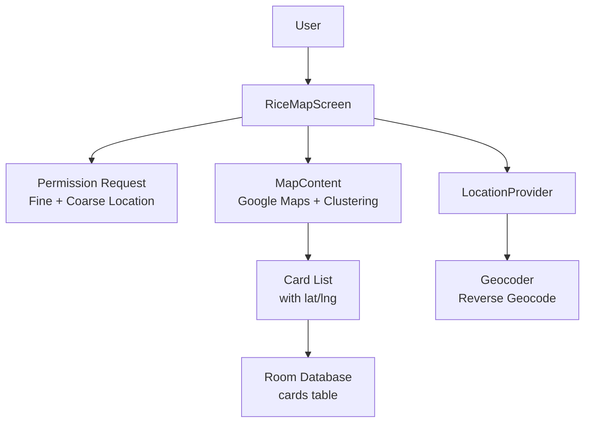
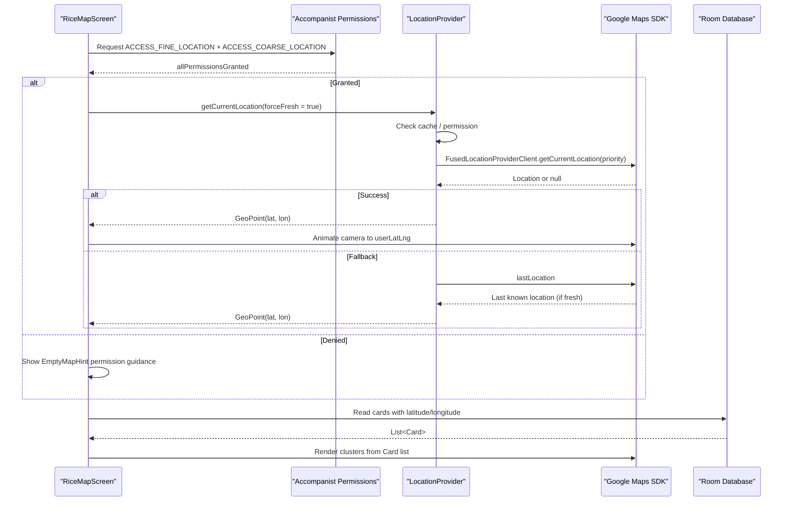
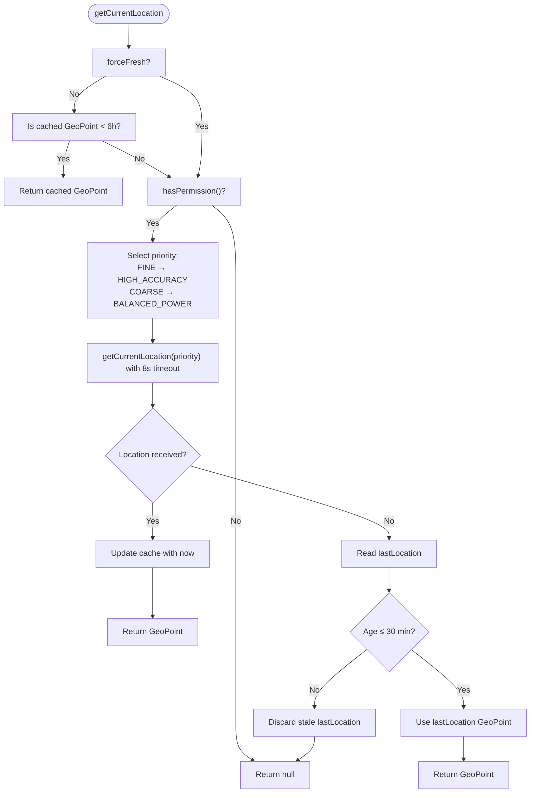
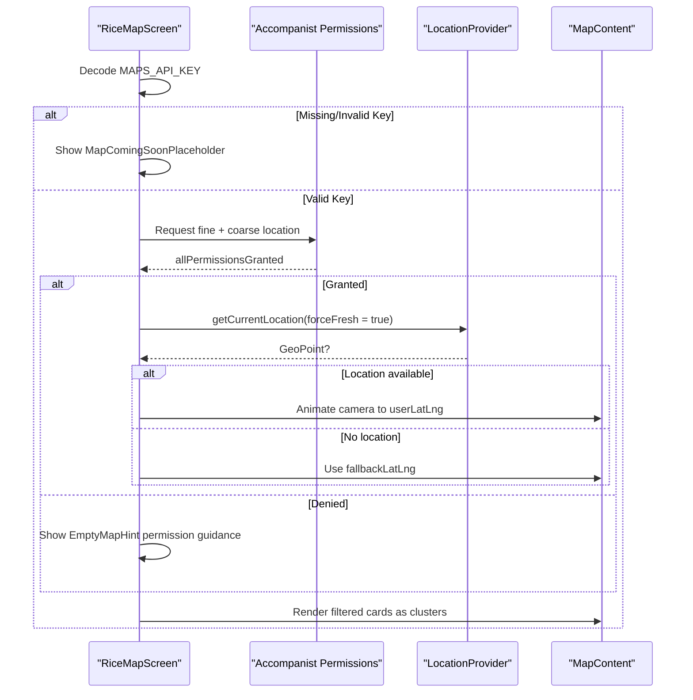
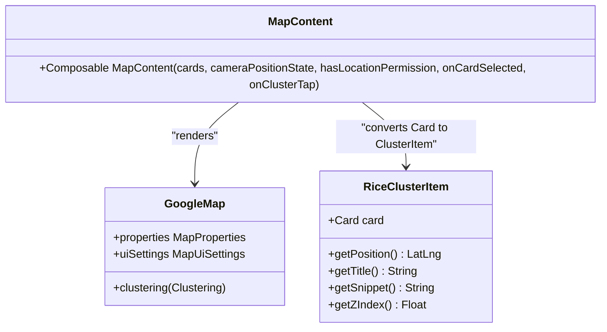
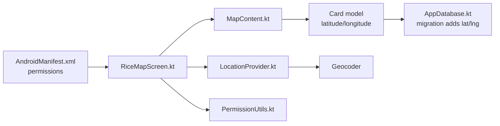

# Location & Mapping Services

<cite>
**Referenced Files in This Document**
- [LocationProvider.kt](file://app/src/main/java/com/giathinh/canlua/data/location/LocationProvider.kt)
- [RiceMapScreen.kt](file://app/src/main/java/com/giathinh/canlua/ui/screen/map/RiceMapScreen.kt)
- [MapContent.kt](file://app/src/main/java/com/giathinh/canlua/ui/screen/map/MapContent.kt)
- [MapFilters.kt](file://app/src/main/java/com/giathinh/canlua/ui/screen/map/MapFilters.kt)
- [CardSummaryBottomSheet.kt](file://app/src/main/java/com/giathinh/canlua/ui/screen/map/CardSummaryBottomSheet.kt)
- [MapEmptyStates.kt](file://app/src/main/java/com/giathinh/canlua/ui/screen/map/MapEmptyStates.kt)
- [MapFormatters.kt](file://app/src/main/java/com/giathinh/canlua/ui/screen/map/MapFormatters.kt)
- [PermissionUtils.kt](file://app/src/main/java/com/giathinh/canlua/util/PermissionUtils.kt)
- [AppDatabase.kt](file://app/src/main/java/com/giathinh/canlua/data/database/AppDatabase.kt)
- [AndroidManifest.xml](file://app/src/main/AndroidManifest.xml)
</cite>

## Table of Contents
1. [Introduction](#introduction)
2. [Project Structure](#project-structure)
3. [Core Components](#core-components)
4. [Architecture Overview](#architecture-overview)
5. [Detailed Component Analysis](#detailed-component-analysis)
6. [Dependency Analysis](#dependency-analysis)
7. [Performance Considerations](#performance-considerations)
8. [Troubleshooting Guide](#troubleshooting-guide)
9. [Conclusion](#conclusion)
10. [Appendices](#appendices)

## Introduction
This document explains how the application integrates Google Maps and Android location services to visualize rice trading locations on interactive maps. It focuses on:

- The `LocationProvider` implementation for GPS access, permission handling, accuracy selection, timeout/fallback behavior, and reverse geocoding.
- The Rice Map UI that displays field cards as clustered markers, supports search and filters, and manages user location camera movement.
- Coordinate systems, marker management, offline-first data persistence, and privacy considerations around location permissions.
- Practical examples for requesting user location, displaying markers, handling empty states, and falling back when GPS is unavailable.

The app follows an offline-first architecture with local Room persistence and optional cloud sync. Location data is persisted per card so the map can render even without network access.

## Project Structure
The location and mapping features span a small set of focused files:

- Data layer: `LocationProvider` wraps Fused Location APIs and provides safe location retrieval and reverse geocoding.
- UI layer: `RiceMapScreen` orchestrates permissions, camera state, filtering, and map rendering; `MapContent` encapsulates Google Maps SDK usage and clustering; supporting files provide filters, empty states, and formatting helpers.
- Persistence: Room database migration adds latitude/longitude fields to the card entity so each field record carries its own coordinates.
- Permissions: Manifest declares fine/coarse location permissions; runtime checks are performed by both `LocationProvider` and Compose permission utilities.

**Diagram sources**
- [RiceMapScreen.kt:83-140](file://app/src/main/java/com/giathinh/canlua/ui/screen/map/RiceMapScreen.kt#L83-L140)
- [MapContent.kt:38-80](file://app/src/main/java/com/giathinh/canlua/ui/screen/map/MapContent.kt#L38-L80)
- [LocationProvider.kt:40-142](file://app/src/main/java/com/giathinh/canlua/data/location/LocationProvider.kt#L40-L142)
- [AppDatabase.kt:187-190](file://app/src/main/java/com/giathinh/canlua/data/database/AppDatabase.kt#L187-L190)

**Section sources**
- [RiceMapScreen.kt:67-140](file://app/src/main/java/com/giathinh/canlua/ui/screen/map/RiceMapScreen.kt#L67-L140)
- [MapContent.kt:30-80](file://app/src/main/java/com/giathinh/canlua/ui/screen/map/MapContent.kt#L30-L80)
- [LocationProvider.kt:33-142](file://app/src/main/java/com/giathinh/canlua/data/location/LocationProvider.kt#L33-L142)
- [AppDatabase.kt:187-190](file://app/src/main/java/com/giathinh/canlua/data/database/AppDatabase.kt#L187-L190)

## Core Components
- `LocationProvider`: A singleton wrapper around Google Play Services Fused Location Provider. It exposes permission checks, current location retrieval with caching and fallbacks, and reverse geocoding using Android’s native `Geocoder`.
- `RiceMapScreen`: The main Composable screen for the rice trading map. It requests permissions, fetches the user’s location, animates the camera, applies search and filter logic, and renders the map with clustered markers.
- `MapContent`: Encapsulates Google Maps SDK configuration, hybrid map type, my-location toggle, and clustering of `Card` items into `ClusterItem`s.
- Supporting UI components: `SearchAndFilterBar`, `FilterChipsRow`, `PriceFilter`, `EmptyMapHint`, `MapComingSoonPlaceholder`, `CardSummaryBottomSheet`, and `MapFormatters`.

Key responsibilities:
- Location acquisition with accuracy-aware priority selection and robust fallback.
- Reverse geocoding to human-readable addresses.
- Offline-first map rendering from persisted card coordinates.
- Privacy-safe permission flows and clear empty-state messaging.

**Section sources**
- [LocationProvider.kt:33-187](file://app/src/main/java/com/giathinh/canlua/data/location/LocationProvider.kt#L33-L187)
- [RiceMapScreen.kt:83-337](file://app/src/main/java/com/giathinh/canlua/ui/screen/map/RiceMapScreen.kt#L83-L337)
- [MapContent.kt:30-115](file://app/src/main/java/com/giathinh/canlua/ui/screen/map/MapContent.kt#L30-L115)
- [MapFilters.kt:43-261](file://app/src/main/java/com/giathinh/canlua/ui/screen/map/MapFilters.kt#L43-L261)
- [CardSummaryBottomSheet.kt:42-255](file://app/src/main/java/com/giathinh/canlua/ui/screen/map/CardSummaryBottomSheet.kt#L42-L255)
- [MapEmptyStates.kt:34-151](file://app/src/main/java/com/giathinh/canlua/ui/screen/map/MapEmptyStates.kt#L34-L151)
- [MapFormatters.kt:8-23](file://app/src/main/java/com/giathinh/canlua/ui/screen/map/MapFormatters.kt#L8-L23)

## Architecture Overview
The location and mapping flow connects UI state, location services, and persistent card data:

**Diagram sources**
- [RiceMapScreen.kt:116-140](file://app/src/main/java/com/giathinh/canlua/ui/screen/map/RiceMapScreen.kt#L116-L140)
- [LocationProvider.kt:83-142](file://app/src/main/java/com/giathinh/canlua/data/location/LocationProvider.kt#L83-L142)
- [MapContent.kt:46-80](file://app/src/main/java/com/giathinh/canlua/ui/screen/map/MapContent.kt#L46-L80)
- [AppDatabase.kt:187-190](file://app/src/main/java/com/giathinh/canlua/data/database/AppDatabase.kt#L187-L190)

## Detailed Component Analysis

### LocationProvider: GPS, Permissions, Accuracy, and Geocoding
`LocationProvider` centralizes location operations:

- **Singleton injection**: Uses Hilt `@Singleton` and constructor injection with `@ApplicationContext`.
- **Fused Location Client**: Lazily initializes `LocationServices.getFusedLocationProviderClient(context)`.
- **In-memory cache**: Stores the last `GeoPoint` and timestamp with a 6-hour TTL. Critical flows must bypass cache via `forceFresh = true`.
- **Permission checks**:
  - `hasPermission()`: Returns true if either fine or coarse location permission is granted.
  - `hasFineLocationPermission()`: Checks fine location specifically.
- **Current location retrieval**:
  - Skips cache unless `forceFresh = false`.
  - Selects priority based on permissions:
    - Fine permission → `Priority.PRIORITY_HIGH_ACCURACY`.
    - Only coarse → `Priority.PRIORITY_BALANCED_POWER_ACCURACY`.
  - Uses a cancellation token and an 8-second timeout to avoid blocking UI.
  - On success, updates in-memory cache with current time.
  - On failure, falls back to `lastLocation` if it is within 30 minutes old; otherwise discards stale data.
  - Catches `SecurityException` and generic exceptions, logging warnings and returning null.
- **Reverse geocoding**:
  - Uses Android’s `Geocoder` with Vietnamese locale.
  - Handles API 33+ asynchronous callback and pre-API 33 blocking calls on `Dispatchers.IO`.
  - Assembles address from sublocality, locality, and admin area with a 5-second timeout.
  - Returns null if service is missing, timed out, or failed.

**Diagram sources**
- [LocationProvider.kt:83-142](file://app/src/main/java/com/giathinh/canlua/data/location/LocationProvider.kt#L83-L142)

**Section sources**
- [LocationProvider.kt:33-187](file://app/src/main/java/com/giathinh/canlua/data/location/LocationProvider.kt#L33-L187)

### RiceMapScreen: Permission Flow, Camera Animation, and Filtering
`RiceMapScreen` is the top-level composable for the rice trading map:

- **API key guard**: Decodes the Maps API key and shows a placeholder if missing or invalid.
- **Hilt entry point**: Accesses `LocationProvider` inside a composable via Hilt `EntryPointAccessors`.
- **Default camera**: Falls back to a predefined coordinate (Mekong Delta region) if no user location is available.
- **Permission request**: Requests both fine and coarse location permissions using Accompanist permissions.
- **Location acquisition**: When permissions are granted, fetches fresh location and animates the camera to the user’s position at zoom level 13.
- **Filtering**: Supports text search across farmer name, rice variety, and field address; price threshold chips; and rice variety chips. Search normalization removes diacritics and case differences.
- **Map rendering**: Delegates to `MapContent` after a short delay to avoid GPU contention during navigation transitions.
- **My Location button**: Centers the camera on the user’s location or fallback coordinate.
- **Empty states**: Shows contextual hints when there are no markers due to permissions, overly tight filters, or lack of GPS-enabled cards.

**Diagram sources**
- [RiceMapScreen.kt:83-140](file://app/src/main/java/com/giathinh/canlua/ui/screen/map/RiceMapScreen.kt#L83-L140)
- [MapContent.kt:46-80](file://app/src/main/java/com/giathinh/canlua/ui/screen/map/MapContent.kt#L46-L80)

**Section sources**
- [RiceMapScreen.kt:83-337](file://app/src/main/java/com/giathinh/canlua/ui/screen/map/RiceMapScreen.kt#L83-L337)
- [MapEmptyStates.kt:34-151](file://app/src/main/java/com/giathinh/canlua/ui/screen/map/MapEmptyStates.kt#L34-L151)

### MapContent: Google Maps Rendering and Marker Clustering
`MapContent` encapsulates Google Maps SDK usage:

- **Hybrid map type**: Uses satellite imagery with labels for better field visualization.
- **My location toggle**: Enables the built-in “my location” dot only when the user has granted permissions.
- **UI settings**: Disables default zoom controls, my location button, and toolbar; keeps compass enabled.
- **Clustering**: Converts `Card` objects into `RiceClusterItem` implementing `ClusterItem`; handles cluster click and single item click events.
- **Custom cluster bubble**: Displays cluster count in a styled circular badge.

**Diagram sources**
- [MapContent.kt:38-115](file://app/src/main/java/com/giathinh/canlua/ui/screen/map/MapContent.kt#L38-L115)

**Section sources**
- [MapContent.kt:30-115](file://app/src/main/java/com/giathinh/canlua/ui/screen/map/MapContent.kt#L30-L115)

### Filters, Formatting, and Bottom Sheet
- **Search and filter bar**: Provides text input, clear action, filter toggle, match count display, and animated visibility for filter chips.
- **Filter chips**: Price thresholds (`ALL`, `HAS_PRICE`, `MIN_7K`, `MIN_8K`, `MIN_9K`) and rice varieties derived from the current card dataset.
- **Search normalization**: Strips diacritics and converts to lowercase for robust matching.
- **Formatting helpers**: Localized number and date formatting used in cluster snippets and bottom sheet details.
- **Card summary bottom sheet**: Shows weight, bag count, variety, price, address, trader phone, and a weigh action button.

**Section sources**
- [MapFilters.kt:43-261](file://app/src/main/java/com/giathinh/canlua/ui/screen/map/MapFilters.kt#L43-L261)
- [MapFormatters.kt:8-23](file://app/src/main/java/com/giathinh/canlua/ui/screen/map/MapFormatters.kt#L8-L23)
- [CardSummaryBottomSheet.kt:42-255](file://app/src/main/java/com/giathinh/canlua/ui/screen/map/CardSummaryBottomSheet.kt#L42-L255)

## Dependency Analysis
The following diagram highlights dependencies between location, UI, and persistence layers:

**Diagram sources**
- [AndroidManifest.xml:9-10](file://app/src/main/AndroidManifest.xml#L9-L10)
- [RiceMapScreen.kt:83-140](file://app/src/main/java/com/giathinh/canlua/ui/screen/map/RiceMapScreen.kt#L83-L140)
- [LocationProvider.kt:33-142](file://app/src/main/java/com/giathinh/canlua/data/location/LocationProvider.kt#L33-L142)
- [MapContent.kt:46-80](file://app/src/main/java/com/giathinh/canlua/ui/screen/map/MapContent.kt#L46-L80)
- [AppDatabase.kt:187-190](file://app/src/main/java/com/giathinh/canlua/data/database/AppDatabase.kt#L187-L190)
- [PermissionUtils.kt:11-24](file://app/src/main/java/com/giathinh/canlua/util/PermissionUtils.kt#L11-L24)

**Section sources**
- [AndroidManifest.xml:9-10](file://app/src/main/AndroidManifest.xml#L9-L10)
- [RiceMapScreen.kt:83-140](file://app/src/main/java/com/giathinh/canlua/ui/screen/map/RiceMapScreen.kt#L83-L140)
- [LocationProvider.kt:33-142](file://app/src/main/java/com/giathinh/canlua/data/location/LocationProvider.kt#L33-L142)
- [MapContent.kt:46-80](file://app/src/main/java/com/giathinh/canlua/ui/screen/map/MapContent.kt#L46-L80)
- [AppDatabase.kt:187-190](file://app/src/main/java/com/giathinh/canlua/data/database/AppDatabase.kt#L187-L190)
- [PermissionUtils.kt:11-24](file://app/src/main/java/com/giathinh/canlua/util/PermissionUtils.kt#L11-L24)

## Performance Considerations
- **Map initialization delay**: The map is rendered after a short delay to avoid GPU contention during navigation transitions. This prevents frame drops when loading heavy Google Maps classes and GL context.
- **Caching strategy**: `LocationProvider` caches the last location for up to 6 hours to reduce unnecessary GPS activation. Critical flows should force fresh location reads.
- **Timeouts**: Location fetch uses an 8-second timeout; reverse geocoding uses a 5-second timeout to prevent coroutine hangs.
- **Battery optimization**: Priority selection adapts to permissions:
  - High accuracy when fine permission is granted.
  - Balanced power accuracy when only coarse permission is available.
- **Clustering**: Reduces marker overhead by grouping nearby cards, improving rendering performance on large datasets.

[No sources needed since this section provides general guidance]

## Troubleshooting Guide
Common issues and resolutions:

- **Missing Maps API key**: If the decoded Maps API key is blank or placeholder, the screen shows a placeholder instead of crashing. Ensure the build configuration includes a valid key.
- **Location permission denied**: The screen requests both fine and coarse location permissions. If denied, an empty state hint guides users to grant permissions.
- **No location fix**: If GPS cannot acquire a fix within the timeout, the provider falls back to the last known location if it is fresh (≤30 minutes). Otherwise, the UI continues with the fallback camera position.
- **Stale last location**: If the last known location is too old, it is discarded to avoid misleading positioning.
- **Reverse geocoding failures**: If `Geocoder` is not present or times out, the method returns null. UI should handle missing address gracefully.
- **Empty map hints**: Contextual messages differentiate between permission denial, overly restrictive filters, and absence of GPS-enabled cards.

**Section sources**
- [RiceMapScreen.kt:90-96](file://app/src/main/java/com/giathinh/canlua/ui/screen/map/RiceMapScreen.kt#L90-L96)
- [RiceMapScreen.kt:116-140](file://app/src/main/java/com/giathinh/canlua/ui/screen/map/RiceMapScreen.kt#L116-L140)
- [LocationProvider.kt:115-142](file://app/src/main/java/com/giathinh/canlua/data/location/LocationProvider.kt#L115-L142)
- [LocationProvider.kt:156-187](file://app/src/main/java/com/giathinh/canlua/data/location/LocationProvider.kt#L156-L187)
- [MapEmptyStates.kt:34-86](file://app/src/main/java/com/giathinh/canlua/ui/screen/map/MapEmptyStates.kt#L34-L86)

## Conclusion
The location and mapping integration combines robust GPS access, careful permission handling, and offline-first data persistence to deliver a reliable rice trading map experience. `LocationProvider` abstracts Fused Location and Geocoder complexities, while `RiceMapScreen` and `MapContent` provide a performant, user-friendly interface with clustering, search, and filters. The system gracefully handles missing permissions, unavailable GPS, and stale location data, ensuring continuity through fallback strategies and clear user feedback.

[No sources needed since this section summarizes without analyzing specific files]

## Appendices

### Coordinate Systems and Geocoding
- Coordinates are represented as latitude/longitude pairs stored in the card entity and converted to `LatLng` for map rendering.
- Reverse geocoding uses Android’s `Geocoder` with Vietnamese locale to produce readable addresses composed of sublocality, locality, and administrative area.

**Section sources**
- [LocationProvider.kt:156-187](file://app/src/main/java/com/giathinh/canlua/data/location/LocationProvider.kt#L156-L187)
- [MapContent.kt:46-51](file://app/src/main/java/com/giathinh/canlua/ui/screen/map/MapContent.kt#L46-L51)

### Offline Map Caching and Location Data Persistence
- The Room database migration adds latitude and longitude columns to the cards table, enabling offline-first map rendering based on persisted field coordinates.
- In-memory location caching reduces GPS wake-ups; critical operations bypass cache to ensure fresh coordinates.

**Section sources**
- [AppDatabase.kt:187-190](file://app/src/main/java/com/giathinh/canlua/data/database/AppDatabase.kt#L187-L190)
- [LocationProvider.kt:46-53](file://app/src/main/java/com/giathinh/canlua/data/location/LocationProvider.kt#L46-L53)

### Examples

#### Requesting User Location
- The screen requests fine and coarse location permissions and then calls `LocationProvider.getCurrentLocation(forceFresh = true)` to obtain the latest coordinates.
- On success, the camera animates to the user’s location; on failure, it uses a predefined fallback coordinate.

**Section sources**
- [RiceMapScreen.kt:116-140](file://app/src/main/java/com/giathinh/canlua/ui/screen/map/RiceMapScreen.kt#L116-L140)
- [LocationProvider.kt:83-142](file://app/src/main/java/com/giathinh/canlua/data/location/LocationProvider.kt#L83-L142)

#### Displaying Markers on Maps
- Cards with non-null latitude/longitude are converted to `RiceClusterItem` and rendered via Google Maps clustering.
- Clicking a single marker opens a bottom sheet with card details; clicking a cluster zooms in or triggers custom behavior.

**Section sources**
- [MapContent.kt:46-80](file://app/src/main/java/com/giathinh/canlua/ui/screen/map/MapContent.kt#L46-L80)
- [CardSummaryBottomSheet.kt:42-255](file://app/src/main/java/com/giathinh/canlua/ui/screen/map/CardSummaryBottomSheet.kt#L42-L255)

#### Handling Location Updates
- The provider selects accuracy priority based on permissions and applies timeouts and fallbacks to ensure responsiveness.
- Reverse geocoding is optional and handled asynchronously on newer Android versions.

**Section sources**
- [LocationProvider.kt:93-142](file://app/src/main/java/com/giathinh/canlua/data/location/LocationProvider.kt#L93-L142)
- [LocationProvider.kt:156-187](file://app/src/main/java/com/giathinh/canlua/data/location/LocationProvider.kt#L156-L187)

### Privacy Considerations and Fallback Mechanisms
- Permissions: Both fine and coarse location permissions are declared in the manifest and requested at runtime.
- Privacy: The app avoids continuous location tracking; it fetches a one-time location when needed and relies on persisted card coordinates for map rendering.
- Fallbacks:
  - If GPS is unavailable, the provider falls back to last known location if fresh.
  - If no location is available, the map centers on a predefined fallback coordinate.
  - If the Maps API key is missing, a placeholder screen is shown instead of crashing.

**Section sources**
- [AndroidManifest.xml:9-10](file://app/src/main/AndroidManifest.xml#L9-L10)
- [RiceMapScreen.kt:90-96](file://app/src/main/java/com/giathinh/canlua/ui/screen/map/RiceMapScreen.kt#L90-L96)
- [RiceMapScreen.kt:109-140](file://app/src/main/java/com/giathinh/canlua/ui/screen/map/RiceMapScreen.kt#L109-L140)
- [LocationProvider.kt:115-142](file://app/src/main/java/com/giathinh/canlua/data/location/LocationProvider.kt#L115-L142)