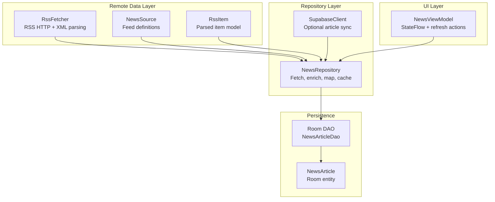
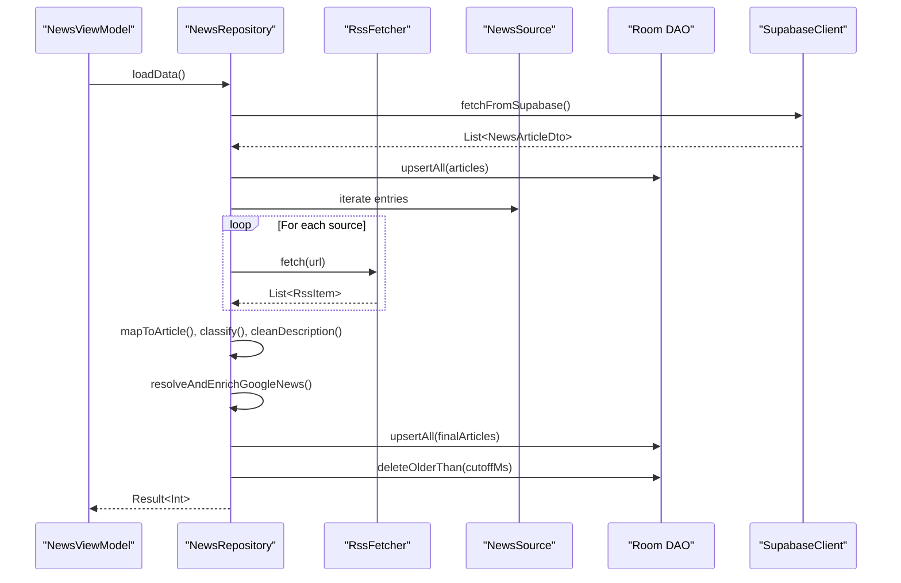
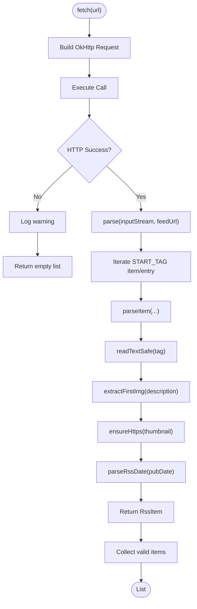
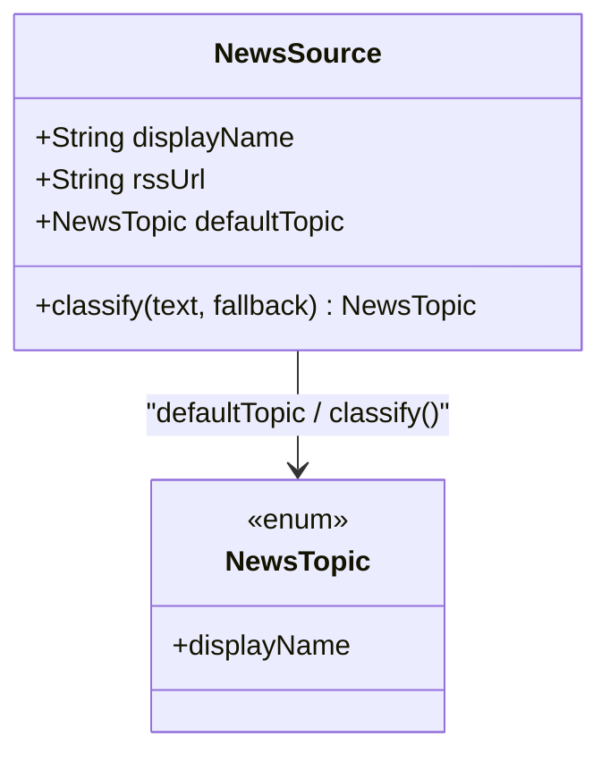
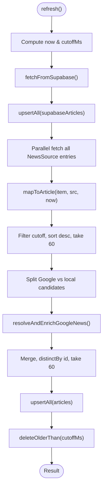
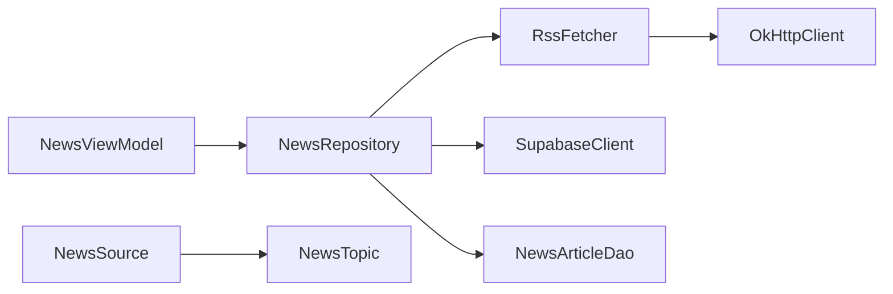

# News Aggregation Service

<cite>
**Referenced Files in This Document**
- [RssFetcher.kt](file://app/src/main/java/com/giathinh/canlua/data/remote/news/RssFetcher.kt)
- [NewsSource.kt](file://app/src/main/java/com/giathinh/canlua/data/remote/news/NewsSource.kt)
- [RssItem.kt](file://app/src/main/java/com/giathinh/canlua/data/remote/news/RssItem.kt)
- [NewsRepository.kt](file://app/src/main/java/com/giathinh/canlua/repository/NewsRepository.kt)
- [NewsViewModel.kt](file://app/src/main/java/com/giathinh/canlua/ui/viewmodel/NewsViewModel.kt)
- [NewsArticle.kt](file://app/src/main/java/com/giathinh/canlua/data/model/NewsArticle.kt)
</cite>

## Table of Contents
1. [Introduction](#introduction)
2. [Project Structure](#project-structure)
3. [Core Components](#core-components)
4. [Architecture Overview](#architecture-overview)
5. [Detailed Component Analysis](#detailed-component-analysis)
6. [Dependency Analysis](#dependency-analysis)
7. [Performance Considerations](#performance-considerations)
8. [Troubleshooting Guide](#troubleshooting-guide)
9. [Conclusion](#conclusion)
10. [Appendices](#appendices)

## Introduction
This document explains the RSS news aggregation system used to collect agricultural and market-related news for an offline-first Android application. The system fetches multiple RSS feeds, parses them into structured items, enriches selected sources, maps results to a Room entity, and exposes them through a repository and ViewModel. It also covers feed source management, caching strategies, update scheduling, content sanitization, image handling, error handling, performance optimization, and practical examples for extending the system.

## Project Structure
The news aggregation feature spans three layers:
- Remote data layer: RSS fetching and parsing.
- Repository layer: orchestration, enrichment, deduplication, persistence, and stale-data checks.
- UI layer: ViewModel state and user-triggered refresh flows.

**Diagram sources**
- [RssFetcher.kt:18-34](file://app/src/main/java/com/giathinh/canlua/data/remote/news/RssFetcher.kt#L18-L34)
- [NewsSource.kt:5-25](file://app/src/main/java/com/giathinh/canlua/data/remote/news/NewsSource.kt#L5-L25)
- [RssItem.kt:3-18](file://app/src/main/java/com/giathinh/canlua/data/remote/news/RssItem.kt#L3-L18)
- [NewsRepository.kt:28-45](file://app/src/main/java/com/giathinh/canlua/repository/NewsRepository.kt#L28-L45)
- [NewsViewModel.kt:26-30](file://app/src/main/java/com/giathinh/canlua/ui/viewmodel/NewsViewModel.kt#L26-L30)
- [NewsArticle.kt:7-25](file://app/src/main/java/com/giathinh/canlua/data/model/NewsArticle.kt#L7-L25)

**Section sources**
- [RssFetcher.kt:18-34](file://app/src/main/java/com/giathinh/canlua/data/remote/news/RssFetcher.kt#L18-L34)
- [NewsSource.kt:5-25](file://app/src/main/java/com/giathinh/canlua/data/remote/news/NewsSource.kt#L5-L25)
- [RssItem.kt:3-18](file://app/src/main/java/com/giathinh/canlua/data/remote/news/RssItem.kt#L3-L18)
- [NewsRepository.kt:28-45](file://app/src/main/java/com/giathinh/canlua/repository/NewsRepository.kt#L28-L45)
- [NewsViewModel.kt:26-30](file://app/src/main/java/com/giathinh/canlua/ui/viewmodel/NewsViewModel.kt#L26-L30)
- [NewsArticle.kt:7-25](file://app/src/main/java/com/giathinh/canlua/data/model/NewsArticle.kt#L7-L25)

## Core Components
- RssFetcher: Fetches RSS/Atom feeds via OkHttp and parses them using XmlPullParser. It supports standard RSS 2.0 items, Atom entries, media thumbnails, enclosure images, WordPress content:encoded, Google News redirects, and RFC-822 date formats.
- NewsSource: Enumerates configured RSS feeds with display names, URLs, default topics, and a topic classification helper.
- RssItem: Lightweight parsed representation of a single feed item before mapping to the persistent model.
- NewsRepository: Orchestrates parallel fetching from all sources, optional Supabase sync, redirect resolution, HTML enrichment, content cleaning, topic classification, deduplication, Room upserts, and staleness checks.
- NewsViewModel: Exposes UI state and triggers data loading and refresh operations.
- NewsArticle: Room entity representing a persisted news article with indexed fields for efficient queries.

**Section sources**
- [RssFetcher.kt:18-34](file://app/src/main/java/com/giathinh/canlua/data/remote/news/RssFetcher.kt#L18-L34)
- [NewsSource.kt:5-25](file://app/src/main/java/com/giathinh/canlua/data/remote/news/NewsSource.kt#L5-L25)
- [RssItem.kt:3-18](file://app/src/main/java/com/giathinh/canlua/data/remote/news/RssItem.kt#L3-L18)
- [NewsRepository.kt:28-45](file://app/src/main/java/com/giathinh/canlua/repository/NewsRepository.kt#L28-L45)
- [NewsViewModel.kt:26-30](file://app/src/main/java/com/giathinh/canlua/ui/viewmodel/NewsViewModel.kt#L26-L30)
- [NewsArticle.kt:7-25](file://app/src/main/java/com/giathinh/canlua/data/model/NewsArticle.kt#L7-L25)

## Architecture Overview
The system follows MVVM and Clean Architecture principles:
- ViewModel observes repository flows and triggers refresh.
- Repository coordinates remote calls (RSS and optional Supabase), performs enrichment, and persists to Room.
- RssFetcher isolates network and XML parsing logic.
- NewsSource centralizes feed configuration and topic heuristics.

**Diagram sources**
- [NewsViewModel.kt:47-56](file://app/src/main/java/com/giathinh/canlua/ui/viewmodel/NewsViewModel.kt#L47-L56)
- [NewsRepository.kt:62-121](file://app/src/main/java/com/giathinh/canlua/repository/NewsRepository.kt#L62-L121)
- [RssFetcher.kt:36-63](file://app/src/main/java/com/giathinh/canlua/data/remote/news/RssFetcher.kt#L36-L63)
- [NewsSource.kt:21-133](file://app/src/main/java/com/giathinh/canlua/data/remote/news/NewsSource.kt#L21-L133)

## Detailed Component Analysis

### RssFetcher
Responsibilities:
- HTTP GET RSS/Atom feeds with appropriate headers.
- Parse both RSS 2.0 `<item>` and Atom `<entry>`.
- Extract title, link, description/summary/content:encoded, pubDate/published/updated, media thumbnails, enclosure images.
- Normalize thumbnail URLs to HTTPS.
- Safely read nested HTML inside tags without throwing on child elements.
- Parse common RFC-822 dates.

Error handling:
- Network and IO exceptions return empty lists rather than throwing.
- XML parsing exceptions are caught and logged.
- Non-success HTTP responses return empty lists.

**Diagram sources**
- [RssFetcher.kt:36-63](file://app/src/main/java/com/giathinh/canlua/data/remote/news/RssFetcher.kt#L36-L63)
- [RssFetcher.kt:69-84](file://app/src/main/java/com/giathinh/canlua/data/remote/news/RssFetcher.kt#L69-L84)
- [RssFetcher.kt:93-166](file://app/src/main/java/com/giathinh/canlua/data/remote/news/RssFetcher.kt#L93-L166)
- [RssFetcher.kt:172-181](file://app/src/main/java/com/giathinh/canlua/data/remote/news/RssFetcher.kt#L172-L181)
- [RssFetcher.kt:192-203](file://app/src/main/java/com/giathinh/canlua/data/remote/news/RssFetcher.kt#L192-L203)
- [RssFetcher.kt:206-224](file://app/src/main/java/com/giathinh/canlua/data/remote/news/RssFetcher.kt#L206-L224)

Key implementation notes:
- Uses XmlPullParser with namespace processing enabled.
- Skips malformed items gracefully to avoid breaking entire feed parsing.
- Supports protocol-relative URLs and converts http to https for image loading safety.

**Section sources**
- [RssFetcher.kt:18-34](file://app/src/main/java/com/giathinh/canlua/data/remote/news/RssFetcher.kt#L18-L34)
- [RssFetcher.kt:36-63](file://app/src/main/java/com/giathinh/canlua/data/remote/news/RssFetcher.kt#L36-L63)
- [RssFetcher.kt:69-84](file://app/src/main/java/com/giathinh/canlua/data/remote/news/RssFetcher.kt#L69-L84)
- [RssFetcher.kt:93-166](file://app/src/main/java/com/giathinh/canlua/data/remote/news/RssFetcher.kt#L93-L166)
- [RssFetcher.kt:172-181](file://app/src/main/java/com/giathinh/canlua/data/remote/news/RssFetcher.kt#L172-L181)
- [RssFetcher.kt:192-203](file://app/src/main/java/com/giathinh/canlua/data/remote/news/RssFetcher.kt#L192-L203)
- [RssFetcher.kt:206-224](file://app/src/main/java/com/giathinh/canlua/data/remote/news/RssFetcher.kt#L206-L224)

### NewsSource
Responsibilities:
- Define feed sources with display name, RSS URL, and default topic.
- Provide a heuristic classifier to assign articles to specific topics based on text patterns.

Feed selection rationale:
- Mix of Google News queries and direct Vietnamese news outlets.
- Prioritize feeds that provide HTTPS images and timely updates.
- Cover rice prices, agriculture, Mekong Delta, business/economy, and specialized agriculture/environmental topics.

Topic classification:
- Heuristic rules prioritize specific keywords like weather events, rice/export terms, cultivation terms, and general market/agriculture terms.
- Fallback to the source’s default topic when no rule matches.

**Diagram sources**
- [NewsSource.kt:21-133](file://app/src/main/java/com/giathinh/canlua/data/remote/news/NewsSource.kt#L21-L133)
- [NewsSource.kt:135-175](file://app/src/main/java/com/giathinh/canlua/data/remote/news/NewsSource.kt#L135-L175)
- [NewsArticle.kt:27-31](file://app/src/main/java/com/giathinh/canlua/data/model/NewsArticle.kt#L27-L31)

**Section sources**
- [NewsSource.kt:5-25](file://app/src/main/java/com/giathinh/canlua/data/remote/news/NewsSource.kt#L5-L25)
- [NewsSource.kt:21-133](file://app/src/main/java/com/giathinh/canlua/data/remote/news/NewsSource.kt#L21-L133)
- [NewsSource.kt:135-175](file://app/src/main/java/com/giathinh/canlua/data/remote/news/NewsSource.kt#L135-L175)
- [NewsArticle.kt:27-31](file://app/src/main/java/com/giathinh/canlua/data/model/NewsArticle.kt#L27-L31)

### RssItem
Responsibilities:
- Represent parsed RSS/Atom items with minimal fields needed for mapping to the persistent model.
- Include optional enrichedLink for resolved article URLs after redirect resolution.

Design note:
- Keeps HTML stripping and image extraction at the repository layer to maintain a pure data model.

**Section sources**
- [RssItem.kt:3-18](file://app/src/main/java/com/giathinh/canlua/data/remote/news/RssItem.kt#L3-L18)

### NewsRepository
Responsibilities:
- Observe cached articles by topic via Room DAO.
- Refresh flow:
  - Sync from Supabase first if available.
  - Parallel fetch from all NewsSource entries.
  - Map RssItem to NewsArticle with cleaned description and classified topic.
  - Enrich Google News items by resolving redirects and extracting og:image/meta description from the actual article page.
  - Deduplicate by ID, sort by publishedAt, limit to top 60 candidates.
  - Upsert into Room and prune older-than-cutoff articles.
- Staleness check based on newest cachedAt timestamp.
- Optional Supabase DTO mapping and conversion.

Caching strategy:
- Offline-first: Room is primary cache; Supabase provides initial fresh data when available.
- Time-based pruning: Articles older than 14 days are removed during refresh.
- Stale detection: Default 1-hour threshold for refreshing.

Background fetching and concurrency:
- All network I/O runs on Dispatchers.IO.
- Parallel fetching across sources using coroutines.
- Semaphore limits concurrent Google News enrichment requests to 5.

Content sanitization and image handling:
- Strip HTML from descriptions with length cap.
- Remove redundant Google News boilerplate text.
- Prefer media thumbnails or enclosure images; otherwise extract first image from description HTML.
- Enrich from article page when description is too short or thumbnail missing.

**Diagram sources**
- [NewsRepository.kt:62-121](file://app/src/main/java/com/giathinh/canlua/repository/NewsRepository.kt#L62-L121)
- [NewsRepository.kt:128-151](file://app/src/main/java/com/giathinh/canlua/repository/NewsRepository.kt#L128-L151)
- [NewsRepository.kt:161-230](file://app/src/main/java/com/giathinh/canlua/repository/NewsRepository.kt#L161-L230)
- [NewsRepository.kt:232-285](file://app/src/main/java/com/giathinh/canlua/repository/NewsRepository.kt#L232-L285)
- [NewsRepository.kt:287-328](file://app/src/main/java/com/giathinh/canlua/repository/NewsRepository.kt#L287-L328)

**Section sources**
- [NewsRepository.kt:28-45](file://app/src/main/java/com/giathinh/canlua/repository/NewsRepository.kt#L28-L45)
- [NewsRepository.kt:62-121](file://app/src/main/java/com/giathinh/canlua/repository/NewsRepository.kt#L62-L121)
- [NewsRepository.kt:128-151](file://app/src/main/java/com/giathinh/canlua/repository/NewsRepository.kt#L128-L151)
- [NewsRepository.kt:161-230](file://app/src/main/java/com/giathinh/canlua/repository/NewsRepository.kt#L161-L230)
- [NewsRepository.kt:232-285](file://app/src/main/java/com/giathinh/canlua/repository/NewsRepository.kt#L232-L285)
- [NewsRepository.kt:287-328](file://app/src/main/java/com/giathinh/canlua/repository/NewsRepository.kt#L287-L328)
- [NewsRepository.kt:330-339](file://app/src/main/java/com/giathinh/canlua/repository/NewsRepository.kt#L330-L339)
- [NewsRepository.kt:341-375](file://app/src/main/java/com/giathinh/canlua/repository/NewsRepository.kt#L341-L375)

### NewsViewModel
Responsibilities:
- Maintain UI state: refreshing flag, error message, last refresh timestamp.
- Expose filtered articles via StateFlow bound to selected topic.
- Trigger initial load: prefer Supabase sync; fall back to RSS refresh if cache is empty.
- Handle manual refresh with error propagation.

Data binding:
- Uses flatMapLatest to switch between topic streams.
- Shares the latest list with a 5-second subscription timeout to reduce memory pressure.

**Section sources**
- [NewsViewModel.kt:20-24](file://app/src/main/java/com/giathinh/canlua/ui/viewmodel/NewsViewModel.kt#L20-L24)
- [NewsViewModel.kt:26-30](file://app/src/main/java/com/giathinh/canlua/ui/viewmodel/NewsViewModel.kt#L26-L30)
- [NewsViewModel.kt:32-45](file://app/src/main/java/com/giathinh/canlua/ui/viewmodel/NewsViewModel.kt#L32-L45)
- [NewsViewModel.kt:47-56](file://app/src/main/java/com/giathinh/canlua/ui/viewmodel/NewsViewModel.kt#L47-L56)
- [NewsViewModel.kt:59-78](file://app/src/main/java/com/giathinh/canlua/ui/viewmodel/NewsViewModel.kt#L59-L78)

### NewsArticle
Responsibilities:
- Room entity storing persisted news articles.
- Indexed by topic and publishedAt for efficient queries.
- Topic enum defines supported categories: Rice, Grain, Market.

**Section sources**
- [NewsArticle.kt:7-25](file://app/src/main/java/com/giathinh/canlua/data/model/NewsArticle.kt#L7-L25)
- [NewsArticle.kt:27-31](file://app/src/main/java/com/giathinh/canlua/data/model/NewsArticle.kt#L27-L31)

## Dependency Analysis
High-level dependencies:
- NewsViewModel depends on NewsRepository for data operations and state exposure.
- NewsRepository depends on RssFetcher for RSS parsing, OkHttpClient for HTTP, SupabaseClient for optional sync, and Room DAO for persistence.
- RssFetcher depends on OkHttpClient and Android XML utilities.
- NewsSource depends on NewsTopic for classification defaults.

**Diagram sources**
- [NewsViewModel.kt:26-30](file://app/src/main/java/com/giathinh/canlua/ui/viewmodel/NewsViewModel.kt#L26-L30)
- [NewsRepository.kt:38-45](file://app/src/main/java/com/giathinh/canlua/repository/NewsRepository.kt#L38-L45)
- [RssFetcher.kt:31-34](file://app/src/main/java/com/giathinh/canlua/data/remote/news/RssFetcher.kt#L31-L34)
- [NewsSource.kt:21-25](file://app/src/main/java/com/giathinh/canlua/data/remote/news/NewsSource.kt#L21-L25)

**Section sources**
- [NewsViewModel.kt:26-30](file://app/src/main/java/com/giathinh/canlua/ui/viewmodel/NewsViewModel.kt#L26-L30)
- [NewsRepository.kt:38-45](file://app/src/main/java/com/giathinh/canlua/repository/NewsRepository.kt#L38-L45)
- [RssFetcher.kt:31-34](file://app/src/main/java/com/giathinh/canlua/data/remote/news/RssFetcher.kt#L31-L34)
- [NewsSource.kt:21-25](file://app/src/main/java/com/giathinh/canlua/data/remote/news/NewsSource.kt#L21-L25)

## Performance Considerations
- Caching:
  - Offline-first via Room; Supabase sync provides initial freshness.
  - Staleness check uses newest cachedAt with a default 1-hour threshold.
  - Pruning removes articles older than 14 days during refresh.
- Concurrency:
  - Parallel fetching across all sources using coroutines.
  - Semaphore limits Google News enrichment to 5 concurrent requests.
- Memory:
  - ViewModel shares StateFlow with a 5-second subscription timeout to release resources when not observed.
  - Limit candidate articles to top 60 before persistence.
- Network:
  - Short timeouts for redirect resolution and enrichment requests.
  - Graceful fallbacks: empty lists on errors, retry via manual refresh.

[No sources needed since this section provides general guidance]

## Troubleshooting Guide
Common issues and resolutions:
- Malformed RSS feeds:
  - RssFetcher catches XML parsing exceptions and logs warnings; individual bad items are skipped.
- Network timeouts and IO errors:
  - RssFetcher returns empty lists on IOException and ProtocolException; repository continues with other sources.
- Feed availability issues:
  - If Supabase fails, repository falls back to RSS refresh; ViewModel shows error messages from refresh results.
- Missing thumbnails or short descriptions:
  - Repository enriches Google News items by resolving redirects and scraping og:image/meta description from the article page.
- Duplicate articles:
  - Deduplication by MD5 hash of article link ensures unique entries across sources.

Operational tips:
- Use NewsViewModel.refresh() to trigger a full refresh and inspect errorMessage in ui state.
- Check isStale(maxAgeMs) to decide whether background refresh is needed.
- Validate new feed URLs and ensure they serve HTTPS images for reliable Coil loading.

**Section sources**
- [RssFetcher.kt:42-62](file://app/src/main/java/com/giathinh/canlua/data/remote/news/RssFetcher.kt#L42-L62)
- [NewsRepository.kt:62-121](file://app/src/main/java/com/giathinh/canlua/repository/NewsRepository.kt#L62-L121)
- [NewsRepository.kt:161-230](file://app/src/main/java/com/giathinh/canlua/repository/NewsRepository.kt#L161-L230)
- [NewsRepository.kt:232-285](file://app/src/main/java/com/giathinh/canlua/repository/NewsRepository.kt#L232-L285)
- [NewsViewModel.kt:63-78](file://app/src/main/java/com/giathinh/canlua/ui/viewmodel/NewsViewModel.kt#L63-L78)

## Conclusion
The news aggregation service provides a robust, offline-first pipeline for collecting agricultural and market news from multiple RSS sources. It balances reliability (graceful error handling, fallbacks), performance (parallelism, concurrency limits, pruning), and usability (topic classification, image enrichment). The design cleanly separates concerns across remote fetching, repository orchestration, and UI state management, making it straightforward to extend with new sources and features.

[No sources needed since this section summarizes without analyzing specific files]

## Appendices

### Adding a New News Source
Steps:
- Add a new entry to NewsSource with displayName, rssUrl, and defaultTopic.
- Ensure the feed serves HTTPS images or relies on repository enrichment.
- Optionally adjust NewsSource.classify heuristics if the new source introduces new terminology.

Example reference:
- See existing entries for structure and comments explaining selection criteria.

**Section sources**
- [NewsSource.kt:21-133](file://app/src/main/java/com/giathinh/canlua/data/remote/news/NewsSource.kt#L21-L133)
- [NewsSource.kt:135-175](file://app/src/main/java/com/giathinh/canlua/data/remote/news/NewsSource.kt#L135-L175)

### Fetching Latest Articles
Usage:
- In ViewModel, call loadData() to prefer Supabase sync and fall back to RSS refresh if cache is empty.
- Use articles StateFlow to observe filtered results by topic.

Reference:
- ViewModel.loadData() orchestrates Supabase and RSS fallback.

**Section sources**
- [NewsViewModel.kt:47-56](file://app/src/main/java/com/giathinh/canlua/ui/viewmodel/NewsViewModel.kt#L47-L56)
- [NewsViewModel.kt:32-45](file://app/src/main/java/com/giathinh/canlua/ui/viewmodel/NewsViewModel.kt#L32-L45)

### Displaying News Content
Guidance:
- Bind to NewsViewModel.articles to render a list of NewsArticle objects.
- Use thumbnail for images; handle nulls gracefully.
- Show source and publishedAt for context; sanitize description if needed.

Reference:
- NewsArticle fields include title, description, link, source, thumbnail, publishedAt, topic, cachedAt.

**Section sources**
- [NewsArticle.kt:7-25](file://app/src/main/java/com/giathinh/canlua/data/model/NewsArticle.kt#L7-L25)
- [NewsViewModel.kt:32-45](file://app/src/main/java/com/giathinh/canlua/ui/viewmodel/NewsViewModel.kt#L32-L45)