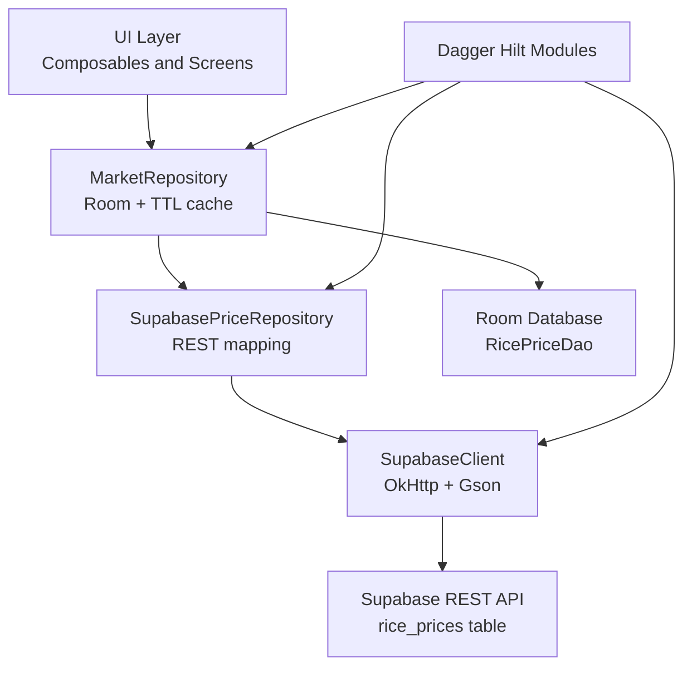
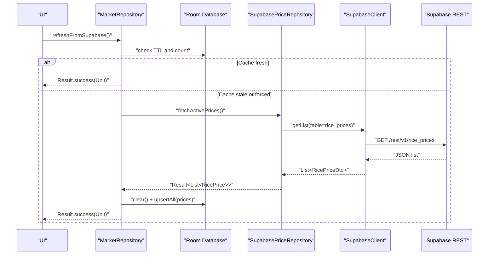
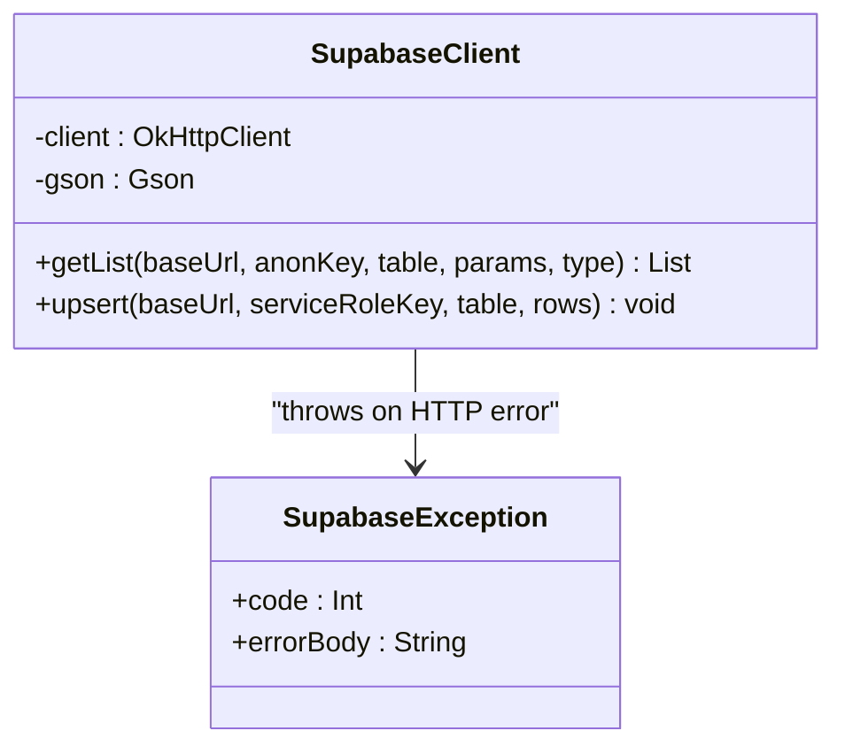
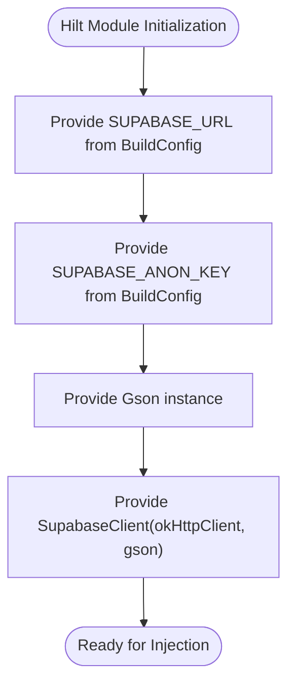
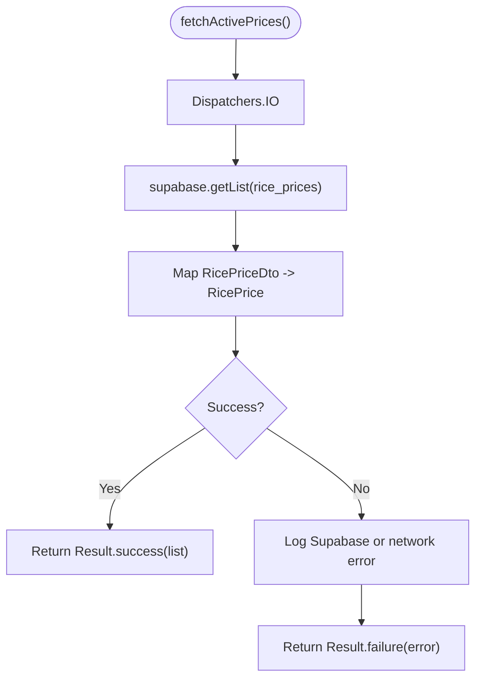
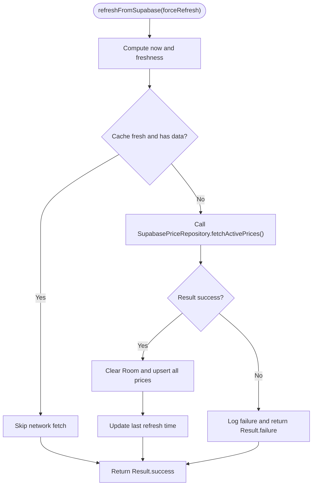
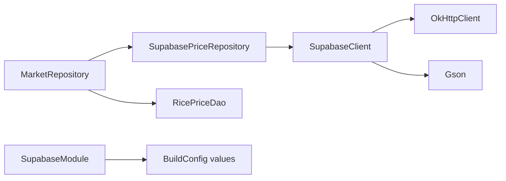

# Supabase Backend Integration

<cite>
**Referenced Files in This Document**
- [SupabaseClient.kt](file://app/src/main/java/com/giathinh/canlua/data/remote/SupabaseClient.kt)
- [SupabaseModule.kt](file://app/src/main/java/com/giathinh/canlua/di/SupabaseModule.kt)
- [SupabasePriceRepository.kt](file://app/src/main/java/com/giathinh/canlua/repository/SupabasePriceRepository.kt)
- [MarketRepository.kt](file://app/src/main/java/com/giathinh/canlua/repository/MarketRepository.kt)
- [FirestoreRepository.kt](file://app/src/main/java/com/giathinh/canlua/repository/FirestoreRepository.kt)
- [FirebaseModule.kt](file://app/src/main/java/com/giathinh/canlua/di/FirebaseModule.kt)
- [NetworkModule.kt](file://app/src/main/java/com/giathinh/canlua/di/NetworkModule.kt)
- [auth_security_rules.md](file://docs/specs/auth_security_rules.md)
- [architectural_north_star.md](file://docs/specs/architectural_north_star.md)
</cite>

## Table of Contents
1. [Introduction](#introduction)
2. [Project Structure](#project-structure)
3. [Core Components](#core-components)
4. [Architecture Overview](#architecture-overview)
5. [Detailed Component Analysis](#detailed-component-analysis)
6. [Dependency Analysis](#dependency-analysis)
7. [Performance Considerations](#performance-considerations)
8. [Troubleshooting Guide](#troubleshooting-guide)
9. [Conclusion](#conclusion)
10. [Appendices](#appendices)

## Introduction
This document explains how the app integrates Supabase as an alternative cloud backend alongside Firebase Firestore. The current implementation uses a lightweight REST client to read market data from a Supabase PostgreSQL table and mirrors it into the local Room database for offline-first operation. It complements the existing Firestore-based sync layer rather than replacing it entirely.

Key points:
- Supabase is used today primarily for reading rice prices via REST.
- Writes to Supabase are not performed directly by the app; they flow through Google Sheets, Apps Script, and the Supabase REST API using a service role key.
- Configuration values such as the Supabase project URL and anonymous key are injected through Dagger Hilt and built into `BuildConfig`.
- Real-time subscriptions and storage operations are not implemented in the current codebase; this document clarifies what exists and how to extend it safely.

## Project Structure
The Supabase integration spans three layers:
- Data remote layer: HTTP client wrapper around Supabase REST.
- Dependency injection module: provides configuration and shared objects.
- Repository layer: maps Supabase DTOs to domain models and coordinates with Room.

**Diagram sources**
- [SupabaseClient.kt:14-26](file://app/src/main/java/com/giathinh/canlua/data/remote/SupabaseClient.kt#L14-L26)
- [SupabasePriceRepository.kt:14-31](file://app/src/main/java/com/giathinh/canlua/repository/SupabasePriceRepository.kt#L14-L31)
- [MarketRepository.kt:16-35](file://app/src/main/java/com/giathinh/canlua/repository/MarketRepository.kt#L16-L35)
- [SupabaseModule.kt:14-39](file://app/src/main/java/com/giathinh/canlua/di/SupabaseModule.kt#L14-L39)

**Section sources**
- [SupabaseClient.kt:14-26](file://app/src/main/java/com/giathinh/canlua/data/remote/SupabaseClient.kt#L14-L26)
- [SupabasePriceRepository.kt:14-31](file://app/src/main/java/com/giathinh/canlua/repository/SupabasePriceRepository.kt#L14-L31)
- [MarketRepository.kt:16-35](file://app/src/main/java/com/giathinh/canlua/repository/MarketRepository.kt#L16-L35)
- [SupabaseModule.kt:14-39](file://app/src/main/java/com/giathinh/canlua/di/SupabaseModule.kt#L14-L39)

## Core Components
- SupabaseClient: A singleton OkHttp-based wrapper that performs GET requests and upsert operations against Supabase REST endpoints. It handles JSON parsing with Gson and throws a custom exception on HTTP errors.
- SupabaseModule: Provides the Supabase base URL, anonymous key, Gson instance, and the SupabaseClient itself. Values come from `BuildConfig`, which is generated from local properties.
- SupabasePriceRepository: Maps Supabase DTOs to the app’s domain model and exposes a suspend function to fetch active rice prices. It runs network calls on the IO dispatcher and returns a Result.
- MarketRepository: Orchestrates the offline-first flow. It reads from Room, refreshes from Supabase with a 10-minute TTL, and seeds mock data when Room is empty.

**Section sources**
- [SupabaseClient.kt:14-105](file://app/src/main/java/com/giathinh/canlua/data/remote/SupabaseClient.kt#L14-L105)
- [SupabaseModule.kt:14-41](file://app/src/main/java/com/giathinh/canlua/di/SupabaseModule.kt#L14-L41)
- [SupabasePriceRepository.kt:14-90](file://app/src/main/java/com/giathinh/canlua/repository/SupabasePriceRepository.kt#L14-L90)
- [MarketRepository.kt:16-78](file://app/src/main/java/com/giathinh/canlua/repository/MarketRepository.kt#L16-L78)

## Architecture Overview
The Supabase integration follows the same offline-first pattern as the rest of the app:
- UI observes Room flows for instant, offline access.
- Repositories trigger background refreshes from Supabase and mirror results into Room.
- Network failures degrade gracefully without breaking the UI.

**Diagram sources**
- [MarketRepository.kt:50-78](file://app/src/main/java/com/giathinh/canlua/repository/MarketRepository.kt#L50-L78)
- [SupabasePriceRepository.kt:37-59](file://app/src/main/java/com/giathinh/canlua/repository/SupabasePriceRepository.kt#L37-L59)
- [SupabaseClient.kt:35-70](file://app/src/main/java/com/giathinh/canlua/data/remote/SupabaseClient.kt#L35-L70)

## Detailed Component Analysis

### SupabaseClient
Responsibilities:
- Build Supabase REST URLs with optional query parameters.
- Attach authentication headers using the anonymous key for reads.
- Parse JSON responses into typed lists using Gson.
- Throw `SupabaseException` on non-success HTTP status codes.
- Provide an upsert method intended for server-side or admin use with the service role key.

Design notes:
- Singleton-scoped via Hilt.
- Reuses the existing OkHttpClient singleton instead of adding another HTTP stack.
- Error handling centralizes logging and exception wrapping.

**Diagram sources**
- [SupabaseClient.kt:22-105](file://app/src/main/java/com/giathinh/canlua/data/remote/SupabaseClient.kt#L22-L105)

**Section sources**
- [SupabaseClient.kt:14-105](file://app/src/main/java/com/giathinh/canlua/data/remote/SupabaseClient.kt#L14-L105)

### SupabaseModule
Responsibilities:
- Provide the Supabase project base URL from `BuildConfig.SUPABASE_URL`.
- Provide the anonymous key from `BuildConfig.SUPABASE_ANON_KEY`.
- Provide Gson and the SupabaseClient instances.

Configuration guidance:
- Add Supabase credentials to your local build configuration so they are compiled into `BuildConfig`.
- Keep the anonymous key safe; it should only allow public RLS reads.
- Do not bundle the service role key in the app binary.

**Diagram sources**
- [SupabaseModule.kt:14-41](file://app/src/main/java/com/giathinh/canlua/di/SupabaseModule.kt#L14-L41)

**Section sources**
- [SupabaseModule.kt:14-41](file://app/src/main/java/com/giathinh/canlua/di/SupabaseModule.kt#L14-L41)

### SupabasePriceRepository
Responsibilities:
- Fetch active rice prices from Supabase.
- Map Supabase DTOs to the domain model.
- Run network I/O off the main thread.
- Return a Result that callers can handle gracefully.

Data mapping:
- Uses a DTO matching snake_case column names from the Supabase table.
- Converts DTO fields to the app’s domain model fields.

Error handling:
- Logs Supabase-specific errors and general network errors.
- Allows callers to fall back to Room when the network fails.

**Diagram sources**
- [SupabasePriceRepository.kt:37-59](file://app/src/main/java/com/giathinh/canlua/repository/SupabasePriceRepository.kt#L37-L59)
- [SupabasePriceRepository.kt:62-89](file://app/src/main/java/com/giathinh/canlua/repository/SupabasePriceRepository.kt#L62-L89)

**Section sources**
- [SupabasePriceRepository.kt:14-90](file://app/src/main/java/com/giathinh/canlua/repository/SupabasePriceRepository.kt#L14-L90)

### MarketRepository
Responsibilities:
- Expose Room flows for UI observation.
- Refresh data from Supabase with a 10-minute TTL.
- Mirror Supabase data into Room.
- Seed mock data when Room is empty to support development and first launch.

Offline-first behavior:
- UI always reads from Room for responsiveness and offline availability.
- Network refresh updates Room but does not break the UI if it fails.

**Diagram sources**
- [MarketRepository.kt:50-78](file://app/src/main/java/com/giathinh/canlua/repository/MarketRepository.kt#L50-L78)

**Section sources**
- [MarketRepository.kt:16-78](file://app/src/main/java/com/giathinh/canlua/repository/MarketRepository.kt#L16-L78)

### Integration With Firebase Firestore
Current state:
- Firestore remains part of the architecture through dedicated modules and repositories.
- Supabase currently serves as an alternative source for market price data, not as a full replacement for Firestore-backed features.
- The app maintains separate data paths: Firestore for core user data and Supabase for selected read-only datasets like rice prices.

Migration considerations:
- If migrating more features from Firestore to Supabase, introduce repository abstractions that can switch between implementations.
- Keep DTOs and domain models decoupled from the transport format (Firestore documents vs Supabase rows).
- Preserve offline-first semantics by mirroring remote changes into Room regardless of the backend.

**Section sources**
- [FirestoreRepository.kt](file://app/src/main/java/com/giathinh/canlua/repository/FirestoreRepository.kt)
- [FirebaseModule.kt](file://app/src/main/java/com/giathinh/canlua/di/FirebaseModule.kt)
- [MarketRepository.kt:16-25](file://app/src/main/java/com/giathinh/canlua/repository/MarketRepository.kt#L16-L25)

## Dependency Analysis
The Supabase integration depends on:
- OkHttp and Gson for HTTP and JSON handling.
- Dagger Hilt for dependency injection.
- Room for local persistence.
- Kotlin coroutines for asynchronous operations.

**Diagram sources**
- [SupabaseClient.kt:22-26](file://app/src/main/java/com/giathinh/canlua/data/remote/SupabaseClient.kt#L22-L26)
- [SupabaseModule.kt:18-39](file://app/src/main/java/com/giathinh/canlua/di/SupabaseModule.kt#L18-L39)
- [SupabasePriceRepository.kt:23-27](file://app/src/main/java/com/giathinh/canlua/repository/SupabasePriceRepository.kt#L23-L27)
- [MarketRepository.kt:28-35](file://app/src/main/java/com/giathinh/canlua/repository/MarketRepository.kt#L28-L35)

**Section sources**
- [SupabaseClient.kt:22-26](file://app/src/main/java/com/giathinh/canlua/data/remote/SupabaseClient.kt#L22-L26)
- [SupabaseModule.kt:18-39](file://app/src/main/java/com/giathinh/canlua/di/SupabaseModule.kt#L18-L39)
- [SupabasePriceRepository.kt:23-27](file://app/src/main/java/com/giathinh/canlua/repository/SupabasePriceRepository.kt#L23-L27)
- [MarketRepository.kt:28-35](file://app/src/main/java/com/giathinh/canlua/repository/MarketRepository.kt#L28-L35)

## Performance Considerations
- Connection pooling: SupabaseClient reuses the shared OkHttpClient singleton, which manages connection pooling and reduces overhead.
- Caching: MarketRepository enforces a 10-minute TTL before calling Supabase, reducing API load and improving perceived performance.
- Threading: Network calls run on Dispatchers.IO to avoid blocking the UI thread.
- Parsing: Gson deserialization is wrapped to return empty lists on malformed JSON, preventing crashes while preserving offline data.
- Read-only design: The app does not write directly to Supabase; writes go through a controlled server path, minimizing client-side risk and payload size.

Recommendations:
- Keep TTL tuned based on data volatility and user expectations.
- Add retry logic at the repository level for transient network errors.
- Monitor Supabase response sizes and consider pagination if tables grow significantly.
- Avoid unnecessary recompositions by observing Room flows rather than repeatedly refreshing.

[No sources needed since this section provides general guidance]

## Troubleshooting Guide
Common issues and resolutions:
- Missing or invalid Supabase URL or anonymous key:
  - Ensure `BuildConfig.SUPABASE_URL` and `BuildConfig.SUPABASE_ANON_KEY` are correctly generated from your local build configuration.
  - Verify that the anonymous key allows public SELECT on the target table.
- HTTP errors from Supabase:
  - Check logs for `SupabaseException` messages containing the HTTP status and truncated error body.
  - Confirm Row-Level Security policies permit anonymous reads where required.
- JSON parsing failures:
  - Validate that the Supabase table schema matches the DTO field names and types.
  - Inspect logs for Gson parse errors and adjust mappings accordingly.
- Stale data in UI:
  - Force a refresh by invoking the repository refresh method with `forceRefresh = true`.
  - Clear Room cache during testing if necessary.

Security note:
- The service role key must never be bundled in the app. Use it only in trusted server-side code such as Apps Script or admin tools.

**Section sources**
- [SupabaseClient.kt:57-68](file://app/src/main/java/com/giathinh/canlua/data/remote/SupabaseClient.kt#L57-L68)
- [SupabaseClient.kt:94-100](file://app/src/main/java/com/giathinh/canlua/data/remote/SupabaseClient.kt#L94-L100)
- [SupabasePriceRepository.kt:53-58](file://app/src/main/java/com/giathinh/canlua/repository/SupabasePriceRepository.kt#L53-L58)
- [auth_security_rules.md:104-125](file://docs/specs/auth_security_rules.md#L104-L125)

## Conclusion
The Supabase integration in this app is a focused, offline-first extension that reads market data from Supabase REST and mirrors it into Room. It complements Firebase Firestore by providing an alternative backend for specific datasets while preserving the app’s unidirectional data flow and offline guarantees. Future extensions should follow the same patterns: repository abstraction, DTO mapping, coroutine-based I/O, and graceful degradation when the network is unavailable.

[No sources needed since this section summarizes without analyzing specific files]

## Appendices

### Authentication Methods
Current implementation:
- Anonymous key is used for read-only REST access.
- Service role key is reserved for server-side upserts and should not be included in the app.

Recommended approach for authenticated Supabase usage:
- Exchange Firebase Auth tokens for Supabase JWTs on the server side.
- Pass the Supabase JWT to the client for authenticated REST calls.
- Enforce Row-Level Security policies in Supabase to restrict access per user.

**Section sources**
- [SupabaseClient.kt:14-21](file://app/src/main/java/com/giathinh/canlua/data/remote/SupabaseClient.kt#L14-L21)
- [auth_security_rules.md:104-125](file://docs/specs/auth_security_rules.md#L104-L125)

### Real-Time Subscriptions
Current state:
- No real-time subscription logic is present in the Supabase integration.
- Data is refreshed on demand with a TTL strategy.

How to add real-time synchronization safely:
- Subscribe to Supabase channels for relevant tables.
- Apply incoming changes to Room transactions to maintain consistency.
- Handle connection lifecycle events and reconnect on network changes.
- Debounce frequent updates to avoid excessive database writes.

[No sources needed since this section provides general guidance]

### Storage Operations
Current state:
- No Supabase storage operations are implemented in the app.
- File uploads should be handled through a secure server endpoint or signed upload tokens.

Recommended approach:
- Generate signed upload URLs from a trusted backend.
- Upload files directly to Supabase Storage using those URLs.
- Store file metadata in Supabase tables and update Room after successful uploads.

[No sources needed since this section provides general guidance]

### Edge Function Calls
Current state:
- No edge function invocations are present in the Supabase integration.

Recommended approach:
- Use the existing OkHttp client to call Supabase Edge Functions.
- Authenticate requests with JWTs obtained from a trusted auth flow.
- Return structured JSON responses and map them to domain models.

[No sources needed since this section provides general guidance]

### Configuration Options and Environment-Specific Settings
- Base URL and anonymous key are provided via Dagger Hilt from `BuildConfig`.
- For different environments (debug, release), supply separate local properties or build variants.
- Never embed secrets in version control; use environment-specific build configurations.

**Section sources**
- [SupabaseModule.kt:18-28](file://app/src/main/java/com/giathinh/canlua/di/SupabaseModule.kt#L18-L28)

### Migration Strategies Between Backends
- Introduce repository interfaces that abstract Firestore and Supabase implementations.
- Keep domain models stable while adapting DTOs per backend.
- Maintain Room as the single source of truth for the UI.
- Gradually migrate features by switching repository implementations behind the interface.
- Preserve offline-first behavior and conflict resolution strategies across backends.

**Section sources**
- [MarketRepository.kt:16-25](file://app/src/main/java/com/giathinh/canlua/repository/MarketRepository.kt#L16-L25)
- [architectural_north_star.md:203-210](file://docs/specs/architectural_north_star.md#L203-L210)

### Examples of Database Queries, File Uploads, and Real-Time Synchronization
- Database queries:
  - Use `SupabaseClient.getList` with query parameters to filter and order rows.
  - Map returned DTOs to domain models in the repository.
- File uploads:
  - Implement server-side signed upload URLs and perform direct uploads to Supabase Storage.
  - Update local metadata after successful uploads.
- Real-time synchronization:
  - Subscribe to Supabase channels and apply changes to Room within transactions.
  - Debounce updates and handle connection resiliency.

[No sources needed since this section provides general guidance]