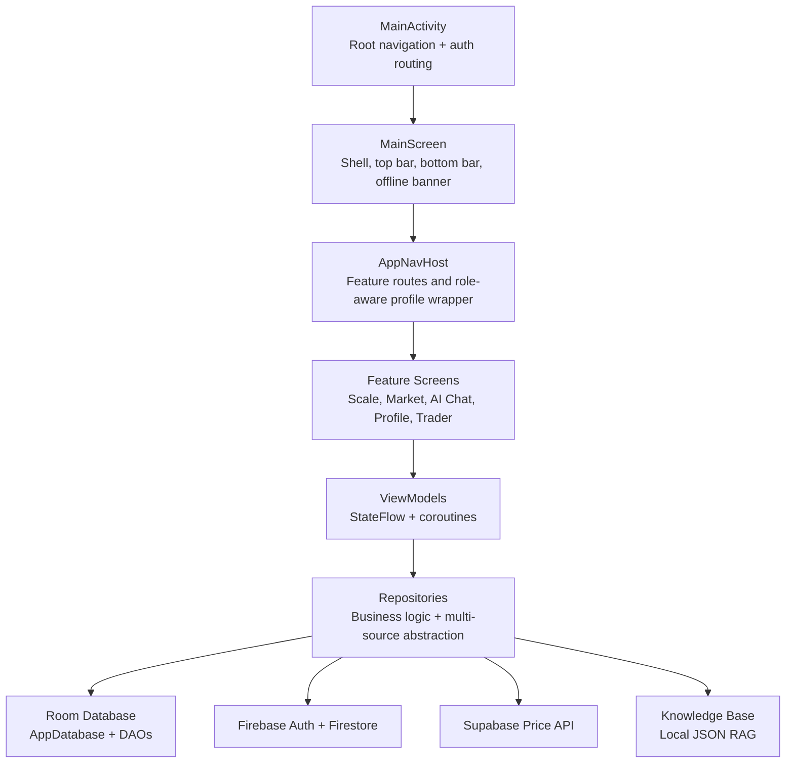
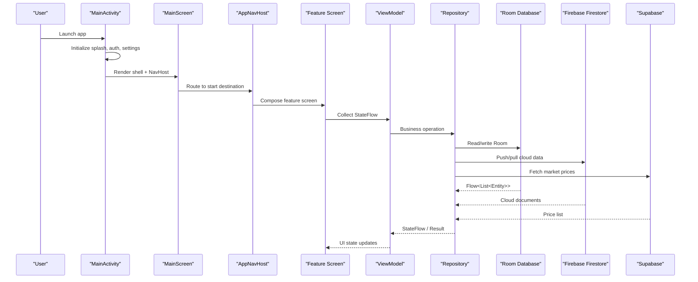
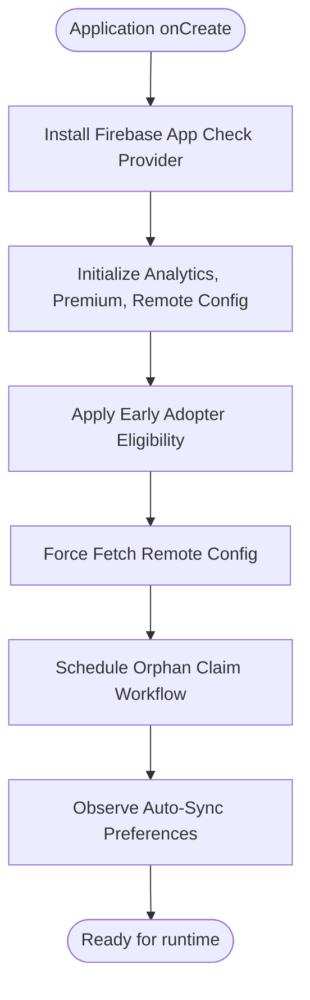
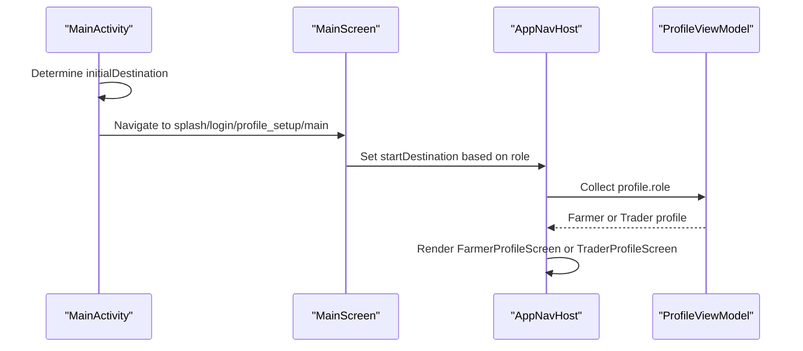
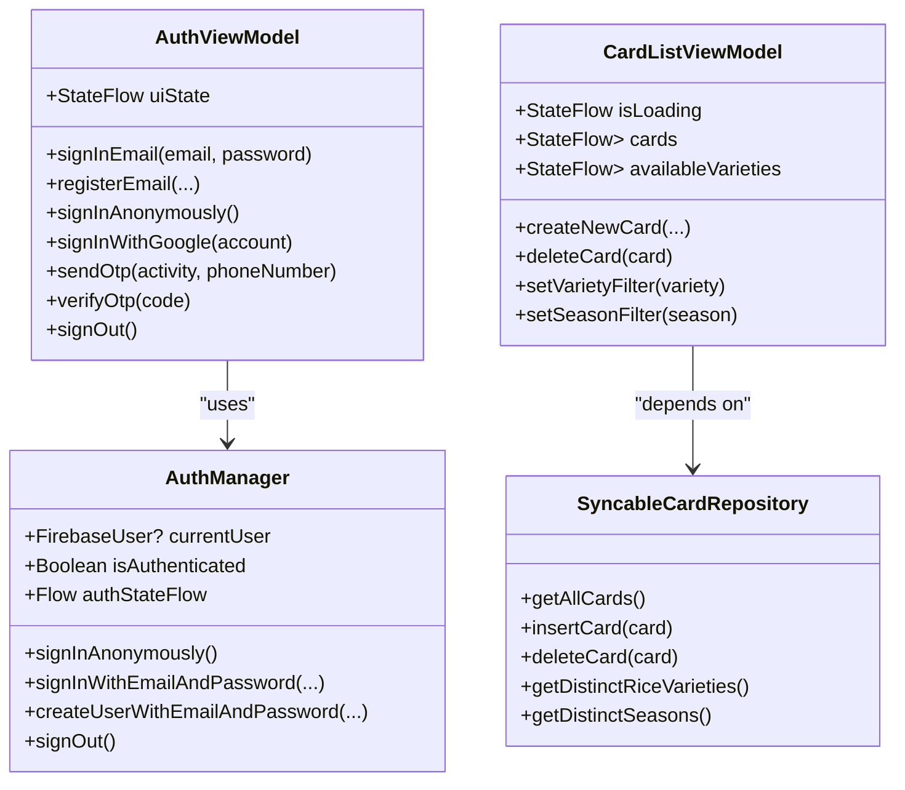
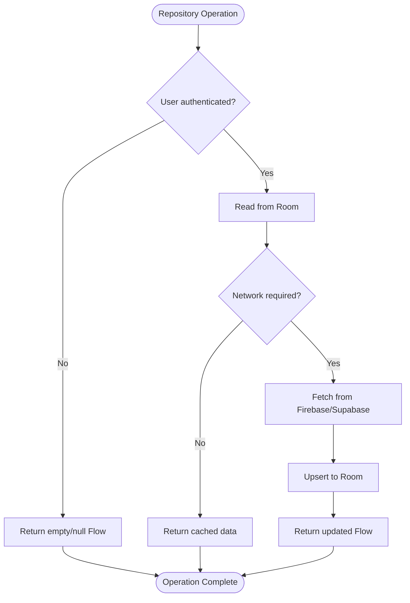
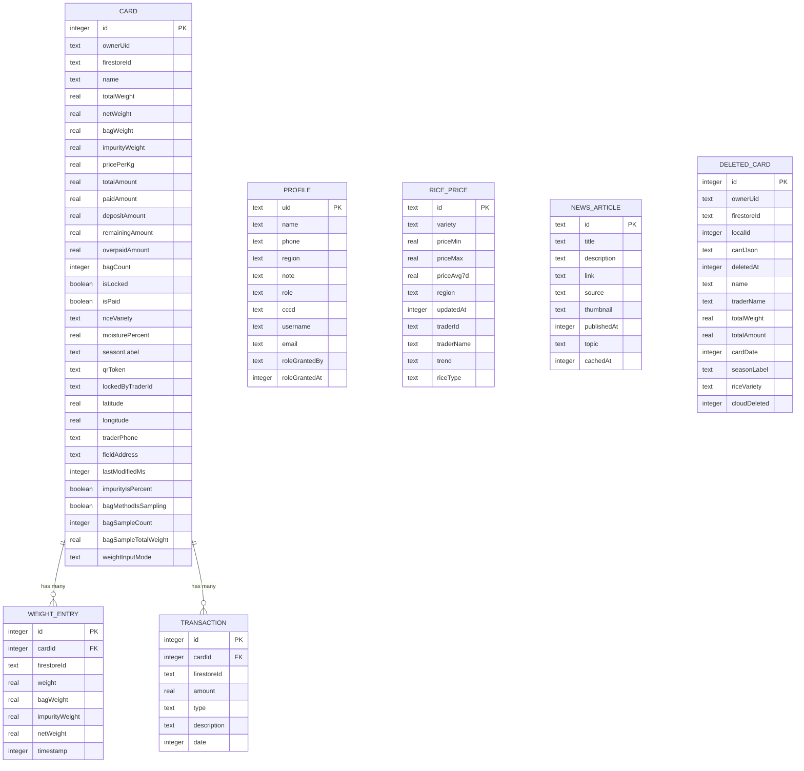
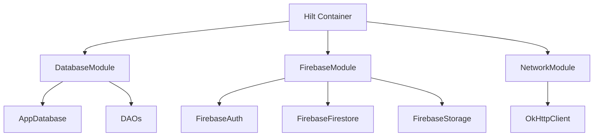
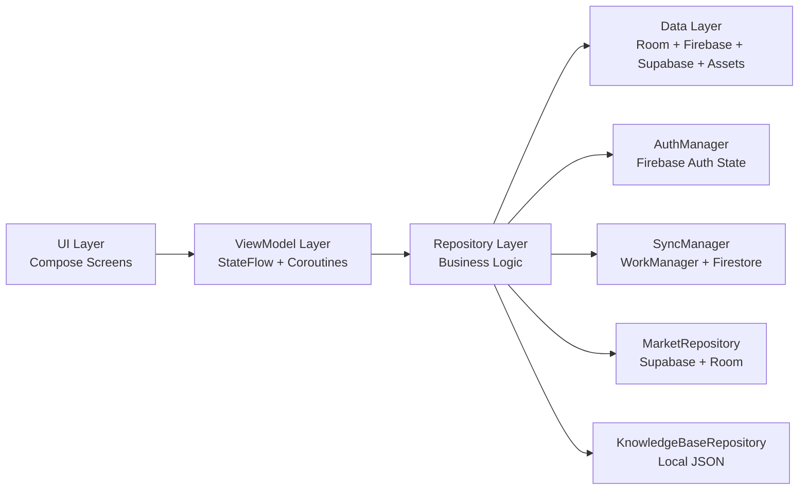

# Architecture Overview

<cite>
**Referenced Files in This Document**
- [MainActivity.kt](file://app/src/main/java/com/giathinh/canlua/MainActivity.kt)
- [MainScreen.kt](file://app/src/main/java/com/giathinh/canlua/ui/MainScreen.kt)
- [AppNavHost.kt](file://app/src/main/java/com/giathinh/canlua/ui/navigation/AppNavHost.kt)
- [CanLuaApplication.kt](file://app/src/main/java/com/giathinh/canlua/CanLuaApplication.kt)
- [AppDatabase.kt](file://app/src/main/java/com/giathinh/canlua/data/database/AppDatabase.kt)
- [DatabaseModule.kt](file://app/src/main/java/com/giathinh/canlua/di/DatabaseModule.kt)
- [FirebaseModule.kt](file://app/src/main/java/com/giathinh/canlua/di/FirebaseModule.kt)
- [NetworkModule.kt](file://app/src/main/java/com/giathinh/canlua/di/NetworkModule.kt)
- [CardRepository.kt](file://app/src/main/java/com/giathinh/canlua/repository/CardRepository.kt)
- [SyncManager.kt](file://app/src/main/java/com/giathinh/canlua/repository/SyncManager.kt)
- [AuthManager.kt](file://app/src/main/java/com/giathinh/canlua/repository/AuthManager.kt)
- [MarketRepository.kt](file://app/src/main/java/com/giathinh/canlua/repository/MarketRepository.kt)
- [KnowledgeBaseRepository.kt](file://app/src/main/java/com/giathinh/canlua/repository/KnowledgeBaseRepository.kt)
- [CardListViewModel.kt](file://app/src/main/java/com/giathinh/canlua/ui/viewmodel/CardListViewModel.kt)
- [AuthViewModel.kt](file://app/src/main/java/com/giathinh/canlua/ui/viewmodel/AuthViewModel.kt)
</cite>

## Table of Contents
1. Introduction
2. Project Structure
3. Core Components
4. Architecture Overview
5. Detailed Component Analysis
6. Dependency Analysis
7. Performance Considerations
8. Troubleshooting Guide
9. Conclusion

## Introduction
Cân Lúa Mobile is a Kotlin 2.3, Jetpack Compose offline-first Android application following MVVM and Clean Architecture with unidirectional data flow through StateFlow and coroutines. The app serves three roles — FARMER, TRADER, and GUEST — with role-based portals and AI features powered by OpenRouter (Gemini Flash) using local RAG context from JSON knowledge files. Local persistence uses AndroidX Room with schema version 19 and an explicit migration chain. Cloud synchronization is bidirectional to Firebase Firestore and Supabase, scheduled idempotently via WorkManager, while the app remains fully functional without network access.

## Project Structure
The codebase is organized by architectural layers:
- UI layer: Jetpack Compose screens, navigation, theme, and reusable components.
- ViewModel layer: state holders exposing StateFlow and handling user actions.
- Repository layer: business logic, orchestration between local and remote sources.
- Data layer: Room database, DAOs, models, Firestore mappings, network clients, and configuration modules.

**Diagram sources**
- [MainActivity.kt:39-145](file://app/src/main/java/com/giathinh/canlua/MainActivity.kt#L39-L145)
- [MainScreen.kt:71-383](file://app/src/main/java/com/giathinh/canlua/ui/MainScreen.kt#L71-L383)
- [AppNavHost.kt:27-150](file://app/src/main/java/com/giathinh/canlua/ui/navigation/AppNavHost.kt#L27-L150)
- [CardListViewModel.kt:24-169](file://app/src/main/java/com/giathinh/canlua/ui/viewmodel/CardListViewModel.kt#L24-L169)
- [CardRepository.kt:26-397](file://app/src/main/java/com/giathinh/canlua/repository/CardRepository.kt#L26-L397)
- [AppDatabase.kt:24-46](file://app/src/main/java/com/giathinh/canlua/data/database/AppDatabase.kt#L24-L46)
- [FirebaseModule.kt:12-33](file://app/src/main/java/com/giathinh/canlua/di/FirebaseModule.kt#L12-L33)
- [MarketRepository.kt:16-78](file://app/src/main/java/com/giathinh/canlua/repository/MarketRepository.kt#L16-L78)
- [KnowledgeBaseRepository.kt:10-105](file://app/src/main/java/com/giathinh/canlua/repository/KnowledgeBaseRepository.kt#L10-L105)

**Section sources**
- [MainActivity.kt:39-145](file://app/src/main/java/com/giathinh/canlua/MainActivity.kt#L39-L145)
- [MainScreen.kt:71-383](file://app/src/main/java/com/giathinh/canlua/ui/MainScreen.kt#L71-L383)
- [AppNavHost.kt:27-150](file://app/src/main/java/com/giathinh/canlua/ui/navigation/AppNavHost.kt#L27-L150)

## Core Components
- Application lifecycle: CanLuaApplication initializes analytics, premium state, Firebase Remote Config, early adopter eligibility, orphan claim scheduling, and auto-sync preference observation. It configures WorkManager with Hilt worker factory and installs Firebase App Check provider.
- Single-activity architecture: MainActivity hosts Compose content, manages splash screen retention until initialization and authentication are ready, sets up edge-to-edge UI, ad consent, locale, and root navigation graph.
- Navigation: MainScreen provides shell UI and delegates feature routing to AppNavHost, which defines tab routes, sub-screens, deep links, and role-aware profile switching.
- State management: ViewModels expose StateFlow for UI state and use coroutines for background work; they depend on repositories for business logic and data operations.
- Repository layer: CardRepository encapsulates per-user isolation, card CRUD, weight entries, transactions, calculations, tombstone handling, and statistics. SyncManager orchestrates bidirectional sync with Firestore and Supabase, enforces constraints, and schedules WorkManager tasks. MarketRepository implements offline-first price caching with TTL refresh. KnowledgeBaseRepository provides local RAG context for AI chat.
- Data layer: AppDatabase declares entities, migrations, and DAO providers. DI modules provide Room database, DAOs, Firebase services, OkHttp client with retry interceptor, and settings repository.

**Section sources**
- [CanLuaApplication.kt:28-125](file://app/src/main/java/com/giathinh/canlua/CanLuaApplication.kt#L28-L125)
- [MainActivity.kt:39-145](file://app/src/main/java/com/giathinh/canlua/MainActivity.kt#L39-L145)
- [MainScreen.kt:71-383](file://app/src/main/java/com/giathinh/canlua/ui/MainScreen.kt#L71-L383)
- [AppNavHost.kt:27-150](file://app/src/main/java/com/giathinh/canlua/ui/navigation/AppNavHost.kt#L27-L150)
- [CardRepository.kt:26-397](file://app/src/main/java/com/giathinh/canlua/repository/CardRepository.kt#L26-L397)
- [SyncManager.kt:35-557](file://app/src/main/java/com/giathinh/canlua/repository/SyncManager.kt#L35-L557)
- [MarketRepository.kt:16-78](file://app/src/main/java/com/giathinh/canlua/repository/MarketRepository.kt#L16-L78)
- [KnowledgeBaseRepository.kt:10-105](file://app/src/main/java/com/giathinh/canlua/repository/KnowledgeBaseRepository.kt#L10-L105)
- [AppDatabase.kt:24-46](file://app/src/main/java/com/giathinh/canlua/data/database/AppDatabase.kt#L24-L46)
- [DatabaseModule.kt:18-76](file://app/src/main/java/com/giathinh/canlua/di/DatabaseModule.kt#L18-L76)
- [FirebaseModule.kt:12-33](file://app/src/main/java/com/giathinh/canlua/di/FirebaseModule.kt#L12-L33)
- [NetworkModule.kt:13-77](file://app/src/main/java/com/giathinh/canlua/di/NetworkModule.kt#L13-L77)

## Architecture Overview
The system follows MVVM + Clean Architecture with unidirectional data flow:
- UI composable reads StateFlow from ViewModels.
- ViewModels call repositories for business logic and data operations.
- Repositories abstract multiple data sources: Room (offline cache), Firebase Firestore (cloud), Supabase (market prices), and local assets (knowledge base).
- Application-level services initialize cross-cutting concerns: analytics, premium gating, remote config, auth-driven workflows, and background sync.

**Diagram sources**
- [MainActivity.kt:39-145](file://app/src/main/java/com/giathinh/canlua/MainActivity.kt#L39-L145)
- [MainScreen.kt:71-383](file://app/src/main/java/com/giathinh/canlua/ui/MainScreen.kt#L71-L383)
- [AppNavHost.kt:27-150](file://app/src/main/java/com/giathinh/canlua/ui/navigation/AppNavHost.kt#L27-L150)
- [CardListViewModel.kt:24-169](file://app/src/main/java/com/giathinh/canlua/ui/viewmodel/CardListViewModel.kt#L24-L169)
- [CardRepository.kt:26-397](file://app/src/main/java/com/giathinh/canlua/repository/CardRepository.kt#L26-L397)
- [SyncManager.kt:35-557](file://app/src/main/java/com/giathinh/canlua/repository/SyncManager.kt#L35-L557)
- [MarketRepository.kt:16-78](file://app/src/main/java/com/giathinh/canlua/repository/MarketRepository.kt#L16-L78)

## Detailed Component Analysis

### Application Lifecycle and Initialization
CanLuaApplication performs critical startup tasks:
- Installs Firebase App Check provider based on build variant.
- Initializes analytics, premium state, and Firebase Remote Config.
- Applies early adopter eligibility and force-fetches remote config.
- Schedules orphan card claiming and observes auto-sync preferences.
- Configures WorkManager with HiltWorkerFactory for dependency injection in workers.

**Diagram sources**
- [CanLuaApplication.kt:53-77](file://app/src/main/java/com/giathinh/canlua/CanLuaApplication.kt#L53-L77)
- [CanLuaApplication.kt:79-125](file://app/src/main/java/com/giathinh/canlua/CanLuaApplication.kt#L79-L125)

**Section sources**
- [CanLuaApplication.kt:28-125](file://app/src/main/java/com/giathinh/canlua/CanLuaApplication.kt#L28-L125)

### Single-Activity Navigation and Role-Based Routing
MainActivity sets up the root navigation graph:
- Splash screen remains visible until data readiness and authentication state are resolved.
- Root routes include splash, login, profile setup, and main app shell.
- Deep links route to specific cards within the main shell.
- MainScreen provides shell UI with top bar, bottom navigation, offline status banner, and delegates feature routing to AppNavHost.
- AppNavHost defines tab routes (Scale, Market, AI Chat, Account) and trader-only routes, with role-aware profile wrapper switching between farmer and trader profiles.

**Diagram sources**
- [MainActivity.kt:45-145](file://app/src/main/java/com/giathinh/canlua/MainActivity.kt#L45-L145)
- [MainScreen.kt:71-383](file://app/src/main/java/com/giathinh/canlua/ui/MainScreen.kt#L71-L383)
- [AppNavHost.kt:27-150](file://app/src/main/java/com/giathinh/canlua/ui/navigation/AppNavHost.kt#L27-L150)

**Section sources**
- [MainActivity.kt:39-145](file://app/src/main/java/com/giathinh/canlua/MainActivity.kt#L39-L145)
- [MainScreen.kt:71-383](file://app/src/main/java/com/giathinh/canlua/ui/MainScreen.kt#L71-L383)
- [AppNavHost.kt:27-150](file://app/src/main/java/com/giathinh/canlua/ui/navigation/AppNavHost.kt#L27-L150)

### ViewModel Layer and Unidirectional Data Flow
ViewModels manage UI state through StateFlow and handle user interactions:
- AuthViewModel subscribes to AuthManager.authStateFlow, updates UI state, and coordinates profile setup routing.
- CardListViewModel combines repository flows with local filters, exposes filtered card lists, and handles card creation/deletion events.
- ViewModels delegate business logic to repositories and use coroutines for background operations.

**Diagram sources**
- [AuthViewModel.kt:25-361](file://app/src/main/java/com/giathinh/canlua/ui/viewmodel/AuthViewModel.kt#L25-L361)
- [CardListViewModel.kt:24-169](file://app/src/main/java/com/giathinh/canlua/ui/viewmodel/CardListViewModel.kt#L24-L169)
- [AuthManager.kt:12-76](file://app/src/main/java/com/giathinh/canlua/repository/AuthManager.kt#L12-L76)

**Section sources**
- [AuthViewModel.kt:25-361](file://app/src/main/java/com/giathinh/canlua/ui/viewmodel/AuthViewModel.kt#L25-L361)
- [CardListViewModel.kt:24-169](file://app/src/main/java/com/giathinh/canlua/ui/viewmodel/CardListViewModel.kt#L24-L169)

### Repository Layer and Multi-Source Abstraction
Repositories implement business logic and abstract data sources:
- CardRepository ensures per-user isolation, encrypts sensitive fields, handles card lifecycle including tombstones for deleted cards, and performs atomic recalculations using RiceSettlement.
- SyncManager orchestrates bidirectional sync with Firestore, batches operations, handles deduplication, and schedules WorkManager tasks with constraints.
- MarketRepository implements offline-first caching with TTL refresh from Supabase.
- KnowledgeBaseRepository provides local RAG context for AI chat using keyword scoring over JSON assets.

**Diagram sources**
- [CardRepository.kt:26-397](file://app/src/main/java/com/giathinh/canlua/repository/CardRepository.kt#L26-L397)
- [SyncManager.kt:35-557](file://app/src/main/java/com/giathinh/canlua/repository/SyncManager.kt#L35-L557)
- [MarketRepository.kt:16-78](file://app/src/main/java/com/giathinh/canlua/repository/MarketRepository.kt#L16-L78)

**Section sources**
- [CardRepository.kt:26-397](file://app/src/main/java/com/giathinh/canlua/repository/CardRepository.kt#L26-L397)
- [SyncManager.kt:35-557](file://app/src/main/java/com/giathinh/canlua/repository/SyncManager.kt#L35-L557)
- [MarketRepository.kt:16-78](file://app/src/main/java/com/giathinh/canlua/repository/MarketRepository.kt#L16-L78)
- [KnowledgeBaseRepository.kt:10-105](file://app/src/main/java/com/giathinh/canlua/repository/KnowledgeBaseRepository.kt#L10-L105)

### Data Layer and Offline-First Strategy
Room database serves as the single source of truth for local data:
- AppDatabase declares entities, migrations, and DAO providers.
- Schema version 19 includes explicit migration chain covering user isolation, cloud sync fields, conflict resolution, tombstone table, per-card weigh modes, and settlement improvements.
- DI module provides database instance and DAOs for repository injection.

**Diagram sources**
- [AppDatabase.kt:24-46](file://app/src/main/java/com/giathinh/canlua/data/database/AppDatabase.kt#L24-L46)
- [AppDatabase.kt:84-398](file://app/src/main/java/com/giathinh/canlua/data/database/AppDatabase.kt#L84-L398)

**Section sources**
- [AppDatabase.kt:24-46](file://app/src/main/java/com/giathinh/canlua/data/database/AppDatabase.kt#L24-L46)
- [AppDatabase.kt:84-398](file://app/src/main/java/com/giathinh/canlua/data/database/AppDatabase.kt#L84-L398)
- [DatabaseModule.kt:18-76](file://app/src/main/java/com/giathinh/canlua/di/DatabaseModule.kt#L18-L76)

### Dependency Injection Setup with Hilt
Hilt provides centralized dependency management:
- DatabaseModule provides AppDatabase singleton and all DAO instances.
- FirebaseModule provides FirebaseAuth, FirebaseFirestore, and FirebaseStorage singletons.
- NetworkModule provides OkHttpClient with timeouts, logging interceptor, and retry logic.
- SettingsRepository and TextToSpeechManager are provided as singletons.

**Diagram sources**
- [DatabaseModule.kt:18-76](file://app/src/main/java/com/giathinh/canlua/di/DatabaseModule.kt#L18-L76)
- [FirebaseModule.kt:12-33](file://app/src/main/java/com/giathinh/canlua/di/FirebaseModule.kt#L12-L33)
- [NetworkModule.kt:13-77](file://app/src/main/java/com/giathinh/canlua/di/NetworkModule.kt#L13-L77)

**Section sources**
- [DatabaseModule.kt:18-76](file://app/src/main/java/com/giathinh/canlua/di/DatabaseModule.kt#L18-L76)
- [FirebaseModule.kt:12-33](file://app/src/main/java/com/giathinh/canlua/di/FirebaseModule.kt#L12-L33)
- [NetworkModule.kt:13-77](file://app/src/main/java/com/giathinh/canlua/di/NetworkModule.kt#L13-L77)

## Dependency Analysis
Component dependencies follow Clean Architecture principles:
- UI depends only on ViewModels through StateFlow.
- ViewModels depend on repositories for business logic.
- Repositories depend on data layer components (Room, Firebase, Supabase, local assets).
- Cross-cutting concerns like analytics, premium state, and remote config are initialized at application level.

**Diagram sources**
- [CardListViewModel.kt:24-169](file://app/src/main/java/com/giathinh/canlua/ui/viewmodel/CardListViewModel.kt#L24-L169)
- [CardRepository.kt:26-397](file://app/src/main/java/com/giathinh/canlua/repository/CardRepository.kt#L26-L397)
- [SyncManager.kt:35-557](file://app/src/main/java/com/giathinh/canlua/repository/SyncManager.kt#L35-L557)
- [MarketRepository.kt:16-78](file://app/src/main/java/com/giathinh/canlua/repository/MarketRepository.kt#L16-L78)
- [KnowledgeBaseRepository.kt:10-105](file://app/src/main/java/com/giathinh/canlua/repository/KnowledgeBaseRepository.kt#L10-L105)

**Section sources**
- [CardListViewModel.kt:24-169](file://app/src/main/java/com/giathinh/canlua/ui/viewmodel/CardListViewModel.kt#L24-L169)
- [CardRepository.kt:26-397](file://app/src/main/java/com/giathinh/canlua/repository/CardRepository.kt#L26-L397)
- [SyncManager.kt:35-557](file://app/src/main/java/com/giathinh/canlua/repository/SyncManager.kt#L35-L557)

## Performance Considerations
- Room database uses WRITE_AHEAD_LOGGING journal mode for concurrent read/write performance.
- Network requests include retry interceptor with exponential backoff for transient failures.
- MarketRepository implements TTL-based caching to reduce API calls.
- SyncManager batches Firestore operations to stay within limits and reduces network overhead.
- ViewModel flows use SharingStarted.WhileSubscribed to avoid unnecessary recomposition when not observed.
- PerformanceTracker monitors screen transitions and frame rates for optimization insights.

[No sources needed since this section provides general guidance]

## Troubleshooting Guide
Common issues and their resolutions:
- Authentication state inconsistencies: Ensure AuthManager.authStateFlow is properly subscribed and that ViewModels handle null states during transitions.
- Sync failures: Check network connectivity, Wi-Fi-only settings, and WorkManager constraints. Review analytics logs for sync failure stages.
- Room migration errors: Verify migration chain completeness and test schema changes thoroughly.
- Offline behavior: Confirm that UI reads from Room first and gracefully degrades when network is unavailable.
- Role-based routing: Validate profile setup completion and ensure role checks are consistent across screens.

**Section sources**
- [AuthManager.kt:12-76](file://app/src/main/java/com/giathinh/canlua/repository/AuthManager.kt#L12-L76)
- [SyncManager.kt:35-557](file://app/src/main/java/com/giathinh/canlua/repository/SyncManager.kt#L35-L557)
- [AppDatabase.kt:84-398](file://app/src/main/java/com/giathinh/canlua/data/database/AppDatabase.kt#L84-L398)

## Conclusion
Cân Lúa Mobile implements a robust MVVM + Clean Architecture with unidirectional data flow, offline-first strategy, and role-based access control. The separation of concerns through ViewModels and repositories enables maintainable code, while Hilt provides clean dependency injection. Room ensures reliable local persistence with comprehensive migrations, and WorkManager guarantees resilient background synchronization. The architecture supports scalability, testability, and a smooth user experience across different roles and network conditions.

[No sources needed since this section summarizes without analyzing specific files]