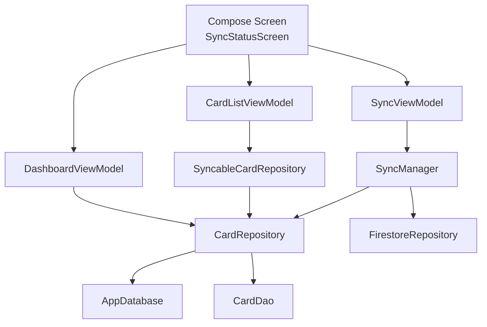
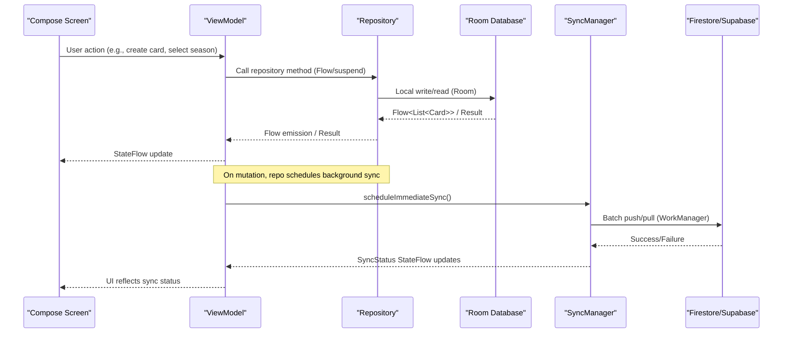
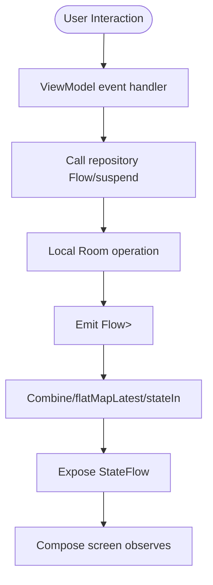
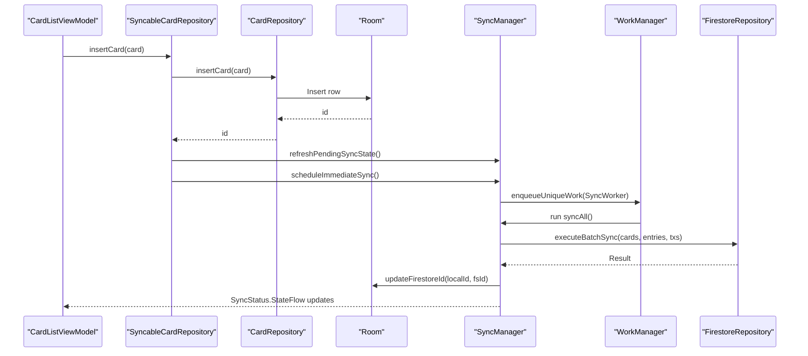
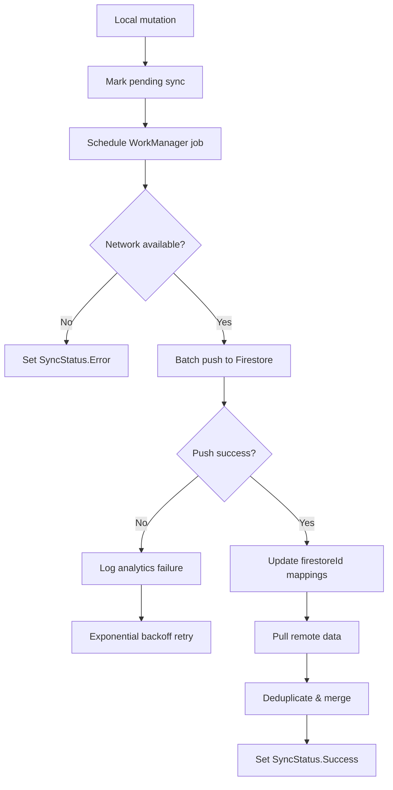
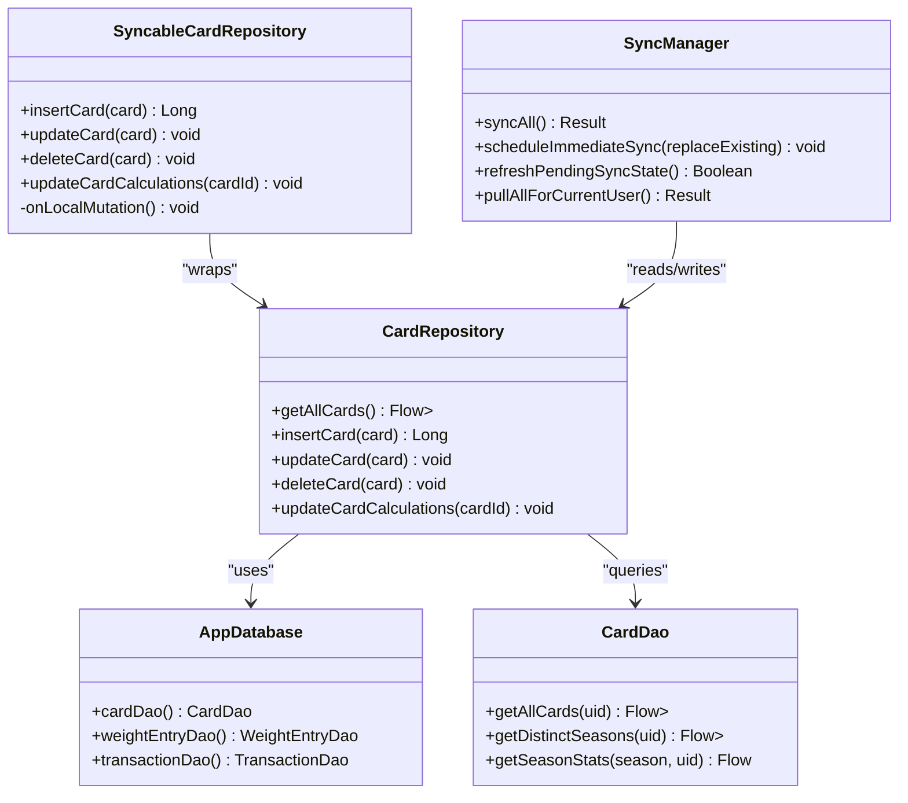
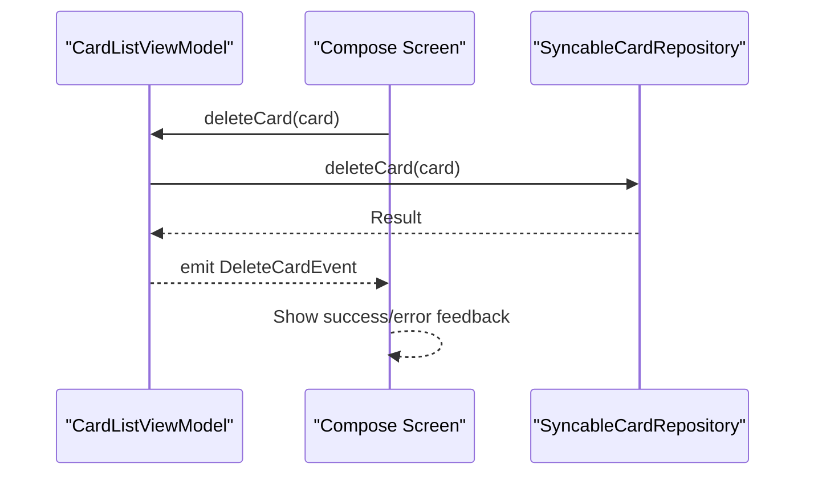
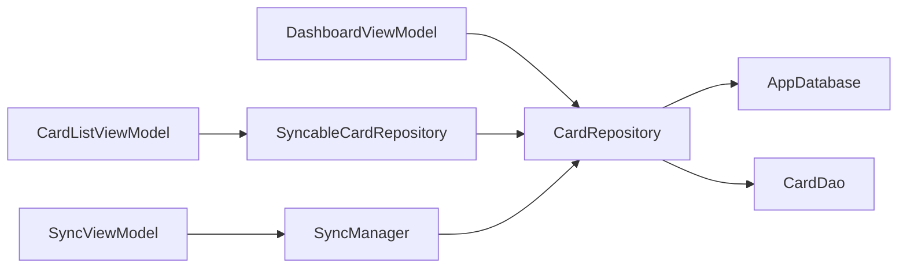

# Data Flow Patterns

<cite>
**Referenced Files in This Document**
- [CardListViewModel.kt](file://app/src/main/java/com/giathinh/canlua/ui/viewmodel/CardListViewModel.kt)
- [DashboardViewModel.kt](file://app/src/main/java/com/giathinh/canlua/ui/viewmodel/DashboardViewModel.kt)
- [SyncViewModel.kt](file://app/src/main/java/com/giathinh/canlua/ui/viewmodel/SyncViewModel.kt)
- [SyncStatusScreen.kt](file://app/src/main/java/com/giathinh/canlua/ui/screen/SyncStatusScreen.kt)
- [CardRepository.kt](file://app/src/main/java/com/giathinh/canlua/repository/CardRepository.kt)
- [SyncableCardRepository.kt](file://app/src/main/java/com/giathinh/canlua/repository/SyncableCardRepository.kt)
- [SyncManager.kt](file://app/src/main/java/com/giathinh/canlua/repository/SyncManager.kt)
- [AppDatabase.kt](file://app/src/main/java/com/giathinh/canlua/data/database/AppDatabase.kt)
- [CardDao.kt](file://app/src/main/java/com/giathinh/canlua/data/dao/CardDao.kt)
- [Card.kt](file://app/src/main/java/com/giathinh/canlua/data/model/Card.kt)
</cite>

## Table of Contents
1. [Introduction](#introduction)
2. [Project Structure](#project-structure)
3. [Core Components](#core-components)
4. [Architecture Overview](#architecture-overview)
5. [Detailed Component Analysis](#detailed-component-analysis)
6. [Dependency Analysis](#dependency-analysis)
7. [Performance Considerations](#performance-considerations)
8. [Troubleshooting Guide](#troubleshooting-guide)
9. [Conclusion](#conclusion)

## Introduction
This document explains the reactive data flow patterns in Cân Lúa Mobile using StateFlow and Kotlin coroutines. The app follows MVVM with Clean Architecture and unidirectional data flow: user interactions trigger events in ViewModels, which call repository methods that perform local Room database operations and optionally coordinate background synchronization to Firebase Firestore and Supabase. Repositories return Flow objects; ViewModels expose StateFlow for UI consumption. The design is offline-first: writes are local-first, and background WorkManager jobs handle idempotent bidirectional sync when connectivity allows.

## Project Structure
The relevant layers for data flow are:
- UI layer: Compose screens observe StateFlow from ViewModels.
- ViewModel layer: owns UI state, reacts to user actions, composes flows, and calls repositories.
- Repository layer: abstracts data sources (Room, Firestore, Supabase), returns Flow or suspend functions, and coordinates background sync.
- Data layer: Room database entities, DAOs, and models.

**Diagram sources**
- [SyncStatusScreen.kt:68-77](file://app/src/main/java/com/giathinh/canlua/ui/screen/SyncStatusScreen.kt#L68-L77)
- [SyncViewModel.kt:14-49](file://app/src/main/java/com/giathinh/canlua/ui/viewmodel/SyncViewModel.kt#L14-L49)
- [CardListViewModel.kt:24-53](file://app/src/main/java/com/giathinh/canlua/ui/viewmodel/CardListViewModel.kt#L24-L53)
- [DashboardViewModel.kt:100-112](file://app/src/main/java/com/giathinh/canlua/ui/viewmodel/DashboardViewModel.kt#L100-L112)
- [SyncableCardRepository.kt:16-24](file://app/src/main/java/com/giathinh/canlua/repository/SyncableCardRepository.kt#L16-L24)
- [CardRepository.kt:36-46](file://app/src/main/java/com/giathinh/canlua/repository/CardRepository.kt#L36-L46)
- [SyncManager.kt:35-47](file://app/src/main/java/com/giathinh/canlua/repository/SyncManager.kt#L35-L47)
- [AppDatabase.kt:24-46](file://app/src/main/java/com/giathinh/canlua/data/database/AppDatabase.kt#L24-L46)
- [CardDao.kt:16-19](file://app/src/main/java/com/giathinh/canlua/data/dao/CardDao.kt#L16-L19)

**Section sources**
- [CardListViewModel.kt:24-53](file://app/src/main/java/com/giathinh/canlua/ui/viewmodel/CardListViewModel.kt#L24-L53)
- [DashboardViewModel.kt:100-112](file://app/src/main/java/com/giathinh/canlua/ui/viewmodel/DashboardViewModel.kt#L100-L112)
- [SyncViewModel.kt:14-49](file://app/src/main/java/com/giathinh/canlua/ui/viewmodel/SyncViewModel.kt#L14-L49)
- [SyncStatusScreen.kt:68-77](file://app/src/main/java/com/giathinh/canlua/ui/screen/SyncStatusScreen.kt#L68-L77)
- [SyncableCardRepository.kt:16-24](file://app/src/main/java/com/giathinh/canlua/repository/SyncableCardRepository.kt#L16-L24)
- [CardRepository.kt:36-46](file://app/src/main/java/com/giathinh/canlua/repository/CardRepository.kt#L36-L46)
- [SyncManager.kt:35-47](file://app/src/main/java/com/giathinh/canlua/repository/SyncManager.kt#L35-L47)
- [AppDatabase.kt:24-46](file://app/src/main/java/com/giathinh/canlua/data/database/AppDatabase.kt#L24-L46)
- [CardDao.kt:16-19](file://app/src/main/java/com/giathinh/canlua/data/dao/CardDao.kt#L16-L19)

## Core Components
- CardListViewModel: exposes filtered card lists via StateFlow, uses combine to react to filter changes, and triggers insert/delete operations through SyncableCardRepository.
- DashboardViewModel: aggregates multiple Flow streams into a single dashboardState Flow, uses flatMapLatest to cancel previous queries on season change, and integrates AI analysis state.
- SyncViewModel: exposes SyncManager’s StateFlow states to the UI and triggers manual sync and backup operations.
- SyncableCardRepository: decorator around CardRepository that marks mutations as pending and schedules background sync via WorkManager.
- CardRepository: local-first persistence layer over Room, encrypts sensitive fields, performs atomic calculations, and provides Flow-based queries.
- SyncManager: orchestrates bidirectional sync, batched Firestore operations, conflict resolution, and WorkManager scheduling.
- AppDatabase and CardDao: Room schema and reactive queries per ownerUid.

**Section sources**
- [CardListViewModel.kt:24-169](file://app/src/main/java/com/giathinh/canlua/ui/viewmodel/CardListViewModel.kt#L24-L169)
- [DashboardViewModel.kt:100-368](file://app/src/main/java/com/giathinh/canlua/ui/viewmodel/DashboardViewModel.kt#L100-L368)
- [SyncViewModel.kt:14-49](file://app/src/main/java/com/giathinh/canlua/ui/viewmodel/SyncViewModel.kt#L14-L49)
- [SyncableCardRepository.kt:16-86](file://app/src/main/java/com/giathinh/canlua/repository/SyncableCardRepository.kt#L16-L86)
- [CardRepository.kt:36-406](file://app/src/main/java/com/giathinh/canlua/repository/CardRepository.kt#L36-L406)
- [SyncManager.kt:35-557](file://app/src/main/java/com/giathinh/canlua/repository/SyncManager.kt#L35-L557)
- [AppDatabase.kt:24-46](file://app/src/main/java/com/giathinh/canlua/data/database/AppDatabase.kt#L24-L46)
- [CardDao.kt:16-19](file://app/src/main/java/com/giathinh/canlua/data/dao/CardDao.kt#L16-L19)

## Architecture Overview
The unidirectional data flow pattern is implemented as follows:
- UI observes StateFlow from ViewModels.
- User actions invoke ViewModel functions.
- ViewModels call repository methods that return Flow or suspend functions.
- Repositories read/write Room and schedule background sync.
- Background workers push/pull data to/from cloud services.

**Diagram sources**
- [CardListViewModel.kt:81-149](file://app/src/main/java/com/giathinh/canlua/ui/viewmodel/CardListViewModel.kt#L81-L149)
- [SyncableCardRepository.kt:36-49](file://app/src/main/java/com/giathinh/canlua/repository/SyncableCardRepository.kt#L36-L49)
- [CardRepository.kt:60-85](file://app/src/main/java/com/giathinh/canlua/repository/CardRepository.kt#L60-L85)
- [SyncManager.kt:102-130](file://app/src/main/java/com/giathinh/canlua/repository/SyncManager.kt#L102-L130)
- [SyncStatusScreen.kt:68-77](file://app/src/main/java/com/giathinh/canlua/ui/screen/SyncStatusScreen.kt#L68-L77)

## Detailed Component Analysis

### Reactive StateFlow and Coroutines in ViewModels
- CardListViewModel combines repository Flow with filter StateFlows to produce a filtered cards list. It sets loading state after emissions and exposes delete events via SharedFlow.
- DashboardViewModel uses flatMapLatest to switch between season-specific queries and cancels previous flows automatically. It combines multiple streams into a single dashboardData Flow to avoid recomposition cascades.
- SyncViewModel exposes SyncManager’s StateFlow values and launches coroutine scopes for sync and backup operations.

**Diagram sources**
- [CardListViewModel.kt:43-53](file://app/src/main/java/com/giathinh/canlua/ui/viewmodel/CardListViewModel.kt#L43-L53)
- [DashboardViewModel.kt:135-148](file://app/src/main/java/com/giathinh/canlua/ui/viewmodel/DashboardViewModel.kt#L135-L148)
- [DashboardViewModel.kt:201-249](file://app/src/main/java/com/giathinh/canlua/ui/viewmodel/DashboardViewModel.kt#L201-L249)
- [SyncViewModel.kt:29-49](file://app/src/main/java/com/giathinh/canlua/ui/viewmodel/SyncViewModel.kt#L29-L49)

**Section sources**
- [CardListViewModel.kt:31-53](file://app/src/main/java/com/giathinh/canlua/ui/viewmodel/CardListViewModel.kt#L31-L53)
- [DashboardViewModel.kt:108-148](file://app/src/main/java/com/giathinh/canlua/ui/viewmodel/DashboardViewModel.kt#L108-L148)
- [DashboardViewModel.kt:201-249](file://app/src/main/java/com/giathinh/canlua/ui/viewmodel/DashboardViewModel.kt#L201-L249)
- [SyncViewModel.kt:29-49](file://app/src/main/java/com/giathinh/canlua/ui/viewmodel/SyncViewModel.kt#L29-L49)

### Offline-First Writes and Background Synchronization
- SyncableCardRepository wraps CardRepository to mark mutations as pending and schedule immediate sync via WorkManager.
- SyncManager checks network conditions, batches Firestore operations, maps local entities to cloud models, and updates local IDs after successful sync. It also pulls remote data and applies deduplication logic.

**Diagram sources**
- [SyncableCardRepository.kt:36-49](file://app/src/main/java/com/giathinh/canlua/repository/SyncableCardRepository.kt#L36-L49)
- [CardRepository.kt:60-68](file://app/src/main/java/com/giathinh/canlua/repository/CardRepository.kt#L60-L68)
- [SyncManager.kt:102-130](file://app/src/main/java/com/giathinh/canlua/repository/SyncManager.kt#L102-L130)
- [SyncManager.kt:139-310](file://app/src/main/java/com/giathinh/canlua/repository/SyncManager.kt#L139-L310)

**Section sources**
- [SyncableCardRepository.kt:16-86](file://app/src/main/java/com/giathinh/canlua/repository/SyncableCardRepository.kt#L16-L86)
- [SyncManager.kt:102-130](file://app/src/main/java/com/giathinh/canlua/repository/SyncManager.kt#L102-L130)
- [SyncManager.kt:139-310](file://app/src/main/java/com/giathinh/canlua/repository/SyncManager.kt#L139-L310)

### Loading States, Error Handling, and Retry Mechanisms
- Loading states: CardListViewModel toggles isLoading based on Flow emissions; DashboardViewModel uses combined dashboardData to signal aggregated readiness.
- Error handling: SyncManager sets SyncStatus.Error with messages and logs analytics; UI displays error messages and disables actions during syncing.
- Retry mechanisms: WorkManager enqueues unique work with exponential backoff; SyncManager retries failed batches and updates tombstone/cloud-deleted flags.

**Diagram sources**
- [CardListViewModel.kt:31-53](file://app/src/main/java/com/giathinh/canlua/ui/viewmodel/CardListViewModel.kt#L31-L53)
- [DashboardViewModel.kt:201-249](file://app/src/main/java/com/giathinh/canlua/ui/viewmodel/DashboardViewModel.kt#L201-L249)
- [SyncManager.kt:139-310](file://app/src/main/java/com/giathinh/canlua/repository/SyncManager.kt#L139-L310)
- [SyncStatusScreen.kt:121-181](file://app/src/main/java/com/giathinh/canlua/ui/screen/SyncStatusScreen.kt#L121-L181)

**Section sources**
- [CardListViewModel.kt:31-53](file://app/src/main/java/com/giathinh/canlua/ui/viewmodel/CardListViewModel.kt#L31-L53)
- [DashboardViewModel.kt:201-249](file://app/src/main/java/com/giathinh/canlua/ui/viewmodel/DashboardViewModel.kt#L201-L249)
- [SyncManager.kt:139-310](file://app/src/main/java/com/giathinh/canlua/repository/SyncManager.kt#L139-L310)
- [SyncStatusScreen.kt:121-181](file://app/src/main/java/com/giathinh/canlua/ui/screen/SyncStatusScreen.kt#L121-L181)

### Background Processing and Concurrent Operations
- Background processing: WorkManager constraints ensure sync runs only under required network types; exponential backoff handles transient failures.
- Concurrent safety: Room transactions wrap critical updates (insert/update/delete and recalculation); CardRepository guards locked cards and uses atomic RiceSettlement computation.
- Concurrency control: flatMapLatest cancels previous flows when user changes selection; stateIn ensures cold flows start only when subscribed.

**Diagram sources**
- [CardRepository.kt:36-406](file://app/src/main/java/com/giathinh/canlua/repository/CardRepository.kt#L36-L406)
- [SyncableCardRepository.kt:16-86](file://app/src/main/java/com/giathinh/canlua/repository/SyncableCardRepository.kt#L16-L86)
- [SyncManager.kt:35-557](file://app/src/main/java/com/giathinh/canlua/repository/SyncManager.kt#L35-L557)
- [AppDatabase.kt:24-46](file://app/src/main/java/com/giathinh/canlua/data/database/AppDatabase.kt#L24-L46)
- [CardDao.kt:16-19](file://app/src/main/java/com/giathinh/canlua/data/dao/CardDao.kt#L16-L19)

**Section sources**
- [CardRepository.kt:176-190](file://app/src/main/java/com/giathinh/canlua/repository/CardRepository.kt#L176-L190)
- [CardRepository.kt:242-310](file://app/src/main/java/com/giathinh/canlua/repository/CardRepository.kt#L242-L310)
- [SyncManager.kt:102-130](file://app/src/main/java/com/giathinh/canlua/repository/SyncManager.kt#L102-L130)
- [DashboardViewModel.kt:135-148](file://app/src/main/java/com/giathinh/canlua/ui/viewmodel/DashboardViewModel.kt#L135-L148)

### Event-Driven Real-Time Updates
- CardListViewModel emits deleteEvents via MutableSharedFlow to notify UI of deletion outcomes.
- DashboardViewModel resets AI analysis state when season changes, ensuring real-time responsiveness.
- SyncStatusScreen observes SyncStatus StateFlow and updates UI accordingly.

**Diagram sources**
- [CardListViewModel.kt:152-161](file://app/src/main/java/com/giathinh/canlua/ui/viewmodel/CardListViewModel.kt#L152-L161)
- [DashboardViewModel.kt:129-132](file://app/src/main/java/com/giathinh/canlua/ui/viewmodel/DashboardViewModel.kt#L129-L132)
- [SyncStatusScreen.kt:68-77](file://app/src/main/java/com/giathinh/canlua/ui/screen/SyncStatusScreen.kt#L68-L77)

**Section sources**
- [CardListViewModel.kt:152-161](file://app/src/main/java/com/giathinh/canlua/ui/viewmodel/CardListViewModel.kt#L152-L161)
- [DashboardViewModel.kt:129-132](file://app/src/main/java/com/giathinh/canlua/ui/viewmodel/DashboardViewModel.kt#L129-L132)
- [SyncStatusScreen.kt:68-77](file://app/src/main/java/com/giathinh/canlua/ui/screen/SyncStatusScreen.kt#L68-L77)

## Dependency Analysis
The dependency graph shows how ViewModels depend on repositories, which in turn depend on Room and cloud services. SyncableCardRepository decorates CardRepository to add sync coordination.

**Diagram sources**
- [CardListViewModel.kt:24-29](file://app/src/main/java/com/giathinh/canlua/ui/viewmodel/CardListViewModel.kt#L24-L29)
- [DashboardViewModel.kt:100-106](file://app/src/main/java/com/giathinh/canlua/ui/viewmodel/DashboardViewModel.kt#L100-L106)
- [SyncViewModel.kt:14-27](file://app/src/main/java/com/giathinh/canlua/ui/viewmodel/SyncViewModel.kt#L14-L27)
- [SyncableCardRepository.kt:16-24](file://app/src/main/java/com/giathinh/canlua/repository/SyncableCardRepository.kt#L16-L24)
- [CardRepository.kt:36-46](file://app/src/main/java/com/giathinh/canlua/repository/CardRepository.kt#L36-L46)
- [AppDatabase.kt:24-46](file://app/src/main/java/com/giathinh/canlua/data/database/AppDatabase.kt#L24-L46)
- [CardDao.kt:16-19](file://app/src/main/java/com/giathinh/canlua/data/dao/CardDao.kt#L16-L19)

**Section sources**
- [CardListViewModel.kt:24-29](file://app/src/main/java/com/giathinh/canlua/ui/viewmodel/CardListViewModel.kt#L24-L29)
- [DashboardViewModel.kt:100-106](file://app/src/main/java/com/giathinh/canlua/ui/viewmodel/DashboardViewModel.kt#L100-L106)
- [SyncViewModel.kt:14-27](file://app/src/main/java/com/giathinh/canlua/ui/viewmodel/SyncViewModel.kt#L14-L27)
- [SyncableCardRepository.kt:16-24](file://app/src/main/java/com/giathinh/canlua/repository/SyncableCardRepository.kt#L16-L24)
- [CardRepository.kt:36-46](file://app/src/main/java/com/giathinh/canlua/repository/CardRepository.kt#L36-L46)
- [AppDatabase.kt:24-46](file://app/src/main/java/com/giathinh/canlua/data/database/AppDatabase.kt#L24-L46)
- [CardDao.kt:16-19](file://app/src/main/java/com/giathinh/canlua/data/dao/CardDao.kt#L16-L19)

## Performance Considerations
- Use stateIn with WhileSubscribed to avoid unnecessary subscriptions and memory leaks.
- Combine multiple flows into a single StateFlow to reduce recompositions (as seen in DashboardViewModel).
- Use flatMapLatest to cancel previous queries when user input changes.
- Batch Firestore operations to stay within API limits and improve throughput.
- Leverage Room indexes (ownerUid, date, riceVariety) for efficient queries.

[No sources needed since this section provides general guidance]

## Troubleshooting Guide
- If sync fails due to network restrictions, check SyncStatus.Error messages and ensure Wi-Fi/mobile settings align with user preferences.
- Verify that WorkManager jobs are scheduled correctly and not blocked by device policies.
- Inspect analytics logs for sync failures and batch errors.
- Ensure Room transactions complete successfully; locked cards should not be recalculated.

**Section sources**
- [SyncManager.kt:139-310](file://app/src/main/java/com/giathinh/canlua/repository/SyncManager.kt#L139-L310)
- [SyncStatusScreen.kt:121-181](file://app/src/main/java/com/giathinh/canlua/ui/screen/SyncStatusScreen.kt#L121-L181)
- [CardRepository.kt:242-310](file://app/src/main/java/com/giathinh/canlua/repository/CardRepository.kt#L242-L310)

## Conclusion
Cân Lúa Mobile implements robust reactive data flow using StateFlow and coroutines, enabling unidirectional data flow from UI to ViewModels to repositories and back. The offline-first approach ensures local writes are always immediate, with background synchronization handling cloud consistency. Event-driven patterns and careful concurrency management provide responsive and reliable user experiences even in challenging network conditions.

[No sources needed since this section summarizes without analyzing specific files]