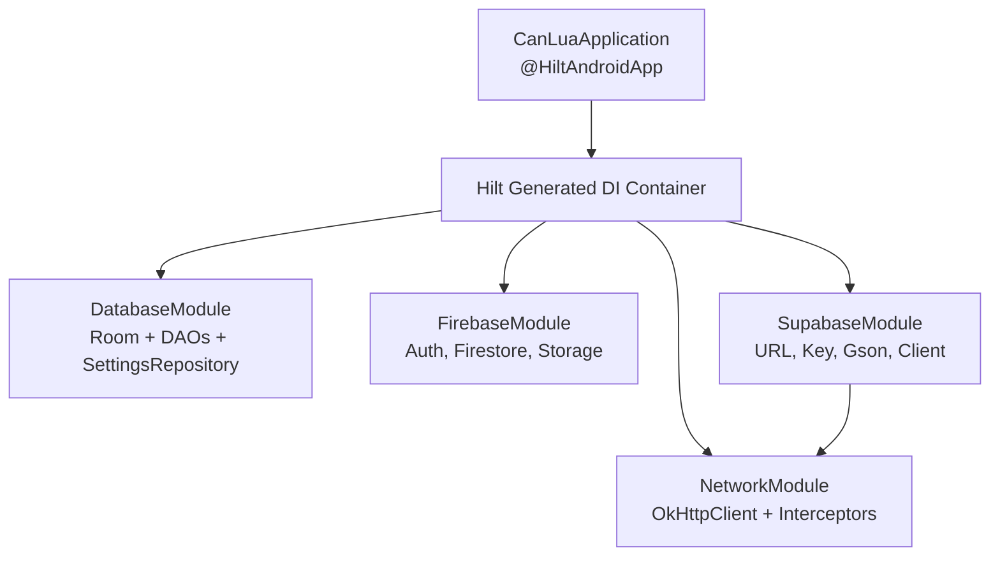
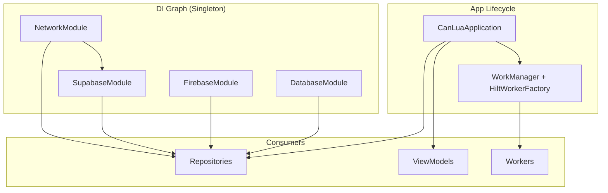
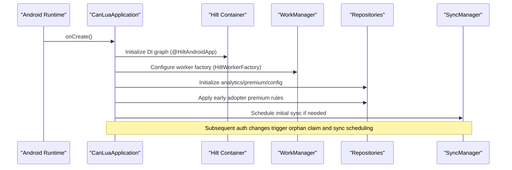
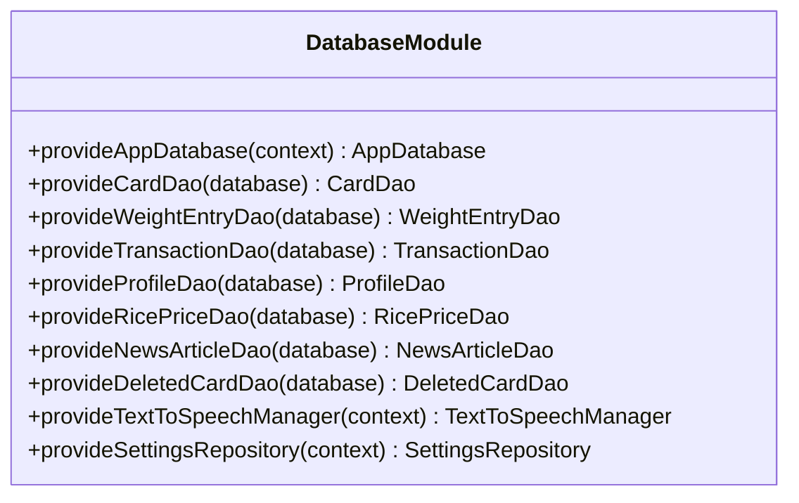
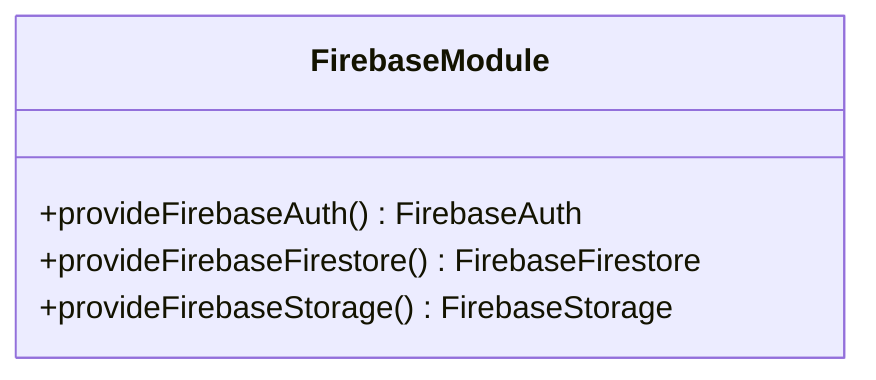
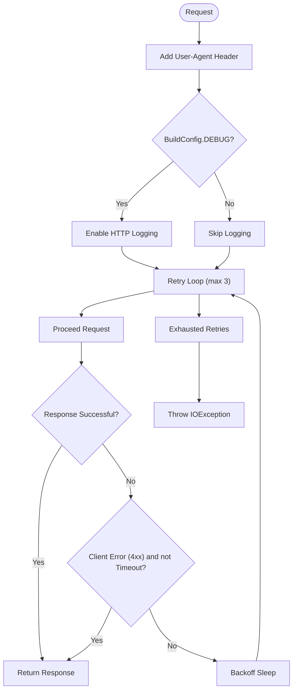
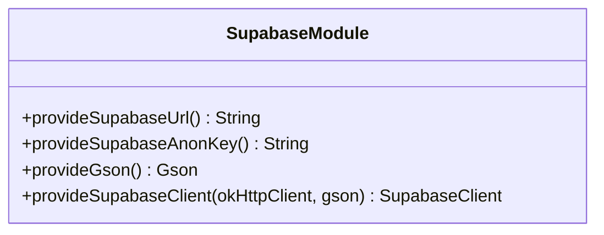
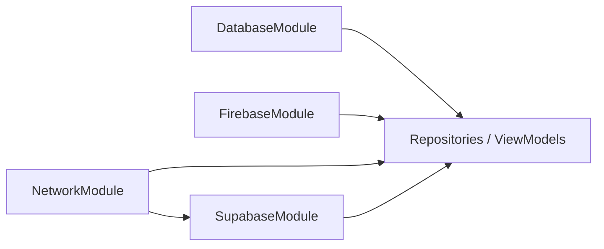

# Dependency Injection with Hilt

<cite>
**Referenced Files in This Document**
- [CanLuaApplication.kt](file://app/src/main/java/com/giathinh/canlua/CanLuaApplication.kt)
- [DatabaseModule.kt](file://app/src/main/java/com/giathinh/canlua/di/DatabaseModule.kt)
- [FirebaseModule.kt](file://app/src/main/java/com/giathinh/canlua/di/FirebaseModule.kt)
- [NetworkModule.kt](file://app/src/main/java/com/giathinh/canlua/di/NetworkModule.kt)
- [SupabaseModule.kt](file://app/src/main/java/com/giathinh/canlua/di/SupabaseModule.kt)
</cite>

## Table of Contents
1. [Introduction](#introduction)
2. [Project Structure](#project-structure)
3. [Core Components](#core-components)
4. [Architecture Overview](#architecture-overview)
5. [Detailed Component Analysis](#detailed-component-analysis)
6. [Dependency Analysis](#dependency-analysis)
7. [Performance Considerations](#performance-considerations)
8. [Troubleshooting Guide](#troubleshooting-guide)
9. [Conclusion](#conclusion)

## Introduction
This document explains how Cân Lúa Mobile uses Hilt for dependency injection (DI). It focuses on the application-level DI container, the module structure under di/, and how modules provide Room, Firebase, HTTP, and Supabase dependencies. It also covers compile-time DI benefits, testability through mocking, environment-specific behavior, and a repeatable pattern for adding new dependencies.

The app is an offline-first Kotlin 2.3 / Jetpack Compose Android application using MVVM + Clean Architecture with unidirectional data flow via StateFlow and coroutines. Local persistence uses AndroidX Room 2.8.4 with schema v18 and eight entities; cloud sync is bidirectional to Firebase Firestore and Supabase, scheduled idempotently via WorkManager. The app remains fully functional without network access.

## Project Structure
Hilt configuration lives in two main areas:
- Application entry point: CanLuaApplication.kt marks the app as a Hilt container and wires early initialization logic.
- DI modules: di/ contains focused modules that provide infrastructure dependencies.

**Diagram sources**
- [CanLuaApplication.kt:28-77](file://app/src/main/java/com/giathinh/canlua/CanLuaApplication.kt#L28-L77)
- [DatabaseModule.kt:18-75](file://app/src/main/java/com/giathinh/canlua/di/DatabaseModule.kt#L18-L75)
- [FirebaseModule.kt:12-32](file://app/src/main/java/com/giathinh/canlua/di/FirebaseModule.kt#L12-L32)
- [NetworkModule.kt:13-76](file://app/src/main/java/com/giathinh/canlua/di/NetworkModule.kt#L13-L76)
- [SupabaseModule.kt:14-39](file://app/src/main/java/com/giathinh/canlua/di/SupabaseModule.kt#L14-L39)

**Section sources**
- [CanLuaApplication.kt:28-77](file://app/src/main/java/com/giathinh/canlua/CanLuaApplication.kt#L28-L77)
- [DatabaseModule.kt:18-75](file://app/src/main/java/com/giathinh/canlua/di/DatabaseModule.kt#L18-L75)
- [FirebaseModule.kt:12-32](file://app/src/main/java/com/giathinh/canlua/di/FirebaseModule.kt#L12-L32)
- [NetworkModule.kt:13-76](file://app/src/main/java/com/giathinh/canlua/di/NetworkModule.kt#L13-L76)
- [SupabaseModule.kt:14-39](file://app/src/main/java/com/giathinh/canlua/di/SupabaseModule.kt#L14-L39)

## Core Components
- Application DI container:
  - Marked with @HiltAndroidApp to generate the Hilt component at build time.
  - Injects repositories and managers used during app startup.
  - Integrates WorkManager with HiltWorkerFactory so background tasks can receive injected dependencies.
- Modules:
  - DatabaseModule provides Room database, DAOs, TextToSpeechManager, and SettingsRepository.
  - FirebaseModule provides FirebaseAuth, FirebaseFirestore, and FirebaseStorage.
  - NetworkModule provides OkHttpClient with timeouts, logging, user-agent header, and retry logic.
  - SupabaseModule provides Supabase URL/key, Gson, and SupabaseClient built on top of OkHttpClient.

Key DI patterns used:
- @Inject annotations on constructor parameters or fields to request dependencies.
- @Module classes annotated with @InstallIn(SingletonComponent::class) to scope providers to the application lifetime.
- @Provides functions returning concrete instances or singletons.
- @Singleton to ensure one instance per DI graph where appropriate.
- @Named qualifiers to distinguish multiple string values (e.g., Supabase URL vs anon key).

Benefits:
- Compile-time DI reduces boilerplate and runtime reflection overhead.
- Clear separation of concerns by grouping related dependencies into modules.
- Improved testability: modules can be replaced with test variants or overridden with @TestInstallIn/@BindIn tests.

**Section sources**
- [CanLuaApplication.kt:28-77](file://app/src/main/java/com/giathinh/canlua/CanLuaApplication.kt#L28-L77)
- [DatabaseModule.kt:18-75](file://app/src/main/java/com/giathinh/canlua/di/DatabaseModule.kt#L18-L75)
- [FirebaseModule.kt:12-32](file://app/src/main/java/com/giathinh/canlua/di/FirebaseModule.kt#L12-L32)
- [NetworkModule.kt:13-76](file://app/src/main/java/com/giathinh/canlua/di/NetworkModule.kt#L13-L76)
- [SupabaseModule.kt:14-39](file://app/src/main/java/com/giathinh/canlua/di/SupabaseModule.kt#L14-L39)

## Architecture Overview
The DI architecture centers around a singleton Hilt graph for the entire app lifecycle. Modules provide infrastructure services consumed by repositories, ViewModels, and UI layers.

**Diagram sources**
- [CanLuaApplication.kt:28-77](file://app/src/main/java/com/giathinh/canlua/CanLuaApplication.kt#L28-L77)
- [DatabaseModule.kt:18-75](file://app/src/main/java/com/giathinh/canlua/di/DatabaseModule.kt#L18-L75)
- [FirebaseModule.kt:12-32](file://app/src/main/java/com/giathinh/canlua/di/FirebaseModule.kt#L12-L32)
- [NetworkModule.kt:13-76](file://app/src/main/java/com/giathinh/canlua/di/NetworkModule.kt#L13-L76)
- [SupabaseModule.kt:14-39](file://app/src/main/java/com/giathinh/canlua/di/SupabaseModule.kt#L14-L39)

## Detailed Component Analysis

### Application DI Container: CanLuaApplication
Responsibilities:
- Declares the app as a Hilt container via @HiltAndroidApp.
- Injects dependencies such as AuthManager, CardRepository, SyncManager, SettingsRepository, and a Lazy HiltWorkerFactory.
- Configures WorkManager to use HiltWorkerFactory so workers receive injected dependencies.
- Initializes analytics, premium state, and remote config; applies early adopter rules; schedules sync based on settings and auth state.

Environment handling:
- Installs Firebase App Check provider factory differently for debug vs release builds.

**Diagram sources**
- [CanLuaApplication.kt:28-77](file://app/src/main/java/com/giathinh/canlua/CanLuaApplication.kt#L28-L77)

**Section sources**
- [CanLuaApplication.kt:28-77](file://app/src/main/java/com/giathinh/canlua/CanLuaApplication.kt#L28-L77)

### DatabaseModule: Room, DAOs, Settings, TTS
Responsibilities:
- Provides a singleton AppDatabase instance.
- Provides all DAOs (CardDao, WeightEntryDao, TransactionDao, ProfileDao, RicePriceDao, NewsArticleDao, DeletedCardDao).
- Provides TextToSpeechManager and SettingsRepository as singletons.

Design notes:
- All providers are scoped to SingletonComponent, ensuring single instances across the app.
- DAOs are provided directly from the database instance, keeping persistence layer cohesive.

**Diagram sources**
- [DatabaseModule.kt:18-75](file://app/src/main/java/com/giathinh/canlua/di/DatabaseModule.kt#L18-L75)

**Section sources**
- [DatabaseModule.kt:18-75](file://app/src/main/java/com/giathinh/canlua/di/DatabaseModule.kt#L18-L75)

### FirebaseModule: Auth, Firestore, Storage
Responsibilities:
- Provides FirebaseAuth, FirebaseFirestore, and FirebaseStorage as singletons.
- Keeps Firebase SDK integration centralized and testable.

**Diagram sources**
- [FirebaseModule.kt:12-32](file://app/src/main/java/com/giathinh/canlua/di/FirebaseModule.kt#L12-L32)

**Section sources**
- [FirebaseModule.kt:12-32](file://app/src/main/java/com/giathinh/canlua/di/FirebaseModule.kt#L12-L32)

### NetworkModule: OkHttpClient with Timeouts, Logging, Retry
Responsibilities:
- Builds a shared OkHttpClient with connect/read/call timeouts.
- Adds a User-Agent header.
- Enables HTTP logging only in debug builds.
- Implements a retry interceptor with exponential backoff for transient failures, skipping client errors except specific cases.

**Diagram sources**
- [NetworkModule.kt:17-76](file://app/src/main/java/com/giathinh/canlua/di/NetworkModule.kt#L17-L76)

**Section sources**
- [NetworkModule.kt:17-76](file://app/src/main/java/com/giathinh/canlua/di/NetworkModule.kt#L17-L76)

### SupabaseModule: Configuration and Client
Responsibilities:
- Provides Supabase base URL and anon key from BuildConfig using @Named qualifiers.
- Provides Gson for JSON serialization.
- Provides SupabaseClient constructed with OkHttpClient and Gson.

**Diagram sources**
- [SupabaseModule.kt:14-39](file://app/src/main/java/com/giathinh/canlua/di/SupabaseModule.kt#L14-L39)

**Section sources**
- [SupabaseModule.kt:14-39](file://app/src/main/java/com/giathinh/canlua/di/SupabaseModule.kt#L14-L39)

## Dependency Analysis
The DI graph composes infrastructure services consumed by higher layers.

**Diagram sources**
- [NetworkModule.kt:13-76](file://app/src/main/java/com/giathinh/canlua/di/NetworkModule.kt#L13-L76)
- [SupabaseModule.kt:14-39](file://app/src/main/java/com/giathinh/canlua/di/SupabaseModule.kt#L14-L39)
- [DatabaseModule.kt:18-75](file://app/src/main/java/com/giathinh/canlua/di/DatabaseModule.kt#L18-L75)
- [FirebaseModule.kt:12-32](file://app/src/main/java/com/giathinh/canlua/di/FirebaseModule.kt#L12-L32)

Coupling and cohesion:
- Each module has high cohesion around a single concern (database, Firebase, networking, Supabase).
- Low coupling between modules; they share common types like Context and OkHttpClient rather than each other.
- No circular dependencies among modules; consumers depend on modules, not vice versa.

External integrations:
- Room database and DAOs.
- Firebase Auth, Firestore, Storage.
- OkHttp for HTTP requests.
- Supabase client built on OkHttp and Gson.

**Section sources**
- [DatabaseModule.kt:18-75](file://app/src/main/java/com/giathinh/canlua/di/DatabaseModule.kt#L18-L75)
- [FirebaseModule.kt:12-32](file://app/src/main/java/com/giathinh/canlua/di/FirebaseModule.kt#L12-L32)
- [NetworkModule.kt:13-76](file://app/src/main/java/com/giathinh/canlua/di/NetworkModule.kt#L13-L76)
- [SupabaseModule.kt:14-39](file://app/src/main/java/com/giathinh/canlua/di/SupabaseModule.kt#L14-L39)

## Performance Considerations
- Singletons: Most infrastructure objects (database, clients, repositories) are provided as singletons to avoid repeated construction and reduce memory churn.
- OkHttp reuse: A single OkHttpClient instance is reused across the app, improving connection pooling and performance.
- Logging control: HTTP logging is disabled in release builds to avoid I/O overhead.
- Retry strategy: Controlled retries with bounded attempts and backoff prevent excessive network load while improving resilience.
- Coroutines: App initialization runs on a dedicated IO-scoped coroutine to avoid blocking the main thread.

[No sources needed since this section provides general guidance]

## Troubleshooting Guide
Common issues and resolutions:
- WorkManager not receiving injected dependencies:
  - Ensure WorkManager is configured with HiltWorkerFactory in the application’s work manager configuration.
- Firebase App Check crashes in debug builds:
  - Verify conditional installation of the debug provider factory when running in debug mode.
- Network timeouts or excessive retries:
  - Review OkHttpClient timeouts and retry interceptor logic; adjust limits and backoff as needed.
- Missing DI bindings:
  - Confirm that the required type is provided by a module installed in SingletonComponent and that the consumer is within the same DI graph scope.

**Section sources**
- [CanLuaApplication.kt:48-51](file://app/src/main/java/com/giathinh/canlua/CanLuaApplication.kt#L48-L51)
- [CanLuaApplication.kt:55-63](file://app/src/main/java/com/giathinh/canlua/CanLuaApplication.kt#L55-L63)
- [NetworkModule.kt:17-76](file://app/src/main/java/com/giathinh/canlua/di/NetworkModule.kt#L17-L76)

## Conclusion
Cân Lúa Mobile uses Hilt to centralize dependency provisioning across Room, Firebase, HTTP, and Supabase. The application-level DI container initializes core services and integrates with WorkManager for background tasks. Modules encapsulate infrastructure concerns, enabling clear boundaries, reduced boilerplate, and improved testability. Environment-specific behavior is handled cleanly, and the established patterns make it straightforward to add new dependencies consistently.

[No sources needed since this section summarizes without analyzing specific files]