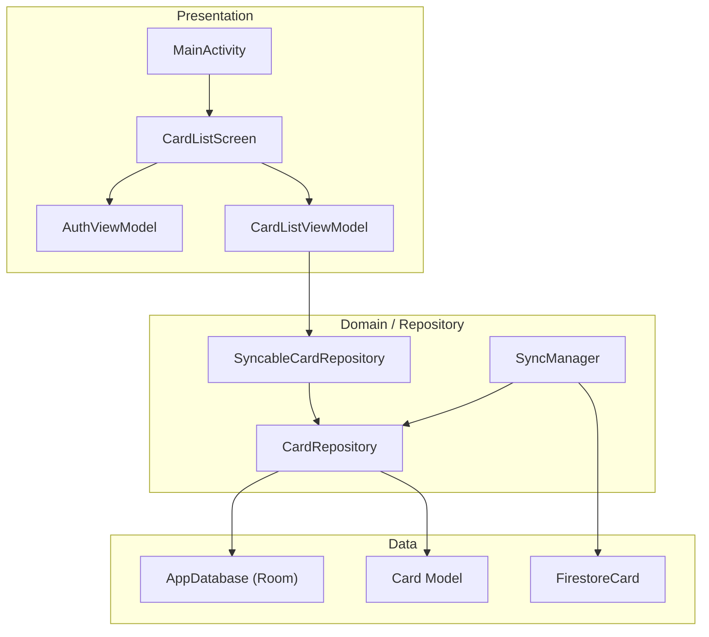
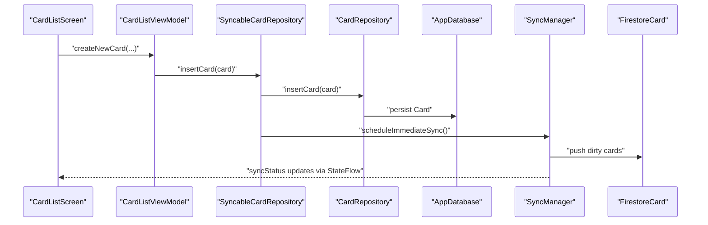
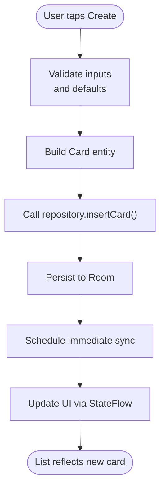
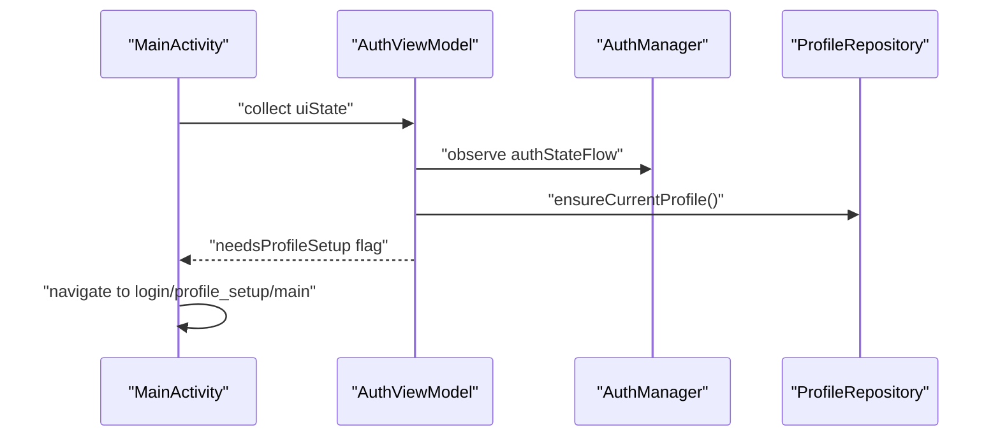
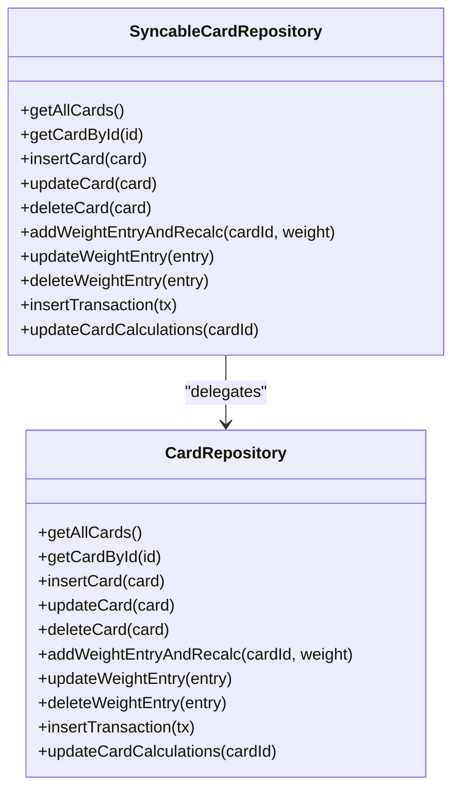
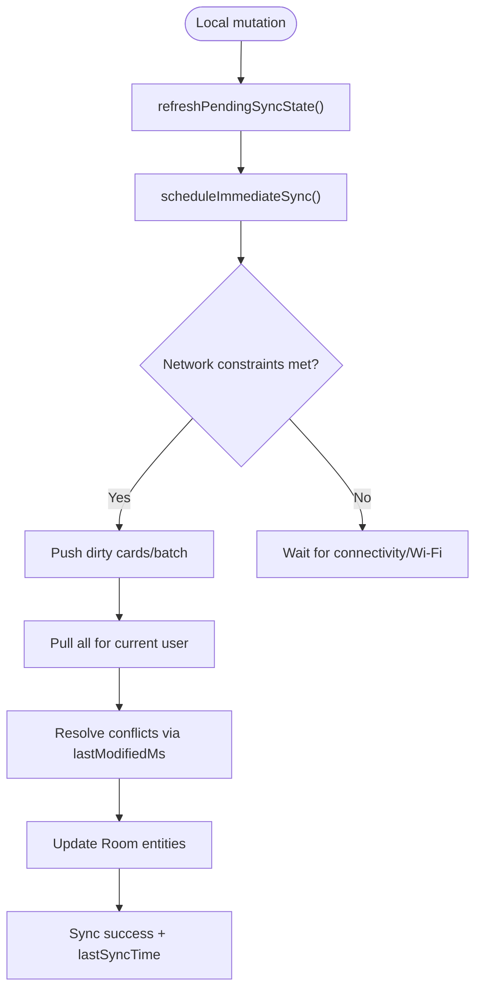
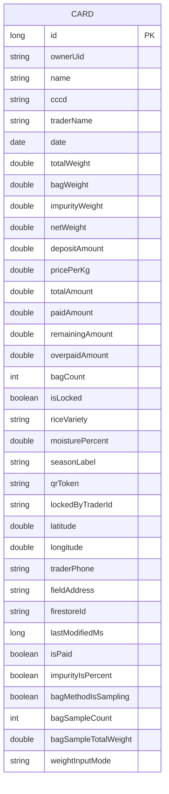
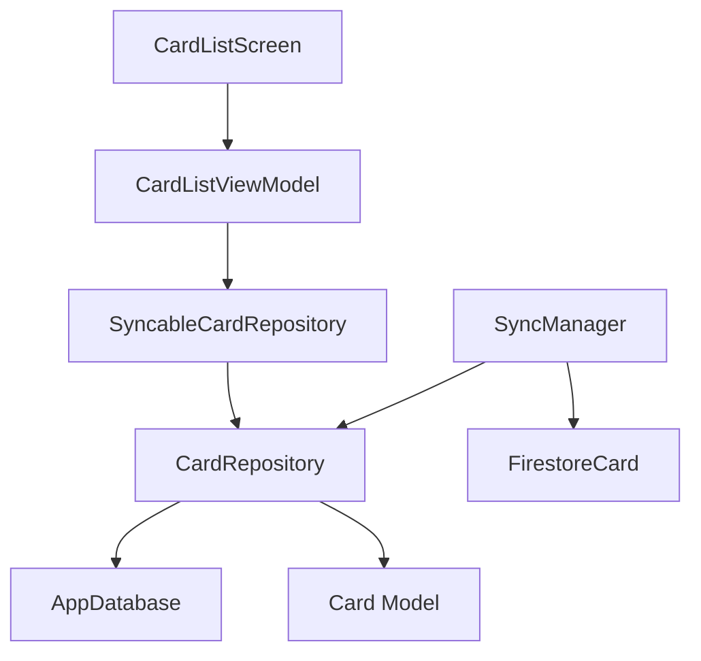

# MVVM Pattern Implementation

<cite>
**Referenced Files in This Document**
- [MainActivity.kt](file://app/src/main/java/com/giathinh/canlua/MainActivity.kt)
- [CanLuaApplication.kt](file://app/src/main/java/com/giathinh/canlua/CanLuaApplication.kt)
- [CardListScreen.kt](file://app/src/main/java/com/giathinh/canlua/ui/screen/CardListScreen.kt)
- [CardListViewModel.kt](file://app/src/main/java/com/giathinh/canlua/ui/viewmodel/CardListViewModel.kt)
- [AuthViewModel.kt](file://app/src/main/java/com/giathinh/canlua/ui/viewmodel/AuthViewModel.kt)
- [CardRepository.kt](file://app/src/main/java/com/giathinh/canlua/repository/CardRepository.kt)
- [SyncableCardRepository.kt](file://app/src/main/java/com/giathinh/canlua/repository/SyncableCardRepository.kt)
- [SyncManager.kt](file://app/src/main/java/com/giathinh/canlua/repository/SyncManager.kt)
- [FirestoreCard.kt](file://app/src/main/java/com/giathinh/canlua/data/firestore/FirestoreCard.kt)
- [AppDatabase.kt](file://app/src/main/java/com/giathinh/canlua/data/database/AppDatabase.kt)
- [Card.kt](file://app/src/main/java/com/giathinh/canlua/data/model/Card.kt)
</cite>

## Table of Contents
1. [Introduction](#introduction)
2. [Project Structure](#project-structure)
3. [Core Components](#core-components)
4. [Architecture Overview](#architecture-overview)
5. [Detailed Component Analysis](#detailed-component-analysis)
6. [Dependency Analysis](#dependency-analysis)
7. [Performance Considerations](#performance-considerations)
8. [Troubleshooting Guide](#troubleshooting-guide)
9. [Conclusion](#conclusion)

## Introduction
This document explains the MVVM implementation in Cân Lúa Mobile with a focus on clear separation of concerns, unidirectional data flow, and offline-first synchronization. The app is a Kotlin 2.3 / Jetpack Compose application using MVVM and Clean Architecture:
- Models represent domain entities and persistence structures.
- Views are Jetpack Compose screens and reusable components.
- ViewModels manage UI state through StateFlow and coroutines.
- Repositories abstract business logic and coordinate multiple data sources: Room database, Firebase Firestore, and network APIs.
- Sync is bidirectional and scheduled idempotently via WorkManager so the app remains fully functional without network access.

The documentation emphasizes how UI events flow down through ViewModels to repositories, while data flows up through StateFlow to update the UI. It also covers loading states, error handling, common state-update patterns, testing strategies, and best practices for maintaining clean boundaries.

## Project Structure
At a high level, the relevant layers are organized as follows:
- Data layer: models, DAOs, Room database, Firestore mappings, remote clients, and repository implementations.
- Repository layer: business logic abstraction, per-user isolation, conflict resolution, and sync orchestration.
- Presentation layer: Compose screens, shared UI components, and ViewModels that expose StateFlow-based UI state.
- Application entry points: MainActivity routes and bootstraps navigation; CanLuaApplication initializes services, analytics, premium state, and background sync scheduling.

**Diagram sources**
- [MainActivity.kt:39-146](file://app/src/main/java/com/giathinh/canlua/MainActivity.kt#L39-L146)
- [CardListScreen.kt:98-114](file://app/src/main/java/com/giathinh/canlua/ui/screen/CardListScreen.kt#L98-L114)
- [CardListViewModel.kt:24-29](file://app/src/main/java/com/giathinh/canlua/ui/viewmodel/CardListViewModel.kt#L24-L29)
- [SyncableCardRepository.kt:10-24](file://app/src/main/java/com/giathinh/canlua/repository/SyncableCardRepository.kt#L10-L24)
- [CardRepository.kt:26-44](file://app/src/main/java/com/giathinh/canlua/repository/CardRepository.kt#L26-L44)
- [SyncManager.kt:35-45](file://app/src/main/java/com/giathinh/canlua/repository/SyncManager.kt#L35-L45)
- [AppDatabase.kt:24-46](file://app/src/main/java/com/giathinh/canlua/data/database/AppDatabase.kt#L24-L46)
- [Card.kt:8-106](file://app/src/main/java/com/giathinh/canlua/data/model/Card.kt#L8-L106)
- [FirestoreCard.kt:7-65](file://app/src/main/java/com/giathinh/canlua/data/firestore/FirestoreCard.kt#L7-L65)

**Section sources**
- [MainActivity.kt:39-146](file://app/src/main/java/com/giathinh/canlua/MainActivity.kt#L39-L146)
- [CanLuaApplication.kt:28-77](file://app/src/main/java/com/giathinh/canlua/CanLuaApplication.kt#L28-L77)

## Core Components
This section highlights the core MVVM components and their responsibilities:
- Models: immutable domain entities such as Card, WeightEntry, Transaction, Profile, RicePrice, NewsArticle, and Firestore mapping types like FirestoreCard.
- Views: Compose screens including CardListScreen and Auth-related screens, plus reusable components under ui/component.
- ViewModels: UI state holders exposing StateFlow and handling user actions, e.g., CardListViewModel and AuthViewModel.
- Repositories: business logic abstractions coordinating Room, Firestore, and network APIs, e.g., CardRepository, SyncableCardRepository, and SyncManager.

Key responsibilities:
- CardListViewModel exposes filtered card lists, filter controls, and operations like create and delete.
- AuthViewModel manages authentication state, profile setup routing, and user identity telemetry.
- CardRepository encapsulates per-user isolation, encryption, tombstone handling, and calculation updates.
- SyncableCardRepository wraps CardRepository to trigger sync scheduling after local mutations.
- SyncManager orchestrates push/pull, batching, deduplication, and WorkManager scheduling.

**Section sources**
- [Card.kt:8-106](file://app/src/main/java/com/giathinh/canlua/data/model/Card.kt#L8-L106)
- [FirestoreCard.kt:7-65](file://app/src/main/java/com/giathinh/canlua/data/firestore/FirestoreCard.kt#L7-L65)
- [CardListViewModel.kt:24-169](file://app/src/main/java/com/giathinh/canlua/ui/viewmodel/CardListViewModel.kt#L24-L169)
- [AuthViewModel.kt:25-361](file://app/src/main/java/com/giathinh/canlua/ui/viewmodel/AuthViewModel.kt#L25-L361)
- [CardRepository.kt:26-406](file://app/src/main/java/com/giathinh/canlua/repository/CardRepository.kt#L26-L406)
- [SyncableCardRepository.kt:10-86](file://app/src/main/java/com/giathinh/canlua/repository/SyncableCardRepository.kt#L10-L86)
- [SyncManager.kt:35-557](file://app/src/main/java/com/giathinh/canlua/repository/SyncManager.kt#L35-L557)

## Architecture Overview
The app implements unidirectional data flow:
- UI events originate in Compose screens and call ViewModel methods.
- ViewModels perform validation, compute derived state, and delegate persistence or sync to repositories.
- Repositories coordinate data sources: Room for offline-first storage, Firestore for cloud sync, and network APIs where applicable.
- StateFlow streams from ViewModels drive UI recomposition.

**Diagram sources**
- [CardListScreen.kt:406-437](file://app/src/main/java/com/giathinh/canlua/ui/screen/CardListScreen.kt#L406-L437)
- [CardListViewModel.kt:81-150](file://app/src/main/java/com/giathinh/canlua/ui/viewmodel/CardListViewModel.kt#L81-L150)
- [SyncableCardRepository.kt:36-40](file://app/src/main/java/com/giathinh/canlua/repository/SyncableCardRepository.kt#L36-L40)
- [CardRepository.kt:60-68](file://app/src/main/java/com/giathinh/canlua/repository/CardRepository.kt#L60-L68)
- [AppDatabase.kt:24-46](file://app/src/main/java/com/giathinh/canlua/data/database/AppDatabase.kt#L24-L46)
- [SyncManager.kt:102-130](file://app/src/main/java/com/giathinh/canlua/repository/SyncManager.kt#L102-L130)
- [FirestoreCard.kt:7-65](file://app/src/main/java/com/giathinh/canlua/data/firestore/FirestoreCard.kt#L7-L65)

## Detailed Component Analysis

### CardList Screen and ViewModel Flow
CardListScreen composes the list UI, collects StateFlow values from CardListViewModel, and triggers actions like creating or deleting cards. CardListViewModel manages filters, loading state, and delegates persistence to SyncableCardRepository.

**Diagram sources**
- [CardListScreen.kt:406-437](file://app/src/main/java/com/giathinh/canlua/ui/screen/CardListScreen.kt#L406-L437)
- [CardListViewModel.kt:81-150](file://app/src/main/java/com/giathinh/canlua/ui/viewmodel/CardListViewModel.kt#L81-L150)
- [SyncableCardRepository.kt:36-40](file://app/src/main/java/com/giathinh/canlua/repository/SyncableCardRepository.kt#L36-L40)

**Section sources**
- [CardListScreen.kt:98-114](file://app/src/main/java/com/giathinh/canlua/ui/screen/CardListScreen.kt#L98-L114)
- [CardListScreen.kt:116-180](file://app/src/main/java/com/giathinh/canlua/ui/screen/CardListScreen.kt#L116-L180)
- [CardListScreen.kt:219-404](file://app/src/main/java/com/giathinh/canlua/ui/screen/CardListScreen.kt#L219-L404)
- [CardListScreen.kt:406-437](file://app/src/main/java/com/giathinh/canlua/ui/screen/CardListScreen.kt#L406-L437)
- [CardListViewModel.kt:24-169](file://app/src/main/java/com/giathinh/canlua/ui/viewmodel/CardListViewModel.kt#L24-L169)

### Authentication Flow and Profile Setup
AuthViewModel coordinates Firebase authentication, profile setup routing, and user identity telemetry. MainActivity observes auth state and navigates accordingly.

**Diagram sources**
- [MainActivity.kt:45-108](file://app/src/main/java/com/giathinh/canlua/MainActivity.kt#L45-L108)
- [AuthViewModel.kt:46-94](file://app/src/main/java/com/giathinh/canlua/ui/viewmodel/AuthViewModel.kt#L46-L94)
- [AuthManager.kt:12-35](file://app/src/main/java/com/giathinh/canlua/repository/AuthManager.kt#L12-L35)

**Section sources**
- [AuthViewModel.kt:25-361](file://app/src/main/java/com/giathinh/canlua/ui/viewmodel/AuthViewModel.kt#L25-L361)
- [MainActivity.kt:45-108](file://app/src/main/java/com/giathinh/canlua/MainActivity.kt#L45-L108)

### Repository Layer: CardRepository and SyncableCardRepository
CardRepository provides per-user isolation, encryption, tombstone handling, and calculation updates. SyncableCardRepository decorates CardRepository to schedule sync after local mutations.

**Diagram sources**
- [CardRepository.kt:26-406](file://app/src/main/java/com/giathinh/canlua/repository/CardRepository.kt#L26-L406)
- [SyncableCardRepository.kt:10-86](file://app/src/main/java/com/giathinh/canlua/repository/SyncableCardRepository.kt#L10-L86)

**Section sources**
- [CardRepository.kt:26-406](file://app/src/main/java/com/giathinh/canlua/repository/CardRepository.kt#L26-L406)
- [SyncableCardRepository.kt:10-86](file://app/src/main/java/com/giathinh/canlua/repository/SyncableCardRepository.kt#L10-L86)

### Sync Orchestration: SyncManager and Firestore Mapping
SyncManager handles push/pull, batching, deduplication, and WorkManager scheduling. FirestoreCard represents the cloud schema used during sync.

**Diagram sources**
- [SyncManager.kt:86-130](file://app/src/main/java/com/giathinh/canlua/repository/SyncManager.kt#L86-L130)
- [SyncManager.kt:139-310](file://app/src/main/java/com/giathinh/canlua/repository/SyncManager.kt#L139-L310)
- [SyncManager.kt:313-412](file://app/src/main/java/com/giathinh/canlua/repository/SyncManager.kt#L313-L412)
- [FirestoreCard.kt:7-65](file://app/src/main/java/com/giathinh/canlua/data/firestore/FirestoreCard.kt#L7-L65)

**Section sources**
- [SyncManager.kt:35-557](file://app/src/main/java/com/giathinh/canlua/repository/SyncManager.kt#L35-L557)
- [FirestoreCard.kt:7-65](file://app/src/main/java/com/giathinh/canlua/data/firestore/FirestoreCard.kt#L7-L65)

### Database Schema and Migration Strategy
AppDatabase defines Room entities and migration chain. Card model includes fields for per-user isolation, GPS location, contact info, cross-device sync identifiers, conflict timestamps, weigh modes, and overpaid amount tracking.

**Diagram sources**
- [AppDatabase.kt:24-46](file://app/src/main/java/com/giathinh/canlua/data/database/AppDatabase.kt#L24-L46)
- [Card.kt:8-106](file://app/src/main/java/com/giathinh/canlua/data/model/Card.kt#L8-L106)

**Section sources**
- [AppDatabase.kt:24-401](file://app/src/main/java/com/giathinh/canlua/data/database/AppDatabase.kt#L24-L401)
- [Card.kt:8-106](file://app/src/main/java/com/giathinh/canlua/data/model/Card.kt#L8-L106)

## Dependency Analysis
The dependency graph shows how presentation depends on viewmodels, which depend on repositories, which depend on data sources.

**Diagram sources**
- [CardListScreen.kt:98-114](file://app/src/main/java/com/giathinh/canlua/ui/screen/CardListScreen.kt#L98-L114)
- [CardListViewModel.kt:24-29](file://app/src/main/java/com/giathinh/canlua/ui/viewmodel/CardListViewModel.kt#L24-L29)
- [SyncableCardRepository.kt:10-24](file://app/src/main/java/com/giathinh/canlua/repository/SyncableCardRepository.kt#L10-L24)
- [CardRepository.kt:26-44](file://app/src/main/java/com/giathinh/canlua/repository/CardRepository.kt#L26-L44)
- [AppDatabase.kt:24-46](file://app/src/main/java/com/giathinh/canlua/data/database/AppDatabase.kt#L24-L46)
- [Card.kt:8-106](file://app/src/main/java/com/giathinh/canlua/data/model/Card.kt#L8-L106)
- [SyncManager.kt:35-45](file://app/src/main/java/com/giathinh/canlua/repository/SyncManager.kt#L35-L45)
- [FirestoreCard.kt:7-65](file://app/src/main/java/com/giathinh/canlua/data/firestore/FirestoreCard.kt#L7-L65)

**Section sources**
- [CardListScreen.kt:98-114](file://app/src/main/java/com/giathinh/canlua/ui/screen/CardListScreen.kt#L98-L114)
- [CardListViewModel.kt:24-29](file://app/src/main/java/com/giathinh/canlua/ui/viewmodel/CardListViewModel.kt#L24-L29)
- [SyncableCardRepository.kt:10-24](file://app/src/main/java/com/giathinh/canlua/repository/SyncableCardRepository.kt#L10-L24)
- [CardRepository.kt:26-44](file://app/src/main/java/com/giathinh/canlua/repository/CardRepository.kt#L26-L44)
- [AppDatabase.kt:24-46](file://app/src/main/java/com/giathinh/canlua/data/database/AppDatabase.kt#L24-L46)
- [Card.kt:8-106](file://app/src/main/java/com/giathinh/canlua/data/model/Card.kt#L8-L106)
- [SyncManager.kt:35-45](file://app/src/main/java/com/giathinh/canlua/repository/SyncManager.kt#L35-L45)
- [FirestoreCard.kt:7-65](file://app/src/main/java/com/giathinh/canlua/data/firestore/FirestoreCard.kt#L7-L65)

## Performance Considerations
- Use StateFlow with lifecycle-aware collection to avoid unnecessary recompositions and leaks.
- Debounce or throttle heavy computations; prefer filtering at the ViewModel layer with combine operators.
- Batch network operations when syncing large datasets; SyncManager already batches Firestore writes.
- Keep UI state minimal and derived; avoid duplicating state between ViewModel and Compose.
- Prefer Room indexes for frequent queries; Card model includes indices for ownerUid and composite keys.
- Avoid blocking the main thread; use Dispatchers.IO for I/O-bound tasks in ViewModels and repositories.

[No sources needed since this section provides general guidance]

## Troubleshooting Guide
Common issues and resolutions:
- Loading state not clearing: Ensure isLoading is updated when data streams emit results; CardListViewModel sets isLoading false after combining repository flows.
- Delete operation errors: ViewModel emits single-use events; collect them in the screen and show appropriate toasts.
- Sync failures: SyncManager exposes SyncStatus; handle Idle, Syncing, Success, and Error states in the UI.
- Network constraints: Sync only runs when allowed by settings; check Wi-Fi vs mobile constraints before attempting sync.
- Profile setup routing: AuthViewModel refreshes needsProfileSetup; MainActivity navigates based on this flag.

**Section sources**
- [CardListViewModel.kt:31-53](file://app/src/main/java/com/giathinh/canlua/ui/viewmodel/CardListViewModel.kt#L31-L53)
- [CardListViewModel.kt:152-169](file://app/src/main/java/com/giathinh/canlua/ui/viewmodel/CardListViewModel.kt#L152-L169)
- [SyncManager.kt:46-57](file://app/src/main/java/com/giathinh/canlua/repository/SyncManager.kt#L46-L57)
- [SyncManager.kt:78-84](file://app/src/main/java/com/giathinh/canlua/repository/SyncManager.kt#L78-L84)
- [AuthViewModel.kt:81-94](file://app/src/main/java/com/giathinh/canlua/ui/viewmodel/AuthViewModel.kt#L81-L94)
- [MainActivity.kt:78-108](file://app/src/main/java/com/giathinh/canlua/MainActivity.kt#L78-L108)

## Conclusion
Cân Lúa Mobile’s MVVM implementation cleanly separates concerns across Models, Views, ViewModels, and Repositories. Unidirectional data flow ensures predictable state updates, while repositories abstract complex data coordination across Room, Firestore, and network APIs. Offline-first design guarantees functionality without network access, and WorkManager-driven sync maintains consistency across devices. Following the patterns documented here—StateFlow-driven UI state, repository-backed business logic, and robust error handling—helps maintain clarity, testability, and performance as the app evolves.

[No sources needed since this section summarizes without analyzing specific files]