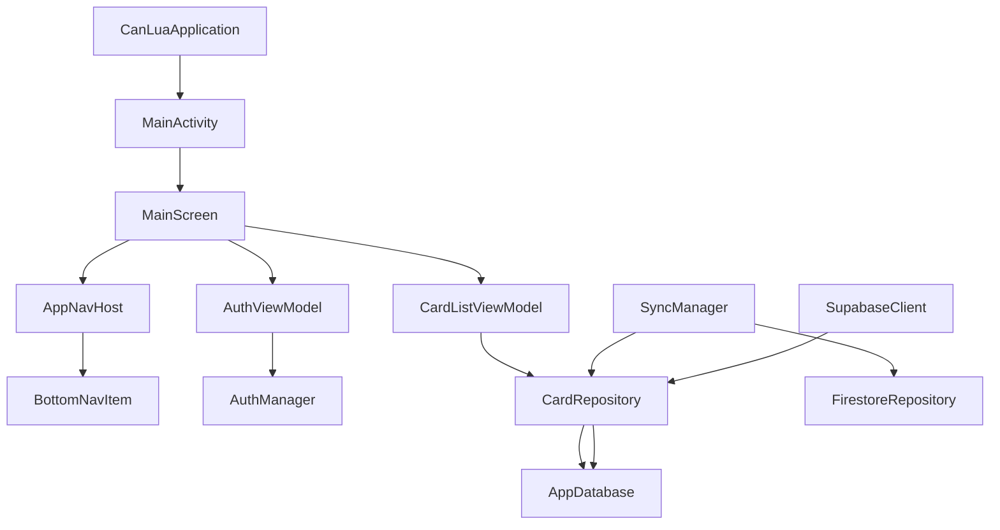
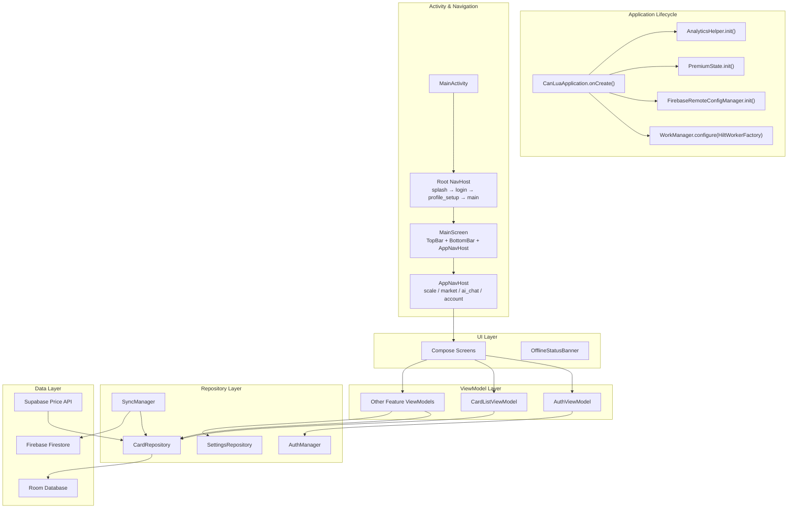
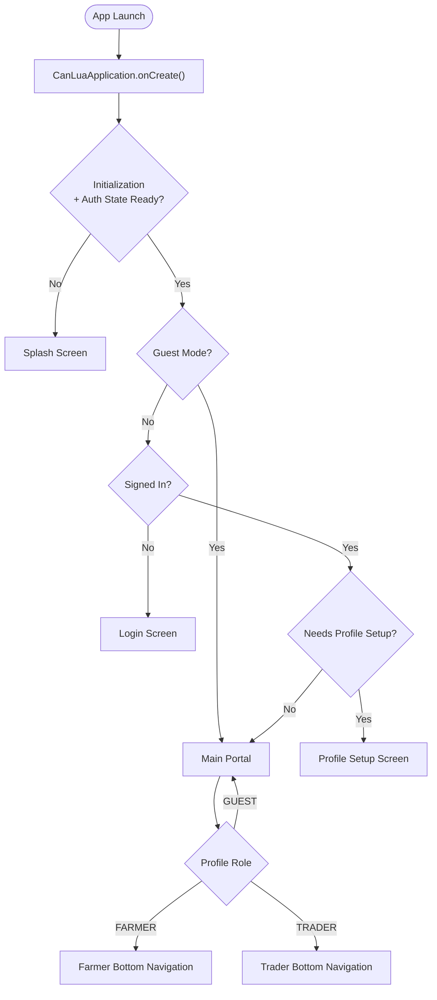
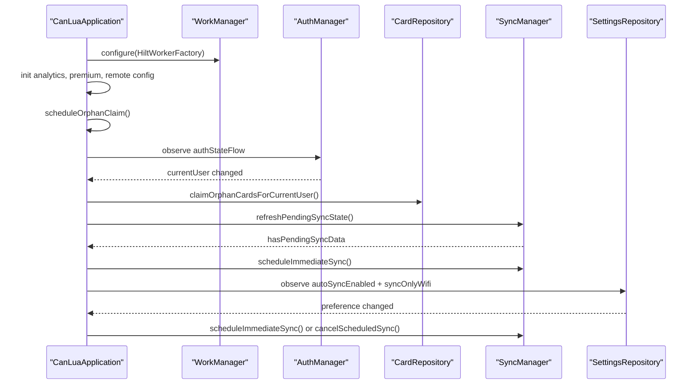
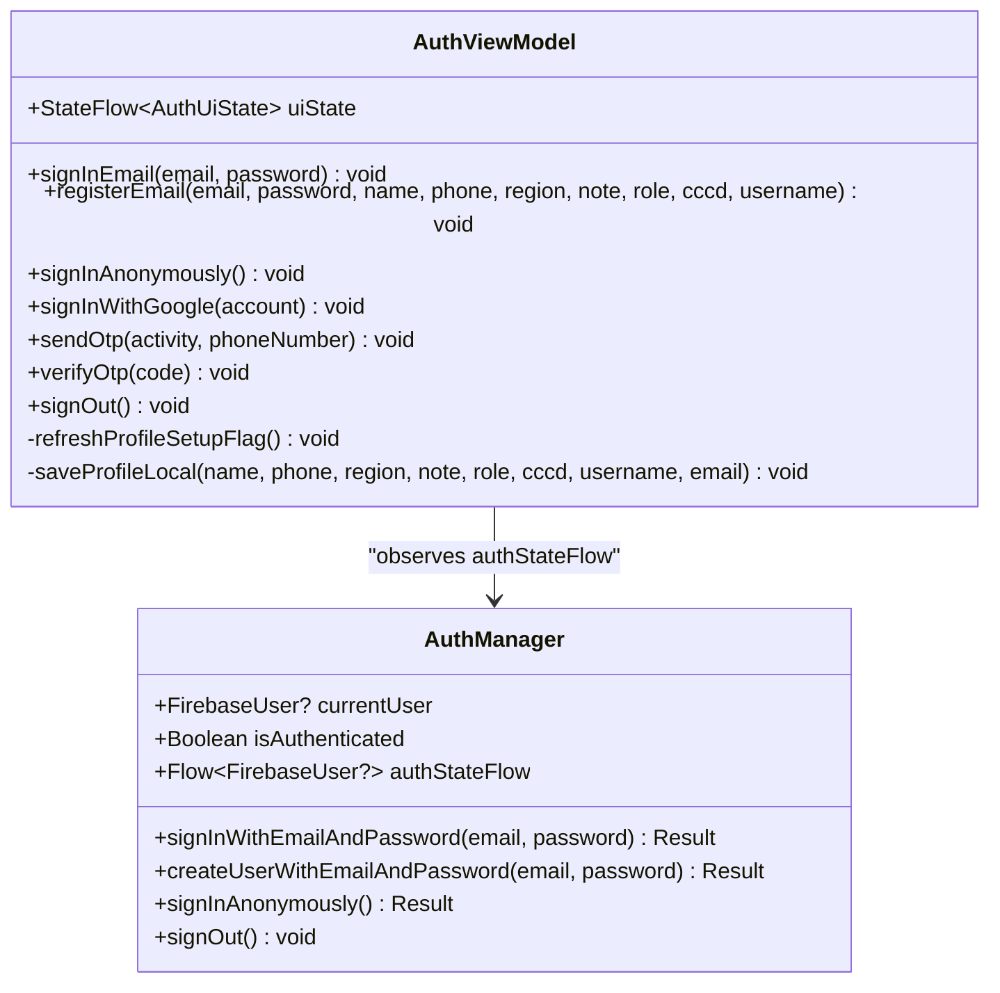
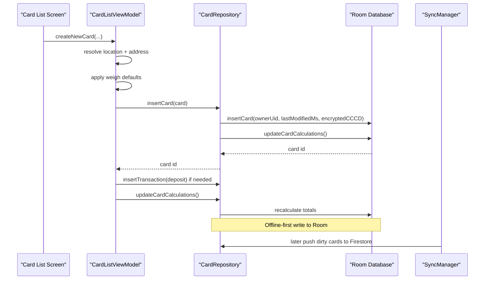
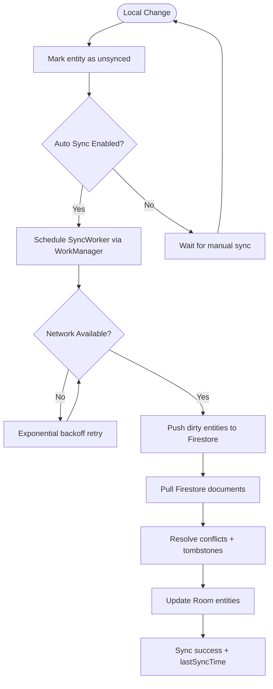
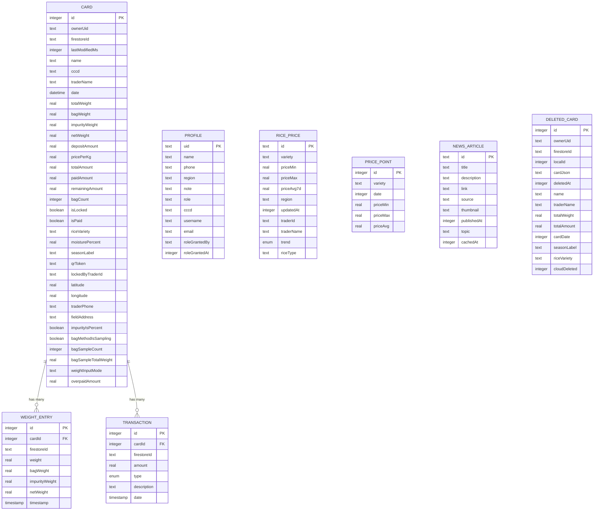
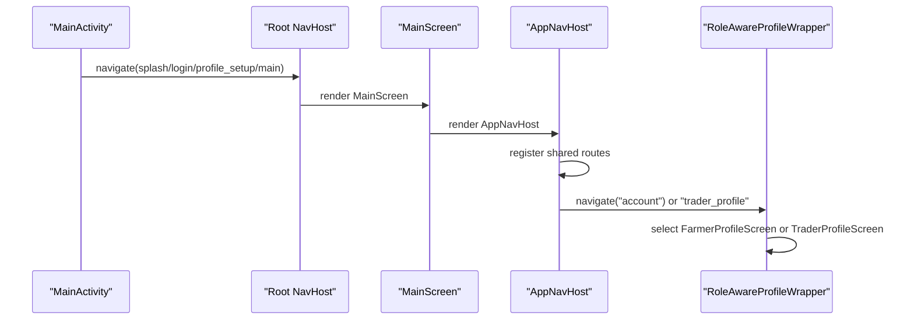
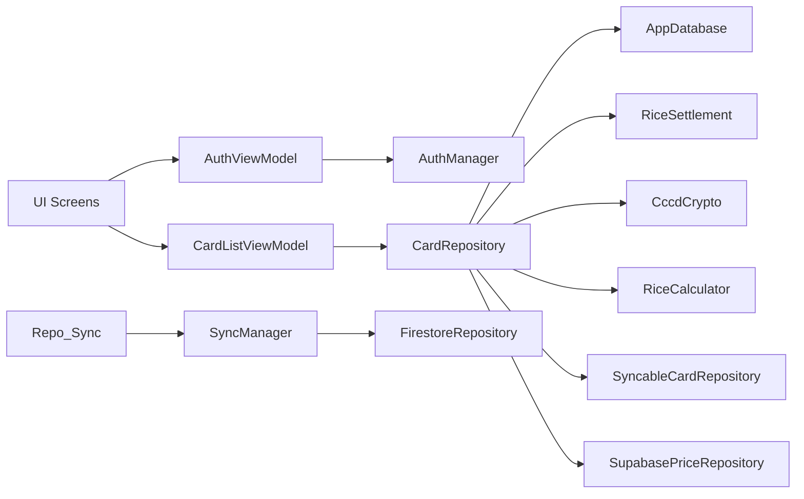

# System Architecture

<cite>
**Referenced Files in This Document**   
- [MainActivity.kt](file://app/src/main/java/com/giathinh/canlua/MainActivity.kt)
- [CanLuaApplication.kt](file://app/src/main/java/com/giathinh/canlua/CanLuaApplication.kt)
- [MainScreen.kt](file://app/src/main/java/com/giathinh/canlua/ui/MainScreen.kt)
- [AppNavHost.kt](file://app/src/main/java/com/giathinh/canlua/ui/navigation/AppNavHost.kt)
- [BottomNavItem.kt](file://app/src/main/java/com/giathinh/canlua/ui/navigation/BottomNavItem.kt)
- [AuthViewModel.kt](file://app/src/main/java/com/giathinh/canlua/ui/viewmodel/AuthViewModel.kt)
- [CardListViewModel.kt](file://app/src/main/java/com/giathinh/canlua/ui/viewmodel/CardListViewModel.kt)
- [AuthManager.kt](file://app/src/main/java/com/giathinh/canlua/repository/AuthManager.kt)
- [CardRepository.kt](file://app/src/main/java/com/giathinh/canlua/repository/CardRepository.kt)
- [SyncManager.kt](file://app/src/main/java/com/giathinh/canlua/repository/SyncManager.kt)
- [AppDatabase.kt](file://app/src/main/java/com/giathinh/canlua/data/database/AppDatabase.kt)
</cite>

## Table of Contents
1. [Introduction](#introduction)
2. [Project Structure](#project-structure)
3. [Core Components](#core-components)
4. [Architecture Overview](#architecture-overview)
5. [Detailed Component Analysis](#detailed-component-analysis)
6. [Dependency Analysis](#dependency-analysis)
7. [Performance Considerations](#performance-considerations)
8. [Troubleshooting Guide](#troubleshooting-guide)
9. [Conclusion](#conclusion)

## Introduction
Cân Lúa Mobile is a Kotlin 2.3 / Jetpack Compose offline-first Android application built with MVVM and Clean Architecture. It uses unidirectional data flow through `StateFlow` and coroutines, Room as the local database, Firebase for authentication and Firestore sync, and Supabase for read-only market price data. The app supports three roles — FARMER, TRADER, and GUEST — and routes users through role-based feature portals after authentication or profile setup.

The single-activity architecture centers on `MainActivity`, which owns the root navigation graph and delegates screen composition to Compose screens. `CanLuaApplication` initializes analytics, premium state, remote configuration, background sync scheduling, and WorkManager integration. The UI layer renders Compose screens; the ViewModel layer manages UI state via `StateFlow`; the repository layer encapsulates business logic, per-user isolation, and conflict resolution; and the data layer provides Room persistence, Firebase/Firestore access, and network clients.

Offline-first is a core architectural principle: all user-facing operations work against Room first, while background sync keeps Firestore and Supabase consistent when connectivity is available.

## Project Structure
The codebase follows a layered organization:

- **UI layer**: `ui/screen`, `ui/component`, `ui/navigation`, `ui/theme`, `ui/util`.
- **ViewModel layer**: `ui/viewmodel`.
- **Repository layer**: `repository`.
- **Data layer**: `data/database`, `data/dao`, `data/model`, `data/firestore`, `data/remote`, `data/location`.
- **Dependency injection**: `di`.
- **Application entry points**: `CanLuaApplication`, `MainActivity`.

**Diagram sources**
- [CanLuaApplication.kt:28-77](file://app/src/main/java/com/giathinh/canlua/CanLuaApplication.kt#L28-L77)
- [MainActivity.kt:39-145](file://app/src/main/java/com/giathinh/canlua/MainActivity.kt#L39-L145)
- [MainScreen.kt:71-367](file://app/src/main/java/com/giathinh/canlua/ui/MainScreen.kt#L71-L367)
- [AppNavHost.kt:27-136](file://app/src/main/java/com/giathinh/canlua/ui/navigation/AppNavHost.kt#L27-L136)
- [BottomNavItem.kt:18-70](file://app/src/main/java/com/giathinh/canlua/ui/navigation/BottomNavItem.kt#L18-L70)
- [AuthViewModel.kt:39-94](file://app/src/main/java/com/giathinh/canlua/ui/viewmodel/AuthViewModel.kt#L39-L94)
- [CardListViewModel.kt:24-59](file://app/src/main/java/com/giathinh/canlua/ui/viewmodel/CardListViewModel.kt#L24-L59)
- [AuthManager.kt:12-36](file://app/src/main/java/com/giathinh/canlua/repository/AuthManager.kt#L12-L36)
- [CardRepository.kt:36-50](file://app/src/main/java/com/giathinh/canlua/repository/CardRepository.kt#L36-L50)
- [SyncManager.kt:35-47](file://app/src/main/java/com/giathinh/canlua/repository/SyncManager.kt#L35-L47)
- [AppDatabase.kt:24-46](file://app/src/main/java/com/giathinh/canlua/data/database/AppDatabase.kt#L24-L46)

**Section sources**
- [MainActivity.kt:39-145](file://app/src/main/java/com/giathinh/canlua/MainActivity.kt#L39-L145)
- [CanLuaApplication.kt:28-77](file://app/src/main/java/com/giathinh/canlua/CanLuaApplication.kt#L28-L77)
- [MainScreen.kt:71-367](file://app/src/main/java/com/giathinh/canlua/ui/MainScreen.kt#L71-L367)
- [AppNavHost.kt:27-136](file://app/src/main/java/com/giathinh/canlua/ui/navigation/AppNavHost.kt#L27-L136)
- [BottomNavItem.kt:18-70](file://app/src/main/java/com/giathinh/canlua/ui/navigation/BottomNavItem.kt#L18-L70)

## Core Components
The system is organized around four primary layers:

| Layer | Responsibility | Key Artifacts |
|---|---|---|
| UI Layer | Renders Compose screens, handles user input, observes `StateFlow` state, performs navigation | `MainActivity`, `MainScreen`, `AppNavHost`, `BottomNavItem`, screen composables |
| ViewModel Layer | Owns UI state, orchestrates use cases, exposes `StateFlow`/`SharedFlow`, launches coroutines | `AuthViewModel`, `CardListViewModel`, other feature ViewModels |
| Repository Layer | Encapsulates business rules, per-user isolation, calculations, sync coordination | `AuthManager`, `CardRepository`, `SyncManager`, `SettingsRepository`, `ProfileRepository` |
| Data Layer | Provides persistence, cloud sync, and network access | `AppDatabase`, DAOs, `FirestoreRepository`, `SupabaseClient`, `HttpClient` |

The unidirectional data flow is explicit:

1. User interacts with a Compose screen.
2. Screen calls a ViewModel method.
3. ViewModel updates `MutableStateFlow` and/or invokes repository methods.
4. Repository writes to Room or coordinates sync with Firestore/Supabase.
5. UI observes `StateFlow` and recomposes accordingly.

**Section sources**
- [AuthViewModel.kt:39-94](file://app/src/main/java/com/giathinh/canlua/ui/viewmodel/AuthViewModel.kt#L39-L94)
- [CardListViewModel.kt:24-59](file://app/src/main/java/com/giathinh/canlua/ui/viewmodel/CardListViewModel.kt#L24-L59)
- [CardRepository.kt:36-50](file://app/src/main/java/com/giathinh/canlua/repository/CardRepository.kt#L36-L50)
- [AppDatabase.kt:24-46](file://app/src/main/java/com/giathinh/canlua/data/database/AppDatabase.kt#L24-L46)

## Architecture Overview
The high-level architecture follows MVVM + Clean Architecture with a single activity and Compose navigation.

**Diagram sources**
- [CanLuaApplication.kt:28-77](file://app/src/main/java/com/giathinh/canlua/CanLuaApplication.kt#L28-L77)
- [MainActivity.kt:39-145](file://app/src/main/java/com/giathinh/canlua/MainActivity.kt#L39-L145)
- [MainScreen.kt:71-367](file://app/src/main/java/com/giathinh/canlua/ui/MainScreen.kt#L71-L367)
- [AppNavHost.kt:27-136](file://app/src/main/java/com/giathinh/canlua/ui/navigation/AppNavHost.kt#L27-L136)
- [AuthViewModel.kt:39-94](file://app/src/main/java/com/giathinh/canlua/ui/viewmodel/AuthViewModel.kt#L39-L94)
- [CardListViewModel.kt:24-59](file://app/src/main/java/com/giathinh/canlua/ui/viewmodel/CardListViewModel.kt#L24-L59)
- [CardRepository.kt:36-50](file://app/src/main/java/com/giathinh/canlua/repository/CardRepository.kt#L36-L50)
- [SyncManager.kt:35-47](file://app/src/main/java/com/giathinh/canlua/repository/SyncManager.kt#L35-L47)
- [AppDatabase.kt:24-46](file://app/src/main/java/com/giathinh/canlua/data/database/AppDatabase.kt#L24-L46)

### Single-Activity Architecture and Role-Based Portals
`MainActivity` is the only Activity. It installs the splash screen, gathers ad consent, applies locale and theme settings, and owns the root navigation graph. The root graph routes to:

- Splash screen while initialization and auth/profile readiness are unresolved.
- Login screen when not signed in.
- Profile setup screen when a signed-in user lacks a complete profile.
- Main portal when ready.

Inside the main portal, `MainScreen` composes the shell and selects bottom navigation items based on the current profile role:

- FARMER: Scale, Market, AI Chat, Account.
- TRADER: Scale, Market, AI Chat, Map, Trader Profile.
- GUEST: Directly enters the main portal without authentication.

**Diagram sources**
- [MainActivity.kt:45-145](file://app/src/main/java/com/giathinh/canlua/MainActivity.kt#L45-L145)
- [MainScreen.kt:96-137](file://app/src/main/java/com/giathinh/canlua/ui/MainScreen.kt#L96-L137)
- [BottomNavItem.kt:52-69](file://app/src/main/java/com/giathinh/canlua/ui/navigation/BottomNavItem.kt#L52-L69)

**Section sources**
- [MainActivity.kt:45-145](file://app/src/main/java/com/giathinh/canlua/MainActivity.kt#L45-L145)
- [MainScreen.kt:96-137](file://app/src/main/java/com/giathinh/canlua/ui/MainScreen.kt#L96-L137)
- [BottomNavItem.kt:52-69](file://app/src/main/java/com/giathinh/canlua/ui/navigation/BottomNavItem.kt#L52-L69)

## Detailed Component Analysis

### Application Lifecycle: CanLuaApplication
`CanLuaApplication` is the Hilt application class that configures WorkManager, initializes Firebase App Check, analytics, premium state, remote configuration, and background sync behavior. It also schedules orphan card claiming and auto-sync based on user preferences.

Key responsibilities:

- Configure WorkManager with Hilt worker factory.
- Install Firebase App Check provider (debug vs release).
- Initialize analytics, premium state, and remote config.
- Apply early adopter premium eligibility.
- Schedule immediate sync when pending data exists.
- Observe auto-sync preference changes and enable/disable scheduled sync.

**Diagram sources**
- [CanLuaApplication.kt:48-77](file://app/src/main/java/com/giathinh/canlua/CanLuaApplication.kt#L48-L77)
- [CanLuaApplication.kt:93-124](file://app/src/main/java/com/giathinh/canlua/CanLuaApplication.kt#L93-L124)
- [AuthManager.kt:22-36](file://app/src/main/java/com/giathinh/canlua/repository/AuthManager.kt#L22-L36)
- [CardRepository.kt:375-380](file://app/src/main/java/com/giathinh/canlua/repository/CardRepository.kt#L375-L380)
- [SyncManager.kt:102-130](file://app/src/main/java/com/giathinh/canlua/repository/SyncManager.kt#L102-L130)

**Section sources**
- [CanLuaApplication.kt:28-124](file://app/src/main/java/com/giathinh/canlua/CanLuaApplication.kt#L28-L124)

### Authentication Flow: AuthViewModel and AuthManager
`AuthViewModel` exposes `AuthUiState` as a `StateFlow`. It subscribes to `AuthManager.authStateFlow`, which wraps Firebase Auth state into a coroutine-friendly flow. When authentication state changes, the ViewModel updates sign-in status, user label, and profile setup requirement.

`AuthManager` is a singleton that holds the current Firebase user and emits auth state changes. It is the single source of truth for authentication across multiple ViewModel instances created by navigation back stack entries.

**Diagram sources**
- [AuthViewModel.kt:25-94](file://app/src/main/java/com/giathinh/canlua/ui/viewmodel/AuthViewModel.kt#L25-L94)
- [AuthManager.kt:12-36](file://app/src/main/java/com/giathinh/canlua/repository/AuthManager.kt#L12-L36)

**Section sources**
- [AuthViewModel.kt:39-94](file://app/src/main/java/com/giathinh/canlua/ui/viewmodel/AuthViewModel.kt#L39-L94)
- [AuthManager.kt:12-36](file://app/src/main/java/com/giathinh/canlua/repository/AuthManager.kt#L12-L36)

### Card Management Flow: CardListViewModel and CardRepository
`CardListViewModel` manages the card list UI state, filters, and card creation/deletion. It exposes `StateFlow` values derived from `SyncableCardRepository` and settings. When creating a card, it resolves location data, applies weigh defaults, constructs a `Card`, inserts it, and optionally creates an initial deposit transaction.

`CardRepository` enforces per-user isolation using the current Firebase UID, encrypts sensitive fields, calculates card totals using `RiceSettlement`, and maintains tombstones for deleted cards. It also supports seasonal statistics, trader history, and premium quota counting.

**Diagram sources**
- [CardListViewModel.kt:81-149](file://app/src/main/java/com/giathinh/canlua/ui/viewmodel/CardListViewModel.kt#L81-L149)
- [CardRepository.kt:60-85](file://app/src/main/java/com/giathinh/canlua/repository/CardRepository.kt#L60-L85)
- [CardRepository.kt:242-310](file://app/src/main/java/com/giathinh/canlua/repository/CardRepository.kt#L242-L310)
- [SyncManager.kt:139-310](file://app/src/main/java/com/giathinh/canlua/repository/SyncManager.kt#L139-L310)

**Section sources**
- [CardListViewModel.kt:24-169](file://app/src/main/java/com/giathinh/canlua/ui/viewmodel/CardListViewModel.kt#L24-L169)
- [CardRepository.kt:36-310](file://app/src/main/java/com/giathinh/canlua/repository/CardRepository.kt#L36-L310)

### Offline-First Strategy and Background Sync
Offline-first means the app treats Room as the source of truth for user operations. Network calls are secondary and scheduled asynchronously.

`SyncManager` coordinates bidirectional sync:

- Push: dirty local cards, weight entries, and transactions are batched and sent to Firestore.
- Pull: Firestore documents are deduplicated and merged into Room using `PullDedupResolver`.
- Tombstones: deleted cards are tracked locally to prevent re-insertion during pull.
- Conflict resolution: locked cards cannot be overwritten; otherwise, newer timestamps win.
- Scheduling: WorkManager runs sync under network constraints, respecting Wi-Fi-only preference.

**Diagram sources**
- [SyncManager.kt:86-130](file://app/src/main/java/com/giathinh/canlua/repository/SyncManager.kt#L86-L130)
- [SyncManager.kt:139-310](file://app/src/main/java/com/giathinh/canlua/repository/SyncManager.kt#L139-L310)
- [SyncManager.kt:313-411](file://app/src/main/java/com/giathinh/canlua/repository/SyncManager.kt#L313-L411)
- [CardRepository.kt:103-162](file://app/src/main/java/com/giathinh/canlua/repository/CardRepository.kt#L103-L162)

**Section sources**
- [SyncManager.kt:35-411](file://app/src/main/java/com/giathinh/canlua/repository/SyncManager.kt#L35-L411)
- [CardRepository.kt:103-162](file://app/src/main/java/com/giathinh/canlua/repository/CardRepository.kt#L103-L162)

### Room Database Schema and Migrations
`AppDatabase` defines the persistent schema with eight entities: `Card`, `WeightEntry`, `Transaction`, `Profile`, `RicePrice`, `PricePoint`, `NewsArticle`, and `DeletedCard`. The database version is 19, with an explicit migration chain from v1 to v19.

Important schema evolution includes:

- Per-user isolation via `ownerUid`.
- Firestore mapping via `firestoreId`.
- Conflict resolution via `lastModifiedMs`.
- Deleted card tombstones via `deleted_cards`.
- Per-card weigh modes and settlement fields.
- Rice type classification and overpaid amount tracking.

**Diagram sources**
- [AppDatabase.kt:24-46](file://app/src/main/java/com/giathinh/canlua/data/database/AppDatabase.kt#L24-L46)
- [AppDatabase.kt:84-398](file://app/src/main/java/com/giathinh/canlua/data/database/AppDatabase.kt#L84-L398)

**Section sources**
- [AppDatabase.kt:24-398](file://app/src/main/java/com/giathinh/canlua/data/database/AppDatabase.kt#L24-L398)

### UI Shell and Navigation
`MainActivity` owns the root navigation graph and decides the initial destination based on guest mode, authentication state, profile setup requirement, and data readiness. Once inside the main portal, `MainScreen` composes the top bar, offline banner, content area, and bottom navigation.

`AppNavHost` registers shared routes such as scale, market, AI chat, settings, sync status, premium, feedback, and role-specific routes like trader map, trader profile, and trader transactions. `RoleAwareProfileWrapper` selects between farmer and trader profile screens based on the current profile role.

**Diagram sources**
- [MainActivity.kt:78-141](file://app/src/main/java/com/giathinh/canlua/MainActivity.kt#L78-L141)
- [MainScreen.kt:309-367](file://app/src/main/java/com/giathinh/canlua/ui/MainScreen.kt#L309-L367)
- [AppNavHost.kt:45-136](file://app/src/main/java/com/giathinh/canlua/ui/navigation/AppNavHost.kt#L45-L136)
- [AppNavHost.kt:139-150](file://app/src/main/java/com/giathinh/canlua/ui/navigation/AppNavHost.kt#L139-L150)

**Section sources**
- [MainActivity.kt:78-141](file://app/src/main/java/com/giathinh/canlua/MainActivity.kt#L78-L141)
- [MainScreen.kt:309-367](file://app/src/main/java/com/giathinh/canlua/ui/MainScreen.kt#L309-L367)
- [AppNavHost.kt:45-150](file://app/src/main/java/com/giathinh/canlua/ui/navigation/AppNavHost.kt#L45-L150)

## Dependency Analysis
The dependency graph shows clear layering and separation of concerns:

Key observations:

- UI depends only on ViewModels.
- ViewModels depend on repositories, not directly on Room or network clients.
- Repositories encapsulate Room, encryption, calculation utilities, and sync coordination.
- SyncManager depends on repositories and Firestore but does not leak data-layer details into ViewModels.
- Room is the canonical local store; Firestore and Supabase are external sources coordinated by repositories and sync logic.

**Diagram sources**
- [AuthViewModel.kt:39-94](file://app/src/main/java/com/giathinh/canlua/ui/viewmodel/AuthViewModel.kt#L39-L94)
- [CardListViewModel.kt:24-59](file://app/src/main/java/com/giathinh/canlua/ui/viewmodel/CardListViewModel.kt#L24-L59)
- [CardRepository.kt:36-50](file://app/src/main/java/com/giathinh/canlua/repository/CardRepository.kt#L36-L50)
- [SyncManager.kt:35-47](file://app/src/main/java/com/giathinh/canlua/repository/SyncManager.kt#L35-L47)
- [AppDatabase.kt:24-46](file://app/src/main/java/com/giathinh/canlua/data/database/AppDatabase.kt#L24-L46)

**Section sources**
- [CardRepository.kt:36-310](file://app/src/main/java/com/giathinh/canlua/repository/CardRepository.kt#L36-L310)
- [SyncManager.kt:35-411](file://app/src/main/java/com/giathinh/canlua/repository/SyncManager.kt#L35-L411)

## Performance Considerations
- **Room WAL**: The database uses Write-Ahead Logging for better concurrency and performance.
- **Reactive Streams**: `StateFlow` and `Flow` minimize unnecessary recompositions and keep UI responsive.
- **Batched Sync**: Firestore writes are batched to reduce operation count and improve reliability.
- **Lazy Initialization**: Hilt and `Lazy` dependencies avoid heavy initialization until needed.
- **Network Awareness**: Offline detection prevents unnecessary network attempts and improves UX.
- **Migration Chain**: Explicit migrations ensure schema upgrades do not crash existing installations.

[No sources needed since this section provides general guidance]

## Troubleshooting Guide
Common architectural issues and their likely locations:

| Symptom | Likely Cause | Where to Investigate |
|---|---|---|
| App crashes on launch | Room migration failure or missing dependency | `AppDatabase` migrations, Hilt modules |
| User sees no cards after login | Per-user isolation returns empty results | `CardRepository.uid()` and DAO queries |
| Sync never runs | Auto-sync disabled or no pending data | `SyncManager.scheduleImmediateSync`, `refreshPendingSyncState` |
| Deleted card reappears | Tombstone not applied or pull dedup skipped | `CardRepository.deleteCard`, `SyncManager.pullAllForCurrentUser` |
| Locked card still editable | Lock guard bypassed | `CardRepository.updateCard`, `updateCardCalculations` |
| Incorrect payment totals | Calculation invariant broken | `CardRepository.updateCardCalculations`, `RiceSettlement` |
| Offline banner always shown | Network capability check fails | `MainScreen.isNetworkAvailable`, `SyncManager.canSync` |

**Section sources**
- [CardRepository.kt:74-85](file://app/src/main/java/com/giathinh/canlua/repository/CardRepository.kt#L74-L85)
- [CardRepository.kt:103-162](file://app/src/main/java/com/giathinh/canlua/repository/CardRepository.kt#L103-L162)
- [CardRepository.kt:242-310](file://app/src/main/java/com/giathinh/canlua/repository/CardRepository.kt#L242-L310)
- [SyncManager.kt:78-130](file://app/src/main/java/com/giathinh/canlua/repository/SyncManager.kt#L78-L130)
- [MainScreen.kt:420-427](file://app/src/main/java/com/giathinh/canlua/ui/MainScreen.kt#L420-L427)

## Conclusion
Cân Lúa Mobile implements a clean, offline-first architecture where Room is the primary data store, ViewModels expose stable `StateFlow` state, repositories encapsulate business rules and sync coordination, and Compose screens render reactive UI. The single-activity design with role-based portals ensures a consistent user experience across FARMER, TRADER, and GUEST roles. Background sync via WorkManager guarantees data consistency with Firestore and Supabase while preserving full functionality without network connectivity.

[No sources needed since this section summarizes without analyzing specific files]