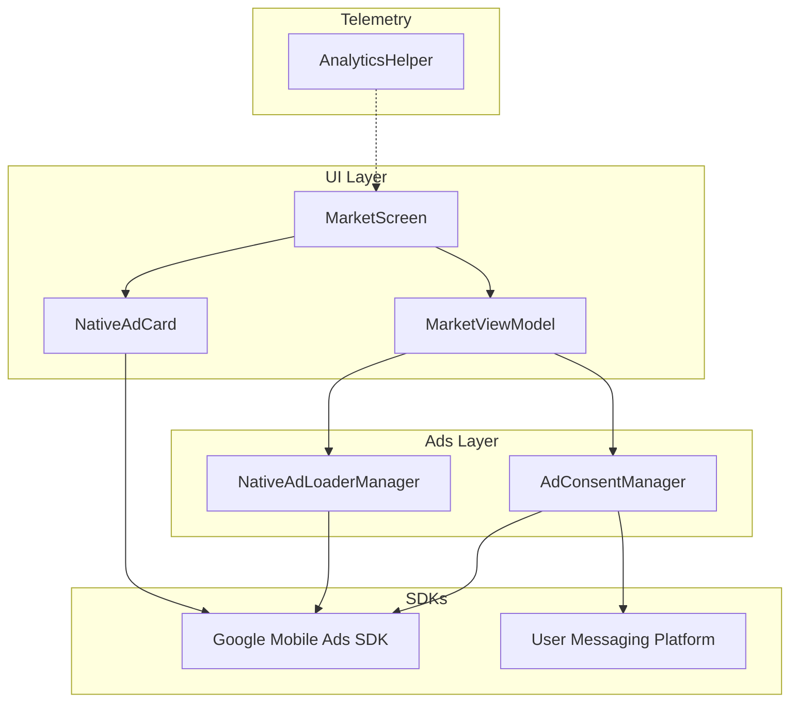
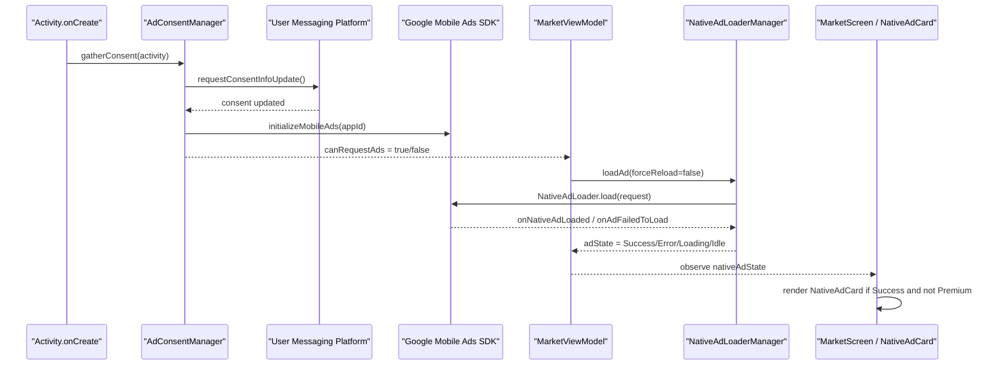
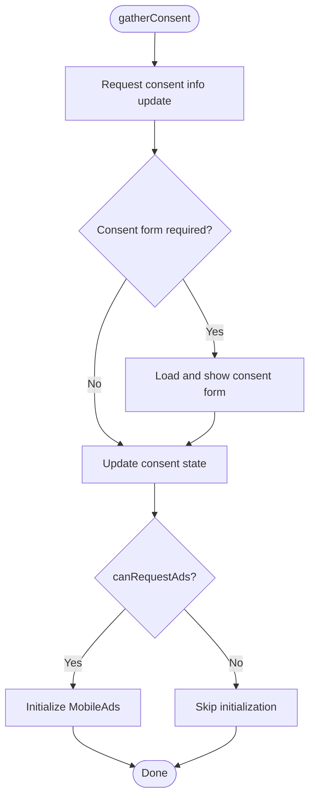
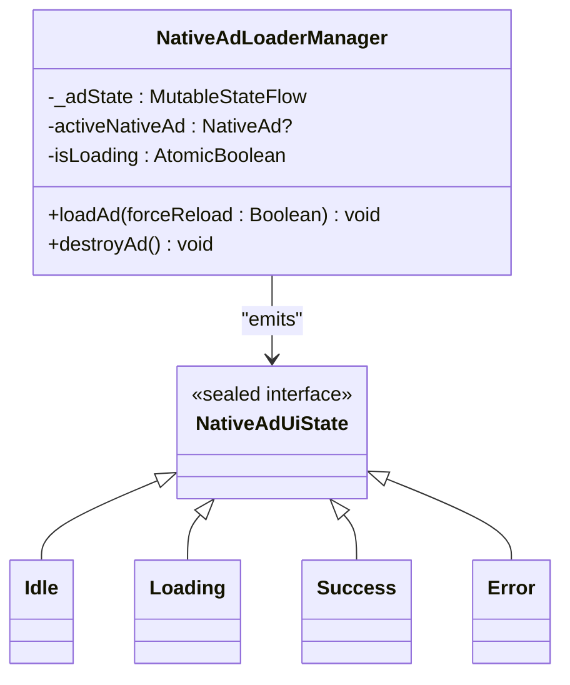
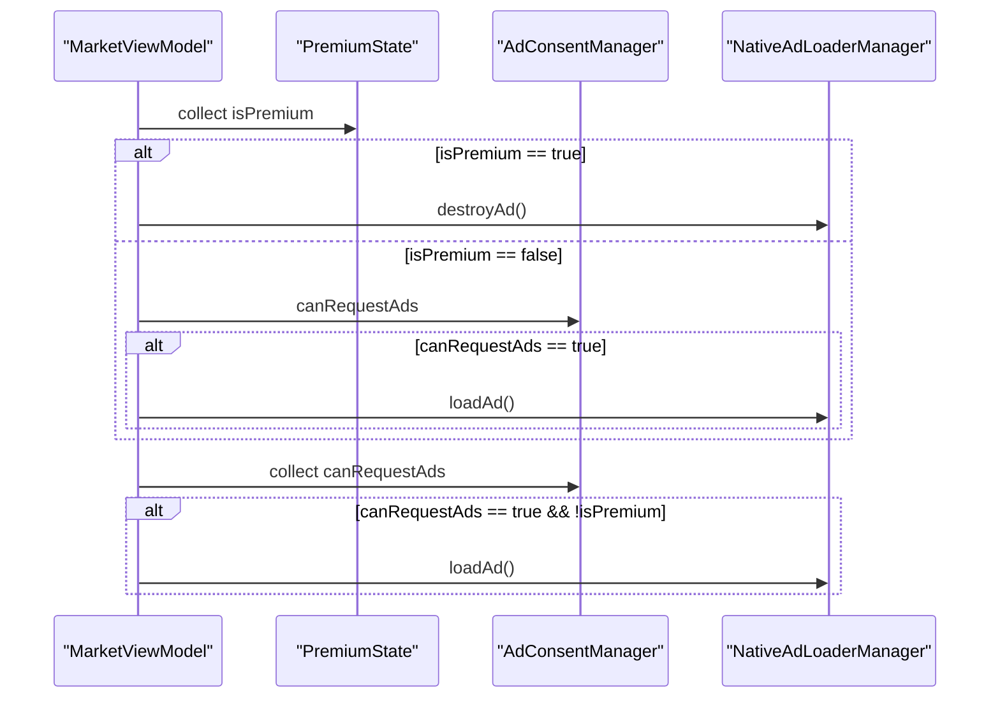
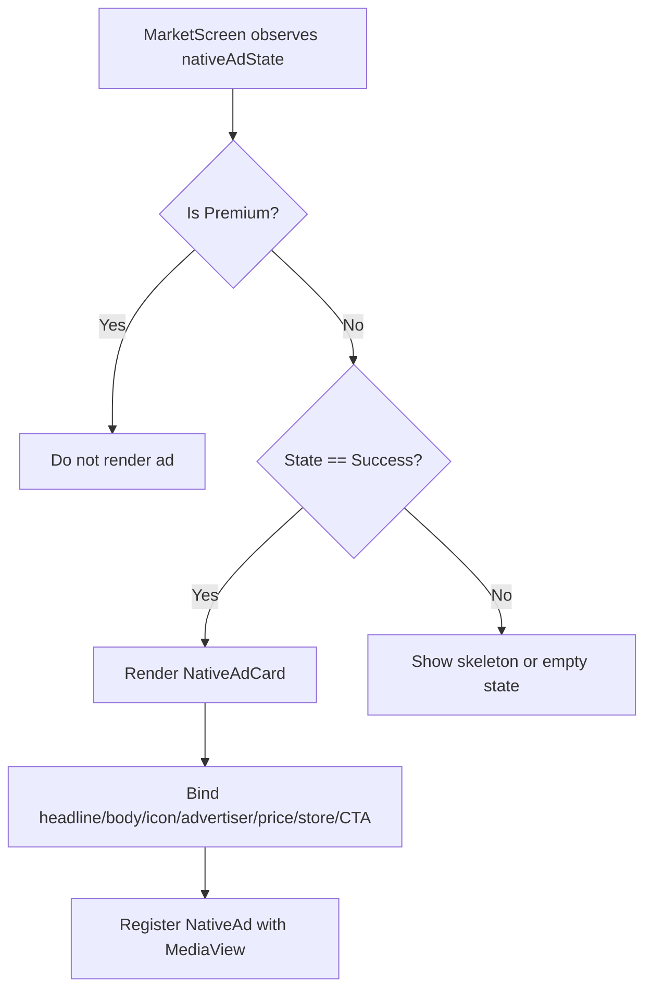
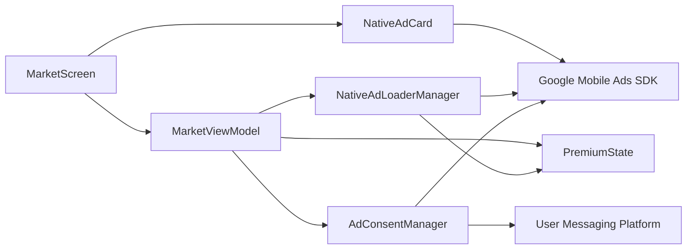

# Advertisement Management

<cite>
**Referenced Files in This Document**
- [NativeAdLoaderManager.kt](file://app/src/main/java/com/giathinh/canlua/ads/NativeAdLoaderManager.kt)
- [AdConsentManager.kt](file://app/src/main/java/com/giathinh/canlua/ads/AdConsentManager.kt)
- [MarketViewModel.kt](file://app/src/main/java/com/giathinh/canlua/ui/viewmodel/MarketViewModel.kt)
- [MarketScreen.kt](file://app/src/main/java/com/giathinh/canlua/ui/screen/market/MarketScreen.kt)
- [NativeAdCard.kt](file://app/src/main/java/com/giathinh/canlua/ui/component/market/NativeAdCard.kt)
- [view_native_ad.xml](file://app/src/main/res/layout/view_native_ad.xml)
- [AnalyticsHelper.kt](file://app/src/main/java/com/giathinh/canlua/util/AnalyticsHelper.kt)
</cite>

## Table of Contents
1. [Introduction](#introduction)
2. [Project Structure](#project-structure)
3. [Core Components](#core-components)
4. [Architecture Overview](#architecture-overview)
5. [Detailed Component Analysis](#detailed-component-analysis)
6. [Dependency Analysis](#dependency-analysis)
7. [Performance Considerations](#performance-considerations)
8. [Troubleshooting Guide](#troubleshooting-guide)
9. [Conclusion](#conclusion)
10. [Appendices](#appendices)

## Introduction
This document explains the advertisement management system for native ads, covering ad loading, consent and privacy, caching and lifecycle, display optimization, and integration with Google AdMob SDK. It focuses on:
- NativeAdLoaderManager: request lifecycle, memory-safe caching, and fallback behavior
- AdConsentManager: GDPR/privacy compliance via User Messaging Platform (UMP), region-aware consent, and privacy-focused ad serving
- UI integration: Market screen and NativeAdCard rendering
- Monitoring and analytics hooks for performance and revenue insights
- Best practices for ad placement, UX, and monetization

## Project Structure
The ad system is implemented across a small set of focused modules:
- Ads layer: consent and loader
- ViewModel orchestration: triggers ad requests based on consent and premium state
- UI layer: renders native ads safely within Compose
- Analytics: telemetry helper for app-wide events

**Diagram sources**
- [AdConsentManager.kt:30-127](file://app/src/main/java/com/giathinh/canlua/ads/AdConsentManager.kt#L30-L127)
- [NativeAdLoaderManager.kt:32-123](file://app/src/main/java/com/giathinh/canlua/ads/NativeAdLoaderManager.kt#L32-L123)
- [MarketViewModel.kt:34-184](file://app/src/main/java/com/giathinh/canlua/ui/viewmodel/MarketViewModel.kt#L34-L184)
- [MarketScreen.kt:106-342](file://app/src/main/java/com/giathinh/canlua/ui/screen/market/MarketScreen.kt#L106-L342)
- [NativeAdCard.kt:30-158](file://app/src/main/java/com/giathinh/canlua/ui/component/market/NativeAdCard.kt#L30-L158)
- [AnalyticsHelper.kt:19-100](file://app/src/main/java/com/giathinh/canlua/util/AnalyticsHelper.kt#L19-L100)

**Section sources**
- [AdConsentManager.kt:30-127](file://app/src/main/java/com/giathinh/canlua/ads/AdConsentManager.kt#L30-L127)
- [NativeAdLoaderManager.kt:32-123](file://app/src/main/java/com/giathinh/canlua/ads/NativeAdLoaderManager.kt#L32-L123)
- [MarketViewModel.kt:34-184](file://app/src/main/java/com/giathinh/canlua/ui/viewmodel/MarketViewModel.kt#L34-L184)
- [MarketScreen.kt:106-342](file://app/src/main/java/com/giathinh/canlua/ui/screen/market/MarketScreen.kt#L106-L342)
- [NativeAdCard.kt:30-158](file://app/src/main/java/com/giathinh/canlua/ui/component/market/NativeAdCard.kt#L30-L158)
- [AnalyticsHelper.kt:19-100](file://app/src/main/java/com/giathinh/canlua/util/AnalyticsHelper.kt#L19-L100)

## Core Components
- AdConsentManager
  - Manages UMP consent flow and initializes Google Mobile Ads Next-Gen SDK
  - Exposes canRequestAds and isPrivacyOptionsRequired StateFlow
  - Provides test App ID and Native Ad Unit ID for development
- NativeAdLoaderManager
  - Loads NativeAd via Google Mobile Ads SDK
  - Enforces premium user exclusion and consent gating
  - Maintains active NativeAd instance and exposes NativeAdUiState
- MarketViewModel
  - Observes PremiumState and consent to trigger ad load/destroy
  - Exposes nativeAdState to UI
- MarketScreen + NativeAdCard
  - Renders NativeAd safely using AndroidView and NativeAdView
  - Binds media content and handles optional fields gracefully
- AnalyticsHelper
  - Centralized Firebase Analytics and Crashlytics wrapper for event logging

**Section sources**
- [AdConsentManager.kt:30-127](file://app/src/main/java/com/giathinh/canlua/ads/AdConsentManager.kt#L30-L127)
- [NativeAdLoaderManager.kt:32-123](file://app/src/main/java/com/giathinh/canlua/ads/NativeAdLoaderManager.kt#L32-L123)
- [MarketViewModel.kt:34-184](file://app/src/main/java/com/giathinh/canlua/ui/viewmodel/MarketViewModel.kt#L34-L184)
- [MarketScreen.kt:106-342](file://app/src/main/java/com/giathinh/canlua/ui/screen/market/MarketScreen.kt#L106-L342)
- [NativeAdCard.kt:30-158](file://app/src/main/java/com/giathinh/canlua/ui/component/market/NativeAdCard.kt#L30-L158)
- [AnalyticsHelper.kt:19-100](file://app/src/main/java/com/giathinh/canlua/util/AnalyticsHelper.kt#L19-L100)

## Architecture Overview
The system follows MVVM with unidirectional data flow:
- Consent and initialization are handled by AdConsentManager
- Ad loading is encapsulated in NativeAdLoaderManager
- MarketViewModel orchestrates lifecycle based on consent and premium status
- MarketScreen composes UI and conditionally renders NativeAdCard
- NativeAdCard binds assets from NativeAd and registers with MediaView

**Diagram sources**
- [AdConsentManager.kt:53-115](file://app/src/main/java/com/giathinh/canlua/ads/AdConsentManager.kt#L53-L115)
- [MarketViewModel.kt:94-114](file://app/src/main/java/com/giathinh/canlua/ui/viewmodel/MarketViewModel.kt#L94-L114)
- [NativeAdLoaderManager.kt:47-112](file://app/src/main/java/com/giathinh/canlua/ads/NativeAdLoaderManager.kt#L47-L112)
- [MarketScreen.kt:470-477](file://app/src/main/java/com/giathinh/canlua/ui/screen/market/MarketScreen.kt#L470-L477)

## Detailed Component Analysis

### AdConsentManager
Responsibilities:
- Collect user consent via UMP
- Initialize Google Mobile Ads Next-Gen SDK only when allowed
- Expose consent state through StateFlow
- Provide Privacy Options UI when required

Key behaviors:
- Uses official test App ID and Native Ad Unit ID during development
- Initializes MobileAds once per process
- Updates canRequestAds and isPrivacyOptionsRequired after consent changes

**Diagram sources**
- [AdConsentManager.kt:53-94](file://app/src/main/java/com/giathinh/canlua/ads/AdConsentManager.kt#L53-L94)
- [AdConsentManager.kt:100-115](file://app/src/main/java/com/giathinh/canlua/ads/AdConsentManager.kt#L100-L115)

**Section sources**
- [AdConsentManager.kt:30-127](file://app/src/main/java/com/giathinh/canlua/ads/AdConsentManager.kt#L30-L127)

### NativeAdLoaderManager
Responsibilities:
- Load NativeAd while respecting premium users and consent
- Manage active NativeAd instance to avoid leaks
- Emit UI state transitions: Idle → Loading → Success/Error

Lifecycle rules:
- Premium users never receive ad requests; existing ad is destroyed
- Requests only proceed when UMP allows
- Prevents concurrent loads; supports forced reload
- Destroys previous ad before assigning new one
- Emits Error states with message and code on failures

**Diagram sources**
- [NativeAdLoaderManager.kt:16-21](file://app/src/main/java/com/giathinh/canlua/ads/NativeAdLoaderManager.kt#L16-L21)
- [NativeAdLoaderManager.kt:32-123](file://app/src/main/java/com/giathinh/canlua/ads/NativeAdLoaderManager.kt#L32-L123)

**Section sources**
- [NativeAdLoaderManager.kt:32-123](file://app/src/main/java/com/giathinh/canlua/ads/NativeAdLoaderManager.kt#L32-L123)

### MarketViewModel
Responsibilities:
- Observe PremiumState and consent to control ad lifecycle
- Expose nativeAdState to UI
- Provide refresh and filter operations unrelated to ads

Ad orchestration:
- If user becomes Premium, destroy current ad
- If consent granted and not Premium, load ad
- On view model clear, destroy ad to prevent leaks

**Diagram sources**
- [MarketViewModel.kt:94-114](file://app/src/main/java/com/giathinh/canlua/ui/viewmodel/MarketViewModel.kt#L94-L114)
- [MarketViewModel.kt:177-183](file://app/src/main/java/com/giathinh/canlua/ui/viewmodel/MarketViewModel.kt#L177-L183)

**Section sources**
- [MarketViewModel.kt:34-184](file://app/src/main/java/com/giathinh/canlua/ui/viewmodel/MarketViewModel.kt#L34-L184)

### MarketScreen and NativeAdCard
Rendering rules:
- Only render native ad when not Premium and ad state is Success
- Use AndroidView to host NativeAdView and bind all available assets
- Handle optional fields (body, icon, advertiser, price, store, CTA)
- Register NativeAd with MediaView for rich media support

UX constraints:
- Do not attach custom click handlers to the entire card
- Let Google Mobile Ads SDK handle clicks and impressions

**Diagram sources**
- [MarketScreen.kt:470-477](file://app/src/main/java/com/giathinh/canlua/ui/screen/market/MarketScreen.kt#L470-L477)
- [NativeAdCard.kt:30-158](file://app/src/main/java/com/giathinh/canlua/ui/component/market/NativeAdCard.kt#L30-L158)
- [view_native_ad.xml:1-164](file://app/src/main/res/layout/view_native_ad.xml#L1-L164)

**Section sources**
- [MarketScreen.kt:106-342](file://app/src/main/java/com/giathinh/canlua/ui/screen/market/MarketScreen.kt#L106-L342)
- [NativeAdCard.kt:30-158](file://app/src/main/java/com/giathinh/canlua/ui/component/market/NativeAdCard.kt#L30-L158)
- [view_native_ad.xml:1-164](file://app/src/main/res/layout/view_native_ad.xml#L1-L164)

### Analytics and Telemetry
- AnalyticsHelper centralizes Firebase Analytics and Crashlytics usage
- Provides methods for user identity, premium state, and business events
- Supports non-fatal error logging and breadcrumbs for debugging

Integration notes:
- No direct ad-specific events are emitted in the analyzed files
- Ad-related errors are logged via standard Android logs in loaders and cards
- Extend AnalyticsHelper to capture ad impressions/clicks at the UI layer if needed

**Section sources**
- [AnalyticsHelper.kt:19-100](file://app/src/main/java/com/giathinh/canlua/util/AnalyticsHelper.kt#L19-L100)

## Dependency Analysis
Coupling and cohesion:
- AdConsentManager depends on UMP and Google Mobile Ads SDK
- NativeAdLoaderManager depends on Google Mobile Ads SDK and PremiumState
- MarketViewModel depends on both managers and PremiumState
- MarketScreen depends on ViewModel and renders NativeAdCard
- NativeAdCard depends on Google Mobile Ads SDK views

**Diagram sources**
- [AdConsentManager.kt:30-127](file://app/src/main/java/com/giathinh/canlua/ads/AdConsentManager.kt#L30-L127)
- [NativeAdLoaderManager.kt:32-123](file://app/src/main/java/com/giathinh/canlua/ads/NativeAdLoaderManager.kt#L32-L123)
- [MarketViewModel.kt:34-184](file://app/src/main/java/com/giathinh/canlua/ui/viewmodel/MarketViewModel.kt#L34-L184)
- [MarketScreen.kt:106-342](file://app/src/main/java/com/giathinh/canlua/ui/screen/market/MarketScreen.kt#L106-L342)
- [NativeAdCard.kt:30-158](file://app/src/main/java/com/giathinh/canlua/ui/component/market/NativeAdCard.kt#L30-L158)

**Section sources**
- [AdConsentManager.kt:30-127](file://app/src/main/java/com/giathinh/canlua/ads/AdConsentManager.kt#L30-L127)
- [NativeAdLoaderManager.kt:32-123](file://app/src/main/java/com/giathinh/canlua/ads/NativeAdLoaderManager.kt#L32-L123)
- [MarketViewModel.kt:34-184](file://app/src/main/java/com/giathinh/canlua/ui/viewmodel/MarketViewModel.kt#L34-L184)
- [MarketScreen.kt:106-342](file://app/src/main/java/com/giathinh/canlua/ui/screen/market/MarketScreen.kt#L106-L342)
- [NativeAdCard.kt:30-158](file://app/src/main/java/com/giathinh/canlua/ui/component/market/NativeAdCard.kt#L30-L158)

## Performance Considerations
- Memory safety
  - Destroy previous NativeAd before assigning a new one
  - Destroy ad on Premium upgrade and ViewModel destruction
- Request throttling
  - Guard against concurrent loads with atomic flag and active instance check
  - Support forceReload for explicit refresh scenarios
- UI efficiency
  - Render native ad only when state is Success and user is not Premium
  - Bind optional fields conditionally to reduce layout overhead
- Initialization
  - Initialize MobileAds once per process
  - Defer heavy work off the main thread where possible

[No sources needed since this section provides general guidance]

## Troubleshooting Guide
Common issues and resolutions:
- Consent not granted
  - Ensure gatherConsent is called early (e.g., Activity.onCreate)
  - Verify canRequestAds flows to true after consent
  - Use Privacy Options UI when required
- No ads served
  - Confirm not in Premium mode
  - Validate that NativeAdLoaderManager is invoked only when consent allows
  - Check for ad load errors and inspect log messages
- Memory leaks
  - Always call destroyAd when leaving screens or when user upgrades to Premium
  - Ensure ViewModel.onCleared destroys active ad
- Rendering problems
  - Verify NativeAdView and MediaView IDs match the layout
  - Ensure registerNativeAd is called with MediaView present

Operational tips:
- Use official test App ID and Native Ad Unit ID during development
- Log and monitor ad load outcomes to detect network or policy issues
- Integrate AnalyticsHelper for structured event tracking if ad metrics are needed

**Section sources**
- [AdConsentManager.kt:53-127](file://app/src/main/java/com/giathinh/canlua/ads/AdConsentManager.kt#L53-L127)
- [NativeAdLoaderManager.kt:47-123](file://app/src/main/java/com/giathinh/canlua/ads/NativeAdLoaderManager.kt#L47-L123)
- [MarketViewModel.kt:94-184](file://app/src/main/java/com/giathinh/canlua/ui/viewmodel/MarketViewModel.kt#L94-L184)
- [NativeAdCard.kt:141-158](file://app/src/main/java/com/giathinh/canlua/ui/component/market/NativeAdCard.kt#L141-L158)

## Conclusion
The ad system integrates consent-driven initialization, safe native ad loading, and clean UI rendering. It respects user privacy, avoids unnecessary requests for Premium users, and maintains memory safety. The architecture cleanly separates concerns across consent, loading, orchestration, and presentation layers, enabling robust testing and extensibility for analytics and monitoring.

[No sources needed since this section summarizes without analyzing specific files]

## Appendices

### Google AdMob SDK Integration Notes
- Use the provided test App ID and Native Ad Unit ID for development
- Initialize MobileAds via AdConsentManager.initializeMobileAds
- Load NativeAd through NativeAdLoaderManager using NativeAdRequest
- Render via NativeAdCard with proper registration of MediaView

**Section sources**
- [AdConsentManager.kt:34-38](file://app/src/main/java/com/giathinh/canlua/ads/AdConsentManager.kt#L34-L38)
- [AdConsentManager.kt:100-115](file://app/src/main/java/com/giathinh/canlua/ads/AdConsentManager.kt#L100-L115)
- [NativeAdLoaderManager.kt:70-112](file://app/src/main/java/com/giathinh/canlua/ads/NativeAdLoaderManager.kt#L70-L112)
- [NativeAdCard.kt:141-158](file://app/src/main/java/com/giathinh/canlua/ui/component/market/NativeAdCard.kt#L141-L158)

### Testing Strategies
- Consent flow
  - Simulate consent denied/granted and verify canRequestAds updates
  - Validate Privacy Options UI availability
- Ad loading
  - Mock NativeAdLoader callbacks to assert Success/Error states
  - Verify Premium gating prevents ad requests
- UI rendering
  - Assert NativeAdCard renders only under correct conditions
  - Validate optional field visibility logic
- Lifecycle
  - Confirm destroyAd is called on Premium upgrade and ViewModel destruction

**Section sources**
- [AdConsentManager.kt:53-127](file://app/src/main/java/com/giathinh/canlua/ads/AdConsentManager.kt#L53-L127)
- [NativeAdLoaderManager.kt:47-123](file://app/src/main/java/com/giathinh/canlua/ads/NativeAdLoaderManager.kt#L47-L123)
- [MarketViewModel.kt:94-184](file://app/src/main/java/com/giathinh/canlua/ui/viewmodel/MarketViewModel.kt#L94-L184)
- [MarketScreen.kt:470-477](file://app/src/main/java/com/giathinh/canlua/ui/screen/market/MarketScreen.kt#L470-L477)

### Best Practices for Ad Placement and UX
- Place native ads between content items to minimize disruption
- Avoid attaching custom click handlers to the ad container
- Respect ad attribution and branding requirements
- Balance ad frequency with user experience to maintain engagement

[No sources needed since this section provides general guidance]

### Monetization Strategies
- Serve native ads to non-Premium users
- Offer Premium subscription to remove ads
- Track ad performance and revenue indirectly via analytics extensions
- Optimize ad formats and placements for higher engagement and CTR

[No sources needed since this section provides general guidance]