# Background Services & Sync

<cite>
**Referenced Files in This Document**   
- [SyncManager.kt](file://app/src/main/java/com/giathinh/canlua/repository/SyncManager.kt)
- [SyncWorker.kt](file://app/src/main/java/com/giathinh/canlua/repository/SyncWorker.kt)
- [PullDedupResolver.kt](file://app/src/main/java/com/giathinh/canlua/repository/PullDedupResolver.kt)
- [FirestoreRepository.kt](file://app/src/main/java/com/giathinh/canlua/repository/FirestoreRepository.kt)
- [SupabaseClient.kt](file://app/src/main/java/com/giathinh/canlua/data/remote/SupabaseClient.kt)
- [SupabasePriceRepository.kt](file://app/src/main/java/com/giathinh/canlua/repository/SupabasePriceRepository.kt)
- [MarketRepository.kt](file://app/src/main/java/com/giathinh/canlua/repository/MarketRepository.kt)
- [NativeAdLoaderManager.kt](file://app/src/main/java/com/giathinh/canlua/ads/NativeAdLoaderManager.kt)
- [AndroidManifest.xml](file://app/src/main/AndroidManifest.xml)
- [CanLuaApplication.kt](file://app/src/main/java/com/giathinh/canlua/CanLuaApplication.kt)
- [FirebaseRemoteConfigManager.kt](file://app/src/main/java/com/giathinh/canlua/util/FirebaseRemoteConfigManager.kt)
</cite>

## Table of Contents
1. [Introduction](#introduction)
2. [Project Structure](#project-structure)
3. [Core Components](#core-components)
4. [Architecture Overview](#architecture-overview)
5. [Detailed Component Analysis](#detailed-component-analysis)
6. [Dependency Analysis](#dependency-analysis)
7. [Performance Considerations](#performance-considerations)
8. [Troubleshooting Guide](#troubleshooting-guide)
9. [Conclusion](#conclusion)

## Introduction
This document explains the background processing and synchronization system for Cân Lúa Mobile. It covers WorkManager-based scheduled sync, bidirectional synchronization with Firebase Firestore, read-only market data from Supabase, a deduplication resolver for concurrent updates, native ad loading, foreground service patterns, task scheduling, dependency management, monitoring/logging, debugging approaches, performance considerations, power efficiency, network optimization, and data consistency guarantees. The app follows an offline-first design: Room is the source of truth, and cloud services are synchronized idempotently in the background.

## Project Structure
The background sync and related services live primarily under repository and ads packages, with supporting remote clients and application initialization logic.

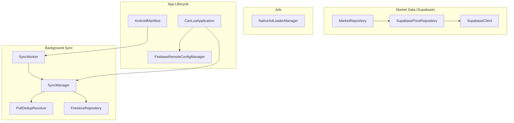

**Diagram sources**
- [SyncManager.kt:35-130](file://app/src/main/java/com/giathinh/canlua/repository/SyncManager.kt#L35-L130)
- [SyncWorker.kt:10-31](file://app/src/main/java/com/giathinh/canlua/repository/SyncWorker.kt#L10-L31)
- [PullDedupResolver.kt:21-73](file://app/src/main/java/com/giathinh/canlua/repository/PullDedupResolver.kt#L21-L73)
- [FirestoreRepository.kt:21-85](file://app/src/main/java/com/giathinh/canlua/repository/FirestoreRepository.kt#L21-L85)
- [MarketRepository.kt:27-78](file://app/src/main/java/com/giathinh/canlua/repository/MarketRepository.kt#L27-L78)
- [SupabasePriceRepository.kt:22-59](file://app/src/main/java/com/giathinh/canlua/repository/SupabasePriceRepository.kt#L22-L59)
- [SupabaseClient.kt:22-101](file://app/src/main/java/com/giathinh/canlua/data/remote/SupabaseClient.kt#L22-L101)
- [NativeAdLoaderManager.kt:32-123](file://app/src/main/java/com/giathinh/canlua/ads/NativeAdLoaderManager.kt#L32-L123)
- [CanLuaApplication.kt:68-99](file://app/src/main/java/com/giathinh/canlua/CanLuaApplication.kt#L68-L99)
- [FirebaseRemoteConfigManager.kt:52-84](file://app/src/main/java/com/giathinh/canlua/util/FirebaseRemoteConfigManager.kt#L52-L84)
- [AndroidManifest.xml:64-79](file://app/src/main/AndroidManifest.xml#L64-L79)

**Section sources**
- [SyncManager.kt:35-130](file://app/src/main/java/com/giathinh/canlua/repository/SyncManager.kt#L35-L130)
- [SyncWorker.kt:10-31](file://app/src/main/java/com/giathinh/canlua/repository/SyncWorker.kt#L10-L31)
- [AndroidManifest.xml:64-79](file://app/src/main/AndroidManifest.xml#L64-L79)

## Core Components
- SyncManager orchestrates push/pull sync with Firestore, manages WorkManager scheduling, network constraints, retry policies, analytics, and state flows for UI.
- SyncWorker executes background sync via WorkManager and handles retry semantics.
- PullDedupResolver resolves conflicts between local and cloud cards using firestoreId or composite key matching.
- FirestoreRepository provides batched writes and reads to Firestore, including real-time listeners and counters.
- Supabase integration uses a lightweight OkHttp client; MarketRepository caches prices in Room with TTL refresh.
- NativeAdLoaderManager loads native ads safely, respecting premium status and user consent.
- CanLuaApplication initializes configuration and triggers lifecycle-related sync tasks.

**Section sources**
- [SyncManager.kt:35-130](file://app/src/main/java/com/giathinh/canlua/repository/SyncManager.kt#L35-L130)
- [SyncWorker.kt:10-31](file://app/src/main/java/com/giathinh/canlua/repository/SyncWorker.kt#L10-L31)
- [PullDedupResolver.kt:21-73](file://app/src/main/java/com/giathinh/canlua/repository/PullDedupResolver.kt#L21-L73)
- [FirestoreRepository.kt:21-85](file://app/src/main/java/com/giathinh/canlua/repository/FirestoreRepository.kt#L21-L85)
- [MarketRepository.kt:27-78](file://app/src/main/java/com/giathinh/canlua/repository/MarketRepository.kt#L27-L78)
- [SupabasePriceRepository.kt:22-59](file://app/src/main/java/com/giathinh/canlua/repository/SupabasePriceRepository.kt#L22-L59)
- [SupabaseClient.kt:22-101](file://app/src/main/java/com/giathinh/canlua/data/remote/SupabaseClient.kt#L22-L101)
- [NativeAdLoaderManager.kt:32-123](file://app/src/main/java/com/giathinh/canlua/ads/NativeAdLoaderManager.kt#L32-L123)
- [CanLuaApplication.kt:68-99](file://app/src/main/java/com/giathinh/canlua/CanLuaApplication.kt#L68-L99)

## Architecture Overview
The system implements an offline-first architecture with WorkManager-driven background sync. Local Room data is authoritative; Firestore is synchronized bidirectionally, while Supabase provides read-only market data refreshed into Room.

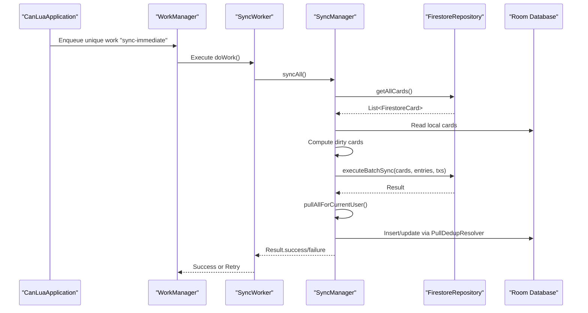

**Diagram sources**
- [CanLuaApplication.kt:68-99](file://app/src/main/java/com/giathinh/canlua/CanLuaApplication.kt#L68-L99)
- [AndroidManifest.xml:64-79](file://app/src/main/AndroidManifest.xml#L64-L79)
- [SyncWorker.kt:10-31](file://app/src/main/java/com/giathinh/canlua/repository/SyncWorker.kt#L10-L31)
- [SyncManager.kt:139-311](file://app/src/main/java/com/giathinh/canlua/repository/SyncManager.kt#L139-L311)
- [FirestoreRepository.kt:45-85](file://app/src/main/java/com/giathinh/canlua/repository/FirestoreRepository.kt#L45-L85)

## Detailed Component Analysis

### WorkManager Scheduling and Sync Orchestration
- SyncManager schedules a one-time unique work named "sync-immediate" with exponential backoff and network constraints based on settings (Wi-Fi only or any connected network).
- It checks user authentication and connectivity before syncing, exposes StateFlow for status and last sync time, and tracks pending sync data.
- On success, it updates last sync time and pending state; on failure, it logs analytics and returns a failure result.

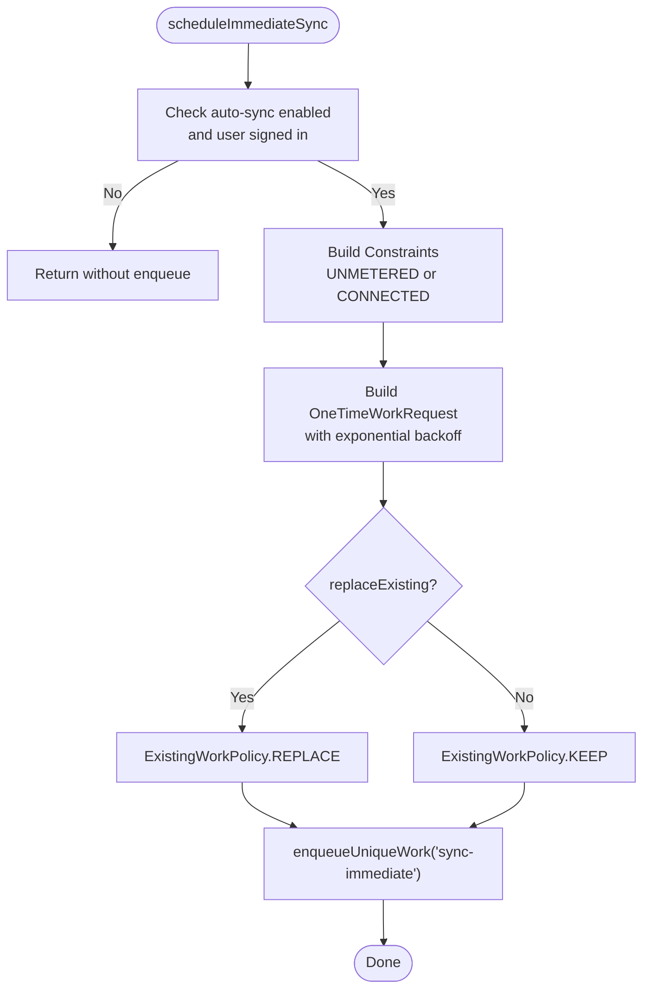

**Diagram sources**
- [SyncManager.kt:98-130](file://app/src/main/java/com/giathinh/canlua/repository/SyncManager.kt#L98-L130)

**Section sources**
- [SyncManager.kt:98-130](file://app/src/main/java/com/giathinh/canlua/repository/SyncManager.kt#L98-L130)
- [AndroidManifest.xml:64-79](file://app/src/main/AndroidManifest.xml#L64-L79)

### SyncWorker Execution and Retry Policy
- SyncWorker delegates to SyncManager.syncAll().
- If the failure indicates no user signed in, it treats it as success to avoid infinite retries; otherwise, it requests retry.

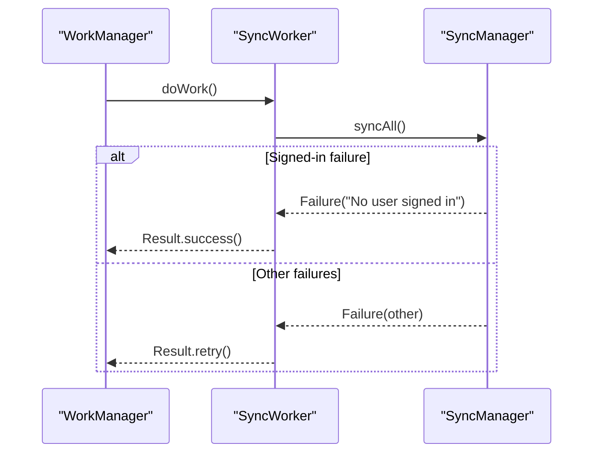

**Diagram sources**
- [SyncWorker.kt:10-31](file://app/src/main/java/com/giathinh/canlua/repository/SyncWorker.kt#L10-L31)
- [SyncManager.kt:139-154](file://app/src/main/java/com/giathinh/canlua/repository/SyncManager.kt#L139-L154)

**Section sources**
- [SyncWorker.kt:10-31](file://app/src/main/java/com/giathinh/canlua/repository/SyncWorker.kt#L10-L31)

### Push Phase: Dirty Cards Batching and Firestore Writes
- SyncManager computes dirty cards by comparing local lastModifiedMs against cloud timestamps.
- It batches card, weight entry, and transaction operations up to a threshold, then calls FirestoreRepository.executeBatchSync.
- After successful batch, it maps new Firestore IDs back to local entities and updates Room.

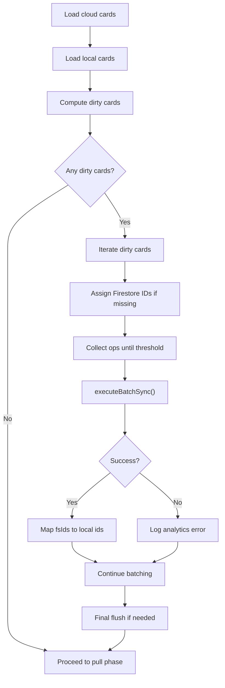

**Diagram sources**
- [SyncManager.kt:156-311](file://app/src/main/java/com/giathinh/canlua/repository/SyncManager.kt#L156-L311)
- [FirestoreRepository.kt:45-85](file://app/src/main/java/com/giathinh/canlua/repository/FirestoreRepository.kt#L45-L85)

**Section sources**
- [SyncManager.kt:156-311](file://app/src/main/java/com/giathinh/canlua/repository/SyncManager.kt#L156-L311)
- [FirestoreRepository.kt:45-85](file://app/src/main/java/com/giathinh/canlua/repository/FirestoreRepository.kt#L45-L85)

### Pull Phase and Conflict Resolution with PullDedupResolver
- SyncManager pulls all cards from Firestore and applies PullDedupResolver to decide insert, update, or skip per card.
- Resolver prioritizes firestoreId match with timestamp comparison, falls back to composite key match for legacy cards, and inserts new cards when unmatched.
- After card resolution, it processes associated weight entries and transactions, and handles pending cloud deletes.

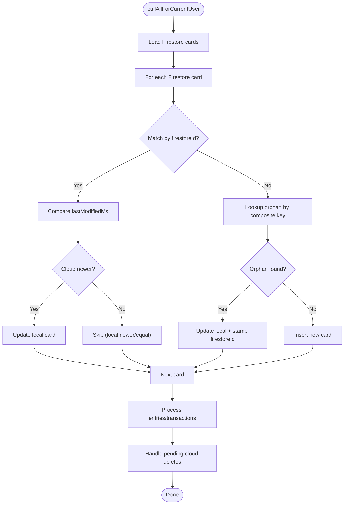

**Diagram sources**
- [SyncManager.kt:313-412](file://app/src/main/java/com/giathinh/canlua/repository/SyncManager.kt#L313-L412)
- [PullDedupResolver.kt:21-73](file://app/src/main/java/com/giathinh/canlua/repository/PullDedupResolver.kt#L21-L73)

**Section sources**
- [SyncManager.kt:313-412](file://app/src/main/java/com/giathinh/canlua/repository/SyncManager.kt#L313-L412)
- [PullDedupResolver.kt:21-73](file://app/src/main/java/com/giathinh/canlua/repository/PullDedupResolver.kt#L21-L73)

### Firestore Repository Integration
- FirestoreRepository provides batched writes with userId and syncTimestamp, incrementing profile counters when new cards are created.
- It offers read methods for cards, weight entries, and transactions, plus real-time listeners for trader-specific data.

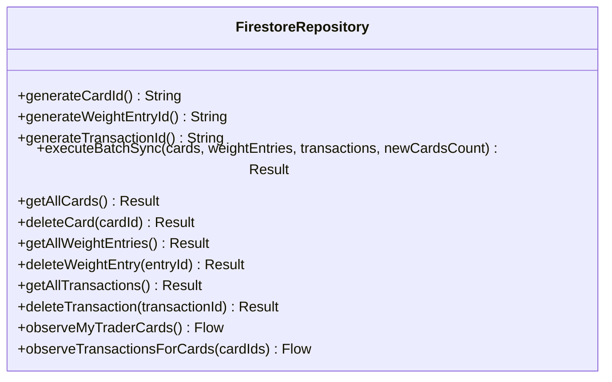

**Diagram sources**
- [FirestoreRepository.kt:21-85](file://app/src/main/java/com/giathinh/canlua/repository/FirestoreRepository.kt#L21-L85)
- [FirestoreRepository.kt:121-133](file://app/src/main/java/com/giathinh/canlua/repository/FirestoreRepository.kt#L121-L133)
- [FirestoreRepository.kt:189-201](file://app/src/main/java/com/giathinh/canlua/repository/FirestoreRepository.kt#L189-L201)
- [FirestoreRepository.kt:249-261](file://app/src/main/java/com/giathinh/canlua/repository/FirestoreRepository.kt#L249-L261)
- [FirestoreRepository.kt:268-327](file://app/src/main/java/com/giathinh/canlua/repository/FirestoreRepository.kt#L268-L327)

**Section sources**
- [FirestoreRepository.kt:21-85](file://app/src/main/java/com/giathinh/canlua/repository/FirestoreRepository.kt#L21-L85)
- [FirestoreRepository.kt:121-133](file://app/src/main/java/com/giathinh/canlua/repository/FirestoreRepository.kt#L121-L133)
- [FirestoreRepository.kt:189-201](file://app/src/main/java/com/giathinh/canlua/repository/FirestoreRepository.kt#L189-L201)
- [FirestoreRepository.kt:249-261](file://app/src/main/java/com/giathinh/canlua/repository/FirestoreRepository.kt#L249-L261)
- [FirestoreRepository.kt:268-327](file://app/src/main/java/com/giathinh/canlua/repository/FirestoreRepository.kt#L268-L327)

### Supabase Integration and Market Data Caching
- SupabaseClient performs GET and UPSERT operations over REST with OkHttp and Gson.
- SupabasePriceRepository fetches active rice prices and maps DTOs to domain models.
- MarketRepository enforces a 10-minute TTL cache, refreshing from Supabase and upserting Room; on failure, it keeps Room cache intact.

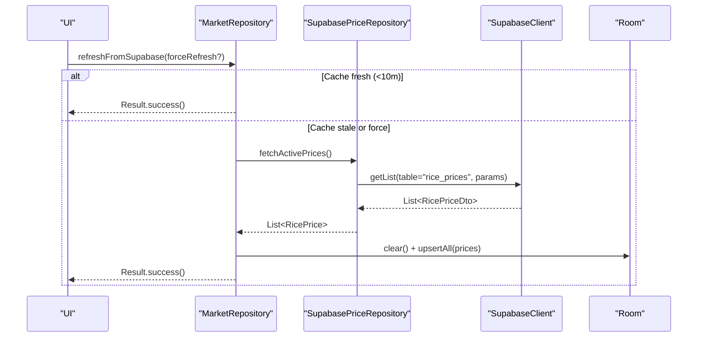

**Diagram sources**
- [MarketRepository.kt:45-78](file://app/src/main/java/com/giathinh/canlua/repository/MarketRepository.kt#L45-L78)
- [SupabasePriceRepository.kt:37-59](file://app/src/main/java/com/giathinh/canlua/repository/SupabasePriceRepository.kt#L37-L59)
- [SupabaseClient.kt:35-70](file://app/src/main/java/com/giathinh/canlua/data/remote/SupabaseClient.kt#L35-L70)

**Section sources**
- [MarketRepository.kt:45-78](file://app/src/main/java/com/giathinh/canlua/repository/MarketRepository.kt#L45-L78)
- [SupabasePriceRepository.kt:37-59](file://app/src/main/java/com/giathinh/canlua/repository/SupabasePriceRepository.kt#L37-L59)
- [SupabaseClient.kt:35-70](file://app/src/main/java/com/giathinh/canlua/data/remote/SupabaseClient.kt#L35-L70)

### Native Ad Loading Manager
- NativeAdLoaderManager ensures ads are not loaded for Premium users, respects UMP consent, avoids duplicate loads, and destroys previous ad instances to prevent leaks.
- It exposes a StateFlow of ad states: Idle, Loading, Success, Error.

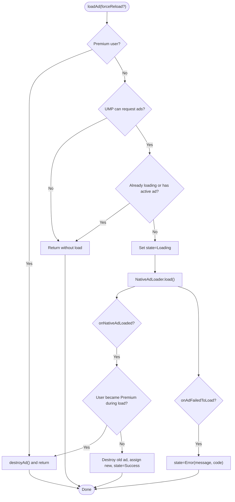

**Diagram sources**
- [NativeAdLoaderManager.kt:47-123](file://app/src/main/java/com/giathinh/canlua/ads/NativeAdLoaderManager.kt#L47-L123)

**Section sources**
- [NativeAdLoaderManager.kt:47-123](file://app/src/main/java/com/giathinh/canlua/ads/NativeAdLoaderManager.kt#L47-L123)

### Application Initialization and Remote Config
- CanLuaApplication initializes Firebase Remote Config, applies early adopter premium rules, and triggers orphan claim and auto-sync preference observation.
- FirebaseRemoteConfigManager sets minimum fetch intervals and defaults, then fetches and activates config values.

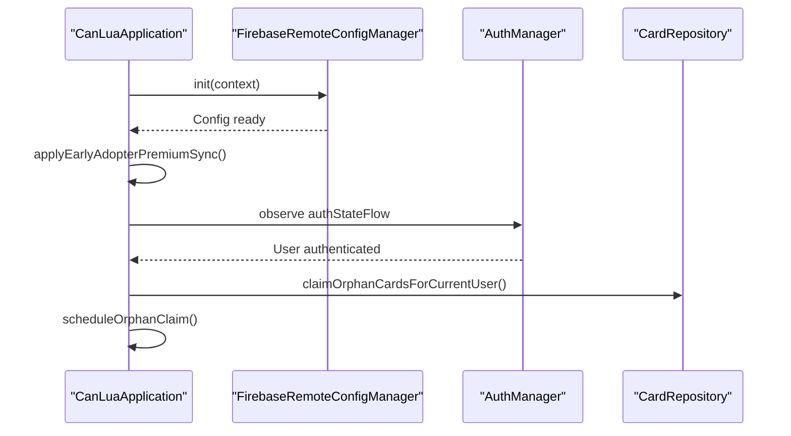

**Diagram sources**
- [CanLuaApplication.kt:68-99](file://app/src/main/java/com/giathinh/canlua/CanLuaApplication.kt#L68-L99)
- [FirebaseRemoteConfigManager.kt:52-84](file://app/src/main/java/com/giathinh/canlua/util/FirebaseRemoteConfigManager.kt#L52-L84)

**Section sources**
- [CanLuaApplication.kt:68-99](file://app/src/main/java/com/giathinh/canlua/CanLuaApplication.kt#L68-L99)
- [FirebaseRemoteConfigManager.kt:52-84](file://app/src/main/java/com/giathinh/canlua/util/FirebaseRemoteConfigManager.kt#L52-L84)

## Dependency Analysis
The following diagram shows how components depend on each other for background sync and data fetching.

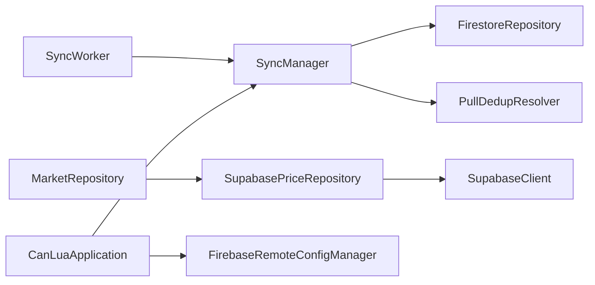

**Diagram sources**
- [SyncWorker.kt:10-31](file://app/src/main/java/com/giathinh/canlua/repository/SyncWorker.kt#L10-L31)
- [SyncManager.kt:35-130](file://app/src/main/java/com/giathinh/canlua/repository/SyncManager.kt#L35-L130)
- [FirestoreRepository.kt:21-85](file://app/src/main/java/com/giathinh/canlua/repository/FirestoreRepository.kt#L21-L85)
- [PullDedupResolver.kt:21-73](file://app/src/main/java/com/giathinh/canlua/repository/PullDedupResolver.kt#L21-L73)
- [MarketRepository.kt:27-78](file://app/src/main/java/com/giathinh/canlua/repository/MarketRepository.kt#L27-L78)
- [SupabasePriceRepository.kt:22-59](file://app/src/main/java/com/giathinh/canlua/repository/SupabasePriceRepository.kt#L22-L59)
- [SupabaseClient.kt:22-101](file://app/src/main/java/com/giathinh/canlua/data/remote/SupabaseClient.kt#L22-L101)
- [CanLuaApplication.kt:68-99](file://app/src/main/java/com/giathinh/canlua/CanLuaApplication.kt#L68-L99)
- [FirebaseRemoteConfigManager.kt:52-84](file://app/src/main/java/com/giathinh/canlua/util/FirebaseRemoteConfigManager.kt#L52-L84)

**Section sources**
- [SyncWorker.kt:10-31](file://app/src/main/java/com/giathinh/canlua/repository/SyncWorker.kt#L10-L31)
- [SyncManager.kt:35-130](file://app/src/main/java/com/giathinh/canlua/repository/SyncManager.kt#L35-L130)
- [MarketRepository.kt:27-78](file://app/src/main/java/com/giathinh/canlua/repository/MarketRepository.kt#L27-L78)

## Performance Considerations
- Batch Firestore writes: SyncManager groups operations to reduce round trips and respects a threshold to avoid oversized batches.
- Client-side sorting: FirestoreRepository sorts results locally to avoid composite index requirements, reducing query complexity.
- TTL caching for market data: MarketRepository limits network calls to once per 10 minutes unless forced.
- Avoid redundant ad loads: NativeAdLoaderManager prevents duplicate requests and destroys previous ad instances to conserve memory and CPU.
- Network constraints: WorkManager constraints ensure sync runs only when appropriate networks are available, minimizing battery drain.

[No sources needed since this section provides general guidance]

## Troubleshooting Guide
Common issues and resolutions:
- No user signed in during sync:
  - Symptom: Sync fails and WorkWorker treats it as success to avoid retry loops.
  - Action: Ensure user is authenticated before triggering sync; check SyncStatus.Error messages.
- Wi-Fi only constraint:
  - Symptom: Sync does not run on mobile data.
  - Action: Adjust settings to allow mobile sync or connect to Wi-Fi; verify SettingsRepository.isSyncOnlyWifi().
- All cards failed to push:
  - Symptom: Analytics log indicates push_all failure; SyncStatus becomes Error.
  - Action: Inspect network connectivity and Firestore errors; retry after resolving connectivity issues.
- Duplicate cards after logout/login:
  - Symptom: Legacy cards without firestoreId may appear duplicated.
  - Action: PullDedupResolver stamps firestoreId on composite matches; ensure pullAllForCurrentUser runs after login.
- Ad not loading:
  - Symptom: Native ad remains idle or shows error.
  - Action: Verify UMP consent granted; confirm user is not Premium; check test ad unit ID and network.

**Section sources**
- [SyncWorker.kt:17-31](file://app/src/main/java/com/giathinh/canlua/repository/SyncWorker.kt#L17-L31)
- [SyncManager.kt:139-154](file://app/src/main/java/com/giathinh/canlua/repository/SyncManager.kt#L139-L154)
- [SyncManager.kt:291-311](file://app/src/main/java/com/giathinh/canlua/repository/SyncManager.kt#L291-L311)
- [PullDedupResolver.kt:45-73](file://app/src/main/java/com/giathinh/canlua/repository/PullDedupResolver.kt#L45-L73)
- [NativeAdLoaderManager.kt:47-123](file://app/src/main/java/com/giathinh/canlua/ads/NativeAdLoaderManager.kt#L47-L123)

## Conclusion
Cân Lúa Mobile’s background sync system leverages WorkManager for reliable, battery-aware scheduling, with SyncManager coordinating push/pull operations against Firestore and applying robust conflict resolution through PullDedupResolver. Market data from Supabase is efficiently cached in Room with TTL refresh. Native ad loading is lifecycle-safe and consent-aware. Together, these components provide an offline-first experience with strong consistency guarantees, resilient error handling, and optimized resource usage.