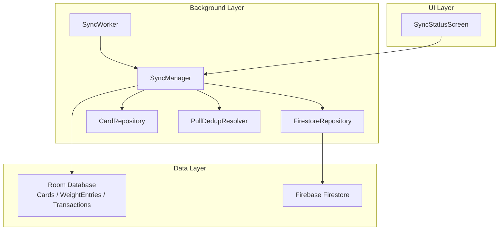
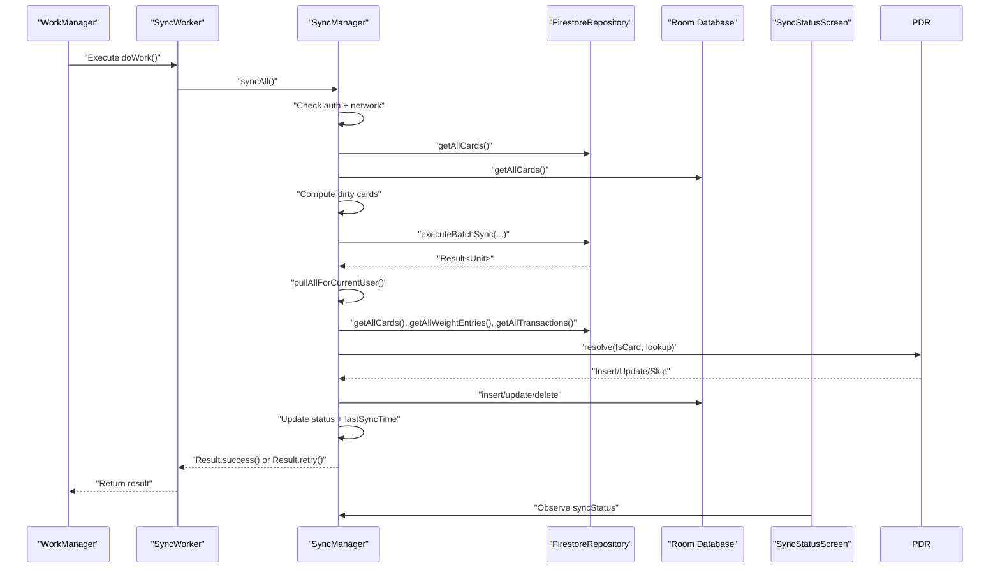
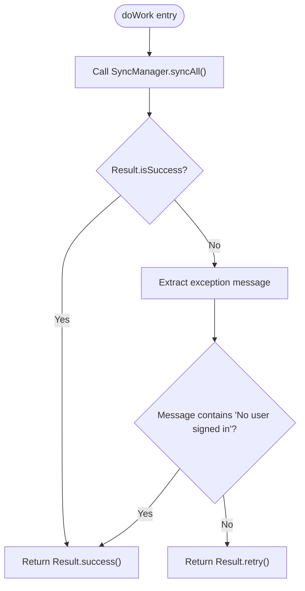
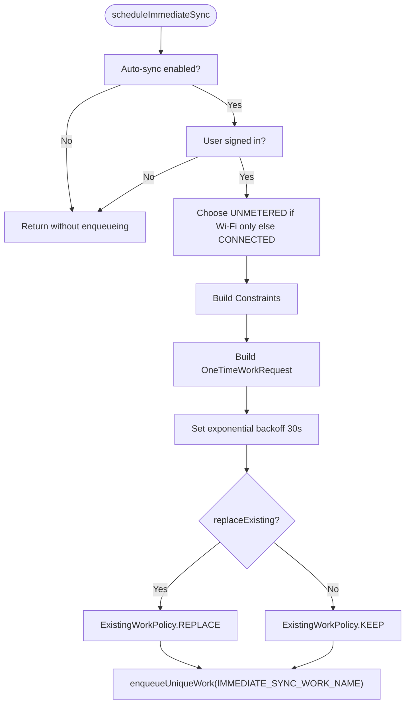
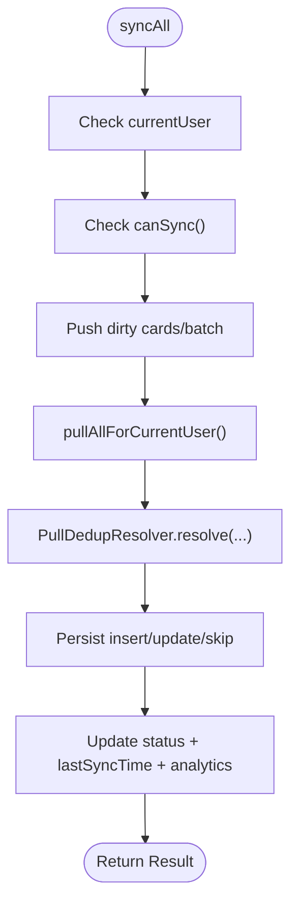
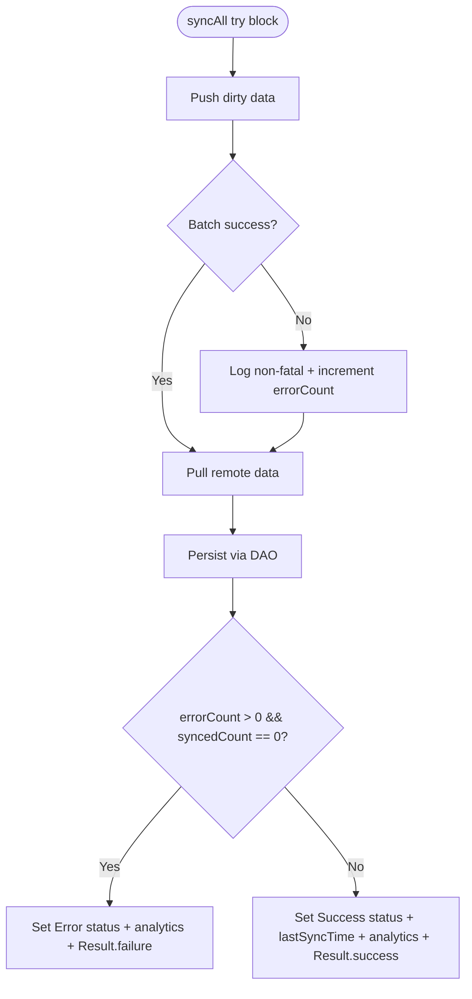
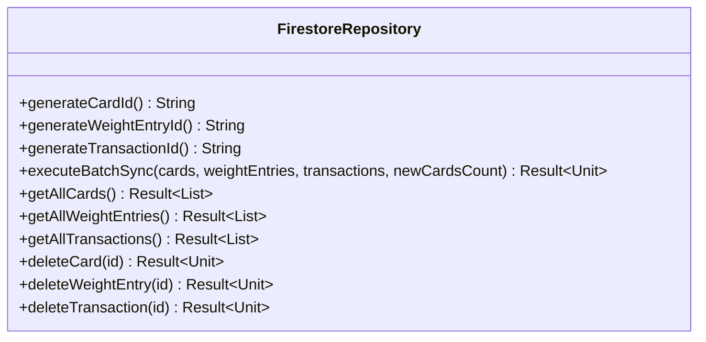
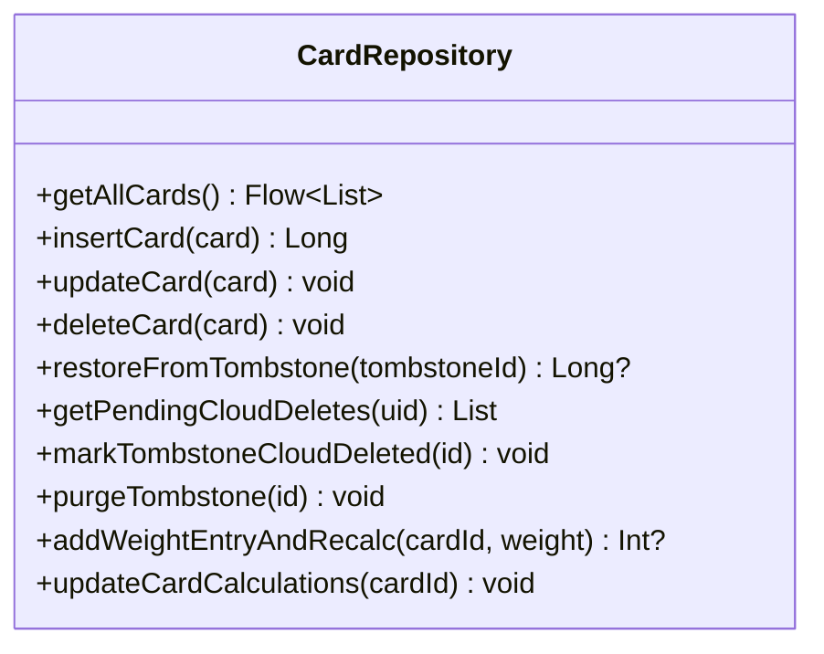
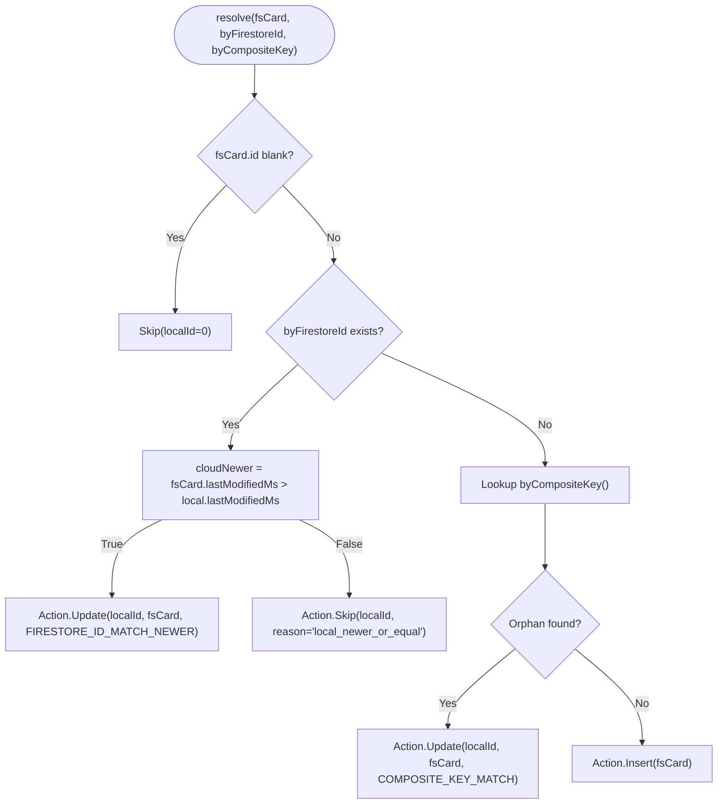
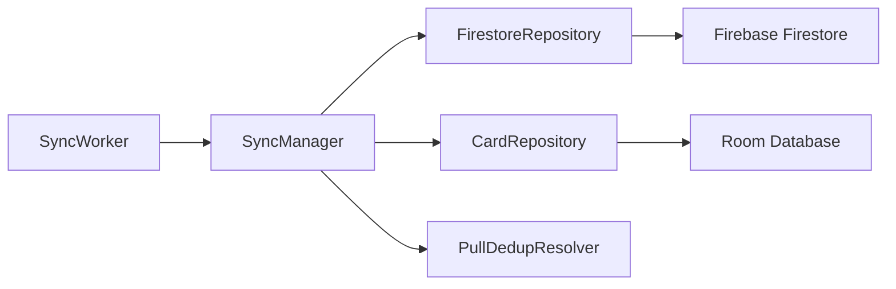

# Background Workers & Scheduling

<cite>
**Referenced Files in This Document**
- [SyncWorker.kt](file://app/src/main/java/com/giathinh/canlua/repository/SyncWorker.kt)
- [SyncManager.kt](file://app/src/main/java/com/giathinh/canlua/repository/SyncManager.kt)
- [FirestoreRepository.kt](file://app/src/main/java/com/giathinh/canlua/repository/FirestoreRepository.kt)
- [CardRepository.kt](file://app/src/main/java/com/giathinh/canlua/repository/CardRepository.kt)
- [PullDedupResolver.kt](file://app/src/main/java/com/giathinh/canlua/repository/PullDedupResolver.kt)
- [AnalyticsHelper.kt](file://app/src/main/java/com/giathinh/canlua/util/AnalyticsHelper.kt)
- [SyncStatusScreen.kt](file://app/src/main/java/com/giathinh/canlua/ui/screen/SyncStatusScreen.kt)
</cite>

## Table of Contents
1. [Introduction](#introduction)
2. [Project Structure](#project-structure)
3. [Core Components](#core-components)
4. [Architecture Overview](#architecture-overview)
5. [Detailed Component Analysis](#detailed-component-analysis)
6. [Dependency Analysis](#dependency-analysis)
7. [Performance Considerations](#performance-considerations)
8. [Troubleshooting Guide](#troubleshooting-guide)
9. [Conclusion](#conclusion)

## Introduction
This document explains the WorkManager-based background synchronization system used by the app to keep local Room data consistent with Firebase Firestore and Supabase. The implementation follows an offline-first design: all user operations work locally first, and a scheduled worker pushes dirty local records to the cloud and pulls remote changes back into Room.

Key goals covered here:
- How `SyncWorker` is triggered and how it delegates to `SyncManager`.
- Constraint-based execution using network requirements.
- One-time vs periodic scheduling patterns.
- Dependency chaining between push and pull phases.
- Lifecycle behavior, retry strategy, and error handling.
- Logging and debugging through analytics and Crashlytics.
- Performance techniques such as batching, deduplication, and IO offloading.
- UI monitoring of sync status.

## Project Structure
The background sync logic lives under the repository layer and integrates with the UI via state flows.

**Diagram sources**
- [SyncWorker.kt:10-30](file://app/src/main/java/com/giathinh/canlua/repository/SyncWorker.kt#L10-L30)
- [SyncManager.kt:35-549](file://app/src/main/java/com/giathinh/canlua/repository/SyncManager.kt#L35-L549)
- [FirestoreRepository.kt:21-85](file://app/src/main/java/com/giathinh/canlua/repository/FirestoreRepository.kt#L21-L85)
- [CardRepository.kt:36-46](file://app/src/main/java/com/giathinh/canlua/repository/CardRepository.kt#L36-L46)
- [PullDedupResolver.kt:21-73](file://app/src/main/java/com/giathinh/canlua/repository/PullDedupResolver.kt#L21-L73)
- [SyncStatusScreen.kt:68-76](file://app/src/main/java/com/giathinh/canlua/ui/screen/SyncStatusScreen.kt#L68-L76)

**Section sources**
- [SyncWorker.kt:10-30](file://app/src/main/java/com/giathinh/canlua/repository/SyncWorker.kt#L10-L30)
- [SyncManager.kt:35-549](file://app/src/main/java/com/giathinh/canlua/repository/SyncManager.kt#L35-L549)

## Core Components
- `SyncWorker`: A Hilt-injected `CoroutineWorker` that runs the full sync pipeline when WorkManager schedules it.
- `SyncManager`: Orchestrates constraints, scheduling, push/pull sync, deduplication, analytics, and status/state exposure.
- `FirestoreRepository`: Wraps Firestore reads, writes, batch commits, and ID generation.
- `CardRepository`: Manages Room persistence for cards, weight entries, transactions, tombstones, and calculations.
- `PullDedupResolver`: Pure logic deciding whether a pulled card should be inserted, updated, or skipped.
- `AnalyticsHelper`: Centralized Firebase Analytics and Crashlytics logging for sync success/failure and non-fatal errors.
- `SyncStatusScreen`: Compose screen observing sync state and last sync time.

**Section sources**
- [SyncWorker.kt:10-30](file://app/src/main/java/com/giathinh/canlua/repository/SyncWorker.kt#L10-L30)
- [SyncManager.kt:35-549](file://app/src/main/java/com/giathinh/canlua/repository/SyncManager.kt#L35-L549)
- [FirestoreRepository.kt:21-85](file://app/src/main/java/com/giathinh/canlua/repository/FirestoreRepository.kt#L21-L85)
- [CardRepository.kt:36-46](file://app/src/main/java/com/giathinh/canlua/repository/CardRepository.kt#L36-L46)
- [PullDedupResolver.kt:21-73](file://app/src/main/java/com/giathinh/canlua/repository/PullDedupResolver.kt#L21-L73)
- [AnalyticsHelper.kt:19-99](file://app/src/main/java/com/giathinh/canlua/util/AnalyticsHelper.kt#L19-L99)
- [SyncStatusScreen.kt:68-76](file://app/src/main/java/com/giathinh/canlua/ui/screen/SyncStatusScreen.kt#L68-L76)

## Architecture Overview
The sync architecture separates scheduling from business logic:
- Scheduling and constraints are handled by `SyncManager` using WorkManager APIs.
- Execution happens inside `SyncWorker.doWork`, which calls `SyncManager.syncAll`.
- `syncAll` performs a push phase (dirty local data to Firestore), then a pull phase (remote data into Room).
- Deduplication during pull uses `PullDedupResolver`.
- Analytics and Crashlytics record outcomes and exceptions.

**Diagram sources**
- [SyncWorker.kt:17-30](file://app/src/main/java/com/giathinh/canlua/repository/SyncWorker.kt#L17-L30)
- [SyncManager.kt:139-310](file://app/src/main/java/com/giathinh/canlua/repository/SyncManager.kt#L139-L310)
- [FirestoreRepository.kt:45-85](file://app/src/main/java/com/giathinh/canlua/repository/FirestoreRepository.kt#L45-L85)
- [PullDedupResolver.kt:45-73](file://app/src/main/java/com/giathinh/canlua/repository/PullDedupResolver.kt#L45-L73)
- [SyncStatusScreen.kt:72-76](file://app/src/main/java/com/giathinh/canlua/ui/screen/SyncStatusScreen.kt#L72-L76)

## Detailed Component Analysis

### SyncWorker Implementation
`SyncWorker` is a Hilt-injected coroutine worker whose only responsibility is to run the sync pipeline and map its outcome to WorkManager results.

Key behaviors:
- Delegates to `SyncManager.syncAll`.
- Treats success as `Result.success`.
- If the failure message indicates no signed-in user, returns `Result.success` to avoid infinite retries.
- Otherwise, returns `Result.retry` so WorkManager can reschedule according to backoff policy.

**Diagram sources**
- [SyncWorker.kt:17-30](file://app/src/main/java/com/giathinh/canlua/repository/SyncWorker.kt#L17-L30)

**Section sources**
- [SyncWorker.kt:10-30](file://app/src/main/java/com/giathinh/canlua/repository/SyncWorker.kt#L10-L30)

### SyncManager: Constraints, Scheduling, and Sync Pipeline
`SyncManager` is the central orchestrator. It exposes:
- Network checks: general connectivity and Wi-Fi-only mode.
- Pending sync detection based on unsynced entities and pending cloud deletes.
- Immediate one-time sync scheduling with WorkManager.
- Full sync pipeline: push dirty data, then pull remote data.
- Status and timing state exposed as `StateFlow`.

#### Constraint-Based Execution
Constraints are built per configuration:
- If sync is Wi-Fi only, use `NetworkType.UNMETERED`.
- Otherwise, use `NetworkType.CONNECTED`.
- Backoff policy is exponential with a 30-second initial delay.

**Diagram sources**
- [SyncManager.kt:102-130](file://app/src/main/java/com/giathinh/canlua/repository/SyncManager.kt#L102-L130)

#### One-Time vs Periodic Work Patterns
Current implementation uses one-time unique work:
- `IMMEDIATE_SYNC_WORK_NAME` is enqueued as a one-time request.
- There is no `PeriodicWorkRequest` usage in the analyzed files.
- Unique work policy supports either replacing or keeping existing work depending on configuration changes or continuous writes.

#### Dependency Chaining Between Push and Pull
`syncAll` chains operations:
1. Validate authentication and network.
2. Fetch remote cards and compare with local cards to find dirty records.
3. Batch push dirty cards, weight entries, and transactions.
4. Update local IDs after successful batch commit.
5. Pull remote cards, weight entries, and transactions.
6. Resolve conflicts using `PullDedupResolver`.
7. Persist resolved changes into Room.
8. Update analytics, last sync time, and pending sync state.

**Diagram sources**
- [SyncManager.kt:139-310](file://app/src/main/java/com/giathinh/canlua/repository/SyncManager.kt#L139-L310)
- [SyncManager.kt:313-412](file://app/src/main/java/com/giathinh/canlua/repository/SyncManager.kt#L313-L412)
- [PullDedupResolver.kt:45-73](file://app/src/main/java/com/giathinh/canlua/repository/PullDedupResolver.kt#L45-L73)

#### Error Handling and Retry Mechanisms
Error handling includes:
- Early exit if no user is signed in.
- Early exit if network conditions are not met.
- Batch failures are logged and counted; if all cards fail, return failure.
- General exceptions update status and log non-fatal errors.
- Worker-level retry avoids infinite loops when there is no signed-in user.

**Diagram sources**
- [SyncManager.kt:156-310](file://app/src/main/java/com/giathinh/canlua/repository/SyncManager.kt#L156-L310)
- [AnalyticsHelper.kt:67-89](file://app/src/main/java/com/giathinh/canlua/util/AnalyticsHelper.kt#L67-L89)

**Section sources**
- [SyncManager.kt:58-84](file://app/src/main/java/com/giathinh/canlua/repository/SyncManager.kt#L58-L84)
- [SyncManager.kt:102-137](file://app/src/main/java/com/giathinh/canlua/repository/SyncManager.kt#L102-L137)
- [SyncManager.kt:139-310](file://app/src/main/java/com/giathinh/canlua/repository/SyncManager.kt#L139-L310)
- [SyncManager.kt:313-412](file://app/src/main/java/com/giathinh/canlua/repository/SyncManager.kt#L313-L412)

### FirestoreRepository: Cloud Integration and Batching
`FirestoreRepository` provides:
- ID generation for new documents.
- Batch write support for cards, weight entries, transactions, and profile counters.
- CRUD operations for cards, weight entries, and transactions.
- Realtime observation flows for trader-related features.

Important sync-related points:
- Batch commits set `userId` and `syncTimestamp`.
- New card creation increments profile `cardCount`.
- All network operations are wrapped in `withContext(Dispatchers.IO)` and return `Result`.

**Diagram sources**
- [FirestoreRepository.kt:41-85](file://app/src/main/java/com/giathinh/canlua/repository/FirestoreRepository.kt#L41-L85)
- [FirestoreRepository.kt:121-133](file://app/src/main/java/com/giathinh/canlua/repository/FirestoreRepository.kt#L121-L133)
- [FirestoreRepository.kt:189-201](file://app/src/main/java/com/giathinh/canlua/repository/FirestoreRepository.kt#L189-L201)
- [FirestoreRepository.kt:249-261](file://app/src/main/java/com/giathinh/canlua/repository/FirestoreRepository.kt#L249-L261)

**Section sources**
- [FirestoreRepository.kt:21-85](file://app/src/main/java/com/giathinh/canlua/repository/FirestoreRepository.kt#L21-L85)
- [FirestoreRepository.kt:121-133](file://app/src/main/java/com/giathinh/canlua/repository/FirestoreRepository.kt#L121-L133)
- [FirestoreRepository.kt:189-201](file://app/src/main/java/com/giathinh/canlua/repository/FirestoreRepository.kt#L189-L201)
- [FirestoreRepository.kt:249-261](file://app/src/main/java/com/giathinh/canlua/repository/FirestoreRepository.kt#L249-L261)

### CardRepository: Local Persistence and Tombstone Cleanup
`CardRepository` manages:
- Per-user isolation using current auth UID.
- Insert/update with encryption and timestamps.
- Delete with tombstone recording for recovery and cloud delete tracking.
- Weight entry and transaction management.
- Calculation updates using `RiceSettlement`.

Sync-relevant responsibilities:
- Provides flows for weight entries and transactions used during push.
- Tracks pending cloud deletes and tombstone states.
- Ensures consistency via Room transactions.

**Diagram sources**
- [CardRepository.kt:48-85](file://app/src/main/java/com/giathinh/canlua/repository/CardRepository.kt#L48-L85)
- [CardRepository.kt:103-165](file://app/src/main/java/com/giathinh/canlua/repository/CardRepository.kt#L103-L165)
- [CardRepository.kt:176-204](file://app/src/main/java/com/giathinh/canlua/repository/CardRepository.kt#L176-L204)
- [CardRepository.kt:242-310](file://app/src/main/java/com/giathinh/canlua/repository/CardRepository.kt#L242-L310)

**Section sources**
- [CardRepository.kt:36-46](file://app/src/main/java/com/giathinh/canlua/repository/CardRepository.kt#L36-L46)
- [CardRepository.kt:103-165](file://app/src/main/java/com/giathinh/canlua/repository/CardRepository.kt#L103-L165)
- [CardRepository.kt:176-204](file://app/src/main/java/com/giathinh/canlua/repository/CardRepository.kt#L176-L204)
- [CardRepository.kt:242-310](file://app/src/main/java/com/giathinh/canlua/repository/CardRepository.kt#L242-L310)

### PullDedupResolver: Conflict Resolution Logic
`PullDedupResolver` determines how to handle incoming Firestore cards:
- Skip blank Firestore IDs.
- Match by Firestore ID and compare modification timestamps.
- Match by composite key for legacy cards without Firestore ID.
- Insert completely new cards.

**Diagram sources**
- [PullDedupResolver.kt:45-73](file://app/src/main/java/com/giathinh/canlua/repository/PullDedupResolver.kt#L45-L73)

**Section sources**
- [PullDedupResolver.kt:21-73](file://app/src/main/java/com/giathinh/canlua/repository/PullDedupResolver.kt#L21-L73)

### Analytics and Debugging
`AnalyticsHelper` centralizes:
- Firebase Analytics events for sync success and failure.
- Crashlytics non-fatal exception logging.
- User identity and premium state properties.

Sync-related telemetry:
- `syncSuccess(durationMs, cardCount)`
- `syncFailed(stage, errorClass)`
- `logNonFatal(throwable, tag)`
- `breadcrumb(message)`

**Section sources**
- [AnalyticsHelper.kt:19-99](file://app/src/main/java/com/giathinh/canlua/util/AnalyticsHelper.kt#L19-L99)

### UI Monitoring: SyncStatusScreen
`SyncStatusScreen` observes:
- `syncStatus` from `SyncViewModel`.
- `lastSyncTime` from `SyncViewModel`.
- Displays status icons, messages, and last sync timestamp.
- Provides manual sync trigger and backup controls.

Note: The actual ViewModel is not included in the analyzed files, but the screen consumes `SyncViewModel` and displays `SyncStatus`.

**Section sources**
- [SyncStatusScreen.kt:68-76](file://app/src/main/java/com/giathinh/canlua/ui/screen/SyncStatusScreen.kt#L68-L76)
- [SyncStatusScreen.kt:120-191](file://app/src/main/java/com/giathinh/canlua/ui/screen/SyncStatusScreen.kt#L120-L191)
- [SyncStatusScreen.kt:195-225](file://app/src/main/java/com/giathinh/canlua/ui/screen/SyncStatusScreen.kt#L195-L225)

## Dependency Analysis
The sync subsystem has clear boundaries:
- `SyncWorker` depends only on `SyncManager`.
- `SyncManager` depends on repositories and DAOs for data access and cloud operations.
- `FirestoreRepository` depends on Firebase services.
- `CardRepository` depends on Room DAOs and calculation utilities.
- `PullDedupResolver` is pure logic with no Android dependencies.

**Diagram sources**
- [SyncWorker.kt:10-15](file://app/src/main/java/com/giathinh/canlua/repository/SyncWorker.kt#L10-L15)
- [SyncManager.kt:35-45](file://app/src/main/java/com/giathinh/canlua/repository/SyncManager.kt#L35-L45)
- [FirestoreRepository.kt:21-25](file://app/src/main/java/com/giathinh/canlua/repository/FirestoreRepository.kt#L21-L25)
- [CardRepository.kt:36-44](file://app/src/main/java/com/giathinh/canlua/repository/CardRepository.kt#L36-L44)
- [PullDedupResolver.kt:21-23](file://app/src/main/java/com/giathinh/canlua/repository/PullDedupResolver.kt#L21-L23)

**Section sources**
- [SyncWorker.kt:10-15](file://app/src/main/java/com/giathinh/canlua/repository/SyncWorker.kt#L10-L15)
- [SyncManager.kt:35-45](file://app/src/main/java/com/giathinh/canlua/repository/SyncManager.kt#L35-L45)
- [FirestoreRepository.kt:21-25](file://app/src/main/java/com/giathinh/canlua/repository/FirestoreRepository.kt#L21-L25)
- [CardRepository.kt:36-44](file://app/src/main/java/com/giathinh/canlua/repository/CardRepository.kt#L36-L44)
- [PullDedupResolver.kt:21-23](file://app/src/main/java/com/giathinh/canlua/repository/PullDedupResolver.kt#L21-L23)

## Performance Considerations
Optimization techniques visible in the codebase:
- **Batching**: `executeBatchSync` groups multiple Firestore writes into a single commit.
- **IO Offloading**: Heavy operations run on `Dispatchers.IO`.
- **Client-Side Sorting**: Avoids Firestore composite index requirements for performance and simplicity.
- **Deduplication**: `PullDedupResolver` prevents unnecessary inserts and resolves legacy mapping issues.
- **Conditional Sync**: Network checks prevent unnecessary work when offline or not on Wi-Fi.
- **Exponential Backoff**: Reduces retry pressure on transient failures.

Recommendations aligned with the code:
- Keep batch sizes reasonable; current logic caps operations before committing.
- Prefer unique work policies that match intent: replace for config changes, keep for continuous writes.
- Monitor analytics for sync duration and card counts to detect regressions.
- Use Crashlytics breadcrumbs for complex dedup scenarios.

[No sources needed since this section provides general guidance]

## Troubleshooting Guide
Common issues and where to look:

- **No user signed in**:
  - `SyncWorker` treats this as success to avoid retry loops.
  - Check authentication flow and ensure user session is active before triggering sync.

- **Network not available or not Wi-Fi**:
  - `canSync()` and constraint builder enforce connectivity rules.
  - Verify device connectivity and settings (`isSyncOnlyWifi`).

- **All card batches failed**:
  - `syncAll` sets error status and logs non-fatal errors.
  - Check Firestore permissions, network stability, and batch size limits.

- **Duplicate or missing cards after pull**:
  - Inspect `PullDedupResolver` logic and composite key matching.
  - Use breadcrumbs for composite key matches.

- **Long-running sync tasks**:
  - Current implementation does not use foreground services; long-running tasks rely on WorkManager scheduling.
  - For truly long-running operations, consider adding a foreground service integration at the application level.

- **Monitoring sync status**:
  - Observe `syncStatus` and `lastSyncTime` in the UI.
  - Use analytics events `sync_success` and `sync_failed`.

**Section sources**
- [SyncWorker.kt:22-28](file://app/src/main/java/com/giathinh/canlua/repository/SyncWorker.kt#L22-L28)
- [SyncManager.kt:139-154](file://app/src/main/java/com/giathinh/canlua/repository/SyncManager.kt#L139-L154)
- [SyncManager.kt:291-310](file://app/src/main/java/com/giathinh/canlua/repository/SyncManager.kt#L291-L310)
- [PullDedupResolver.kt:55-69](file://app/src/main/java/com/giathinh/canlua/repository/PullDedupResolver.kt#L55-L69)
- [AnalyticsHelper.kt:67-94](file://app/src/main/java/com/giathinh/canlua/util/AnalyticsHelper.kt#L67-L94)

## Conclusion
The background sync system centers on `SyncWorker` and `SyncManager`, providing a robust, offline-first synchronization pipeline. It uses WorkManager constraints for network-aware execution, exponential backoff for resilience, and a clear push-then-pull dependency chain. Data integrity is maintained through batching, deduplication, and Room transactions. Observability is provided via analytics and Crashlytics, while the UI exposes sync status and timing.

For future enhancements:
- Add periodic sync using `PeriodicWorkRequest` if required by product needs.
- Introduce foreground service integration for long-running sync tasks.
- Expand custom constraints such as battery optimization flags if device power policies require stricter control.
- Continue refining batch sizes and dedup strategies based on analytics and crash reports.

[No sources needed since this section summarizes without analyzing specific files]