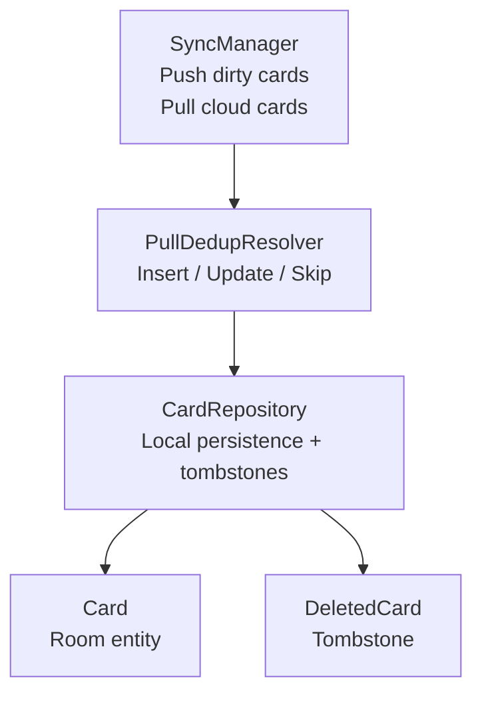
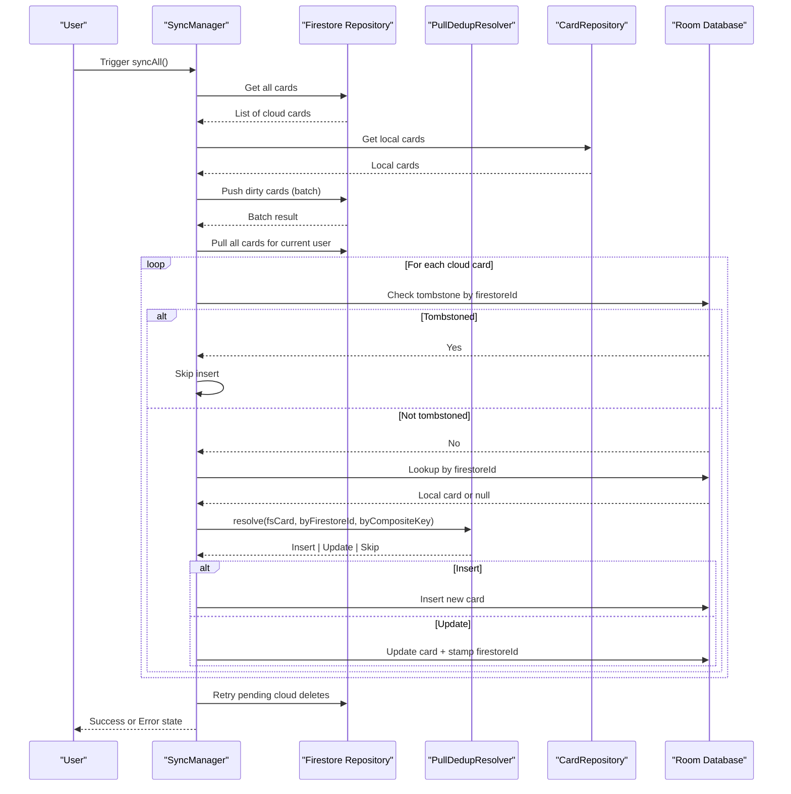
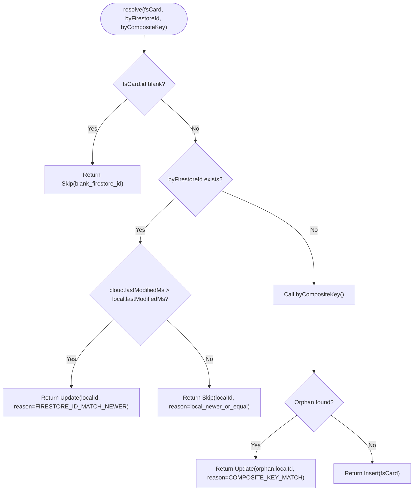
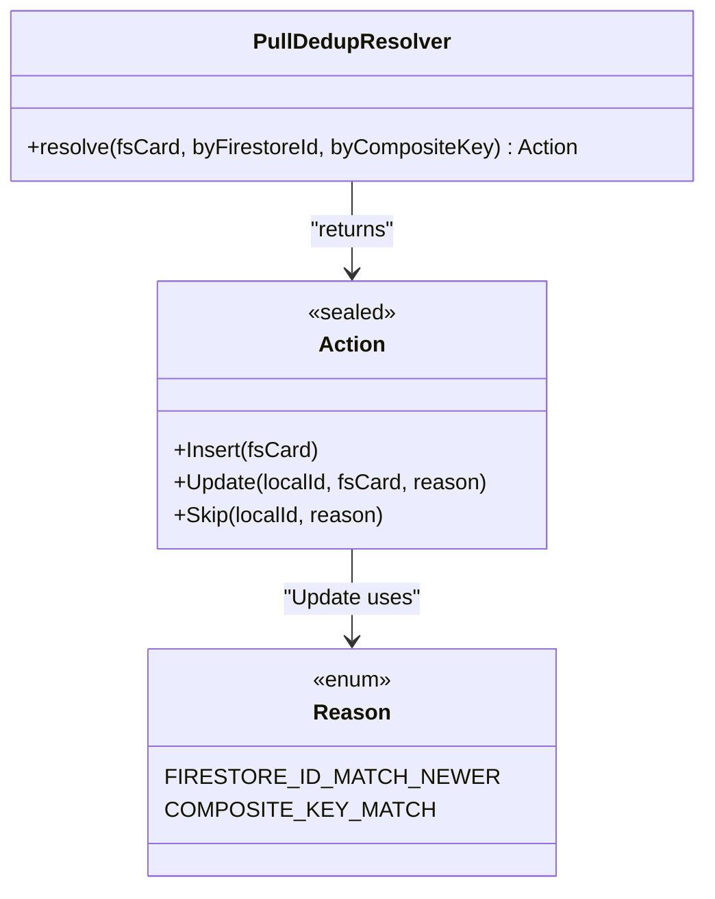
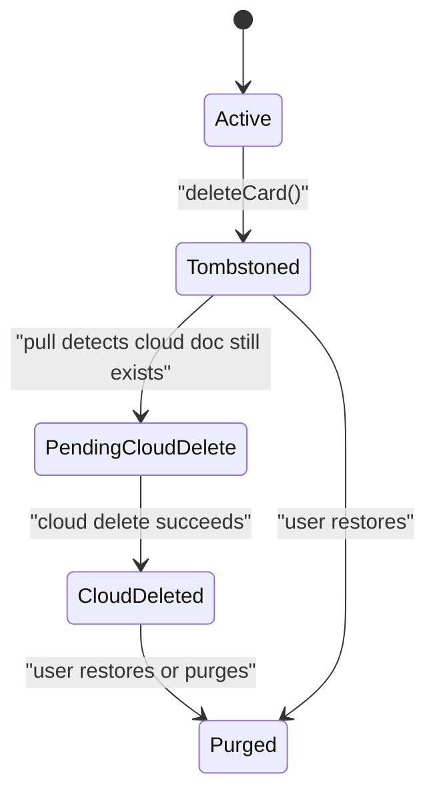
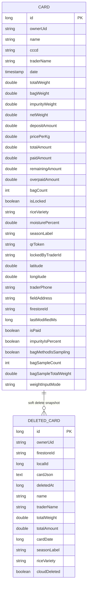
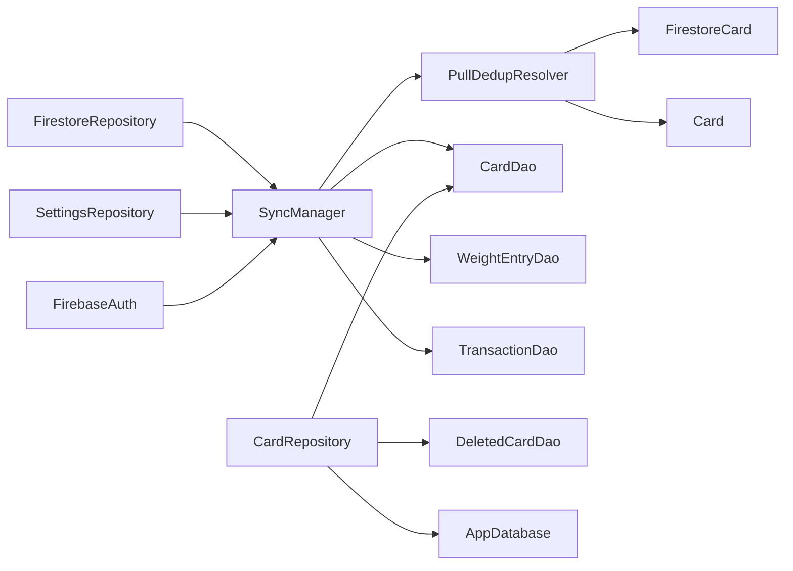

# Conflict Resolution & Deduplication

<cite>
**Referenced Files in This Document**
- [PullDedupResolver.kt](file://app/src/main/java/com/giathinh/canlua/repository/PullDedupResolver.kt)
- [PullDedupResolverTest.kt](file://app/src/test/java/com/giathinh/canlua/repository/PullDedupResolverTest.kt)
- [SyncManager.kt](file://app/src/main/java/com/giathinh/canlua/repository/SyncManager.kt)
- [CardRepository.kt](file://app/src/main/java/com/giathinh/canlua/repository/CardRepository.kt)
- [Card.kt](file://app/src/main/java/com/giathinh/canlua/data/model/Card.kt)
- [DeletedCard.kt](file://app/src/main/java/com/giathinh/canlua/data/model/DeletedCard.kt)
</cite>

## Table of Contents
1. [Introduction](#introduction)
2. [Project Structure](#project-structure)
3. [Core Components](#core-components)
4. [Architecture Overview](#architecture-overview)
5. [Detailed Component Analysis](#detailed-component-analysis)
6. [Dependency Analysis](#dependency-analysis)
7. [Performance Considerations](#performance-considerations)
8. [Troubleshooting Guide](#troubleshooting-guide)
9. [Conclusion](#conclusion)

## Introduction
This document explains the conflict resolution and deduplication system that keeps local Room data consistent with Firestore and Supabase across multiple devices. The system is offline-first: the app works without network, schedules idempotent syncs via WorkManager, and only merges cloud changes when they are newer or explicitly match a legacy local record.

The core decision engine is `PullDedupResolver`. It answers one question for every incoming cloud card: insert, update, or skip. It uses three signals:
- Cloud document ID (`firestoreId`)
- Local modification timestamp (`lastModifiedMs`)
- Composite key fallback for legacy records without `firestoreId`

Soft deletes use a tombstone table so deleted local cards do not “resurrect” after a pull. Orphan detection matches pre-v13 cards by date, name, and total weight to stamp their missing `firestoreId`.

## Project Structure
The conflict resolution logic lives in the repository layer and is isolated from UI and database runtime details:

**Diagram sources**
- [SyncManager.kt:139-412](file://app/src/main/java/com/giathinh/canlua/repository/SyncManager.kt#L139-L412)
- [PullDedupResolver.kt:21-73](file://app/src/main/java/com/giathinh/canlua/repository/PullDedupResolver.kt#L21-L73)
- [CardRepository.kt:56-162](file://app/src/main/java/com/giathinh/canlua/repository/CardRepository.kt#L56-L162)
- [Card.kt:8-82](file://app/src/main/java/com/giathinh/canlua/data/model/Card.kt#L8-L82)
- [DeletedCard.kt:6-52](file://app/src/main/java/com/giathinh/canlua/data/model/DeletedCard.kt#L6-L52)

**Section sources**
- [SyncManager.kt:35-45](file://app/src/main/java/com/giathinh/canlua/repository/SyncManager.kt#L35-L45)
- [CardRepository.kt:26-44](file://app/src/main/java/com/giathinh/canlua/repository/CardRepository.kt#L26-L44)

## Core Components
- `PullDedupResolver`: Pure Kotlin logic that decides whether an incoming cloud card should be inserted, updated, or skipped.
- `SyncManager`: Orchestrates push/pull, batches Firestore operations, applies tombstone checks, and maps between local and cloud models.
- `CardRepository`: Manages local Room persistence, per-user isolation, last-modified timestamps, and tombstone lifecycle.
- `Card`: Room entity carrying business fields plus sync metadata such as `firestoreId` and `lastModifiedMs`.
- `DeletedCard`: Tombstone model storing a serialized snapshot of deleted cards and pending cloud delete status.

Key responsibilities:
- Prevent duplicate cards on logout/login or multi-device sync.
- Prefer local edits over older cloud versions.
- Stamp missing `firestoreId` on legacy orphan records.
- Keep soft deletes consistent across devices.

**Section sources**
- [PullDedupResolver.kt:6-20](file://app/src/main/java/com/giathinh/canlua/repository/PullDedupResolver.kt#L6-L20)
- [Card.kt:67-82](file://app/src/main/java/com/giathinh/canlua/data/model/Card.kt#L67-L82)
- [DeletedCard.kt:6-24](file://app/src/main/java/com/giathinh/canlua/data/model/DeletedCard.kt#L6-L24)

## Architecture Overview
The sync flow is bidirectional and idempotent:

**Diagram sources**
- [SyncManager.kt:139-412](file://app/src/main/java/com/giathinh/canlua/repository/SyncManager.kt#L139-L412)
- [PullDedupResolver.kt:45-73](file://app/src/main/java/com/giathinh/canlua/repository/PullDedupResolver.kt#L45-L73)
- [CardRepository.kt:103-162](file://app/src/main/java/com/giathinh/canlua/repository/CardRepository.kt#L103-L162)

## Detailed Component Analysis

### PullDedupResolver Algorithm
`PullDedupResolver.resolve` implements a deterministic three-case strategy:

1. **Skip invalid input**: If the cloud card has no valid `firestoreId`, return `Skip`.
2. **Exact match by `firestoreId`**: Compare `lastModifiedMs`. If cloud is newer, return `Update`; otherwise return `Skip`.
3. **Legacy composite match**: If no `firestoreId` match, try matching by composite key: owner UID, card date, name, and total weight. If found, return `Update` to stamp the missing `firestoreId`.
4. **New card**: Otherwise, return `Insert`.

**Diagram sources**
- [PullDedupResolver.kt:45-73](file://app/src/main/java/com/giathinh/canlua/repository/PullDedupResolver.kt#L45-L73)

#### Decision Rules Summary
| Condition | Action | Reason / Outcome |
|---|---|---|
| Cloud card has blank `firestoreId` | Skip | Invalid or malformed cloud record |
| Local card has same `firestoreId` and cloud is newer | Update | Cloud-wins only when strictly newer |
| Local card has same `firestoreId` and local is newer or equal | Skip | Preserve local edits |
| No `firestoreId` match but composite key matches | Update | Stamp missing `firestoreId` on legacy orphan |
| No match anywhere | Insert | Treat as brand-new remote card |

**Section sources**
- [PullDedupResolver.kt:21-73](file://app/src/main/java/com/giathinh/canlua/repository/PullDedupResolver.kt#L21-L73)
- [PullDedupResolverTest.kt:60-145](file://app/src/test/java/com/giathinh/canlua/repository/PullDedupResolverTest.kt#L60-L145)

### Composite Key Matching Strategy
The composite key used for orphan detection consists of:
- Owner UID
- Card date
- Name
- Total weight

This strategy exists because pre-v13 synced cards may lack `firestoreId`. When pulling, if exact `firestoreId` lookup fails, the system queries for an orphan local card with the same composite signature and stamps its `firestoreId`.

**Diagram sources**
- [PullDedupResolver.kt:21-37](file://app/src/main/java/com/giathinh/canlua/repository/PullDedupResolver.kt#L21-L37)

**Section sources**
- [SyncManager.kt:331-345](file://app/src/main/java/com/giathinh/canlua/repository/SyncManager.kt#L331-L345)
- [PullDedupResolverTest.kt:94-105](file://app/src/test/java/com/giathinh/canlua/repository/PullDedupResolverTest.kt#L94-L105)

### Tombstone Mechanism for Soft Deletes
When a card is deleted locally:
1. A tombstone row is inserted before deleting the card.
2. The tombstone stores the full serialized card snapshot, original `firestoreId`, original local ID, and display fields.
3. During pull, any cloud card whose `firestoreId` matches a tombstone is skipped, preventing resurrection.
4. Background sync retries deleting the cloud document until successful; once done, the tombstone can be marked cloud-deleted.

**Diagram sources**
- [CardRepository.kt:87-162](file://app/src/main/java/com/giathinh/canlua/repository/CardRepository.kt#L87-L162)
- [DeletedCard.kt:6-52](file://app/src/main/java/com/giathinh/canlua/data/model/DeletedCard.kt#L6-L52)
- [SyncManager.kt:373-383](file://app/src/main/java/com/giathinh/canlua/repository/SyncManager.kt#L373-L383)

**Section sources**
- [CardRepository.kt:87-162](file://app/src/main/java/com/giathinh/canlua/repository/CardRepository.kt#L87-L162)
- [DeletedCard.kt:6-52](file://app/src/main/java/com/giathinh/canlua/data/model/DeletedCard.kt#L6-L52)

### Orphan Detection System
Orphans are local cards created before proper cross-device sync was available. They have:
- Empty or null `ownerUid` (pre-migration), claimed by the first login after v12.
- Null `firestoreId` (pre-v13), stamped during pull via composite key matching.

The system ensures:
- Per-user isolation through `ownerUid`.
- Safe migration of orphan cards to the current user.
- Idempotent stamping of `firestoreId` so repeated pulls do not create duplicates.

**Section sources**
- [Card.kt:23-29](file://app/src/main/java/com/giathinh/canlua/data/model/Card.kt#L23-L29)
- [Card.kt:67-73](file://app/src/main/java/com/giathinh/canlua/data/model/Card.kt#L67-L73)
- [CardRepository.kt:368-380](file://app/src/main/java/com/giathinh/canlua/repository/CardRepository.kt#L368-L380)
- [PullDedupResolverTest.kt:134-145](file://app/src/test/java/com/giathinh/canlua/repository/PullDedupResolverTest.kt#L134-L145)

### Conflict Resolution Priorities and Merge Strategy
Priority order:
1. **Tombstone check**: If a tombstone exists for the cloud `firestoreId`, skip insertion entirely.
2. **Exact `firestoreId` match**: Compare timestamps. Only overwrite if cloud is strictly newer.
3. **Composite key match**: Stamp missing `firestoreId` on legacy orphan.
4. **Insert**: Treat as new card.

Merge behavior:
- Field-level merge is not implemented. The resolver returns either the full cloud card or skips it.
- Local edits win when `lastModifiedMs` is greater than or equal to cloud timestamp.
- When updating via composite match, the caller stamps `firestoreId` and preserves local identity.

Audit trail:
- Composite-key updates emit a breadcrumb log entry for debugging dedup behavior.

**Section sources**
- [SyncManager.kt:331-357](file://app/src/main/java/com/giathinh/canlua/repository/SyncManager.kt#L331-L357)
- [PullDedupResolver.kt:45-73](file://app/src/main/java/com/giathinh/canlua/repository/PullDedupResolver.kt#L45-L73)

### Data Model Relationships

**Diagram sources**
- [Card.kt:8-106](file://app/src/main/java/com/giathinh/canlua/data/model/Card.kt#L8-L106)
- [DeletedCard.kt:26-52](file://app/src/main/java/com/giathinh/canlua/data/model/DeletedCard.kt#L26-L52)

## Dependency Analysis
The conflict resolution pipeline depends on clean separation between orchestration, decision logic, and persistence:

**Diagram sources**
- [SyncManager.kt:35-45](file://app/src/main/java/com/giathinh/canlua/repository/SyncManager.kt#L35-L45)
- [PullDedupResolver.kt:3-4](file://app/src/main/java/com/giathinh/canlua/repository/PullDedupResolver.kt#L3-L4)
- [CardRepository.kt:37-44](file://app/src/main/java/com/giathinh/canlua/repository/CardRepository.kt#L37-L44)

Coupling notes:
- `PullDedupResolver` is intentionally pure and testable without Room or Android runtime.
- `SyncManager` owns network constraints, batching, and mapping.
- `CardRepository` owns local consistency rules, encryption, and tombstone lifecycle.

Potential risks:
- Composite key collisions are possible if two different cards share date, name, and total weight. The tests cover the intended bug scenario but do not prove uniqueness under all real-world inputs.
- Timestamp-only conflict resolution does not merge conflicting fields; it chooses one side completely.

**Section sources**
- [PullDedupResolver.kt:6-11](file://app/src/main/java/com/giathinh/canlua/repository/PullDedupResolver.kt#L6-L11)
- [SyncManager.kt:98-130](file://app/src/main/java/com/giathinh/canlua/repository/SyncManager.kt#L98-L130)
- [CardRepository.kt:56-85](file://app/src/main/java/com/giathinh/canlua/repository/CardRepository.kt#L56-L85)

## Performance Considerations
- Batching: `syncAll` groups card, weight entry, and transaction writes into Firestore batches to reduce round trips and stay within limits.
- Dirty filtering: Only cards without `firestoreId`, not present in cloud, or newer than cloud are pushed.
- Tombstone early exit: Pull skips tombstoned cloud cards before expensive lookups.
- Index usage: Room indexes on `ownerUid`, `ownerUid + date`, and `ownerUid + riceVariety` support efficient per-user queries.
- Idempotency: Unique work names and batch mappings prevent duplicate sync operations.

[No sources needed since this section provides general guidance]

## Troubleshooting Guide

### Common Conflict Scenarios and Outcomes
| Scenario | Expected Behavior | Debugging Signal |
|---|---|---|
| Cloud card newer than local by `firestoreId` | Update local card | `FIRESTORE_ID_MATCH_NEWER` |
| Local card newer than cloud by `firestoreId` | Skip overwrite | `local_newer_or_equal` |
| Same `lastModifiedMs` for matched `firestoreId` | Skip duplicate write | `local_newer_or_equal` |
| Legacy card without `firestoreId` but composite matches | Stamp `firestoreId` and update | `COMPOSITE_KEY_MATCH` |
| Brand-new cloud card | Insert | `Insert` action |
| Cloud card with blank `firestoreId` | Skip without composite lookup | `blank_firestore_id` |
| Local delete followed by pull | Tombstone prevents resurrection | Tombstone check skips insert |

**Section sources**
- [PullDedupResolverTest.kt:60-145](file://app/src/test/java/com/giathinh/canlua/repository/PullDedupResolverTest.kt#L60-L145)
- [SyncManager.kt:331-357](file://app/src/main/java/com/giathinh/canlua/repository/SyncManager.kt#L331-L357)

### Investigating Data Inconsistencies
Use these steps:
1. Check sync status flows for errors or idle states.
2. Verify whether the card is tombstoned by querying pending cloud deletes and tombstone status.
3. Inspect whether `firestoreId` is present and stable across restarts.
4. Confirm `lastModifiedMs` reflects local edits and cloud timestamps.
5. Look for composite-key breadcrumbs indicating legacy orphan stamping.
6. Validate that orphan cards were claimed by the correct user after v12 migration.

Recommended investigation points:
- `SyncStatus` values indicate success, syncing, idle, or error messages.
- Analytics breadcrumbs capture composite-key dedup events.
- Tombstone rows show `cloudDeleted` status and serialized card snapshots.
- Local vs cloud timestamps explain why a pull was skipped.

**Section sources**
- [SyncManager.kt:46-53](file://app/src/main/java/com/giathinh/canlua/repository/SyncManager.kt#L46-L53)
- [SyncManager.kt:354-356](file://app/src/main/java/com/giathinh/canlua/repository/SyncManager.kt#L354-L356)
- [CardRepository.kt:156-162](file://app/src/main/java/com/giathinh/canlua/repository/CardRepository.kt#L156-L162)
- [DeletedCard.kt:33-52](file://app/src/main/java/com/giathinh/canlua/data/model/DeletedCard.kt#L33-L52)

### Manual Conflict Resolution Notes
The current implementation does not expose a manual merge UI. Conflicts are resolved automatically:
- Cloud wins only when strictly newer.
- Local wins when newer or equal.
- Legacy orphans are reconciled by stamping `firestoreId`.

If manual intervention is required:
- Restore from tombstone to recreate a deleted card.
- Re-edit the card to refresh `lastModifiedMs`, forcing a future push.
- Clear or repair orphan cards by ensuring correct `ownerUid` and `firestoreId`.

**Section sources**
- [CardRepository.kt:136-151](file://app/src/main/java/com/giathinh/canlua/repository/CardRepository.kt#L136-L151)
- [CardRepository.kt:368-380](file://app/src/main/java/com/giathinh/canlua/repository/CardRepository.kt#L368-L380)

## Conclusion
The conflict resolution and deduplication system prioritizes data safety over aggressive merging. It avoids resurrecting deleted cards, prevents duplicate cards after logout/login, and preserves local edits unless the cloud version is strictly newer. The composite key fallback repairs legacy records, while tombstones provide a robust soft-delete mechanism. For complex field-level conflicts, the system currently chooses one side rather than merging fields, making timestamp accuracy and stable `firestoreId` assignment critical for predictable behavior.