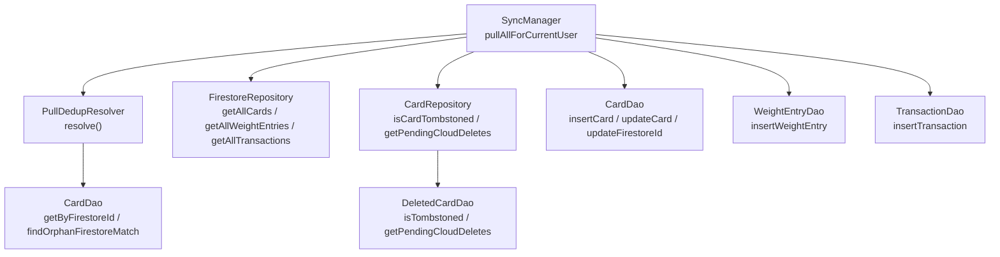
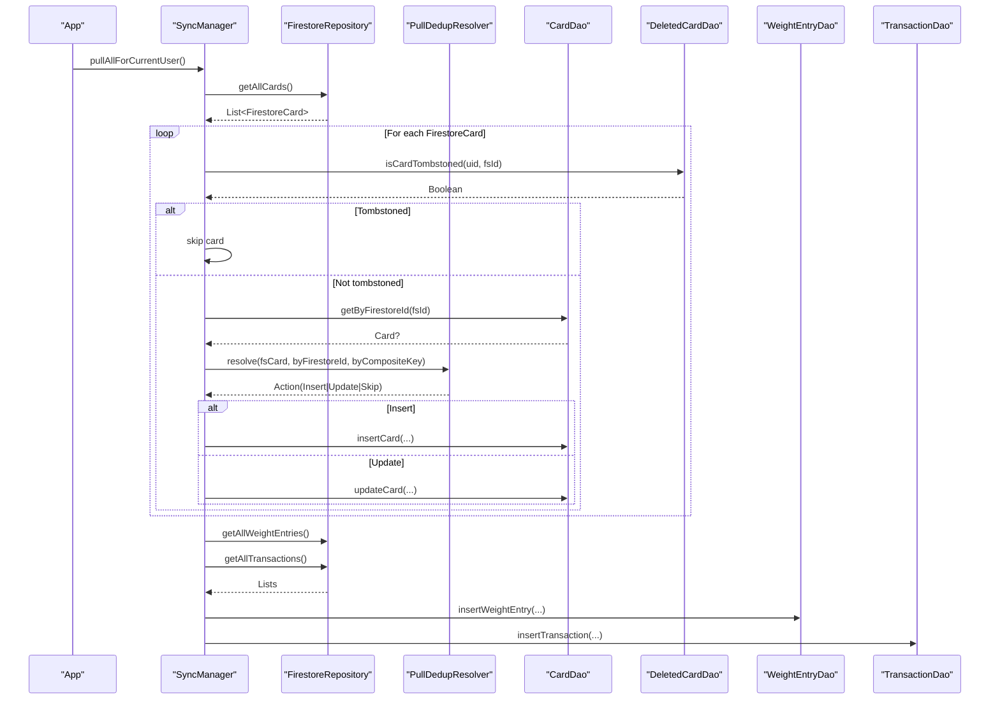
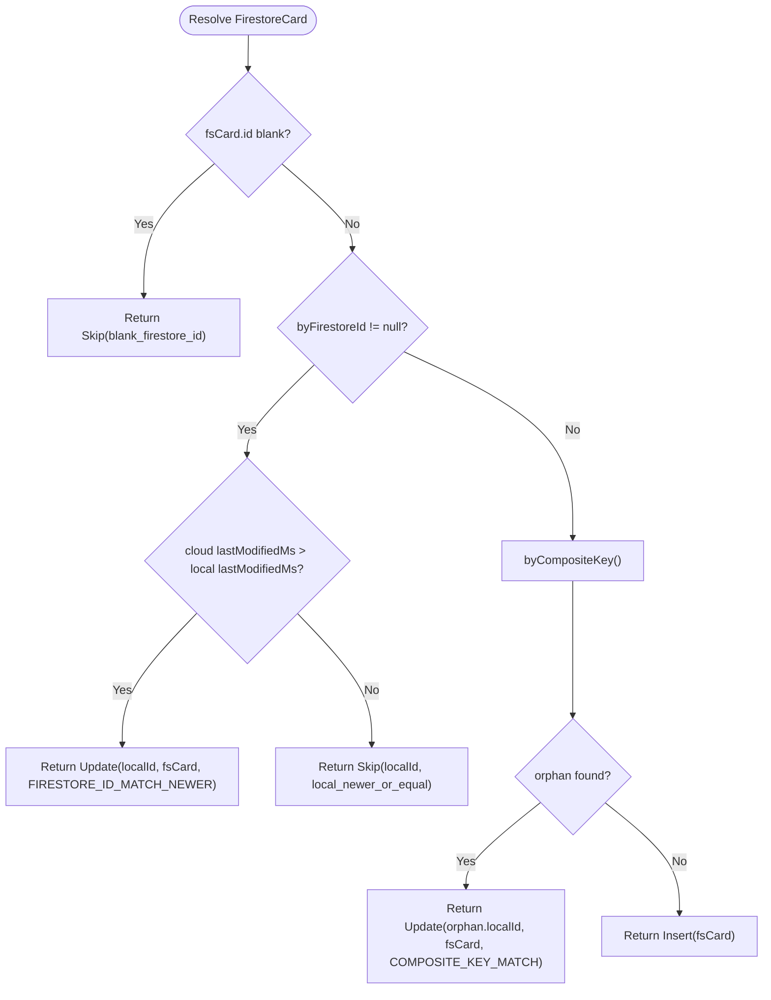
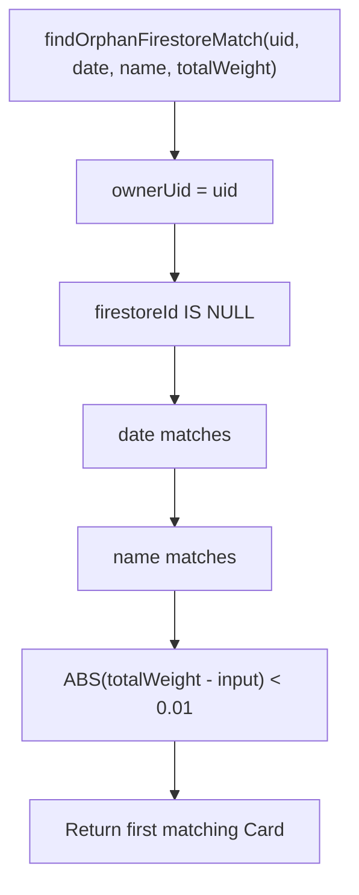
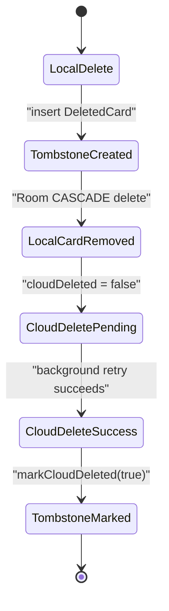
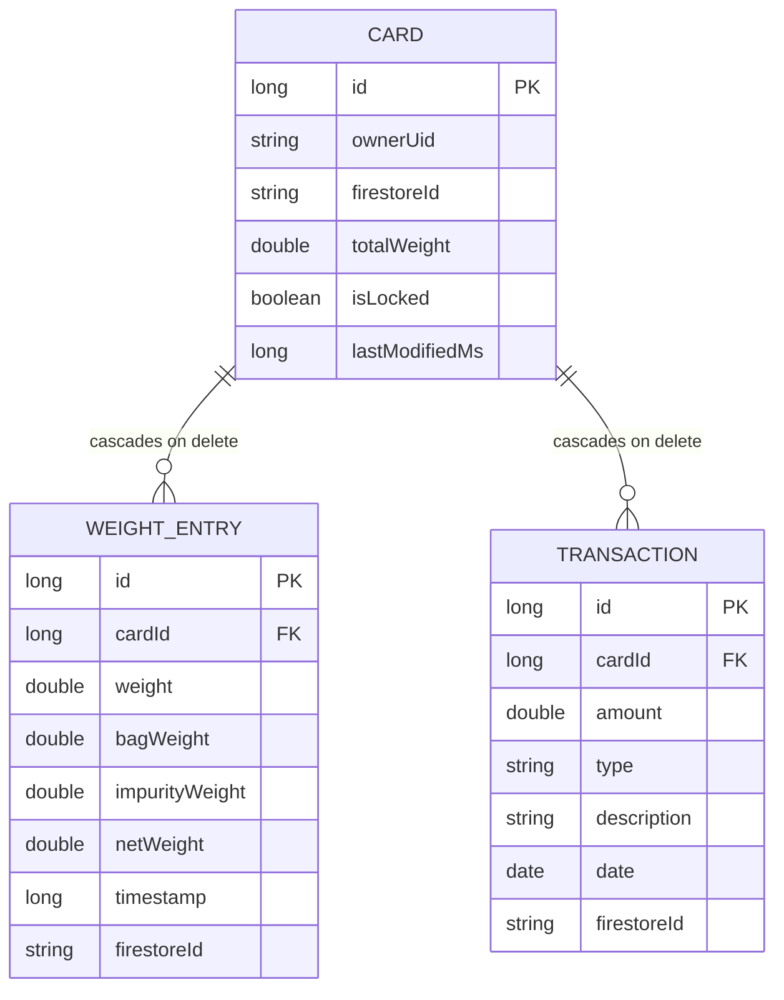
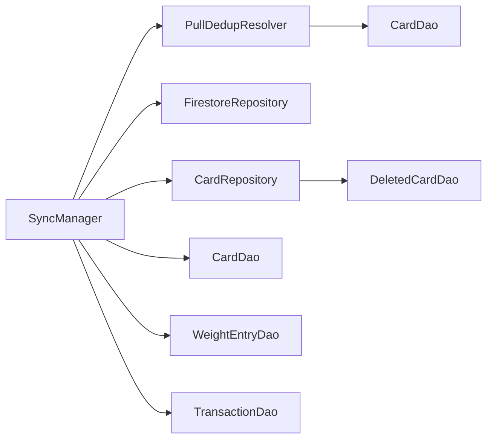

# Pull Operations & Conflict Resolution

<cite>
**Referenced Files in This Document**
- [PullDedupResolver.kt](file://app/src/main/java/com/giathinh/canlua/repository/PullDedupResolver.kt)
- [SyncManager.kt](file://app/src/main/java/com/giathinh/canlua/repository/SyncManager.kt)
- [CardRepository.kt](file://app/src/main/java/com/giathinh/canlua/repository/CardRepository.kt)
- [CardDao.kt](file://app/src/main/java/com/giathinh/canlua/data/dao/CardDao.kt)
- [DeletedCardDao.kt](file://app/src/main/java/com/giathinh/canlua/data/dao/DeletedCardDao.kt)
- [Card.kt](file://app/src/main/java/com/giathinh/canlua/data/model/Card.kt)
- [WeightEntry.kt](file://app/src/main/java/com/giathinh/canlua/data/model/WeightEntry.kt)
- [Transaction.kt](file://app/src/main/java/com/giathinh/canlua/data/model/Transaction.kt)
- [DeletedCard.kt](file://app/src/main/java/com/giathinh/canlua/data/model/DeletedCard.kt)
- [FirestoreCard.kt](file://app/src/main/java/com/giathinh/canlua/data/firestore/FirestoreCard.kt)
- [PullDedupResolverTest.kt](file://app/src/test/java/com/giathinh/canlua/repository/PullDedupResolverTest.kt)
- [SyncManagerTest.kt](file://app/src/test/java/com/giathinh/canlua/repository/SyncManagerTest.kt)
</cite>

## Table of Contents
1. [Introduction](#introduction)
2. [Project Structure](#project-structure)
3. [Core Components](#core-components)
4. [Architecture Overview](#architecture-overview)
5. [Detailed Component Analysis](#detailed-component-analysis)
6. [Dependency Analysis](#dependency-analysis)
7. [Performance Considerations](#performance-considerations)
8. [Troubleshooting Guide](#troubleshooting-guide)
9. [Conclusion](#conclusion)

## Introduction
This document explains how the app pulls remote data from Firestore, resolves conflicts, and keeps local Room data consistent across devices. The system is offline-first: it works without network, pushes changes to Firestore when possible, and pulls remote updates idempotently through WorkManager-scheduled sync.

The key mechanisms are:
- Remote pull via `SyncManager.pullAllForCurrentUser`.
- Deduplication and conflict resolution via `PullDedupResolver`.
- Composite key matching for legacy cards without a Firestore document ID.
- Tombstone-based soft deletes that prevent deleted cards from reappearing after pull.
- Cascading deletion of weight entries and transactions when a parent card is removed.
- Timestamp-based conflict resolution using `lastModifiedMs` so local edits can override older cloud data.

## Project Structure
The pull and conflict resolution logic spans repositories, DAOs, domain models, and Firestore mappings:

**Diagram sources**
- [SyncManager.kt:313-412](file://app/src/main/java/com/giathinh/canlua/repository/SyncManager.kt#L313-L412)
- [PullDedupResolver.kt:45-73](file://app/src/main/java/com/giathinh/canlua/repository/PullDedupResolver.kt#L45-L73)
- [CardDao.kt:150-191](file://app/src/main/java/com/giathinh/canlua/data/dao/CardDao.kt#L150-L191)
- [DeletedCardDao.kt:20-40](file://app/src/main/java/com/giathinh/canlua/data/dao/DeletedCardDao.kt#L20-L40)

**Section sources**
- [SyncManager.kt:313-412](file://app/src/main/java/com/giathinh/canlua/repository/SyncManager.kt#L313-L412)
- [PullDedupResolver.kt:1-75](file://app/src/main/java/com/giathinh/canlua/repository/PullDedupResolver.kt#L1-L75)

## Core Components
- `SyncManager`: orchestrates push and pull, batches Firestore operations, maps between local models and Firestore models, and applies tombstone-based deletion.
- `PullDedupResolver`: pure decision logic that returns Insert, Update, or Skip actions based on Firestore ID match, composite key match, and timestamp comparison.
- `CardRepository`: manages local card lifecycle, including tombstone creation, restoration, and cascading calculations.
- `CardDao` and `DeletedCardDao`: provide per-user isolation, Firestore ID lookup, orphan fallback matching, and tombstone queries.
- Domain models: `Card`, `WeightEntry`, `Transaction`, `DeletedCard`, and `FirestoreCard`.

**Section sources**
- [SyncManager.kt:35-45](file://app/src/main/java/com/giathinh/canlua/repository/SyncManager.kt#L35-L45)
- [PullDedupResolver.kt:21-37](file://app/src/main/java/com/giathinh/canlua/repository/PullDedupResolver.kt#L21-L37)
- [CardRepository.kt:37-44](file://app/src/main/java/com/giathinh/canlua/repository/CardRepository.kt#L37-L44)
- [CardDao.kt:16-17](file://app/src/main/java/com/giathinh/canlua/data/dao/CardDao.kt#L16-L17)
- [DeletedCardDao.kt:10-11](file://app/src/main/java/com/giathinh/canlua/data/dao/DeletedCardDao.kt#L10-L11)

## Architecture Overview
The pull workflow fetches all cards, weight entries, and transactions from Firestore, then applies deduplication and tombstone checks before inserting or updating local records.

**Diagram sources**
- [SyncManager.kt:313-412](file://app/src/main/java/com/giathinh/canlua/repository/SyncManager.kt#L313-L412)
- [PullDedupResolver.kt:45-73](file://app/src/main/java/com/giathinh/canlua/repository/PullDedupResolver.kt#L45-L73)
- [CardDao.kt:150-191](file://app/src/main/java/com/giathinh/canlua/data/dao/CardDao.kt#L150-L191)
- [DeletedCardDao.kt:20-40](file://app/src/main/java/com/giathinh/canlua/data/dao/DeletedCardDao.kt#L20-L40)

## Detailed Component Analysis

### PullDedupResolver: Insert, Update, or Skip
`PullDedupResolver.resolve()` decides what to do with a remote `FirestoreCard`:

1. **Blank Firestore ID**: skip immediately.
2. **Firestore ID match**: compare `lastModifiedMs`; if cloud is newer, return Update; otherwise return Skip.
3. **No Firestore ID match but composite match**: return Update for the orphan local card.
4. **No match anywhere**: return Insert.

**Diagram sources**
- [PullDedupResolver.kt:45-73](file://app/src/main/java/com/giathinh/canlua/repository/PullDedupResolver.kt#L45-L73)

**Section sources**
- [PullDedupResolver.kt:6-20](file://app/src/main/java/com/giathinh/canlua/repository/PullDedupResolver.kt#L6-L20)
- [PullDedupResolver.kt:45-73](file://app/src/main/java/com/giathinh/canlua/repository/PullDedupResolver.kt#L45-L73)

### Composite Key Matching Strategy
When a local card lacks a Firestore document ID (legacy pre-v13 sync), the resolver falls back to a composite key match:
- Owner UID
- Date
- Name
- Total weight (with small floating-point tolerance)

This prevents duplicate inserts during logout/login flows where old cards have no `firestoreId`.

**Diagram sources**
- [CardDao.kt:170-191](file://app/src/main/java/com/giathinh/canlua/data/dao/CardDao.kt#L170-L191)

**Section sources**
- [CardDao.kt:170-191](file://app/src/main/java/com/giathinh/canlua/data/dao/CardDao.kt#L170-L191)
- [PullDedupResolverTest.kt:94-105](file://app/src/test/java/com/giathinh/canlua/repository/PullDedupResolverTest.kt#L94-L105)

### Tombstone-Based Deletion System
When a user deletes a card locally:
1. A tombstone is inserted into `deleted_cards` with the card snapshot and optional Firestore ID.
2. The local card is deleted via Room cascade, which removes associated weight entries and transactions.
3. During pull, any Firestore card whose ID exists in tombstones is skipped, preventing resurrection.
4. Background sync retries deleting the Firestore document until successful, then marks the tombstone as cloud-deleted.

**Diagram sources**
- [CardRepository.kt:103-129](file://app/src/main/java/com/giathinh/canlua/repository/CardRepository.kt#L103-L129)
- [DeletedCard.kt:6-24](file://app/src/main/java/com/giathinh/canlua/data/model/DeletedCard.kt#L6-L24)
- [DeletedCardDao.kt:34-40](file://app/src/main/java/com/giathinh/canlua/data/dao/DeletedCardDao.kt#L34-L40)
- [SyncManager.kt:373-383](file://app/src/main/java/com/giathinh/canlua/repository/SyncManager.kt#L373-L383)

**Section sources**
- [CardRepository.kt:87-129](file://app/src/main/java/com/giathinh/canlua/repository/CardRepository.kt#L87-L129)
- [DeletedCard.kt:6-53](file://app/src/main/java/com/giathinh/canlua/data/model/DeletedCard.kt#L6-L53)
- [DeletedCardDao.kt:20-40](file://app/src/main/java/com/giathinh/canlua/data/dao/DeletedCardDao.kt#L20-L40)
- [SyncManager.kt:373-383](file://app/src/main/java/com/giathinh/canlua/repository/SyncManager.kt#L373-L383)

### Cascading Delete Operations
Room foreign keys enforce cascade deletion:
- Deleting a `Card` automatically deletes its child `WeightEntry` rows.
- Deleting a `Card` also deletes its child `Transaction` rows.

This ensures data consistency when a parent card is removed locally.

**Diagram sources**
- [WeightEntry.kt:7-18](file://app/src/main/java/com/giathinh/canlua/data/model/WeightEntry.kt#L7-L18)
- [Transaction.kt:8-19](file://app/src/main/java/com/giathinh/canlua/data/model/Transaction.kt#L8-L19)
- [CardRepository.kt:126-128](file://app/src/main/java/com/giathinh/canlua/repository/CardRepository.kt#L126-L128)

**Section sources**
- [WeightEntry.kt:7-18](file://app/src/main/java/com/giathinh/canlua/data/model/WeightEntry.kt#L7-L18)
- [Transaction.kt:8-19](file://app/src/main/java/com/giathinh/canlua/data/model/Transaction.kt#L8-L19)
- [CardRepository.kt:103-129](file://app/src/main/java/com/giathinh/canlua/repository/CardRepository.kt#L103-L129)

### Deduplication Logic Against Simultaneous Inserts
The resolver prevents duplicate inserts in these scenarios:
- Same Firestore ID: only one local row exists; later pulls either update or skip.
- Legacy orphan card: composite key match stamps the existing row with the Firestore ID instead of creating a duplicate.
- New remote card: inserted only if no local match exists.

Tests verify:
- Cloud newer → update local.
- Local newer or equal → skip overwrite.
- No Firestore ID match but composite match → update orphan.
- No match anywhere → insert new.
- Blank Firestore ID → skip without composite lookup.
- Logout/login regression: orphan stamped once, second pass skips.

**Section sources**
- [PullDedupResolverTest.kt:60-145](file://app/src/test/java/com/giathinh/canlua/repository/PullDedupResolverTest.kt#L60-L145)
- [PullDedupResolver.kt:45-73](file://app/src/main/java/com/giathinh/canlua/repository/PullDedupResolver.kt#L45-L73)

### Conflict Scenarios and Resolution Outcomes
Conflict resolution uses `lastModifiedMs`:
- If cloud `lastModifiedMs` > local `lastModifiedMs`, cloud wins and local is updated.
- If local `lastModifiedMs` >= cloud `lastModifiedMs`, local wins and pull skips overwrite.

Examples:
- Device A creates a card at time 1000. Device B updates same card at time 2000. Pull on Device A sees cloud newer → update.
- Device A updates card at time 2000. Device B has cloud version at time 1000. Pull on Device B sees local newer → skip.
- Same timestamp → skip duplicate write to avoid unnecessary updates.

These behaviors are validated by unit tests and implemented in the resolver.

**Section sources**
- [PullDedupResolver.kt:55-62](file://app/src/main/java/com/giathinh/canlua/repository/PullDedupResolver.kt#L55-L62)
- [PullDedupResolverTest.kt:60-92](file://app/src/test/java/com/giathinh/canlua/repository/PullDedupResolverTest.kt#L60-L92)

## Dependency Analysis
The pull pipeline depends on several layers:

**Diagram sources**
- [SyncManager.kt:313-412](file://app/src/main/java/com/giathinh/canlua/repository/SyncManager.kt#L313-L412)
- [PullDedupResolver.kt:45-73](file://app/src/main/java/com/giathinh/canlua/repository/PullDedupResolver.kt#L45-L73)
- [CardRepository.kt:156-164](file://app/src/main/java/com/giathinh/canlua/repository/CardRepository.kt#L156-L164)
- [DeletedCardDao.kt:20-40](file://app/src/main/java/com/giathinh/canlua/data/dao/DeletedCardDao.kt#L20-L40)

**Section sources**
- [SyncManager.kt:313-412](file://app/src/main/java/com/giathinh/canlua/repository/SyncManager.kt#L313-L412)
- [CardRepository.kt:156-164](file://app/src/main/java/com/giathinh/canlua/repository/CardRepository.kt#L156-L164)

## Performance Considerations
- Batch Firestore writes: `syncAll` groups cards, weight entries, and transactions into batches capped at ~400 operations to avoid Firestore limits.
- Idempotent mapping: after batch success, local IDs are mapped to Firestore IDs via `updateFirestoreId`.
- Minimal DB writes: pull inserts only missing weight entries and transactions per card.
- Offline resilience: sync status and pending state are tracked via StateFlow; WorkManager schedules retries with exponential backoff.

[No sources needed since this section provides general guidance]

## Troubleshooting Guide
Common issues and diagnostics:
- Duplicate cards after logout/login: ensure composite key matching is active; check that orphan cards receive `firestoreId` stamping.
- Deleted cards reappear: verify tombstone exists for the Firestore ID and that pull skips tombstoned cards.
- Sync fails due to network: check `canSync()` and Wi-Fi-only settings; inspect `SyncStatus.Error`.
- Pending cloud deletes not cleared: confirm background worker retries and `markTombstoneCloudDeleted` is called after successful Firestore delete.

**Section sources**
- [SyncManagerTest.kt:45-127](file://app/src/test/java/com/giathinh/canlua/repository/SyncManagerTest.kt#L45-L127)
- [PullDedupResolverTest.kt:134-145](file://app/src/test/java/com/giathinh/canlua/repository/PullDedupResolverTest.kt#L134-L145)
- [SyncManager.kt:78-84](file://app/src/main/java/com/giathinh/canlua/repository/SyncManager.kt#L78-L84)

## Conclusion
The pull and conflict resolution system combines Firestore ID matching, composite key fallback, tombstone-based soft deletes, and timestamp-driven conflict resolution to keep local Room data consistent across devices. It handles legacy cards, prevents duplicates, supports cascading deletions, and remains robust under offline conditions. Tests validate core behaviors, ensuring reliable synchronization even in edge cases like logout/login and simultaneous multi-device edits.

[No sources needed since this section summarizes without analyzing specific files]