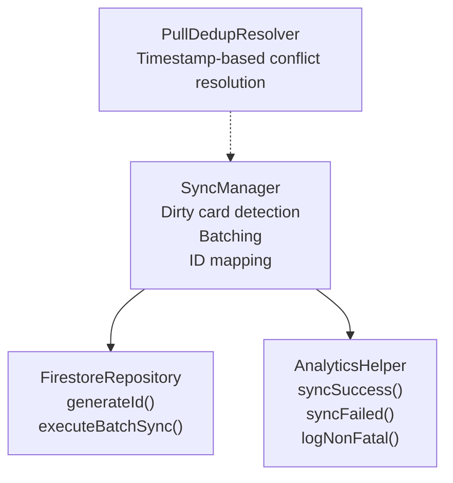
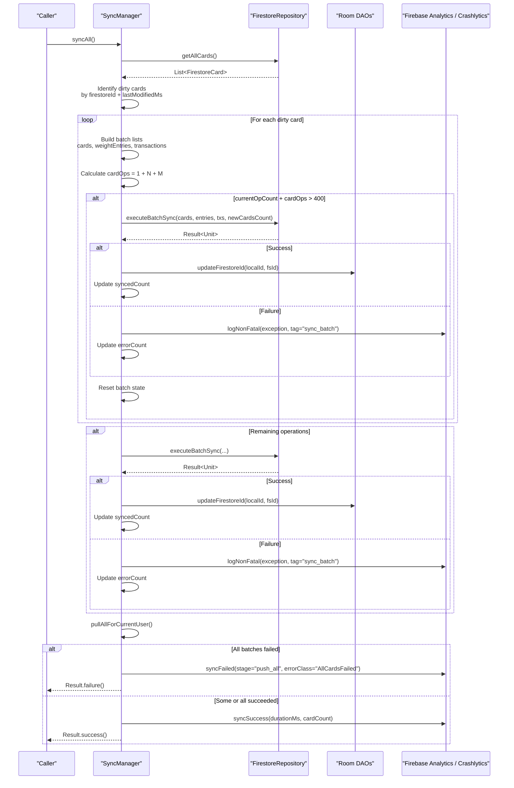
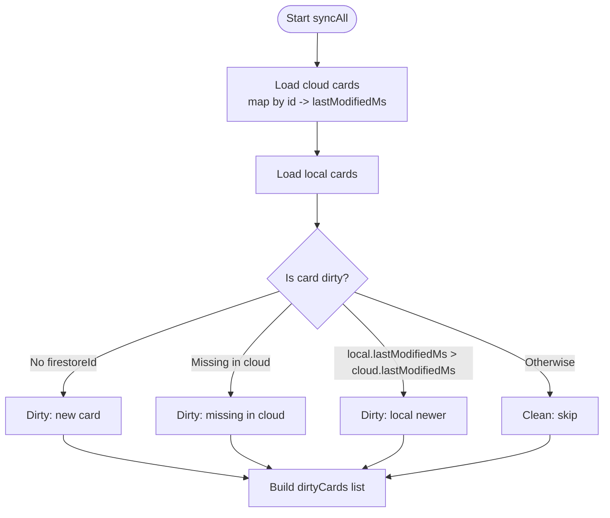
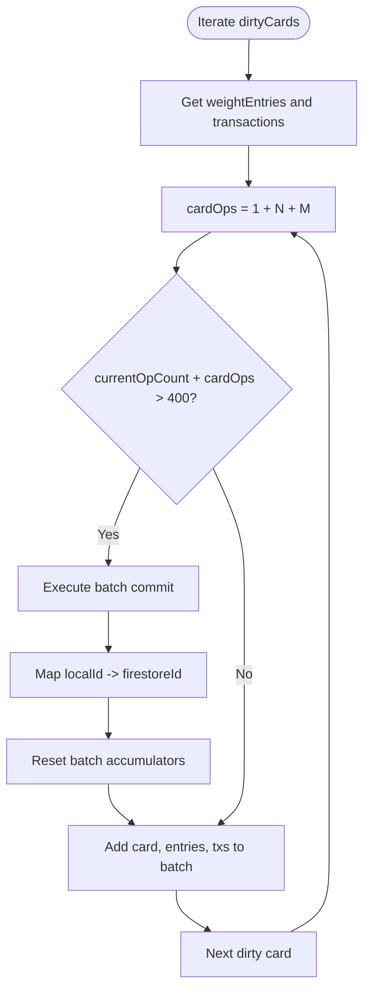
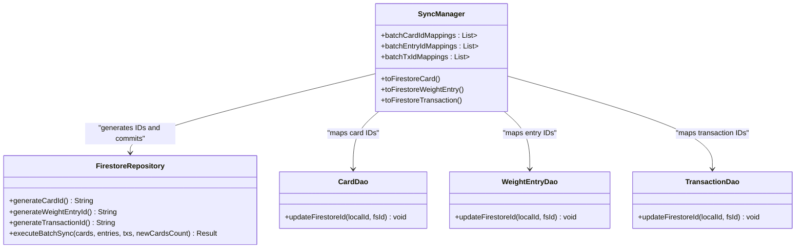
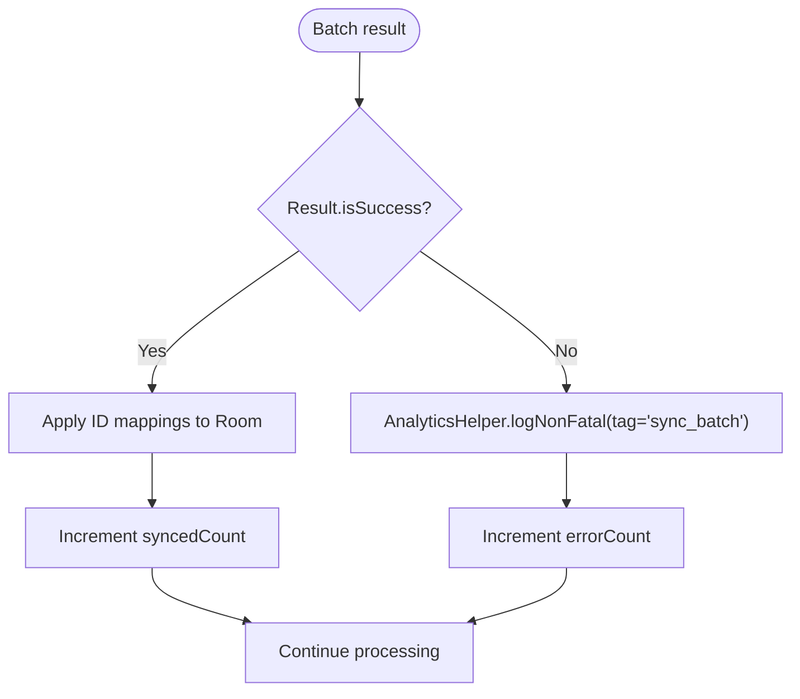
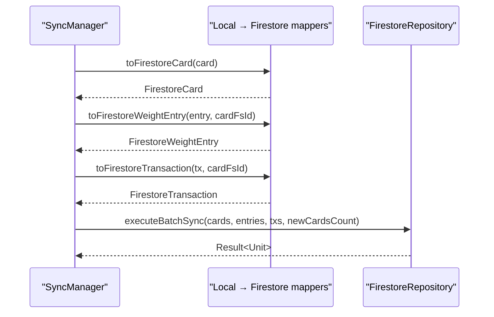
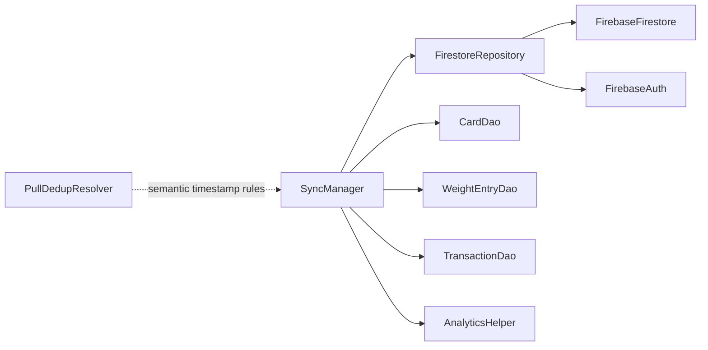

# Push Operations & Batch Processing

<cite>
**Referenced Files in This Document**
- [SyncManager.kt](file://app/src/main/java/com/giathinh/canlua/repository/SyncManager.kt)
- [FirestoreRepository.kt](file://app/src/main/java/com/giathinh/canlua/repository/FirestoreRepository.kt)
- [AnalyticsHelper.kt](file://app/src/main/java/com/giathinh/canlua/util/AnalyticsHelper.kt)
- [PullDedupResolver.kt](file://app/src/main/java/com/giathinh/canlua/repository/PullDedupResolver.kt)
</cite>

## Table of Contents
1. [Introduction](#introduction)
2. [Project Structure](#project-structure)
3. [Core Components](#core-components)
4. [Architecture Overview](#architecture-overview)
5. [Detailed Component Analysis](#detailed-component-analysis)
6. [Dependency Analysis](#dependency-analysis)
7. [Performance Considerations](#performance-considerations)
8. [Troubleshooting Guide](#troubleshooting-guide)
9. [Conclusion](#conclusion)

## Introduction
This document explains the push side of the bidirectional sync orchestration layer, focusing on how dirty local cards are identified, transformed into Firestore models, and committed to Firebase Firestore through a batch processing strategy. It covers:

- Dirty card identification using timestamp comparison with cloud versions.
- New card creation versus existing card updates.
- A batch size limit of up to 400 Firestore operations per batch.
- Operation count calculation: one card plus N weight entries plus M transactions.
- Local-to-cloud ID mapping that persists `firestoreId` values back to Room entities after successful batches.
- Error handling where individual batch failures are logged via `AnalyticsHelper`, while successful batches continue processing.
- End-to-end execution flow showing how cards, weight entries, and transactions are transformed and processed together.

The implementation is part of an offline-first Android app using Kotlin, Room, WorkManager, and Firebase Firestore.

## Project Structure
The push pipeline lives primarily in the repository layer:

- `SyncManager` orchestrates dirty-card detection, batching, Firestore writes, and post-batch ID synchronization.
- `FirestoreRepository` provides Firestore access, ID generation, and the atomic batch commit operation.
- `AnalyticsHelper` centralizes analytics and Crashlytics logging for non-fatal errors and sync outcomes.
- `PullDedupResolver` supports pull-side deduplication and timestamp-based conflict resolution, which complements the push logic by defining how timestamps drive sync decisions.

**Diagram sources**
- [SyncManager.kt:139-310](file://app/src/main/java/com/giathinh/canlua/repository/SyncManager.kt#L139-L310)
- [FirestoreRepository.kt:41-85](file://app/src/main/java/com/giathinh/canlua/repository/FirestoreRepository.kt#L41-L85)
- [AnalyticsHelper.kt:67-99](file://app/src/main/java/com/giathinh/canlua/util/AnalyticsHelper.kt#L67-L99)
- [PullDedupResolver.kt:45-73](file://app/src/main/java/com/giathinh/canlua/repository/PullDedupResolver.kt#L45-L73)

**Section sources**
- [SyncManager.kt:35-45](file://app/src/main/java/com/giathinh/canlua/repository/SyncManager.kt#L35-L45)
- [FirestoreRepository.kt:21-43](file://app/src/main/java/com/giathinh/canlua/repository/FirestoreRepository.kt#L21-L43)
- [AnalyticsHelper.kt:19-29](file://app/src/main/java/com/giathinh/canlua/util/AnalyticsHelper.kt#L19-L29)
- [PullDedupResolver.kt:28-73](file://app/src/main/java/com/giathinh/canlua/repository/PullDedupResolver.kt#L28-L73)

## Core Components
- **SyncManager**: Entry point for push sync. It loads cloud cards, identifies dirty local cards, groups them into batches, transforms them to Firestore models, executes batch commits, and maps returned IDs back to local entities.
- **FirestoreRepository**: Encapsulates Firestore collections, generates stable IDs, and performs atomic batch writes including profile counters when new cards are created.
- **AnalyticsHelper**: Provides semantic analytics events and Crashlytics non-fatal exception logging used during push failures and overall sync success/failure reporting.
- **PullDedupResolver**: Defines timestamp-driven conflict resolution behavior used during pull; it clarifies the semantics of `lastModifiedMs` comparisons that also influence push decisions.

Key responsibilities:
- Dirty card filtering based on missing or stale `firestoreId` and `lastModifiedMs`.
- Batching up to 400 operations per commit.
- Mapping local IDs to Firestore IDs and persisting them back to Room.
- Logging partial failures without aborting the entire sync run.

**Section sources**
- [SyncManager.kt:139-310](file://app/src/main/java/com/giathinh/canlua/repository/SyncManager.kt#L139-L310)
- [FirestoreRepository.kt:41-85](file://app/src/main/java/com/giathinh/canlua/repository/FirestoreRepository.kt#L41-L85)
- [AnalyticsHelper.kt:67-99](file://app/src/main/java/com/giathinh/canlua/util/AnalyticsHelper.kt#L67-L99)
- [PullDedupResolver.kt:45-73](file://app/src/main/java/com/giathinh/canlua/repository/PullDedupResolver.kt#L45-L73)

## Architecture Overview
The push workflow starts from `SyncManager.syncAll()` and proceeds through dirty-card detection, batching, Firestore commit, and post-batch ID synchronization. After pushing, it triggers a pull phase to reconcile cloud changes.

**Diagram sources**
- [SyncManager.kt:139-310](file://app/src/main/java/com/giathinh/canlua/repository/SyncManager.kt#L139-L310)
- [FirestoreRepository.kt:45-85](file://app/src/main/java/com/giathinh/canlua/repository/FirestoreRepository.kt#L45-L85)
- [AnalyticsHelper.kt:67-99](file://app/src/main/java/com/giathinh/canlua/util/AnalyticsHelper.kt#L67-L99)

## Detailed Component Analysis

### Dirty Card Identification Through Timestamp Comparison
Dirty cards are determined by comparing local and cloud states:

- A local card is considered dirty if:
  - It has no `firestoreId` (new card).
  - Its `firestoreId` does not exist in the cloud map.
  - Its `lastModifiedMs` is newer than the corresponding cloud version’s `lastModifiedMs`.

Cloud cards are loaded and mapped by Firestore ID to their modification timestamps. The filter ensures only cards that need to be pushed are included in the batch pipeline.

**Diagram sources**
- [SyncManager.kt:160-170](file://app/src/main/java/com/giathinh/canlua/repository/SyncManager.kt#L160-L170)
- [PullDedupResolver.kt:55-62](file://app/src/main/java/com/giathinh/canlua/repository/PullDedupResolver.kt#L55-L62)

**Section sources**
- [SyncManager.kt:160-170](file://app/src/main/java/com/giathinh/canlua/repository/SyncManager.kt#L160-L170)
- [PullDedupResolver.kt:55-62](file://app/src/main/java/com/giathinh/canlua/repository/PullDedupResolver.kt#L55-L62)

### Batch Processing Strategy and Operation Count Calculation
The system groups related data into batches to optimize Firestore write performance:

- Each card contributes one operation.
- Each associated weight entry contributes one operation.
- Each associated transaction contributes one operation.
- The total operation count for a card is calculated as: 1 + N (weight entries) + M (transactions).
- If adding the next card would exceed 400 operations, the current batch is executed before continuing.

**Diagram sources**
- [SyncManager.kt:194-259](file://app/src/main/java/com/giathinh/canlua/repository/SyncManager.kt#L194-L259)

**Section sources**
- [SyncManager.kt:194-259](file://app/src/main/java/com/giathinh/canlua/repository/SyncManager.kt#L194-L259)

### ID Mapping Mechanism During Batch Processing
During batch construction, the manager tracks mappings between local Room IDs and generated Firestore IDs:

- For each card, a Firestore ID is either reused (if present) or newly generated.
- For each weight entry and transaction, Firestore IDs are similarly reused or generated.
- Mappings are stored as pairs of local ID to Firestore ID.
- After a successful batch commit, these mappings are applied to update the `firestoreId` fields in Room via DAOs.

**Diagram sources**
- [SyncManager.kt:182-256](file://app/src/main/java/com/giathinh/canlua/repository/SyncManager.kt#L182-L256)
- [FirestoreRepository.kt:41-85](file://app/src/main/java/com/giathinh/canlua/repository/FirestoreRepository.kt#L41-L85)

**Section sources**
- [SyncManager.kt:182-256](file://app/src/main/java/com/giathinh/canlua/repository/SyncManager.kt#L182-L256)

### Error Handling Approach
Individual batch failures are handled gracefully:

- On failure, the batch’s affected card count is added to `errorCount`.
- The exception is logged via `AnalyticsHelper.logNonFatal` with a tag indicating the sync batch context.
- Successful batches continue processing subsequent dirty cards.
- If all batches fail, the overall sync reports failure and logs a high-level analytics event.
- If at least some batches succeed, the sync reports success and logs the duration and number of successfully synced cards.

**Diagram sources**
- [SyncManager.kt:206-232](file://app/src/main/java/com/giathinh/canlua/repository/SyncManager.kt#L206-L232)
- [AnalyticsHelper.kt:86-89](file://app/src/main/java/com/giathinh/canlua/util/AnalyticsHelper.kt#L86-L89)

**Section sources**
- [SyncManager.kt:206-232](file://app/src/main/java/com/giathinh/canlua/repository/SyncManager.kt#L206-L232)
- [AnalyticsHelper.kt:86-89](file://app/src/main/java/com/giathinh/canlua/util/AnalyticsHelper.kt#L86-L89)

### Transformation and Execution Flow Examples
The transformation pipeline converts local domain models into Firestore models and processes them together:

- Cards are transformed via a mapper that preserves business fields and sets `lastModifiedMs` and `localId`.
- Weight entries are transformed with the target card’s Firestore ID as the parent reference.
- Transactions are transformed similarly, preserving type and date fields.
- The batch commit includes setting documents and optionally incrementing the user’s profile card count when new cards are created.

**Diagram sources**
- [SyncManager.kt:418-479](file://app/src/main/java/com/giathinh/canlua/repository/SyncManager.kt#L418-L479)
- [FirestoreRepository.kt:45-85](file://app/src/main/java/com/giathinh/canlua/repository/FirestoreRepository.kt#L45-L85)

**Section sources**
- [SyncManager.kt:418-479](file://app/src/main/java/com/giathinh/canlua/repository/SyncManager.kt#L418-L479)
- [FirestoreRepository.kt:45-85](file://app/src/main/java/com/giathinh/canlua/repository/FirestoreRepository.kt#L45-L85)

## Dependency Analysis
The push pipeline depends on several components:

- `SyncManager` depends on `FirestoreRepository` for network operations and ID generation.
- `SyncManager` depends on Room DAOs (`CardDao`, `WeightEntryDao`, `TransactionDao`) for ID mapping persistence.
- `SyncManager` uses `AnalyticsHelper` for telemetry and crash reporting.
- `FirestoreRepository` depends on Firebase Firestore and FirebaseAuth for authenticated writes.
- `PullDedupResolver` informs conflict resolution semantics around timestamps, complementing push decisions.

**Diagram sources**
- [SyncManager.kt:35-45](file://app/src/main/java/com/giathinh/canlua/repository/SyncManager.kt#L35-L45)
- [FirestoreRepository.kt:21-43](file://app/src/main/java/com/giathinh/canlua/repository/FirestoreRepository.kt#L21-L43)
- [AnalyticsHelper.kt:19-29](file://app/src/main/java/com/giathinh/canlua/util/AnalyticsHelper.kt#L19-L29)
- [PullDedupResolver.kt:45-73](file://app/src/main/java/com/giathinh/canlua/repository/PullDedupResolver.kt#L45-L73)

**Section sources**
- [SyncManager.kt:35-45](file://app/src/main/java/com/giathinh/canlua/repository/SyncManager.kt#L35-L45)
- [FirestoreRepository.kt:21-43](file://app/src/main/java/com/giathinh/canlua/repository/FirestoreRepository.kt#L21-L43)
- [AnalyticsHelper.kt:19-29](file://app/src/main/java/com/giathinh/canlua/util/AnalyticsHelper.kt#L19-L29)
- [PullDedupResolver.kt:45-73](file://app/src/main/java/com/giathinh/canlua/repository/PullDedupResolver.kt#L45-L73)

## Performance Considerations
- Batching up to 400 operations reduces Firestore round-trips and improves throughput.
- Client-side sorting is used for weight entries and transactions to avoid composite index requirements, keeping queries simple and efficient.
- Profile card count increments are performed atomically within the same batch when new cards are created, minimizing extra network calls.
- The design avoids heavy server-side ordering constraints, preferring lightweight client-side sorting for small datasets typical of a single card’s related entries and transactions.

[No sources needed since this section provides general guidance]

## Troubleshooting Guide
Common issues and diagnostics:

- **Partial batch failures**: Individual batch failures are logged via `AnalyticsHelper.logNonFatal` with tag `sync_batch`. Review Crashlytics for stack traces and tags to identify problematic batches.
- **All cards failed**: When every batch fails, `syncFailed` is called with stage `push_all` and error class `AllCardsFailed`. Check network connectivity and authentication status.
- **ID mapping not persisted**: Ensure successful batch results trigger DAO updates. Verify that `updateFirestoreId` is invoked for cards, weight entries, and transactions after successful commits.
- **Timestamp conflicts**: Confirm that `lastModifiedMs` is updated correctly on both local and cloud sides. Use `PullDedupResolver` semantics to understand how newer timestamps win during pull, and ensure push only sends locally newer or new records.

**Section sources**
- [SyncManager.kt:217-223](file://app/src/main/java/com/giathinh/canlua/repository/SyncManager.kt#L217-L223)
- [SyncManager.kt:279-285](file://app/src/main/java/com/giathinh/canlua/repository/SyncManager.kt#L279-L285)
- [SyncManager.kt:291-304](file://app/src/main/java/com/giathinh/canlua/repository/SyncManager.kt#L291-L304)
- [AnalyticsHelper.kt:86-89](file://app/src/main/java/com/giathinh/canlua/util/AnalyticsHelper.kt#L86-L89)
- [PullDedupResolver.kt:55-62](file://app/src/main/java/com/giathinh/canlua/repository/PullDedupResolver.kt#L55-L62)

## Conclusion
The push operations and batch processing system in the sync orchestration layer provides a robust, offline-first mechanism for synchronizing local cards, weight entries, and transactions to Firebase Firestore. By identifying dirty cards through timestamp comparison, grouping operations into batches capped at 400, and mapping local IDs to cloud IDs after successful commits, the system ensures consistency and performance. Graceful error handling allows partial successes to proceed while logging failures for observability. Together with pull-side deduplication and timestamp-based conflict resolution, the architecture maintains reliable bidirectional sync across devices and sessions.

[No sources needed since this section summarizes without analyzing specific files]