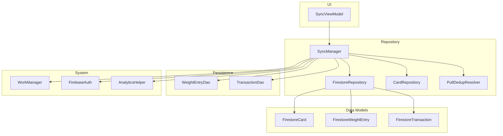
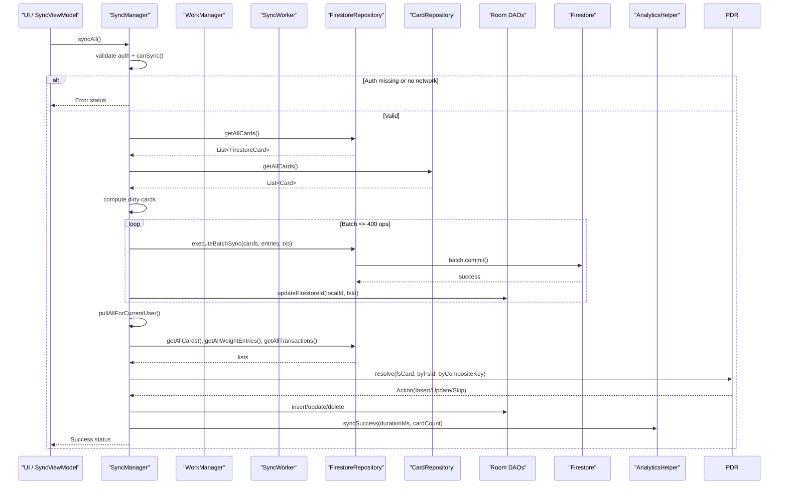
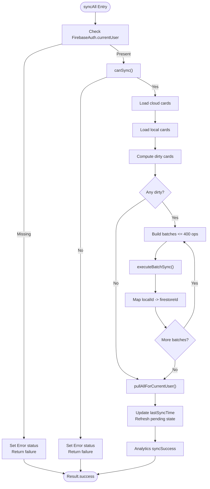
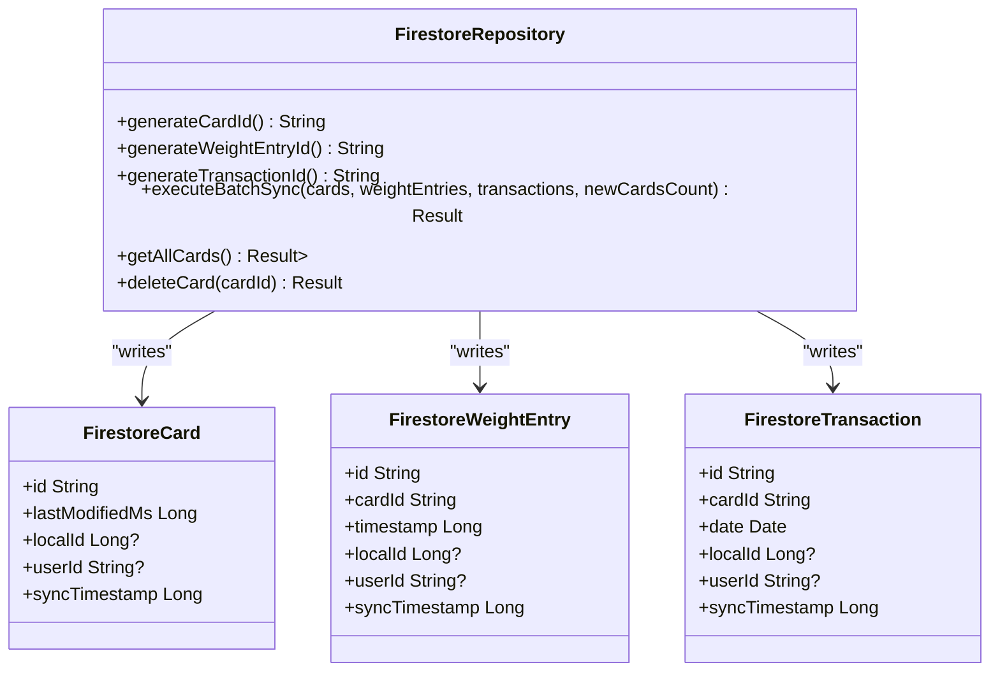
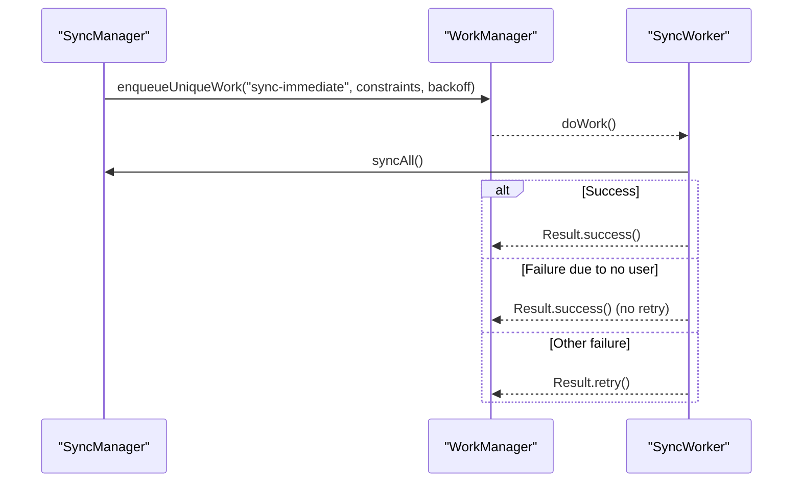
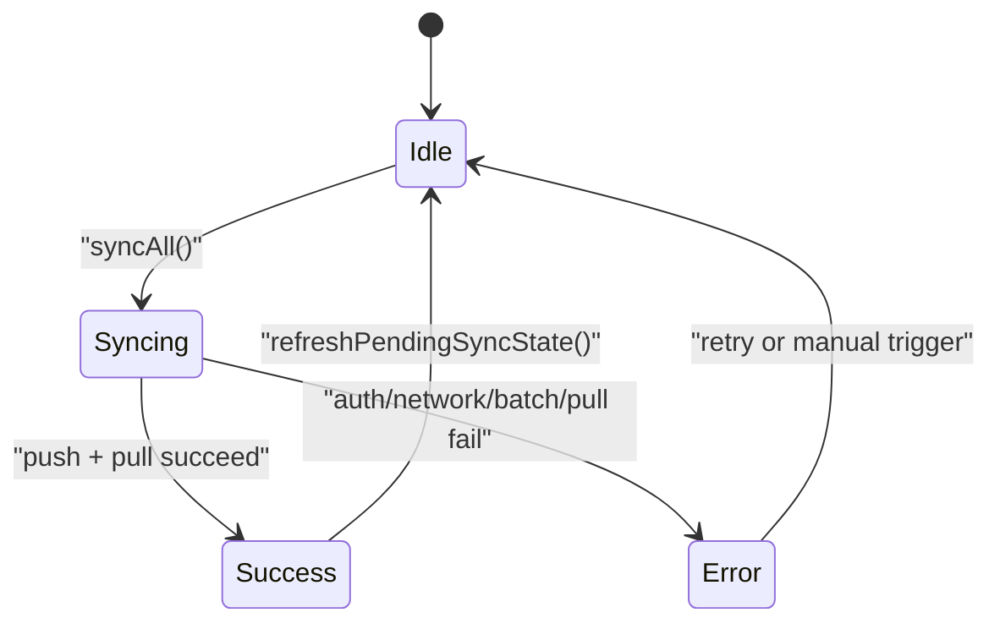
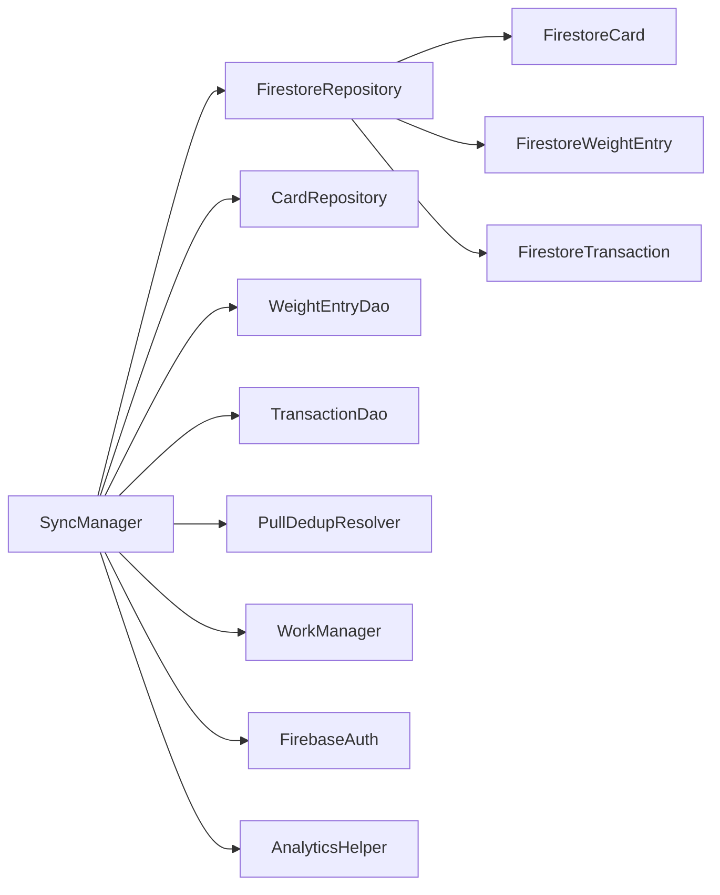

# Sync Orchestration Layer

<cite>
**Referenced Files in This Document**
- [SyncManager.kt](file://app/src/main/java/com/giathinh/canlua/repository/SyncManager.kt)
- [SyncWorker.kt](file://app/src/main/java/com/giathinh/canlua/repository/SyncWorker.kt)
- [FirestoreRepository.kt](file://app/src/main/java/com/giathinh/canlua/repository/FirestoreRepository.kt)
- [CardRepository.kt](file://app/src/main/java/com/giathinh/canlua/repository/CardRepository.kt)
- [PullDedupResolver.kt](file://app/src/main/java/com/giathinh/canlua/repository/PullDedupResolver.kt)
- [FirestoreCard.kt](file://app/src/main/java/com/giathinh/canlua/data/firestore/FirestoreCard.kt)
- [FirestoreWeightEntry.kt](file://app/src/main/java/com/giathinh/canlua/data/firestore/FirestoreWeightEntry.kt)
- [FirestoreTransaction.kt](file://app/src/main/java/com/giathinh/canlua/data/firestore/FirestoreTransaction.kt)
- [WeightEntryDao.kt](file://app/src/main/java/com/giathinh/canlua/data/dao/WeightEntryDao.kt)
- [TransactionDao.kt](file://app/src/main/java/com/giathinh/canlua/data/dao/TransactionDao.kt)
- [AnalyticsHelper.kt](file://app/src/main/java/com/giathinh/canlua/util/AnalyticsHelper.kt)
- [SyncViewModel.kt](file://app/src/main/java/com/giathinh/canlua/ui/viewmodel/SyncViewModel.kt)
</cite>

## Table of Contents
1. [Introduction](#introduction)
2. [Project Structure](#project-structure)
3. [Core Components](#core-components)
4. [Architecture Overview](#architecture-overview)
5. [Detailed Component Analysis](#detailed-component-analysis)
6. [Dependency Analysis](#dependency-analysis)
7. [Performance Considerations](#performance-considerations)
8. [Troubleshooting Guide](#troubleshooting-guide)
9. [Conclusion](#conclusion)

## Introduction
This document explains the SyncManager orchestration layer that coordinates bidirectional synchronization between a local Room database and Firebase Firestore. It covers push and pull workflows, batch processing strategy, conflict resolution, connectivity checks, authentication validation, error handling, state management via StateFlow, scheduling through WorkManager, retry policies with exponential backoff, and analytics integration for monitoring sync performance.

The app follows an offline-first design: it remains fully functional without network access, while background workers schedule idempotent syncs when connectivity allows. Local persistence uses AndroidX Room 2.8.4, schema v18, with per-user isolation and explicit migration chains. Cloud sync targets Firebase Firestore (and Supabase elsewhere), but this page focuses on Firestore.

## Project Structure
The sync orchestration spans repository, data model, DAO, UI ViewModel, and utility layers:

- Repository layer:
  - SyncManager orchestrates push/pull, batching, scheduling, and status/state.
  - FirestoreRepository abstracts Firestore reads/writes and batch commits.
  - CardRepository provides Room-backed card operations and tombstone handling.
  - PullDedupResolver implements deterministic conflict resolution logic.
- Data models:
  - FirestoreCard, FirestoreWeightEntry, FirestoreTransaction define cloud documents.
- DAO layer:
  - WeightEntryDao and TransactionDao expose Room queries for sync mapping and counts.
- UI layer:
  - SyncViewModel exposes StateFlow for UI binding and triggers sync calls.
- Utilities:
  - AnalyticsHelper logs success/failure metrics and non-fatal errors.



**Diagram sources**
- [SyncManager.kt:35-549](file://app/src/main/java/com/giathinh/canlua/repository/SyncManager.kt#L35-L549)
- [FirestoreRepository.kt:21-357](file://app/src/main/java/com/giathinh/canlua/repository/FirestoreRepository.kt#L21-L357)
- [CardRepository.kt:36-397](file://app/src/main/java/com/giathinh/canlua/repository/CardRepository.kt#L36-L397)
- [PullDedupResolver.kt:21-75](file://app/src/main/java/com/giathinh/canlua/repository/PullDedupResolver.kt#L21-L75)
- [FirestoreCard.kt:11-65](file://app/src/main/java/com/giathinh/canlua/data/firestore/FirestoreCard.kt#L11-L65)
- [FirestoreWeightEntry.kt:8-20](file://app/src/main/java/com/giathinh/canlua/data/firestore/FirestoreWeightEntry.kt#L8-L20)
- [FirestoreTransaction.kt:9-20](file://app/src/main/java/com/giathinh/canlua/data/firestore/FirestoreTransaction.kt#L9-L20)
- [WeightEntryDao.kt:7-51](file://app/src/main/java/com/giathinh/canlua/data/dao/WeightEntryDao.kt#L7-L51)
- [TransactionDao.kt:7-40](file://app/src/main/java/com/giathinh/canlua/data/dao/TransactionDao.kt#L7-L40)
- [AnalyticsHelper.kt:19-100](file://app/src/main/java/com/giathinh/canlua/util/AnalyticsHelper.kt#L19-L100)
- [SyncViewModel.kt:14-50](file://app/src/main/java/com/giathinh/canlua/ui/viewmodel/SyncViewModel.kt#L14-L50)

**Section sources**
- [SyncManager.kt:35-549](file://app/src/main/java/com/giathinh/canlua/repository/SyncManager.kt#L35-L549)
- [FirestoreRepository.kt:21-357](file://app/src/main/java/com/giathinh/canlua/repository/FirestoreRepository.kt#L21-L357)
- [CardRepository.kt:36-397](file://app/src/main/java/com/giathinh/canlua/repository/CardRepository.kt#L36-L397)
- [PullDedupResolver.kt:21-75](file://app/src/main/java/com/giathinh/canlua/repository/PullDedupResolver.kt#L21-L75)
- [FirestoreCard.kt:11-65](file://app/src/main/java/com/giathinh/canlua/data/firestore/FirestoreCard.kt#L11-L65)
- [FirestoreWeightEntry.kt:8-20](file://app/src/main/java/com/giathinh/canlua/data/firestore/FirestoreWeightEntry.kt#L8-L20)
- [FirestoreTransaction.kt:9-20](file://app/src/main/java/com/giathinh/canlua/data/firestore/FirestoreTransaction.kt#L9-L20)
- [WeightEntryDao.kt:7-51](file://app/src/main/java/com/giathinh/canlua/data/dao/WeightEntryDao.kt#L7-L51)
- [TransactionDao.kt:7-40](file://app/src/main/java/com/giathinh/canlua/data/dao/TransactionDao.kt#L7-L40)
- [AnalyticsHelper.kt:19-100](file://app/src/main/java/com/giathinh/canlua/util/AnalyticsHelper.kt#L19-L100)
- [SyncViewModel.kt:14-50](file://app/src/main/java/com/giathinh/canlua/ui/viewmodel/SyncViewModel.kt#L14-L50)

## Core Components
- SyncManager: Orchestrates bidirectional sync, manages StateFlow-based status and pending data detection, schedules WorkManager jobs, enforces Wi-Fi-only mode, validates user authentication, and integrates analytics.
- FirestoreRepository: Encapsulates Firestore read/write operations, including batch commit for up to 400 operations per batch, and ID generation utilities.
- CardRepository: Provides Room-backed card operations, tombstone tracking for deletions, and calculation updates; used by SyncManager for local data access and pending delete handling.
- PullDedupResolver: Pure logic for conflict resolution using timestamp comparison and composite key matching during pull operations.
- DAOs: WeightEntryDao and TransactionDao support sync mapping, unsynced counts, and firestoreId updates after successful batch commits.
- AnalyticsHelper: Logs sync success/failure events and non-fatal exceptions for monitoring.

Key responsibilities:
- Push dirty cards, weight entries, and transactions to Firestore in batches.
- Pull remote updates into Room with deduplication and conflict resolution.
- Track sync status, last sync time, and pending data presence via StateFlow.
- Schedule immediate sync with WorkManager constraints and exponential backoff.
- Validate connectivity (Wi-Fi-only option) and user authentication before syncing.

**Section sources**
- [SyncManager.kt:35-549](file://app/src/main/java/com/giathinh/canlua/repository/SyncManager.kt#L35-L549)
- [FirestoreRepository.kt:21-357](file://app/src/main/java/com/giathinh/canlua/repository/FirestoreRepository.kt#L21-L357)
- [CardRepository.kt:36-397](file://app/src/main/java/com/giathinh/canlua/repository/CardRepository.kt#L36-L397)
- [PullDedupResolver.kt:21-75](file://app/src/main/java/com/giathinh/canlua/repository/PullDedupResolver.kt#L21-L75)
- [WeightEntryDao.kt:7-51](file://app/src/main/java/com/giathinh/canlua/data/dao/WeightEntryDao.kt#L7-L51)
- [TransactionDao.kt:7-40](file://app/src/main/java/com/giathinh/canlua/data/dao/TransactionDao.kt#L7-L40)
- [AnalyticsHelper.kt:19-100](file://app/src/main/java/com/giathinh/canlua/util/AnalyticsHelper.kt#L19-L100)

## Architecture Overview
The sync flow is orchestrated by SyncManager, which coordinates local Room data and remote Firestore data through repositories and DAOs. WorkManager schedules background sync tasks with constraints based on connectivity settings.



**Diagram sources**
- [SyncManager.kt:139-311](file://app/src/main/java/com/giathinh/canlua/repository/SyncManager.kt#L139-L311)
- [FirestoreRepository.kt:45-85](file://app/src/main/java/com/giathinh/canlua/repository/FirestoreRepository.kt#L45-L85)
- [PullDedupResolver.kt:45-73](file://app/src/main/java/com/giathinh/canlua/repository/PullDedupResolver.kt#L45-L73)
- [AnalyticsHelper.kt:67-75](file://app/src/main/java/com/giathinh/canlua/util/AnalyticsHelper.kt#L67-L75)

## Detailed Component Analysis

### SyncManager Orchestration
Responsibilities:
- Exposes StateFlow properties for sync status, last sync time, and pending data detection.
- Validates user authentication and connectivity (with optional Wi-Fi-only enforcement).
- Schedules immediate sync via WorkManager with exponential backoff.
- Performs push of dirty cards, weight entries, and transactions in batches capped at 400 operations.
- Executes pull of remote updates with deduplication and conflict resolution.
- Updates local firestoreId mappings after successful batch commits.
- Integrates analytics for success/failure and non-fatal errors.

Key behaviors:
- Authentication check: requires non-anonymous signed-in user.
- Connectivity check: supports Wi-Fi-only mode via settings; otherwise requires general internet connectivity.
- Pending data detection: counts unsynced cards, weight entries, transactions, and pending cloud deletes.
- Batch strategy: groups up to 400 operations per batch; maps local IDs to Firestore IDs post-commit.
- Conflict resolution: delegates to PullDedupResolver during pull; uses timestamp comparison and composite key matching.
- Error handling: sets Error status, logs analytics, and records non-fatal exceptions.



**Diagram sources**
- [SyncManager.kt:139-311](file://app/src/main/java/com/giathinh/canlua/repository/SyncManager.kt#L139-L311)
- [FirestoreRepository.kt:45-85](file://app/src/main/java/com/giathinh/canlua/repository/FirestoreRepository.kt#L45-L85)

**Section sources**
- [SyncManager.kt:35-549](file://app/src/main/java/com/giathinh/canlua/repository/SyncManager.kt#L35-L549)

### FirestoreRepository Batch Strategy
Responsibilities:
- Generates unique Firestore IDs for new documents.
- Executes batch commits containing cards, weight entries, and transactions.
- Increments profile cardCount when new cards are pushed.
- Wraps all operations with Result handling and exception capture.

Batch details:
- Groups up to 400 operations per batch to optimize Firestore performance.
- Sets userId and syncTimestamp on each document before committing.
- Uses FieldValue.increment for atomic counter updates.



**Diagram sources**
- [FirestoreRepository.kt:41-85](file://app/src/main/java/com/giathinh/canlua/repository/FirestoreRepository.kt#L41-L85)
- [FirestoreCard.kt:11-65](file://app/src/main/java/com/giathinh/canlua/data/firestore/FirestoreCard.kt#L11-L65)
- [FirestoreWeightEntry.kt:8-20](file://app/src/main/java/com/giathinh/canlua/data/firestore/FirestoreWeightEntry.kt#L8-L20)
- [FirestoreTransaction.kt:9-20](file://app/src/main/java/com/giathinh/canlua/data/firestore/FirestoreTransaction.kt#L9-L20)

**Section sources**
- [FirestoreRepository.kt:41-85](file://app/src/main/java/com/giathinh/canlua/repository/FirestoreRepository.kt#L41-L85)

### Pull Deduplication and Conflict Resolution
Responsibilities:
- Determines whether to insert, update, or skip a Firestore card during pull.
- Uses timestamp comparison to decide overwrite vs keep local.
- Falls back to composite key matching for legacy cards without firestoreId.

Resolution logic:
- If firestoreId matches and cloud is newer → update local.
- If firestoreId matches but local is newer/equal → skip.
- If firestoreId does not match but composite key matches → update and stamp firestoreId.
- Otherwise → insert as new card.

```mermaid
flowchart TD
Start([resolve(fsCard)]) --> BlankId{"fsCard.id blank?"}
BlankId --> |Yes| SkipBlank["Skip(blank_firestore_id)"]
BlankId --> |No| MatchFsId{"byFirestoreId exists?"}
MatchFsId --> |Yes| CompareTs["cloudNewer = fsCard.lastModifiedMs > local.lastModifiedMs"]
CompareTs --> |True| UpdateNewer["Action.Update(localId, fsCard, FIRESTORE_ID_MATCH_NEWER)"]
CompareTs --> |False| SkipLocalNewer["Action.Skip(localId, local_newer_or_equal)"]
MatchFsId --> |No| CompositeMatch["byCompositeKey()"]
CompositeMatch --> FoundOrphan{"Orphan found?"}
FoundOrphan --> |Yes| UpdateLegacy["Action.Update(orphan.id, fsCard, COMPOSITE_KEY_MATCH)"]
FoundOrphan --> |No| InsertNew["Action.Insert(fsCard)"]
```

**Diagram sources**
- [PullDedupResolver.kt:45-73](file://app/src/main/java/com/giathinh/canlua/repository/PullDedupResolver.kt#L45-L73)

**Section sources**
- [PullDedupResolver.kt:21-75](file://app/src/main/java/com/giathinh/canlua/repository/PullDedupResolver.kt#L21-L75)

### WorkManager Scheduling and Retry Policy
Responsibilities:
- Schedules immediate sync via WorkManager with constraints based on connectivity settings.
- Applies exponential backoff policy for retries.
- Replaces or keeps existing work based on configuration changes.
- SyncWorker handles result propagation and avoids infinite retry loops when no user is signed in.

Scheduling details:
- NetworkType.UNMETERED for Wi-Fi-only mode; CONNECTED otherwise.
- BackoffPolicy.EXPONENTIAL with 30-second initial delay.
- Unique work name ensures idempotency.



**Diagram sources**
- [SyncManager.kt:102-130](file://app/src/main/java/com/giathinh/canlua/repository/SyncManager.kt#L102-L130)
- [SyncWorker.kt:17-30](file://app/src/main/java/com/giathinh/canlua/repository/SyncWorker.kt#L17-L30)

**Section sources**
- [SyncManager.kt:102-130](file://app/src/main/java/com/giathinh/canlua/repository/SyncManager.kt#L102-L130)
- [SyncWorker.kt:17-30](file://app/src/main/java/com/giathinh/canlua/repository/SyncWorker.kt#L17-L30)

### State Management via StateFlow
Responsibilities:
- Exposes syncStatus, lastSyncTime, and hasPendingSyncData as StateFlow for UI observation.
- Updates these states during sync lifecycle and after pull operations.
- SyncViewModel mirrors these flows to the UI layer.

State transitions:
- Idle → Syncing → Success/Error.
- lastSyncTime updated on successful sync and pull.
- hasPendingSyncData refreshed by counting unsynced entities and pending cloud deletes.



**Diagram sources**
- [SyncManager.kt:46-53](file://app/src/main/java/com/giathinh/canlua/repository/SyncManager.kt#L46-L53)
- [SyncManager.kt:139-311](file://app/src/main/java/com/giathinh/canlua/repository/SyncManager.kt#L139-L311)
- [SyncViewModel.kt:20-23](file://app/src/main/java/com/giathinh/canlua/ui/viewmodel/SyncViewModel.kt#L20-L23)

**Section sources**
- [SyncManager.kt:46-53](file://app/src/main/java/com/giathinh/canlua/repository/SyncManager.kt#L46-L53)
- [SyncViewModel.kt:20-23](file://app/src/main/java/com/giathinh/canlua/ui/viewmodel/SyncViewModel.kt#L20-L23)

### Connectivity Checks and Wi-Fi-Only Mode
Responsibilities:
- Validates active internet connectivity and validated capability.
- Supports Wi-Fi-only mode based on settings; otherwise allows mobile data.
- Enforces constraints in WorkManager scheduling accordingly.

Checks:
- isOnline(): requires NET_CAPABILITY_INTERNET and NET_CAPABILITY_VALIDATED.
- isWifiConnected(): additionally requires TRANSPORT_WIFI or NOT_METERED.
- canSync(): respects settingsRepository.isSyncOnlyWifi().

**Section sources**
- [SyncManager.kt:58-84](file://app/src/main/java/com/giathinh/canlua/repository/SyncManager.kt#L58-L84)

### User Authentication Validation
Responsibilities:
- Ensures a non-anonymous user is signed in before syncing.
- Exposes isUserSignedIn property for UI and scheduling decisions.
- Returns early with Error status if authentication fails.

Validation:
- Requires FirebaseAuth.currentUser != null and currentUser.isAnonymous == false.

**Section sources**
- [SyncManager.kt:55-56](file://app/src/main/java/com/giathinh/canlua/repository/SyncManager.kt#L55-L56)
- [SyncManager.kt:139-154](file://app/src/main/java/com/giathinh/canlua/repository/SyncManager.kt#L139-L154)

### Error Handling Strategies
Responsibilities:
- Sets SyncStatus.Error with descriptive messages for auth/network failures.
- Logs analytics events for sync success/failure stages.
- Records non-fatal exceptions via Crashlytics for debugging.

Strategies:
- Early returns with failure results on invalid conditions.
- Batch operation failures increment error counters and log analytics.
- Exception blocks wrap entire syncAll() to capture unexpected errors.

**Section sources**
- [SyncManager.kt:139-154](file://app/src/main/java/com/giathinh/canlua/repository/SyncManager.kt#L139-L154)
- [SyncManager.kt:291-310](file://app/src/main/java/com/giathinh/canlua/repository/SyncManager.kt#L291-L310)
- [AnalyticsHelper.kt:67-89](file://app/src/main/java/com/giathinh/canlua/util/AnalyticsHelper.kt#L67-L89)

### Analytics Integration
Responsibilities:
- Logs sync_success with duration and card count on success.
- Logs sync_failed with stage and error class on failure.
- Records non-fatal exceptions with tags for Crashlytics grouping.

Integration points:
- Called from SyncManager after successful sync and on batch failures.
- Breadcrumb logging for composite key deduplication events.

**Section sources**
- [SyncManager.kt:297-309](file://app/src/main/java/com/giathinh/canlua/repository/SyncManager.kt#L297-L309)
- [SyncManager.kt:354-356](file://app/src/main/java/com/giathinh/canlua/repository/SyncManager.kt#L354-L356)
- [AnalyticsHelper.kt:67-94](file://app/src/main/java/com/giathinh/canlua/util/AnalyticsHelper.kt#L67-L94)

## Dependency Analysis
The sync orchestration depends on multiple components with clear separation of concerns:



**Diagram sources**
- [SyncManager.kt:35-549](file://app/src/main/java/com/giathinh/canlua/repository/SyncManager.kt#L35-L549)
- [FirestoreRepository.kt:21-357](file://app/src/main/java/com/giathinh/canlua/repository/FirestoreRepository.kt#L21-L357)
- [CardRepository.kt:36-397](file://app/src/main/java/com/giathinh/canlua/repository/CardRepository.kt#L36-L397)
- [WeightEntryDao.kt:7-51](file://app/src/main/java/com/giathinh/canlua/data/dao/WeightEntryDao.kt#L7-L51)
- [TransactionDao.kt:7-40](file://app/src/main/java/com/giathinh/canlua/data/dao/TransactionDao.kt#L7-L40)
- [FirestoreCard.kt:11-65](file://app/src/main/java/com/giathinh/canlua/data/firestore/FirestoreCard.kt#L11-L65)
- [FirestoreWeightEntry.kt:8-20](file://app/src/main/java/com/giathinh/canlua/data/firestore/FirestoreWeightEntry.kt#L8-L20)
- [FirestoreTransaction.kt:9-20](file://app/src/main/java/com/giathinh/canlua/data/firestore/FirestoreTransaction.kt#L9-L20)

**Section sources**
- [SyncManager.kt:35-549](file://app/src/main/java/com/giathinh/canlua/repository/SyncManager.kt#L35-L549)
- [FirestoreRepository.kt:21-357](file://app/src/main/java/com/giathinh/canlua/repository/FirestoreRepository.kt#L21-L357)
- [CardRepository.kt:36-397](file://app/src/main/java/com/giathinh/canlua/repository/CardRepository.kt#L36-L397)

## Performance Considerations
- Batch size limit: Up to 400 operations per batch to optimize Firestore write performance and avoid exceeding limits.
- Client-side sorting: Avoids composite index requirements by sorting locally for weight entries and transactions.
- Atomic counter updates: Uses FieldValue.increment for profile cardCount to ensure consistency.
- Efficient DAO operations: Bulk updates and transactional writes reduce disk I/O pressure.
- Minimal network calls: Consolidates reads and writes to minimize round trips.

[No sources needed since this section provides general guidance]

## Troubleshooting Guide
Common issues and resolutions:
- No user signed in: Ensure non-anonymous authentication before triggering sync; SyncWorker avoids retry loops in this case.
- Not connected to network/Wi-Fi: Verify connectivity settings; enable Wi-Fi-only mode only when required.
- Batch failures: Check analytics logs for sync_failed events; review non-fatal exceptions tagged with sync_batch.
- Duplicate cards after logout/login: Composite key matching stamps firestoreId to prevent duplicates; verify PullDedupResolver usage.
- Stale sync status: Refresh pending sync state via refreshPendingSyncState(); observe StateFlow values in UI.

Diagnostic steps:
- Inspect SyncStatus Flow for current state.
- Review lastSyncTime to confirm successful sync completion.
- Check hasPendingSyncData to identify unsynced entities.
- Use AnalyticsHelper breadcrumbs for composite key deduplication events.

**Section sources**
- [SyncWorker.kt:17-30](file://app/src/main/java/com/giathinh/canlua/repository/SyncWorker.kt#L17-L30)
- [SyncManager.kt:139-154](file://app/src/main/java/com/giathinh/canlua/repository/SyncManager.kt#L139-L154)
- [SyncManager.kt:291-310](file://app/src/main/java/com/giathinh/canlua/repository/SyncManager.kt#L291-L310)
- [PullDedupResolver.kt:65-69](file://app/src/main/java/com/giathinh/canlua/repository/PullDedupResolver.kt#L65-L69)
- [AnalyticsHelper.kt:67-94](file://app/src/main/java/com/giathinh/canlua/util/AnalyticsHelper.kt#L67-L94)

## Conclusion
The SyncManager orchestration layer provides robust bidirectional synchronization between Room and Firestore, leveraging batch processing, conflict resolution, connectivity checks, and analytics integration. Its design ensures offline-first functionality, reliable background scheduling, and comprehensive monitoring for performance and reliability. The modular architecture separates concerns across repositories, DAOs, and utilities, enabling maintainability and testability.

[No sources needed since this section summarizes without analyzing specific files]