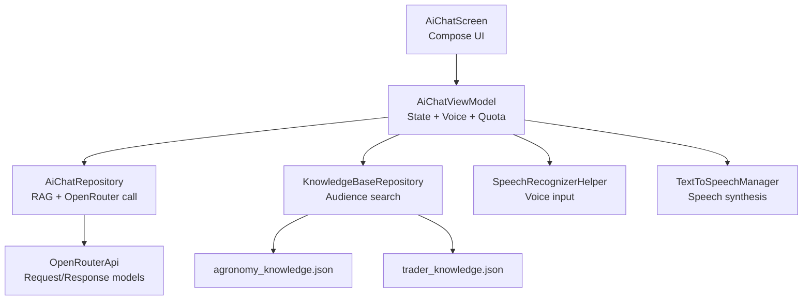
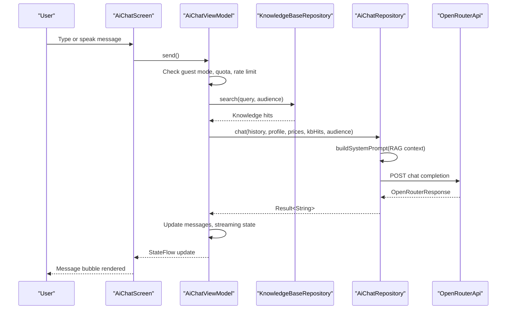
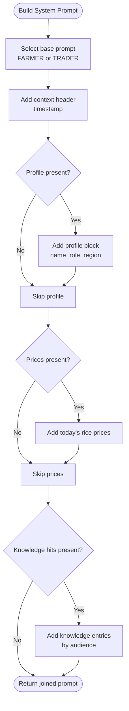
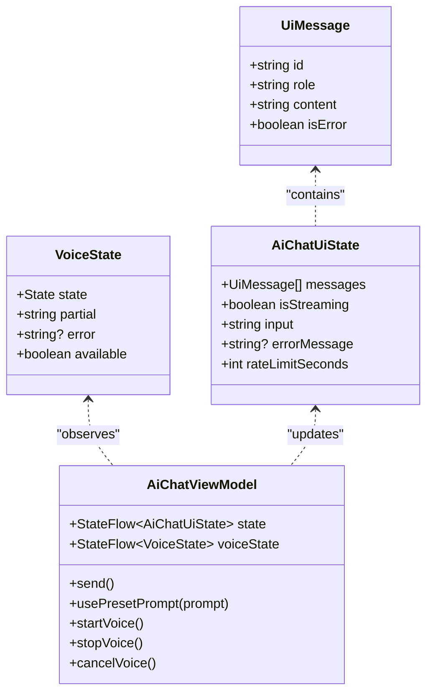
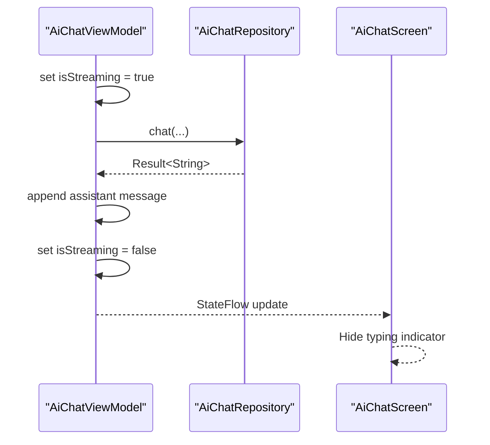
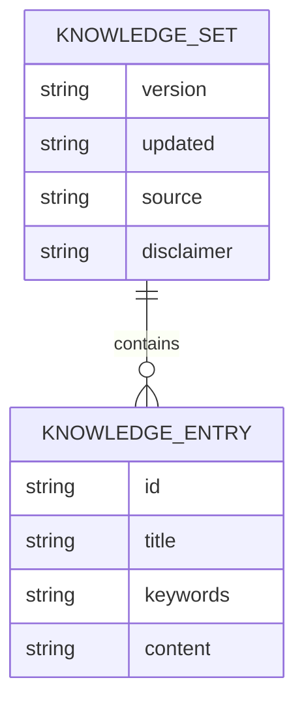
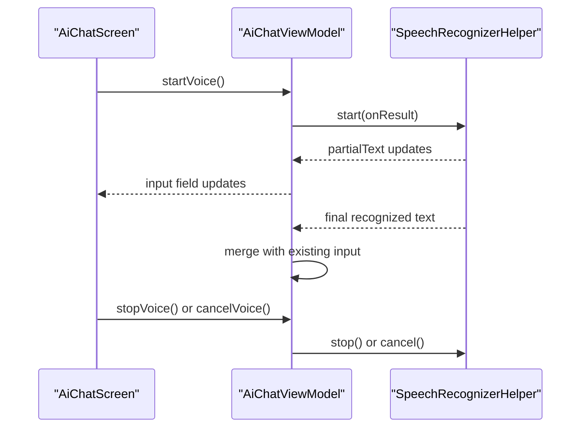
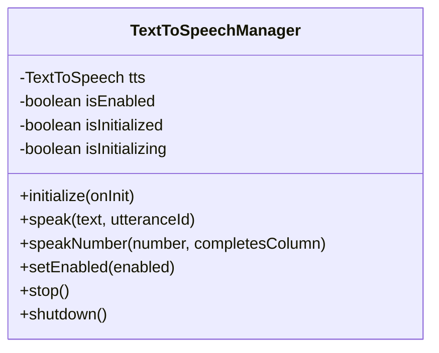
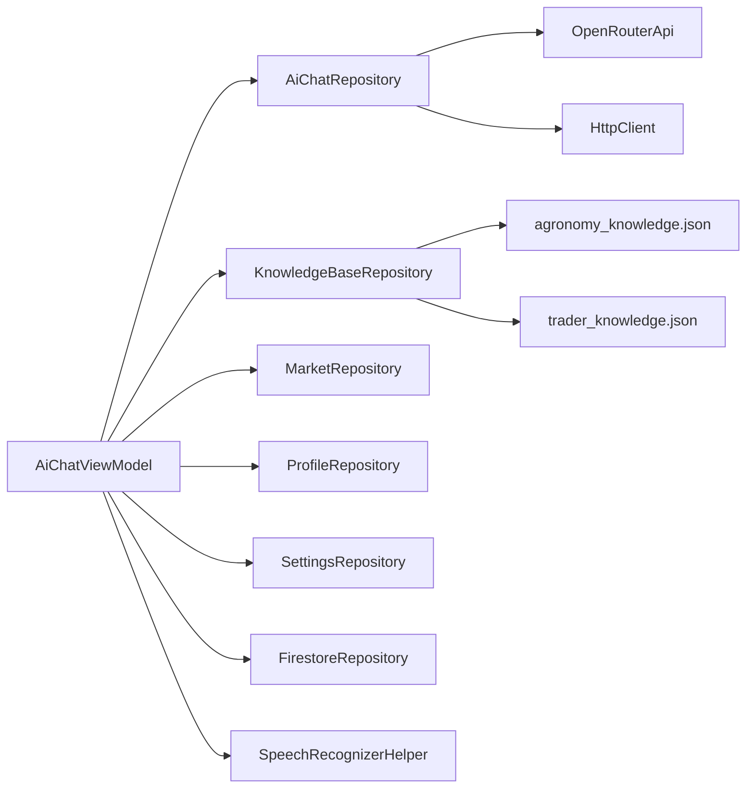

# AI Agronomy Assistant

<cite>
**Referenced Files in This Document**   
- [OpenRouterApi.kt](file://app/src/main/java/com/giathinh/canlua/data/remote/ai/OpenRouterApi.kt)
- [AiChatRepository.kt](file://app/src/main/java/com/giathinh/canlua/repository/AiChatRepository.kt)
- [AiChatScreen.kt](file://app/src/main/java/com/giathinh/canlua/ui/screen/aichat/AiChatScreen.kt)
- [AiChatViewModel.kt](file://app/src/main/java/com/giathinh/canlua/ui/viewmodel/AiChatViewModel.kt)
- [agronomy_knowledge.json](file://app/src/main/assets/agronomy_knowledge.json)
- [trader_knowledge.json](file://app/src/main/assets/trader_knowledge.json)
- [SpeechRecognizerHelper.kt](file://app/src/main/java/com/giathinh/canlua/util/SpeechRecognizerHelper.kt)
- [TextToSpeechManager.kt](file://app/src/main/java/com/giathinh/canlua/util/TextToSpeechManager.kt)
</cite>

## Table of Contents
1. [Introduction](#introduction)
2. [Project Structure](#project-structure)
3. [Core Components](#core-components)
4. [Architecture Overview](#architecture-overview)
5. [Detailed Component Analysis](#detailed-component-analysis)
6. [Dependency Analysis](#dependency-analysis)
7. [Performance Considerations](#performance-considerations)
8. [Troubleshooting Guide](#troubleshooting-guide)
9. [Conclusion](#conclusion)
10. [Appendices](#appendices)

## Introduction
This document explains the AI-powered agronomy assistant built into the Android app. The assistant uses OpenRouter’s Gemini Flash-compatible endpoint to provide context-aware farming and trading advice. It implements a lightweight Retrieval-Augmented Generation (RAG) flow that injects user profile, rice prices, and knowledge base entries into the system prompt before calling the model.

The chat interface is implemented with Jetpack Compose and MVVM. It supports:
- Session-like conversation history within the current screen state.
- Streaming-style UI feedback while waiting for the model response.
- Voice input through Android Speech Recognition.
- Text-to-speech utilities for reading numbers and feedback sounds.
- Audience-specific behavior for farmers and traders using separate knowledge sets.

The app follows Kotlin 2.3 / Jetpack Compose offline-first principles, Room persistence, and role-based portals. AI features are gated by guest mode, premium quotas, and rate limits.

## Project Structure
The AI feature spans four main layers:
- UI layer: `AiChatScreen` renders messages, preset prompts, voice controls, and streaming indicators.
- ViewModel layer: `AiChatViewModel` manages chat state, voice state, rate limiting, quota checks, and orchestrates repository calls.
- Repository layer: `AiChatRepository` builds RAG prompts, calls OpenRouter, sanitizes responses, and maps errors to friendly Vietnamese messages.
- Data assets: `agronomy_knowledge.json` and `trader_knowledge.json` provide domain-specific reference material used by RAG.

**Diagram sources**
- [AiChatScreen.kt:101-205](file://app/src/main/java/com/giathinh/canlua/ui/screen/aichat/AiChatScreen.kt#L101-L205)
- [AiChatViewModel.kt:55-146](file://app/src/main/java/com/giathinh/canlua/ui/viewmodel/AiChatViewModel.kt#L55-L146)
- [AiChatRepository.kt:36-67](file://app/src/main/java/com/giathinh/canlua/repository/AiChatRepository.kt#L36-L67)
- [OpenRouterApi.kt:7-26](file://app/src/main/java/com/giathinh/canlua/data/remote/ai/OpenRouterApi.kt#L7-L26)
- [SpeechRecognizerHelper.kt:24-44](file://app/src/main/java/com/giathinh/canlua/util/SpeechRecognizerHelper.kt#L24-L44)
- [TextToSpeechManager.kt:12-45](file://app/src/main/java/com/giathinh/canlua/util/TextToSpeechManager.kt#L12-L45)

**Section sources**
- [AiChatScreen.kt:101-205](file://app/src/main/java/com/giathinh/canlua/ui/screen/aichat/AiChatScreen.kt#L101-L205)
- [AiChatViewModel.kt:55-146](file://app/src/main/java/com/giathinh/canlua/ui/viewmodel/AiChatViewModel.kt#L55-L146)
- [AiChatRepository.kt:36-67](file://app/src/main/java/com/giathinh/canlua/repository/AiChatRepository.kt#L36-L67)
- [OpenRouterApi.kt:7-26](file://app/src/main/java/com/giathinh/canlua/data/remote/ai/OpenRouterApi.kt#L7-L26)

## Core Components
- **AI Chat Screen**: Renders message bubbles, typing indicator, preset prompts, and an input bar with send/mic/stop actions. It also shows a locked screen when the user is in guest mode.
- **AI Chat ViewModel**: Holds `UiMessage`, `VoiceState`, and `AiChatUiState`. It enforces rate limits, premium/free quotas, guest-mode gating, audience detection, and voice integration.
- **AI Chat Repository**: Builds system prompts with RAG context, calls OpenRouter once per request, sanitizes output, and returns user-friendly error messages.
- **OpenRouter API Models**: Lightweight data classes for OpenAI-compatible chat requests and responses.
- **Knowledge Base JSON**: Two static knowledge sets — agronomy guidance for farmers and trader market/logistics guidance.
- **Speech Recognition Helper**: Wraps Android `SpeechRecognizer` for live partial results and final text.
- **Text-to-Speech Manager**: Initializes TTS, formats numbers for Vietnamese speech, and provides playback helpers.

**Section sources**
- [AiChatScreen.kt:101-205](file://app/src/main/java/com/giathinh/canlua/ui/screen/aichat/AiChatScreen.kt#L101-L205)
- [AiChatViewModel.kt:28-53](file://app/src/main/java/com/giathinh/canlua/ui/viewmodel/AiChatViewModel.kt#L28-L53)
- [AiChatRepository.kt:27-67](file://app/src/main/java/com/giathinh/canlua/repository/AiChatRepository.kt#L27-L67)
- [OpenRouterApi.kt:7-26](file://app/src/main/java/com/giathinh/canlua/data/remote/ai/OpenRouterApi.kt#L7-L26)
- [SpeechRecognizerHelper.kt:16-44](file://app/src/main/java/com/giathinh/canlua/util/SpeechRecognizerHelper.kt#L16-L44)
- [TextToSpeechManager.kt:12-45](file://app/src/main/java/com/giathinh/canlua/util/TextToSpeechManager.kt#L12-L45)

## Architecture Overview
The assistant follows unidirectional data flow:
1. User types or speaks a question.
2. ViewModel validates input, guest mode, quotas, and rate limits.
3. ViewModel searches the appropriate knowledge set based on user role.
4. Repository builds a system prompt combining profile, prices, and knowledge hits.
5. Repository calls OpenRouter with a single request and timeout.
6. Response is sanitized and returned as a message; errors become visible assistant messages marked as errors.

**Diagram sources**
- [AiChatScreen.kt:191-201](file://app/src/main/java/com/giathinh/canlua/ui/screen/aichat/AiChatScreen.kt#L191-L201)
- [AiChatViewModel.kt:158-237](file://app/src/main/java/com/giathinh/canlua/ui/viewmodel/AiChatViewModel.kt#L158-L237)
- [AiChatRepository.kt:52-67](file://app/src/main/java/com/giathinh/canlua/repository/AiChatRepository.kt#L52-L67)
- [OpenRouterApi.kt:7-26](file://app/src/main/java/com/giathinh/canlua/data/remote/ai/OpenRouterApi.kt#L7-L26)

## Detailed Component Analysis

### RAG System and Prompt Engineering
The repository constructs a layered system prompt:
- Base prompt depends on audience: farmer vs trader.
- Context header adds timestamp.
- Profile block personalizes greeting and role.
- Rice price block injects current market data.
- Knowledge block injects top matched entries from the selected knowledge set.

**Diagram sources**
- [AiChatRepository.kt:209-225](file://app/src/main/java/com/giathinh/canlua/repository/AiChatRepository.kt#L209-L225)
- [AiChatRepository.kt:227-286](file://app/src/main/java/com/giathinh/canlua/repository/AiChatRepository.kt#L227-L286)

**Section sources**
- [AiChatRepository.kt:27-67](file://app/src/main/java/com/giathinh/canlua/repository/AiChatRepository.kt#L27-L67)
- [AiChatRepository.kt:171-225](file://app/src/main/java/com/giathinh/canlua/repository/AiChatRepository.kt#L171-L225)
- [AiChatRepository.kt:304-343](file://app/src/main/java/com/giathinh/canlua/repository/AiChatRepository.kt#L304-L343)

### Chat Interface and Session Management
The screen composes:
- Preset chips shown only at the start of a conversation.
- A scrollable message list with auto-scrolling.
- A typing indicator while awaiting the model.
- An input bar with dynamic action button states: send, mic, stop.
- Guest-mode locked screen with comparison table and login CTA.

Conversation history is maintained in `AiChatUiState.messages`. Each message has a unique ID, role, content, and error flag. The ViewModel filters out error messages when sending history to the repository.

**Diagram sources**
- [AiChatViewModel.kt:28-53](file://app/src/main/java/com/giathinh/canlua/ui/viewmodel/AiChatViewModel.kt#L28-L53)
- [AiChatViewModel.kt:158-237](file://app/src/main/java/com/giathinh/canlua/ui/viewmodel/AiChatViewModel.kt#L158-L237)
- [AiChatScreen.kt:228-276](file://app/src/main/java/com/giathinh/canlua/ui/screen/aichat/AiChatScreen.kt#L228-L276)

**Section sources**
- [AiChatScreen.kt:101-205](file://app/src/main/java/com/giathinh/canlua/ui/screen/aichat/AiChatScreen.kt#L101-L205)
- [AiChatScreen.kt:228-276](file://app/src/main/java/com/giathinh/canlua/ui/screen/aichat/AiChatScreen.kt#L228-L276)
- [AiChatViewModel.kt:158-237](file://app/src/main/java/com/giathinh/canlua/ui/viewmodel/AiChatViewModel.kt#L158-L237)

### Streaming Responses
The UI treats the model response as a streaming phase:
- `isStreaming` becomes true after sending.
- A typing indicator is appended to the message list.
- After the repository returns a result, the ViewModel updates the assistant message and clears streaming.

Note: The current repository implementation returns a single completed string rather than a stream of tokens. The UI still provides a smooth “typing” experience during the network call.

**Diagram sources**
- [AiChatViewModel.kt:196-237](file://app/src/main/java/com/giathinh/canlua/ui/viewmodel/AiChatViewModel.kt#L196-L237)
- [AiChatScreen.kt:166-168](file://app/src/main/java/com/giathinh/canlua/ui/screen/aichat/AiChatScreen.kt#L166-L168)

**Section sources**
- [AiChatViewModel.kt:196-237](file://app/src/main/java/com/giathinh/canlua/ui/viewmodel/AiChatViewModel.kt#L196-L237)
- [AiChatScreen.kt:166-168](file://app/src/main/java/com/giathinh/canlua/ui/screen/aichat/AiChatScreen.kt#L166-L168)

### Knowledge Base Integration
Two knowledge sets are embedded as JSON:
- `agronomy_knowledge.json`: Farming topics such as blast disease, brown planthopper, small leaf roller, fertilization schedules, flooding recovery, spraying timing, harvest timing, physiological yellowing, and seeding density.
- `trader_knowledge.json`: Market pricing for Đông Xuân and Hè Thu seasons, moisture measurement, impurity checks, short-term storage, barge logistics, negotiation practices, export codes, margin ranges, and low-quality signs.

The ViewModel selects the audience based on the user profile role:
- FARMER → agronomy knowledge.
- TRADER → trader knowledge.

The repository then injects matched entries into the system prompt under an audience-specific header.

**Diagram sources**
- [agronomy_knowledge.json:1-71](file://app/src/main/assets/agronomy_knowledge.json#L1-L71)
- [trader_knowledge.json:1-65](file://app/src/main/assets/trader_knowledge.json#L1-L65)

**Section sources**
- [agronomy_knowledge.json:1-71](file://app/src/main/assets/agronomy_knowledge.json#L1-L71)
- [trader_knowledge.json:1-65](file://app/src/main/assets/trader_knowledge.json#L1-L65)
- [AiChatViewModel.kt:132-152](file://app/src/main/java/com/giathinh/canlua/ui/viewmodel/AiChatViewModel.kt#L132-L152)
- [AiChatRepository.kt:271-286](file://app/src/main/java/com/giathinh/canlua/repository/AiChatRepository.kt#L271-L286)

### Voice Interaction
Voice input is handled by `SpeechRecognizerHelper`:
- Checks device support.
- Starts recognition with Vietnamese language model.
- Emits partial results for live preview.
- Converts final results into text appended to the input field.
- Maps Android speech errors to friendly messages.

The ViewModel wires voice events to the input field and exposes `startVoice`, `stopVoice`, `cancelVoice`, and `clearVoiceError`. The screen renders a voice error banner and changes the input border color while listening.

**Diagram sources**
- [SpeechRecognizerHelper.kt:45-79](file://app/src/main/java/com/giathinh/canlua/util/SpeechRecognizerHelper.kt#L45-L79)
- [SpeechRecognizerHelper.kt:141-157](file://app/src/main/java/com/giathinh/canlua/util/SpeechRecognizerHelper.kt#L141-L157)
- [AiChatViewModel.kt:245-257](file://app/src/main/java/com/giathinh/canlua/ui/viewmodel/AiChatViewModel.kt#L245-L257)
- [AiChatScreen.kt:369-435](file://app/src/main/java/com/giathinh/canlua/ui/screen/aichat/AiChatScreen.kt#L369-L435)

**Section sources**
- [SpeechRecognizerHelper.kt:16-162](file://app/src/main/java/com/giathinh/canlua/util/SpeechRecognizerHelper.kt#L16-L162)
- [AiChatViewModel.kt:245-257](file://app/src/main/java/com/giathinh/canlua/ui/viewmodel/AiChatViewModel.kt#L245-L257)
- [AiChatScreen.kt:308-435](file://app/src/main/java/com/giathinh/canlua/ui/screen/aichat/AiChatScreen.kt#L308-L435)

### Text-to-Speech Synthesis
`TextToSpeechManager` initializes Android TTS for Vietnamese, formats numbers for natural speech, and provides helper methods for speaking values and triggering haptic/audio feedback. While not directly wired into the chat reply loop in the analyzed files, it is available for reading numbers, dashboard insights, or accessibility features.

**Diagram sources**
- [TextToSpeechManager.kt:12-45](file://app/src/main/java/com/giathinh/canlua/util/TextToSpeechManager.kt#L12-L45)
- [TextToSpeechManager.kt:76-90](file://app/src/main/java/com/giathinh/canlua/util/TextToSpeechManager.kt#L76-L90)
- [TextToSpeechManager.kt:92-154](file://app/src/main/java/com/giathinh/canlua/util/TextToSpeechManager.kt#L92-L154)

**Section sources**
- [TextToSpeechManager.kt:12-177](file://app/src/main/java/com/giathinh/canlua/util/TextToSpeechManager.kt#L12-L177)

### Practical Examples of AI Prompt Engineering and Context Injection
- **Audience-specific base prompts**: Farmer prompts emphasize practical agronomy, local terminology, and cautious technical advice. Trader prompts emphasize market analysis, risk, logistics, and realistic margins.
- **Context injection order**: Timestamp → profile → prices → knowledge hits. Missing fields are skipped so the prompt stays focused.
- **Price context formatting**: Top prices are sorted, trend icons added, freshness calculated, and units localized.
- **Knowledge block formatting**: Entries are numbered and prefixed with an audience-specific header so the model prioritizes internal documents over general knowledge.
- **Output constraints**: The repository sanitizes control characters, removes replacement characters, and caps length to avoid UI parsing issues.

These strategies reduce hallucination, keep answers grounded in verified agronomy and trader data, and tailor tone to the intended user.

**Section sources**
- [AiChatRepository.kt:209-286](file://app/src/main/java/com/giathinh/canlua/repository/AiChatRepository.kt#L209-L286)
- [AiChatRepository.kt:345-361](file://app/src/main/java/com/giathinh/canlua/repository/AiChatRepository.kt#L345-L361)

## Dependency Analysis
The AI feature depends on:
- OpenRouter API models for request/response serialization.
- HTTP client for authenticated POST calls.
- Firestore repository for query counting and analytics.
- Market repository for rice price context.
- Profile repository for user role and personalization.
- Settings repository for guest mode.
- Knowledge base repository for audience-aware retrieval.
- Speech recognizer helper for voice input.
- Text-to-speech manager for audio feedback and number reading.

**Diagram sources**
- [AiChatViewModel.kt:55-65](file://app/src/main/java/com/giathinh/canlua/ui/viewmodel/AiChatViewModel.kt#L55-L65)
- [AiChatRepository.kt:36-39](file://app/src/main/java/com/giathinh/canlua/repository/AiChatRepository.kt#L36-L39)
- [OpenRouterApi.kt:7-26](file://app/src/main/java/com/giathinh/canlua/data/remote/ai/OpenRouterApi.kt#L7-L26)
- [agronomy_knowledge.json:1-71](file://app/src/main/assets/agronomy_knowledge.json#L1-L71)
- [trader_knowledge.json:1-65](file://app/src/main/assets/trader_knowledge.json#L1-L65)

**Section sources**
- [AiChatViewModel.kt:55-65](file://app/src/main/java/com/giathinh/canlua/ui/viewmodel/AiChatViewModel.kt#L55-L65)
- [AiChatRepository.kt:36-39](file://app/src/main/java/com/giathinh/canlua/repository/AiChatRepository.kt#L36-L39)

## Performance Considerations
- **Single API call per request**: The repository does not retry or fallback, reducing redundant network usage and cost.
- **Timeout protection**: Requests use a 30-second timeout to avoid hanging UI threads.
- **Response sanitization**: Control characters and oversized responses are cleaned to prevent UI parsing failures and memory pressure.
- **Season analysis cache**: In-memory caching avoids repeated model calls for identical season summaries within the same process lifetime.
- **Rate limiting**: Prevents burst spamming by enforcing minimum delay between sends and a sliding window cap.
- **Quota enforcement**: Free users have a daily limit; premium users have a higher limit.

Optimization opportunities include:
- Streaming token updates from the model to the UI for faster perceived responsiveness.
- Pagination or truncation of long knowledge blocks if they exceed model context windows.
- Local caching of knowledge hits for frequent queries.

[No sources needed since this section provides general guidance]

## Troubleshooting Guide
Common connectivity and service issues:
- **Missing API key**: If the decoded OpenRouter key is empty, the repository returns a configuration error.
- **Authentication failure**: HTTP 401/403 maps to a message asking the developer to check the key.
- **Paid tier limit**: HTTP 402 indicates free-tier quota exhaustion.
- **Rate limiting**: HTTP 429 indicates overload; the UI should show a friendly retry message.
- **Server errors**: HTTP 5xx maps to temporary service failure.
- **Network errors**: IOException maps to checking internet connectivity.
- **Timeout**: Exceeding 30 seconds maps to connection timeout messaging.
- **Empty response**: Model returns no content; user is asked to rephrase.
- **Voice unavailable**: Device lacks speech recognition support or Google Speech Services.
- **Microphone permission denied**: Android permission error surfaced through the speech helper.

Recommended steps:
- Verify OpenRouter API key configuration.
- Check internet connectivity and firewall rules.
- Retry after brief delays for transient server errors.
- Use keyboard input if voice recognition fails.
- Review Firebase Crashlytics logs for detailed error context.

**Section sources**
- [AiChatRepository.kt:59-67](file://app/src/main/java/com/giathinh/canlua/repository/AiChatRepository.kt#L59-L67)
- [AiChatRepository.kt:99-168](file://app/src/main/java/com/giathinh/canlua/repository/AiChatRepository.kt#L99-L168)
- [SpeechRecognizerHelper.kt:45-79](file://app/src/main/java/com/giathinh/canlua/util/SpeechRecognizerHelper.kt#L45-L79)
- [SpeechRecognizerHelper.kt:123-139](file://app/src/main/java/com/giathinh/canlua/util/SpeechRecognizerHelper.kt#L123-L139)

## Conclusion
The AI agronomy assistant combines a clean MVVM architecture, audience-aware RAG prompting, and a responsive Compose chat interface. It grounds model outputs in verified agronomy and trader knowledge, enriches them with real-time rice prices and user profile context, and protects users with clear error messaging and rate/quota controls. Voice input improves accessibility, while TTS utilities provide additional audio feedback. Future enhancements can focus on streaming model tokens, richer local caching, and deeper integration of TTS for conversational read-back.

[No sources needed since this section summarizes without analyzing specific files]

## Appendices

### API Contract Summary
- **Endpoint**: OpenRouter chat completions compatible with OpenAI format.
- **Model**: Free-tier model configured in repository.
- **Headers**: Authorization bearer token, referer, and app title.
- **Request body**: Model name, message list including system prompt and conversation history, temperature, and max tokens.
- **Response body**: Optional metadata, choices with assistant message, and optional error object.

**Section sources**
- [OpenRouterApi.kt:7-26](file://app/src/main/java/com/giathinh/canlua/data/remote/ai/OpenRouterApi.kt#L7-L26)
- [AiChatRepository.kt:99-114](file://app/src/main/java/com/giathinh/canlua/repository/AiChatRepository.kt#L99-L114)