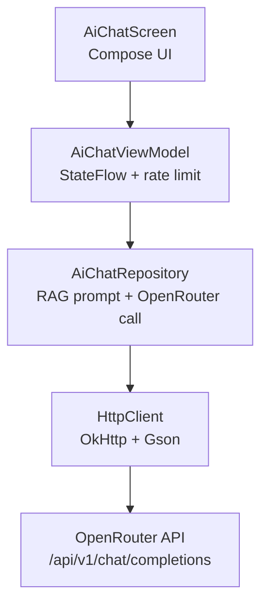
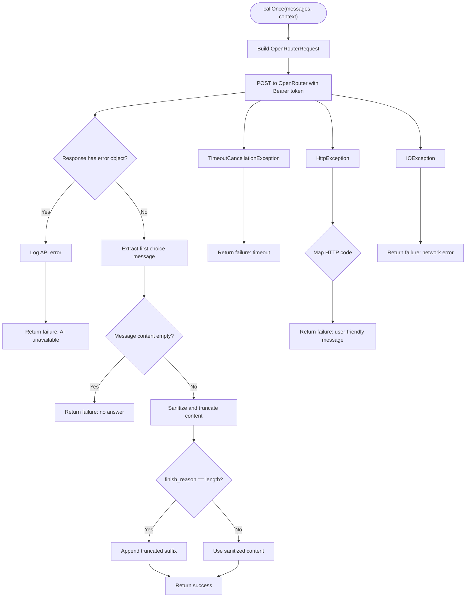
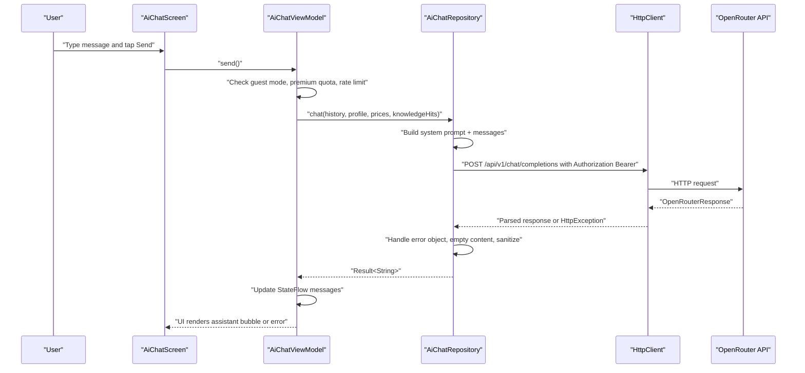
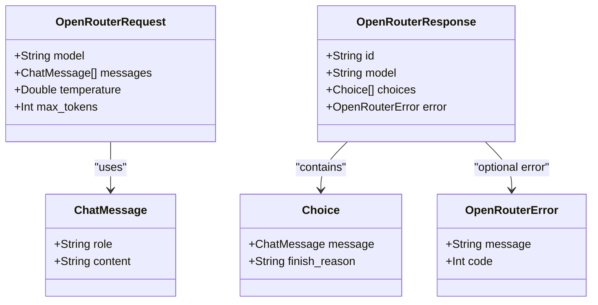
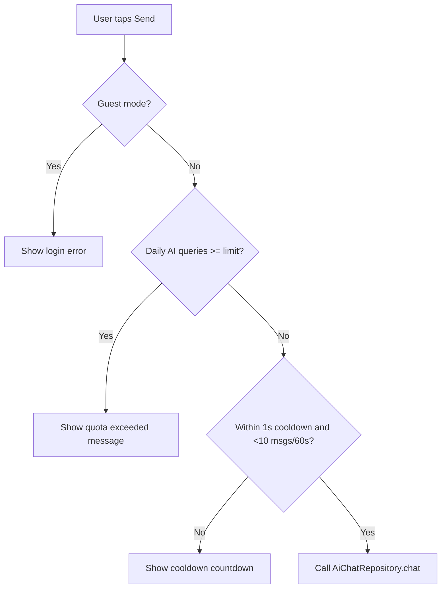
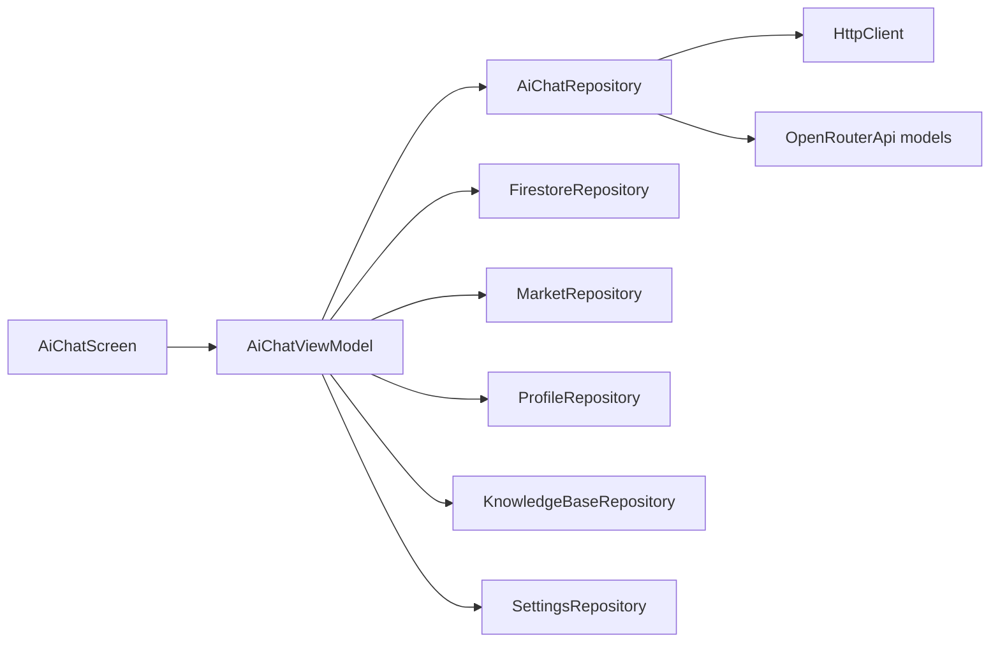

# OpenRouter API Integration

<cite>
**Referenced Files in This Document**
- [OpenRouterApi.kt](file://app/src/main/java/com/giathinh/canlua/data/remote/ai/OpenRouterApi.kt)
- [HttpClient.kt](file://app/src/main/java/com/giathinh/canlua/data/remote/HttpClient.kt)
- [AiChatRepository.kt](file://app/src/main/java/com/giathinh/canlua/repository/AiChatRepository.kt)
- [AiChatViewModel.kt](file://app/src/main/java/com/giathinh/canlua/ui/viewmodel/AiChatViewModel.kt)
- [AiChatScreen.kt](file://app/src/main/java/com/giathinh/canlua/ui/screen/aichat/AiChatScreen.kt)
</cite>

## Table of Contents
1. [Introduction](#introduction)
2. [Project Structure](#project-structure)
3. [Core Components](#core-components)
4. [Architecture Overview](#architecture-overview)
5. [Detailed Component Analysis](#detailed-component-analysis)
6. [Dependency Analysis](#dependency-analysis)
7. [Performance Considerations](#performance-considerations)
8. [Troubleshooting Guide](#troubleshooting-guide)
9. [Conclusion](#conclusion)

## Introduction
This document explains the OpenRouter API integration layer used by the Android app to provide an AI chat assistant for farmers and traders. The integration is built on a lightweight OkHttp client, uses Bearer token authentication, and targets the OpenAI-compatible chat completion endpoint at `https://openrouter.ai/api/v1/chat/completions`.

The implementation follows the project’s MVVM + Clean Architecture pattern:
- UI layer (Compose screen) observes ViewModel state.
- ViewModel manages user input, rate limiting, premium quota checks, and calls the repository.
- Repository builds system prompts with RAG context, constructs the OpenRouter request, performs the network call, and maps errors into user-friendly Vietnamese messages.
- Data models define the OpenRouter request and response structures.

## Project Structure
The OpenRouter integration spans four main layers:

| Layer | Responsibility | Key File |
|---|---|---|
| UI Screen | Renders chat bubbles, preset prompts, voice input, and error banners | [AiChatScreen.kt](file://app/src/main/java/com/giathinh/canlua/ui/screen/aichat/AiChatScreen.kt) |
| ViewModel | Manages chat state, local rate limiting, premium quota, and orchestrates repository calls | [AiChatViewModel.kt](file://app/src/main/java/com/giathinh/canlua/ui/viewmodel/AiChatViewModel.kt) |
| Repository | Builds system prompts, sends OpenRouter requests, sanitizes responses, and handles HTTP/network errors | [AiChatRepository.kt](file://app/src/main/java/com/giathinh/canlua/repository/AiChatRepository.kt) |
| Remote Models | Defines OpenRouter request/response data classes | [OpenRouterApi.kt](file://app/src/main/java/com/giathinh/canlua/data/remote/ai/OpenRouterApi.kt) |
| HTTP Client | Wraps OkHttp + Gson, provides JSON POST/GET, redirects handling, and throws typed exceptions | [HttpClient.kt](file://app/src/main/java/com/giathinh/canlua/data/remote/HttpClient.kt) |

**Diagram sources**
- [AiChatScreen.kt:101-205](file://app/src/main/java/com/giathinh/canlua/ui/screen/aichat/AiChatScreen.kt#L101-L205)
- [AiChatViewModel.kt:158-237](file://app/src/main/java/com/giathinh/canlua/ui/viewmodel/AiChatViewModel.kt#L158-L237)
- [AiChatRepository.kt:52-169](file://app/src/main/java/com/giathinh/canlua/repository/AiChatRepository.kt#L52-L169)
- [HttpClient.kt:31-74](file://app/src/main/java/com/giathinh/canlua/data/remote/HttpClient.kt#L31-L74)

**Section sources**
- [AiChatScreen.kt:101-205](file://app/src/main/java/com/giathinh/canlua/ui/screen/aichat/AiChatScreen.kt#L101-L205)
- [AiChatViewModel.kt:158-237](file://app/src/main/java/com/giathinh/canlua/ui/viewmodel/AiChatViewModel.kt#L158-L237)
- [AiChatRepository.kt:52-169](file://app/src/main/java/com/giathinh/canlua/repository/AiChatRepository.kt#L52-L169)
- [HttpClient.kt:31-74](file://app/src/main/java/com/giathinh/canlua/data/remote/HttpClient.kt#L31-L74)

## Core Components

### HTTP Client Configuration
The app uses a custom `HttpClient` that wraps OkHttp and Gson. It avoids Retrofit to keep the bundle small.

Key behaviors:
- `get(url, headers)` executes a GET request and parses JSON into a generic type.
- `postJson(url, body, headers)` serializes the body to JSON, sets `Content-Type: application/json`, and parses the response.
- For Google Apps Script endpoints, it temporarily disables automatic redirect following to catch 302 responses, then re-posts the same body to the redirected URL.
- Non-2xx responses throw `HttpException(code, errorBody)`.
- JSON parsing failures are wrapped as `HttpException` with a parse-error message.

Timeouts and connection settings are not configured inside this class; they come from the injected `OkHttpClient` instance provided by the DI module.

**Section sources**
- [HttpClient.kt:12-19](file://app/src/main/java/com/giathinh/canlua/data/remote/HttpClient.kt#L12-L19)
- [HttpClient.kt:23-29](file://app/src/main/java/com/giathinh/canlua/data/remote/HttpClient.kt#L23-L29)
- [HttpClient.kt:31-74](file://app/src/main/java/com/giathinh/canlua/data/remote/HttpClient.kt#L31-L74)
- [HttpClient.kt:76-94](file://app/src/main/java/com/giathinh/canlua/data/remote/HttpClient.kt#L76-L94)

### Authentication with Bearer Tokens
Authentication is handled in the repository when calling OpenRouter:
- The API key is read from `BuildConfig.OPENROUTER_API_KEY`.
- It is decoded through `ApiKeyObfuscator.decode(...)` before use.
- The request header `Authorization` is set to `Bearer <decoded-key>`.
- Additional OpenRouter-required headers include:
  - `HTTP-Referer`: `https://canlua.app`
  - `X-Title`: `CanLua`

If the decoded API key is empty, the repository returns a failure result early, indicating that the AI assistant has not been configured.

**Section sources**
- [AiChatRepository.kt:52-67](file://app/src/main/java/com/giathinh/canlua/repository/AiChatRepository.kt#L52-L67)
- [AiChatRepository.kt:99-114](file://app/src/main/java/com/giathinh/canlua/repository/AiChatRepository.kt#L99-L114)

### Request Model: OpenRouterRequest
The request model is OpenAI-compatible and sent to the chat completions endpoint.

| Field | Type | Default | Purpose |
|---|---|---:|---|
| `model` | String | Required | OpenRouter model identifier; the app uses `openrouter/free`. |
| `messages` | List\<ChatMessage\> | Required | Chat history including system, user, and assistant messages. |
| `temperature` | Double | 0.6 | Controls randomness; higher values make outputs more creative. |
| `max_tokens` | Int | 1500 | Limits generated output length to reduce truncation risk. |

`ChatMessage` contains:
- `role`: typically `"system"`, `"user"`, or `"assistant"`.
- `content`: the text content for that role.

**Section sources**
- [OpenRouterApi.kt:3-16](file://app/src/main/java/com/giathinh/canlua/data/remote/ai/OpenRouterApi.kt#L3-L16)
- [AiChatRepository.kt:99-104](file://app/src/main/java/com/giathinh/canlua/repository/AiChatRepository.kt#L99-L104)

### Response Model: OpenRouterResponse
The response model mirrors the OpenAI-compatible structure returned by OpenRouter.

| Field | Type | Default | Purpose |
|---|---|---:|---|
| `id` | String? | null | Optional response identifier. |
| `model` | String? | null | Model used to generate the response. |
| `choices` | List\<Choice\> | empty list | Contains one or more candidate completions. |
| `error` | OpenRouterError? | null | Present when the API reports an error. |

`Choice` contains:
- `message`: optional `ChatMessage` with the assistant reply.
- `finish_reason`: string such as `"stop"` or `"length"`.

`OpenRouterError` contains:
- `message`: human-readable error description.
- `code`: optional numeric error code.

**Section sources**
- [OpenRouterApi.kt:18-26](file://app/src/main/java/com/giathinh/canlua/data/remote/ai/OpenRouterApi.kt#L18-L26)
- [AiChatRepository.kt:115-141](file://app/src/main/java/com/giathinh/canlua/repository/AiChatRepository.kt#L115-L141)

### Error Handling Strategies
The repository implements layered error handling:

1. **Missing API key**: Returns a failure result indicating the AI assistant is not configured.
2. **API-level error object**: If `OpenRouterResponse.error` is present, logs via Crashlytics and returns a friendly Vietnamese error.
3. **Empty assistant content**: Returns a failure result suggesting the user try another question.
4. **Timeout**: Catches coroutine timeout and returns a network timeout message.
5. **HTTP errors**: Maps common status codes:
   - `401` / `403`: Invalid AI key.
   - `402`: Free daily quota exhausted.
   - `429`: Rate limited or overloaded.
   - `500-599`: Temporary server error.
   - Other codes: Generic fallback message.
6. **Network I/O errors**: Catches `IOException` and shows a network connectivity message.
7. **Unexpected exceptions**: Logs and records the exception via Crashlytics, then returns a generic retry message.

The ViewModel displays error messages directly in the chat UI as assistant messages marked as errors.

**Diagram sources**
- [AiChatRepository.kt:99-169](file://app/src/main/java/com/giathinh/canlua/repository/AiChatRepository.kt#L99-L169)

**Section sources**
- [AiChatRepository.kt:99-169](file://app/src/main/java/com/giathinh/canlua/repository/AiChatRepository.kt#L99-L169)
- [AiChatViewModel.kt:221-236](file://app/src/main/java/com/giathinh/canlua/ui/viewmodel/AiChatViewModel.kt#L221-L236)

## Architecture Overview
The OpenRouter integration follows a unidirectional data flow:

**Diagram sources**
- [AiChatScreen.kt:101-205](file://app/src/main/java/com/giathinh/canlua/ui/screen/aichat/AiChatScreen.kt#L101-L205)
- [AiChatViewModel.kt:158-237](file://app/src/main/java/com/giathinh/canlua/ui/viewmodel/AiChatViewModel.kt#L158-L237)
- [AiChatRepository.kt:52-169](file://app/src/main/java/com/giathinh/canlua/repository/AiChatRepository.kt#L52-L169)
- [HttpClient.kt:31-74](file://app/src/main/java/com/giathinh/canlua/data/remote/HttpClient.kt#L31-L74)

## Detailed Component Analysis

### OpenRouter Request and Response Models
The request and response models are simple data classes designed for serialization and deserialization with Gson.

**Diagram sources**
- [OpenRouterApi.kt:7-26](file://app/src/main/java/com/giathinh/canlua/data/remote/ai/OpenRouterApi.kt#L7-L26)

**Section sources**
- [OpenRouterApi.kt:3-26](file://app/src/main/java/com/giathinh/canlua/data/remote/ai/OpenRouterApi.kt#L3-L26)

### Chat Completion Endpoint Usage
The repository calls the OpenRouter chat completions endpoint using the following behavior:

- Endpoint URL: `https://openrouter.ai/api/v1/chat/completions`.
- Model: `openrouter/free`.
- Headers:
  - `Authorization: Bearer <decoded-api-key>`
  - `HTTP-Referer: https://canlua.app`
  - `X-Title: CanLua`
- Body: serialized `OpenRouterRequest`.
- Timeout: 30 seconds via coroutine `withTimeout`.

The repository also builds a system prompt that includes:
- Audience-specific base prompt (farmer or trader).
- Conversation timestamp context.
- User profile information.
- Today’s rice price context.
- Knowledge base hits for RAG-style grounding.

**Section sources**
- [AiChatRepository.kt:99-114](file://app/src/main/java/com/giathinh/canlua/repository/AiChatRepository.kt#L99-L114)
- [AiChatRepository.kt:209-225](file://app/src/main/java/com/giathinh/canlua/repository/AiChatRepository.kt#L209-L225)
- [AiChatRepository.kt:298-302](file://app/src/main/java/com/giathinh/canlua/repository/AiChatRepository.kt#L298-L302)

### Timeout Configuration
The repository enforces a 30-second timeout around the HTTP call using Kotlin coroutines:

- `withTimeout(30_000.milliseconds)` wraps the `httpClient.postJson` call.
- A `TimeoutCancellationException` is caught and mapped to a user-friendly timeout message.

The underlying OkHttp client’s own timeouts are not configured in `HttpClient`; they depend on the injected `OkHttpClient` instance.

**Section sources**
- [AiChatRepository.kt:102-105](file://app/src/main/java/com/giathinh/canlua/repository/AiChatRepository.kt#L102-L105)
- [AiChatRepository.kt:142-146](file://app/src/main/java/com/giathinh/canlua/repository/AiChatRepository.kt#L142-L146)

### Rate Limiting Considerations
There are two layers of rate limiting:

1. **Client-side rate limiting in ViewModel**:
   - Maximum 10 messages per 60-second window.
   - Minimum 1 second between sends.
   - Displays a countdown timer in the UI when throttled.

2. **Server-side rate limiting from OpenRouter**:
   - Status `429` is treated as overload/rate limit.
   - The repository returns a friendly message asking the user to wait and resend.

The ViewModel also enforces daily query limits based on premium state:
- Free users have a fixed daily limit.
- Premium users have a higher daily limit.
- Exceeding the limit prevents further AI calls until the next day.

**Diagram sources**
- [AiChatViewModel.kt:81-100](file://app/src/main/java/com/giathinh/canlua/ui/viewmodel/AiChatViewModel.kt#L81-L100)
- [AiChatViewModel.kt:158-194](file://app/src/main/java/com/giathinh/canlua/ui/viewmodel/AiChatViewModel.kt#L158-L194)
- [AiChatRepository.kt:147-156](file://app/src/main/java/com/giathinh/canlua/repository/AiChatRepository.kt#L147-L156)

**Section sources**
- [AiChatViewModel.kt:81-100](file://app/src/main/java/com/giathinh/canlua/ui/viewmodel/AiChatViewModel.kt#L81-L100)
- [AiChatViewModel.kt:158-194](file://app/src/main/java/com/giathinh/canlua/ui/viewmodel/AiChatViewModel.kt#L158-L194)
- [AiChatRepository.kt:147-156](file://app/src/main/java/com/giathinh/canlua/repository/AiChatRepository.kt#L147-L156)

### Practical Examples

#### Example 1: Sending a Chat Message
Typical flow:
1. User types a question in `AiChatScreen`.
2. `AiChatViewModel.send()` validates guest mode, premium quota, and rate limit.
3. ViewModel converts UI messages to `ChatMessage` objects.
4. Repository builds a system prompt and sends `OpenRouterRequest` to OpenRouter.
5. Repository parses `OpenRouterResponse`, extracts the assistant message, sanitizes it, and returns `Result<String>`.
6. ViewModel updates the chat state with the assistant reply or error.

Expected inputs:
- History: list of `ChatMessage` with roles `"user"` and `"assistant"`.
- Profile: optional user profile for personalization.
- Rice prices: optional market data for grounded answers.
- Knowledge hits: optional RAG context entries.

Expected outputs:
- Success: sanitized assistant text.
- Failure: user-friendly Vietnamese error message.

**Section sources**
- [AiChatScreen.kt:101-205](file://app/src/main/java/com/giathinh/canlua/ui/screen/aichat/AiChatScreen.kt#L101-L205)
- [AiChatViewModel.kt:158-237](file://app/src/main/java/com/giathinh/canlua/ui/viewmodel/AiChatViewModel.kt#L158-L237)
- [AiChatRepository.kt:52-169](file://app/src/main/java/com/giathinh/canlua/repository/AiChatRepository.kt#L52-L169)

#### Example 2: Parsing the OpenRouter Response
The repository:
- Checks `resp.error` first.
- Extracts the first choice’s message content.
- Handles `finish_reason == "length"` by appending a truncation note.
- Sanitizes control characters and replaces invalid Unicode placeholders.
- Truncates long responses to prevent UI memory issues.

**Section sources**
- [AiChatRepository.kt:115-141](file://app/src/main/java/com/giathinh/canlua/repository/AiChatRepository.kt#L115-L141)
- [AiChatRepository.kt:345-361](file://app/src/main/java/com/giathinh/canlua/repository/AiChatRepository.kt#L345-L361)

#### Example 3: Troubleshooting Authentication Failures
Symptoms:
- Immediate failure after sending a message.
- Error message about invalid AI key.

Likely causes:
- Missing or empty `OPENROUTER_API_KEY` in build configuration.
- Decoded API key is blank.
- OpenRouter returns `401` or `403`.

Recommended checks:
- Verify `BuildConfig.OPENROUTER_API_KEY` is set during build.
- Confirm `ApiKeyObfuscator.decode(...)` returns a non-empty value.
- Check OpenRouter dashboard for key validity and permissions.

**Section sources**
- [AiChatRepository.kt:59-63](file://app/src/main/java/com/giathinh/canlua/repository/AiChatRepository.kt#L59-L63)
- [AiChatRepository.kt:147-151](file://app/src/main/java/com/giathinh/canlua/repository/AiChatRepository.kt#L147-L151)

#### Example 4: Troubleshooting Network Timeouts
Symptoms:
- Long loading spinner.
- Timeout error message.

Likely causes:
- Slow or unstable network.
- OpenRouter backend latency.
- Coroutines timeout reached.

Recommended checks:
- Test network connectivity.
- Retry after a short delay.
- Inspect whether the underlying OkHttp client has appropriate connect/read/write timeouts.

**Section sources**
- [AiChatRepository.kt:142-146](file://app/src/main/java/com/giathinh/canlua/repository/AiChatRepository.kt#L142-L146)
- [AiChatRepository.kt:157-161](file://app/src/main/java/com/giathinh/canlua/repository/AiChatRepository.kt#L157-L161)

#### Example 5: Troubleshooting API Quota Limits
Symptoms:
- Daily quota exceeded message.
- `402` or `429` from OpenRouter.

Likely causes:
- Free-tier daily limit reached.
- Premium daily limit reached.
- OpenRouter rate limiting due to burst usage.

Recommended checks:
- Review premium state and daily query counters.
- Wait until the next day or adjust usage patterns.
- Reduce burst frequency to respect client-side cooldown.

**Section sources**
- [AiChatViewModel.kt:168-180](file://app/src/main/java/com/giathinh/canlua/ui/viewmodel/AiChatViewModel.kt#L168-L180)
- [AiChatRepository.kt:149-153](file://app/src/main/java/com/giathinh/canlua/repository/AiChatRepository.kt#L149-L153)

## Dependency Analysis
The OpenRouter integration depends on several internal modules:

**Diagram sources**
- [AiChatViewModel.kt:55-65](file://app/src/main/java/com/giathinh/canlua/ui/viewmodel/AiChatViewModel.kt#L55-L65)
- [AiChatRepository.kt:36-39](file://app/src/main/java/com/giathinh/canlua/repository/AiChatRepository.kt#L36-L39)
- [HttpClient.kt:16-19](file://app/src/main/java/com/giathinh/canlua/data/remote/HttpClient.kt#L16-L19)

Coupling and cohesion observations:
- `AiChatRepository` is tightly coupled to `HttpClient`, `OpenRouterApi` models, and app domain repositories (`ProfileRepository`, `MarketRepository`, `KnowledgeBaseRepository`).
- `AiChatViewModel` coordinates UI state and business rules but delegates network logic to the repository.
- `HttpClient` is reusable across remote features and isolates OkHttp/Gson details.

Potential risks:
- If the injected `OkHttpClient` lacks proper timeouts, network calls may hang longer than the coroutine timeout.
- Heavy system prompt construction can increase payload size; the repository already increases `max_tokens` to mitigate truncation.

**Section sources**
- [AiChatViewModel.kt:55-65](file://app/src/main/java/com/giathinh/canlua/ui/viewmodel/AiChatViewModel.kt#L55-L65)
- [AiChatRepository.kt:36-39](file://app/src/main/java/com/giathinh/canlua/repository/AiChatRepository.kt#L36-L39)
- [HttpClient.kt:16-19](file://app/src/main/java/com/giathinh/canlua/data/remote/HttpClient.kt#L16-L19)

## Performance Considerations
- **Response truncation protection**: Assistant content is sanitized and truncated to a maximum character limit to avoid UI rendering issues.
- **Local season analysis cache**: The repository caches season analysis results within a session to avoid repeated API calls for identical summaries.
- **Client-side rate limiting**: Prevents rapid bursts of requests that could trigger server-side rate limits.
- **Prompt size management**: The request model uses a higher `max_tokens` default to accommodate longer system prompts and Markdown outputs.
- **Minimal HTTP library**: Using OkHttp + Gson instead of Retrofit reduces dependency overhead.

[No sources needed since this section provides general guidance]

## Troubleshooting Guide

### Common Connectivity Issues

| Issue | Symptoms | Likely Cause | Recommended Action |
|---|---|---|---|
| Authentication failure | Immediate error about invalid AI key | Missing or invalid `OPENROUTER_API_KEY` | Verify build-time API key and OpenRouter key validity |
| Network timeout | Loading spinner followed by timeout message | Slow network or OpenRouter latency | Check network, retry later, inspect OkHttp timeouts |
| API quota limit | Daily quota exceeded or `402`/`429` | Free/premium daily limit or rate limit | Wait for next day, reduce burst frequency, review premium state |
| Empty response | No assistant message | API returned empty content or malformed response | Retry, simplify question, check logs |
| Server error | `500-599` error | Temporary OpenRouter issue | Retry after a short delay |

### Debugging Steps
1. **Verify API key configuration**: Ensure `BuildConfig.OPENROUTER_API_KEY` is present and decodes to a non-empty value.
2. **Check HTTP status codes**: Look for `401`, `402`, `403`, `429`, or `5xx` in repository logs.
3. **Inspect response structure**: Confirm `OpenRouterResponse.choices[0].message.content` exists.
4. **Review rate limiting**: Check ViewModel cooldown and daily query counters.
5. **Validate network path**: Confirm device connectivity and DNS resolution for `openrouter.ai`.

**Section sources**
- [AiChatRepository.kt:59-63](file://app/src/main/java/com/giathinh/canlua/repository/AiChatRepository.kt#L59-L63)
- [AiChatRepository.kt:147-169](file://app/src/main/java/com/giathinh/canlua/repository/AiChatRepository.kt#L147-L169)
- [AiChatViewModel.kt:168-194](file://app/src/main/java/com/giathinh/canlua/ui/viewmodel/AiChatViewModel.kt#L168-L194)

## Conclusion
The OpenRouter API integration in this app is a focused, well-scoped layer that combines:
- A lightweight HTTP client.
- Bearer token authentication.
- OpenAI-compatible request/response models.
- Robust error handling mapped to user-friendly Vietnamese messages.
- Client-side rate limiting and daily quota enforcement.
- RAG-enhanced system prompts using profile, market, and knowledge base context.

For production stability, ensure:
- The API key is correctly configured at build time.
- The injected `OkHttpClient` has sensible timeouts.
- Monitoring and crash reporting capture authentication, timeout, and quota-related failures.
- Users receive clear, actionable feedback when AI features are unavailable.