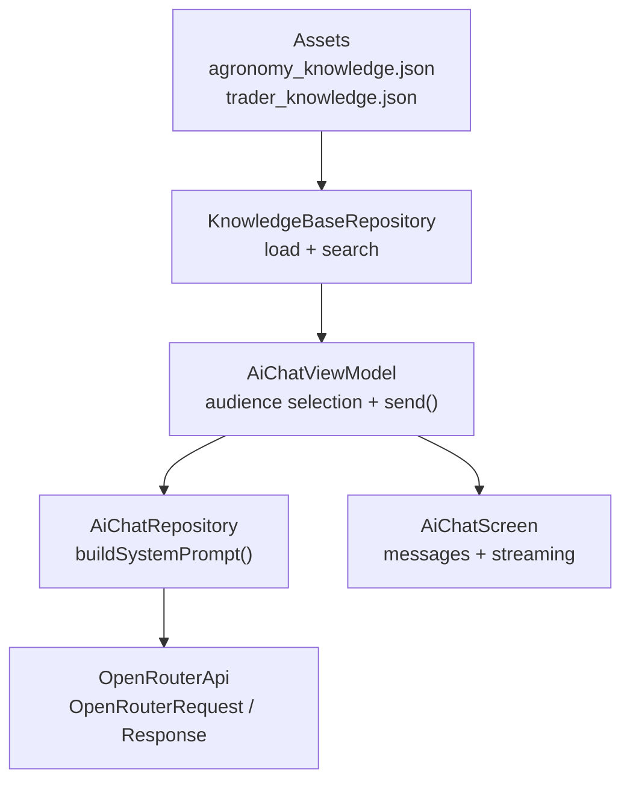
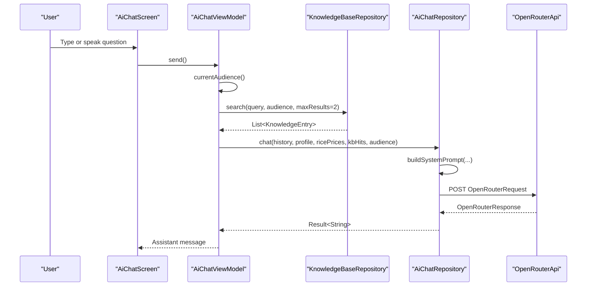
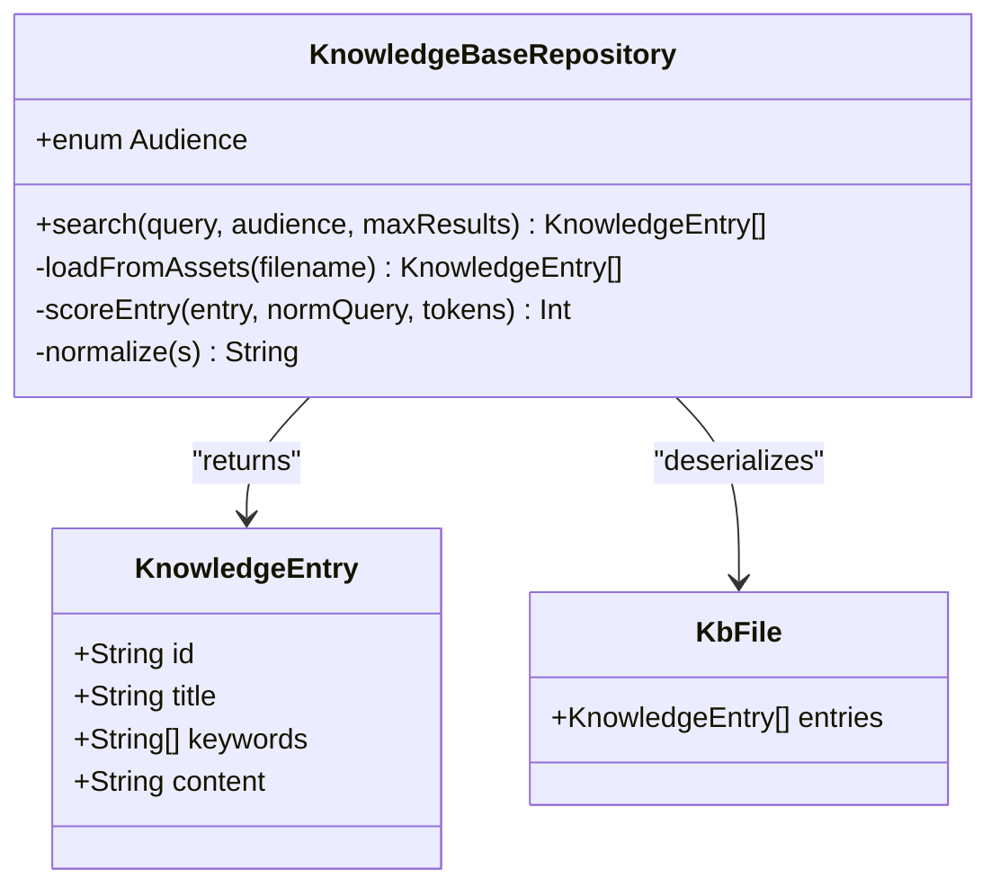
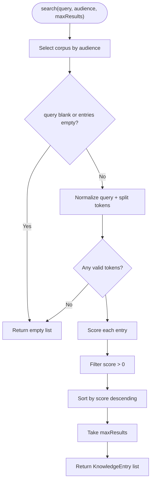
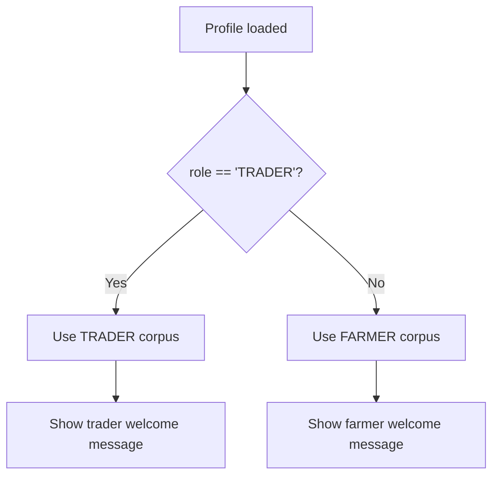
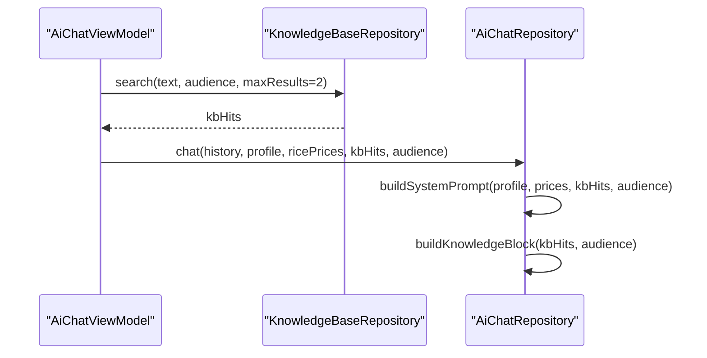
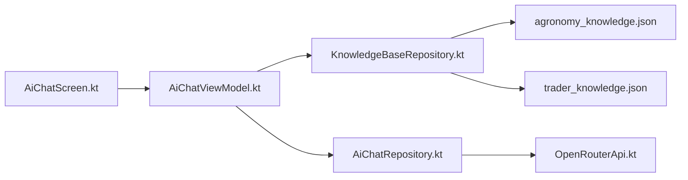

# RAG System & Knowledge Base

<cite>
**Referenced Files in This Document**
- [agronomy_knowledge.json](file://app/src/main/assets/agronomy_knowledge.json)
- [trader_knowledge.json](file://app/src/main/assets/trader_knowledge.json)
- [KnowledgeBaseRepository.kt](file://app/src/main/java/com/giathinh/canlua/repository/KnowledgeBaseRepository.kt)
- [AiChatViewModel.kt](file://app/src/main/java/com/giathinh/canlua/ui/viewmodel/AiChatViewModel.kt)
- [AiChatRepository.kt](file://app/src/main/java/com/giathinh/canlua/repository/AiChatRepository.kt)
- [OpenRouterApi.kt](file://app/src/main/java/com/giathinh/canlua/data/remote/ai/OpenRouterApi.kt)
- [AiChatScreen.kt](file://app/src/main/java/com/giathinh/canlua/ui/screen/aichat/AiChatScreen.kt)
</cite>

## Table of Contents
1. [Introduction](#introduction)
2. [Project Structure](#project-structure)
3. [Core Components](#core-components)
4. [Architecture Overview](#architecture-overview)
5. [Detailed Component Analysis](#detailed-component-analysis)
6. [Dependency Analysis](#dependency-analysis)
7. [Performance Considerations](#performance-considerations)
8. [Troubleshooting Guide](#troubleshooting-guide)
9. [Conclusion](#conclusion)

## Introduction
This document explains the Retrieval-Augmented Generation (RAG) system that powers context-aware AI responses in the app. The system combines four local or session-scoped data sources into a single system prompt before calling OpenRouter:

1. User profile and role.
2. Current rice price data.
3. Audience-filtered knowledge base entries.
4. Conversation history.

The knowledge base is split by audience:
- **FARMER**: agronomy, pest control, fertilizer schedules, harvest timing, flood recovery, etc.
- **TRADER**: purchase prices, moisture testing, impurity standards, storage, logistics, negotiation, export varieties, margins, and low-quality grain signs.

The goal is to keep AI answers grounded in trusted local knowledge while still allowing natural Vietnamese conversation for farmers and traders in the Mekong Delta.

## Project Structure
The RAG pipeline spans assets, repository, view model, and remote API layers:

**Diagram sources**
- [KnowledgeBaseRepository.kt:21-105](file://app/src/main/java/com/giathinh/canlua/repository/KnowledgeBaseRepository.kt#L21-L105)
- [AiChatViewModel.kt:132-237](file://app/src/main/java/com/giathinh/canlua/ui/viewmodel/AiChatViewModel.kt#L132-L237)
- [AiChatRepository.kt:52-67](file://app/src/main/java/com/giathinh/canlua/repository/AiChatRepository.kt#L52-L67)
- [OpenRouterApi.kt:7-16](file://app/src/main/java/com/giathinh/canlua/data/remote/ai/OpenRouterApi.kt#L7-L16)
- [AiChatScreen.kt:102-205](file://app/src/main/java/com/giathinh/canlua/ui/screen/aichat/AiChatScreen.kt#L102-L205)

**Section sources**
- [KnowledgeBaseRepository.kt:10-19](file://app/src/main/java/com/giathinh/canlua/repository/KnowledgeBaseRepository.kt#L10-L19)
- [AiChatViewModel.kt:132-152](file://app/src/main/java/com/giathinh/canlua/ui/viewmodel/AiChatViewModel.kt#L132-L152)
- [AiChatRepository.kt:27-35](file://app/src/main/java/com/giathinh/canlua/repository/AiChatRepository.kt#L27-L35)

## Core Components
| Component | Responsibility | Key Behavior |
|---|---|---|
| `agronomy_knowledge.json` | Farmer-focused knowledge corpus | Contains `_meta` plus an `entries` array with id, title, keywords, content. |
| `trader_knowledge.json` | Trader-focused knowledge corpus | Contains an `entries` array with id, title, keywords, content. |
| `KnowledgeBaseRepository` | Load JSON from assets and score-match queries | Normalizes Vietnamese text, scores keyword/title matches, returns top entries. |
| `AiChatViewModel` | Orchestrates chat flow and audience selection | Chooses FARMER vs TRADER based on user profile; injects knowledge hits into AI call. |
| `AiChatRepository` | Builds system prompt and calls OpenRouter | Combines profile, prices, knowledge hits, and audience-specific prompt base. |
| `OpenRouterApi` | Request/response models for OpenRouter | Defines `OpenRouterRequest`, `ChatMessage`, and response structure. |
| `AiChatScreen` | Renders messages, input, voice state, presets | Displays assistant markdown and user bubbles; triggers ViewModel actions. |

**Section sources**
- [agronomy_knowledge.json:1-71](file://app/src/main/assets/agronomy_knowledge.json#L1-L71)
- [trader_knowledge.json:1-65](file://app/src/main/assets/trader_knowledge.json#L1-L65)
- [KnowledgeBaseRepository.kt:21-105](file://app/src/main/java/com/giathinh/canlua/repository/KnowledgeBaseRepository.kt#L21-L105)
- [AiChatViewModel.kt:55-65](file://app/src/main/java/com/giathinh/canlua/ui/viewmodel/AiChatViewModel.kt#L55-L65)
- [AiChatRepository.kt:52-67](file://app/src/main/java/com/giathinh/canlua/repository/AiChatRepository.kt#L52-L67)
- [OpenRouterApi.kt:7-16](file://app/src/main/java/com/giathinh/canlua/data/remote/ai/OpenRouterApi.kt#L7-L16)
- [AiChatScreen.kt:102-205](file://app/src/main/java/com/giathinh/canlua/ui/screen/aichat/AiChatScreen.kt#L102-L205)

## Architecture Overview
The RAG flow starts when the user sends a message. The ViewModel selects the correct knowledge corpus, retrieves relevant entries, and passes them to the repository, which builds a structured system prompt and calls OpenRouter.

**Diagram sources**
- [AiChatScreen.kt:191-201](file://app/src/main/java/com/giathinh/canlua/ui/screen/aichat/AiChatScreen.kt#L191-L201)
- [AiChatViewModel.kt:158-237](file://app/src/main/java/com/giathinh/canlua/ui/viewmodel/AiChatViewModel.kt#L158-L237)
- [KnowledgeBaseRepository.kt:59-81](file://app/src/main/java/com/giathinh/canlua/repository/KnowledgeBaseRepository.kt#L59-L81)
- [AiChatRepository.kt:52-67](file://app/src/main/java/com/giathinh/canlua/repository/AiChatRepository.kt#L52-L67)
- [OpenRouterApi.kt:7-16](file://app/src/main/java/com/giathinh/canlua/data/remote/ai/OpenRouterApi.kt#L7-L16)

## Detailed Component Analysis

### Knowledge Base JSON Structure
The knowledge base is stored as static JSON files under `assets`. Each file contains a list of knowledge entries.

#### Farmer Knowledge Corpus
- Root object includes metadata such as version, update date, source, and disclaimer.
- `entries` is an array of objects with:
  - `id`: stable identifier.
  - `title`: human-readable topic title.
  - `keywords`: Vietnamese and romanized terms used for matching.
  - `content`: detailed guidance, often including symptoms, thresholds, chemicals, and timing.

Example entry shape:
- `id`: `"dao_on_co_bong"`
- `title`: disease name
- `keywords`: disease names, synonyms, Latin names, romanized forms
- `content`: prevention, treatment, timing, chemical names, field advice

**Section sources**
- [agronomy_knowledge.json:1-71](file://app/src/main/assets/agronomy_knowledge.json#L1-L71)

#### Trader Knowledge Corpus
- `entries` is an array of trader-focused topics.
- Topics include pricing by season, moisture measurement, impurity standards, storage, barge logistics, negotiation, export codes, margin estimation, and low-quality grain indicators.

Example entry shape:
- `id`: `"trader_moisture_check"`
- `title`: moisture measurement procedure
- `keywords`: moisture, device names, humidity ranges
- `content`: calibration, sampling strategy, acceptable moisture, penalties

**Section sources**
- [trader_knowledge.json:1-65](file://app/src/main/assets/trader_knowledge.json#L1-L65)

### Knowledge Base Loading and Data Model
`KnowledgeBaseRepository` loads each corpus lazily from Android assets using UTF-8 text and Gson. If the asset is missing or malformed, it falls back to an empty list so the AI can still run without crashing.

Key responsibilities:
- Define `Audience.FARMER` and `Audience.TRADER`.
- Define `KnowledgeEntry` with `id`, `title`, `keywords`, `content`.
- Deserialize `KbFile` containing `entries`.
- Cache farmer and trader lists via `lazy`.
- Provide `search(query, audience, maxResults)` returning the most relevant entries.

**Diagram sources**
- [KnowledgeBaseRepository.kt:21-53](file://app/src/main/java/com/giathinh/canlua/repository/KnowledgeBaseRepository.kt#L21-L53)
- [KnowledgeBaseRepository.kt:27-36](file://app/src/main/java/com/giathinh/canlua/repository/KnowledgeBaseRepository.kt#L27-L36)

**Section sources**
- [KnowledgeBaseRepository.kt:21-53](file://app/src/main/java/com/giathinh/canlua/repository/KnowledgeBaseRepository.kt#L21-L53)

### Search Algorithm
The search algorithm is a lightweight keyword-based matcher designed for small-to-medium corpora (~10–30 topics per corpus). It does not use embeddings.

Algorithm steps:
1. Normalize the query to lowercase and remove Vietnamese diacritics.
2. Split into tokens of length at least 2.
3. For each knowledge entry:
   - Score full keyword matches against the normalized query.
   - Score partial token matches between normalized keywords and query tokens.
   - Add a small bonus if any query token appears in the normalized title.
4. Filter out zero-score entries.
5. Sort descending by score.
6. Return the top `maxResults` entries.

**Diagram sources**
- [KnowledgeBaseRepository.kt:59-94](file://app/src/main/java/com/giathinh/canlua/repository/KnowledgeBaseRepository.kt#L59-L94)

Scoring highlights:
- Full keyword match against normalized query: higher weight.
- Token overlap between normalized keyword and query tokens: medium weight.
- Title token overlap: small bonus.
- Diacritic removal improves recall for unaccented Vietnamese typing.

Complexity:
- Time complexity is approximately O(E × K), where E is the number of entries and K is the number of keywords per entry.
- Space complexity is proportional to the number of entries and tokens created during normalization.

**Section sources**
- [KnowledgeBaseRepository.kt:59-104](file://app/src/main/java/com/giathinh/canlua/repository/KnowledgeBaseRepository.kt#L59-L104)

### Audience-Based Filtering System
The app supports three roles: FARMER, TRADER, and GUEST. For RAG purposes, the audience determines which knowledge corpus is used:

- If the profile role equals `TRADER` (case-insensitive), the system uses `trader_knowledge.json`.
- Otherwise, it defaults to `agronomy_knowledge.json` for FARMER.

The audience is determined in two places:
1. Initial welcome message generation.
2. Each chat request.

**Diagram sources**
- [AiChatViewModel.kt:132-152](file://app/src/main/java/com/giathinh/canlua/ui/viewmodel/AiChatViewModel.kt#L132-L152)

**Section sources**
- [AiChatViewModel.kt:132-152](file://app/src/main/java/com/giathinh/canlua/ui/viewmodel/AiChatViewModel.kt#L132-L152)

### Injecting Retrieved Knowledge into AI Prompts
When the user sends a message, the ViewModel:
1. Validates guest mode, premium quota, and rate limiting.
2. Adds the user message to the conversation history.
3. Determines the current audience.
4. Calls `knowledgeBase.search()` with the query, audience, and `maxResults = 2`.
5. Passes the retrieved knowledge hits to `AiChatRepository.chat()`.

`AiChatRepository` then builds a system prompt composed of:
- Audience-specific prompt base.
- Conversation context header.
- Optional user profile block.
- Optional rice price block.
- Optional knowledge block built from retrieved entries.

**Diagram sources**
- [AiChatViewModel.kt:206-220](file://app/src/main/java/com/giathinh/canlua/ui/viewmodel/AiChatViewModel.kt#L206-L220)
- [AiChatRepository.kt:209-225](file://app/src/main/java/com/giathinh/canlua/repository/AiChatRepository.kt#L209-L225)
- [AiChatRepository.kt:271-286](file://app/src/main/java/com/giathinh/canlua/repository/AiChatRepository.kt#L271-L286)

The knowledge block formats each hit as:
- A numbered reference.
- The entry title.
- The entry content.

This gives the LLM explicit, citable context rather than relying only on its training data.

**Section sources**
- [AiChatViewModel.kt:158-237](file://app/src/main/java/com/giathinh/canlua/ui/viewmodel/AiChatViewModel.kt#L158-L237)
- [AiChatRepository.kt:209-286](file://app/src/main/java/com/giathinh/canlua/repository/AiChatRepository.kt#L209-L286)

### Example Knowledge Entry Formats
Below are conceptual examples derived from the actual JSON structure. Do not copy these verbatim; they illustrate the expected schema.

#### Farmer Entry Example
- `id`: `"pest_or_blast"`
- `title`: `"Blast disease symptoms and treatment"`
- `keywords`: `["blast", "đạo ôn", "cổ bông", "magnaporthe", "blast disease"]`
- `content`: `"Symptoms appear during flowering under humid conditions. Prevention includes balanced NPK and timely fungicide application before heading."`

#### Trader Entry Example
- `id`: `"moisture_penalty"`
- `title`: `"Moisture penalty and export standard"`
- `keywords`: `["moisture", "ẩm lúa", "export", "tiêu chuẩn xuất khẩu", "penalty"]`
- `content`: `"Export-standard rice should be below 14% moisture. Each percentage point above standard may incur a price deduction."`

These examples follow the same fields used by `KnowledgeEntry` and the deserialized `entries` arrays in both JSON files.

**Section sources**
- [KnowledgeBaseRepository.kt:27-36](file://app/src/main/java/com/giathinh/canlua/repository/KnowledgeBaseRepository.kt#L27-L36)
- [agronomy_knowledge.json:8-68](file://app/src/main/assets/agronomy_knowledge.json#L8-L68)
- [trader_knowledge.json:2-63](file://app/src/main/assets/trader_knowledge.json#L2-L63)

### Search Query Patterns
Because the matcher normalizes Vietnamese text and removes diacritics, effective queries can be written in either form:

- Natural Vietnamese: `"cách trị đạo ôn cổ bông"`
- Romanized: `"cach tri dao on co bong"`
- Mixed or partial: `"đạo ôn", "blast", "fungicide before heading"`
- Trader-focused: `"độ ẩm lúa tiêu chuẩn xuất khẩu"`
- Logistics-focused: `"vận chuyển sà lan ĐBSCL"`

Recommended patterns:
- Include one strong domain keyword from the entry’s `keywords`.
- Add a symptom, product name, or process term when asking about treatment or procedure.
- Keep queries concise; the algorithm splits by whitespace and ignores very short tokens.

**Section sources**
- [KnowledgeBaseRepository.kt:69-94](file://app/src/main/java/com/giathinh/canlua/repository/KnowledgeBaseRepository.kt#L69-L94)

## Dependency Analysis
The RAG system has clear layering:

**Diagram sources**
- [AiChatScreen.kt:102-205](file://app/src/main/java/com/giathinh/canlua/ui/screen/aichat/AiChatScreen.kt#L102-L205)
- [AiChatViewModel.kt:55-65](file://app/src/main/java/com/giathinh/canlua/ui/viewmodel/AiChatViewModel.kt#L55-L65)
- [KnowledgeBaseRepository.kt:21-53](file://app/src/main/java/com/giathinh/canlua/repository/KnowledgeBaseRepository.kt#L21-L53)
- [AiChatRepository.kt:52-67](file://app/src/main/java/com/giathinh/canlua/repository/AiChatRepository.kt#L52-L67)
- [OpenRouterApi.kt:7-16](file://app/src/main/java/com/giathinh/canlua/data/remote/ai/OpenRouterApi.kt#L7-L16)

Coupling and cohesion:
- `KnowledgeBaseRepository` is cohesive around loading and scoring knowledge entries.
- `AiChatViewModel` coordinates UI state, audience selection, and RAG retrieval.
- `AiChatRepository` owns prompt construction and network behavior.
- `OpenRouterApi` is a thin model layer for the remote API contract.

Potential circular dependencies:
- None observed among the RAG components.
- Dependencies flow downward from UI → ViewModel → Repository → API/Assets.

External integration points:
- Android `Context.assets` for reading JSON.
- Gson for JSON deserialization.
- OpenRouter HTTP endpoint for chat completion.

**Section sources**
- [KnowledgeBaseRepository.kt:45-53](file://app/src/main/java/com/giathinh/canlua/repository/KnowledgeBaseRepository.kt#L45-L53)
- [AiChatRepository.kt:99-169](file://app/src/main/java/com/giathinh/canlua/repository/AiChatRepository.kt#L99-L169)
- [OpenRouterApi.kt:7-16](file://app/src/main/java/com/giathinh/canlua/data/remote/ai/OpenRouterApi.kt#L7-L16)

## Performance Considerations
Current design is optimized for small corpora:

- Asset loading is lazy and cached per corpus.
- Search runs locally on the main coroutine scope path but operates over small lists.
- Only the top two knowledge hits are injected into the prompt.
- Prompt size is managed by limiting knowledge hits and trimming long AI outputs.

Recommendations for large knowledge bases:
1. **Precompute normalized indexes**: Store lowercase, diacritic-free versions of titles and keywords to avoid repeated normalization.
2. **Add inverted indexes**: Map normalized tokens to entry IDs for faster candidate retrieval.
3. **Introduce embedding-based retrieval**: Replace or augment keyword scoring with vector similarity when entries exceed ~100 per corpus.
4. **Cache search results**: Cache recent query-to-hits mappings keyed by normalized query and audience.
5. **Limit prompt injection**: Keep `maxResults` small and truncate long knowledge content before building the system prompt.
6. **Background load**: Preload knowledge corpora during app startup if frequent AI usage is expected.
7. **Monitor token budget**: Track combined length of profile, prices, knowledge block, and history to avoid exceeding model limits.

[No sources needed since this section provides general guidance]

## Troubleshooting Guide
Common issues and their likely causes:

| Symptom | Likely Cause | Resolution |
|---|---|---|
| No knowledge context appears in AI replies | Missing or malformed knowledge JSON | Check that `agronomy_knowledge.json` or `trader_knowledge.json` exists and contains a valid `entries` array. |
| AI ignores Vietnamese queries without diacritics | Keywords lack romanized variants | Add romanized keywords to entries for better recall. |
| Wrong audience corpus is used | Profile role is not `TRADER` | Ensure the user profile role is set correctly. |
| Guest users cannot chat | Guest mode blocks AI requests | Log in or disable guest mode. |
| Rate limit countdown appears | Too many messages within 60 seconds | Wait for cooldown or reduce rapid sending. |
| AI returns error messages | Network timeout, HTTP error, or invalid API key | Check network connectivity, OpenRouter status, and API key configuration. |
| Long AI replies are cut off | Output exceeds maximum content length | Ask shorter questions or accept truncated output. |

**Section sources**
- [KnowledgeBaseRepository.kt:45-53](file://app/src/main/java/com/giathinh/canlua/repository/KnowledgeBaseRepository.kt#L45-L53)
- [AiChatViewModel.kt:158-193](file://app/src/main/java/com/giathinh/canlua/ui/viewmodel/AiChatViewModel.kt#L158-L193)
- [AiChatRepository.kt:99-169](file://app/src/main/java/com/giathinh/canlua/repository/AiChatRepository.kt#L99-L169)
- [AiChatRepository.kt:345-361](file://app/src/main/java/com/giathinh/canlua/repository/AiChatRepository.kt#L345-L361)

## Conclusion
The RAG system in this app is intentionally simple and offline-first:
- Knowledge is stored as structured JSON.
- Matching is keyword-based with Vietnamese normalization.
- Audience filtering ensures farmers receive agronomy context and traders receive market context.
- Retrieved knowledge is injected into a carefully constructed system prompt before calling OpenRouter.

For small-to-medium knowledge bases, this approach is fast, predictable, and easy to maintain. As the corpus grows, adding indexing, caching, and embedding-based retrieval will improve relevance and scalability while preserving the same user-facing workflow.

[No sources needed since this section summarizes without analyzing specific files]