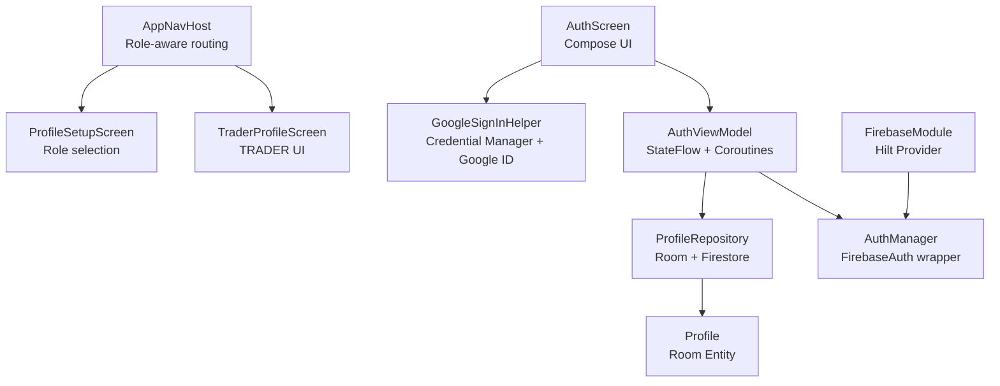
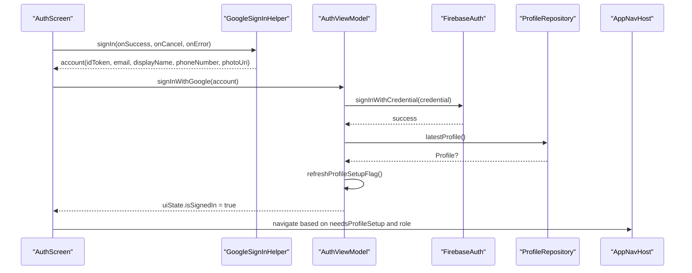
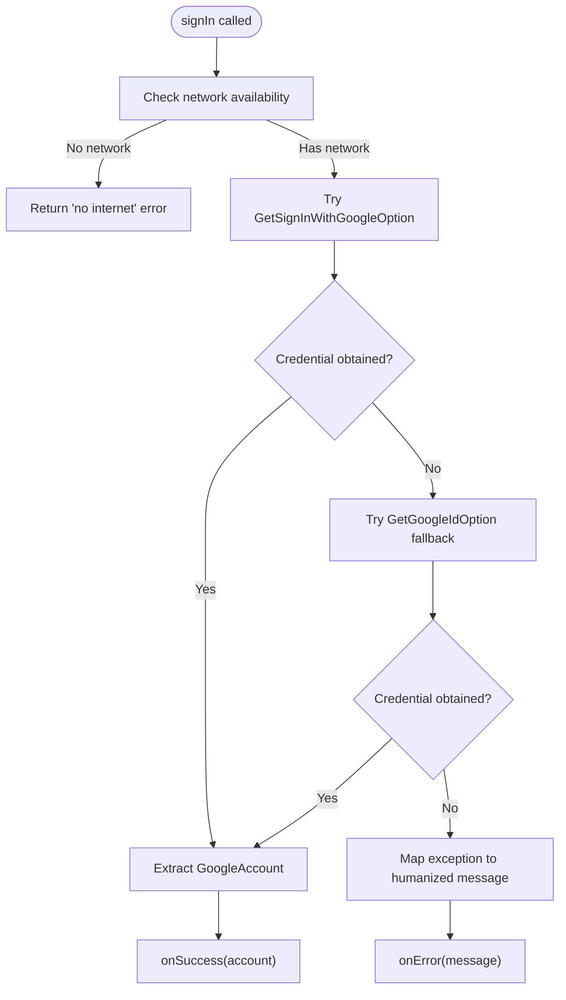
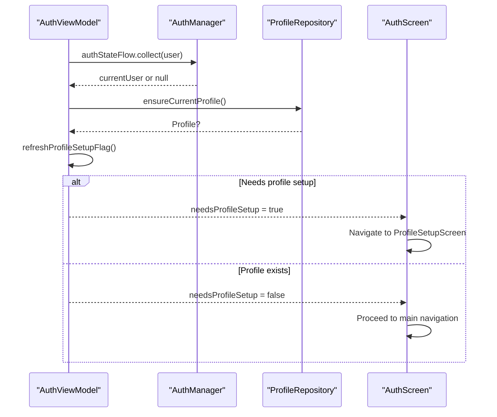
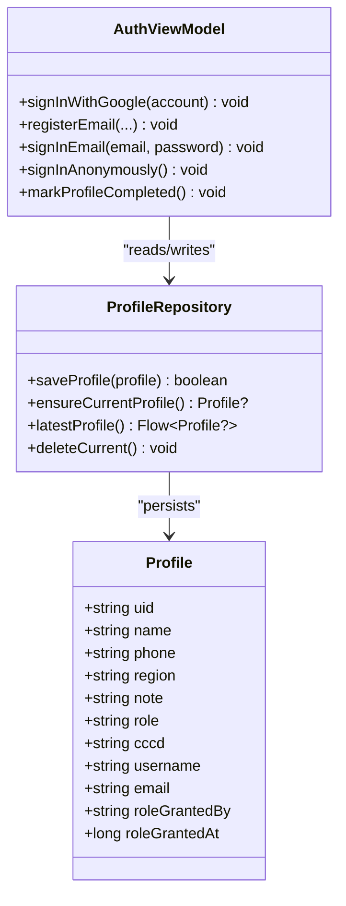
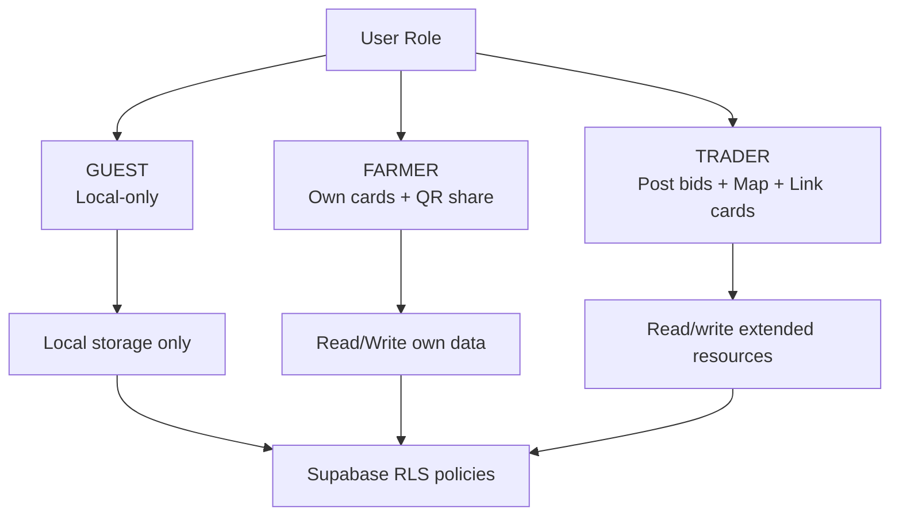
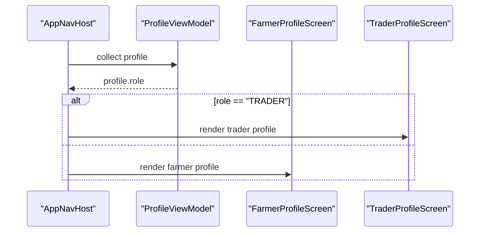
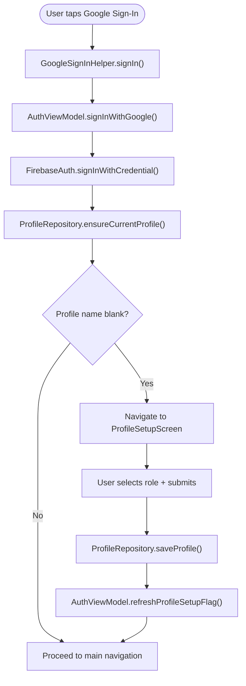
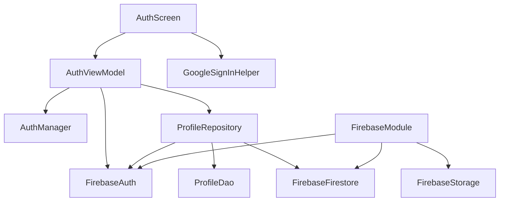

# Authentication & User Management

<cite>
**Referenced Files in This Document**   
- [GoogleSignInHelper.kt](file://app/src/main/java/com/giathinh/canlua/auth/GoogleSignInHelper.kt)
- [AuthManager.kt](file://app/src/main/java/com/giathinh/canlua/repository/AuthManager.kt)
- [FirebaseModule.kt](file://app/src/main/java/com/giathinh/canlua/di/FirebaseModule.kt)
- [AuthViewModel.kt](file://app/src/main/java/com/giathinh/canlua/ui/viewmodel/AuthViewModel.kt)
- [AuthScreen.kt](file://app/src/main/java/com/giathinh/canlua/ui/screen/AuthScreen.kt)
- [ProfileRepository.kt](file://app/src/main/java/com/giathinh/canlua/repository/ProfileRepository.kt)
- [Profile.kt](file://app/src/main/java/com/giathinh/canlua/data/model/Profile.kt)
- [AppNavHost.kt](file://app/src/main/java/com/giathinh/canlua/ui/navigation/AppNavHost.kt)
- [BottomNavItem.kt](file://app/src/main/java/com/giathinh/canlua/ui/navigation/BottomNavItem.kt)
- [TraderProfileScreen.kt](file://app/src/main/java/com/giathinh/canlua/ui/screen/trader/TraderProfileScreen.kt)
- [ProfileSetupScreen.kt](file://app/src/main/java/com/giathinh/canlua/ui/screen/ProfileSetupScreen.kt)
- [auth_security_rules.md](file://docs/specs/auth_security_rules.md)
</cite>

## Table of Contents
1. [Introduction](#introduction)
2. [Project Structure](#project-structure)
3. [Core Components](#core-components)
4. [Architecture Overview](#architecture-overview)
5. [Detailed Component Analysis](#detailed-component-analysis)
6. [Dependency Analysis](#dependency-analysis)
7. [Performance Considerations](#performance-considerations)
8. [Troubleshooting Guide](#troubleshooting-guide)
9. [Conclusion](#conclusion)

## Introduction
This document explains Cân Lúa Mobile’s authentication and user management system. It covers Google Sign-In integration through Firebase Authentication, the three-role authorization matrix (FARMER, TRADER, GUEST), role-based access control, the Profile entity structure, role granting mechanisms, and permission enforcement at both local and cloud levels. It also documents the end-to-end authentication flow from sign-in to role assignment, including admin-granted TRADER roles and role upgrade requests, with practical examples of role-specific UI rendering and repository-level permission checks.

The app follows Kotlin 2.3 / Jetpack Compose offline-first architecture using MVVM and unidirectional data flow via StateFlow and coroutines. Local persistence uses AndroidX Room, while cloud sync is bidirectional to Firebase Firestore and Supabase. The application must remain fully functional without network connectivity.

## Project Structure
Authentication and user management span several layers:

- Presentation layer: Compose screens (`AuthScreen`, `ProfileSetupScreen`) and navigation routing (`AppNavHost`, `BottomNavItem`).
- ViewModels: `AuthViewModel` orchestrates auth state, profile setup, and telemetry.
- Repository layer: `AuthManager` wraps Firebase Authentication; `ProfileRepository` manages local and remote profiles.
- Data model: `Profile` defines the user profile schema, including role and audit fields for admin grants.
- Dependency injection: `FirebaseModule` provides Firebase services.
- Security specification: `auth_security_rules.md` defines the authorization matrix and security rules.

**Diagram sources**
- [AuthScreen.kt:114-335](file://app/src/main/java/com/giathinh/canlua/ui/screen/AuthScreen.kt#L114-L335)
- [AuthViewModel.kt:39-94](file://app/src/main/java/com/giathinh/canlua/ui/viewmodel/AuthViewModel.kt#L39-L94)
- [AuthManager.kt:12-35](file://app/src/main/java/com/giathinh/canlua/repository/AuthManager.kt#L12-L35)
- [ProfileRepository.kt:20-48](file://app/src/main/java/com/giathinh/canlua/repository/ProfileRepository.kt#L20-L48)
- [GoogleSignInHelper.kt:39-100](file://app/src/main/java/com/giathinh/canlua/auth/GoogleSignInHelper.kt#L39-L100)
- [AppNavHost.kt:139-150](file://app/src/main/java/com/giathinh/canlua/ui/navigation/AppNavHost.kt#L139-L150)
- [ProfileSetupScreen.kt:36-44](file://app/src/main/java/com/giathinh/canlua/ui/screen/ProfileSetupScreen.kt#L36-L44)
- [Profile.kt:13-26](file://app/src/main/java/com/giathinh/canlua/data/model/Profile.kt#L13-L26)
- [FirebaseModule.kt:12-33](file://app/src/main/java/com/giathinh/canlua/di/FirebaseModule.kt#L12-L33)

**Section sources**
- [AuthScreen.kt:114-335](file://app/src/main/java/com/giathinh/canlua/ui/screen/AuthScreen.kt#L114-L335)
- [AuthViewModel.kt:39-94](file://app/src/main/java/com/giathinh/canlua/ui/viewmodel/AuthViewModel.kt#L39-L94)
- [AuthManager.kt:12-35](file://app/src/main/java/com/giathinh/canlua/repository/AuthManager.kt#L12-L35)
- [ProfileRepository.kt:20-48](file://app/src/main/java/com/giathinh/canlua/repository/ProfileRepository.kt#L20-L48)
- [GoogleSignInHelper.kt:39-100](file://app/src/main/java/com/giathinh/canlua/auth/GoogleSignInHelper.kt#L39-L100)
- [AppNavHost.kt:139-150](file://app/src/main/java/com/giathinh/canlua/ui/navigation/AppNavHost.kt#L139-L150)
- [ProfileSetupScreen.kt:36-44](file://app/src/main/java/com/giathinh/canlua/ui/screen/ProfileSetupScreen.kt#L36-L44)
- [Profile.kt:13-26](file://app/src/main/java/com/giathinh/canlua/data/model/Profile.kt#L13-L26)
- [FirebaseModule.kt:12-33](file://app/src/main/java/com/giathinh/canlua/di/FirebaseModule.kt#L12-L33)

## Core Components
- Google Sign-In helper: Uses modern Credential Manager and Google Identity API to obtain an ID token, with fallback flows and robust error handling.
- Auth manager: Wraps FirebaseAuth, exposes current user, authentication state flow, and email/password plus anonymous sign-in methods.
- Auth view model: Coordinates UI state, handles sign-in flows (email, phone OTP, Google, anonymous), pre-fills local profile on first login, and triggers profile setup when needed.
- Profile repository: Persists and streams the current user’s profile keyed by Firebase UID, encrypts sensitive fields, and syncs with Firestore.
- Profile model: Room entity representing user profile with role and audit fields for admin-granted roles.
- Navigation and UI: Role-aware routing and role-specific profile screens.

**Section sources**
- [GoogleSignInHelper.kt:39-100](file://app/src/main/java/com/giathinh/canlua/auth/GoogleSignInHelper.kt#L39-L100)
- [AuthManager.kt:12-35](file://app/src/main/java/com/giathinh/canlua/repository/AuthManager.kt#L12-L35)
- [AuthViewModel.kt:39-94](file://app/src/main/java/com/giathinh/canlua/ui/viewmodel/AuthViewModel.kt#L39-L94)
- [ProfileRepository.kt:20-48](file://app/src/main/java/com/giathinh/canlua/repository/ProfileRepository.kt#L20-L48)
- [Profile.kt:13-26](file://app/src/main/java/com/giathinh/canlua/data/model/Profile.kt#L13-L26)
- [AppNavHost.kt:139-150](file://app/src/main/java/com/giathinh/canlua/ui/navigation/AppNavHost.kt#L139-L150)

## Architecture Overview
The authentication architecture combines a presentation layer (Compose), a view model layer (StateFlow-driven), a repository layer (local and cloud), and Firebase services. Google Sign-In is initiated from the UI, validated by the helper, then passed to the view model which authenticates via Firebase and updates local profile state. Navigation routes are role-aware, showing different profile screens based on the user’s role.

**Diagram sources**
- [AuthScreen.kt:263-276](file://app/src/main/java/com/giathinh/canlua/ui/screen/AuthScreen.kt#L263-L276)
- [GoogleSignInHelper.kt:44-100](file://app/src/main/java/com/giathinh/canlua/auth/GoogleSignInHelper.kt#L44-L100)
- [AuthViewModel.kt:199-229](file://app/src/main/java/com/giathinh/canlua/ui/viewmodel/AuthViewModel.kt#L199-L229)
- [ProfileRepository.kt:90-109](file://app/src/main/java/com/giathinh/canlua/repository/ProfileRepository.kt#L90-L109)
- [AppNavHost.kt:139-150](file://app/src/main/java/com/giathinh/canlua/ui/navigation/AppNavHost.kt#L139-L150)

## Detailed Component Analysis

### Google Sign-In Integration
Google Sign-In uses Credential Manager and Google Identity API. The helper checks network availability before attempting sign-in, tries primary sign-in options, falls back to alternative options if needed, and maps credential exceptions to user-friendly messages. On success, it extracts the ID token and account metadata for the view model to authenticate with Firebase.

Key behaviors:
- Network check prevents misleading errors when offline.
- Primary flow uses GetSignInWithGoogleOption; fallback uses GetGoogleIdOption with authorized accounts disabled.
- Errors are categorized into network issues, developer configuration errors, or generic failures.
- Account extraction returns idToken, email, display name, phone number, and photo URI.

**Diagram sources**
- [GoogleSignInHelper.kt:44-100](file://app/src/main/java/com/giathinh/canlua/auth/GoogleSignInHelper.kt#L44-L100)
- [GoogleSignInHelper.kt:102-145](file://app/src/main/java/com/giathinh/canlua/auth/GoogleSignInHelper.kt#L102-L145)
- [GoogleSignInHelper.kt:147-174](file://app/src/main/java/com/giathinh/canlua/auth/GoogleSignInHelper.kt#L147-L174)

**Section sources**
- [GoogleSignInHelper.kt:39-100](file://app/src/main/java/com/giathinh/canlua/auth/GoogleSignInHelper.kt#L39-L100)
- [GoogleSignInHelper.kt:102-174](file://app/src/main/java/com/giathinh/canlua/auth/GoogleSignInHelper.kt#L102-L174)

### Firebase Authentication Wrapper
AuthManager provides a singleton wrapper around FirebaseAuth. It exposes:
- Current user and authenticated state.
- A cold Flow emitting auth state changes, ensuring all ViewModel instances observe the same source of truth.
- Methods for anonymous sign-in, email/password sign-in, and email/password registration.
- Sign-out capability.

This abstraction centralizes Firebase interactions and simplifies testing and reuse across the app.

**Section sources**
- [AuthManager.kt:12-35](file://app/src/main/java/com/giathinh/canlua/repository/AuthManager.kt#L12-L35)
- [AuthManager.kt:37-72](file://app/src/main/java/com/giathinh/canlua/repository/AuthManager.kt#L37-L72)
- [FirebaseModule.kt:12-33](file://app/src/main/java/com/giathinh/canlua/di/FirebaseModule.kt#L12-L33)

### AuthViewModel and Profile Setup Coordination
AuthViewModel manages UI state and orchestrates authentication flows:
- Subscribes to AuthManager.authStateFlow to keep UI synchronized with Firebase state.
- Determines whether profile setup is required by checking the current profile’s name field.
- Handles email sign-in, registration, anonymous sign-in, Google sign-in, and phone OTP flows.
- Pre-fills local profile on first Google sign-in if the name is blank.
- Updates analytics identity after successful sign-in.

Profile setup is triggered when the user is signed in but lacks a complete profile. The UI navigates to ProfileSetupScreen, where users select their role (FARMER or TRADER) and provide required information.

**Diagram sources**
- [AuthViewModel.kt:54-94](file://app/src/main/java/com/giathinh/canlua/ui/viewmodel/AuthViewModel.kt#L54-L94)
- [AuthScreen.kt:129-137](file://app/src/main/java/com/giathinh/canlua/ui/screen/AuthScreen.kt#L129-L137)
- [ProfileRepository.kt:50-84](file://app/src/main/java/com/giathinh/canlua/repository/ProfileRepository.kt#L50-L84)

**Section sources**
- [AuthViewModel.kt:39-94](file://app/src/main/java/com/giathinh/canlua/ui/viewmodel/AuthViewModel.kt#L39-L94)
- [AuthViewModel.kt:109-175](file://app/src/main/java/com/giathinh/canlua/ui/viewmodel/AuthViewModel.kt#L109-L175)
- [AuthViewModel.kt:199-229](file://app/src/main/java/com/giathinh/canlua/ui/viewmodel/AuthViewModel.kt#L199-L229)
- [AuthScreen.kt:114-335](file://app/src/main/java/com/giathinh/canlua/ui/screen/AuthScreen.kt#L114-L335)

### Profile Entity and Role Granting Mechanisms
The Profile entity stores user identity and role information:
- uid: Firebase UID key.
- name, phone, region, note: user-provided details.
- role: default "FARMER".
- cccd: encrypted national ID.
- username, email: additional identifiers.
- roleGrantedBy: indicates who granted the role ("self", "admin", "system").
- roleGrantedAt: timestamp of role grant.

Role granting:
- Default role is FARMER for new users.
- Admin-granted TRADER roles are supported via roleGrantedBy and roleGrantedAt fields, preparing for future admin approval workflows.
- ProfileRepository loads and saves profiles keyed by Firebase UID, encrypting sensitive fields and syncing with Firestore.

**Diagram sources**
- [Profile.kt:13-26](file://app/src/main/java/com/giathinh/canlua/data/model/Profile.kt#L13-L26)
- [ProfileRepository.kt:20-48](file://app/src/main/java/com/giathinh/canlua/repository/ProfileRepository.kt#L20-L48)
- [AuthViewModel.kt:199-229](file://app/src/main/java/com/giathinh/canlua/ui/viewmodel/AuthViewModel.kt#L199-L229)

**Section sources**
- [Profile.kt:13-26](file://app/src/main/java/com/giathinh/canlua/data/model/Profile.kt#L13-L26)
- [ProfileRepository.kt:20-48](file://app/src/main/java/com/giathinh/canlua/repository/ProfileRepository.kt#L20-L48)
- [ProfileRepository.kt:50-84](file://app/src/main/java/com/giathinh/canlua/repository/ProfileRepository.kt#L50-L84)

### Authorization Matrix and Role-Based Access Control
The application enforces three roles:
- GUEST: Default guest mode with local-only operations.
- FARMER: Can manage own weighing cards and share QR codes.
- TRADER: Can post buy prices, scan QR to link cards, and view map features.

Permissions are defined per resource:
- Weighing cards: creation, reading, updating, deletion vary by role.
- Market prices: read access is open; write bids are TRADER-only.
- Role upgrades: FARMER can request TRADER role; GUEST cannot; TRADER does not apply.

Local enforcement:
- Guest mode is tracked in settings and reflected in profile stream.
- Sensitive data like CCCD is encrypted locally.
- Multi-user isolation ensures data separation by owner UID.

Cloud enforcement:
- Firestore syncs profiles and other entities.
- Supabase Row-Level Security (RLS) policies restrict access based on auth.uid() and role relationships.

**Diagram sources**
- [auth_security_rules.md:7-52](file://docs/specs/auth_security_rules.md#L7-L52)
- [ProfileRepository.kt:90-109](file://app/src/main/java/com/giathinh/canlua/repository/ProfileRepository.kt#L90-L109)

**Section sources**
- [auth_security_rules.md:7-52](file://docs/specs/auth_security_rules.md#L7-L52)
- [auth_security_rules.md:56-83](file://docs/specs/auth_security_rules.md#L56-L83)
- [auth_security_rules.md:104-125](file://docs/specs/auth_security_rules.md#L104-L125)
- [ProfileRepository.kt:90-109](file://app/src/main/java/com/giathinh/canlua/repository/ProfileRepository.kt#L90-L109)

### Role-Specific UI Rendering and Navigation
Navigation is role-aware:
- AppNavHost includes a RoleAwareProfileWrapper that renders either TraderProfileScreen or FarmerProfileScreen based on profile.role.
- Bottom navigation items differ slightly between roles, with TRADER having a dedicated map tab.
- TraderProfileScreen displays trader-specific stats and operations.

Examples:
- When profile.role equals "TRADER", the app shows the trader profile interface.
- Otherwise, it shows the farmer profile interface.
- Routes like "trader_map" and "trader_profile" are available for TRADER users.

**Diagram sources**
- [AppNavHost.kt:139-150](file://app/src/main/java/com/giathinh/canlua/ui/navigation/AppNavHost.kt#L139-L150)
- [BottomNavItem.kt:52-57](file://app/src/main/java/com/giathinh/canlua/ui/navigation/BottomNavItem.kt#L52-L57)
- [TraderProfileScreen.kt:74-102](file://app/src/main/java/com/giathinh/canlua/ui/screen/trader/TraderProfileScreen.kt#L74-L102)

**Section sources**
- [AppNavHost.kt:139-150](file://app/src/main/java/com/giathinh/canlua/ui/navigation/AppNavHost.kt#L139-L150)
- [BottomNavItem.kt:52-57](file://app/src/main/java/com/giathinh/canlua/ui/navigation/BottomNavItem.kt#L52-L57)
- [TraderProfileScreen.kt:74-102](file://app/src/main/java/com/giathinh/canlua/ui/screen/trader/TraderProfileScreen.kt#L74-L102)

### Authentication Flow from Sign-In to Role Assignment
End-to-end flow:
1. User initiates Google Sign-In from AuthScreen.
2. GoogleSignInHelper obtains ID token and account info.
3. AuthViewModel authenticates with Firebase using the ID token.
4. AuthViewModel checks current profile via ProfileRepository.
5. If profile setup is needed, UI navigates to ProfileSetupScreen.
6. User selects role (FARMER or TRADER) and submits profile.
7. ProfileRepository saves profile locally and syncs to Firestore.
8. AuthViewModel updates analytics identity and UI state.
9. Navigation proceeds to main app or role-specific screens.

**Diagram sources**
- [AuthScreen.kt:263-276](file://app/src/main/java/com/giathinh/canlua/ui/screen/AuthScreen.kt#L263-L276)
- [GoogleSignInHelper.kt:44-100](file://app/src/main/java/com/giathinh/canlua/auth/GoogleSignInHelper.kt#L44-L100)
- [AuthViewModel.kt:199-229](file://app/src/main/java/com/giathinh/canlua/ui/viewmodel/AuthViewModel.kt#L199-L229)
- [ProfileRepository.kt:50-84](file://app/src/main/java/com/giathinh/canlua/repository/ProfileRepository.kt#L50-L84)
- [ProfileSetupScreen.kt:182-204](file://app/src/main/java/com/giathinh/canlua/ui/screen/ProfileSetupScreen.kt#L182-L204)

**Section sources**
- [AuthScreen.kt:263-276](file://app/src/main/java/com/giathinh/canlua/ui/screen/AuthScreen.kt#L263-L276)
- [AuthViewModel.kt:199-229](file://app/src/main/java/com/giathinh/canlua/ui/viewmodel/AuthViewModel.kt#L199-L229)
- [ProfileRepository.kt:50-84](file://app/src/main/java/com/giathinh/canlua/repository/ProfileRepository.kt#L50-L84)
- [ProfileSetupScreen.kt:182-204](file://app/src/main/java/com/giathinh/canlua/ui/screen/ProfileSetupScreen.kt#L182-L204)

### Admin-Granted TRADER Roles and Role Upgrade Requests
Admin-granted TRADER roles are prepared via:
- roleGrantedBy: "admin" indicates admin approval.
- roleGrantedAt: timestamp of grant.
- Future workflow: FARMER users can submit roleRequests to request TRADER role; admin reviews and grants.

Permission enforcement:
- Local: ProfileRepository reads role from local DB or Firestore, decrypts sensitive fields, and streams to UI.
- Cloud: Supabase RLS policies enforce row-level access based on auth.uid() and role relationships.

Practical example:
- If profile.role is "TRADER", the app allows posting market bids and accessing map features.
- If profile.role is "FARMER", the app restricts write access to own cards and disallows bid posting.

**Section sources**
- [Profile.kt:10-25](file://app/src/main/java/com/giathinh/canlua/data/model/Profile.kt#L10-L25)
- [ProfileRepository.kt:50-84](file://app/src/main/java/com/giathinh/canlua/repository/ProfileRepository.kt#L50-L84)
- [auth_security_rules.md:47-52](file://docs/specs/auth_security_rules.md#L47-L52)
- [auth_security_rules.md:104-125](file://docs/specs/auth_security_rules.md#L104-L125)

## Dependency Analysis
The authentication and user management components have clear dependencies:
- AuthScreen depends on AuthViewModel and GoogleSignInHelper.
- AuthViewModel depends on AuthManager, FirebaseAuth, and ProfileRepository.
- ProfileRepository depends on ProfileDao, FirebaseAuth, FirebaseFirestore, and CccdCrypto.
- FirebaseModule provides FirebaseAuth, FirebaseFirestore, and FirebaseStorage.

**Diagram sources**
- [AuthScreen.kt:114-335](file://app/src/main/java/com/giathinh/canlua/ui/screen/AuthScreen.kt#L114-L335)
- [AuthViewModel.kt:39-94](file://app/src/main/java/com/giathinh/canlua/ui/viewmodel/AuthViewModel.kt#L39-L94)
- [ProfileRepository.kt:20-48](file://app/src/main/java/com/giathinh/canlua/repository/ProfileRepository.kt#L20-L48)
- [FirebaseModule.kt:12-33](file://app/src/main/java/com/giathinh/canlua/di/FirebaseModule.kt#L12-L33)

**Section sources**
- [AuthScreen.kt:114-335](file://app/src/main/java/com/giathinh/canlua/ui/screen/AuthScreen.kt#L114-L335)
- [AuthViewModel.kt:39-94](file://app/src/main/java/com/giathinh/canlua/ui/viewmodel/AuthViewModel.kt#L39-L94)
- [ProfileRepository.kt:20-48](file://app/src/main/java/com/giathinh/canlua/repository/ProfileRepository.kt#L20-L48)
- [FirebaseModule.kt:12-33](file://app/src/main/java/com/giathinh/canlua/di/FirebaseModule.kt#L12-L33)

## Performance Considerations
- Auth state flow ensures a single source of truth, reducing redundant re-renders across multiple ViewModel instances.
- ProfileRepository streams profile data reactive to auth state changes, avoiding unnecessary database queries.
- Google Sign-In helper performs network checks upfront to prevent unnecessary API calls and improve UX.
- Offline-first design ensures app functionality without network, with background sync to Firestore and Supabase.

[No sources needed since this section provides general guidance]

## Troubleshooting Guide
Common authentication issues and resolutions:
- No network during Google Sign-In: Helper returns a specific error message; ensure device has internet connectivity.
- Invalid ID token: Parsing exceptions are handled; verify Google client configuration.
- Email/password errors: AuthViewModel maps Firebase exceptions to user-friendly messages (e.g., incorrect credentials, malformed email).
- Profile setup not triggering: Ensure profile.name is blank for first-time setup; check ProfileRepository.ensureCurrentProfile logic.
- Role not updating: Verify roleGrantedBy and roleGrantedAt fields; confirm Firestore sync and local encryption/decryption.

**Section sources**
- [GoogleSignInHelper.kt:163-174](file://app/src/main/java/com/giathinh/canlua/auth/GoogleSignInHelper.kt#L163-L174)
- [AuthViewModel.kt:109-175](file://app/src/main/java/com/giathinh/canlua/ui/viewmodel/AuthViewModel.kt#L109-L175)
- [ProfileRepository.kt:50-84](file://app/src/main/java/com/giathinh/canlua/repository/ProfileRepository.kt#L50-L84)

## Conclusion
Cân Lúa Mobile’s authentication and user management system integrates Google Sign-In with Firebase Authentication, supports three roles (FARMER, TRADER, GUEST), and enforces permissions at both local and cloud levels. The Profile entity captures user identity and role information, with support for admin-granted roles and future role upgrade workflows. Role-based UI rendering and navigation ensure users see appropriate interfaces based on their role. The system is designed for offline-first operation, with robust error handling and performance optimizations.

[No sources needed since this section summarizes without analyzing specific files]