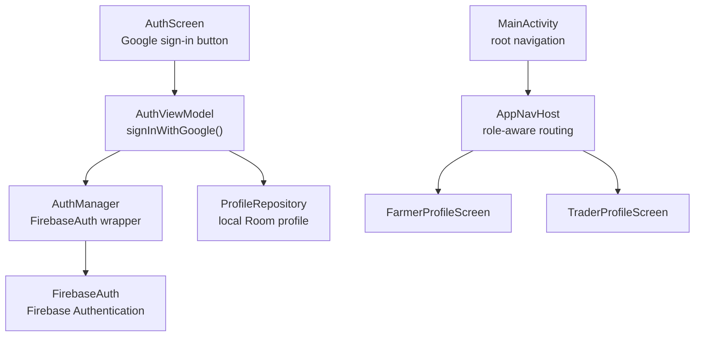
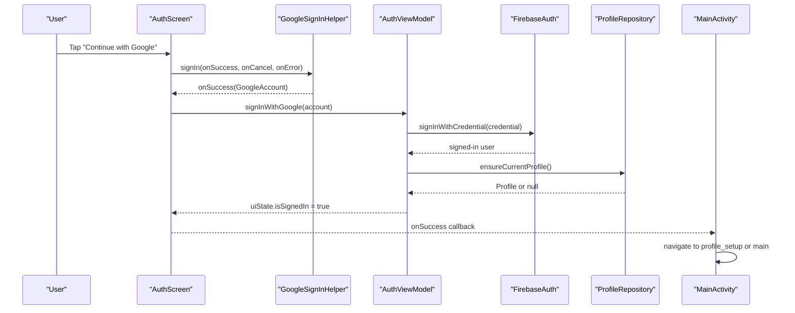
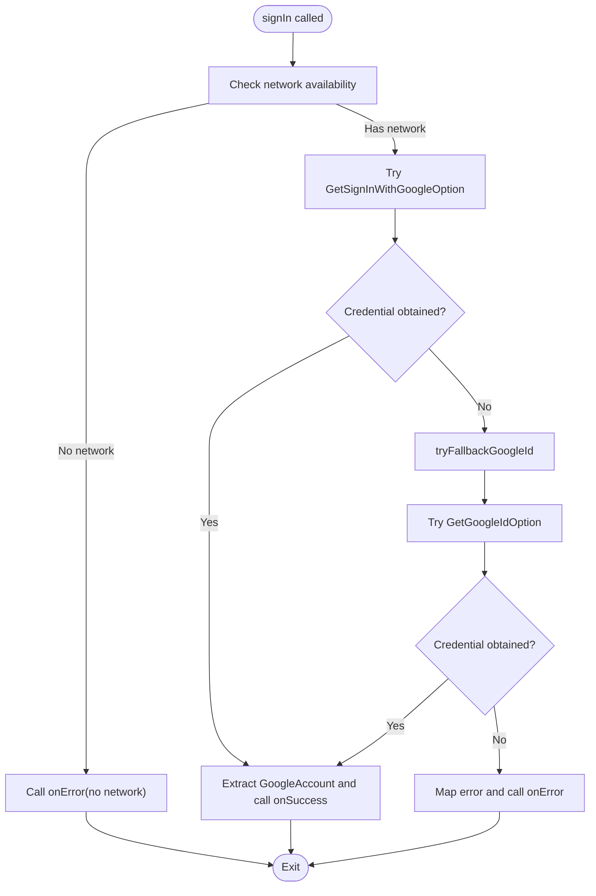
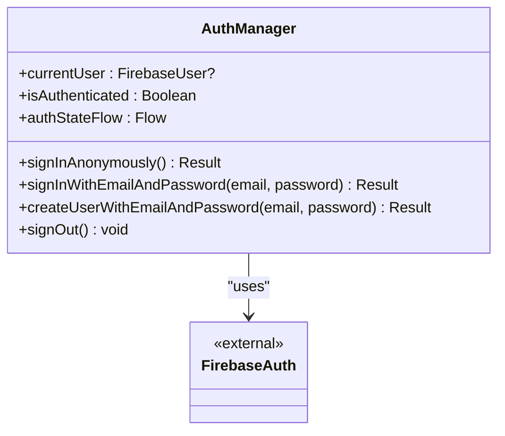
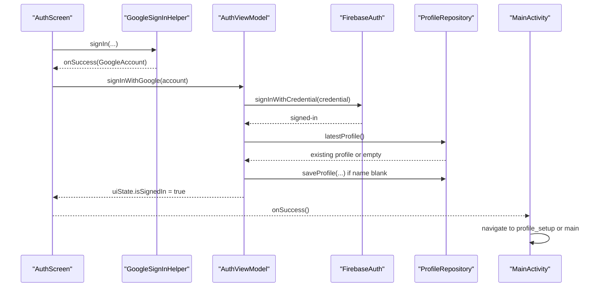
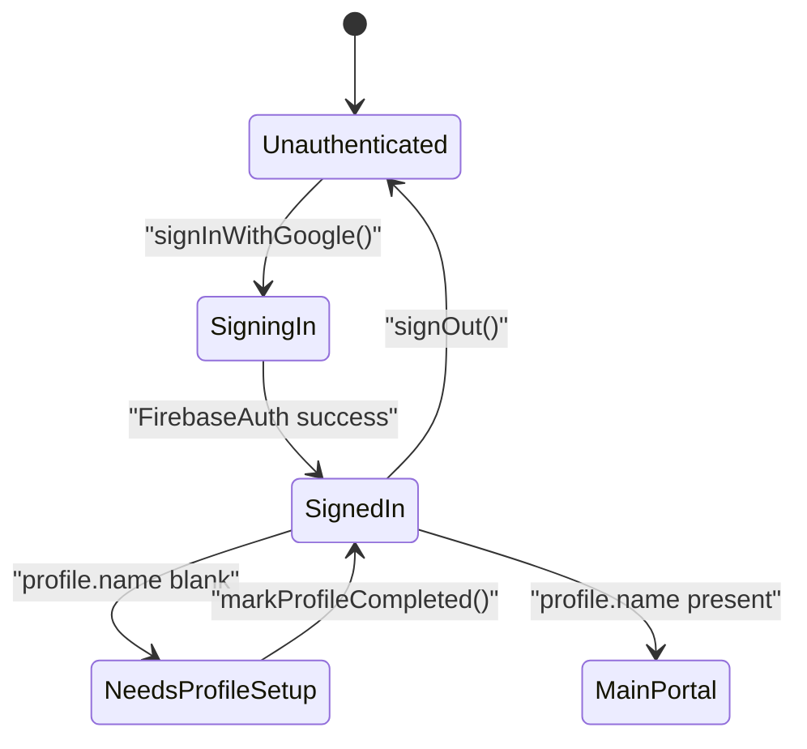
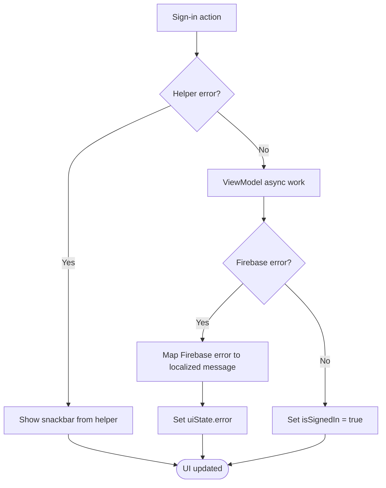
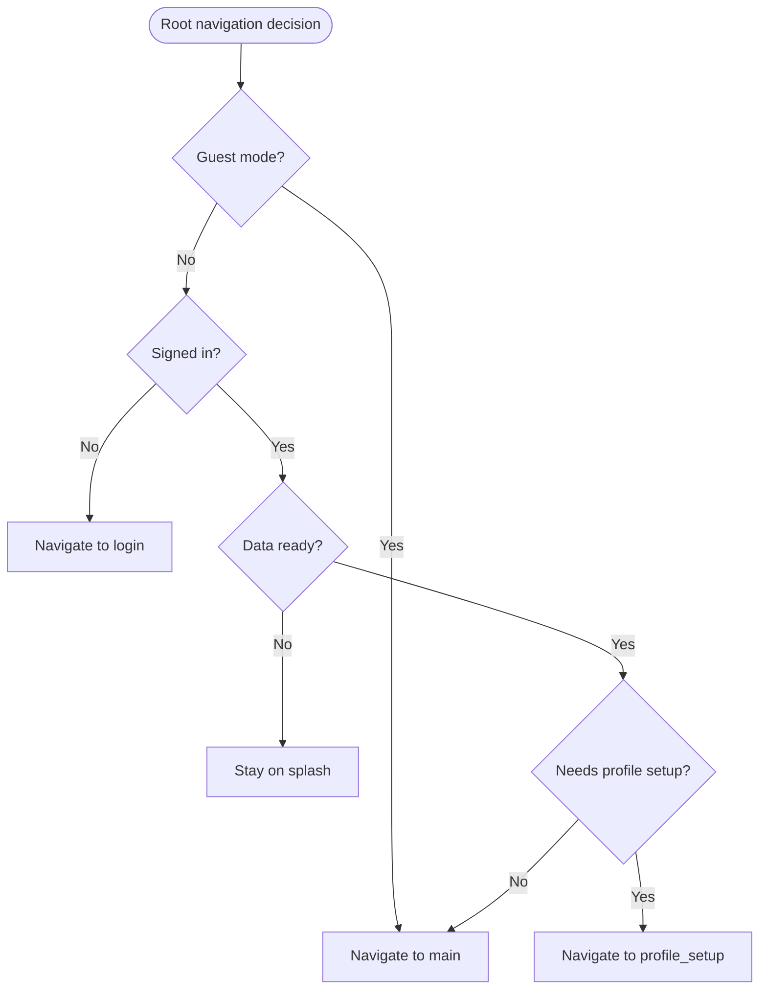
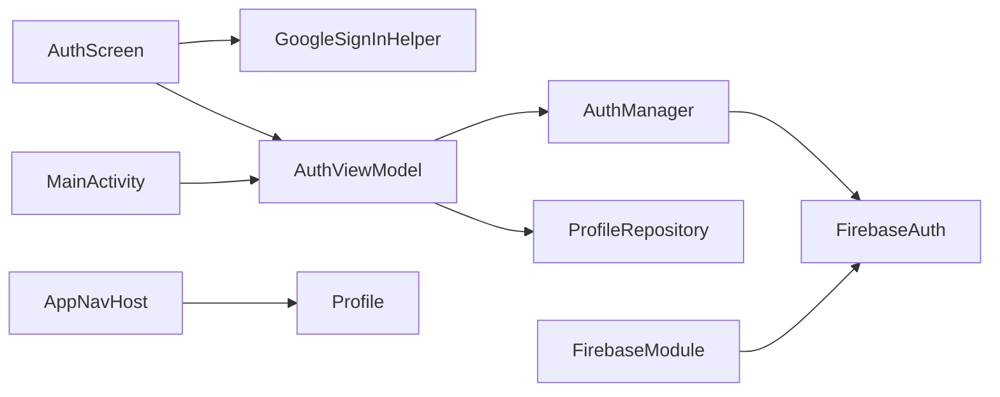

# Google Sign-In Integration

<cite>
**Referenced Files in This Document**
- [GoogleSignInHelper.kt](file://app/src/main/java/com/giathinh/canlua/auth/GoogleSignInHelper.kt)
- [AuthManager.kt](file://app/src/main/java/com/giathinh/canlua/repository/AuthManager.kt)
- [FirebaseModule.kt](file://app/src/main/java/com/giathinh/canlua/di/FirebaseModule.kt)
- [AuthViewModel.kt](file://app/src/main/java/com/giathinh/canlua/ui/viewmodel/AuthViewModel.kt)
- [AuthScreen.kt](file://app/src/main/java/com/giathinh/canlua/ui/screen/AuthScreen.kt)
- [MainActivity.kt](file://app/src/main/java/com/giathinh/canlua/MainActivity.kt)
- [AppNavHost.kt](file://app/src/main/java/com/giathinh/canlua/ui/navigation/AppNavHost.kt)
- [Profile.kt](file://app/src/main/java/com/giathinh/canlua/data/model/Profile.kt)
</cite>

## Table of Contents
1. [Introduction](#introduction)
2. [Project Structure](#project-structure)
3. [Core Components](#core-components)
4. [Architecture Overview](#architecture-overview)
5. [Detailed Component Analysis](#detailed-component-analysis)
6. [Dependency Analysis](#dependency-analysis)
7. [Performance Considerations](#performance-considerations)
8. [Troubleshooting Guide](#troubleshooting-guide)
9. [Conclusion](#conclusion)

## Introduction
This document explains the Google Sign-In integration in Cân Lúa Mobile. It covers how the app obtains a Google ID token, authenticates with Firebase Authentication, manages authentication state, pre-fills the local user profile on first sign-in, and routes authenticated users to role-specific portals. The implementation follows the project’s Kotlin 2.3 / Jetpack Compose MVVM + Clean Architecture style: UI is declarative, business logic lives in ViewModels and repositories, and Firebase is injected via Hilt.

The Google Sign-In path uses AndroidX Credential Manager and Google Identity APIs rather than the legacy `GoogleSignInClient`. After successful sign-in, the app creates or updates a local Room profile, then navigates through a splash → login → profile setup → main flow. Role-aware routing determines whether the user enters the farmer or trader portal.

## Project Structure
The Google Sign-In integration spans several layers:

- **UI layer**: `AuthScreen` renders the Google sign-in button and forwards callbacks to `AuthViewModel`.
- **ViewModel layer**: `AuthViewModel` converts the Google account into a Firebase credential, signs in, and updates UI state.
- **Repository layer**: `AuthManager` wraps `FirebaseAuth`, exposes current user and auth state as a Flow.
- **DI layer**: `FirebaseModule` provides `FirebaseAuth` for injection.
- **Navigation layer**: `MainActivity` decides root route based on auth state; `AppNavHost` routes to role-specific profile screens.
- **Data model**: `Profile` stores the user’s local profile, including role.

**Diagram sources**
- [AuthScreen.kt:263-276](file://app/src/main/java/com/giathinh/canlua/ui/screen/AuthScreen.kt#L263-L276)
- [AuthViewModel.kt:199-229](file://app/src/main/java/com/giathinh/canlua/ui/viewmodel/AuthViewModel.kt#L199-L229)
- [AuthManager.kt:12-35](file://app/src/main/java/com/giathinh/canlua/repository/AuthManager.kt#L12-L35)
- [FirebaseModule.kt:16-20](file://app/src/main/java/com/giathinh/canlua/di/FirebaseModule.kt#L16-L20)
- [MainActivity.kt:89-108](file://app/src/main/java/com/giathinh/canlua/MainActivity.kt#L89-L108)
- [AppNavHost.kt:139-150](file://app/src/main/java/com/giathinh/canlua/ui/navigation/AppNavHost.kt#L139-L150)

**Section sources**
- [AuthScreen.kt:114-335](file://app/src/main/java/com/giathinh/canlua/ui/screen/AuthScreen.kt#L114-L335)
- [AuthViewModel.kt:25-52](file://app/src/main/java/com/giathinh/canlua/ui/viewmodel/AuthViewModel.kt#L25-L52)
- [AuthManager.kt:12-35](file://app/src/main/java/com/giathinh/canlua/repository/AuthManager.kt#L12-L35)
- [FirebaseModule.kt:12-33](file://app/src/main/java/com/giathinh/canlua/di/FirebaseModule.kt#L12-L33)
- [MainActivity.kt:34-108](file://app/src/main/java/com/giathinh/canlua/MainActivity.kt#L34-L108)
- [AppNavHost.kt:27-150](file://app/src/main/java/com/giathinh/canlua/ui/navigation/AppNavHost.kt#L27-L150)
- [Profile.kt:6-26](file://app/src/main/java/com/giathinh/canlua/data/model/Profile.kt#L6-L26)

## Core Components
This section summarizes the responsibilities of each core component involved in Google Sign-In.

| Component | Responsibility | Key Behavior |
|---|---|---|
| `GoogleSignInHelper` | Obtains Google ID token using Credential Manager | Checks network availability, tries modern sign-in option, falls back to Google ID option, extracts `GoogleAccount`, humanizes errors |
| `AuthViewModel` | Orchestrates sign-in and UI state | Converts `GoogleAccount` to Firebase credential, signs in, pre-fills local profile if needed, emits `AuthUiState` |
| `AuthManager` | Wraps Firebase Authentication | Exposes `currentUser`, `isAuthenticated`, `authStateFlow`, anonymous/email/password sign-in methods |
| `FirebaseModule` | Dependency injection | Provides singleton `FirebaseAuth` instance |
| `AuthScreen` | Renders sign-in UI | Shows Google sign-in button, handles success/error/info, calls ViewModel |
| `MainActivity` | Root navigation controller | Decides between splash, login, profile setup, and main screen based on auth state |
| `AppNavHost` | Role-aware routing | Routes to farmer or trader profile screen based on profile role |
| `Profile` | Local user profile model | Stores UID, name, phone, region, role, and related fields |

**Section sources**
- [GoogleSignInHelper.kt:23-199](file://app/src/main/java/com/giathinh/canlua/auth/GoogleSignInHelper.kt#L23-L199)
- [AuthViewModel.kt:25-94](file://app/src/main/java/com/giathinh/canlua/ui/viewmodel/AuthViewModel.kt#L25-L94)
- [AuthManager.kt:12-72](file://app/src/main/java/com/giathinh/canlua/repository/AuthManager.kt#L12-L72)
- [FirebaseModule.kt:12-33](file://app/src/main/java/com/giathinh/canlua/di/FirebaseModule.kt#L12-L33)
- [AuthScreen.kt:114-335](file://app/src/main/java/com/giathinh/canlua/ui/screen/AuthScreen.kt#L114-L335)
- [MainActivity.kt:34-108](file://app/src/main/java/com/giathinh/canlua/MainActivity.kt#L34-L108)
- [AppNavHost.kt:139-150](file://app/src/main/java/com/giathinh/canlua/ui/navigation/AppNavHost.kt#L139-L150)
- [Profile.kt:6-26](file://app/src/main/java/com/giathinh/canlua/data/model/Profile.kt#L6-L26)

## Architecture Overview
The Google Sign-In flow is unidirectional: UI triggers ViewModel actions, ViewModel performs authentication and data operations, and UI observes state changes.

**Diagram sources**
- [AuthScreen.kt:263-276](file://app/src/main/java/com/giathinh/canlua/ui/screen/AuthScreen.kt#L263-L276)
- [GoogleSignInHelper.kt:44-100](file://app/src/main/java/com/giathinh/canlua/auth/GoogleSignInHelper.kt#L44-L100)
- [AuthViewModel.kt:199-229](file://app/src/main/java/com/giathinh/canlua/ui/viewmodel/AuthViewModel.kt#L199-L229)
- [MainActivity.kt:89-108](file://app/src/main/java/com/giathinh/canlua/MainActivity.kt#L89-L108)

## Detailed Component Analysis

### GoogleSignInHelper Implementation
`GoogleSignInHelper` is the bridge between the app and Google Identity. It uses Credential Manager to request a Google ID token and returns a `GoogleAccount` containing the token and optional profile fields.

Key behaviors:
- Network check before invoking the credential picker to avoid misleading error messages.
- Primary flow uses `GetSignInWithGoogleOption`.
- Fallback flow uses `GetGoogleIdOption` with `filterByAuthorizedAccounts = false`.
- Extracts `GoogleIdTokenCredential` and maps it to `GoogleAccount`.
- Humanizes errors by mapping network-related messages to a localized no-network message and developer errors to a developer-error message.
- Provides a helper to save email/password credentials via Credential Manager after successful email/password sign-in.

**Diagram sources**
- [GoogleSignInHelper.kt:44-145](file://app/src/main/java/com/giathinh/canlua/auth/GoogleSignInHelper.kt#L44-L145)
- [GoogleSignInHelper.kt:147-174](file://app/src/main/java/com/giathinh/canlua/auth/GoogleSignInHelper.kt#L147-L174)

**Section sources**
- [GoogleSignInHelper.kt:23-199](file://app/src/main/java/com/giathinh/canlua/auth/GoogleSignInHelper.kt#L23-L199)

### Firebase Authentication Setup
Firebase Authentication is provided as a singleton through Hilt. `AuthManager` wraps `FirebaseAuth` and exposes:
- Current user accessors.
- A cold `authStateFlow` that emits whenever Firebase auth state changes.
- Methods for anonymous, email/password sign-in, and user creation.

**Diagram sources**
- [AuthManager.kt:12-72](file://app/src/main/java/com/giathinh/canlua/repository/AuthManager.kt#L12-L72)
- [FirebaseModule.kt:16-20](file://app/src/main/java/com/giathinh/canlua/di/FirebaseModule.kt#L16-L20)

**Section sources**
- [AuthManager.kt:12-72](file://app/src/main/java/com/giathinh/canlua/repository/AuthManager.kt#L12-L72)
- [FirebaseModule.kt:12-33](file://app/src/main/java/com/giathinh/canlua/di/FirebaseModule.kt#L12-L33)

### Complete Authentication Flow from Sign-In Button to Profile Creation
The end-to-end flow starts at `AuthScreen`, proceeds through `GoogleSignInHelper` and `AuthViewModel`, and ends with navigation decisions in `MainActivity`.

**Diagram sources**
- [AuthScreen.kt:263-276](file://app/src/main/java/com/giathinh/canlua/ui/screen/AuthScreen.kt#L263-L276)
- [AuthViewModel.kt:199-229](file://app/src/main/java/com/giathinh/canlua/ui/viewmodel/AuthViewModel.kt#L199-L229)
- [MainActivity.kt:89-108](file://app/src/main/java/com/giathinh/canlua/MainActivity.kt#L89-L108)

**Section sources**
- [AuthScreen.kt:263-276](file://app/src/main/java/com/giathinh/canlua/ui/screen/AuthScreen.kt#L263-L276)
- [AuthViewModel.kt:199-229](file://app/src/main/java/com/giathinh/canlua/ui/viewmodel/AuthViewModel.kt#L199-L229)
- [MainActivity.kt:89-108](file://app/src/main/java/com/giathinh/canlua/MainActivity.kt#L89-L108)

### Sign-In State Management
Authentication state is centralized in `AuthViewModel.uiState`:
- `isSignedIn`: reflects whether Firebase has a current user.
- `loading`: indicates ongoing sign-in or profile loading.
- `error` and `info`: user-facing messages.
- `userLabel`: displayable identity derived from email, phone, or UID.
- `needsProfileSetup`: indicates whether the user needs to complete profile setup.

`AuthViewModel` subscribes to `AuthManager.authStateFlow`, so all ViewModel instances observe the same source of truth. When the user becomes signed in, it refreshes the profile setup flag and sets analytics identity.

**Diagram sources**
- [AuthViewModel.kt:25-94](file://app/src/main/java/com/giathinh/canlua/ui/viewmodel/AuthViewModel.kt#L25-L94)
- [AuthViewModel.kt:199-229](file://app/src/main/java/com/giathinh/canlua/ui/viewmodel/AuthViewModel.kt#L199-L229)
- [AuthViewModel.kt:302-310](file://app/src/main/java/com/giathinh/canlua/ui/viewmodel/AuthViewModel.kt#L302-L310)

**Section sources**
- [AuthViewModel.kt:25-94](file://app/src/main/java/com/giathinh/canlua/ui/viewmodel/AuthViewModel.kt#L25-L94)
- [AuthViewModel.kt:199-229](file://app/src/main/java/com/giathinh/canlua/ui/viewmodel/AuthViewModel.kt#L199-L229)
- [AuthViewModel.kt:302-310](file://app/src/main/java/com/giathinh/canlua/ui/viewmodel/AuthViewModel.kt#L302-L310)

### Error Handling Strategies
Error handling occurs at multiple layers:

- **GoogleSignInHelper**:
  - Detects missing network and returns a localized no-network message.
  - Catches cancellation and delegates to `onCancel`.
  - Maps network exceptions and developer errors to user-friendly strings.
  - Handles invalid token parsing and unknown exceptions.

- **AuthViewModel**:
  - Sets `loading` and clears previous errors before async work.
  - On failure, maps Firebase error messages to localized Vietnamese messages for common cases.
  - Preserves user feedback via `error` in `AuthUiState`.

- **AuthScreen**:
  - Observes `uiState.error` and shows snackbar notifications.
  - Disables interactive controls while loading.

**Diagram sources**
- [GoogleSignInHelper.kt:44-100](file://app/src/main/java/com/giathinh/canlua/auth/GoogleSignInHelper.kt#L44-L100)
- [GoogleSignInHelper.kt:163-174](file://app/src/main/java/com/giathinh/canlua/auth/GoogleSignInHelper.kt#L163-L174)
- [AuthViewModel.kt:109-131](file://app/src/main/java/com/giathinh/canlua/ui/viewmodel/AuthViewModel.kt#L109-L131)
- [AuthViewModel.kt:199-229](file://app/src/main/java/com/giathinh/canlua/ui/viewmodel/AuthViewModel.kt#L199-L229)
- [AuthScreen.kt:129-137](file://app/src/main/java/com/giathinh/canlua/ui/screen/AuthScreen.kt#L129-L137)

**Section sources**
- [GoogleSignInHelper.kt:44-100](file://app/src/main/java/com/giathinh/canlua/auth/GoogleSignInHelper.kt#L44-L100)
- [GoogleSignInHelper.kt:163-174](file://app/src/main/java/com/giathinh/canlua/auth/GoogleSignInHelper.kt#L163-L174)
- [AuthViewModel.kt:109-131](file://app/src/main/java/com/giathinh/canlua/ui/viewmodel/AuthViewModel.kt#L109-L131)
- [AuthViewModel.kt:199-229](file://app/src/main/java/com/giathinh/canlua/ui/viewmodel/AuthViewModel.kt#L199-L229)
- [AuthScreen.kt:129-137](file://app/src/main/java/com/giathinh/canlua/ui/screen/AuthScreen.kt#L129-L137)

### Transition to Role-Specific Portals
After sign-in, navigation depends on:
- Whether the user is guest mode.
- Whether the user is signed in.
- Whether profile setup is required.
- Whether app data initialization is ready.

Once inside the main app, the account tab uses `RoleAwareProfileWrapper` to render either `FarmerProfileScreen` or `TraderProfileScreen` based on the stored profile role.

**Diagram sources**
- [MainActivity.kt:89-108](file://app/src/main/java/com/giathinh/canlua/MainActivity.kt#L89-L108)
- [AppNavHost.kt:139-150](file://app/src/main/java/com/giathinh/canlua/ui/navigation/AppNavHost.kt#L139-L150)

**Section sources**
- [MainActivity.kt:89-108](file://app/src/main/java/com/giathinh/canlua/MainActivity.kt#L89-L108)
- [AppNavHost.kt:139-150](file://app/src/main/java/com/giathinh/canlua/ui/navigation/AppNavHost.kt#L139-L150)

### Practical Examples

#### Implementing the Google Sign-In UI Component
- Render an outlined button labeled “Continue with Google”.
- On click, launch a coroutine and call `GoogleSignInHelper.signIn`.
- On success, call `AuthViewModel.signInWithGoogle`.
- On error, show a snackbar with the returned message.
- Keep the button disabled while loading.

Reference paths:
- [AuthScreen.kt:770-797](file://app/src/main/java/com/giathinh/canlua/ui/screen/AuthScreen.kt#L770-L797)
- [AuthScreen.kt:263-276](file://app/src/main/java/com/giathinh/canlua/ui/screen/AuthScreen.kt#L263-L276)

#### Handling Sign-In Callbacks
- `onSuccess`: forward `GoogleAccount` to `AuthViewModel.signInWithGoogle`.
- `onCancel`: currently a no-op in the UI; you can add analytics or subtle feedback here.
- `onError`: show snackbar; do not crash the UI.

Reference paths:
- [AuthScreen.kt:263-276](file://app/src/main/java/com/giathinh/canlua/ui/screen/AuthScreen.kt#L263-L276)
- [GoogleSignInHelper.kt:44-100](file://app/src/main/java/com/giathinh/canlua/auth/GoogleSignInHelper.kt#L44-L100)

#### Managing Authentication State Across the Application
- Observe `AuthViewModel.uiState` in Composables.
- Use `isSignedIn` to gate protected screens.
- Use `needsProfileSetup` to decide between profile setup and main portal.
- Use `error` and `info` for transient user feedback.

Reference paths:
- [AuthViewModel.kt:25-52](file://app/src/main/java/com/giathinh/canlua/ui/viewmodel/AuthViewModel.kt#L25-L52)
- [MainActivity.kt:89-108](file://app/src/main/java/com/giathinh/canlua/MainActivity.kt#L89-L108)

## Dependency Analysis
The following diagram shows how the Google Sign-In components depend on each other and external services.

**Diagram sources**
- [AuthScreen.kt:263-276](file://app/src/main/java/com/giathinh/canlua/ui/screen/AuthScreen.kt#L263-L276)
- [GoogleSignInHelper.kt:44-100](file://app/src/main/java/com/giathinh/canlua/auth/GoogleSignInHelper.kt#L44-L100)
- [AuthViewModel.kt:199-229](file://app/src/main/java/com/giathinh/canlua/ui/viewmodel/AuthViewModel.kt#L199-L229)
- [AuthManager.kt:12-35](file://app/src/main/java/com/giathinh/canlua/repository/AuthManager.kt#L12-L35)
- [FirebaseModule.kt:16-20](file://app/src/main/java/com/giathinh/canlua/di/FirebaseModule.kt#L16-L20)
- [MainActivity.kt:89-108](file://app/src/main/java/com/giathinh/canlua/MainActivity.kt#L89-L108)
- [AppNavHost.kt:139-150](file://app/src/main/java/com/giathinh/canlua/ui/navigation/AppNavHost.kt#L139-L150)
- [Profile.kt:6-26](file://app/src/main/java/com/giathinh/canlua/data/model/Profile.kt#L6-L26)

**Section sources**
- [AuthScreen.kt:263-276](file://app/src/main/java/com/giathinh/canlua/ui/screen/AuthScreen.kt#L263-L276)
- [GoogleSignInHelper.kt:44-100](file://app/src/main/java/com/giathinh/canlua/auth/GoogleSignInHelper.kt#L44-L100)
- [AuthViewModel.kt:199-229](file://app/src/main/java/com/giathinh/canlua/ui/viewmodel/AuthViewModel.kt#L199-L229)
- [AuthManager.kt:12-35](file://app/src/main/java/com/giathinh/canlua/repository/AuthManager.kt#L12-L35)
- [FirebaseModule.kt:16-20](file://app/src/main/java/com/giathinh/canlua/di/FirebaseModule.kt#L16-L20)
- [MainActivity.kt:89-108](file://app/src/main/java/com/giathinh/canlua/MainActivity.kt#L89-L108)
- [AppNavHost.kt:139-150](file://app/src/main/java/com/giathinh/canlua/ui/navigation/AppNavHost.kt#L139-L150)
- [Profile.kt:6-26](file://app/src/main/java/com/giathinh/canlua/data/model/Profile.kt#L6-L26)

## Performance Considerations
- **Credential Manager calls are suspend functions**, so they should be invoked from coroutines to avoid blocking the UI thread.
- **Network checks are performed locally** before opening the credential picker, reducing unnecessary network requests and improving perceived responsiveness.
- **Auth state is observed via Flow**, which avoids polling and ensures efficient updates when Firebase auth state changes.
- **Profile setup flag is refreshed only after sign-in**, preventing unnecessary database reads during failed attempts.
- **UI disables buttons while loading**, preventing duplicate sign-in attempts and reducing redundant work.

[No sources needed since this section provides general guidance]

## Troubleshooting Guide

### Common Google Sign-In Issues
| Symptom | Likely Cause | Recommended Action |
|---|---|---|
| Immediate “no network” error | Device lacks internet connectivity | Verify network status; retry after connection restored |
| Developer error message | Misconfigured web client ID or SHA keys | Validate `default_web_client_id` and Google configuration |
| Invalid token error | Token parsing failed | Re-sign-in; check backend and client configuration |
| No account selected | Credential picker returned no credential | Ensure Google account is available; try fallback flow |
| Sign-in succeeds but profile not created | Profile name is blank and repository did not pre-fill | Check `ProfileRepository.ensureCurrentProfile()` behavior and room schema |
| Navigation stuck on splash | Data initialization or profile setup flag not resolved | Inspect `InitViewModel.isDataReady` and `AuthViewModel.needsProfileSetup` |

### Security Considerations
- The app receives a Google ID token and passes it to Firebase Authentication; the app does not store the raw token long-term.
- Sensitive identifiers such as email and phone are used to pre-fill local profiles; ensure these values are handled according to privacy requirements.
- Analytics identity is set after sign-in; clear it on sign-out to avoid cross-user telemetry leakage.
- Credential Manager may prompt to save credentials; this is optional and fails silently if unavailable.

### Debugging Tips
- Log helper errors and network availability to distinguish device issues from configuration problems.
- Inspect `AuthUiState.error` and `AuthUiState.info` for user-visible feedback.
- Verify that `FirebaseAuth.currentUser` is non-null after sign-in.
- Confirm that `Profile.role` matches expected roles (`FARMER`, `TRADER`) for correct portal routing.

**Section sources**
- [GoogleSignInHelper.kt:44-100](file://app/src/main/java/com/giathinh/canlua/auth/GoogleSignInHelper.kt#L44-L100)
- [GoogleSignInHelper.kt:163-174](file://app/src/main/java/com/giathinh/canlua/auth/GoogleSignInHelper.kt#L163-L174)
- [AuthViewModel.kt:199-229](file://app/src/main/java/com/giathinh/canlua/ui/viewmodel/AuthViewModel.kt#L199-L229)
- [AuthViewModel.kt:302-310](file://app/src/main/java/com/giathinh/canlua/ui/viewmodel/AuthViewModel.kt#L302-L310)
- [MainActivity.kt:89-108](file://app/src/main/java/com/giathinh/canlua/MainActivity.kt#L89-L108)

## Conclusion
Cân Lúa Mobile implements Google Sign-In through a clean separation of concerns: `GoogleSignInHelper` handles Google Identity, `AuthViewModel` orchestrates Firebase Authentication and profile pre-fill, and `MainActivity` plus `AppNavHost` manage navigation and role-based portals. The system emphasizes offline-first resilience, clear error messaging, and consistent state management via `StateFlow`. For production use, ensure Google configuration is correct, handle edge cases around profile setup, and monitor analytics identity lifecycle to maintain security and privacy.

[No sources needed since this section summarizes without analyzing specific files]