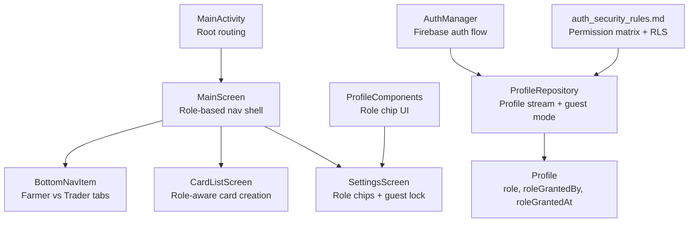
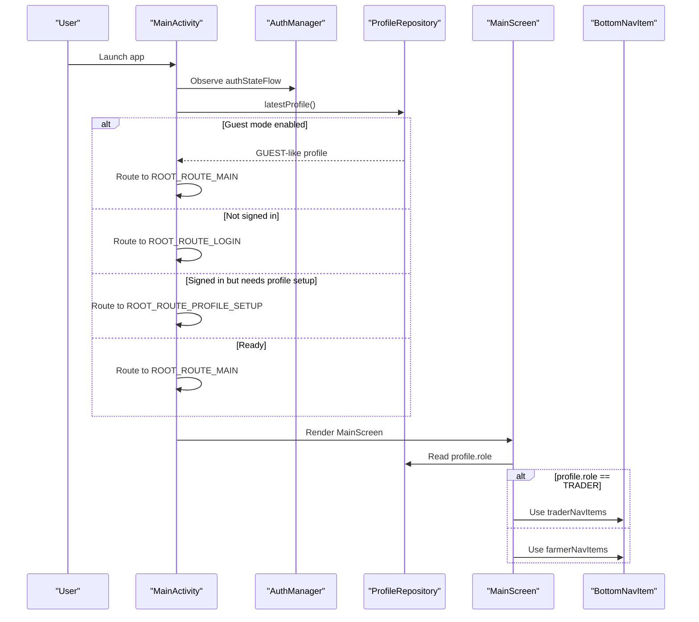
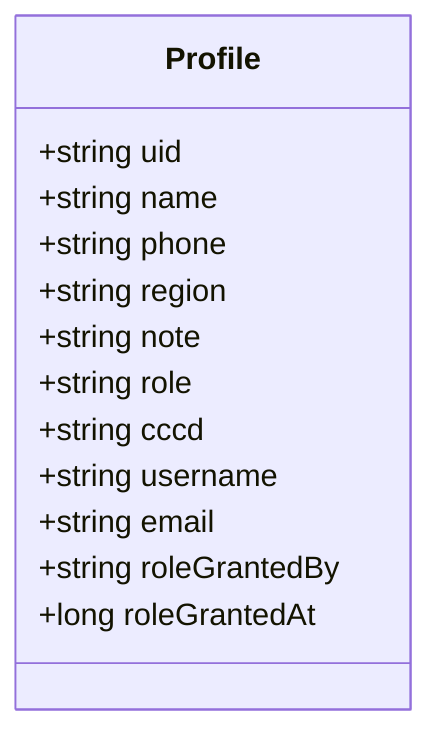
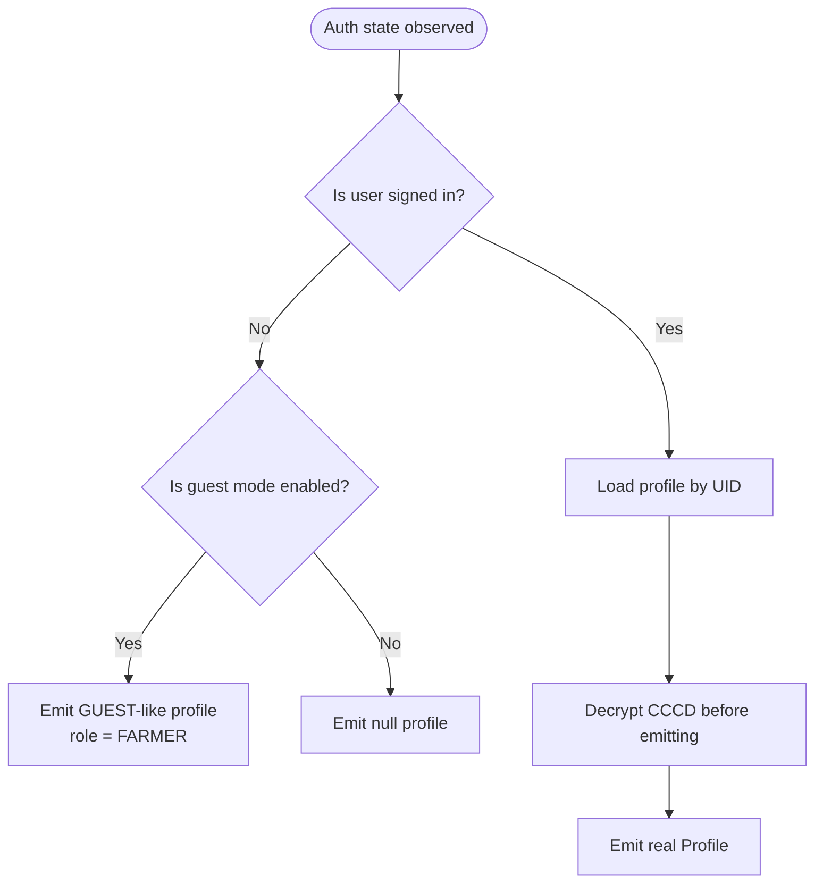
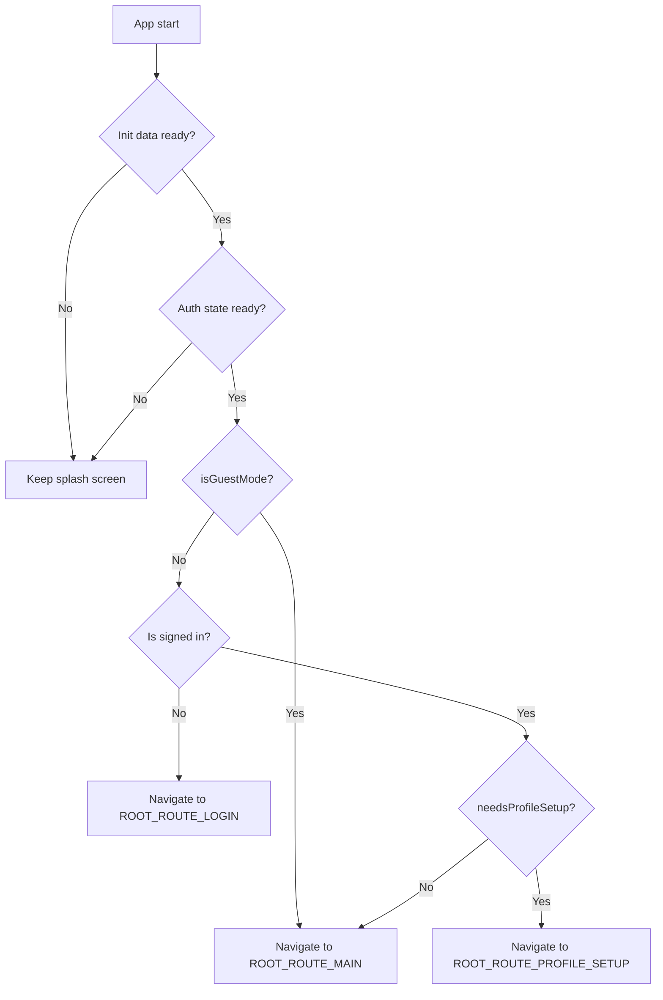
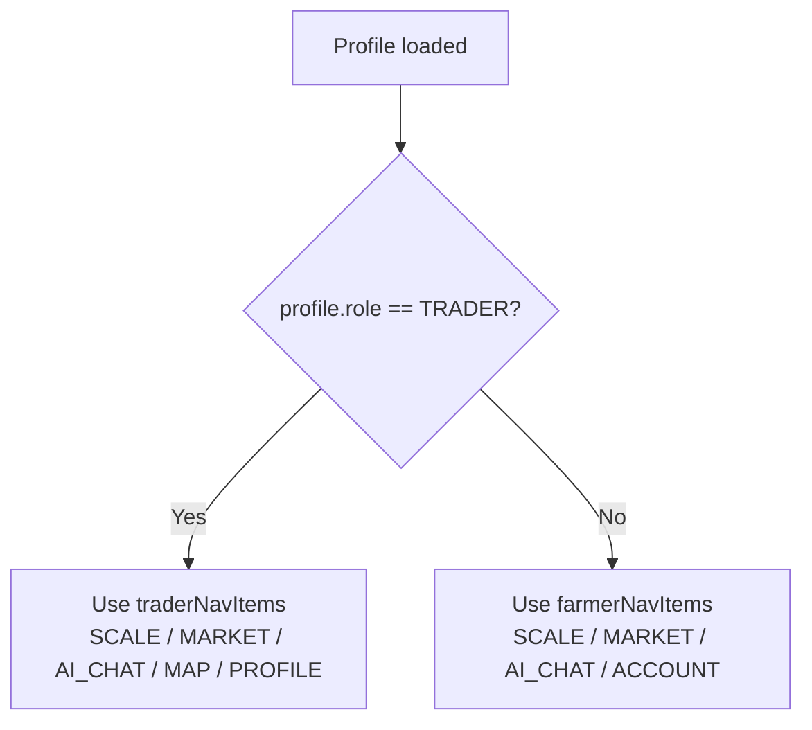
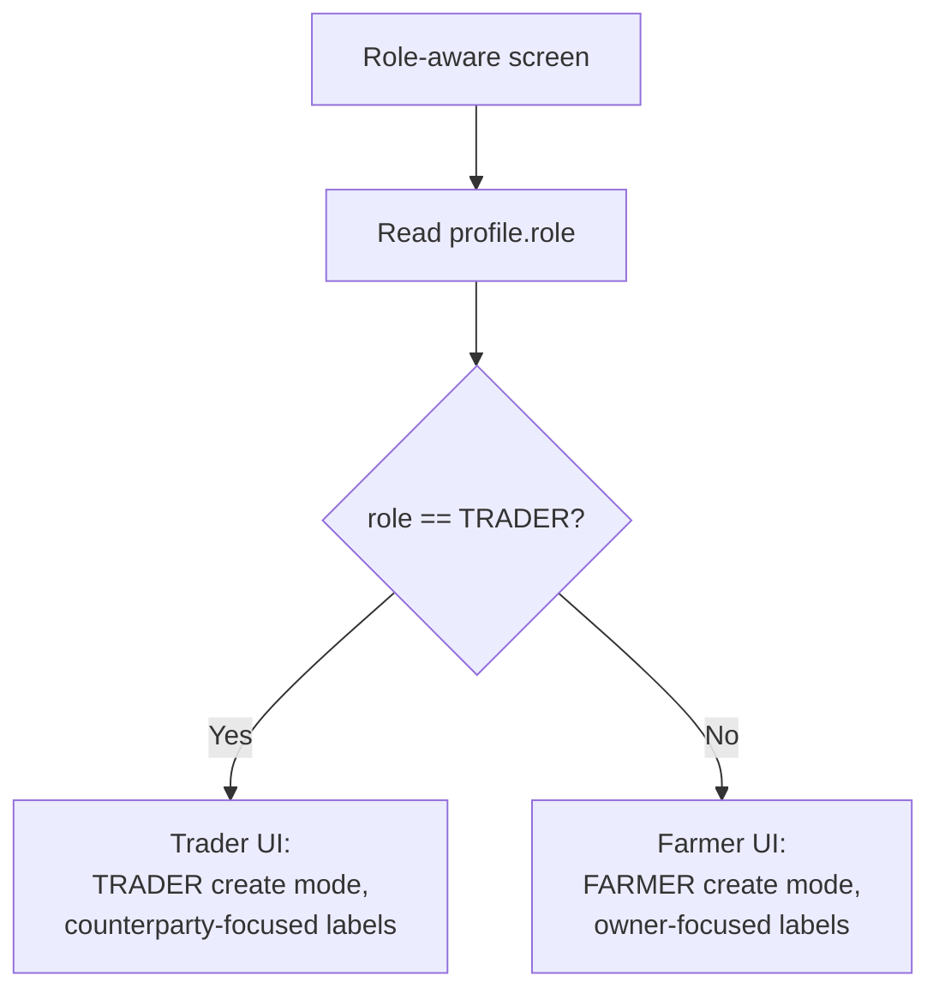
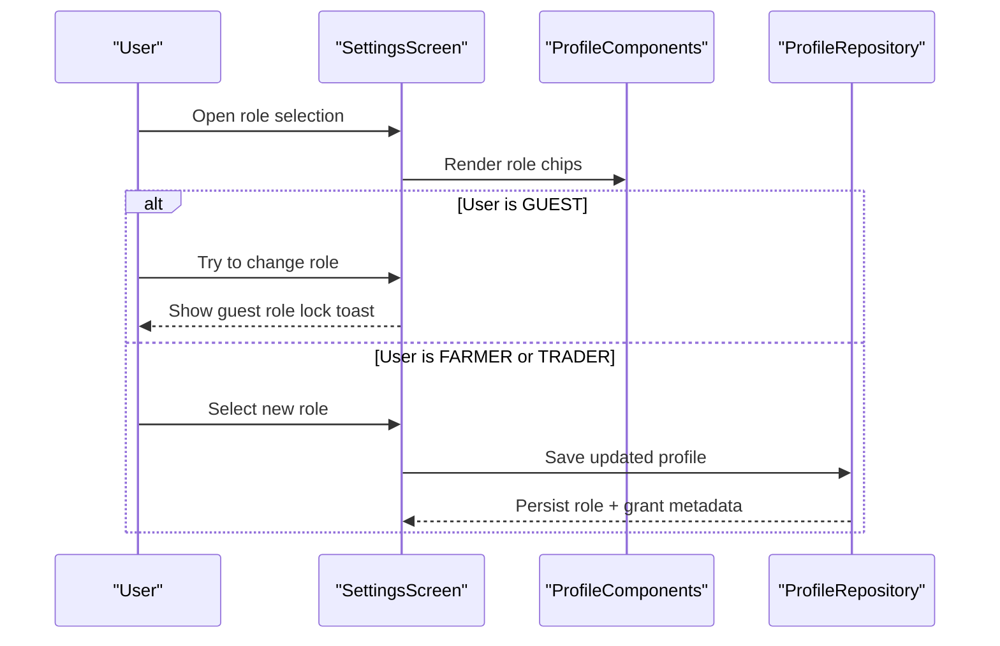
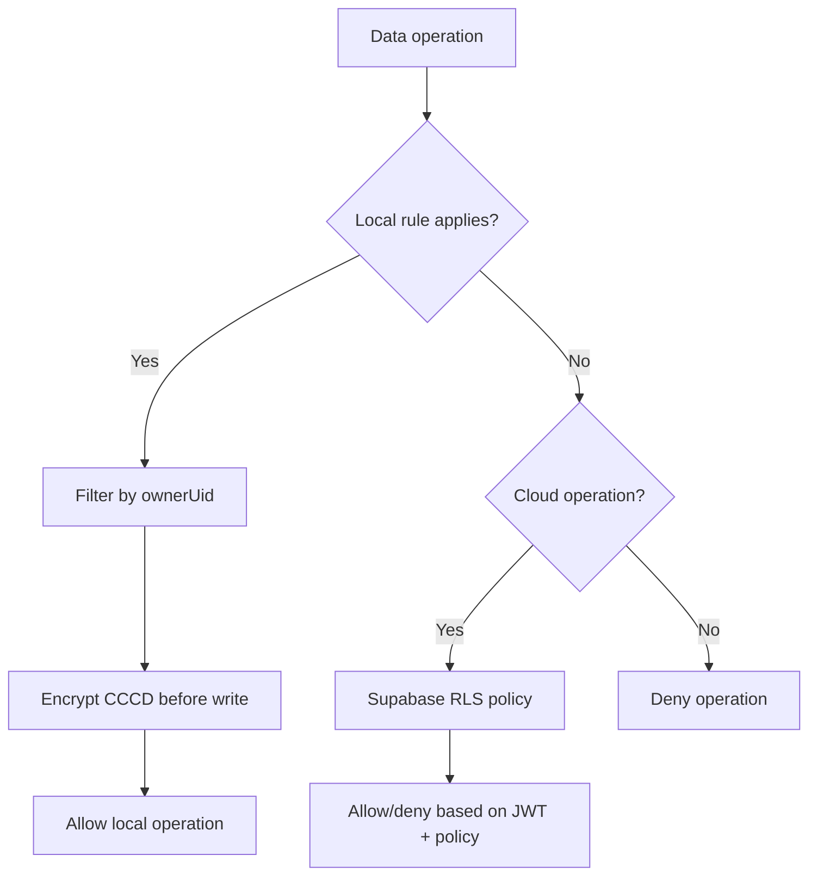
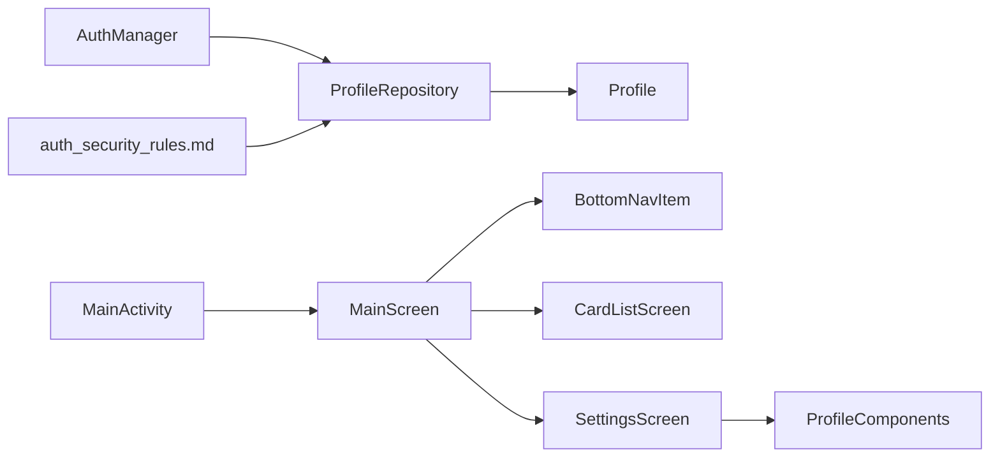

# Role-Based Authorization

<cite>
**Referenced Files in This Document**   
- [auth_security_rules.md](file://docs/specs/auth_security_rules.md)
- [Profile.kt](file://app/src/main/java/com/giathinh/canlua/data/model/Profile.kt)
- [AuthManager.kt](file://app/src/main/java/com/giathinh/canlua/repository/AuthManager.kt)
- [ProfileRepository.kt](file://app/src/main/java/com/giathinh/canlua/repository/ProfileRepository.kt)
- [MainActivity.kt](file://app/src/main/java/com/giathinh/canlua/MainActivity.kt)
- [MainScreen.kt](file://app/src/main/java/com/giathinh/canlua/ui/MainScreen.kt)
- [BottomNavItem.kt](file://app/src/main/java/com/giathinh/canlua/ui/navigation/BottomNavItem.kt)
- [CardListScreen.kt](file://app/src/main/java/com/giathinh/canlua/ui/screen/CardListScreen.kt)
- [SettingsScreen.kt](file://app/src/main/java/com/giathinh/canlua/ui/screen/SettingsScreen.kt)
- [ProfileComponents.kt](file://app/src/main/java/com/giathinh/canlua/ui/screen/profile/ProfileComponents.kt)
</cite>

## Table of Contents
1. [Introduction](#introduction)
2. [Project Structure](#project-structure)
3. [Core Components](#core-components)
4. [Architecture Overview](#architecture-overview)
5. [Detailed Component Analysis](#detailed-component-analysis)
6. [Dependency Analysis](#dependency-analysis)
7. [Performance Considerations](#performance-considerations)
8. [Troubleshooting Guide](#troubleshooting-guide)
9. [Conclusion](#conclusion)

## Introduction
This document explains the three-role authorization system used by Cân Lúa Mobile: **GUEST**, **FARMER**, and **TRADER**. It covers the role hierarchy, permission matrix, UI and repository-level enforcement, route behavior, role switching workflows, and security rules for local and cloud data.

The app is an offline-first Android application using Kotlin, Jetpack Compose, MVVM, Room, Firebase Authentication, Firestore, and Supabase with bidirectional sync. Roles are stored in a user profile and drive navigation, feature visibility, and data access policies.

## Project Structure
Role-related logic spans several layers:

- **Data model**: `Profile` stores the current role and admin-grant metadata.
- **Authentication layer**: `AuthManager` exposes authentication state and flows.
- **Profile persistence**: `ProfileRepository` streams the current profile, handles guest mode, and encrypts sensitive fields.
- **App entry point**: `MainActivity` routes users to login, profile setup, or main shell based on auth and guest mode.
- **Navigation shell**: `MainScreen` selects farmer or trader bottom navigation based on profile role.
- **Feature screens**: Screens like `CardListScreen`, `SettingsScreen`, and `ProfileComponents` render role-specific UI and actions.
- **Security specification**: `auth_security_rules.md` defines the official permission matrix and cloud Row-Level Security policy.

**Diagram sources**
- [MainActivity.kt:34-142](file://app/src/main/java/com/giathinh/canlua/MainActivity.kt#L34-L142)
- [MainScreen.kt:96-137](file://app/src/main/java/com/giathinh/canlua/ui/MainScreen.kt#L96-L137)
- [BottomNavItem.kt:52-69](file://app/src/main/java/com/giathinh/canlua/ui/navigation/BottomNavItem.kt#L52-L69)
- [CardListScreen.kt:181-436](file://app/src/main/java/com/giathinh/canlua/ui/screen/CardListScreen.kt#L181-L436)
- [SettingsScreen.kt:1086-1138](file://app/src/main/java/com/giathinh/canlua/ui/screen/SettingsScreen.kt#L1086-L1138)
- [ProfileComponents.kt:317-389](file://app/src/main/java/com/giathinh/canlua/ui/screen/profile/ProfileComponents.kt#L317-L389)
- [AuthManager.kt:12-73](file://app/src/main/java/com/giathinh/canlua/repository/AuthManager.kt#L12-L73)
- [ProfileRepository.kt:28-109](file://app/src/main/java/com/giathinh/canlua/repository/ProfileRepository.kt#L28-L109)
- [Profile.kt:13-26](file://app/src/main/java/com/giathinh/canlua/data/model/Profile.kt#L13-L26)
- [auth_security_rules.md:7-52](file://docs/specs/auth_security_rules.md#L7-L52)

**Section sources**
- [MainActivity.kt:34-142](file://app/src/main/java/com/giathinh/canlua/MainActivity.kt#L34-L142)
- [MainScreen.kt:96-137](file://app/src/main/java/com/giathinh/canlua/ui/MainScreen.kt#L96-L137)
- [BottomNavItem.kt:52-69](file://app/src/main/java/com/giathinh/canlua/ui/navigation/BottomNavItem.kt#L52-L69)
- [auth_security_rules.md:7-52](file://docs/specs/auth_security_rules.md#L7-L52)

## Core Components
The authorization system is built around these core components:

| Component | Responsibility | Role Relevance |
|---|---|---|
| `Profile` | Stores user identity, role, and grant metadata | Holds `role`, `roleGrantedBy`, `roleGrantedAt`; default role is FARMER |
| `AuthManager` | Wraps Firebase Authentication state and sign-in flows | Provides authenticated user context; does not enforce roles itself |
| `ProfileRepository` | Streams current profile, handles guest mode, encrypts PII | Emits GUEST-like profile when guest mode is enabled; decrypts CCCD |
| `MainActivity` | Root navigation controller | Routes to login, profile setup, or main shell depending on auth and guest mode |
| `MainScreen` | App shell with top bar and bottom navigation | Chooses farmer or trader tab set based on profile role |
| `BottomNavItem` | Defines tab routes and role-specific tab lists | Farmer has 4 tabs; Trader has 5 tabs including map and trader profile |
| `CardListScreen` | Weighing card list and creation | Adapts create mode and labels for TRADER vs FARMER |
| `SettingsScreen` | Settings UI including role selection | Shows role chips and blocks GUEST from changing roles |
| `ProfileComponents` | Shared role chip UI | Renders role selection and triggers role change callbacks |
| `auth_security_rules.md` | Official security and authorization spec | Defines permission matrix, local encryption, and Supabase RLS |

**Section sources**
- [Profile.kt:13-26](file://app/src/main/java/com/giathinh/canlua/data/model/Profile.kt#L13-L26)
- [AuthManager.kt:12-73](file://app/src/main/java/com/giathinh/canlua/repository/AuthManager.kt#L12-L73)
- [ProfileRepository.kt:28-109](file://app/src/main/java/com/giathinh/canlua/repository/ProfileRepository.kt#L28-L109)
- [MainActivity.kt:34-142](file://app/src/main/java/com/giathinh/canlua/MainActivity.kt#L34-L142)
- [MainScreen.kt:96-137](file://app/src/main/java/com/giathinh/canlua/ui/MainScreen.kt#L96-L137)
- [BottomNavItem.kt:52-69](file://app/src/main/java/com/giathinh/canlua/ui/navigation/BottomNavItem.kt#L52-L69)
- [CardListScreen.kt:181-436](file://app/src/main/java/com/giathinh/canlua/ui/screen/CardListScreen.kt#L181-L436)
- [SettingsScreen.kt:1086-1138](file://app/src/main/java/com/giathinh/canlua/ui/screen/SettingsScreen.kt#L1086-L1138)
- [ProfileComponents.kt:317-389](file://app/src/main/java/com/giathinh/canlua/ui/screen/profile/ProfileComponents.kt#L317-L389)
- [auth_security_rules.md:7-52](file://docs/specs/auth_security_rules.md#L7-L52)

## Architecture Overview
The authorization architecture follows unidirectional data flow:

1. **Authentication state** comes from Firebase via `AuthManager`.
2. **Profile state** is streamed through `ProfileRepository`, which resolves the current user’s profile or guest profile.
3. **UI state** in ViewModels observes profile role and renders role-appropriate screens.
4. **Navigation** is controlled at two levels:
   - Root routing in `MainActivity` decides whether to show login, profile setup, or main shell.
   - Shell routing in `MainScreen` chooses farmer or trader bottom navigation.
5. **Permissions** are enforced both in UI (conditional rendering) and at the data layer (local isolation and Supabase RLS).

**Diagram sources**
- [MainActivity.kt:64-142](file://app/src/main/java/com/giathinh/canlua/MainActivity.kt#L64-L142)
- [AuthManager.kt:22-35](file://app/src/main/java/com/giathinh/canlua/repository/AuthManager.kt#L22-L35)
- [ProfileRepository.kt:90-109](file://app/src/main/java/com/giathinh/canlua/repository/ProfileRepository.kt#L90-L109)
- [MainScreen.kt:96-137](file://app/src/main/java/com/giathinh/canlua/ui/MainScreen.kt#L96-L137)
- [BottomNavItem.kt:52-69](file://app/src/main/java/com/giathinh/canlua/ui/navigation/BottomNavItem.kt#L52-L69)

## Detailed Component Analysis

### Role Model and Grant Metadata
The `Profile` entity is the canonical source of role information. Its default role is FARMER, and it includes fields for admin-granted TRADER roles:

- `role`: Current role string, typically `"FARMER"` or `"TRADER"`.
- `roleGrantedBy`: Indicates who granted the role (`"self"`, `"admin"`, or `"system"`).
- `roleGrantedAt`: Timestamp when the role was granted.

These fields support the documented workflow where users request TRADER role upgrades and admins approve them.

**Diagram sources**
- [Profile.kt:13-26](file://app/src/main/java/com/giathinh/canlua/data/model/Profile.kt#L13-L26)

**Section sources**
- [Profile.kt:13-26](file://app/src/main/java/com/giathinh/canlua/data/model/Profile.kt#L13-L26)

### Permission Matrix
The official permission matrix defines what each role can do:

| Feature | GUEST | FARMER | TRADER |
|---|---|---|---|
| Create weighing cards | Allowed locally only | Allowed | Allowed (creates cards representing a farmer) |
| Read weighing cards | Local cards created by guest | Own cards | Own cards or QR-linked cards |
| Update weighing cards | Allowed locally if unlocked | Allowed if unlocked | Payment status updates allowed; cannot edit locked weights |
| Delete weighing cards | Allowed locally if unlocked | Allowed if unlocked | Forbidden |
| Read market prices | Allowed | Allowed | Allowed |
| Write bids | Forbidden | Forbidden | Allowed (own bids) |
| Request TRADER upgrade | Forbidden | Allowed (submit CCCD + reason for admin approval) | Not applicable |

This matrix is the contract that UI and repository layers should follow.

**Section sources**
- [auth_security_rules.md:7-52](file://docs/specs/auth_security_rules.md#L7-L52)

### Authentication and Guest Mode
`AuthManager` provides:

- Current Firebase user reference.
- Boolean flag indicating whether a user is signed in.
- A cold `Flow<FirebaseUser?>` that emits whenever authentication state changes.
- Anonymous sign-in, email/password sign-in, account creation, and sign-out operations.

Guest mode is not a Firebase role; it is a local preference that allows limited usage without signing in. When guest mode is active, `ProfileRepository` emits a lightweight GUEST-like profile with role FARMER so the UI remains consistent while restricting network writes.

**Diagram sources**
- [AuthManager.kt:16-35](file://app/src/main/java/com/giathinh/canlua/repository/AuthManager.kt#L16-L35)
- [ProfileRepository.kt:90-109](file://app/src/main/java/com/giathinh/canlua/repository/ProfileRepository.kt#L90-L109)

**Section sources**
- [AuthManager.kt:12-73](file://app/src/main/java/com/giathinh/canlua/repository/AuthManager.kt#L12-L73)
- [ProfileRepository.kt:90-109](file://app/src/main/java/com/giathinh/canlua/repository/ProfileRepository.kt#L90-L109)

### Root Navigation and Role-Gated Entry Points
`MainActivity` controls the root navigation graph:

- If guest mode is enabled, it routes directly to the main shell.
- If not signed in, it routes to the login screen.
- If profile setup is required, it routes to the profile setup screen.
- Otherwise, it routes to the main shell.

This is the first gate: even before role checks, the app enforces authentication and profile completion.

**Diagram sources**
- [MainActivity.kt:45-108](file://app/src/main/java/com/giathinh/canlua/MainActivity.kt#L45-L108)

**Section sources**
- [MainActivity.kt:34-142](file://app/src/main/java/com/giathinh/canlua/MainActivity.kt#L34-L142)

### Role-Based Navigation Shell
`MainScreen` reads the current profile and determines whether the user is a trader:

- `isTrader = profile?.role == "TRADER"`
- If trader, it uses `BottomNavItem.traderNavItems`.
- Otherwise, it uses `BottomNavItem.farmerNavItems`.

This is the primary UI-level role gate: it changes the bottom navigation structure rather than blocking individual routes at the navigation graph level.

**Diagram sources**
- [MainScreen.kt:96-137](file://app/src/main/java/com/giathinh/canlua/ui/MainScreen.kt#L96-L137)
- [BottomNavItem.kt:52-69](file://app/src/main/java/com/giathinh/canlua/ui/navigation/BottomNavItem.kt#L52-L69)

**Section sources**
- [MainScreen.kt:96-137](file://app/src/main/java/com/giathinh/canlua/ui/MainScreen.kt#L96-L137)
- [BottomNavItem.kt:52-69](file://app/src/main/java/com/giathinh/canlua/ui/navigation/BottomNavItem.kt#L52-L69)

### Role-Specific UI Rendering
Several screens adapt their UI based on role:

- **CardListScreen**: Detects `profileState?.role == "TRADER"` and switches create mode, owner/trader labels, and analytics tags accordingly.
- **SettingsScreen**: Displays role chips and blocks GUEST users from changing roles.
- **ProfileComponents**: Renders selectable role chips and calls a role-change callback when the user selects a different role.

**Diagram sources**
- [CardListScreen.kt:181-436](file://app/src/main/java/com/giathinh/canlua/ui/screen/CardListScreen.kt#L181-L436)
- [SettingsScreen.kt:1086-1138](file://app/src/main/java/com/giathinh/canlua/ui/screen/SettingsScreen.kt#L1086-L1138)
- [ProfileComponents.kt:317-389](file://app/src/main/java/com/giathinh/canlua/ui/screen/profile/ProfileComponents.kt#L317-L389)

**Section sources**
- [CardListScreen.kt:181-436](file://app/src/main/java/com/giathinh/canlua/ui/screen/CardListScreen.kt#L181-L436)
- [SettingsScreen.kt:1086-1138](file://app/src/main/java/com/giathinh/canlua/ui/screen/SettingsScreen.kt#L1086-L1138)
- [ProfileComponents.kt:317-389](file://app/src/main/java/com/giathinh/canlua/ui/screen/profile/ProfileComponents.kt#L317-L389)

### Role Switching Workflow
Role switching is primarily a UI-driven action with validation:

1. The user opens settings or profile section.
2. The role chip UI shows current role and alternative role options.
3. For GUEST users, attempts to change roles are blocked with a warning toast.
4. For non-GUEST users, selecting a different role triggers a role-change callback.
5. The actual role update and admin-grant metadata handling should be implemented through the profile save flow, respecting `roleGrantedBy` and `roleGrantedAt`.

**Diagram sources**
- [SettingsScreen.kt:1086-1138](file://app/src/main/java/com/giathinh/canlua/ui/screen/SettingsScreen.kt#L1086-L1138)
- [ProfileComponents.kt:317-389](file://app/src/main/java/com/giathinh/canlua/ui/screen/profile/ProfileComponents.kt#L317-L389)
- [ProfileRepository.kt:38-48](file://app/src/main/java/com/giathinh/canlua/repository/ProfileRepository.kt#L38-L48)

**Section sources**
- [SettingsScreen.kt:1086-1138](file://app/src/main/java/com/giathinh/canlua/ui/screen/SettingsScreen.kt#L1086-L1138)
- [ProfileComponents.kt:317-389](file://app/src/main/java/com/giathinh/canlua/ui/screen/profile/ProfileComponents.kt#L317-L389)
- [ProfileRepository.kt:38-48](file://app/src/main/java/com/giathinh/canlua/repository/ProfileRepository.kt#L38-L48)

### Data Access Controls and Security Rules
Authorization is not only UI-visible; it must also be enforced at the data layer:

- **Local multi-user isolation**: Profiles are keyed by Firebase UID, and DAO queries should filter by `ownerUid` to prevent cross-account leakage.
- **PII protection**: CCCD values are encrypted before storage and decrypted only when needed for display.
- **Cloud Row-Level Security**: Supabase RLS policies restrict read/write access based on authenticated user ID and relationship between profiles and cards.

Key RLS concepts from the specification:

- Profiles: select/update restricted to owner or QR-linked relationships.
- Cards: select allowed for owner or handshake trader; delete allowed only for owner when unlocked.
- Weight entries: access depends on associated card ownership or trader linkage.

**Diagram sources**
- [auth_security_rules.md:56-124](file://docs/specs/auth_security_rules.md#L56-L124)
- [ProfileRepository.kt:38-48](file://app/src/main/java/com/giathinh/canlua/repository/ProfileRepository.kt#L38-L48)

**Section sources**
- [auth_security_rules.md:56-124](file://docs/specs/auth_security_rules.md#L56-L124)
- [ProfileRepository.kt:38-48](file://app/src/main/java/com/giathinh/canlua/repository/ProfileRepository.kt#L38-L48)

## Dependency Analysis
The authorization dependencies form a layered chain:

**Diagram sources**
- [AuthManager.kt:12-73](file://app/src/main/java/com/giathinh/canlua/repository/AuthManager.kt#L12-L73)
- [ProfileRepository.kt:28-109](file://app/src/main/java/com/giathinh/canlua/repository/ProfileRepository.kt#L28-L109)
- [Profile.kt:13-26](file://app/src/main/java/com/giathinh/canlua/data/model/Profile.kt#L13-L26)
- [MainActivity.kt:64-142](file://app/src/main/java/com/giathinh/canlua/MainActivity.kt#L64-L142)
- [MainScreen.kt:96-137](file://app/src/main/java/com/giathinh/canlua/ui/MainScreen.kt#L96-L137)
- [BottomNavItem.kt:52-69](file://app/src/main/java/com/giathinh/canlua/ui/navigation/BottomNavItem.kt#L52-L69)
- [CardListScreen.kt:181-436](file://app/src/main/java/com/giathinh/canlua/ui/screen/CardListScreen.kt#L181-L436)
- [SettingsScreen.kt:1086-1138](file://app/src/main/java/com/giathinh/canlua/ui/screen/SettingsScreen.kt#L1086-L1138)
- [ProfileComponents.kt:317-389](file://app/src/main/java/com/giathinh/canlua/ui/screen/profile/ProfileComponents.kt#L317-L389)
- [auth_security_rules.md:7-52](file://docs/specs/auth_security_rules.md#L7-L52)

**Section sources**
- [AuthManager.kt:12-73](file://app/src/main/java/com/giathinh/canlua/repository/AuthManager.kt#L12-L73)
- [ProfileRepository.kt:28-109](file://app/src/main/java/com/giathinh/canlua/repository/ProfileRepository.kt#L28-L109)
- [MainActivity.kt:64-142](file://app/src/main/java/com/giathinh/canlua/MainActivity.kt#L64-L142)
- [MainScreen.kt:96-137](file://app/src/main/java/com/giathinh/canlua/ui/MainScreen.kt#L96-L137)
- [auth_security_rules.md:7-52](file://docs/specs/auth_security_rules.md#L7-L52)

## Performance Considerations
- Role checks are simple string comparisons against `profile.role`, so they are cheap and suitable for frequent recompositions.
- Using `collectAsStateWithLifecycle` ensures role state updates are lifecycle-aware and avoid unnecessary recompositions.
- Bottom navigation selection happens once per role change, minimizing recomposition overhead.
- Guest mode avoids heavy profile loading by emitting a minimal GUEST-like profile.

[No sources needed since this section provides general guidance]

## Troubleshooting Guide
Common authorization issues and how to investigate them:

| Symptom | Likely Cause | Investigation Steps |
|---|---|---|
| User sees login screen unexpectedly | Guest mode disabled and not signed in | Check `isGuestMode` and `authState.isSignedIn` in `MainActivity` |
| User cannot change role | GUEST mode or current role already selected | Verify role chip click handlers and guest toast logic |
| Trader tabs missing | Profile role is not TRADER | Inspect `profile.role` in `MainScreen` |
| Card creation shows wrong owner/trader labels | Role detection mismatch | Check `isTrader` derivation in `CardListScreen` |
| Data not syncing or access denied | Supabase RLS policy blocking operation | Review RLS policies in `auth_security_rules.md` |
| CCCD appears corrupted or unreadable | Encryption/decryption mismatch | Verify `CccdCrypto` usage in profile save/load |

**Section sources**
- [MainActivity.kt:64-108](file://app/src/main/java/com/giathinh/canlua/MainActivity.kt#L64-L108)
- [SettingsScreen.kt:1086-1138](file://app/src/main/java/com/giathinh/canlua/ui/screen/SettingsScreen.kt#L1086-L1138)
- [MainScreen.kt:96-137](file://app/src/main/java/com/giathinh/canlua/ui/MainScreen.kt#L96-L137)
- [CardListScreen.kt:181-436](file://app/src/main/java/com/giathinh/canlua/ui/screen/CardListScreen.kt#L181-L436)
- [auth_security_rules.md:56-124](file://docs/specs/auth_security_rules.md#L56-L124)

## Conclusion
Cân Lúa Mobile implements a clear three-role authorization model:

- **GUEST**: Limited local-only experience without authentication.
- **FARMER**: Full weighing card management for own data, with optional upgrade path to TRADER.
- **TRADER**: Market-facing capabilities including bid management, QR-linked card access, and map features.

Authorization is enforced at multiple layers:

- **Entry routing** in `MainActivity` gates login and profile setup.
- **Navigation shell** in `MainScreen` selects farmer or trader tabs.
- **Feature screens** conditionally render role-specific UI and actions.
- **Repository layer** streams profile state, handles guest mode, and protects PII.
- **Security specification** defines the permission matrix and cloud RLS policies.

For future improvements, consider adding explicit route guards for TRADER-only screens, centralizing permission checks into a reusable helper, and ensuring all repository methods validate role before performing network writes.

[No sources needed since this section summarizes without analyzing specific files]