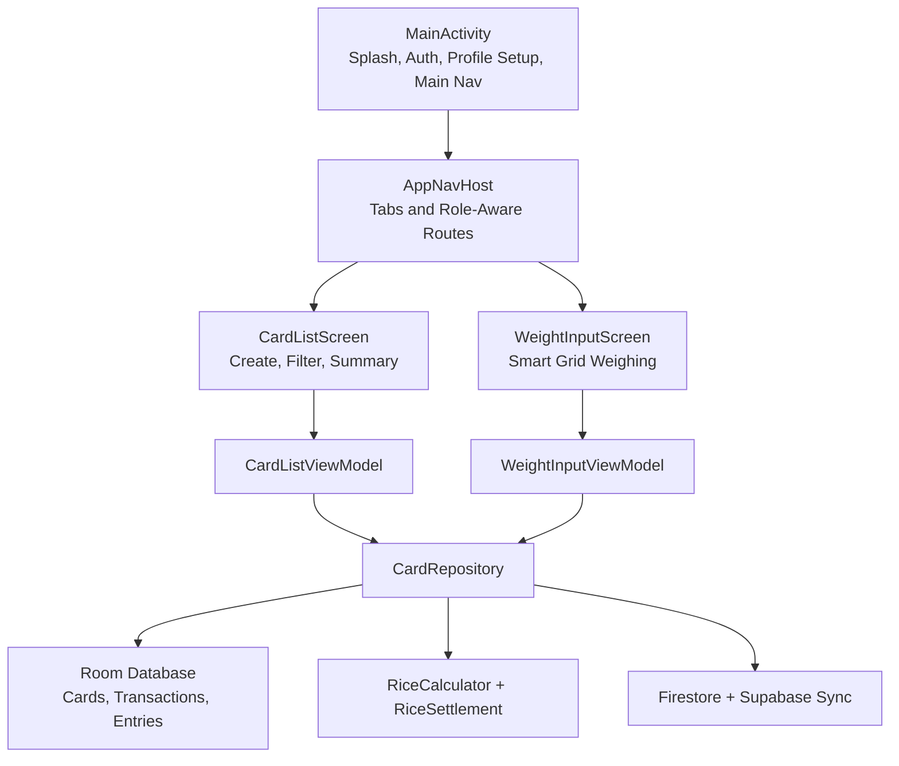
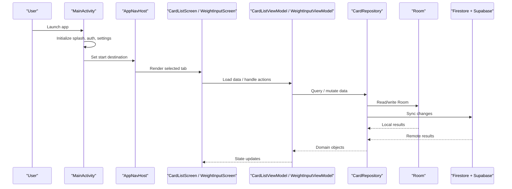
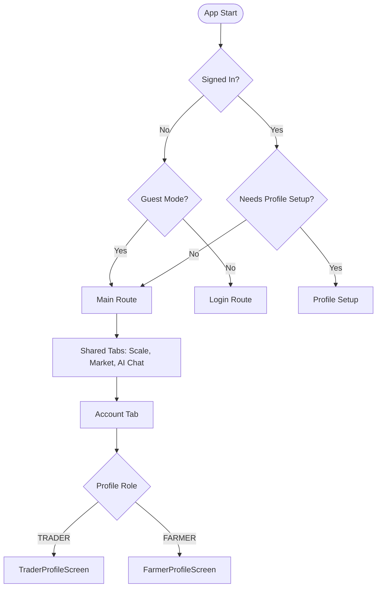
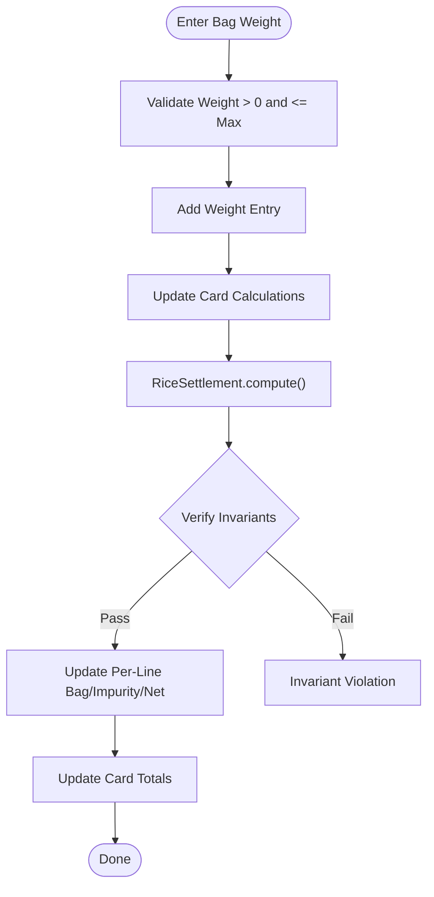
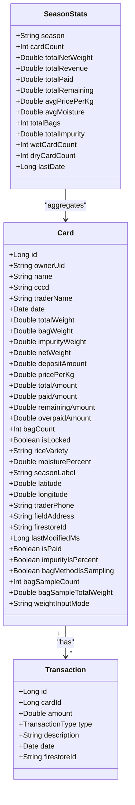
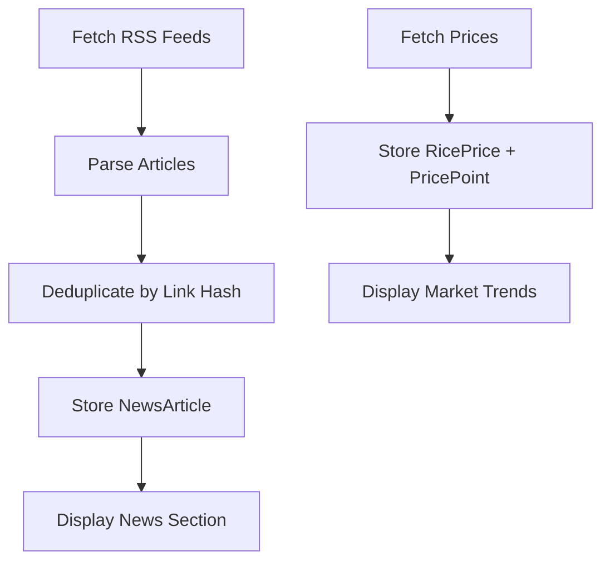
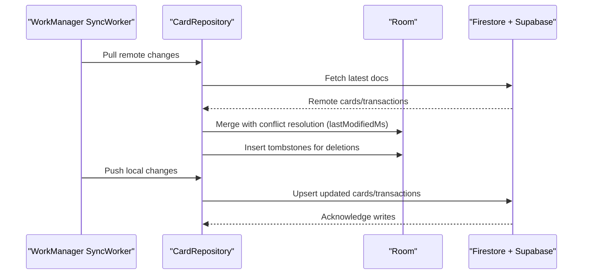
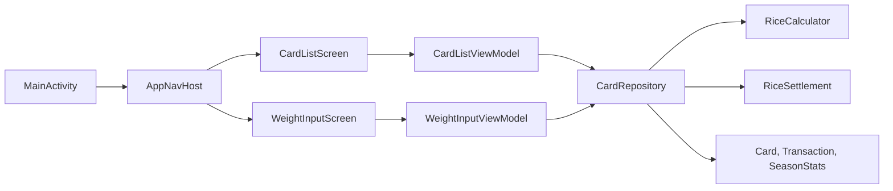

# Core Features

<cite>
**Referenced Files in This Document**
- [MainActivity.kt](file://app/src/main/java/com/giathinh/canlua/MainActivity.kt)
- [AppNavHost.kt](file://app/src/main/java/com/giathinh/canlua/ui/navigation/AppNavHost.kt)
- [CardListScreen.kt](file://app/src/main/java/com/giathinh/canlua/ui/screen/CardListScreen.kt)
- [WeightInputScreen.kt](file://app/src/main/java/com/giathinh/canlua/ui/screen/WeightInputScreen.kt)
- [CardListViewModel.kt](file://app/src/main/java/com/giathinh/canlua/ui/viewmodel/CardListViewModel.kt)
- [WeightInputViewModel.kt](file://app/src/main/java/com/giathinh/canlua/ui/viewmodel/WeightInputViewModel.kt)
- [CardRepository.kt](file://app/src/main/java/com/giathinh/canlua/repository/CardRepository.kt)
- [RiceCalculator.kt](file://app/src/main/java/com/giathinh/canlua/util/RiceCalculator.kt)
- [RiceSettlement.kt](file://app/src/main/java/com/giathinh/canlua/util/RiceSettlement.kt)
- [Card.kt](file://app/src/main/java/com/giathinh/canlua/data/model/Card.kt)
- [Transaction.kt](file://app/src/main/java/com/giathinh/canlua/data/model/Transaction.kt)
- [RicePrice.kt](file://app/src/main/java/com/giathinh/canlua/data/model/RicePrice.kt)
- [NewsArticle.kt](file://app/src/main/java/com/giathinh/canlua/data/model/NewsArticle.kt)
- [Profile.kt](file://app/src/main/java/com/giathinh/canlua/data/model/Profile.kt)
- [SeasonStats.kt](file://app/src/main/java/com/giathinh/canlua/data/model/SeasonStats.kt)
- [KpiGrid.kt](file://app/src/main/java/com/giathinh/canlua/ui/component/dashboard/KpiGrid.kt)
</cite>

## Table of Contents
1. [Introduction](#introduction)
2. [Project Structure](#project-structure)
3. [Core Components](#core-components)
4. [Architecture Overview](#architecture-overview)
5. [Detailed Component Analysis](#detailed-component-analysis)
6. [Dependency Analysis](#dependency-analysis)
7. [Performance Considerations](#performance-considerations)
8. [Troubleshooting Guide](#troubleshooting-guide)
9. [Conclusion](#conclusion)

## Introduction
Cân Lúa Mobile is an offline-first Android application for rice weighing, settlement, season analytics, market intelligence, and AI agronomy assistance. It supports three roles: FARMER, TRADER, and GUEST. The app uses MVVM with Jetpack Compose, Room persistence, bidirectional sync to Firebase Firestore and Supabase, and background synchronization via WorkManager. Users can create rice cards, enter bag weights through smart numeric grids, compute net weight with moisture adjustment, calculate financial totals, track seasons, view market prices and news, and ask the AI agronomy assistant contextual farming questions.

## Project Structure
The app follows a layered architecture:
- UI layer: Compose screens, components, navigation, and ViewModels.
- Repository layer: Business logic, data orchestration, and calculation coordination.
- Data layer: Room database entities, DAOs, remote clients, and models.
- Utilities: Rice calculations, settlement algorithms, formatting, and helpers.

**Diagram sources**
- [MainActivity.kt:45-141](file://app/src/main/java/com/giathinh/canlua/MainActivity.kt#L45-L141)
- [AppNavHost.kt:31-136](file://app/src/main/java/com/giathinh/canlua/ui/navigation/AppNavHost.kt#L31-L136)
- [CardListScreen.kt:98-114](file://app/src/main/java/com/giathinh/canlua/ui/screen/CardListScreen.kt#L98-L114)
- [WeightInputScreen.kt:58-87](file://app/src/main/java/com/giathinh/canlua/ui/screen/WeightInputScreen.kt#L58-L87)
- [CardListViewModel.kt:24-29](file://app/src/main/java/com/giathinh/canlua/ui/viewmodel/CardListViewModel.kt#L24-L29)
- [WeightInputViewModel.kt:24-29](file://app/src/main/java/com/giathinh/canlua/ui/viewmodel/WeightInputViewModel.kt#L24-L29)
- [CardRepository.kt:36-44](file://app/src/main/java/com/giathinh/canlua/repository/CardRepository.kt#L36-L44)

**Section sources**
- [MainActivity.kt:45-141](file://app/src/main/java/com/giathinh/canlua/MainActivity.kt#L45-L141)
- [AppNavHost.kt:31-136](file://app/src/main/java/com/giathinh/canlua/ui/navigation/AppNavHost.kt#L31-L136)

## Core Components
- Multi-role portal system:
  - Roles: FARMER, TRADER, GUEST.
  - Navigation routes include shared tabs (Scale, Market, AI Chat) and role-specific profile screens.
  - Role-aware routing selects Farmer or Trader profile based on user profile.
- Rice weighing system:
  - Smart grid input with auto-confirm, focus management, and TTS feedback.
  - Financial calculations using RiceCalculator and RiceSettlement.
  - Settlement ensures per-line allocation and invariant checks.
- Season management:
  - Cards carry season labels, variety, moisture, GPS, and contact info.
  - Season stats provide aggregated metrics and breakdowns.
- Market intelligence:
  - Rice price model with min/max/avg and trend indicators.
  - News articles from RSS feeds with deduplication by link hash.
- AI agronomy assistant:
  - Powered by OpenRouter with RAG context from knowledge JSON assets.
- Data synchronization:
  - Offline-first Room persistence.
  - Bidirectional sync to Firestore and Supabase.
  - Background sync via WorkManager; conflict resolution by lastModifiedMs.

**Section sources**
- [AppNavHost.kt:139-150](file://app/src/main/java/com/giathinh/canlua/ui/navigation/AppNavHost.kt#L139-L150)
- [Card.kt:20-106](file://app/src/main/java/com/giathinh/canlua/data/model/Card.kt#L20-L106)
- [RiceCalculator.kt:8-122](file://app/src/main/java/com/giathinh/canlua/util/RiceCalculator.kt#L8-L122)
- [RiceSettlement.kt:19-184](file://app/src/main/java/com/giathinh/canlua/util/RiceSettlement.kt#L19-L184)
- [RicePrice.kt:11-37](file://app/src/main/java/com/giathinh/canlua/data/model/RicePrice.kt#L11-L37)
- [NewsArticle.kt:11-31](file://app/src/main/java/com/giathinh/canlua/data/model/NewsArticle.kt#L11-L31)
- [SeasonStats.kt:16-164](file://app/src/main/java/com/giathinh/canlua/data/model/SeasonStats.kt#L16-L164)

## Architecture Overview
The app’s runtime flow starts at MainActivity, which initializes splash conditions, gathers ad consent, applies locale/theme settings, and sets up the root navigation graph. From there, AppNavHost defines shared tabs and role-aware routes. Screens delegate state and business operations to ViewModels, which call repositories. Repositories coordinate Room queries, calculations, and cloud sync.

**Diagram sources**
- [MainActivity.kt:45-141](file://app/src/main/java/com/giathinh/canlua/MainActivity.kt#L45-L141)
- [AppNavHost.kt:31-136](file://app/src/main/java/com/giathinh/canlua/ui/navigation/AppNavHost.kt#L31-L136)
- [CardListScreen.kt:98-114](file://app/src/main/java/com/giathinh/canlua/ui/screen/CardListScreen.kt#L98-L114)
- [WeightInputScreen.kt:58-87](file://app/src/main/java/com/giathinh/canlua/ui/screen/WeightInputScreen.kt#L58-L87)
- [CardListViewModel.kt:24-29](file://app/src/main/java/com/giathinh/canlua/ui/viewmodel/CardListViewModel.kt#L24-L29)
- [WeightInputViewModel.kt:24-29](file://app/src/main/java/com/giathinh/canlua/ui/viewmodel/WeightInputViewModel.kt#L24-L29)
- [CardRepository.kt:36-44](file://app/src/main/java/com/giathinh/canlua/repository/CardRepository.kt#L36-L44)

## Detailed Component Analysis

### Multi-Role Portal System
- Roles:
  - FARMER: Standard weighing, card management, season analytics, farmer profile.
  - TRADER: Shared tabs plus trader profile, transactions, map, and history.
  - GUEST: Limited access without authentication; navigates directly to main.
- Navigation:
  - Root routes: splash, login, profile setup, main.
  - Main host includes shared tabs and role-aware profile wrapper.
  - Role selection renders either FarmerProfileScreen or TraderProfileScreen.

**Diagram sources**
- [MainActivity.kt:78-108](file://app/src/main/java/com/giathinh/canlua/MainActivity.kt#L78-L108)
- [AppNavHost.kt:31-136](file://app/src/main/java/com/giathinh/canlua/ui/navigation/AppNavHost.kt#L31-L136)
- [AppNavHost.kt:139-150](file://app/src/main/java/com/giathinh/canlua/ui/navigation/AppNavHost.kt#L139-L150)

**Section sources**
- [MainActivity.kt:78-108](file://app/src/main/java/com/giathinh/canlua/MainActivity.kt#L78-L108)
- [AppNavHost.kt:31-136](file://app/src/main/java/com/giathinh/canlua/ui/navigation/AppNavHost.kt#L31-L136)
- [AppNavHost.kt:139-150](file://app/src/main/java/com/giathinh/canlua/ui/navigation/AppNavHost.kt#L139-L150)
- [Profile.kt:13-26](file://app/src/main/java/com/giathinh/canlua/data/model/Profile.kt#L13-L26)

### Rice Weighing System
- Smart Input Methods:
  - Numeric grid cells auto-confirm after fixed digit counts based on mode (SMALL/LARGE).
  - Focus management moves to next cell/column/table; optional TTS reads digits and column completion.
  - Lock/unlock prevents edits on locked cards.
- Financial Calculations:
  - RiceCalculator computes standard weight, net weight, bag totals, impurity totals, total amount, remaining amount.
  - RiceSettlement provides precise allocation across lines and invariant verification.
- Settlement Algorithms:
  - Uses internal units (0.01 kg) to avoid floating-point drift.
  - Largest Remainder Method ensures Σ lines == totals.
  - Money computed once in VND; overpaid separated from remaining.

**Diagram sources**
- [WeightInputScreen.kt:148-175](file://app/src/main/java/com/giathinh/canlua/ui/screen/WeightInputScreen.kt#L148-L175)
- [WeightInputViewModel.kt:97-112](file://app/src/main/java/com/giathinh/canlua/ui/viewmodel/WeightInputViewModel.kt#L97-L112)
- [CardRepository.kt:176-182](file://app/src/main/java/com/giathinh/canlua/repository/CardRepository.kt#L176-L182)
- [RiceCalculator.kt:8-122](file://app/src/main/java/com/giathinh/canlua/util/RiceCalculator.kt#L8-L122)
- [RiceSettlement.kt:89-184](file://app/src/main/java/com/giathinh/canlua/util/RiceSettlement.kt#L89-L184)

**Section sources**
- [WeightInputScreen.kt:148-175](file://app/src/main/java/com/giathinh/canlua/ui/screen/WeightInputScreen.kt#L148-L175)
- [WeightInputViewModel.kt:97-112](file://app/src/main/java/com/giathinh/canlua/ui/viewmodel/WeightInputViewModel.kt#L97-L112)
- [CardRepository.kt:176-182](file://app/src/main/java/com/giathinh/canlua/repository/CardRepository.kt#L176-L182)
- [RiceCalculator.kt:8-122](file://app/src/main/java/com/giathinh/canlua/util/RiceCalculator.kt#L8-L122)
- [RiceSettlement.kt:89-184](file://app/src/main/java/com/giathinh/canlua/util/RiceSettlement.kt#L89-L184)

### Season Management
- Card Creation:
  - Includes name, CCCD, trader info, date, price, deposit, variety, moisture, season label, location, and weigh defaults.
  - Optional deposit creates initial DEPOSIT transaction and recalculates totals.
- Yield Tracking:
  - Cards grouped by date; daily summaries show card count, total kg, total amount, average price, bag count.
  - Filters by variety and season; available options derived from repository.
- Analytics:
  - Season stats aggregate revenue, paid, remaining, average price/moisture, bags, impurity, wet/dry card counts.
  - KPI grid displays metrics with deltas and sentiment.

**Diagram sources**
- [Card.kt:20-106](file://app/src/main/java/com/giathinh/canlua/data/model/Card.kt#L20-L106)
- [Transaction.kt:8-36](file://app/src/main/java/com/giathinh/canlua/data/model/Transaction.kt#L8-L36)
- [SeasonStats.kt:54-80](file://app/src/main/java/com/giathinh/canlua/data/model/SeasonStats.kt#L54-L80)

**Section sources**
- [CardListViewModel.kt:81-150](file://app/src/main/java/com/giathinh/canlua/ui/viewmodel/CardListViewModel.kt#L81-L150)
- [CardListScreen.kt:195-276](file://app/src/main/java/com/giathinh/canlua/ui/screen/CardListScreen.kt#L195-L276)
- [CardRepository.kt:330-366](file://app/src/main/java/com/giathinh/canlua/repository/CardRepository.kt#L330-L366)
- [KpiGrid.kt:15-67](file://app/src/main/java/com/giathinh/canlua/ui/component/dashboard/KpiGrid.kt#L15-L67)

### Market Intelligence
- Real-Time Price Tracking:
  - RicePrice stores variety, region, min/max/avg prices, update timestamp, trader metadata, trend, and rice type.
  - PricePoint tracks historical points for charting.
- Trend Analysis:
  - Trend values indicate UP/DOWN/STABLE; UI can visualize changes over time.
- RSS News Aggregation:
  - NewsArticle stores title, description, link, source, thumbnail, publishedAt, topic, cachedAt.
  - Deduplication by SHA-256 hash of link; indexed by topic and publishedAt.

**Diagram sources**
- [RicePrice.kt:11-37](file://app/src/main/java/com/giathinh/canlua/data/model/RicePrice.kt#L11-L37)
- [NewsArticle.kt:11-31](file://app/src/main/java/com/giathinh/canlua/data/model/NewsArticle.kt#L11-L31)

**Section sources**
- [RicePrice.kt:11-37](file://app/src/main/java/com/giathinh/canlua/data/model/RicePrice.kt#L11-L37)
- [NewsArticle.kt:11-31](file://app/src/main/java/com/giathinh/canlua/data/model/NewsArticle.kt#L11-L31)

### AI Agronomy Assistant
- Powered by OpenRouter (Gemini Flash) with RAG context from app assets knowledge JSON files.
- Context-aware advice tailored to farming scenarios; integrates with chat UI and session state.

[No sources needed since this section doesn't analyze specific source files]

### Data Synchronization
- Offline-First:
  - All primary data lives in Room; UI works fully offline.
- Background Sync:
  - Scheduled idempotently via WorkManager; triggers pull/push operations.
- Conflict Resolution:
  - Cards store lastModifiedMs; when pulling from Firestore, compare local vs cloud timestamps to decide winner.
  - Tombstones prevent “resurrection” of deleted cards; support restore from tombstone.

**Diagram sources**
- [CardRepository.kt:103-164](file://app/src/main/java/com/giathinh/canlua/repository/CardRepository.kt#L103-L164)
- [CardRepository.kt:242-310](file://app/src/main/java/com/giathinh/canlua/repository/CardRepository.kt#L242-L310)

**Section sources**
- [CardRepository.kt:103-164](file://app/src/main/java/com/giathinh/canlua/repository/CardRepository.kt#L103-L164)
- [CardRepository.kt:242-310](file://app/src/main/java/com/giathinh/canlua/repository/CardRepository.kt#L242-L310)

## Dependency Analysis
Key dependencies between core components:
- MainActivity orchestrates navigation and app initialization.
- AppNavHost manages route definitions and role-aware wrappers.
- Screens depend on ViewModels for state and actions.
- ViewModels depend on repositories for data operations.
- Repositories depend on Room DAOs, utilities, and remote clients.
- Utilities encapsulate domain math and settlement logic.

**Diagram sources**
- [MainActivity.kt:45-141](file://app/src/main/java/com/giathinh/canlua/MainActivity.kt#L45-L141)
- [AppNavHost.kt:31-136](file://app/src/main/java/com/giathinh/canlua/ui/navigation/AppNavHost.kt#L31-L136)
- [CardListScreen.kt:98-114](file://app/src/main/java/com/giathinh/canlua/ui/screen/CardListScreen.kt#L98-L114)
- [WeightInputScreen.kt:58-87](file://app/src/main/java/com/giathinh/canlua/ui/screen/WeightInputScreen.kt#L58-L87)
- [CardListViewModel.kt:24-29](file://app/src/main/java/com/giathinh/canlua/ui/viewmodel/CardListViewModel.kt#L24-L29)
- [WeightInputViewModel.kt:24-29](file://app/src/main/java/com/giathinh/canlua/ui/viewmodel/WeightInputViewModel.kt#L24-L29)
- [CardRepository.kt:36-44](file://app/src/main/java/com/giathinh/canlua/repository/CardRepository.kt#L36-L44)
- [RiceCalculator.kt:8-122](file://app/src/main/java/com/giathinh/canlua/util/RiceCalculator.kt#L8-L122)
- [RiceSettlement.kt:19-184](file://app/src/main/java/com/giathinh/canlua/util/RiceSettlement.kt#L19-L184)

**Section sources**
- [MainActivity.kt:45-141](file://app/src/main/java/com/giathinh/canlua/MainActivity.kt#L45-L141)
- [AppNavHost.kt:31-136](file://app/src/main/java/com/giathinh/canlua/ui/navigation/AppNavHost.kt#L31-L136)
- [CardRepository.kt:36-44](file://app/src/main/java/com/giathinh/canlua/repository/CardRepository.kt#L36-L44)

## Performance Considerations
- Low refresh rate on weight input screen to save battery during heavy numeric entry.
- Lazy composition and stable callbacks reduce recompositions in grid cells.
- Persistent lists and rememberUpdatedState improve stability for large tables.
- Delayed heavy work until animation finishes avoids frame drops on entry.
- Column-major grid layout and focus management optimize typing flow.

[No sources needed since this section provides general guidance]

## Troubleshooting Guide
- Locked Cards:
  - Editing locked cards is blocked; unlock first before modifying entries or calculations.
- Calculation Errors:
  - RiceSettlement.verify returns invariant violations; check inputs like moisture, bag sampling, impurity percent.
- Missing Card:
  - Weight input shows not-found state if card ID is invalid; navigate back to list.
- Premium Gate:
  - Free users limited to daily card creation; upgrade path shown via dialog.

**Section sources**
- [WeightInputScreen.kt:506-556](file://app/src/main/java/com/giathinh/canlua/ui/screen/WeightInputScreen.kt#L506-L556)
- [CardRepository.kt:269-271](file://app/src/main/java/com/giathinh/canlua/repository/CardRepository.kt#L269-L271)
- [CardListScreen.kt:456-466](file://app/src/main/java/com/giathinh/canlua/ui/screen/CardListScreen.kt#L456-L466)

## Conclusion
Cân Lúa Mobile delivers a robust, offline-first platform for rice weighing, financial settlement, season analytics, market intelligence, and AI-assisted agronomy. Its multi-role portal adapts interfaces and permissions for FARMER, TRADER, and GUEST users. The weighing system combines smart input methods with precise calculations and settlement algorithms. Season management enables yield tracking and analytics. Market features provide real-time pricing and news aggregation. Data synchronization ensures reliability and consistency across devices while maintaining full functionality offline.