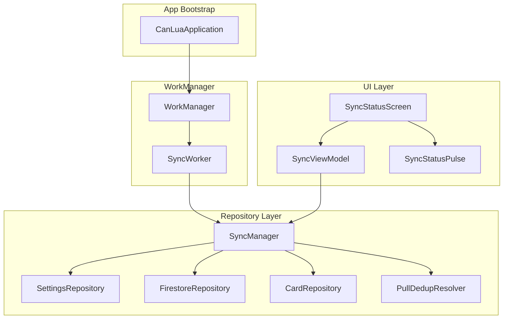
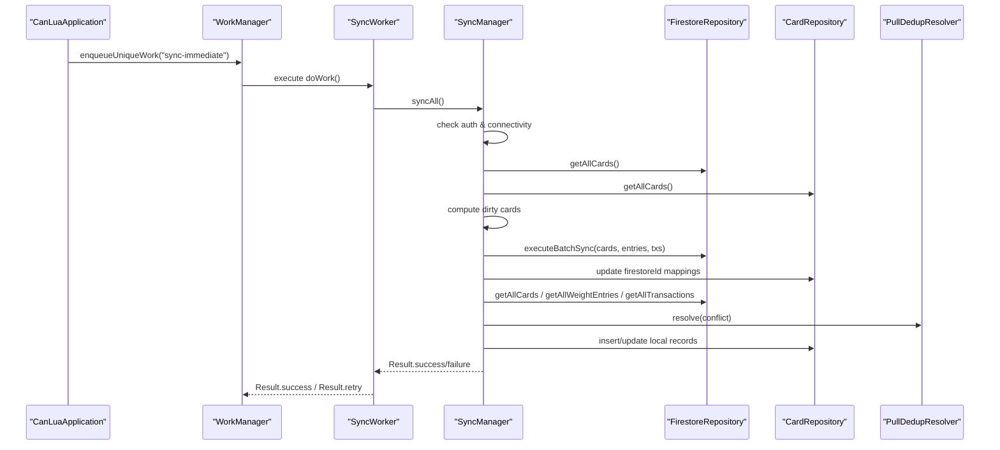
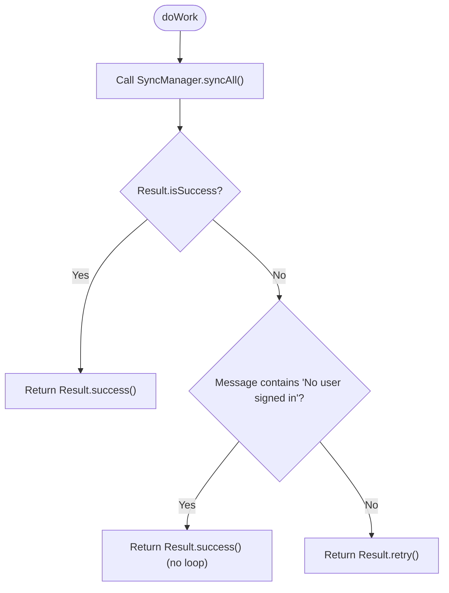
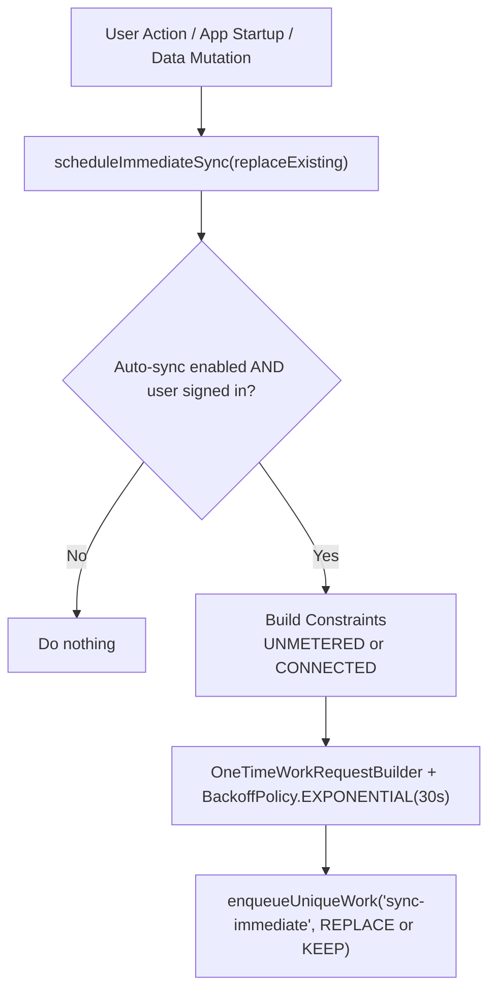
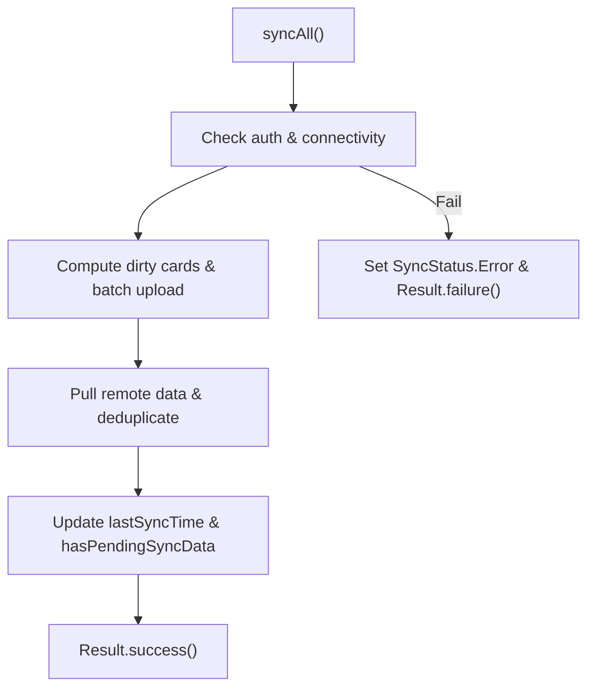
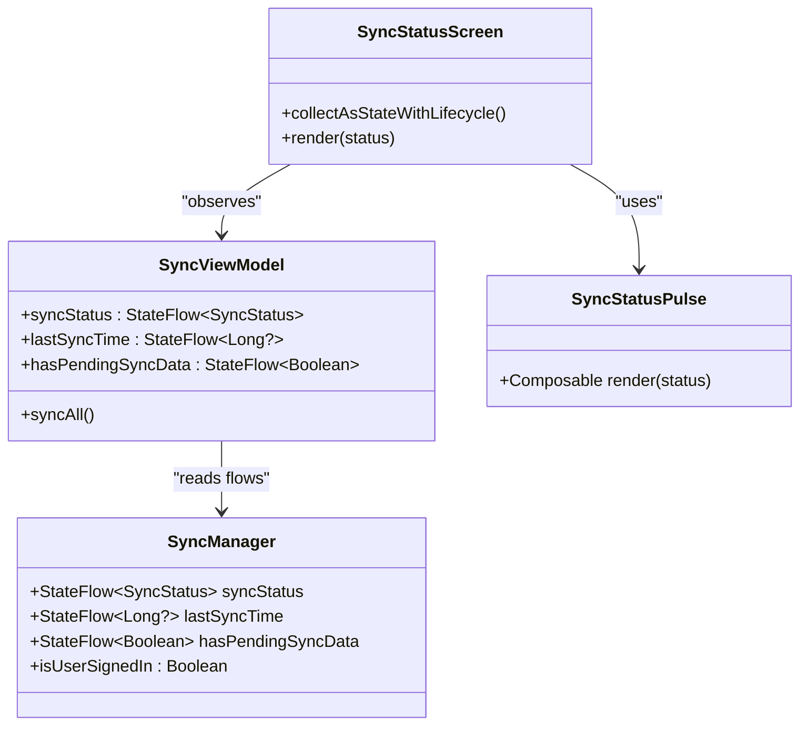
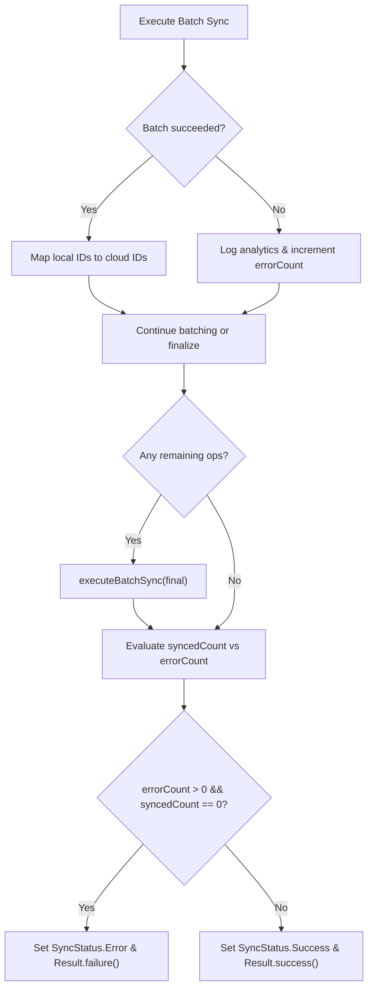
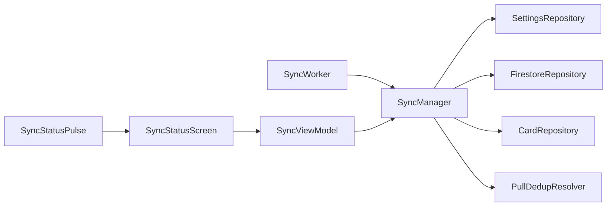

# Background Synchronization Workflow

<cite>
**Referenced Files in This Document**
- [SyncWorker.kt](file://app/src/main/java/com/giathinh/canlua/repository/SyncWorker.kt)
- [SyncManager.kt](file://app/src/main/java/com/giathinh/canlua/repository/SyncManager.kt)
- [SettingsRepository.kt](file://app/src/main/java/com/giathinh/canlua/repository/SettingsRepository.kt)
- [FirestoreRepository.kt](file://app/src/main/java/com/giathinh/canlua/repository/FirestoreRepository.kt)
- [CardRepository.kt](file://app/src/main/java/com/giathinh/canlua/repository/CardRepository.kt)
- [PullDedupResolver.kt](file://app/src/main/java/com/giathinh/canlua/repository/PullDedupResolver.kt)
- [SyncStatusPulse.kt](file://app/src/main/java/com/giathinh/canlua/ui/component/SyncStatusPulse.kt)
- [SyncViewModel.kt](file://app/src/main/java/com/giathinh/canlua/ui/viewmodel/SyncViewModel.kt)
- [SyncStatusScreen.kt](file://app/src/main/java/com/giathinh/canlua/ui/screen/SyncStatusScreen.kt)
- [CanLuaApplication.kt](file://app/src/main/java/com/giathinh/canlua/CanLuaApplication.kt)
</cite>

## Table of Contents
1. [Introduction](#introduction)
2. [Project Structure](#project-structure)
3. [Core Components](#core-components)
4. [Architecture Overview](#architecture-overview)
5. [Detailed Component Analysis](#detailed-component-analysis)
6. [Dependency Analysis](#dependency-analysis)
7. [Performance Considerations](#performance-considerations)
8. [Troubleshooting Guide](#troubleshooting-guide)
9. [Conclusion](#conclusion)

## Introduction
This document explains the background synchronization workflow implemented with WorkManager and Kotlin coroutines. It covers how SyncWorker orchestrates sync operations, how job scheduling constraints are applied, and how worker lifecycle is managed. It also documents trigger mechanisms (manual, automatic, event-driven), status tracking via SyncStatusPulse, retry policies with exponential backoff, failure recovery, configuration examples, monitoring, debugging, and battery optimization considerations including Doze mode compatibility. The app follows an offline-first design: local Room persistence is primary, and cloud data is synchronized bidirectionally to Firebase Firestore and Supabase when connectivity permits.

## Project Structure
The background sync feature spans repository, UI, and application bootstrap layers:
- Repository layer: SyncManager coordinates sync logic; SyncWorker executes work under WorkManager; SettingsRepository provides user preferences; FirestoreRepository and CardRepository provide data access; PullDedupResolver resolves conflicts during pull.
- UI layer: SyncViewModel exposes StateFlow for status; SyncStatusScreen renders sync state; SyncStatusPulse visualizes live status.
- Application bootstrap: CanLuaApplication schedules or cancels sync jobs based on settings changes.

**Diagram sources**
- [CanLuaApplication.kt](file://app/src/main/java/com/giathinh/canlua/CanLuaApplication.kt)
- [SyncWorker.kt](file://app/src/main/java/com/giathinh/canlua/repository/SyncWorker.kt)
- [SyncManager.kt](file://app/src/main/java/com/giathinh/canlua/repository/SyncManager.kt)
- [SettingsRepository.kt](file://app/src/main/java/com/giathinh/canlua/repository/SettingsRepository.kt)
- [FirestoreRepository.kt](file://app/src/main/java/com/giathinh/canlua/repository/FirestoreRepository.kt)
- [CardRepository.kt](file://app/src/main/java/com/giathinh/canlua/repository/CardRepository.kt)
- [PullDedupResolver.kt](file://app/src/main/java/com/giathinh/canlua/repository/PullDedupResolver.kt)
- [SyncViewModel.kt](file://app/src/main/java/com/giathinh/canlua/ui/viewmodel/SyncViewModel.kt)
- [SyncStatusScreen.kt](file://app/src/main/java/com/giathinh/canlua/ui/screen/SyncStatusScreen.kt)
- [SyncStatusPulse.kt](file://app/src/main/java/com/giathinh/canlua/ui/component/SyncStatusPulse.kt)

**Section sources**
- [SyncWorker.kt:10-31](file://app/src/main/java/com/giathinh/canlua/repository/SyncWorker.kt#L10-L31)
- [SyncManager.kt:35-557](file://app/src/main/java/com/giathinh/canlua/repository/SyncManager.kt#L35-L557)
- [SyncViewModel.kt:14-50](file://app/src/main/java/com/giathinh/canlua/ui/viewmodel/SyncViewModel.kt#L14-L50)
- [SyncStatusScreen.kt:67-364](file://app/src/main/java/com/giathinh/canlua/ui/screen/SyncStatusScreen.kt#L67-L364)
- [SyncStatusPulse.kt:30-101](file://app/src/main/java/com/giathinh/canlua/ui/component/SyncStatusPulse.kt#L30-L101)
- [CanLuaApplication.kt:101-120](file://app/src/main/java/com/giathinh/canlua/CanLuaApplication.kt#L101-L120)

## Core Components
- SyncWorker: A Hilt-injected CoroutineWorker that delegates execution to SyncManager.syncAll(). It returns success on successful sync or unauthenticated errors, otherwise requests retry.
- SyncManager: Singleton orchestrator providing:
  - Connectivity checks and policy enforcement (Wi-Fi only vs any network).
  - Job scheduling via WorkManager with constraints and exponential backoff.
  - Bidirectional sync: push dirty local entities to Firestore, then pull remote updates and apply deduplication.
  - Status flows: syncStatus, lastSyncTime, hasPendingSyncData.
- SettingsRepository: Provides user preferences such as auto-sync enablement and Wi-Fi-only sync.
- FirestoreRepository: Cloud API client for reading/writing cards, weight entries, transactions, and batch operations.
- CardRepository: Local Room access and helper methods for pending deletes and orphan matching.
- PullDedupResolver: Conflict resolution strategy for incoming cloud data versus local records.
- SyncViewModel: Exposes sync-related StateFlows and triggers syncAll() from UI.
- SyncStatusScreen: UI screen to monitor sync status and trigger manual sync.
- SyncStatusPulse: Lightweight Compose component showing animated pulse for syncing state.

**Section sources**
- [SyncWorker.kt:10-31](file://app/src/main/java/com/giathinh/canlua/repository/SyncWorker.kt#L10-L31)
- [SyncManager.kt:35-557](file://app/src/main/java/com/giathinh/canlua/repository/SyncManager.kt#L35-L557)
- [SettingsRepository.kt](file://app/src/main/java/com/giathinh/canlua/repository/SettingsRepository.kt)
- [FirestoreRepository.kt](file://app/src/main/java/com/giathinh/canlua/repository/FirestoreRepository.kt)
- [CardRepository.kt](file://app/src/main/java/com/giathinh/canlua/repository/CardRepository.kt)
- [PullDedupResolver.kt](file://app/src/main/java/com/giathinh/canlua/repository/PullDedupResolver.kt)
- [SyncViewModel.kt:14-50](file://app/src/main/java/com/giathinh/canlua/ui/viewmodel/SyncViewModel.kt#L14-L50)
- [SyncStatusScreen.kt:67-364](file://app/src/main/java/com/giathinh/canlua/ui/screen/SyncStatusScreen.kt#L67-L364)
- [SyncStatusPulse.kt:30-101](file://app/src/main/java/com/giathinh/canlua/ui/component/SyncStatusPulse.kt#L30-L101)

## Architecture Overview
The background sync architecture uses WorkManager to schedule a unique one-time job that runs when network constraints are satisfied. SyncWorker invokes SyncManager.syncAll(), which performs:
- Authentication and connectivity validation.
- Push phase: identify dirty local cards and related entities, batch them, upload to Firestore, and update local IDs.
- Pull phase: fetch remote cards, resolve conflicts using PullDedupResolver, and insert/update local records.
- Analytics and status updates.

**Diagram sources**
- [CanLuaApplication.kt:101-120](file://app/src/main/java/com/giathinh/canlua/CanLuaApplication.kt#L101-L120)
- [SyncWorker.kt:17-31](file://app/src/main/java/com/giathinh/canlua/repository/SyncWorker.kt#L17-L31)
- [SyncManager.kt:102-130](file://app/src/main/java/com/giathinh/canlua/repository/SyncManager.kt#L102-L130)
- [SyncManager.kt:139-311](file://app/src/main/java/com/giathinh/canlua/repository/SyncManager.kt#L139-L311)
- [SyncManager.kt:313-412](file://app/src/main/java/com/giathinh/canlua/repository/SyncManager.kt#L313-L412)
- [FirestoreRepository.kt](file://app/src/main/java/com/giathinh/canlua/repository/FirestoreRepository.kt)
- [CardRepository.kt](file://app/src/main/java/com/giathinh/canlua/repository/CardRepository.kt)
- [PullDedupResolver.kt](file://app/src/main/java/com/giathinh/canlua/repository/PullDedupResolver.kt)

## Detailed Component Analysis

### SyncWorker Lifecycle and Retry Policy
- Execution: SyncWorker.doWork() calls SyncManager.syncAll().
- Success path: Returns Result.success().
- Failure path: If error message indicates no authenticated user, returns Result.success() to avoid infinite retries; otherwise returns Result.retry() to let WorkManager reschedule with backoff.
- Backoff: Configured as exponential with a base delay of 30 seconds.

**Diagram sources**
- [SyncWorker.kt:17-31](file://app/src/main/java/com/giathinh/canlua/repository/SyncWorker.kt#L17-L31)
- [SyncManager.kt:117-122](file://app/src/main/java/com/giathinh/canlua/repository/SyncManager.kt#L117-L122)

**Section sources**
- [SyncWorker.kt:10-31](file://app/src/main/java/com/giathinh/canlua/repository/SyncWorker.kt#L10-L31)
- [SyncManager.kt:117-122](file://app/src/main/java/com/giathinh/canlua/repository/SyncManager.kt#L117-L122)

### Job Scheduling Constraints and Trigger Mechanisms
- Manual trigger: UI calls SyncViewModel.syncAll(), which invokes SyncManager.syncAll() directly.
- Automatic background execution: CanLuaApplication calls scheduleImmediateSync() on app startup or when settings change.
- Event-driven synchronization: Data write repositories call scheduleImmediateSync() after mutations to ensure eventual consistency.
- Constraints:
  - NetworkType.UNMETERED if Wi-Fi-only is enabled; otherwise NetworkType.CONNECTED.
  - ExistingWorkPolicy.REPLACE when replacing existing work (e.g., settings changed); KEEP when queuing during continuous writes.
  - BackoffPolicy.EXPONENTIAL with 30-second base delay.

**Diagram sources**
- [SyncManager.kt:102-130](file://app/src/main/java/com/giathinh/canlua/repository/SyncManager.kt#L102-L130)
- [CanLuaApplication.kt:101-120](file://app/src/main/java/com/giathinh/canlua/CanLuaApplication.kt#L101-L120)

**Section sources**
- [SyncManager.kt:102-130](file://app/src/main/java/com/giathinh/canlua/repository/SyncManager.kt#L102-L130)
- [CanLuaApplication.kt:101-120](file://app/src/main/java/com/giathinh/canlua/CanLuaApplication.kt#L101-L120)

### Sync Orchestration and Data Flow
- Authentication and connectivity checks:
  - Requires an authenticated non-anonymous user.
  - Enforces Wi-Fi-only or general connectivity based on settings.
- Push phase:
  - Fetches all cloud cards and maps by ID and timestamp.
  - Compares with local cards to determine dirty set.
  - Batches card, weight entry, and transaction operations up to a threshold before executing Firestore batch sync.
  - Updates local IDs after successful batch.
- Pull phase:
  - Retrieves remote cards, weight entries, and transactions.
  - Applies tombstone-based deletion for cloud-deleted items.
  - Resolves conflicts using PullDedupResolver and inserts/updates local records.
- Status and analytics:
  - Emits SyncStatus.Syncing during operation.
  - On success, emits SyncStatus.Success and updates lastSyncTime.
  - On failure, emits SyncStatus.Error and logs analytics.

**Diagram sources**
- [SyncManager.kt:139-311](file://app/src/main/java/com/giathinh/canlua/repository/SyncManager.kt#L139-L311)
- [SyncManager.kt:313-412](file://app/src/main/java/com/giathinh/canlua/repository/SyncManager.kt#L313-L412)

**Section sources**
- [SyncManager.kt:139-311](file://app/src/main/java/com/giathinh/canlua/repository/SyncManager.kt#L139-L311)
- [SyncManager.kt:313-412](file://app/src/main/java/com/giathinh/canlua/repository/SyncManager.kt#L313-L412)

### Status Tracking System: SyncStatusPulse and Real-Time Updates
- State exposure:
  - SyncManager exposes syncStatus, lastSyncTime, and hasPendingSyncData as StateFlow.
  - SyncViewModel proxies these flows to UI.
- UI rendering:
  - SyncStatusScreen collects flows and displays status-specific icons, messages, and timestamps.
  - SyncStatusPulse shows a pulsing dot for Syncing, static green for Idle/Success, and red for Error.
- Animation performance:
  - Infinite animations run only when status is Syncing to avoid unnecessary frame ticks.

**Diagram sources**
- [SyncManager.kt:46-57](file://app/src/main/java/com/giathinh/canlua/repository/SyncManager.kt#L46-L57)
- [SyncViewModel.kt:14-50](file://app/src/main/java/com/giathinh/canlua/ui/viewmodel/SyncViewModel.kt#L14-L50)
- [SyncStatusScreen.kt:67-364](file://app/src/main/java/com/giathinh/canlua/ui/screen/SyncStatusScreen.kt#L67-L364)
- [SyncStatusPulse.kt:30-101](file://app/src/main/java/com/giathinh/canlua/ui/component/SyncStatusPulse.kt#L30-L101)

**Section sources**
- [SyncManager.kt:46-57](file://app/src/main/java/com/giathinh/canlua/repository/SyncManager.kt#L46-L57)
- [SyncViewModel.kt:14-50](file://app/src/main/java/com/giathinh/canlua/ui/viewmodel/SyncViewModel.kt#L14-L50)
- [SyncStatusScreen.kt:67-364](file://app/src/main/java/com/giathinh/canlua/ui/screen/SyncStatusScreen.kt#L67-L364)
- [SyncStatusPulse.kt:30-101](file://app/src/main/java/com/giathinh/canlua/ui/component/SyncStatusPulse.kt#L30-L101)

### Retry Policies, Exponential Backoff, and Failure Recovery
- Retry policy:
  - WorkManager applies BackoffPolicy.EXPONENTIAL with a 30-second initial delay.
  - SyncWorker returns Result.retry() for transient failures; avoids retry loops on authentication errors.
- Failure recovery:
  - Partial batch failures are logged and counted; if all cards fail, sync reports error.
  - Successful batches update local IDs to maintain idempotency.
  - Pull phase handles tombstones and missing remote entities gracefully.

**Diagram sources**
- [SyncManager.kt:175-304](file://app/src/main/java/com/giathinh/canlua/repository/SyncManager.kt#L175-L304)

**Section sources**
- [SyncManager.kt:117-122](file://app/src/main/java/com/giathinh/canlua/repository/SyncManager.kt#L117-L122)
- [SyncManager.kt:175-304](file://app/src/main/java/com/giathinh/canlua/repository/SyncManager.kt#L175-L304)
- [SyncWorker.kt:17-31](file://app/src/main/java/com/giathinh/canlua/repository/SyncWorker.kt#L17-L31)

### Practical Examples

- Configure sync intervals and constraints:
  - Use scheduleImmediateSync(replaceExisting = true) when network settings change to replace existing work.
  - Use scheduleImmediateSync() after data mutations to queue sync when auto-sync is enabled.
  - Constraints are derived from SettingsRepository.isSyncOnlyWifi(): UNMETERED for Wi-Fi-only, CONNECTED otherwise.

- Monitor sync status:
  - Collect SyncViewModel.syncStatus in UI to display real-time state.
  - Display lastSyncTime to inform users of the most recent successful sync.
  - Use SyncStatusPulse to show a lightweight indicator in toolbars or banners.

- Debug background sync issues:
  - Verify canSync() conditions: connectivity and Wi-Fi-only preference.
  - Check isUserSignedIn to ensure authentication is present.
  - Inspect analytics tags "sync_batch", "sync_all", and stage markers like "push_all".
  - Confirm WorkManager unique work name "sync-immediate" is enqueued and not canceled.

**Section sources**
- [SyncManager.kt:102-130](file://app/src/main/java/com/giathinh/canlua/repository/SyncManager.kt#L102-L130)
- [SyncManager.kt:139-311](file://app/src/main/java/com/giathinh/canlua/repository/SyncManager.kt#L139-L311)
- [SyncViewModel.kt:14-50](file://app/src/main/java/com/giathinh/canlua/ui/viewmodel/SyncViewModel.kt#L14-L50)
- [SyncStatusScreen.kt:67-364](file://app/src/main/java/com/giathinh/canlua/ui/screen/SyncStatusScreen.kt#L67-L364)
- [SyncStatusPulse.kt:30-101](file://app/src/main/java/com/giathinh/canlua/ui/component/SyncStatusPulse.kt#L30-L101)

### Battery Optimization and Doze Mode Compatibility
- WorkManager automatically respects system power-saving policies, including Doze mode and App Standby. Jobs are deferred until maintenance windows unless explicitly urgent.
- Using OneTimeWorkRequest with constraints ensures jobs run only when required network conditions are met, reducing unnecessary wakeups.
- Exponential backoff minimizes resource consumption during repeated failures.
- Avoid frequent short-interval scheduling; prefer event-driven triggers and replace-existing policy when settings change to prevent job thrashing.

[No sources needed since this section provides general guidance]

## Dependency Analysis
Key dependencies and relationships:
- SyncWorker depends on SyncManager for business logic.
- SyncManager depends on SettingsRepository for preferences, FirestoreRepository for cloud I/O, CardRepository for local data, and PullDedupResolver for conflict resolution.
- UI components depend on SyncViewModel, which wraps SyncManager flows.

**Diagram sources**
- [SyncWorker.kt:10-31](file://app/src/main/java/com/giathinh/canlua/repository/SyncWorker.kt#L10-L31)
- [SyncManager.kt:35-557](file://app/src/main/java/com/giathinh/canlua/repository/SyncManager.kt#L35-L557)
- [SettingsRepository.kt](file://app/src/main/java/com/giathinh/canlua/repository/SettingsRepository.kt)
- [FirestoreRepository.kt](file://app/src/main/java/com/giathinh/canlua/repository/FirestoreRepository.kt)
- [CardRepository.kt](file://app/src/main/java/com/giathinh/canlua/repository/CardRepository.kt)
- [PullDedupResolver.kt](file://app/src/main/java/com/giathinh/canlua/repository/PullDedupResolver.kt)
- [SyncViewModel.kt:14-50](file://app/src/main/java/com/giathinh/canlua/ui/viewmodel/SyncViewModel.kt#L14-L50)
- [SyncStatusScreen.kt:67-364](file://app/src/main/java/com/giathinh/canlua/ui/screen/SyncStatusScreen.kt#L67-L364)
- [SyncStatusPulse.kt:30-101](file://app/src/main/java/com/giathinh/canlua/ui/component/SyncStatusPulse.kt#L30-L101)

**Section sources**
- [SyncWorker.kt:10-31](file://app/src/main/java/com/giathinh/canlua/repository/SyncWorker.kt#L10-L31)
- [SyncManager.kt:35-557](file://app/src/main/java/com/giathinh/canlua/repository/SyncManager.kt#L35-L557)
- [SyncViewModel.kt:14-50](file://app/src/main/java/com/giathinh/canlua/ui/viewmodel/SyncViewModel.kt#L14-L50)

## Performance Considerations
- Batching: Group card, weight entry, and transaction operations into batches to reduce network round-trips and respect Firestore limits.
- Idempotency: Maintain mapping between local IDs and cloud IDs to avoid duplicate uploads and support safe retries.
- Threading: Heavy IO runs on Dispatchers.IO to keep UI responsive.
- Animation efficiency: Pulse animation runs only during Syncing state to minimize CPU usage.

[No sources needed since this section provides general guidance]

## Troubleshooting Guide
Common issues and resolutions:
- No user signed in:
  - Symptom: Sync fails immediately; Worker does not retry to avoid loops.
  - Resolution: Ensure user is authenticated and not anonymous before enabling auto-sync.
- Network constraints not met:
  - Symptom: WorkManager defers job; canSync() returns false.
  - Resolution: Connect to Wi-Fi if Wi-Fi-only is enabled; verify connectivity APIs return valid networks.
- All cards failed to sync:
  - Symptom: SyncStatus.Error with message indicating failure.
  - Resolution: Check FirestoreRepository.batch operations and analytics logs; inspect partial successes and retry.
- Stuck in Syncing state:
  - Symptom: UI shows pulsing indicator indefinitely.
  - Resolution: Verify WorkManager job completion; check for exceptions in syncAll(); confirm status flows are updated.

**Section sources**
- [SyncWorker.kt:17-31](file://app/src/main/java/com/giathinh/canlua/repository/SyncWorker.kt#L17-L31)
- [SyncManager.kt:139-311](file://app/src/main/java/com/giathinh/canlua/repository/SyncManager.kt#L139-L311)
- [SyncStatusScreen.kt:67-364](file://app/src/main/java/com/giathinh/canlua/ui/screen/SyncStatusScreen.kt#L67-L364)

## Conclusion
The background synchronization workflow leverages WorkManager, Coroutines, and a robust SyncManager to deliver reliable, offline-first data synchronization. It supports manual, automatic, and event-driven triggers, enforces network constraints, and implements exponential backoff with careful retry handling. The UI provides clear status feedback through SyncStatusPulse and SyncStatusScreen, while analytics aid in diagnosing issues. Proper configuration and adherence to system power policies ensure efficient operation under battery optimization and Doze mode.

[No sources needed since this section summarizes without analyzing specific files]