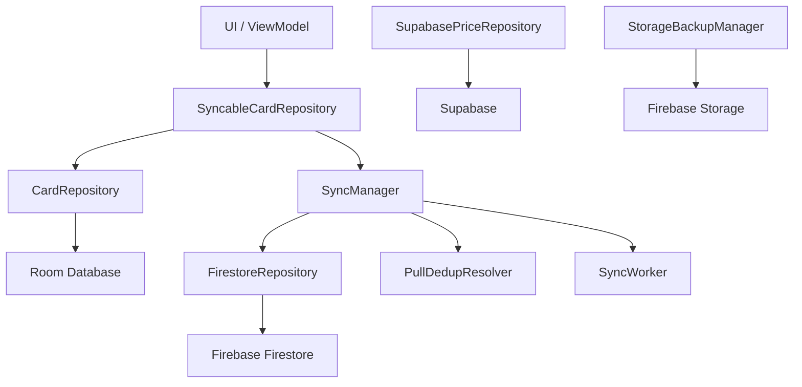
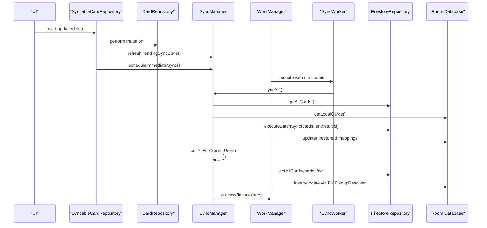
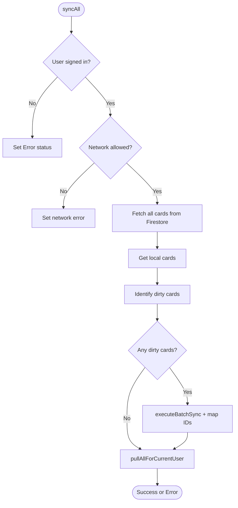
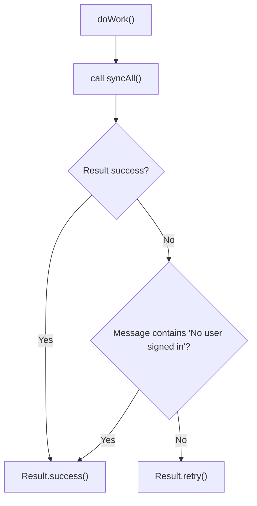
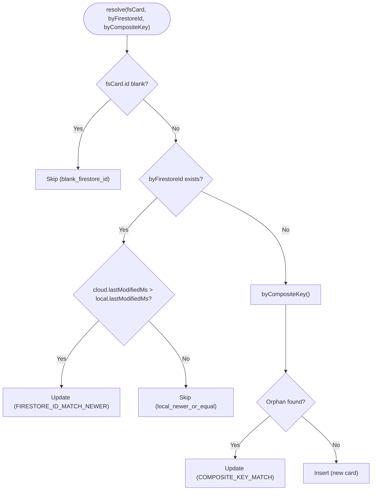
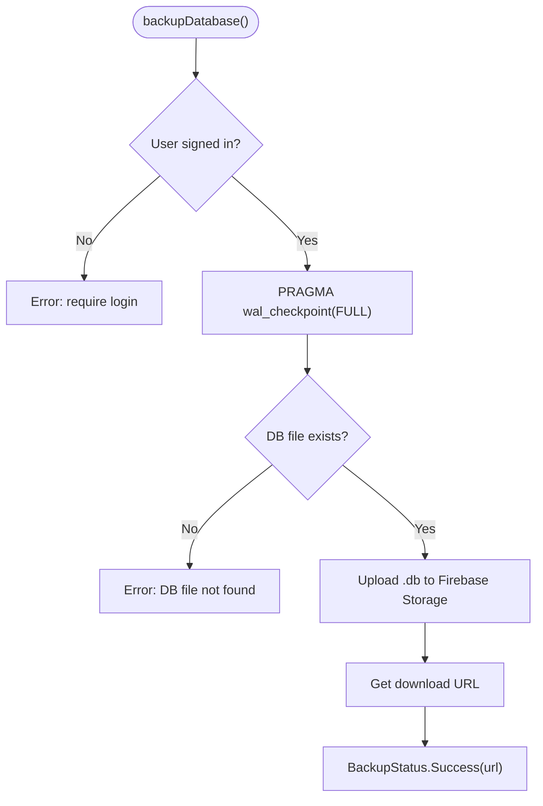
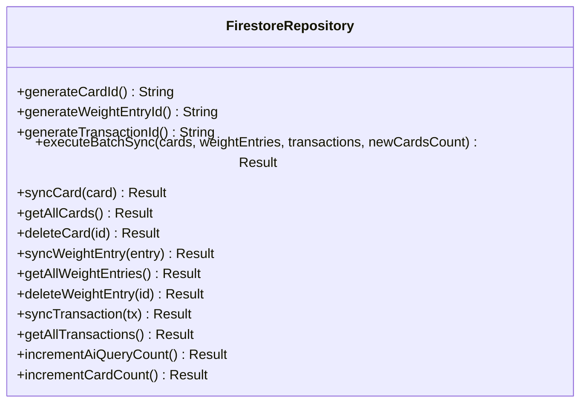
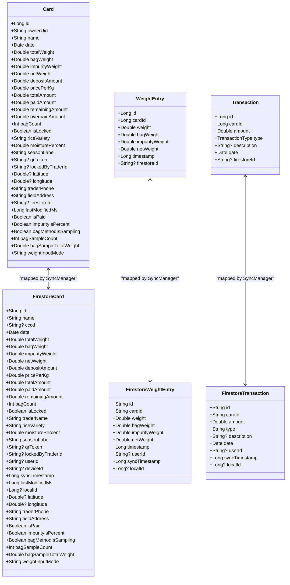
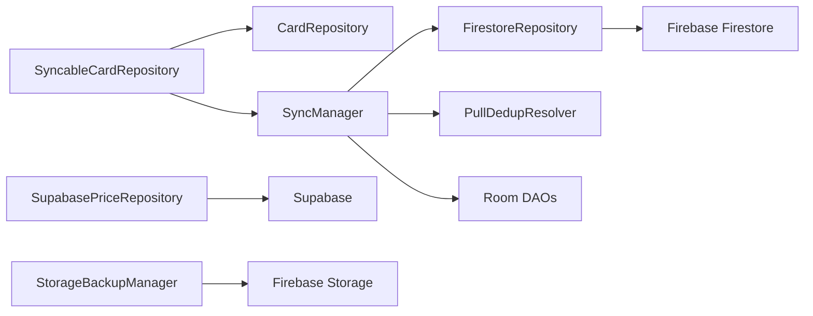

# Data Synchronization

<cite>
**Referenced Files in This Document**
- [SyncManager.kt](file://app/src/main/java/com/giathinh/canlua/repository/SyncManager.kt)
- [SyncWorker.kt](file://app/src/main/java/com/giathinh/canlua/repository/SyncWorker.kt)
- [PullDedupResolver.kt](file://app/src/main/java/com/giathinh/canlua/repository/PullDedupResolver.kt)
- [StorageBackupManager.kt](file://app/src/main/java/com/giathinh/canlua/repository/StorageBackupManager.kt)
- [CardRepository.kt](file://app/src/main/java/com/giathinh/canlua/repository/CardRepository.kt)
- [FirestoreRepository.kt](file://app/src/main/java/com/giathinh/canlua/repository/FirestoreRepository.kt)
- [SupabasePriceRepository.kt](file://app/src/main/java/com/giathinh/canlua/repository/SupabasePriceRepository.kt)
- [FirestoreCard.kt](file://app/src/main/java/com/giathinh/canlua/data/firestore/FirestoreCard.kt)
- [FirestoreWeightEntry.kt](file://app/src/main/java/com/giathinh/canlua/data/firestore/FirestoreWeightEntry.kt)
- [FirestoreTransaction.kt](file://app/src/main/java/com/giathinh/canlua/data/firestore/FirestoreTransaction.kt)
- [Card.kt](file://app/src/main/java/com/giathinh/canlua/data/model/Card.kt)
- [WeightEntry.kt](file://app/src/main/java/com/giathinh/canlua/data/model/WeightEntry.kt)
- [Transaction.kt](file://app/src/main/java/com/giathinh/canlua/data/model/Transaction.kt)
- [SyncableCardRepository.kt](file://app/src/main/java/com/giathinh/canlua/repository/SyncableCardRepository.kt)
- [SyncStatusPulse.kt](file://app/src/main/java/com/giathinh/canlua/ui/component/SyncStatusPulse.kt)
</cite>

## Table of Contents
1. [Introduction](#introduction)
2. [Project Structure](#project-structure)
3. [Core Components](#core-components)
4. [Architecture Overview](#architecture-overview)
5. [Detailed Component Analysis](#detailed-component-analysis)
6. [Dependency Analysis](#dependency-analysis)
7. [Performance Considerations](#performance-considerations)
8. [Troubleshooting Guide](#troubleshooting-guide)
9. [Conclusion](#conclusion)
10. [Appendices](#appendices)

## Introduction
This document explains the offline-first data synchronization system that keeps local Room data consistent with cloud storage (Firebase Firestore and Supabase). It covers bidirectional sync, background scheduling via WorkManager, idempotent operations, network state monitoring, automatic retry, conflict resolution, pull deduplication, storage backup for portability, data models, sync status tracking, and error recovery. The app remains fully functional without network access; sync is opportunistic and scheduled when connectivity allows.

## Project Structure
The synchronization layer sits between UI/ViewModels and persistence/cloud layers:
- Local persistence: Room entities and DAOs (not shown here).
- Domain repository: CardRepository handles business logic and per-user isolation.
- Sync orchestration: SyncManager coordinates push/pull, batching, and status.
- Background execution: SyncWorker runs sync tasks under WorkManager constraints.
- Cloud clients: FirestoreRepository for Firestore; SupabasePriceRepository for read-only market prices.
- Models: Local Room models and Firestore DTOs.
- UI feedback: SyncStatusPulse displays sync state.

**Diagram sources**
- [SyncManager.kt:35-130](file://app/src/main/java/com/giathinh/canlua/repository/SyncManager.kt#L35-L130)
- [SyncWorker.kt:10-31](file://app/src/main/java/com/giathinh/canlua/repository/SyncWorker.kt#L10-L31)
- [FirestoreRepository.kt:21-85](file://app/src/main/java/com/giathinh/canlua/repository/FirestoreRepository.kt#L21-L85)
- [SupabasePriceRepository.kt:22-59](file://app/src/main/java/com/giathinh/canlua/repository/SupabasePriceRepository.kt#L22-L59)
- [StorageBackupManager.kt:19-69](file://app/src/main/java/com/giathinh/canlua/repository/StorageBackupManager.kt#L19-L69)

**Section sources**
- [SyncManager.kt:35-130](file://app/src/main/java/com/giathinh/canlua/repository/SyncManager.kt#L35-L130)
- [FirestoreRepository.kt:21-85](file://app/src/main/java/com/giathinh/canlua/repository/FirestoreRepository.kt#L21-L85)
- [SupabasePriceRepository.kt:22-59](file://app/src/main/java/com/giathinh/canlua/repository/SupabasePriceRepository.kt#L22-L59)
- [StorageBackupManager.kt:19-69](file://app/src/main/java/com/giathinh/canlua/repository/StorageBackupManager.kt#L19-L69)

## Core Components
- SyncManager: Orchestrates bidirectional sync, enqueues WorkManager jobs, checks network state, batches Firestore writes, maps local ↔ cloud models, and tracks sync status.
- SyncWorker: Executes syncAll() in background with retry policy.
- PullDedupResolver: Pure logic to decide Insert/Update/Skip during pull based on firestoreId and composite key matching.
- StorageBackupManager: Exports a full Room database file to Firebase Storage for portability.
- FirestoreRepository: CRUD and batch operations over Firestore collections.
- SupabasePriceRepository: Read-only fetch of rice prices from Supabase.
- CardRepository: Local business logic, per-user isolation, tombstone-based delete handling, and calculations.
- SyncableCardRepository: Decorator that triggers pending sync after local mutations.
- UI Sync Status Pulse: Visual indicator for sync states.

**Section sources**
- [SyncManager.kt:35-557](file://app/src/main/java/com/giathinh/canlua/repository/SyncManager.kt#L35-L557)
- [SyncWorker.kt:10-31](file://app/src/main/java/com/giathinh/canlua/repository/SyncWorker.kt#L10-L31)
- [PullDedupResolver.kt:21-73](file://app/src/main/java/com/giathinh/canlua/repository/PullDedupResolver.kt#L21-L73)
- [StorageBackupManager.kt:19-79](file://app/src/main/java/com/giathinh/canlua/repository/StorageBackupManager.kt#L19-L79)
- [FirestoreRepository.kt:21-357](file://app/src/main/java/com/giathinh/canlua/repository/FirestoreRepository.kt#L21-L357)
- [SupabasePriceRepository.kt:22-90](file://app/src/main/java/com/giathinh/canlua/repository/SupabasePriceRepository.kt#L22-L90)
- [CardRepository.kt:36-406](file://app/src/main/java/com/giathinh/canlua/repository/CardRepository.kt#L36-L406)
- [SyncableCardRepository.kt:10-86](file://app/src/main/java/com/giathinh/canlua/repository/SyncableCardRepository.kt#L10-L86)
- [SyncStatusPulse.kt:30-100](file://app/src/main/java/com/giathinh/canlua/ui/component/SyncStatusPulse.kt#L30-L100)

## Architecture Overview
The system implements an offline-first, bidirectional sync pipeline:
- Push: Dirty local cards (and related weight entries and transactions) are batched and written to Firestore. After successful write, local IDs are mapped to Firestore IDs.
- Pull: Cloud cards are reconciled against local records using PullDedupResolver; related entries and transactions are inserted if not present locally. Tombstoned deletions are propagated to cloud.
- Background scheduling: WorkManager schedules SyncWorker with exponential backoff and network constraints.
- Network gating: Sync only proceeds when online or Wi-Fi depending on settings.
- Status tracking: StateFlow exposes Idle/Syncing/Success/Error and last sync time.

**Diagram sources**
- [SyncableCardRepository.kt:21-49](file://app/src/main/java/com/giathinh/canlua/repository/SyncableCardRepository.kt#L21-L49)
- [SyncManager.kt:102-130](file://app/src/main/java/com/giathinh/canlua/repository/SyncManager.kt#L102-L130)
- [SyncWorker.kt:17-31](file://app/src/main/java/com/giathinh/canlua/repository/SyncWorker.kt#L17-L31)
- [FirestoreRepository.kt:45-85](file://app/src/main/java/com/giathinh/canlua/repository/FirestoreRepository.kt#L45-L85)
- [SyncManager.kt:139-311](file://app/src/main/java/com/giathinh/canlua/repository/SyncManager.kt#L139-L311)
- [SyncManager.kt:313-412](file://app/src/main/java/com/giathinh/canlua/repository/SyncManager.kt#L313-L412)

## Detailed Component Analysis

### Bidirectional Sync Orchestration (SyncManager)
Responsibilities:
- Enqueue immediate sync via WorkManager with configurable network constraints.
- Check connectivity and Wi-Fi-only policy before syncing.
- Push dirty local data in batches to Firestore, mapping local IDs to Firestore IDs.
- Pull cloud data and reconcile with local using PullDedupResolver.
- Propagate cloud deletes for tombstoned local records.
- Track sync status and last sync time.

Key behaviors:
- Idempotent push: uses existing Firestore IDs when present; generates new IDs for new records.
- Batch size control: groups operations to avoid exceeding limits.
- Error handling: logs analytics, sets error status, and returns failure results.
- Pull dedup: decides Insert/Update/Skip based on firestoreId match and composite key fallback.

**Diagram sources**
- [SyncManager.kt:139-311](file://app/src/main/java/com/giathinh/canlua/repository/SyncManager.kt#L139-L311)
- [SyncManager.kt:313-412](file://app/src/main/java/com/giathinh/canlua/repository/SyncManager.kt#L313-L412)

**Section sources**
- [SyncManager.kt:58-84](file://app/src/main/java/com/giathinh/canlua/repository/SyncManager.kt#L58-L84)
- [SyncManager.kt:102-130](file://app/src/main/java/com/giathinh/canlua/repository/SyncManager.kt#L102-L130)
- [SyncManager.kt:139-311](file://app/src/main/java/com/giathinh/canlua/repository/SyncManager.kt#L139-L311)
- [SyncManager.kt:313-412](file://app/src/main/java/com/giathinh/canlua/repository/SyncManager.kt#L313-L412)

### Background Scheduling and Retry (SyncWorker)
- Runs syncAll() in background.
- Retries on failures unless the error indicates no user signed in (avoids infinite retry loops).
- Uses WorkManager constraints set by SyncManager (Wi-Fi or connected).

**Diagram sources**
- [SyncWorker.kt:17-31](file://app/src/main/java/com/giathinh/canlua/repository/SyncWorker.kt#L17-L31)

**Section sources**
- [SyncWorker.kt:10-31](file://app/src/main/java/com/giathinh/canlua/repository/SyncWorker.kt#L10-L31)

### Pull Deduplication Resolver
Decides how to reconcile each cloud card into Room:
- Case 1: Match by firestoreId → compare timestamps; overwrite if cloud newer, else skip.
- Case 2: No firestoreId match but composite key matches (date + name + totalWeight) → stamp firestoreId onto legacy local record.
- Case 3: Otherwise → insert as new card.

**Diagram sources**
- [PullDedupResolver.kt:45-73](file://app/src/main/java/com/giathinh/canlua/repository/PullDedupResolver.kt#L45-L73)

**Section sources**
- [PullDedupResolver.kt:21-73](file://app/src/main/java/com/giathinh/canlua/repository/PullDedupResolver.kt#L21-L73)

### Storage Backup Manager
Exports the Room database file to Firebase Storage:
- Requires authenticated user.
- Performs WAL checkpoint to flush writes.
- Uploads .db file and returns download URL.
- Tracks backup status and last backup time.

**Diagram sources**
- [StorageBackupManager.kt:32-69](file://app/src/main/java/com/giathinh/canlua/repository/StorageBackupManager.kt#L32-L69)

**Section sources**
- [StorageBackupManager.kt:19-79](file://app/src/main/java/com/giathinh/canlua/repository/StorageBackupManager.kt#L19-L79)

### Firestore Repository
Provides:
- ID generation for documents.
- Batched writes for cards, weight entries, and transactions.
- Individual CRUD operations.
- Aggregation counters for profiles.

**Diagram sources**
- [FirestoreRepository.kt:21-85](file://app/src/main/java/com/giathinh/canlua/repository/FirestoreRepository.kt#L21-L85)
- [FirestoreRepository.kt:87-357](file://app/src/main/java/com/giathinh/canlua/repository/FirestoreRepository.kt#L87-L357)

**Section sources**
- [FirestoreRepository.kt:21-357](file://app/src/main/java/com/giathinh/canlua/repository/FirestoreRepository.kt#L21-L357)

### Supabase Price Repository
Read-only access to rice prices:
- Fetches active prices ordered by updated_at.
- Logs errors and falls back gracefully.

**Section sources**
- [SupabasePriceRepository.kt:22-90](file://app/src/main/java/com/giathinh/canlua/repository/SupabasePriceRepository.kt#L22-L90)

### Local Data Models and Cloud DTOs
- Local Room models: Card, WeightEntry, Transaction.
- Firestore DTOs: FirestoreCard, FirestoreWeightEntry, FirestoreTransaction.
- Mapping functions in SyncManager convert between local and cloud representations.

**Diagram sources**
- [Card.kt:8-106](file://app/src/main/java/com/giathinh/canlua/data/model/Card.kt#L8-L106)
- [FirestoreCard.kt:7-65](file://app/src/main/java/com/giathinh/canlua/data/firestore/FirestoreCard.kt#L7-L65)
- [WeightEntry.kt:7-30](file://app/src/main/java/com/giathinh/canlua/data/model/WeightEntry.kt#L7-L30)
- [FirestoreWeightEntry.kt:7-20](file://app/src/main/java/com/giathinh/canlua/data/firestore/FirestoreWeightEntry.kt#L7-L20)
- [Transaction.kt:8-36](file://app/src/main/java/com/giathinh/canlua/data/model/Transaction.kt#L8-L36)
- [FirestoreTransaction.kt:7-20](file://app/src/main/java/com/giathinh/canlua/data/firestore/FirestoreTransaction.kt#L7-L20)
- [SyncManager.kt:418-545](file://app/src/main/java/com/giathinh/canlua/repository/SyncManager.kt#L418-L545)

**Section sources**
- [Card.kt:8-106](file://app/src/main/java/com/giathinh/canlua/data/model/Card.kt#L8-L106)
- [FirestoreCard.kt:7-65](file://app/src/main/java/com/giathinh/canlua/data/firestore/FirestoreCard.kt#L7-L65)
- [WeightEntry.kt:7-30](file://app/src/main/java/com/giathinh/canlua/data/model/WeightEntry.kt#L7-L30)
- [FirestoreWeightEntry.kt:7-20](file://app/src/main/java/com/giathinh/canlua/data/firestore/FirestoreWeightEntry.kt#L7-L20)
- [Transaction.kt:8-36](file://app/src/main/java/com/giathinh/canlua/data/model/Transaction.kt#L8-L36)
- [FirestoreTransaction.kt:7-20](file://app/src/main/java/com/giathinh/canlua/data/firestore/FirestoreTransaction.kt#L7-L20)
- [SyncManager.kt:418-545](file://app/src/main/java/com/giathinh/canlua/repository/SyncManager.kt#L418-L545)

### Conflict Resolution Strategies
- Timestamp-based conflict resolution: cloud wins only if its lastModifiedMs is newer than local lastModifiedMs.
- Legacy reconciliation: composite key matching stamps firestoreId onto orphan local records to prevent duplicates across logout/login cycles.
- Tombstone-based deletion: local deletes create tombstones; pull phase skips tombstoned cards even if they exist in cloud.

Practical scenarios:
- Same card edited on two devices: the device with the newer lastModifiedMs wins.
- Old pre-v13 card without firestoreId: matched by composite key and stamped with firestoreId.
- Deleted card reappears in cloud: skipped due to tombstone; cloud-side deletion is attempted and tombstone marked as deleted.

**Section sources**
- [PullDedupResolver.kt:21-73](file://app/src/main/java/com/giathinh/canlua/repository/PullDedupResolver.kt#L21-L73)
- [CardRepository.kt:87-164](file://app/src/main/java/com/giathinh/canlua/repository/CardRepository.kt#L87-L164)
- [SyncManager.kt:313-412](file://app/src/main/java/com/giathinh/canlua/repository/SyncManager.kt#L313-L412)

### Idempotent Sync Operations
- Push uses existing Firestore IDs when available; new IDs generated only for new records.
- Batch commits ensure atomicity; partial failures are logged and retried.
- Pull inserts only when local does not already have the corresponding Firestore ID.

**Section sources**
- [FirestoreRepository.kt:45-85](file://app/src/main/java/com/giathinh/canlua/repository/FirestoreRepository.kt#L45-L85)
- [SyncManager.kt:175-287](file://app/src/main/java/com/giathinh/canlua/repository/SyncManager.kt#L175-L287)
- [SyncManager.kt:385-405](file://app/src/main/java/com/giathinh/canlua/repository/SyncManager.kt#L385-L405)

### Network State Monitoring and Automatic Retry
- Connectivity checks: isOnline(), isWifiConnected(), canSync().
- WorkManager constraints: UNMETERED for Wi-Fi-only mode, CONNECTED otherwise.
- Backoff policy: exponential backoff with 30-second initial delay.
- Retry behavior: SyncWorker retries unless error indicates no user signed in.

**Section sources**
- [SyncManager.kt:58-84](file://app/src/main/java/com/giathinh/canlua/repository/SyncManager.kt#L58-L84)
- [SyncManager.kt:102-130](file://app/src/main/java/com/giathinh/canlua/repository/SyncManager.kt#L102-L130)
- [SyncWorker.kt:17-31](file://app/src/main/java/com/giathinh/canlua/repository/SyncWorker.kt#L17-L31)

### Error Recovery Procedures
- Analytics logging for non-fatal errors and sync outcomes.
- Sync status transitions to Error with descriptive messages.
- Tombstone mechanism prevents “resurrection” of deleted cards after pull.
- Backup manager provides portable copies of the database.

**Section sources**
- [SyncManager.kt:291-310](file://app/src/main/java/com/giathinh/canlua/repository/SyncManager.kt#L291-L310)
- [CardRepository.kt:87-164](file://app/src/main/java/com/giathinh/canlua/repository/CardRepository.kt#L87-L164)
- [StorageBackupManager.kt:32-69](file://app/src/main/java/com/giathinh/canlua/repository/StorageBackupManager.kt#L32-L69)

## Dependency Analysis
High-level dependencies among sync components:

**Diagram sources**
- [SyncableCardRepository.kt:10-86](file://app/src/main/java/com/giathinh/canlua/repository/SyncableCardRepository.kt#L10-L86)
- [SyncManager.kt:35-130](file://app/src/main/java/com/giathinh/canlua/repository/SyncManager.kt#L35-L130)
- [FirestoreRepository.kt:21-85](file://app/src/main/java/com/giathinh/canlua/repository/FirestoreRepository.kt#L21-L85)
- [SupabasePriceRepository.kt:22-59](file://app/src/main/java/com/giathinh/canlua/repository/SupabasePriceRepository.kt#L22-L59)
- [StorageBackupManager.kt:19-69](file://app/src/main/java/com/giathinh/canlua/repository/StorageBackupManager.kt#L19-L69)

**Section sources**
- [SyncableCardRepository.kt:10-86](file://app/src/main/java/com/giathinh/canlua/repository/SyncableCardRepository.kt#L10-L86)
- [SyncManager.kt:35-130](file://app/src/main/java/com/giathinh/canlua/repository/SyncManager.kt#L35-L130)
- [FirestoreRepository.kt:21-85](file://app/src/main/java/com/giathinh/canlua/repository/FirestoreRepository.kt#L21-L85)
- [SupabasePriceRepository.kt:22-59](file://app/src/main/java/com/giathinh/canlua/repository/SupabasePriceRepository.kt#L22-L59)
- [StorageBackupManager.kt:19-69](file://app/src/main/java/com/giathinh/canlua/repository/StorageBackupManager.kt#L19-L69)

## Performance Considerations
- Batching Firestore writes reduces round trips and respects service quotas.
- Client-side sorting avoids composite index requirements for queries.
- Tombstone-based deletion minimizes unnecessary cloud operations for deleted records.
- Exponential backoff prevents aggressive retries under transient network issues.
- Per-user isolation ensures efficient scoped queries.

[No sources needed since this section provides general guidance]

## Troubleshooting Guide
Common issues and resolutions:
- No user signed in:
  - Symptom: Sync fails immediately; WorkManager may retry indefinitely.
  - Resolution: Ensure user is authenticated; SyncWorker treats this case as success to stop retry loops.
- Not connected to network/Wi-Fi:
  - Symptom: Sync blocked by canSync(); status shows network error.
  - Resolution: Enable network or switch to Wi-Fi if sync-only-Wi-Fi is enabled.
- All cards failed to push:
  - Symptom: syncAll returns failure; status set to error.
  - Resolution: Check Firestore connectivity and quotas; review analytics logs tagged with sync_batch.
- Duplicate cards after logout/login:
  - Symptom: Legacy cards without firestoreId appear duplicated.
  - Resolution: PullDedupResolver composite key matching stamps firestoreId; verify tombstone behavior.
- Database corruption risk during backup:
  - Symptom: Backup incomplete or missing rows.
  - Resolution: Ensure WAL checkpoint succeeds; check Storage permissions and disk space.

**Section sources**
- [SyncWorker.kt:17-31](file://app/src/main/java/com/giathinh/canlua/repository/SyncWorker.kt#L17-L31)
- [SyncManager.kt:139-154](file://app/src/main/java/com/giathinh/canlua/repository/SyncManager.kt#L139-L154)
- [SyncManager.kt:291-310](file://app/src/main/java/com/giathinh/canlua/repository/SyncManager.kt#L291-L310)
- [PullDedupResolver.kt:45-73](file://app/src/main/java/com/giathinh/canlua/repository/PullDedupResolver.kt#L45-L73)
- [StorageBackupManager.kt:32-69](file://app/src/main/java/com/giathinh/canlua/repository/StorageBackupManager.kt#L32-L69)

## Conclusion
The offline-first sync architecture combines robust local persistence with reliable cloud synchronization. Bidirectional sync is orchestrated by SyncManager, scheduled idempotently via WorkManager, and protected by conflict resolution and deduplication strategies. Firestore and Supabase integrations provide scalable cloud storage and read-only market data. The system maintains consistency, resilience, and performance while keeping the app fully usable offline.

[No sources needed since this section summarizes without analyzing specific files]

## Appendices

### Practical Examples

- Sync configuration:
  - Enable auto-sync and choose network mode (Wi-Fi only or any connection).
  - Observe sync status via UI component SyncStatusPulse.

- Conflict resolution scenario:
  - Two devices edit the same card; the one with the newer lastModifiedMs wins.
  - Legacy cards without firestoreId are reconciled via composite key matching.

- Debugging synchronization issues:
  - Check SyncStatusPulse for Idle/Syncing/Success/Error.
  - Review analytics logs for sync_failed and sync_success events.
  - Validate tombstone presence for deleted cards and confirm cloud deletion attempts.

**Section sources**
- [SyncStatusPulse.kt:30-100](file://app/src/main/java/com/giathinh/canlua/ui/component/SyncStatusPulse.kt#L30-L100)
- [SyncManager.kt:291-310](file://app/src/main/java/com/giathinh/canlua/repository/SyncManager.kt#L291-L310)
- [PullDedupResolver.kt:45-73](file://app/src/main/java/com/giathinh/canlua/repository/PullDedupResolver.kt#L45-L73)