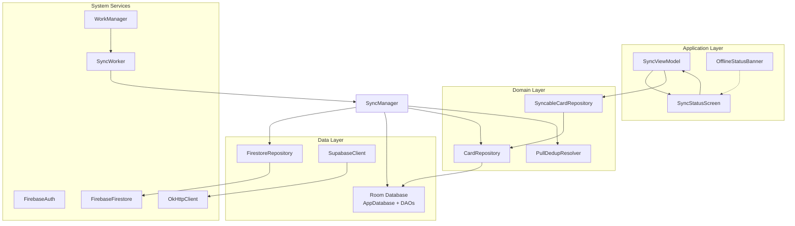
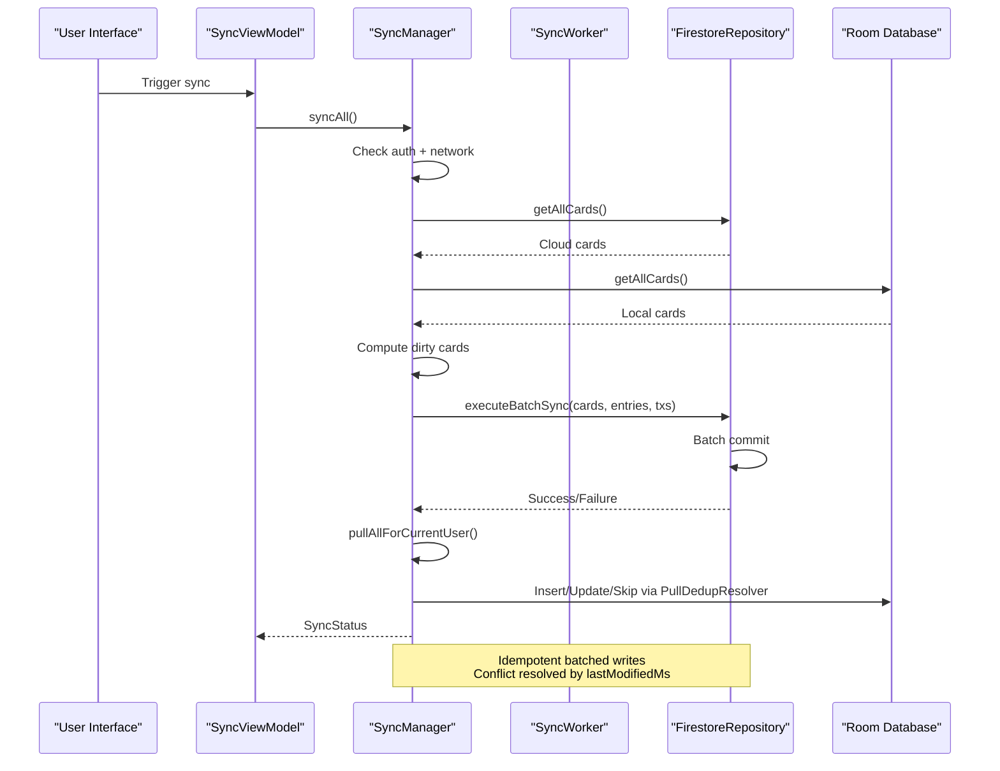
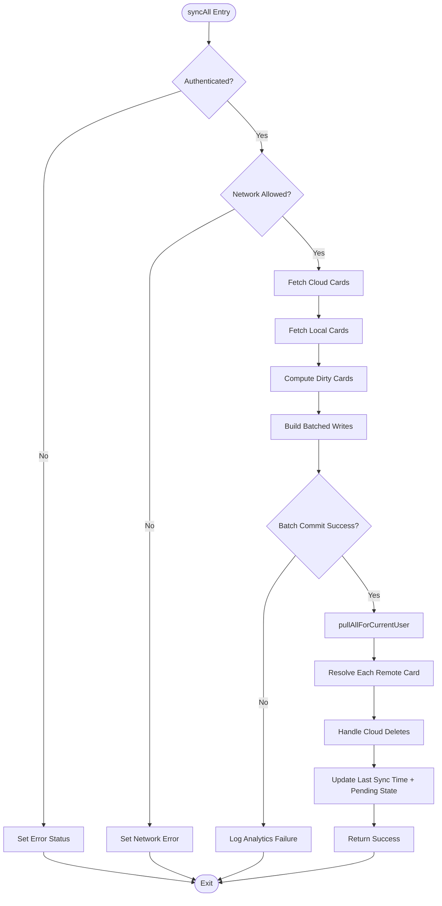
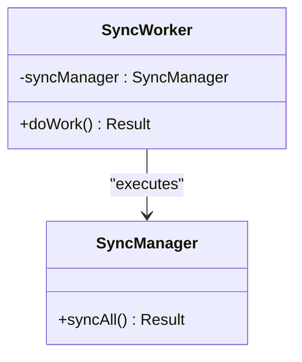
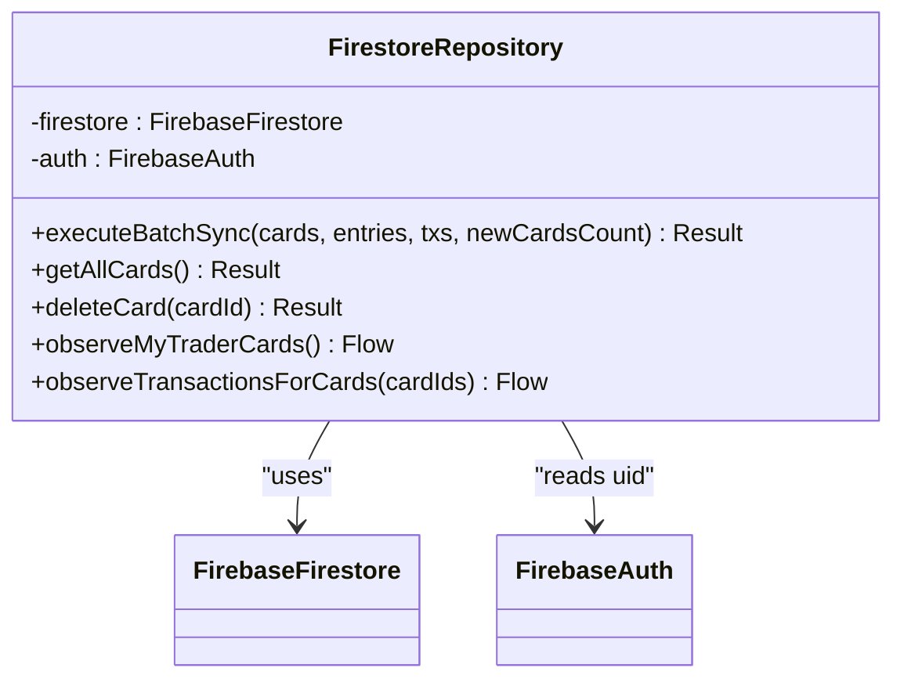
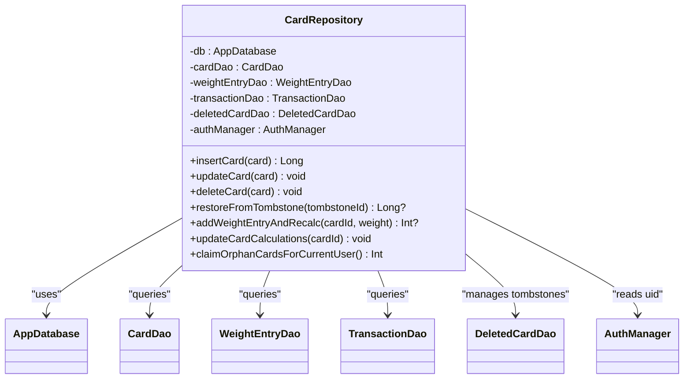
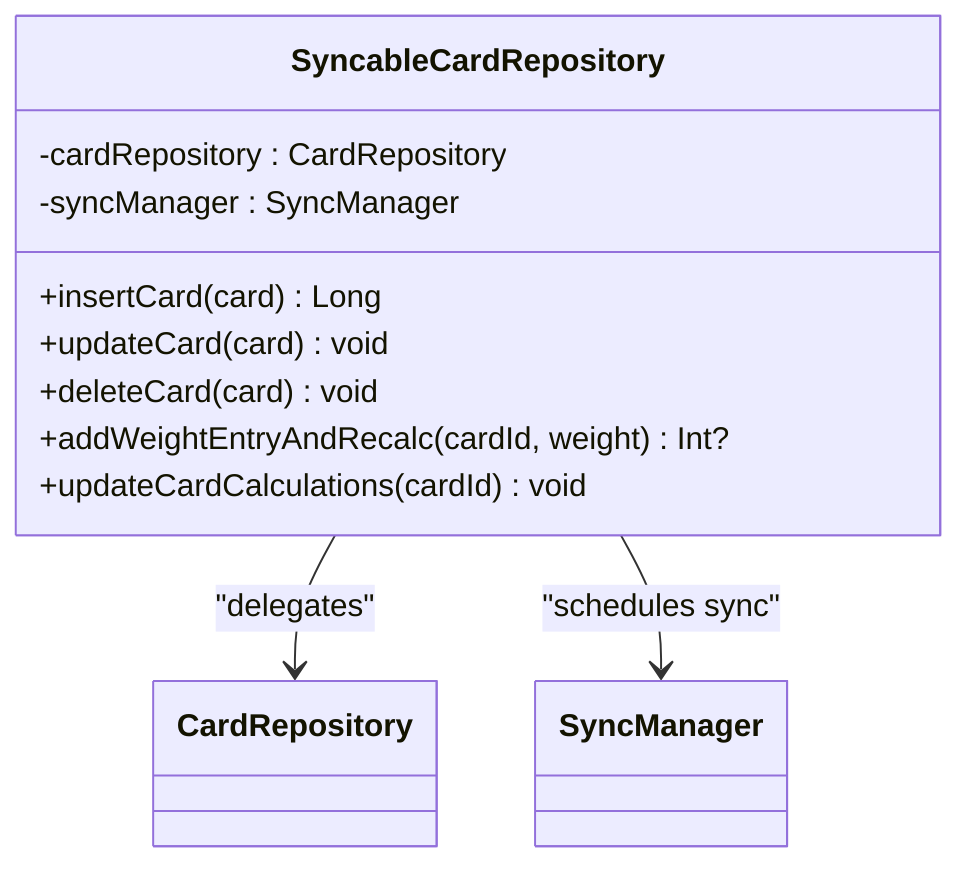
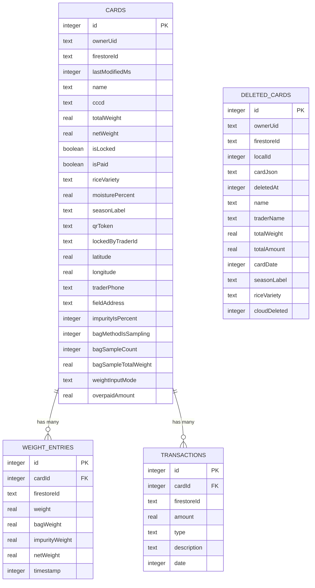
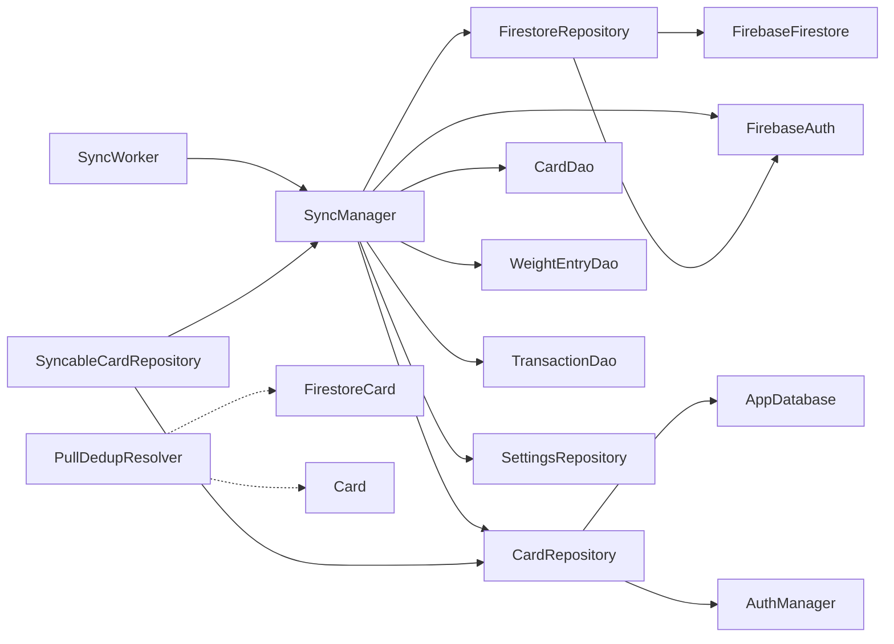

# Sync Architecture & Design

<cite>
**Referenced Files in This Document**   
- [SyncManager.kt](file://app/src/main/java/com/giathinh/canlua/repository/SyncManager.kt)
- [SyncWorker.kt](file://app/src/main/java/com/giathinh/canlua/repository/SyncWorker.kt)
- [FirestoreRepository.kt](file://app/src/main/java/com/giathinh/canlua/repository/FirestoreRepository.kt)
- [CardRepository.kt](file://app/src/main/java/com/giathinh/canlua/repository/CardRepository.kt)
- [SyncableCardRepository.kt](file://app/src/main/java/com/giathinh/canlua/repository/SyncableCardRepository.kt)
- [PullDedupResolver.kt](file://app/src/main/java/com/giathinh/canlua/repository/PullDedupResolver.kt)
- [AppDatabase.kt](file://app/src/main/java/com/giathinh/canlua/data/database/AppDatabase.kt)
- [FirebaseModule.kt](file://app/src/main/java/com/giathinh/canlua/di/FirebaseModule.kt)
- [SupabaseModule.kt](file://app/src/main/java/com/giathinh/canlua/di/SupabaseModule.kt)
- [SupabaseClient.kt](file://app/src/main/java/com/giathinh/canlua/data/remote/SupabaseClient.kt)
- [SyncViewModel.kt](file://app/src/main/java/com/giathinh/canlua/ui/viewmodel/SyncViewModel.kt)
- [SyncStatusScreen.kt](file://app/src/main/java/com/giathinh/canlua/ui/screen/SyncStatusScreen.kt)
- [OfflineStatusBanner.kt](file://app/src/main/java/com/giathinh/canlua/ui/component/OfflineStatusBanner.kt)
- [PerformanceTracker.kt](file://app/src/main/java/com/giathinh/canlua/util/PerformanceTracker.kt)
</cite>

## Table of Contents
1. [Introduction](#introduction)
2. [Project Structure](#project-structure)
3. [Core Components](#core-components)
4. [Architecture Overview](#architecture-overview)
5. [Detailed Component Analysis](#detailed-component-analysis)
6. [Dependency Analysis](#dependency-analysis)
7. [Performance Considerations](#performance-considerations)
8. [Troubleshooting Guide](#troubleshooting-guide)
9. [Conclusion](#conclusion)

## Introduction
This document describes the offline-first data synchronization architecture for an Android application that persists user data locally with Room and synchronizes it bidirectionally with cloud storage. The primary cloud backend is Firebase Firestore, while Supabase is integrated as a REST client for read-only or administrative operations. The system enforces role-based data isolation through per-user fields and UID-scoped queries, supports FARMER, TRADER, and GUEST roles at the application layer, and guarantees full app functionality without network connectivity.

The sync engine uses WorkManager to schedule idempotent background synchronization, batches Firestore writes, and applies conflict resolution based on local timestamps and composite keys. Network state monitoring determines whether sync can proceed, and UI components expose sync status and offline indicators.

## Project Structure
The synchronization logic spans repositories, database definitions, dependency injection modules, UI view models, and Compose screens:

- **Local persistence**: Room database schema, DAOs, and migration chain define the offline data model.
- **Cloud integration**: Firestore repository wraps Firebase SDK calls; Supabase module provides a lightweight REST client.
- **Sync orchestration**: `SyncManager` coordinates push/pull, batching, deduplication, tombstones, and WorkManager scheduling.
- **Background execution**: `SyncWorker` runs `syncAll()` under WorkManager constraints.
- **UI exposure**: `SyncViewModel` exposes sync state; `SyncStatusScreen` visualizes sync outcomes; `OfflineStatusBanner` shows offline state.



**Diagram sources**
- [SyncViewModel.kt:14-50](file://app/src/main/java/com/giathinh/canlua/ui/viewmodel/SyncViewModel.kt#L14-L50)
- [SyncStatusScreen.kt:67-364](file://app/src/main/java/com/giathinh/canlua/ui/screen/SyncStatusScreen.kt#L67-L364)
- [OfflineStatusBanner.kt:34-79](file://app/src/main/java/com/giathinh/canlua/ui/component/OfflineStatusBanner.kt#L34-L79)
- [SyncableCardRepository.kt:10-86](file://app/src/main/java/com/giathinh/canlua/repository/SyncableCardRepository.kt#L10-L86)
- [CardRepository.kt:26-45](file://app/src/main/java/com/giathinh/canlua/repository/CardRepository.kt#L26-L45)
- [AppDatabase.kt:24-46](file://app/src/main/java/com/giathinh/canlua/data/database/AppDatabase.kt#L24-L46)
- [FirestoreRepository.kt:21-43](file://app/src/main/java/com/giathinh/canlua/repository/FirestoreRepository.kt#L21-L43)
- [SupabaseClient.kt:22-26](file://app/src/main/java/com/giathinh/canlua/data/remote/SupabaseClient.kt#L22-L26)
- [SyncWorker.kt:10-31](file://app/src/main/java/com/giathinh/canlua/repository/SyncWorker.kt#L10-L31)
- [SyncManager.kt:35-45](file://app/src/main/java/com/giathinh/canlua/repository/SyncManager.kt#L35-L45)

**Section sources**
- [AppDatabase.kt:24-46](file://app/src/main/java/com/giathinh/canlua/data/database/AppDatabase.kt#L24-L46)
- [FirebaseModule.kt:12-33](file://app/src/main/java/com/giathinh/canlua/di/FirebaseModule.kt#L12-L33)
- [SupabaseModule.kt:14-40](file://app/src/main/java/com/giathinh/canlua/di/SupabaseModule.kt#L14-L40)

## Core Components
- **SyncManager**: Orchestrates bidirectional sync, checks network state, schedules WorkManager jobs, batches Firestore writes, maps local entities to Firestore documents, and pulls remote data into Room with deduplication.
- **SyncWorker**: Background worker executing `syncAll()` with retry semantics except when authentication is missing.
- **FirestoreRepository**: Encapsulates Firestore reads/writes, batch commits, real-time listeners, and user-scoped queries.
- **CardRepository**: Local Room access with per-user isolation, encrypted sensitive fields, calculation updates, and tombstone management.
- **SyncableCardRepository**: Decorator that triggers pending sync scheduling after local mutations.
- **PullDedupResolver**: Pure logic deciding insert/update/skip during pull based on Firestore ID and composite key matching.
- **AppDatabase**: Room schema definition with explicit migrations supporting per-user isolation, cross-device sync fields, conflict timestamps, tombstones, and domain-specific fields.
- **FirebaseModule / SupabaseModule**: Dependency injection configuration for Firebase services and Supabase REST client.
- **SupabaseClient**: Lightweight OkHttp + Gson client for Supabase REST endpoints.
- **SyncViewModel / SyncStatusScreen**: UI-facing state exposure and visualization of sync status and backup state.
- **OfflineStatusBanner**: Compose banner indicating offline state.
- **PerformanceTracker**: Performance monitoring utility for screen traces and frame metrics.

**Section sources**
- [SyncManager.kt:35-557](file://app/src/main/java/com/giathinh/canlua/repository/SyncManager.kt#L35-L557)
- [SyncWorker.kt:10-31](file://app/src/main/java/com/giathinh/canlua/repository/SyncWorker.kt#L10-L31)
- [FirestoreRepository.kt:21-357](file://app/src/main/java/com/giathinh/canlua/repository/FirestoreRepository.kt#L21-L357)
- [CardRepository.kt:26-406](file://app/src/main/java/com/giathinh/canlua/repository/CardRepository.kt#L26-L406)
- [SyncableCardRepository.kt:10-86](file://app/src/main/java/com/giathinh/canlua/repository/SyncableCardRepository.kt#L10-L86)
- [PullDedupResolver.kt:6-75](file://app/src/main/java/com/giathinh/canlua/repository/PullDedupResolver.kt#L6-L75)
- [AppDatabase.kt:24-401](file://app/src/main/java/com/giathinh/canlua/data/database/AppDatabase.kt#L24-L401)
- [FirebaseModule.kt:12-33](file://app/src/main/java/com/giathinh/canlua/di/FirebaseModule.kt#L12-L33)
- [SupabaseModule.kt:14-40](file://app/src/main/java/com/giathinh/canlua/di/SupabaseModule.kt#L14-L40)
- [SupabaseClient.kt:22-106](file://app/src/main/java/com/giathinh/canlua/data/remote/SupabaseClient.kt#L22-L106)
- [SyncViewModel.kt:14-50](file://app/src/main/java/com/giathinh/canlua/ui/viewmodel/SyncViewModel.kt#L14-L50)
- [SyncStatusScreen.kt:67-364](file://app/src/main/java/com/giathinh/canlua/ui/screen/SyncStatusScreen.kt#L67-L364)
- [OfflineStatusBanner.kt:34-79](file://app/src/main/java/com/giathinh/canlua/ui/component/OfflineStatusBanner.kt#L34-L79)
- [PerformanceTracker.kt:17-259](file://app/src/main/java/com/giathinh/canlua/util/PerformanceTracker.kt#L17-L259)

## Architecture Overview
The system follows MVVM + Clean Architecture with unidirectional data flow via StateFlow and coroutines. User actions update Room immediately; background workers synchronize changes to Firestore. Pull operations reconcile remote data with local records using timestamp comparison and composite-key fallback. Role-based isolation ensures users only see their own data.



**Diagram sources**
- [SyncViewModel.kt:33-37](file://app/src/main/java/com/giathinh/canlua/ui/viewmodel/SyncViewModel.kt#L33-L37)
- [SyncManager.kt:139-311](file://app/src/main/java/com/giathinh/canlua/repository/SyncManager.kt#L139-L311)
- [FirestoreRepository.kt:45-85](file://app/src/main/java/com/giathinh/canlua/repository/FirestoreRepository.kt#L45-L85)
- [AppDatabase.kt:24-46](file://app/src/main/java/com/giathinh/canlua/data/database/AppDatabase.kt#L24-L46)

## Detailed Component Analysis

### SyncManager
`SyncManager` is the central orchestrator for synchronization. It validates authentication and network conditions, schedules WorkManager tasks, performs push and pull operations, and manages mapping between local Room entities and Firestore documents.

Key responsibilities:
- Network state checking (`isOnline`, `isWifiConnected`, `canSync`)
- Pending sync detection across cards, weight entries, transactions, and tombstones
- WorkManager scheduling with exponential backoff
- Push dirty cards with batched Firestore writes
- Pull remote data with deduplication and tombstone handling
- Mapping local models to Firestore models and vice versa



**Diagram sources**
- [SyncManager.kt:139-311](file://app/src/main/java/com/giathinh/canlua/repository/SyncManager.kt#L139-L311)
- [SyncManager.kt:313-412](file://app/src/main/java/com/giathinh/canlua/repository/SyncManager.kt#L313-L412)
- [PullDedupResolver.kt:45-75](file://app/src/main/java/com/giathinh/canlua/repository/PullDedupResolver.kt#L45-L75)

**Section sources**
- [SyncManager.kt:35-557](file://app/src/main/java/com/giathinh/canlua/repository/SyncManager.kt#L35-L557)

### SyncWorker
`SyncWorker` executes `syncAll()` in the background. It retries failures unless the error indicates no authenticated user, preventing infinite retry loops.



**Diagram sources**
- [SyncWorker.kt:10-31](file://app/src/main/java/com/giathinh/canlua/repository/SyncWorker.kt#L10-L31)
- [SyncManager.kt:139-311](file://app/src/main/java/com/giathinh/canlua/repository/SyncManager.kt#L139-L311)

**Section sources**
- [SyncWorker.kt:10-31](file://app/src/main/java/com/giathinh/canlua/repository/SyncWorker.kt#L10-L31)

### FirestoreRepository
`FirestoreRepository` abstracts Firestore operations including card CRUD, batch commits, real-time listeners, and user-scoped queries. It adds `userId` and `syncTimestamp` to documents and increments profile counters.



**Diagram sources**
- [FirestoreRepository.kt:21-85](file://app/src/main/java/com/giathinh/canlua/repository/FirestoreRepository.kt#L21-L85)
- [FirestoreRepository.kt:268-327](file://app/src/main/java/com/giathinh/canlua/repository/FirestoreRepository.kt#L268-L327)

**Section sources**
- [FirestoreRepository.kt:21-357](file://app/src/main/java/com/giathinh/canlua/repository/FirestoreRepository.kt#L21-L357)

### CardRepository
`CardRepository` manages local Room operations with per-user isolation, encrypted sensitive fields, and comprehensive calculation updates. It also handles tombstone creation for deleted cards and restoration from tombstones.



**Diagram sources**
- [CardRepository.kt:36-44](file://app/src/main/java/com/giathinh/canlua/repository/CardRepository.kt#L36-L44)
- [CardRepository.kt:60-85](file://app/src/main/java/com/giathinh/canlua/repository/CardRepository.kt#L60-L85)
- [CardRepository.kt:103-152](file://app/src/main/java/com/giathinh/canlua/repository/CardRepository.kt#L103-L152)
- [CardRepository.kt:242-310](file://app/src/main/java/com/giathinh/canlua/repository/CardRepository.kt#L242-L310)

**Section sources**
- [CardRepository.kt:26-406](file://app/src/main/java/com/giathinh/canlua/repository/CardRepository.kt#L26-L406)

### SyncableCardRepository
`SyncableCardRepository` decorates `CardRepository` to trigger pending sync scheduling after any local mutation. This ensures immediate background synchronization attempts while maintaining offline-first behavior.



**Diagram sources**
- [SyncableCardRepository.kt:17-24](file://app/src/main/java/com/giathinh/canlua/repository/SyncableCardRepository.kt#L17-L24)
- [SyncableCardRepository.kt:36-86](file://app/src/main/java/com/giathinh/canlua/repository/SyncableCardRepository.kt#L36-L86)

**Section sources**
- [SyncableCardRepository.kt:10-86](file://app/src/main/java/com/giathinh/canlua/repository/SyncableCardRepository.kt#L10-L86)

### PullDedupResolver
`PullDedupResolver` implements pure logic for determining how to handle incoming Firestore cards during pull operations:
- Match by Firestore ID → compare timestamps to decide overwrite or skip
- Match by composite key (date + name + totalWeight) → legacy card reconciliation
- No match → insert as new card

```mermaid
flowchart TD
Start([resolve(fsCard)]) --> BlankCheck{"fsCard.id blank?"}
BlankCheck --> |Yes| SkipBlank["Skip (blank_firestore_id)"]
BlankCheck --> |No| FsIdMatch{"Match by firestoreId?"}
FsIdMatch --> |Yes| CompareTime{"Cloud newer?"}
CompareTime --> |Yes| UpdateNewer["Update (FIRESTORE_ID_MATCH_NEWER)"]
CompareTime --> |No| SkipLocal["Skip (local_newer_or_equal)"]
FsIdMatch --> |No| CompositeMatch{"Composite key match?"}
CompositeMatch --> |Yes| LegacyUpdate["Update (COMPOSITE_KEY_MATCH)"]
CompositeMatch --> |No| InsertNew["Insert (new card)"]
SkipBlank --> End([Action])
UpdateNewer --> End
SkipLocal --> End
LegacyUpdate --> End
InsertNew --> End
```

**Diagram sources**
- [PullDedupResolver.kt:45-75](file://app/src/main/java/com/giathinh/canlua/repository/PullDedupResolver.kt#L45-L75)

**Section sources**
- [PullDedupResolver.kt:6-75](file://app/src/main/java/com/giathinh/canlua/repository/PullDedupResolver.kt#L6-L75)

### AppDatabase Schema & Migrations
The Room database defines 8 entities and maintains an explicit migration chain from version 1 to 19. Key migration phases include:
- Per-user isolation (`ownerUid` column)
- Cross-device sync fields (`firestoreId` columns)
- Conflict resolution timestamp (`lastModifiedMs`)
- Tombstone table for deleted cards
- Domain-specific fields (rice variety, moisture, bag methods, payment tracking)



**Diagram sources**
- [AppDatabase.kt:24-34](file://app/src/main/java/com/giathinh/canlua/data/database/AppDatabase.kt#L24-L34)
- [AppDatabase.kt:272-297](file://app/src/main/java/com/giathinh/canlua/data/database/AppDatabase.kt#L272-L297)
- [AppDatabase.kt:309-314](file://app/src/main/java/com/giathinh/canlua/data/database/AppDatabase.kt#L309-L314)
- [AppDatabase.kt:325-350](file://app/src/main/java/com/giathinh/canlua/data/database/AppDatabase.kt#L325-L350)

**Section sources**
- [AppDatabase.kt:24-401](file://app/src/main/java/com/giathinh/canlua/data/database/AppDatabase.kt#L24-L401)

### Technology Stack Integration
- **Firebase**: Authentication, Firestore, Storage provided via Hilt modules.
- **Supabase**: REST API client built on OkHttp + Gson for reading public tables and administrative upserts.
- **Room**: Local persistence with explicit migrations ensuring schema evolution compatibility.
- **WorkManager**: Background job scheduling with network constraints and exponential backoff.
- **Compose + MVVM**: UI state exposed via StateFlow with lifecycle-aware collection.

**Section sources**
- [FirebaseModule.kt:12-33](file://app/src/main/java/com/giathinh/canlua/di/FirebaseModule.kt#L12-L33)
- [SupabaseModule.kt:14-40](file://app/src/main/java/com/giathinh/canlua/di/SupabaseModule.kt#L14-L40)
- [SupabaseClient.kt:22-106](file://app/src/main/java/com/giathinh/canlua/data/remote/SupabaseClient.kt#L22-L106)

## Dependency Analysis
The synchronization system exhibits clear separation of concerns with minimal coupling:

- `SyncManager` depends on repositories and DAOs but not directly on UI.
- `FirestoreRepository` depends only on Firebase SDKs.
- `CardRepository` depends on Room and AuthManager for local operations.
- `SyncableCardRepository` decorates `CardRepository` and triggers `SyncManager`.
- `PullDedupResolver` is pure logic with no external dependencies.



**Diagram sources**
- [SyncManager.kt:35-45](file://app/src/main/java/com/giathinh/canlua/repository/SyncManager.kt#L35-L45)
- [SyncWorker.kt:10-15](file://app/src/main/java/com/giathinh/canlua/repository/SyncWorker.kt#L10-L15)
- [SyncableCardRepository.kt:17-24](file://app/src/main/java/com/giathinh/canlua/repository/SyncableCardRepository.kt#L17-L24)
- [FirestoreRepository.kt:21-25](file://app/src/main/java/com/giathinh/canlua/repository/FirestoreRepository.kt#L21-L25)
- [CardRepository.kt:36-44](file://app/src/main/java/com/giathinh/canlua/repository/CardRepository.kt#L36-L44)

**Section sources**
- [SyncManager.kt:35-45](file://app/src/main/java/com/giathinh/canlua/repository/SyncManager.kt#L35-L45)
- [FirestoreRepository.kt:21-25](file://app/src/main/java/com/giathinh/canlua/repository/FirestoreRepository.kt#L21-L25)
- [CardRepository.kt:36-44](file://app/src/main/java/com/giathinh/canlua/repository/CardRepository.kt#L36-L44)

## Performance Considerations
- **Batched Firestore writes**: `SyncManager` groups cards, weight entries, and transactions into batches to reduce network round trips and Firestore write costs.
- **Client-side sorting**: Firestore queries avoid composite index requirements by sorting results client-side, trading some CPU for query simplicity.
- **Transaction atomicity**: Room operations use `withTransaction` to prevent race conditions during card calculations and deletions.
- **Frame metrics monitoring**: `PerformanceTracker` measures slow/frozen frames and screen render times via Firebase Performance Monitoring.
- **Exponential backoff**: WorkManager retries sync failures with increasing delays to handle transient network issues.
- **Selective updates**: `CardRepository.updateCardCalculations` only writes changed weight entry fields to minimize database writes.

**Section sources**
- [SyncManager.kt:175-287](file://app/src/main/java/com/giathinh/canlua/repository/SyncManager.kt#L175-L287)
- [FirestoreRepository.kt:164-178](file://app/src/main/java/com/giathinh/canlua/repository/FirestoreRepository.kt#L164-L178)
- [CardRepository.kt:242-310](file://app/src/main/java/com/giathinh/canlua/repository/CardRepository.kt#L242-L310)
- [PerformanceTracker.kt:17-259](file://app/src/main/java/com/giathinh/canlua/util/PerformanceTracker.kt#L17-L259)

## Troubleshooting Guide
Common sync issues and their handling:

- **Authentication errors**: `SyncWorker` treats "No user signed in" as success to avoid retry loops.
- **Network restrictions**: `SyncManager.canSync()` respects Wi-Fi-only settings and general connectivity.
- **Batch failures**: Individual batch failures are logged via analytics while allowing partial sync completion.
- **Tombstone conflicts**: Deleted cards are tracked to prevent re-insertion during pull operations.
- **Legacy card reconciliation**: Composite key matching resolves duplicates from pre-v13 sync versions.

Recommended debugging steps:
1. Check `SyncStatus` in `SyncStatusScreen` for current sync state.
2. Verify network connectivity using `SyncManager.isOnline()` and `isWifiConnected()`.
3. Review analytics logs for batch failure details.
4. Inspect tombstone table for deleted card reconciliation.
5. Validate Firestore document structure matches expected schema.

**Section sources**
- [SyncWorker.kt:17-30](file://app/src/main/java/com/giathinh/canlua/repository/SyncWorker.kt#L17-L30)
- [SyncManager.kt:58-84](file://app/src/main/java/com/giathinh/canlua/repository/SyncManager.kt#L58-L84)
- [SyncManager.kt:217-285](file://app/src/main/java/com/giathinh/canlua/repository/SyncManager.kt#L217-L285)
- [CardRepository.kt:103-152](file://app/src/main/java/com/giathinh/canlua/repository/CardRepository.kt#L103-L152)
- [PullDedupResolver.kt:65-69](file://app/src/main/java/com/giathinh/canlua/repository/PullDedupResolver.kt#L65-L69)

## Conclusion
The offline-first synchronization architecture successfully balances local performance with cloud reliability. By leveraging Room for immediate local persistence, WorkManager for background synchronization, and Firestore for cloud storage, the system provides a robust foundation for multi-device data consistency. The role-based isolation strategy ensures data security across different user types, while the conflict resolution mechanisms handle edge cases like legacy data and concurrent modifications. The modular design with clear separation of concerns enables maintainability and testability, making it suitable for complex agricultural business logic involving weigh-in operations, pricing calculations, and financial tracking.