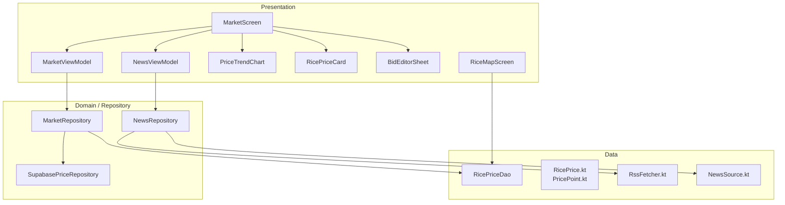
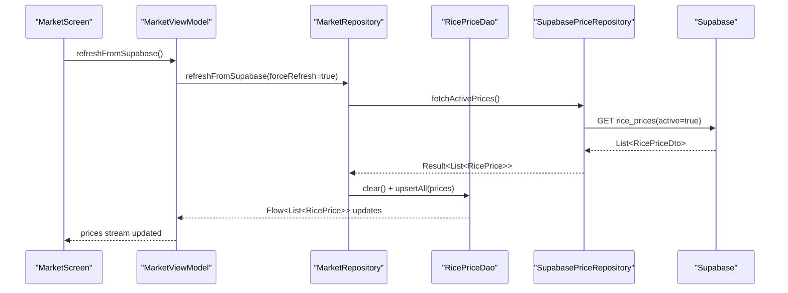
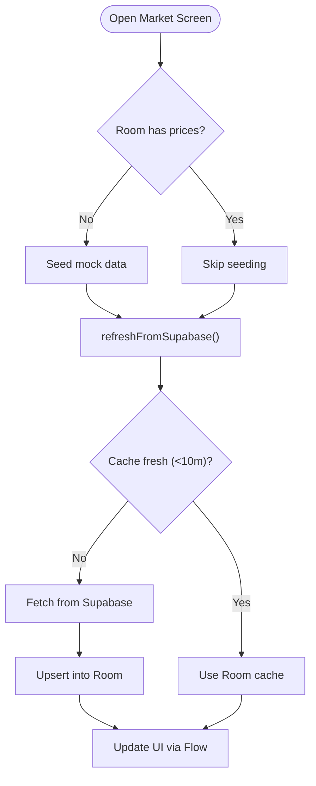
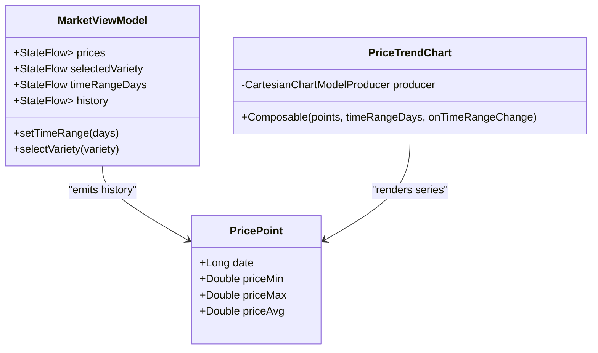
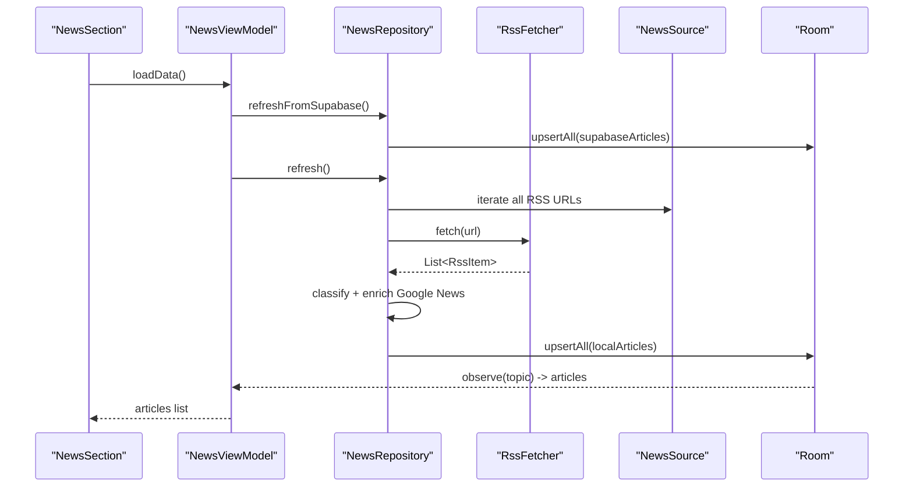
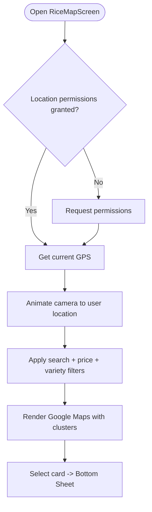
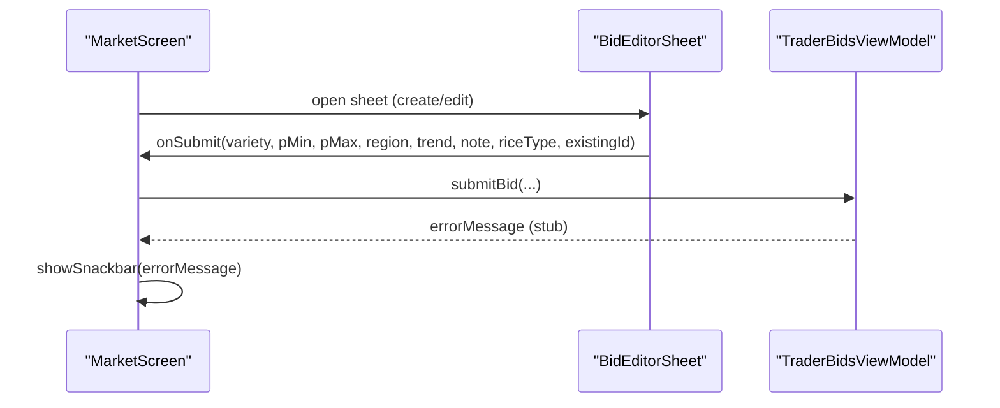
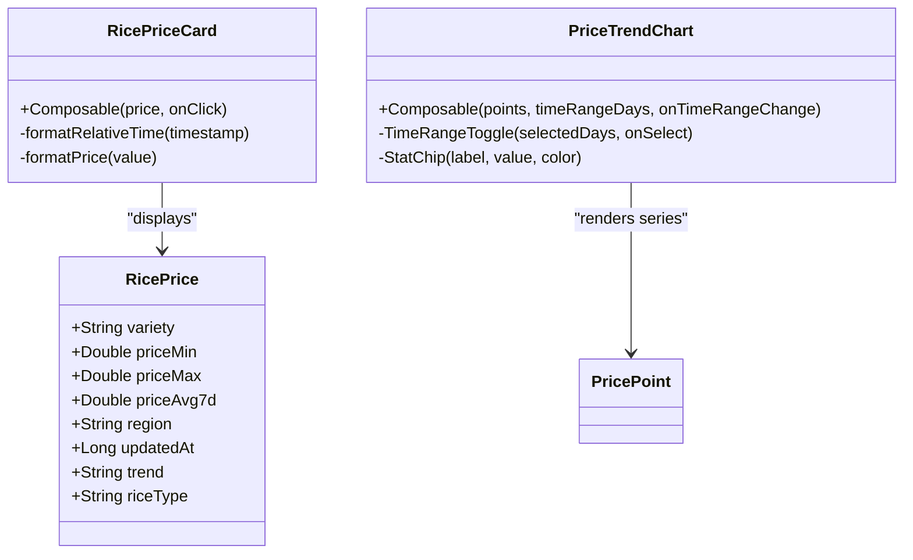
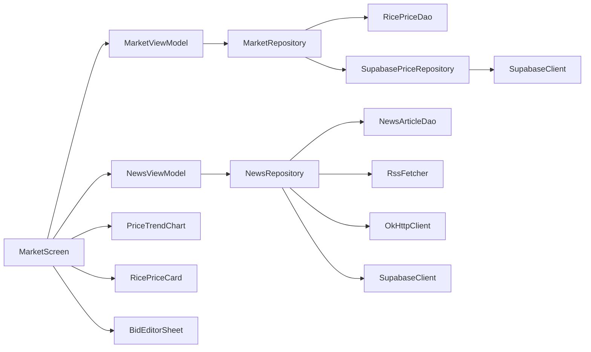

# Market Intelligence

<cite>
**Referenced Files in This Document**
- [RicePrice.kt](file://app/src/main/java/com/giathinh/canlua/data/model/RicePrice.kt)
- [RicePriceDao.kt](file://app/src/main/java/com/giathinh/canlua/data/dao/RicePriceDao.kt)
- [MarketRepository.kt](file://app/src/main/java/com/giathinh/canlua/repository/MarketRepository.kt)
- [SupabasePriceRepository.kt](file://app/src/main/java/com/giathinh/canlua/repository/SupabasePriceRepository.kt)
- [MarketScreen.kt](file://app/src/main/java/com/giathinh/canlua/ui/screen/market/MarketScreen.kt)
- [MarketViewModel.kt](file://app/src/main/java/com/giathinh/canlua/ui/viewmodel/MarketViewModel.kt)
- [PriceTrendChart.kt](file://app/src/main/java/com/giathinh/canlua/ui/component/market/PriceTrendChart.kt)
- [RicePriceCard.kt](file://app/src/main/java/com/giathinh/canlua/ui/component/market/RicePriceCard.kt)
- [BidEditorSheet.kt](file://app/src/main/java/com/giathinh/canlua/ui/component/market/BidEditorSheet.kt)
- [TraderBidsViewModel.kt](file://app/src/main/java/com/giathinh/canlua/ui/viewmodel/TraderBidsViewModel.kt)
- [RssFetcher.kt](file://app/src/main/java/com/giathinh/canlua/data/remote/news/RssFetcher.kt)
- [NewsSource.kt](file://app/src/main/java/com/giathinh/canlua/data/remote/news/NewsSource.kt)
- [NewsSection.kt](file://app/src/main/java/com/giathinh/canlua/ui/component/market/NewsSection.kt)
- [NewsRepository.kt](file://app/src/main/java/com/giathinh/canlua/repository/NewsRepository.kt)
- [NewsViewModel.kt](file://app/src/main/java/com/giathinh/canlua/ui/viewmodel/NewsViewModel.kt)
- [RiceMapScreen.kt](file://app/src/main/java/com/giathinh/canlua/ui/screen/map/RiceMapScreen.kt)
</cite>

## Table of Contents
1. Introduction
2. Project Structure
3. Core Components
4. Architecture Overview
5. Detailed Component Analysis
6. Dependency Analysis
7. Performance Considerations
8. Troubleshooting Guide
9. Conclusion

## Introduction
This document explains the market intelligence system for real-time agricultural market data. It covers rice price tracking with live updates from Supabase, historical trend analysis and 7-day comparison charts, RSS-based news aggregation, supply mapping using GPS to visualize trading locations on Google Maps, bid management for traders, and offline caching strategies. The app follows an offline-first architecture: Room is the local cache, Supabase provides authoritative data, and UI components render state via StateFlow.

## Project Structure
The market intelligence features span data models, DAOs, repositories, viewmodels, and Compose screens/components:
- Data layer: RicePrice and PricePoint entities; RicePriceDao queries and upserts; Supabase DTOs map remote JSON to domain models.
- Repository layer: MarketRepository orchestrates Room and Supabase; NewsRepository aggregates RSS feeds and enriches Google News items.
- Presentation layer: MarketScreen composes NewsPage and PricesPage; PriceTrendChart renders Vico line charts; RicePriceCard displays current prices; BidEditorSheet collects trader inputs; RiceMapScreen integrates Google Maps with location services.

**Diagram sources**
- [MarketScreen.kt:106-388](file://app/src/main/java/com/giathinh/canlua/ui/screen/market/MarketScreen.kt#L106-L388)
- [MarketViewModel.kt:34-185](file://app/src/main/java/com/giathinh/canlua/ui/viewmodel/MarketViewModel.kt#L34-L185)
- [NewsViewModel.kt:28-80](file://app/src/main/java/com/giathinh/canlua/ui/viewmodel/NewsViewModel.kt#L28-L80)
- [MarketRepository.kt:28-155](file://app/src/main/java/com/giathinh/canlua/repository/MarketRepository.kt#L28-L155)
- [SupabasePriceRepository.kt:23-90](file://app/src/main/java/com/giathinh/canlua/repository/SupabasePriceRepository.kt#L23-L90)
- [RicePriceDao.kt:11-38](file://app/src/main/java/com/giathinh/canlua/data/dao/RicePriceDao.kt#L11-L38)
- [RicePrice.kt:11-38](file://app/src/main/java/com/giathinh/canlua/data/model/RicePrice.kt#L11-L38)
- [RssFetcher.kt:32-226](file://app/src/main/java/com/giathinh/canlua/data/remote/news/RssFetcher.kt#L32-L226)
- [NewsSource.kt:21-177](file://app/src/main/java/com/giathinh/canlua/data/remote/news/NewsSource.kt#L21-L177)
- [RiceMapScreen.kt:85-337](file://app/src/main/java/com/giathinh/canlua/ui/screen/map/RiceMapScreen.kt#L85-L337)

**Section sources**
- [MarketScreen.kt:106-388](file://app/src/main/java/com/giathinh/canlua/ui/screen/market/MarketScreen.kt#L106-L388)
- [MarketViewModel.kt:34-185](file://app/src/main/java/com/giathinh/canlua/ui/viewmodel/MarketViewModel.kt#L34-L185)
- [NewsViewModel.kt:28-80](file://app/src/main/java/com/giathinh/canlua/ui/viewmodel/NewsViewModel.kt#L28-L80)
- [MarketRepository.kt:28-155](file://app/src/main/java/com/giathinh/canlua/repository/MarketRepository.kt#L28-L155)
- [SupabasePriceRepository.kt:23-90](file://app/src/main/java/com/giathinh/canlua/repository/SupabasePriceRepository.kt#L23-L90)
- [RicePriceDao.kt:11-38](file://app/src/main/java/com/giathinh/canlua/data/dao/RicePriceDao.kt#L11-L38)
- [RicePrice.kt:11-38](file://app/src/main/java/com/giathinh/canlua/data/model/RicePrice.kt#L11-L38)
- [RssFetcher.kt:32-226](file://app/src/main/java/com/giathinh/canlua/data/remote/news/RssFetcher.kt#L32-L226)
- [NewsSource.kt:21-177](file://app/src/main/java/com/giathinh/canlua/data/remote/news/NewsSource.kt#L21-L177)
- [RiceMapScreen.kt:85-337](file://app/src/main/java/com/giathinh/canlua/ui/screen/map/RiceMapScreen.kt#L85-L337)

## Core Components
- RicePrice and PricePoint: Domain models for current prices and daily history points used by charts and lists.
- RicePriceDao: Room DAO exposing Flow<List<RicePrice>> and Flow<List<PricePoint>> for reactive UI updates.
- MarketRepository: Offline-first repository that seeds mock data, refreshes from Supabase with TTL, and persists results into Room.
- SupabasePriceRepository: Reads active rice prices from Supabase and maps DTOs to domain models.
- MarketViewModel: Exposes filtered prices, selected variety, time range, and history; triggers refresh and manages ad lifecycle.
- PriceTrendChart: Renders a Vico line chart over PricePoint series with 7-day and 30-day toggles.
- RicePriceCard: Displays variety, trend badge, product type, region, relative update time, and min/max/avg prices.
- BidEditorSheet: Form for traders to post purchase prices (stubbed submission path).
- TraderBidsViewModel: Stub ViewModel indicating submission moved to external management.
- RssFetcher: Parses RSS/Atom feeds, handles media tags, dates, and errors gracefully.
- NewsSource: Enumerates RSS sources and classifies articles into topics.
- NewsRepository: Aggregates RSS and Supabase news, deduplicates, enriches Google News items, and caches in Room.
- NewsViewModel: Streams articles by topic, loads from Supabase first, falls back to RSS.
- RiceMapScreen: Integrates Google Maps SDK, requests location permissions, filters cards, and shows details in a bottom sheet.

**Section sources**
- [RicePrice.kt:11-38](file://app/src/main/java/com/giathinh/canlua/data/model/RicePrice.kt#L11-L38)
- [RicePriceDao.kt:11-38](file://app/src/main/java/com/giathinh/canlua/data/dao/RicePriceDao.kt#L11-L38)
- [MarketRepository.kt:28-155](file://app/src/main/java/com/giathinh/canlua/repository/MarketRepository.kt#L28-L155)
- [SupabasePriceRepository.kt:23-90](file://app/src/main/java/com/giathinh/canlua/repository/SupabasePriceRepository.kt#L23-L90)
- [MarketViewModel.kt:34-185](file://app/src/main/java/com/giathinh/canlua/ui/viewmodel/MarketViewModel.kt#L34-L185)
- [PriceTrendChart.kt:46-200](file://app/src/main/java/com/giathinh/canlua/ui/component/market/PriceTrendChart.kt#L46-L200)
- [RicePriceCard.kt:52-290](file://app/src/main/java/com/giathinh/canlua/ui/component/market/RicePriceCard.kt#L52-L290)
- [BidEditorSheet.kt:57-319](file://app/src/main/java/com/giathinh/canlua/ui/component/market/BidEditorSheet.kt#L57-L319)
- [TraderBidsViewModel.kt:27-60](file://app/src/main/java/com/giathinh/canlua/ui/viewmodel/TraderBidsViewModel.kt#L27-L60)
- [RssFetcher.kt:32-226](file://app/src/main/java/com/giathinh/canlua/data/remote/news/RssFetcher.kt#L32-L226)
- [NewsSource.kt:21-177](file://app/src/main/java/com/giathinh/canlua/data/remote/news/NewsSource.kt#L21-L177)
- [NewsRepository.kt:38-402](file://app/src/main/java/com/giathinh/canlua/repository/NewsRepository.kt#L38-L402)
- [NewsViewModel.kt:28-80](file://app/src/main/java/com/giathinh/canlua/ui/viewmodel/NewsViewModel.kt#L28-L80)
- [RiceMapScreen.kt:85-337](file://app/src/main/java/com/giathinh/canlua/ui/screen/map/RiceMapScreen.kt#L85-L337)

## Architecture Overview
The system uses MVVM + Clean Architecture with unidirectional data flow. UI observes StateFlow streams from ViewModels. Repositories coordinate between Room and remote sources. Supabase is the authoritative source for rice prices and news; RSS feeds are aggregated and enriched locally.

**Diagram sources**
- [MarketScreen.kt:290-338](file://app/src/main/java/com/giathinh/canlua/ui/screen/market/MarketScreen.kt#L290-L338)
- [MarketViewModel.kt:133-150](file://app/src/main/java/com/giathinh/canlua/ui/viewmodel/MarketViewModel.kt#L133-L150)
- [MarketRepository.kt:50-78](file://app/src/main/java/com/giathinh/canlua/repository/MarketRepository.kt#L50-L78)
- [SupabasePriceRepository.kt:37-59](file://app/src/main/java/com/giathinh/canlua/repository/SupabasePriceRepository.kt#L37-L59)
- [RicePriceDao.kt:14-27](file://app/src/main/java/com/giathinh/canlua/data/dao/RicePriceDao.kt#L14-L27)

## Detailed Component Analysis

### Rice Price Tracking and Live Updates
- Data model: RicePrice includes variety, priceMin, priceMax, priceAvg7d, region, updatedAt, trend, and riceType. PricePoint stores daily averages for charting.
- DAO: Provides Flow<List<RicePrice>> and Flow<List<PricePoint>> for reactive UI.
- Repository: Implements TTL-based refresh from Supabase; if network fails, Room cache remains intact. Seeds mock data when empty.
- ViewModel: Exposes filtered prices, selected variety, and history; triggers refresh and clears error states.

**Diagram sources**
- [MarketRepository.kt:84-141](file://app/src/main/java/com/giathinh/canlua/repository/MarketRepository.kt#L84-L141)
- [MarketRepository.kt:50-78](file://app/src/main/java/com/giathinh/canlua/repository/MarketRepository.kt#L50-L78)
- [MarketViewModel.kt:116-150](file://app/src/main/java/com/giathinh/canlua/ui/viewmodel/MarketViewModel.kt#L116-L150)

**Section sources**
- [RicePrice.kt:11-38](file://app/src/main/java/com/giathinh/canlua/data/model/RicePrice.kt#L11-L38)
- [RicePriceDao.kt:11-38](file://app/src/main/java/com/giathinh/canlua/data/dao/RicePriceDao.kt#L11-L38)
- [MarketRepository.kt:28-155](file://app/src/main/java/com/giathinh/canlua/repository/MarketRepository.kt#L28-L155)
- [SupabasePriceRepository.kt:23-90](file://app/src/main/java/com/giathinh/canlua/repository/SupabasePriceRepository.kt#L23-L90)
- [MarketViewModel.kt:34-185](file://app/src/main/java/com/giathinh/canlua/ui/viewmodel/MarketViewModel.kt#L34-L185)

### Historical Trend Analysis and 7-Day Comparison Charts
- ViewModel combines selected variety and time range to emit history Flow.
- Chart component uses Vico CartesianChartHost with a line series of average prices.
- TimeRangeToggle supports 7-day and 30-day views; stats show min, avg, max.

**Diagram sources**
- [MarketViewModel.kt:74-85](file://app/src/main/java/com/giathinh/canlua/ui/viewmodel/MarketViewModel.kt#L74-L85)
- [PriceTrendChart.kt:46-200](file://app/src/main/java/com/giathinh/canlua/ui/component/market/PriceTrendChart.kt#L46-L200)
- [RicePrice.kt:29-38](file://app/src/main/java/com/giathinh/canlua/data/model/RicePrice.kt#L29-L38)

**Section sources**
- [MarketViewModel.kt:74-85](file://app/src/main/java/com/giathinh/canlua/ui/viewmodel/MarketViewModel.kt#L74-L85)
- [PriceTrendChart.kt:46-200](file://app/src/main/java/com/giathinh/canlua/ui/component/market/PriceTrendChart.kt#L46-L200)
- [RicePrice.kt:29-38](file://app/src/main/java/com/giathinh/canlua/data/model/RicePrice.kt#L29-L38)

### RSS News Aggregation System
- RssFetcher parses RSS/Atom feeds, extracts title, link, description, pubDate, and thumbnails; handles errors per item without failing the entire feed.
- NewsSource enumerates multiple Vietnamese news sources and classifies articles into topics (RICE, GRAIN, MARKET).
- NewsRepository fetches from Supabase first, then parallel RSS sources, enriches Google News items (redirect resolution and og:image extraction), deduplicates, and caches in Room.
- NewsViewModel streams articles by topic, loads from Supabase initially, and falls back to RSS if needed.

**Diagram sources**
- [NewsViewModel.kt:47-57](file://app/src/main/java/com/giathinh/canlua/ui/viewmodel/NewsViewModel.kt#L47-L57)
- [NewsRepository.kt:62-121](file://app/src/main/java/com/giathinh/canlua/repository/NewsRepository.kt#L62-L121)
- [RssFetcher.kt:36-63](file://app/src/main/java/com/giathinh/canlua/data/remote/news/RssFetcher.kt#L36-L63)
- [NewsSource.kt:141-174](file://app/src/main/java/com/giathinh/canlua/data/remote/news/NewsSource.kt#L141-L174)

**Section sources**
- [RssFetcher.kt:32-226](file://app/src/main/java/com/giathinh/canlua/data/remote/news/RssFetcher.kt#L32-L226)
- [NewsSource.kt:21-177](file://app/src/main/java/com/giathinh/canlua/data/remote/news/NewsSource.kt#L21-L177)
- [NewsRepository.kt:38-402](file://app/src/main/java/com/giathinh/canlua/repository/NewsRepository.kt#L38-L402)
- [NewsViewModel.kt:28-80](file://app/src/main/java/com/giathinh/canlua/ui/viewmodel/NewsViewModel.kt#L28-L80)
- [NewsSection.kt:87-197](file://app/src/main/java/com/giathinh/canlua/ui/component/market/NewsSection.kt#L87-L197)

### Supply Mapping with GPS and Google Maps
- RiceMapScreen requests fine/coarse location permissions, animates camera to user location, and initializes Google Maps after a short delay to avoid frame drops.
- Filters include search query, price thresholds, and variety chips; selected card opens a summary bottom sheet.
- MapContent (not shown here) renders clusters and markers based on filtered cards.

**Diagram sources**
- [RiceMapScreen.kt:116-140](file://app/src/main/java/com/giathinh/canlua/ui/screen/map/RiceMapScreen.kt#L116-L140)
- [RiceMapScreen.kt:142-170](file://app/src/main/java/com/giathinh/canlua/ui/screen/map/RiceMapScreen.kt#L142-L170)
- [RiceMapScreen.kt:182-189](file://app/src/main/java/com/giathinh/canlua/ui/screen/map/RiceMapScreen.kt#L182-L189)
- [RiceMapScreen.kt:248-307](file://app/src/main/java/com/giathinh/canlua/ui/screen/map/RiceMapScreen.kt#L248-L307)

**Section sources**
- [RiceMapScreen.kt:85-337](file://app/src/main/java/com/giathinh/canlua/ui/screen/map/RiceMapScreen.kt#L85-L337)

### Bid Management for Traders
- BidEditorSheet provides form fields for variety, product type, min/max price, region, trend, and note.
- TraderBidsViewModel is currently a stub; submission is managed externally via Google Sheets → Apps Script → Supabase.
- MarketScreen integrates the editor sheet and displays success/error messages via Snackbar.

**Diagram sources**
- [MarketScreen.kt:195-221](file://app/src/main/java/com/giathinh/canlua/ui/screen/market/MarketScreen.kt#L195-L221)
- [BidEditorSheet.kt:57-319](file://app/src/main/java/com/giathinh/canlua/ui/component/market/BidEditorSheet.kt#L57-L319)
- [TraderBidsViewModel.kt:27-60](file://app/src/main/java/com/giathinh/canlua/ui/viewmodel/TraderBidsViewModel.kt#L27-L60)

**Section sources**
- [BidEditorSheet.kt:57-319](file://app/src/main/java/com/giathinh/canlua/ui/component/market/BidEditorSheet.kt#L57-L319)
- [TraderBidsViewModel.kt:27-60](file://app/src/main/java/com/giathinh/canlua/ui/viewmodel/TraderBidsViewModel.kt#L27-L60)
- [MarketScreen.kt:195-221](file://app/src/main/java/com/giathinh/canlua/ui/screen/market/MarketScreen.kt#L195-L221)

### Price Trend Visualization Components
- RicePriceCard shows variety, trend badge, product type, region, relative update time, and three price columns (min, max, avg7d).
- PriceTrendChart renders a line series of PricePoint.priceAvg with min/avg/max stats and time range toggle.

**Diagram sources**
- [RicePriceCard.kt:52-290](file://app/src/main/java/com/giathinh/canlua/ui/component/market/RicePriceCard.kt#L52-L290)
- [PriceTrendChart.kt:46-200](file://app/src/main/java/com/giathinh/canlua/ui/component/market/PriceTrendChart.kt#L46-L200)
- [RicePrice.kt:11-38](file://app/src/main/java/com/giathinh/canlua/data/model/RicePrice.kt#L11-L38)

**Section sources**
- [RicePriceCard.kt:52-290](file://app/src/main/java/com/giathinh/canlua/ui/component/market/RicePriceCard.kt#L52-L290)
- [PriceTrendChart.kt:46-200](file://app/src/main/java/com/giathinh/canlua/ui/component/market/PriceTrendChart.kt#L46-L200)
- [RicePrice.kt:11-38](file://app/src/main/java/com/giathinh/canlua/data/model/RicePrice.kt#L11-L38)

## Dependency Analysis
Key dependencies and relationships:
- MarketViewModel depends on MarketRepository and NativeAdLoaderManager.
- MarketRepository depends on RicePriceDao and SupabasePriceRepository.
- SupabasePriceRepository depends on SupabaseClient and configuration values.
- NewsViewModel depends on NewsRepository.
- NewsRepository depends on NewsArticleDao, RssFetcher, OkHttpClient, and SupabaseClient.
- UI components depend on their respective ViewModels and data models.

**Diagram sources**
- [MarketViewModel.kt:34-185](file://app/src/main/java/com/giathinh/canlua/ui/viewmodel/MarketViewModel.kt#L34-L185)
- [MarketRepository.kt:28-155](file://app/src/main/java/com/giathinh/canlua/repository/MarketRepository.kt#L28-L155)
- [SupabasePriceRepository.kt:23-90](file://app/src/main/java/com/giathinh/canlua/repository/SupabasePriceRepository.kt#L23-L90)
- [NewsViewModel.kt:28-80](file://app/src/main/java/com/giathinh/canlua/ui/viewmodel/NewsViewModel.kt#L28-L80)
- [NewsRepository.kt:38-402](file://app/src/main/java/com/giathinh/canlua/repository/NewsRepository.kt#L38-L402)
- [MarketScreen.kt:106-388](file://app/src/main/java/com/giathinh/canlua/ui/screen/market/MarketScreen.kt#L106-L388)

**Section sources**
- [MarketViewModel.kt:34-185](file://app/src/main/java/com/giathinh/canlua/ui/viewmodel/MarketViewModel.kt#L34-L185)
- [MarketRepository.kt:28-155](file://app/src/main/java/com/giathinh/canlua/repository/MarketRepository.kt#L28-L155)
- [SupabasePriceRepository.kt:23-90](file://app/src/main/java/com/giathinh/canlua/repository/SupabasePriceRepository.kt#L23-L90)
- [NewsViewModel.kt:28-80](file://app/src/main/java/com/giathinh/canlua/ui/viewmodel/NewsViewModel.kt#L28-L80)
- [NewsRepository.kt:38-402](file://app/src/main/java/com/giathinh/canlua/repository/NewsRepository.kt#L38-L402)
- [MarketScreen.kt:106-388](file://app/src/main/java/com/giathinh/canlua/ui/screen/market/MarketScreen.kt#L106-L388)

## Performance Considerations
- Room Flow streams provide instant, offline-first reads; UI recompositions are lightweight.
- MarketRepository uses a 10-minute TTL to avoid hammering Supabase; forceRefresh bypasses cache when needed.
- NewsRepository parallelizes RSS fetches across sources and limits Google News enrichment concurrency with a semaphore.
- RiceMapScreen delays Google Maps initialization to avoid GPU contention during transitions.
- Vico chart updates use runTransaction for efficient model changes.

[No sources needed since this section provides general guidance]

## Troubleshooting Guide
- Network failures:
  - MarketRepository logs warnings and keeps Room cache intact; MarketViewModel surfaces refreshError to UI.
  - NewsRepository catches exceptions per source and continues processing others; NewsSection shows an error banner while preserving cached articles.
- Empty data:
  - MarketRepository seeds mock data when Room is empty; ensure seed job runs before UI display.
  - NewsViewModel loads from Supabase first; if empty, it triggers RSS refresh.
- Location permissions:
  - RiceMapScreen requests fine/coarse location permissions; if denied, fallback camera centers on Mekong Delta.

**Section sources**
- [MarketRepository.kt:50-78](file://app/src/main/java/com/giathinh/canlua/repository/MarketRepository.kt#L50-L78)
- [MarketViewModel.kt:133-150](file://app/src/main/java/com/giathinh/canlua/ui/viewmodel/MarketViewModel.kt#L133-L150)
- [NewsRepository.kt:62-121](file://app/src/main/java/com/giathinh/canlua/repository/NewsRepository.kt#L62-L121)
- [NewsSection.kt:463-504](file://app/src/main/java/com/giathinh/canlua/ui/component/market/NewsSection.kt#L463-L504)
- [RiceMapScreen.kt:116-140](file://app/src/main/java/com/giathinh/canlua/ui/screen/map/RiceMapScreen.kt#L116-L140)

## Conclusion
The market intelligence system delivers robust, offline-first access to rice pricing and agricultural news, with rich visualization and mapping capabilities. Supabase serves as the authoritative source for prices and news, while RSS feeds broaden coverage. The UI remains responsive through Flow-based state, and performance is optimized via TTL caching, parallel fetching, and deferred heavy initialization. Traders can compose bids via the editor sheet, though submission is managed externally.

[No sources needed since this section summarizes without analyzing specific files]