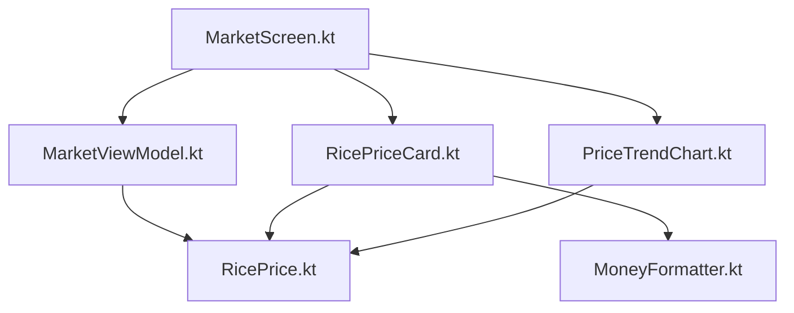
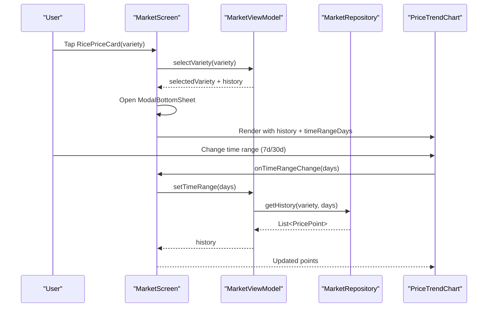
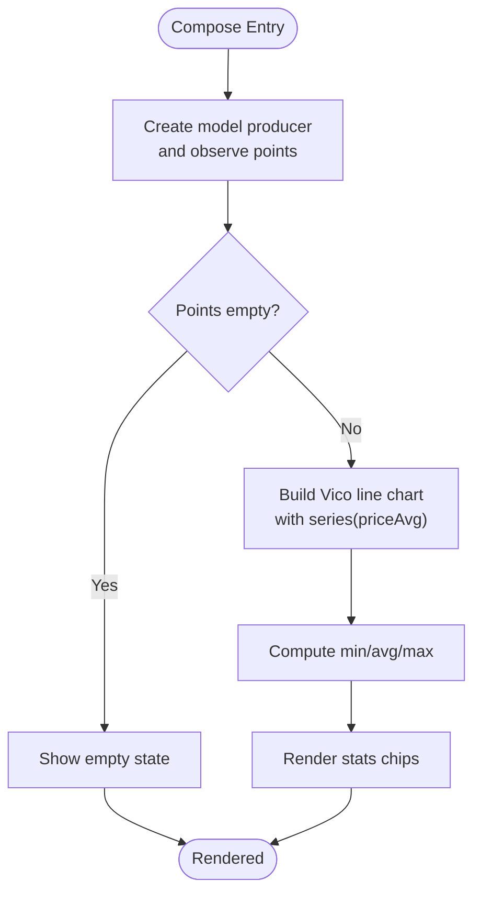
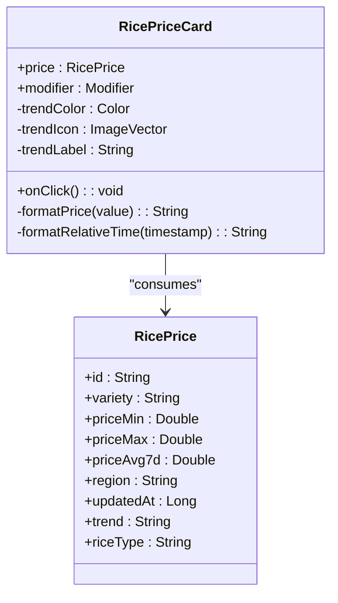
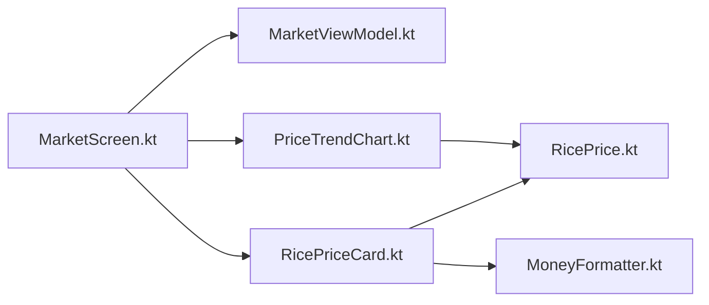

# Price Trend Visualization

<cite>
**Referenced Files in This Document**
- [PriceTrendChart.kt](file://app/src/main/java/com/giathinh/canlua/ui/component/market/PriceTrendChart.kt)
- [RicePriceCard.kt](file://app/src/main/java/com/giathinh/canlua/ui/component/market/RicePriceCard.kt)
- [MarketScreen.kt](file://app/src/main/java/com/giathinh/canlua/ui/screen/market/MarketScreen.kt)
- [MarketViewModel.kt](file://app/src/main/java/com/giathinh/canlua/ui/viewmodel/MarketViewModel.kt)
- [RicePrice.kt](file://app/src/main/java/com/giathinh/canlua/data/model/RicePrice.kt)
- [MoneyFormatter.kt](file://app/src/main/java/com/giathinh/canlua/util/MoneyFormatter.kt)
</cite>

## Table of Contents
1. [Introduction](#introduction)
2. [Project Structure](#project-structure)
3. [Core Components](#core-components)
4. [Architecture Overview](#architecture-overview)
5. [Detailed Component Analysis](#detailed-component-analysis)
6. [Dependency Analysis](#dependency-analysis)
7. [Performance Considerations](#performance-considerations)
8. [Troubleshooting Guide](#troubleshooting-guide)
9. [Conclusion](#conclusion)
10. [Appendices](#appendices)

## Introduction
This document explains the price trend visualization system used by the Market feature. It covers:
- The interactive line chart for historical rice prices built with Vico Charts.
- Time range selection and animated transitions between periods.
- The RicePriceCard component that shows current prices, trend indicators, and relative update time.
- Color coding for price movements, currency formatting, and responsive design considerations.
- Examples of chart customization, data point formatting, and accessibility features for screen readers.

The implementation follows the project’s Kotlin 2.3 / Jetpack Compose offline-first architecture using MVVM, StateFlow, Room persistence, and optional cloud sync.

## Project Structure
The price trend visualization is implemented across UI components, a screen controller, a ViewModel, and shared data models:
- `PriceTrendChart.kt` renders the Vico line chart and time range toggle.
- `RicePriceCard.kt` displays per-variety price cards with trend badges and formatted prices.
- `MarketScreen.kt` orchestrates the market tab, opens the chart bottom sheet, and wires user interactions.
- `MarketViewModel.kt` manages selected variety, time range, filtering, and history loading.
- `RicePrice.kt` defines the price entity and historical price point model.
- `MoneyFormatter.kt` provides localized VND formatting utilities.

**Diagram sources**
- [MarketScreen.kt:303-370](file://app/src/main/java/com/giathinh/canlua/ui/screen/market/MarketScreen.kt#L303-L370)
- [MarketViewModel.kt:34-85](file://app/src/main/java/com/giathinh/canlua/ui/viewmodel/MarketViewModel.kt#L34-L85)
- [RicePriceCard.kt:52-182](file://app/src/main/java/com/giathinh/canlua/ui/component/market/RicePriceCard.kt#L52-L182)
- [PriceTrendChart.kt:46-136](file://app/src/main/java/com/giathinh/canlua/ui/component/market/PriceTrendChart.kt#L46-L136)
- [RicePrice.kt:11-37](file://app/src/main/java/com/giathinh/canlua/data/model/RicePrice.kt#L11-L37)
- [MoneyFormatter.kt:16-40](file://app/src/main/java/com/giathinh/canlua/util/MoneyFormatter.kt#L16-L40)

**Section sources**
- [MarketScreen.kt:104-388](file://app/src/main/java/com/giathinh/canlua/ui/screen/market/MarketScreen.kt#L104-L388)
- [MarketViewModel.kt:34-185](file://app/src/main/java/com/giathinh/canlua/ui/viewmodel/MarketViewModel.kt#L34-L185)
- [RicePriceCard.kt:52-290](file://app/src/main/java/com/giathinh/canlua/ui/component/market/RicePriceCard.kt#L52-L290)
- [PriceTrendChart.kt:46-200](file://app/src/main/java/com/giathinh/canlua/ui/component/market/PriceTrendChart.kt#L46-L200)
- [RicePrice.kt:11-37](file://app/src/main/java/com/giathinh/canlua/data/model/RicePrice.kt#L11-L37)
- [MoneyFormatter.kt:16-108](file://app/src/main/java/com/giathinh/canlua/util/MoneyFormatter.kt#L16-L108)

## Core Components
- PriceTrendChart: Renders a Vico Cartesian line chart from historical price averages, includes a header title, empty state, min/avg/max stat chips, and a time range toggle (7-day and 30-day).
- RicePriceCard: Displays variety name, trend badge (UP/DOWN/STABLE), product type and region badges, last updated relative time, and three price columns (min, max, 7-day average).
- MarketScreen: Hosts the Prices page, filters, and opens a modal bottom sheet with the selected variety’s chart; it also handles pull-to-refresh and error display.
- MarketViewModel: Manages selected variety, time range days, filter state, and exposes combined flows for filtered prices and history.
- RicePrice and PricePoint: Data models for current price entries and historical points used by both card and chart.
- MoneyFormatter: Provides VND short formatting and human-readable Vietnamese text for amounts.

**Section sources**
- [PriceTrendChart.kt:46-200](file://app/src/main/java/com/giathinh/canlua/ui/component/market/PriceTrendChart.kt#L46-L200)
- [RicePriceCard.kt:52-290](file://app/src/main/java/com/giathinh/canlua/ui/component/market/RicePriceCard.kt#L52-L290)
- [MarketScreen.kt:303-388](file://app/src/main/java/com/giathinh/canlua/ui/screen/market/MarketScreen.kt#L303-L388)
- [MarketViewModel.kt:34-185](file://app/src/main/java/com/giathinh/canlua/ui/viewmodel/MarketViewModel.kt#L34-L185)
- [RicePrice.kt:11-37](file://app/src/main/java/com/giathinh/canlua/data/model/RicePrice.kt#L11-L37)
- [MoneyFormatter.kt:16-108](file://app/src/main/java/com/giathinh/canlua/util/MoneyFormatter.kt#L16-L108)

## Architecture Overview
The visualization uses unidirectional data flow:
- User taps a RicePriceCard to select a variety.
- MarketViewModel updates selectedVariety and exposes history based on variety and timeRangeDays.
- MarketScreen observes history and opens a ModalBottomSheet containing PriceTrendChart.
- PriceTrendChart consumes PricePoint list and renders a Vico line chart.
- Time range changes propagate through ViewModel to recompute history.

**Diagram sources**
- [MarketScreen.kt:344-370](file://app/src/main/java/com/giathinh/canlua/ui/screen/market/MarketScreen.kt#L344-L370)
- [MarketViewModel.kt:74-85](file://app/src/main/java/com/giathinh/canlua/ui/viewmodel/MarketViewModel.kt#L74-L85)
- [PriceTrendChart.kt:46-136](file://app/src/main/java/com/giathinh/canlua/ui/component/market/PriceTrendChart.kt#L46-L136)

## Detailed Component Analysis

### PriceTrendChart Component
Purpose:
- Renders a Vico Cartesian line chart for historical price averages.
- Provides a header with localized title and a time range toggle (7-day and 30-day).
- Shows an empty state when no history is available.
- Displays Min/Avg/Max stat chips below the chart.

Key behaviors:
- Uses Vico’s `CartesianChartHost`, `rememberCartesianChart`, `rememberLineCartesianLayer`, and `CartesianChartModelProducer`.
- Updates the chart series via `LaunchedEffect(points)` and `lineSeries { series(...) }`.
- Time range toggle triggers haptic feedback and calls `onTimeRangeChange`.
- Stat chips use a local short formatter for compact labels.

Customization examples:
- Axis configuration: vertical start axis and horizontal bottom axis are configured in the chart builder.
- Series data: mapped from `PricePoint.priceAvg` values.
- Empty state: shown when `points.isEmpty()`.

Accessibility:
- Chart container is a Material Card with semantic padding.
- Stat labels are localized strings.
- No explicit contentDescription on chart itself; rely on surrounding context and labels.

**Diagram sources**
- [PriceTrendChart.kt:52-62](file://app/src/main/java/com/giathinh/canlua/ui/component/market/PriceTrendChart.kt#L52-L62)
- [PriceTrendChart.kt:105-116](file://app/src/main/java/com/giathinh/canlua/ui/component/market/PriceTrendChart.kt#L105-L116)
- [PriceTrendChart.kt:121-133](file://app/src/main/java/com/giathinh/canlua/ui/component/market/PriceTrendChart.kt#L121-L133)

**Section sources**
- [PriceTrendChart.kt:46-200](file://app/src/main/java/com/giathinh/canlua/ui/component/market/PriceTrendChart.kt#L46-L200)

### RicePriceCard Component
Purpose:
- Displays a single variety’s current pricing snapshot with trend indicator and metadata.
- Provides tap interaction to open the chart bottom sheet.

Key behaviors:
- Trend badge mapping: UP → success color + up icon; DOWN → error color + down icon; else stable → info color + flat icon.
- Meta row shows rice type badge (color-coded by keywords), region badge, separator, and relative update time.
- Three price columns: min, max (highlighted), and 7-day average, each with localized labels and unit text.
- Haptic feedback on card press.

Formatting:
- Currency formatting uses a locale-aware number formatter for VND without decimals.
- Relative time formatting computes minutes/hours/days/weeks/months ago.

Color coding:
- Trend colors map to AppColors.Success/Error/Info.
- Rice type badge background/foreground colors vary by keyword matching.

Accessibility:
- Chevron icon has localized contentDescription for screen readers.
- Trend badge icon has null contentDescription; label text conveys meaning.

**Diagram sources**
- [RicePriceCard.kt:52-182](file://app/src/main/java/com/giathinh/canlua/ui/component/market/RicePriceCard.kt#L52-L182)
- [RicePrice.kt:11-24](file://app/src/main/java/com/giathinh/canlua/data/model/RicePrice.kt#L11-L24)

**Section sources**
- [RicePriceCard.kt:52-290](file://app/src/main/java/com/giathinh/canlua/ui/component/market/RicePriceCard.kt#L52-L290)
- [RicePrice.kt:11-24](file://app/src/main/java/com/giathinh/canlua/data/model/RicePrice.kt#L11-L24)

### MarketScreen Integration
Purpose:
- Hosts the Prices page and integrates RicePriceCard items.
- Opens a ModalBottomSheet with PriceTrendChart when a variety is selected.
- Handles pull-to-refresh, snackbar errors, and navigation between News and Prices tabs.

Key integration points:
- Observes `selectedVariety`, `timeRangeDays`, and `history` from ViewModel.
- Passes `history` and `timeRangeDays` into PriceTrendChart.
- Calls `viewModel.setTimeRange(it)` when time range changes.

Responsive behavior:
- Uses LazyColumn with dynamic spacing and bottom padding accounting for navigation bars.
- Pull-to-refresh wraps the list and indicates loading state.

**Section sources**
- [MarketScreen.kt:130-388](file://app/src/main/java/com/giathinh/canlua/ui/screen/market/MarketScreen.kt#L130-L388)
- [MarketScreen.kt:496-590](file://app/src/main/java/com/giathinh/canlua/ui/screen/market/MarketScreen.kt#L496-L590)

### MarketViewModel Responsibilities
Purpose:
- Manages UI state for market: selected variety, time range, filter, loading, and refresh errors.
- Exposes filtered prices and history flows.

Key responsibilities:
- `prices`: combines all prices with filter criteria (variety, region, trend).
- `history`: combines selected variety and time range to fetch historical points.
- `selectVariety` and `setTimeRange` update state; history recomputes automatically via combine/flatMapLatest.
- `refreshFromSupabase` triggers network refresh and sets loading/error states.

State flow highlights:
- `combine(_selectedVariety, _timeRangeDays)` feeds repository history query.
- `stateIn(..., initialValue = emptyList())` ensures safe initial rendering.

**Section sources**
- [MarketViewModel.kt:34-185](file://app/src/main/java/com/giathinh/canlua/ui/viewmodel/MarketViewModel.kt#L34-L185)

## Dependency Analysis
Component relationships:
- MarketScreen depends on MarketViewModel for state and actions.
- MarketScreen composes RicePriceCard and PriceTrendChart.
- RicePriceCard depends on RicePrice model and formats currency/time locally.
- PriceTrendChart depends on PricePoint model and Vico charting primitives.
- MoneyFormatter is available for consistent VND formatting across the app.

**Diagram sources**
- [MarketScreen.kt:303-388](file://app/src/main/java/com/giathinh/canlua/ui/screen/market/MarketScreen.kt#L303-L388)
- [MarketViewModel.kt:34-185](file://app/src/main/java/com/giathinh/canlua/ui/viewmodel/MarketViewModel.kt#L34-L185)
- [RicePriceCard.kt:52-290](file://app/src/main/java/com/giathinh/canlua/ui/component/market/RicePriceCard.kt#L52-L290)
- [PriceTrendChart.kt:46-200](file://app/src/main/java/com/giathinh/canlua/ui/component/market/PriceTrendChart.kt#L46-L200)
- [RicePrice.kt:11-37](file://app/src/main/java/com/giathinh/canlua/data/model/RicePrice.kt#L11-L37)
- [MoneyFormatter.kt:16-108](file://app/src/main/java/com/giathinh/canlua/util/MoneyFormatter.kt#L16-L108)

**Section sources**
- [MarketScreen.kt:303-388](file://app/src/main/java/com/giathinh/canlua/ui/screen/market/MarketScreen.kt#L303-L388)
- [MarketViewModel.kt:34-185](file://app/src/main/java/com/giathinh/canlua/ui/viewmodel/MarketViewModel.kt#L34-L185)
- [RicePriceCard.kt:52-290](file://app/src/main/java/com/giathinh/canlua/ui/component/market/RicePriceCard.kt#L52-L290)
- [PriceTrendChart.kt:46-200](file://app/src/main/java/com/giathinh/canlua/ui/component/market/PriceTrendChart.kt#L46-L200)
- [RicePrice.kt:11-37](file://app/src/main/java/com/giathinh/canlua/data/model/RicePrice.kt#L11-L37)
- [MoneyFormatter.kt:16-108](file://app/src/main/java/com/giathinh/canlua/util/MoneyFormatter.kt#L16-L108)

## Performance Considerations
- Chart data updates: `LaunchedEffect(points)` triggers a transactional update only when points change, minimizing unnecessary recompositions.
- Model producer reuse: `CartesianChartModelProducer` is remembered to avoid recreating chart state on every recomposition.
- Filtering efficiency: ViewModel uses `combine` and `stateIn` to compute filtered lists efficiently.
- Network refresh: `refreshFromSupabase` sets loading state and clears previous errors before/after operations.

Recommendations:
- Keep series data minimal; avoid heavy transformations inside chart composition.
- Use pagination or virtualization for large datasets if history grows significantly.
- Debounce rapid time range changes if needed to reduce repository calls.

[No sources needed since this section provides general guidance]

## Troubleshooting Guide
Common issues and resolutions:
- Chart not updating when time range changes:
  - Ensure `setTimeRange` updates `_timeRangeDays` and that `history` recomputes via `combine(_selectedVariety, _timeRangeDays)`.
  - Verify `MarketScreen` passes `timeRangeDays` to `PriceTrendChart` and calls `viewModel.setTimeRange(it)`.
- Empty chart state:
  - Check that `history` returns non-empty list for selected variety and time range.
  - Confirm repository method `getHistory(variety, days)` returns expected data.
- Trend badge not reflecting price movement:
  - Validate `RicePrice.trend` values are one of UP/DOWN/STABLE.
  - Ensure UI maps trend correctly to color/icon/label.
- Currency formatting inconsistencies:
  - Use consistent formatters (`NumberFormat.getNumberInstance(Locale.forLanguageTag("vi-VN"))`) for VND.
  - Prefer `MoneyFormatter.formatVndShort` where appropriate for consistent localization.

**Section sources**
- [MarketViewModel.kt:74-85](file://app/src/main/java/com/giathinh/canlua/ui/viewmodel/MarketViewModel.kt#L74-L85)
- [MarketScreen.kt:344-370](file://app/src/main/java/com/giathinh/canlua/ui/screen/market/MarketScreen.kt#L344-L370)
- [PriceTrendChart.kt:52-62](file://app/src/main/java/com/giathinh/canlua/ui/component/market/PriceTrendChart.kt#L52-L62)
- [RicePriceCard.kt:58-62](file://app/src/main/java/com/giathinh/canlua/ui/component/market/RicePriceCard.kt#L58-L62)
- [MoneyFormatter.kt:18-24](file://app/src/main/java/com/giathinh/canlua/util/MoneyFormatter.kt#L18-L24)

## Conclusion
The price trend visualization integrates a Vico-based line chart with a clean card layout to present rice price trends effectively. The system leverages MVVM and StateFlow for reactive updates, supports time range selection, and provides accessible, localized UI elements. By following the documented patterns for chart customization, data formatting, and accessibility, developers can extend and maintain these components consistently.

[No sources needed since this section summarizes without analyzing specific files]

## Appendices

### Time Range Selection Behavior
- Supported ranges: 7-day and 30-day toggles in PriceTrendChart.
- Interaction: Tapping a range triggers haptic feedback and calls `onTimeRangeChange`, which updates ViewModel state and recomputes history.

**Section sources**
- [PriceTrendChart.kt:138-173](file://app/src/main/java/com/giathinh/canlua/ui/component/market/PriceTrendChart.kt#L138-L173)
- [MarketViewModel.kt:160-163](file://app/src/main/java/com/giathinh/canlua/ui/viewmodel/MarketViewModel.kt#L160-L163)

### Color Coding System
- Trend indicators:
  - UP: success color + trending up icon.
  - DOWN: error color + trending down icon.
  - STABLE: info color + trending flat icon.
- Rice type badges:
  - Background and foreground colors vary by keyword match (e.g., “ướt”, “Khô”, “nếp”, “gạo”, “lúa”).

**Section sources**
- [RicePriceCard.kt:58-62](file://app/src/main/java/com/giathinh/canlua/ui/component/market/RicePriceCard.kt#L58-L62)
- [RicePriceCard.kt:115-130](file://app/src/main/java/com/giathinh/canlua/ui/component/market/RicePriceCard.kt#L115-L130)

### Formatting Utilities
- VND short format: `MoneyFormatter.formatVndShort(amount)` produces localized VND strings without decimals.
- Localized number formatting: `NumberFormat.getNumberInstance(Locale.forLanguageTag("vi-VN"))` used in RicePriceCard for integer VND display.
- Relative time formatting: Computes “just now”, “X minutes ago”, “X hours ago”, “X days ago”, “X weeks ago”, “X months ago”.

**Section sources**
- [MoneyFormatter.kt:18-24](file://app/src/main/java/com/giathinh/canlua/util/MoneyFormatter.kt#L18-L24)
- [RicePriceCard.kt:270-289](file://app/src/main/java/com/giathinh/canlua/ui/component/market/RicePriceCard.kt#L270-L289)

### Accessibility Features
- Content descriptions:
  - Chevron icon in RicePriceCard has localized contentDescription for screen readers.
- Semantic structure:
  - Cards and rows provide clear grouping for assistive technologies.
- Labels:
  - Stat chips and trend badges use localized strings.

**Section sources**
- [RicePriceCard.kt:100-105](file://app/src/main/java/com/giathinh/canlua/ui/component/market/RicePriceCard.kt#L100-L105)
- [PriceTrendChart.kt:121-133](file://app/src/main/java/com/giathinh/canlua/ui/component/market/PriceTrendChart.kt#L121-L133)