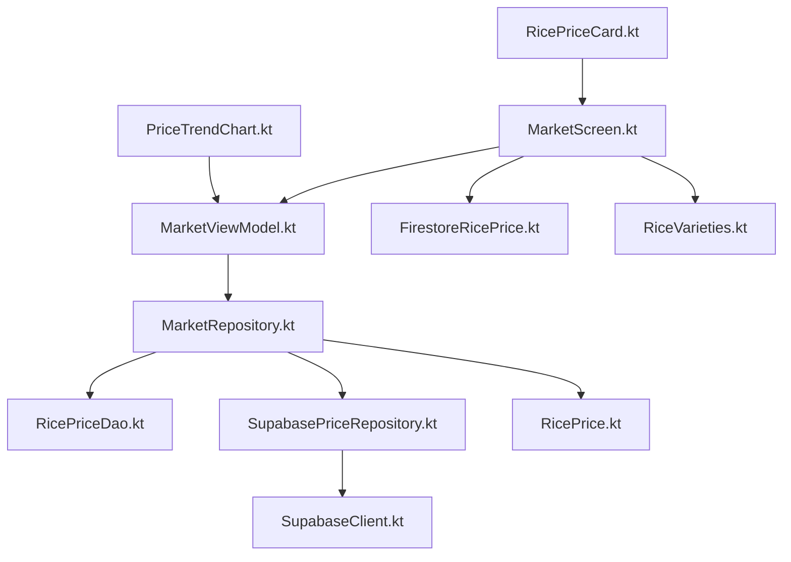
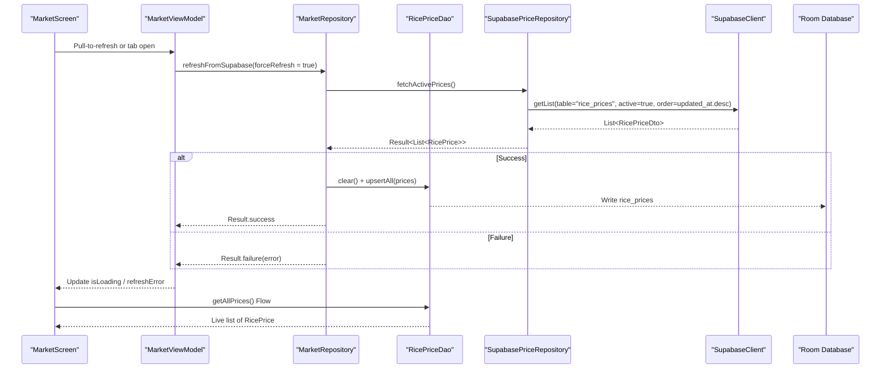
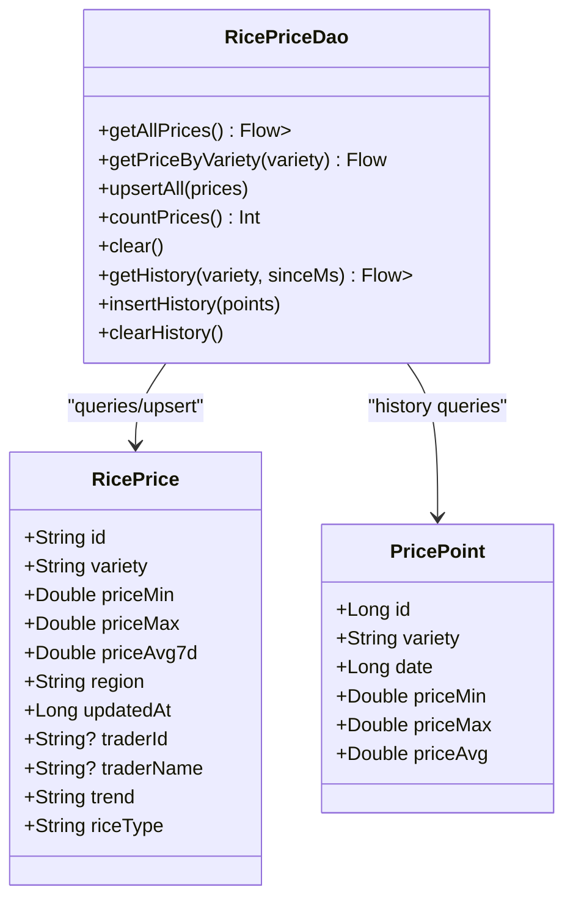
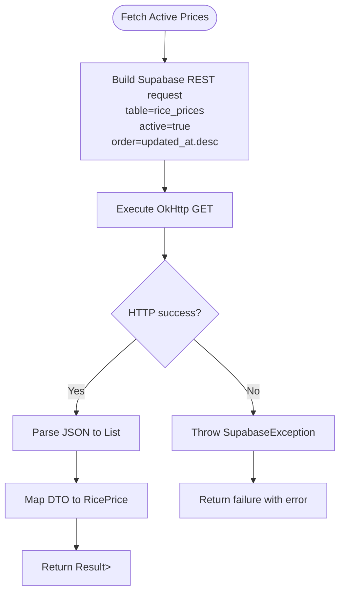
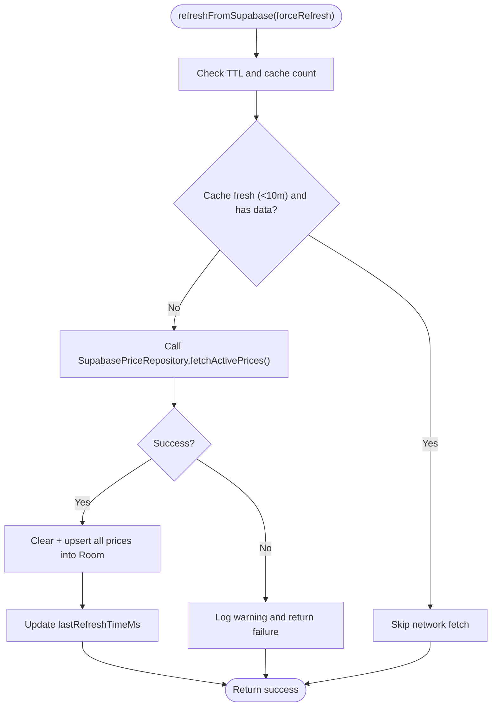
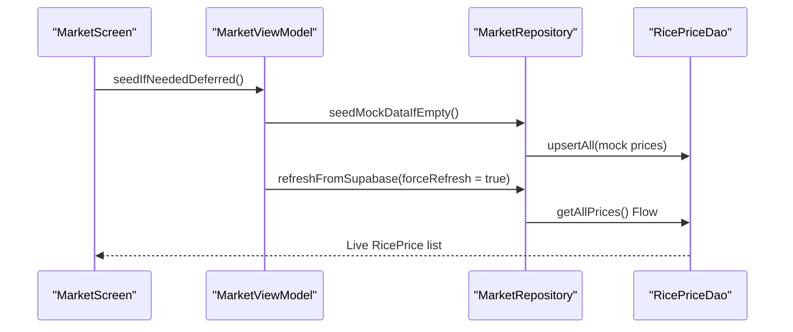
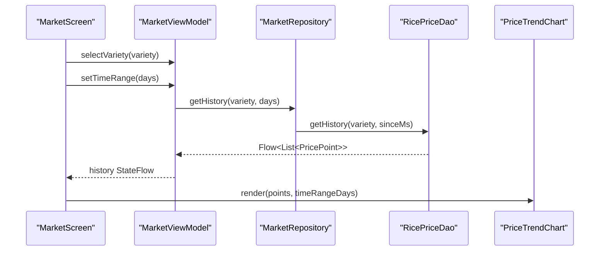
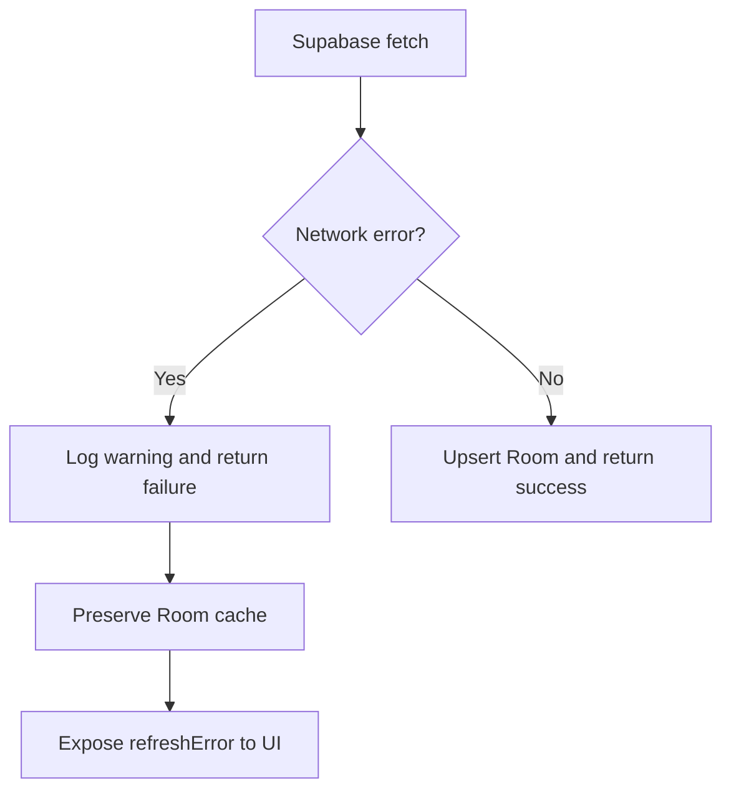
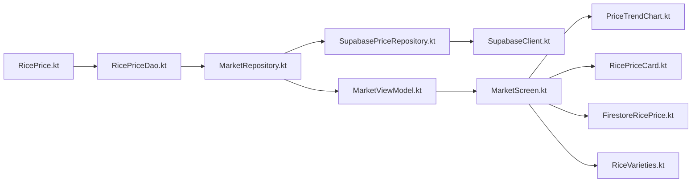

# Rice Price Tracking

<cite>
**Referenced Files in This Document**
- [RicePrice.kt](file://app/src/main/java/com/giathinh/canlua/data/model/RicePrice.kt)
- [RicePriceDao.kt](file://app/src/main/java/com/giathinh/canlua/data/dao/RicePriceDao.kt)
- [MarketRepository.kt](file://app/src/main/java/com/giathinh/canlua/repository/MarketRepository.kt)
- [SupabasePriceRepository.kt](file://app/src/main/java/com/giathinh/canlua/repository/SupabasePriceRepository.kt)
- [SupabaseClient.kt](file://app/src/main/java/com/giathinh/canlua/data/remote/SupabaseClient.kt)
- [FirestoreRicePrice.kt](file://app/src/main/java/com/giathinh/canlua/data/firestore/FirestoreRicePrice.kt)
- [MarketViewModel.kt](file://app/src/main/java/com/giathinh/canlua/ui/viewmodel/MarketViewModel.kt)
- [MarketScreen.kt](file://app/src/main/java/com/giathinh/canlua/ui/screen/market/MarketScreen.kt)
- [PriceTrendChart.kt](file://app/src/main/java/com/giathinh/canlua/ui/component/market/PriceTrendChart.kt)
- [RicePriceCard.kt](file://app/src/main/java/com/giathinh/canlua/ui/component/market/RicePriceCard.kt)
- [RiceVarieties.kt](file://app/src/main/java/com/giathinh/canlua/util/RiceVarieties.kt)
</cite>

## Table of Contents
1. [Introduction](#introduction)
2. [Project Structure](#project-structure)
3. [Core Components](#core-components)
4. [Architecture Overview](#architecture-overview)
5. [Detailed Component Analysis](#detailed-component-analysis)
6. [Dependency Analysis](#dependency-analysis)
7. [Performance Considerations](#performance-considerations)
8. [Troubleshooting Guide](#troubleshooting-guide)
9. [Conclusion](#conclusion)

## Introduction
This document explains the rice price tracking system that provides real-time market data from Supabase while remaining fully functional offline through an AndroidX Room cache. The implementation follows Kotlin 2.3, Jetpack Compose, MVVM, and Clean Architecture with unidirectional data flow via StateFlow and coroutines. Local persistence uses Room schema v18; cloud sync is bidirectional to Firebase Firestore and Supabase, scheduled idempotently via WorkManager. The app serves FARMER, TRADER, and GUEST roles and must remain usable with zero network connectivity.

The focus here is the market pricing layer: how prices are fetched from Supabase, cached into Room, exposed to the UI, filtered by variety and region, visualized as a trend chart, and kept consistent with remote updates.

## Project Structure
The rice price feature spans data models, DAOs, repositories, remote clients, ViewModel state, and Compose screens/components:

**Diagram sources**
- [MarketScreen.kt:104-388](file://app/src/main/java/com/giathinh/canlua/ui/screen/market/MarketScreen.kt#L104-L388)
- [MarketViewModel.kt:32-185](file://app/src/main/java/com/giathinh/canlua/ui/viewmodel/MarketViewModel.kt#L32-L185)
- [MarketRepository.kt:16-155](file://app/src/main/java/com/giathinh/canlua/repository/MarketRepository.kt#L16-L155)
- [RicePriceDao.kt:11-38](file://app/src/main/java/com/giathinh/canlua/data/dao/RicePriceDao.kt#L11-L38)
- [SupabasePriceRepository.kt:22-90](file://app/src/main/java/com/giathinh/canlua/repository/SupabasePriceRepository.kt#L22-L90)
- [SupabaseClient.kt:22-106](file://app/src/main/java/com/giathinh/canlua/data/remote/SupabaseClient.kt#L22-L106)
- [RicePrice.kt:6-38](file://app/src/main/java/com/giathinh/canlua/data/model/RicePrice.kt#L6-L38)
- [FirestoreRicePrice.kt:5-30](file://app/src/main/java/com/giathinh/canlua/data/firestore/FirestoreRicePrice.kt#L5-L30)
- [PriceTrendChart.kt:41-200](file://app/src/main/java/com/giathinh/canlua/ui/component/market/PriceTrendChart.kt#L41-L200)
- [RicePriceCard.kt:44-290](file://app/src/main/java/com/giathinh/canlua/ui/component/market/RicePriceCard.kt#L44-L290)
- [RiceVarieties.kt:3-23](file://app/src/main/java/com/giathinh/canlua/util/RiceVarieties.kt#L3-L23)

**Section sources**
- [MarketScreen.kt:104-388](file://app/src/main/java/com/giathinh/canlua/ui/screen/market/MarketScreen.kt#L104-L388)
- [MarketViewModel.kt:32-185](file://app/src/main/java/com/giathinh/canlua/ui/viewmodel/MarketViewModel.kt#L32-L185)
- [MarketRepository.kt:16-155](file://app/src/main/java/com/giathinh/canlua/repository/MarketRepository.kt#L16-L155)

## Core Components
- **RicePrice**: Room entity representing current buy prices per variety, including min/max/7-day average, region, update timestamp, optional trader metadata, trend direction, and product type.
- **PricePoint**: Room entity for daily historical price points used by the trend chart.
- **RicePriceDao**: Room DAO exposing Flow-based queries for current prices and history, plus upsert and clear operations.
- **SupabasePriceRepository**: Read-only repository fetching active rice prices from Supabase REST API and mapping DTOs to domain entities.
- **MarketRepository**: Offline-first repository coordinating Room cache, Supabase refresh, TTL-based caching, mock seeding, and history queries.
- **MarketViewModel**: UI state holder combining all prices, filters, selected variety, time range, and history; triggers refresh and exposes error state.
- **MarketScreen**: Compose screen driving pull-to-refresh, filtering, bid editing (for traders), and opening the price trend modal.
- **PriceTrendChart**: Vico-based line chart rendering historical averages with 7-day/30-day toggles and min/avg/max stats.
- **RicePriceCard**: Card displaying variety name, trend badge, product type, region, relative update time, and three price columns.

**Section sources**
- [RicePrice.kt:6-38](file://app/src/main/java/com/giathinh/canlua/data/model/RicePrice.kt#L6-L38)
- [RicePriceDao.kt:11-38](file://app/src/main/java/com/giathinh/canlua/data/dao/RicePriceDao.kt#L11-L38)
- [SupabasePriceRepository.kt:22-90](file://app/src/main/java/com/giathinh/canlua/repository/SupabasePriceRepository.kt#L22-L90)
- [MarketRepository.kt:16-155](file://app/src/main/java/com/giathinh/canlua/repository/MarketRepository.kt#L16-L155)
- [MarketViewModel.kt:26-185](file://app/src/main/java/com/giathinh/canlua/ui/viewmodel/MarketViewModel.kt#L26-L185)
- [MarketScreen.kt:104-388](file://app/src/main/java/com/giathinh/canlua/ui/screen/market/MarketScreen.kt#L104-L388)
- [PriceTrendChart.kt:41-200](file://app/src/main/java/com/giathinh/canlua/ui/component/market/PriceTrendChart.kt#L41-L200)
- [RicePriceCard.kt:44-290](file://app/src/main/java/com/giathinh/canlua/ui/component/market/RicePriceCard.kt#L44-L290)

## Architecture Overview
The system implements an offline-first pipeline:

**Diagram sources**
- [MarketScreen.kt:290-339](file://app/src/main/java/com/giathinh/canlua/ui/screen/market/MarketScreen.kt#L290-L339)
- [MarketViewModel.kt:130-150](file://app/src/main/java/com/giathinh/canlua/ui/viewmodel/MarketViewModel.kt#L130-L150)
- [MarketRepository.kt:45-78](file://app/src/main/java/com/giathinh/canlua/repository/MarketRepository.kt#L45-L78)
- [SupabasePriceRepository.kt:33-59](file://app/src/main/java/com/giathinh/canlua/repository/SupabasePriceRepository.kt#L33-L59)
- [SupabaseClient.kt:35-70](file://app/src/main/java/com/giathinh/canlua/data/remote/SupabaseClient.kt#L35-L70)
- [RicePriceDao.kt:14-27](file://app/src/main/java/com/giathinh/canlua/data/dao/RicePriceDao.kt#L14-L27)

## Detailed Component Analysis

### Data Model and History Tracking
- `RicePrice` stores current market price snapshots per variety, including min/max/7-day average, region, update timestamp, optional trader identity, trend direction, and product type.
- `PricePoint` stores daily historical data points for charting, keyed by variety and date.

**Diagram sources**
- [RicePrice.kt:6-38](file://app/src/main/java/com/giathinh/canlua/data/model/RicePrice.kt#L6-L38)
- [RicePriceDao.kt:11-38](file://app/src/main/java/com/giathinh/canlua/data/dao/RicePriceDao.kt#L11-L38)

**Section sources**
- [RicePrice.kt:6-38](file://app/src/main/java/com/giathinh/canlua/data/model/RicePrice.kt#L6-L38)
- [RicePriceDao.kt:11-38](file://app/src/main/java/com/giathinh/canlua/data/dao/RicePriceDao.kt#L11-L38)

### Price Data Fetching Mechanism
- `SupabasePriceRepository.fetchActivePrices()` calls `SupabaseClient.getList()` with query parameters filtering active rows and ordering by most recent update.
- `SupabaseClient` performs OkHttp GET requests with Supabase headers and parses JSON into `RicePriceDto`, then maps to `RicePrice`.
- Errors are wrapped as `SupabaseException` and logged; successful results return parsed lists.

**Diagram sources**
- [SupabasePriceRepository.kt:33-59](file://app/src/main/java/com/giathinh/canlua/repository/SupabasePriceRepository.kt#L33-L59)
- [SupabaseClient.kt:35-70](file://app/src/main/java/com/giathinh/canlua/data/remote/SupabaseClient.kt#L35-L70)

**Section sources**
- [SupabasePriceRepository.kt:22-90](file://app/src/main/java/com/giathinh/canlua/repository/SupabasePriceRepository.kt#L22-L90)
- [SupabaseClient.kt:22-106](file://app/src/main/java/com/giathinh/canlua/data/remote/SupabaseClient.kt#L22-L106)

### Local Caching Strategy with Room
- `MarketRepository.refreshFromSupabase()` enforces a 10-minute TTL; if cache is fresh and non-empty, it skips network calls.
- On success, it clears existing room records and upserts the new list, ensuring idempotent replacement.
- On failure, it logs the error and leaves Room cache untouched, preserving offline availability.

**Diagram sources**
- [MarketRepository.kt:45-78](file://app/src/main/java/com/giathinh/canlua/repository/MarketRepository.kt#L45-L78)

**Section sources**
- [MarketRepository.kt:45-78](file://app/src/main/java/com/giathinh/canlua/repository/MarketRepository.kt#L45-L78)

### Offline-First Architecture Implementation
- UI reads from `MarketRepository.getAllPrices()` which returns a Room-backed Flow; this ensures instant, always-available data.
- On Market tab open or pull-to-refresh, ViewModel triggers `refreshFromSupabase(forceRefresh = true)`; errors surface as `refreshError` without breaking UI.
- Mock seeding populates initial data when Room is empty, allowing full offline UX until real data arrives.

**Diagram sources**
- [MarketViewModel.kt:116-128](file://app/src/main/java/com/giathinh/canlua/ui/viewmodel/MarketViewModel.kt#L116-L128)
- [MarketRepository.kt:80-141](file://app/src/main/java/com/giathinh/canlua/repository/MarketRepository.kt#L80-L141)
- [RicePriceDao.kt:14-27](file://app/src/main/java/com/giathinh/canlua/data/dao/RicePriceDao.kt#L14-L27)

**Section sources**
- [MarketViewModel.kt:116-128](file://app/src/main/java/com/giathinh/canlua/ui/viewmodel/MarketViewModel.kt#L116-L128)
- [MarketRepository.kt:80-141](file://app/src/main/java/com/giathinh/canlua/repository/MarketRepository.kt#L80-L141)

### RicePrice Model Structure
- Fields include unique identifier, variety, min/max/7-day average price, region, update timestamp, optional trader identity/name, trend direction, and product type.
- Trend values are constrained to UP, DOWN, or STABLE.
- Product types include dry rice, wet rice, white rice, sticky rice, etc., influencing card badges and colors.

**Section sources**
- [RicePrice.kt:6-24](file://app/src/main/java/com/giathinh/canlua/data/model/RicePrice.kt#L6-L24)
- [RicePriceCard.kt:115-135](file://app/src/main/java/com/giathinh/canlua/ui/component/market/RicePriceCard.kt#L115-L135)

### Price History Tracking and Trend Visualization
- `MarketRepository.getHistory(variety, days)` computes a `sinceMs` timestamp and returns a Flow of `PricePoint` from Room.
- `MarketViewModel.history` combines selected variety and time range to dynamically fetch history.
- `PriceTrendChart` renders a line series using Vico’s CartesianChartHost, showing min/avg/max statistics and supporting 7-day/30-day toggles.

**Diagram sources**
- [MarketViewModel.kt:74-85](file://app/src/main/java/com/giathinh/canlua/ui/viewmodel/MarketViewModel.kt#L74-L85)
- [MarketRepository.kt:40-43](file://app/src/main/java/com/giathinh/canlua/repository/MarketRepository.kt#L40-L43)
- [RicePriceDao.kt:29-33](file://app/src/main/java/com/giathinh/canlua/data/dao/RicePriceDao.kt#L29-L33)
- [PriceTrendChart.kt:41-136](file://app/src/main/java/com/giathinh/canlua/ui/component/market/PriceTrendChart.kt#L41-L136)

**Section sources**
- [MarketViewModel.kt:74-85](file://app/src/main/java/com/giathinh/canlua/ui/viewmodel/MarketViewModel.kt#L74-L85)
- [PriceTrendChart.kt:41-200](file://app/src/main/java/com/giathinh/canlua/ui/component/market/PriceTrendChart.kt#L41-L200)

### Integration with MarketRepository for Data Synchronization
- `MarketRepository` coordinates between Room and Supabase, applying TTL-based refresh and mock seeding.
- It exposes Flow-based APIs for current prices and history, enabling reactive UI updates.
- Error handling preserves local cache on network failures, ensuring offline continuity.

**Section sources**
- [MarketRepository.kt:16-155](file://app/src/main/java/com/giathinh/canlua/repository/MarketRepository.kt#L16-L155)

### Error Handling for Network Failures and Automatic Retry
- `SupabaseClient` throws `SupabaseException` on HTTP errors; `SupabasePriceRepository` logs and returns failure.
- `MarketRepository.refreshFromSupabase()` catches failures and returns `Result.failure`, leaving Room cache intact.
- `MarketViewModel.refreshFromSupabase()` surfaces `refreshError` to the UI; users can retry via pull-to-refresh or manual refresh.
- No automatic retry loop is implemented; retries are user-triggered or TTL-driven.

**Diagram sources**
- [SupabaseClient.kt:57-69](file://app/src/main/java/com/giathinh/canlua/data/remote/SupabaseClient.kt#L57-L69)
- [SupabasePriceRepository.kt:53-58](file://app/src/main/java/com/giathinh/canlua/repository/SupabasePriceRepository.kt#L53-L58)
- [MarketRepository.kt:62-77](file://app/src/main/java/com/giathinh/canlua/repository/MarketRepository.kt#L62-L77)
- [MarketViewModel.kt:133-150](file://app/src/main/java/com/giathinh/canlua/ui/viewmodel/MarketViewModel.kt#L133-L150)

**Section sources**
- [SupabaseClient.kt:57-69](file://app/src/main/java/com/giathinh/canlua/data/remote/SupabaseClient.kt#L57-L69)
- [SupabasePriceRepository.kt:53-58](file://app/src/main/java/com/giathinh/canlua/repository/SupabasePriceRepository.kt#L53-L58)
- [MarketRepository.kt:62-77](file://app/src/main/java/com/giathinh/canlua/repository/MarketRepository.kt#L62-L77)
- [MarketViewModel.kt:133-150](file://app/src/main/java/com/giathinh/canlua/ui/viewmodel/MarketViewModel.kt#L133-L150)

### Practical Examples

#### Retrieving Price Data
- UI observes `viewModel.prices` to display current prices.
- Pull-to-refresh triggers `viewModel.refreshFromSupabase()`, which forces a network call and updates Room.

**Section sources**
- [MarketScreen.kt:138-145](file://app/src/main/java/com/giathinh/canlua/ui/screen/market/MarketScreen.kt#L138-L145)
- [MarketViewModel.kt:130-150](file://app/src/main/java/com/giathinh/canlua/ui/viewmodel/MarketViewModel.kt#L130-L150)

#### Filtering by Variety and Region
- `MarketFilter` supports filtering by variety, region, and trend.
- `MarketViewModel.prices` combines all prices with filter criteria, returning a filtered Flow.

**Section sources**
- [MarketViewModel.kt:26-67](file://app/src/main/java/com/giathinh/canlua/ui/viewmodel/MarketViewModel.kt#L26-L67)

#### Handling Price Updates in Real-Time
- Room DAOs expose Flow-based queries; changes propagate automatically to UI.
- `MarketScreen` displays updated cards and trends without manual refresh.

**Section sources**
- [RicePriceDao.kt:14-18](file://app/src/main/java/com/giathinh/canlua/data/dao/RicePriceDao.kt#L14-L18)
- [MarketScreen.kt:576-582](file://app/src/main/java/com/giathinh/canlua/ui/screen/market/MarketScreen.kt#L576-L582)

## Dependency Analysis
The rice price module depends on Room for persistence, Supabase for remote data, and Compose for UI. ViewModel orchestrates repository calls and exposes state to UI components.

**Diagram sources**
- [RicePrice.kt:6-38](file://app/src/main/java/com/giathinh/canlua/data/model/RicePrice.kt#L6-L38)
- [RicePriceDao.kt:11-38](file://app/src/main/java/com/giathinh/canlua/data/dao/RicePriceDao.kt#L11-L38)
- [MarketRepository.kt:16-155](file://app/src/main/java/com/giathinh/canlua/repository/MarketRepository.kt#L16-L155)
- [SupabasePriceRepository.kt:22-90](file://app/src/main/java/com/giathinh/canlua/repository/SupabasePriceRepository.kt#L22-L90)
- [SupabaseClient.kt:22-106](file://app/src/main/java/com/giathinh/canlua/data/remote/SupabaseClient.kt#L22-L106)
- [MarketViewModel.kt:32-185](file://app/src/main/java/com/giathinh/canlua/ui/viewmodel/MarketViewModel.kt#L32-L185)
- [MarketScreen.kt:104-388](file://app/src/main/java/com/giathinh/canlua/ui/screen/market/MarketScreen.kt#L104-L388)
- [PriceTrendChart.kt:41-200](file://app/src/main/java/com/giathinh/canlua/ui/component/market/PriceTrendChart.kt#L41-L200)
- [RicePriceCard.kt:44-290](file://app/src/main/java/com/giathinh/canlua/ui/component/market/RicePriceCard.kt#L44-L290)
- [FirestoreRicePrice.kt:5-30](file://app/src/main/java/com/giathinh/canlua/data/firestore/FirestoreRicePrice.kt#L5-L30)
- [RiceVarieties.kt:3-23](file://app/src/main/java/com/giathinh/canlua/util/RiceVarieties.kt#L3-L23)

**Section sources**
- [MarketRepository.kt:16-155](file://app/src/main/java/com/giathinh/canlua/repository/MarketRepository.kt#L16-L155)
- [MarketViewModel.kt:32-185](file://app/src/main/java/com/giathinh/canlua/ui/viewmodel/MarketViewModel.kt#L32-L185)

## Performance Considerations
- **Flow-based Reactivity**: All DAO queries return Flows, enabling efficient, lifecycle-aware updates without manual polling.
- **TTL Caching**: A 10-minute TTL prevents excessive network calls during frequent recompositions.
- **Lazy Loading**: ViewModel uses `stateIn` with `WhileSubscribed(5000)` to avoid unnecessary computation when not observed.
- **List Rendering**: Compose LazyColumn renders only visible items; skeleton states improve perceived performance during loading.
- **Memory Management**: ViewModel destroys native ads on premium upgrade or disposal to free resources.

[No sources needed since this section provides general guidance]

## Troubleshooting Guide
- **Network Errors**: Check logs for `SupabaseException`; verify Supabase URL and anon key configuration.
- **Stale Data**: If prices appear outdated, trigger pull-to-refresh or call `refreshFromSupabase(forceRefresh = true)`.
- **Empty Lists**: Ensure mock seeding ran on first launch; check Room cache count and Supabase response.
- **Chart Not Updating**: Verify selected variety and time range; confirm history Flow emits data.

**Section sources**
- [SupabaseClient.kt:57-69](file://app/src/main/java/com/giathinh/canlua/data/remote/SupabaseClient.kt#L57-L69)
- [MarketViewModel.kt:133-150](file://app/src/main/java/com/giathinh/canlua/ui/viewmodel/MarketViewModel.kt#L133-L150)

## Conclusion
The rice price tracking system delivers real-time market data from Supabase while maintaining robust offline functionality through Room caching. Its architecture emphasizes clean separation of concerns, reactive UI updates, and resilient error handling. Users benefit from immediate access to price information, flexible filtering, and insightful trend visualization, all within an offline-first design that prioritizes reliability and performance.

[No sources needed since this section summarizes without analyzing specific files]