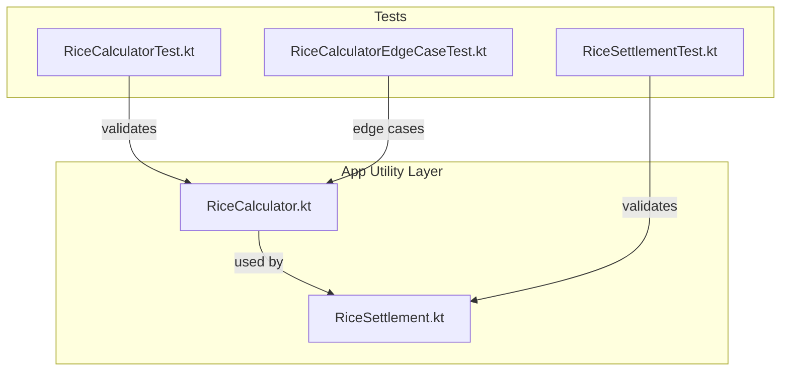
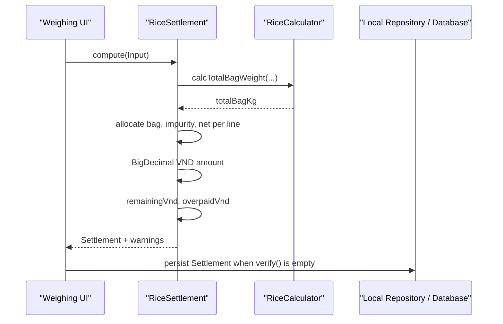
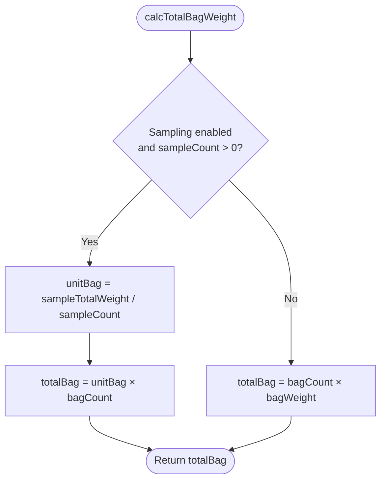
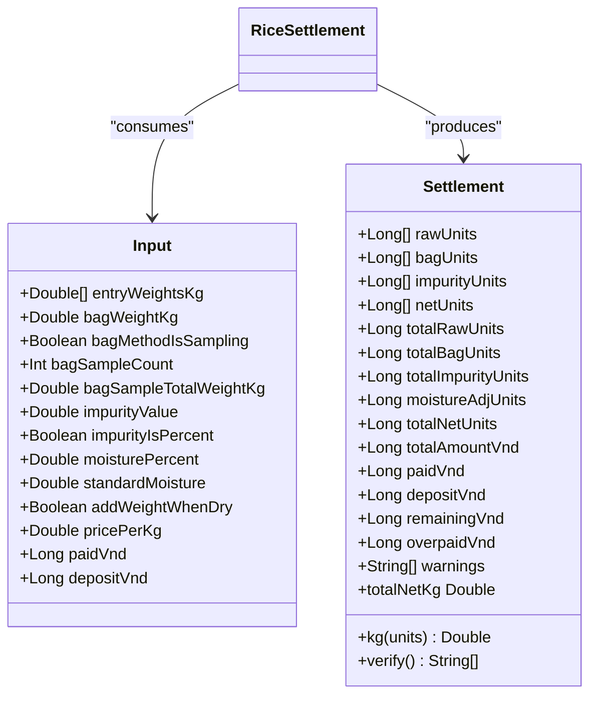
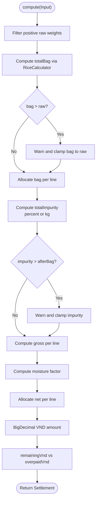
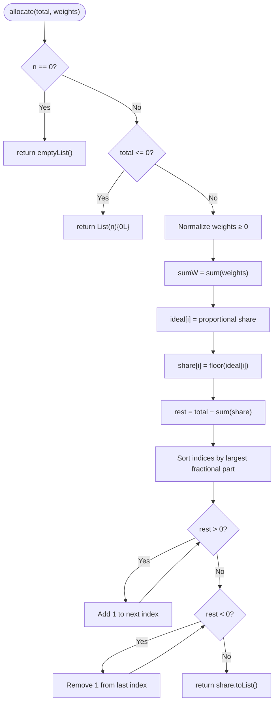
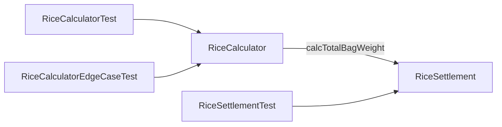

# Financial Calculation Engine

<cite>
**Referenced Files in This Document**
- [RiceCalculator.kt](file://app/src/main/java/com/giathinh/canlua/util/RiceCalculator.kt)
- [RiceSettlement.kt](file://app/src/main/java/com/giathinh/canlua/util/RiceSettlement.kt)
- [RiceCalculatorTest.kt](file://app/src/test/java/com/giathinh/canlua/util/RiceCalculatorTest.kt)
- [RiceSettlementTest.kt](file://app/src/test/java/com/giathinh/canlua/util/RiceSettlementTest.kt)
- [RiceCalculatorEdgeCaseTest.kt](file://app/src/test/java/com/giathinh/canlua/util/RiceCalculatorEdgeCaseTest.kt)
</cite>

## Table of Contents
1. [Introduction](#introduction)
2. [Project Structure](#project-structure)
3. [Core Components](#core-components)
4. [Architecture Overview](#architecture-overview)
5. [Detailed Component Analysis](#detailed-component-analysis)
6. [Dependency Analysis](#dependency-analysis)
7. [Performance Considerations](#performance-considerations)
8. [Troubleshooting Guide](#troubleshooting-guide)
9. [Conclusion](#conclusion)
10. [Appendices](#appendices)

## Introduction
This document explains the financial calculation engine that converts rice weighing data into accurate financial settlements. It focuses on two core Kotlin utilities:

- `RiceCalculator`: standard industry calculations for moisture adjustment, net weight, bag weight modes, impurity handling, and basic monetary totals.
- `RiceSettlement`: a precision-focused settlement pipeline that distributes weights per line, computes VND amounts safely with integer arithmetic, tracks overpayments, and validates all invariants.

The engine supports offline-first Android workflows where weighing inputs are collected locally and later converted into auditable financial records.

## Project Structure
The financial logic lives under the app’s utility layer:

**Diagram sources**
- [RiceCalculator.kt:1-123](file://app/src/main/java/com/giathinh/canlua/util/RiceCalculator.kt#L1-L123)
- [RiceSettlement.kt:1-219](file://app/src/main/java/com/giathinh/canlua/util/RiceSettlement.kt#L1-L219)
- [RiceCalculatorTest.kt:1-325](file://app/src/test/java/com/giathinh/canlua/util/RiceCalculatorTest.kt#L1-L325)
- [RiceSettlementTest.kt:1-232](file://app/src/test/java/com/giathinh/canlua/util/RiceSettlementTest.kt#L1-L232)
- [RiceCalculatorEdgeCaseTest.kt:1-326](file://app/src/test/java/com/giathinh/canlua/util/RiceCalculatorEdgeCaseTest.kt#L1-L326)

**Section sources**
- [RiceCalculator.kt:1-123](file://app/src/main/java/com/giathinh/canlua/util/RiceCalculator.kt#L1-L123)
- [RiceSettlement.kt:1-219](file://app/src/main/java/com/giathinh/canlua/util/RiceSettlement.kt#L1-L219)

## Core Components
- `RiceCalculator` provides:
  - Moisture normalization to a standard percentage.
  - Net weight after subtracting bag and impurity.
  - Bag weight calculation using direct or sampling modes.
  - Impurity handling as kilograms (with legacy percent parameter support).
  - Basic total amount and remaining amount helpers.

- `RiceSettlement` provides:
  - A full settlement computation from raw per-line weights to final VND balance.
  - Integer-based internal units to avoid floating-point drift.
  - Largest Remainder Method allocation so per-line sums equal totals exactly.
  - Overpayment tracking instead of silently clamping to zero.
  - A `verify()` method that returns invariant violations; empty means the settlement is consistent.

**Section sources**
- [RiceCalculator.kt:8-122](file://app/src/main/java/com/giathinh/canlua/util/RiceCalculator.kt#L8-L122)
- [RiceSettlement.kt:8-87](file://app/src/main/java/com/giathinh/canlua/util/RiceSettlement.kt#L8-L87)

## Architecture Overview
At a high level, the workflow is:

1. Weighing UI collects raw weights, bag configuration, impurity, moisture, price, paid amount, and deposit.
2. `RiceSettlement.compute` uses `RiceCalculator.calcTotalBagWeight` for bag mode selection.
3. Settlement distributes bag, impurity, and net weight across lines without rounding drift.
4. Monetary values are computed once in VND using `BigDecimal`, then split into remaining and overpaid amounts.
5. The resulting `Settlement` can be persisted and displayed, with warnings and verification results.

**Diagram sources**
- [RiceSettlement.kt:89-183](file://app/src/main/java/com/giathinh/canlua/util/RiceSettlement.kt#L89-L183)
- [RiceCalculator.kt:52-64](file://app/src/main/java/com/giathinh/canlua/util/RiceCalculator.kt#L52-L64)

## Detailed Component Analysis

### RiceCalculator Methods

#### Moisture Normalization
- Purpose: Convert raw weight to standard dry basis.
- Formula: `W_std = W_raw × (100 − moisturePercent) / (100 − standardMoisture)`
- Default standard moisture: 14%.
- Edge behavior:
  - Invalid moisture (`≤ 0` or `≥ 100`) returns raw weight unchanged.
  - Zero raw weight returns zero.
  - Negative raw weight is not blocked here; callers must guard.

**Section sources**
- [RiceCalculator.kt:10-23](file://app/src/main/java/com/giathinh/canlua/util/RiceCalculator.kt#L10-L23)
- [RiceCalculatorEdgeCaseTest.kt:94-152](file://app/src/test/java/com/giathinh/canlua/util/RiceCalculatorEdgeCaseTest.kt#L94-L152)

#### Net Weight Calculation
- Purpose: Compute sellable weight after removing bags and impurities, then normalize moisture.
- Steps:
  1. `gross = rawWeight − bagWeight − impurityWeight`
  2. If `gross ≤ 0`, return `0.0`.
  3. Apply moisture normalization.
  4. Round to one decimal place and coerce to non-negative.

**Section sources**
- [RiceCalculator.kt:28-38](file://app/src/main/java/com/giathinh/canlua/util/RiceCalculator.kt#L28-L38)
- [RiceCalculatorTest.kt:49-85](file://app/src/test/java/com/giathinh/canlua/util/RiceCalculatorTest.kt#L49-L85)
- [RiceCalculatorEdgeCaseTest.kt:154-194](file://app/src/test/java/com/giathinh/canlua/util/RiceCalculatorEdgeCaseTest.kt#L154-L194)

#### Bag Weight Calculation Modes
- Direct mode (`methodIsSampling = false`):
  - `totalBag = bagCount × bagWeight`
- Sampling mode (`methodIsSampling = true`):
  - `unitBag = sampleTotalWeight / sampleCount`
  - `totalBag = unitBag × bagCount`
  - Fallback to direct mode if `sampleCount ≤ 0`.

**Diagram sources**
- [RiceCalculator.kt:52-64](file://app/src/main/java/com/giathinh/canlua/util/RiceCalculator.kt#L52-L64)

**Section sources**
- [RiceCalculator.kt:40-64](file://app/src/main/java/com/giathinh/canlua/util/RiceCalculator.kt#L40-L64)
- [RiceCalculatorTest.kt:180-205](file://app/src/test/java/com/giathinh/canlua/util/RiceCalculatorTest.kt#L180-L205)
- [RiceCalculatorEdgeCaseTest.kt:249-288](file://app/src/test/java/com/giathinh/canlua/util/RiceCalculatorEdgeCaseTest.kt#L249-L288)

#### Impurity Handling
- Current implementation treats `impurityValue` as kilograms directly.
- The `isPercent` parameter exists for legacy compatibility but does not change the result in this implementation.
- Negative impurity values are coerced to zero.

**Section sources**
- [RiceCalculator.kt:66-77](file://app/src/main/java/com/giathinh/canlua/util/RiceCalculator.kt#L66-L77)
- [RiceCalculatorTest.kt:207-228](file://app/src/test/java/com/giathinh/canlua/util/RiceCalculatorTest.kt#L207-L228)
- [RiceCalculatorEdgeCaseTest.kt:25-66](file://app/src/test/java/com/giathinh/canlua/util/RiceCalculatorEdgeCaseTest.kt#L25-L66)

#### Net Weight With Modes
- Combines bag mode and impurity mode into one call used during per-card recalculation.
- Flow:
  1. Compute total bag weight using selected mode.
  2. Subtract bag weight from raw weight.
  3. Compute impurity as kilograms.
  4. Compute gross after impurity.
  5. Normalize moisture.
  6. Round to one decimal and coerce to non-negative.

**Section sources**
- [RiceCalculator.kt:79-106](file://app/src/main/java/com/giathinh/canlua/util/RiceCalculator.kt#L79-L106)
- [RiceCalculatorTest.kt:230-263](file://app/src/test/java/com/giathinh/canlua/util/RiceCalculatorTest.kt#L230-L263)
- [RiceCalculatorEdgeCaseTest.kt:68-90](file://app/src/test/java/com/giathinh/canlua/util/RiceCalculatorEdgeCaseTest.kt#L68-L90)

#### Monetary Helpers
- `calcTotalAmount(netWeight, pricePerKg)`: multiplies net weight by price.
- `calcRemainingAmount(totalAmount, paidAmount, depositAmount)`: subtracts payments and deposit; may be negative if overpaid.

**Section sources**
- [RiceCalculator.kt:108-120](file://app/src/main/java/com/giathinh/canlua/util/RiceCalculator.kt#L108-L120)
- [RiceCalculatorTest.kt:87-126](file://app/src/test/java/com/giathinh/canlua/util/RiceCalculatorTest.kt#L87-L126)
- [RiceCalculatorEdgeCaseTest.kt:196-247](file://app/src/test/java/com/giathinh/canlua/util/RiceCalculatorEdgeCaseTest.kt#L196-L247)

### RiceSettlement Pipeline

#### Input and Output Model
- `Input` carries:
  - Per-entry raw weights in kilograms.
  - Bag configuration including sampling mode.
  - Impurity value and whether it is percent.
  - Moisture content and standard moisture.
  - Whether dry rice gets extra weight when below standard moisture.
  - Price per kilogram, paid amount, and deposit in VND.
- `Settlement` exposes:
  - Per-line units for raw, bag, impurity, and net weight.
  - Totals for raw, bag, impurity, net, and moisture adjustment.
  - Amount in VND, remaining due, and overpaid amount.
  - Warnings and a `verify()` method.

**Diagram sources**
- [RiceSettlement.kt:23-87](file://app/src/main/java/com/giathinh/canlua/util/RiceSettlement.kt#L23-L87)

**Section sources**
- [RiceSettlement.kt:23-87](file://app/src/main/java/com/giathinh/canlua/util/RiceSettlement.kt#L23-L87)

#### Settlement Computation Flow
The main `compute` function performs these steps:

1. Filter valid entries: only positive raw weights become lines.
2. Compute total bag weight using `RiceCalculator.calcTotalBagWeight`.
3. Warn and clamp if bag weight exceeds raw weight.
4. Distribute bag weight across lines using largest remainder allocation.
5. Compute impurity:
   - Percent mode: percentage of weight after bag removal.
   - Kilogram mode: direct kilograms.
   - Warn and clamp if impurity exceeds weight after bag.
6. Compute gross weight after impurity.
7. Apply moisture factor:
   - Missing or invalid moisture keeps weight unchanged.
   - Dry rice may be rewarded depending on `addWeightWhenDry`.
8. Allocate net weight across lines.
9. Compute total amount in VND using `BigDecimal` with single rounding step.
10. Split difference between remaining due and overpaid.

**Diagram sources**
- [RiceSettlement.kt:89-183](file://app/src/main/java/com/giathinh/canlua/util/RiceSettlement.kt#L89-L183)

**Section sources**
- [RiceSettlement.kt:89-183](file://app/src/main/java/com/giathinh/canlua/util/RiceSettlement.kt#L89-L183)

#### Allocation Algorithm
`allocate` implements the Largest Remainder Method:

- Converts fractional ideal shares to floor values.
- Distributes remaining integer units to lines with the largest fractional parts.
- Guarantees exact sum equality across lines.
- Handles edge cases:
  - Empty input list.
  - Non-positive total.
  - All-zero weights.
  - Defensive correction for rare floating-point drift.

**Diagram sources**
- [RiceSettlement.kt:198-217](file://app/src/main/java/com/giathinh/canlua/util/RiceSettlement.kt#L198-L217)

**Section sources**
- [RiceSettlement.kt:188-217](file://app/src/main/java/com/giathinh/canlua/util/RiceSettlement.kt#L188-L217)

#### Invariant Verification
`Settlement.verify()` checks:

- Sums of per-line raw, bag, impurity, and net match totals.
- Accounting identity: `raw − bag − impurity + moistureAdjustment = net`.
- No negative totals or negative per-line net.
- Remaining and overpaid are non-negative.
- Payment identity: `remaining − overpaid = totalAmount − paid − deposit`.

An empty list means the settlement is internally consistent and safe to persist.

**Section sources**
- [RiceSettlement.kt:70-87](file://app/src/main/java/com/giathinh/canlua/util/RiceSettlement.kt#L70-L87)

## Dependency Analysis
`RiceSettlement` depends on `RiceCalculator` only for bag weight mode selection. All other distribution, moisture, and monetary logic is implemented inside `RiceSettlement` to preserve precision and auditability.

**Diagram sources**
- [RiceCalculator.kt:52-64](file://app/src/main/java/com/giathinh/canlua/util/RiceCalculator.kt#L52-L64)
- [RiceSettlement.kt:99-106](file://app/src/main/java/com/giathinh/canlua/util/RiceSettlement.kt#L99-L106)
- [RiceCalculatorTest.kt:1-325](file://app/src/test/java/com/giathinh/canlua/util/RiceCalculatorTest.kt#L1-L325)
- [RiceSettlementTest.kt:1-232](file://app/src/test/java/com/giathinh/canlua/util/RiceSettlementTest.kt#L1-L232)
- [RiceCalculatorEdgeCaseTest.kt:1-326](file://app/src/test/java/com/giathinh/canlua/util/RiceCalculatorEdgeCaseTest.kt#L1-L326)

**Section sources**
- [RiceCalculator.kt:1-123](file://app/src/main/java/com/giathinh/canlua/util/RiceCalculator.kt#L1-L123)
- [RiceSettlement.kt:1-219](file://app/src/main/java/com/giathinh/canlua/util/RiceSettlement.kt#L1-L219)

## Performance Considerations
- `RiceCalculator` methods are lightweight and suitable for per-bag recalculations.
- `RiceSettlement` uses integer units internally to avoid repeated floating-point rounding errors.
- Monetary calculation uses `BigDecimal` once per settlement to ensure correct VND rounding.
- Allocation runs in linear time relative to number of lines plus sorting overhead for fractional ranking.
- For very large cards, prefer batch settlement rather than recomputing per line repeatedly.

[No sources needed since this section provides general guidance]

## Troubleshooting Guide

### Common Edge Cases

| Scenario | Expected Behavior | Where to Inspect |
|---|---|---|
| Zero or negative raw weight | `RiceCalculator.calcNetWeight` returns zero when gross is non-positive; `RiceSettlement` filters non-positive entries | [RiceCalculator.kt:28-38](file://app/src/main/java/com/giathinh/canlua/util/RiceCalculator.kt#L28-L38), [RiceSettlement.kt:93-96](file://app/src/main/java/com/giathinh/canlua/util/RiceSettlement.kt#L93-L96) |
| Bag weight larger than raw weight | Settlement warns and clamps bag to raw; net becomes zero | [RiceSettlement.kt:107-115](file://app/src/main/java/com/giathinh/canlua/util/RiceSettlement.kt#L107-L115) |
| Impurity larger than weight after bag | Settlement warns and clamps impurity | [RiceSettlement.kt:121-133](file://app/src/main/java/com/giathinh/canlua/util/RiceSettlement.kt#L121-L133) |
| Missing or invalid moisture | Settlement warns and keeps weight unchanged | [RiceSettlement.kt:139-152](file://app/src/main/java/com/giathinh/canlua/util/RiceSettlement.kt#L139-L152) |
| Overpayment | `remainingVnd` is zero; `overpaidVnd` captures excess | [RiceSettlement.kt:157-165](file://app/src/main/java/com/giathinh/canlua/util/RiceSettlement.kt#L157-L165) |
| Per-line sums differ from totals | Use `Settlement.verify()`; empty list means consistent | [RiceSettlement.kt:70-87](file://app/src/main/java/com/giathinh/canlua/util/RiceSettlement.kt#L70-L87) |

### Precision Notes
- `RiceCalculator` rounds net weight to one decimal place.
- `RiceSettlement` stores weights in hundredths of a kilogram and VND in whole currency units.
- Monetary rounding happens once via `BigDecimal.divide` with `HALF_UP`.

**Section sources**
- [RiceCalculator.kt:28-38](file://app/src/main/java/com/giathinh/canlua/util/RiceCalculator.kt#L28-L38)
- [RiceSettlement.kt:70-87](file://app/src/main/java/com/giathinh/canlua/util/RiceSettlement.kt#L70-L87)
- [RiceSettlement.kt:157-165](file://app/src/main/java/com/giathinh/canlua/util/RiceSettlement.kt#L157-L165)

## Conclusion
The financial calculation engine separates concerns cleanly:

- `RiceCalculator` implements industry-standard formulas for moisture, net weight, bag modes, and simple monetary math.
- `RiceSettlement` adds production-grade precision, per-line consistency, warning reporting, and invariant verification.

For reliable financial records, use `RiceSettlement.compute` for full settlement generation and rely on `Settlement.verify()` before persistence. Use `RiceCalculator` for quick per-bag or per-card recalculations where full settlement accounting is not required.

[No sources needed since this section summarizes without analyzing specific files]

## Appendices

### Mathematical Formulas Summary

| Calculation | Formula | Notes |
|---|---|---|
| Standard weight | `W_std = W_raw × (100 − moisture) / (100 − standardMoisture)` | Returns raw when moisture is invalid |
| Net weight | `gross = raw − bag − impurity`; then apply standard weight | Clamped to zero if gross ≤ 0 |
| Bag weight direct | `totalBag = bagCount × bagWeight` | Default mode |
| Bag weight sampling | `totalBag = (sampleTotalWeight / sampleCount) × bagCount` | Falls back to direct if `sampleCount ≤ 0` |
| Impurity | Current implementation treats value as kilograms | Legacy percent flag ignored |
| Total amount | `netWeight × pricePerKg` | Caller should validate price |
| Remaining amount | `totalAmount − paidAmount − depositAmount` | May be negative if overpaid |
| Settlement VND amount | `BigDecimal(totalNetUnits / 100) × pricePerKg`, rounded once | Stored as whole VND |

**Section sources**
- [RiceCalculator.kt:10-23](file://app/src/main/java/com/giathinh/canlua/util/RiceCalculator.kt#L10-L23)
- [RiceCalculator.kt:28-38](file://app/src/main/java/com/giathinh/canlua/util/RiceCalculator.kt#L28-L38)
- [RiceCalculator.kt:52-64](file://app/src/main/java/com/giathinh/canlua/util/RiceCalculator.kt#L52-L64)
- [RiceCalculator.kt:66-77](file://app/src/main/java/com/giathinh/canlua/util/RiceCalculator.kt#L66-L77)
- [RiceCalculator.kt:108-120](file://app/src/main/java/com/giathinh/canlua/util/RiceCalculator.kt#L108-L120)
- [RiceSettlement.kt:157-165](file://app/src/main/java/com/giathinh/canlua/util/RiceSettlement.kt#L157-L165)

### Concrete Calculation Scenarios

#### Scenario 1: Standard Moisture, Bags and Impurity
- Inputs:
  - Raw weight: 1000 kg
  - Bag weight: 50 kg
  - Impurity: 10 kg
  - Moisture: 14%
- Expected outputs:
  - Gross: 940 kg
  - Net at 14%: 940 kg
  - At price 8500 VND/kg: 7,990,000 VND

**Section sources**
- [RiceCalculatorTest.kt:51-85](file://app/src/test/java/com/giathinh/canlua/util/RiceCalculatorTest.kt#L51-L85)

#### Scenario 2: Wet Harvest, No Bags
- Inputs:
  - Raw weight: 1000 kg
  - Bag weight: 0 kg
  - Impurity: 0 kg
  - Moisture: 22%
- Expected outputs:
  - Net ≈ 907.0 kg after rounding
  - At price 7000 VND/kg: 6,349,000 VND

**Section sources**
- [RiceCalculatorTest.kt:147-158](file://app/src/test/java/com/giathinh/canlua/util/RiceCalculatorTest.kt#L147-L158)

#### Scenario 3: Full Settlement with Known Hand Calculation
- Inputs:
  - Two entries: 500 kg each
  - Bag weight: 10 kg per bag
  - Impurity: 10 kg
  - Moisture: 18%
  - Price: 7000 VND/kg
  - Paid: 5,000,000 VND
- Expected outputs:
  - Total net units correspond to approximately 924.88 kg
  - Total amount: 6,474,160 VND
  - Remaining: 1,474,160 VND
  - Overpaid: 0 VND

**Section sources**
- [RiceSettlementTest.kt:21-43](file://app/src/test/java/com/giathinh/canlua/util/RiceSettlementTest.kt#L21-L43)

#### Scenario 4: Overpayment Tracking
- Inputs:
  - One entry: 100 kg
  - Price: 7000 VND/kg
  - Paid: 800,000 VND
- Expected outputs:
  - Total amount: 700,000 VND
  - Remaining: 0 VND
  - Overpaid: 100,000 VND

**Section sources**
- [RiceSettlementTest.kt:81-91](file://app/src/test/java/com/giathinh/canlua/util/RiceSettlementTest.kt#L81-L91)

#### Scenario 5: Mekong Delta Truck Load with Sampling
- Inputs:
  - Raw: 10,000 kg
  - 200 bags
  - Sampling: 10 bags weigh 5.2 kg → average 0.52 kg/bag
  - Impurity: 30 kg
  - Moisture: 28%
  - Price: 8000 VND/kg
- Expected outputs:
  - Total bag: 104 kg
  - Net ≈ 8259.9 kg
  - Total amount ≈ 66,079,200 VND

**Section sources**
- [RiceCalculatorEdgeCaseTest.kt:292-324](file://app/src/test/java/com/giathinh/canlua/util/RiceCalculatorEdgeCaseTest.kt#L292-L324)