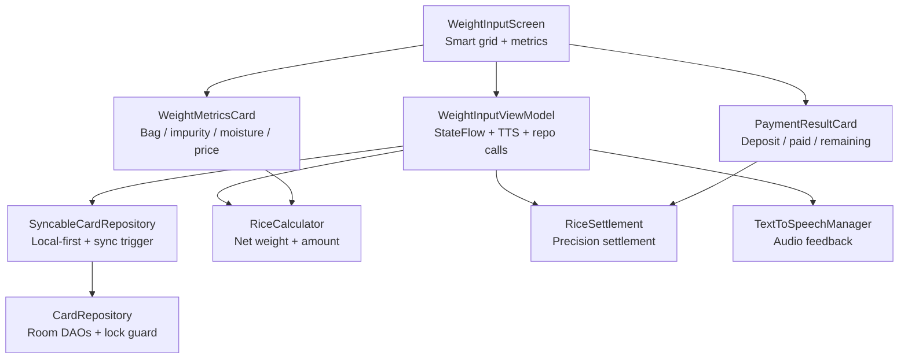
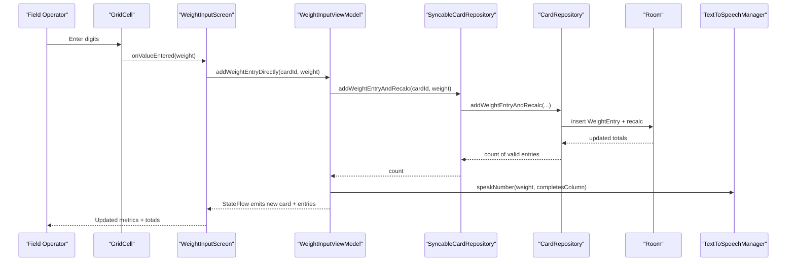
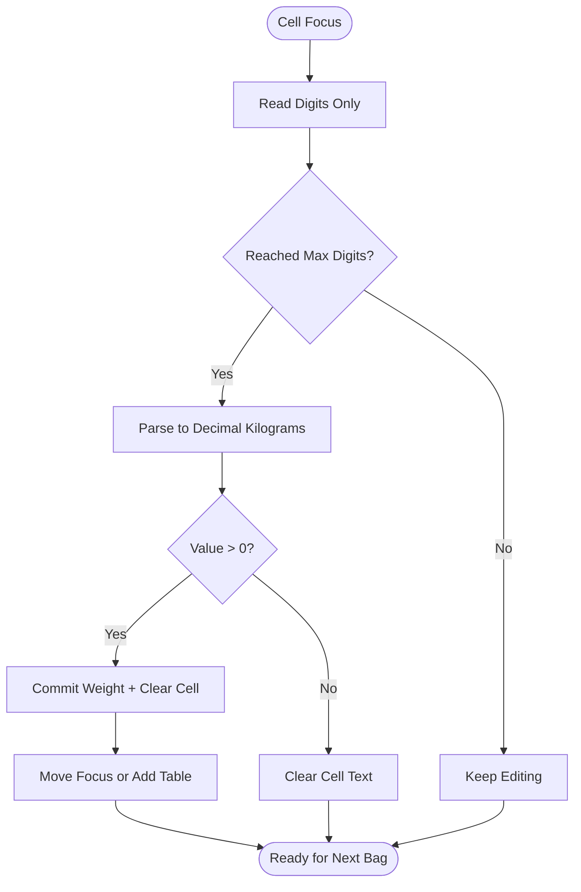
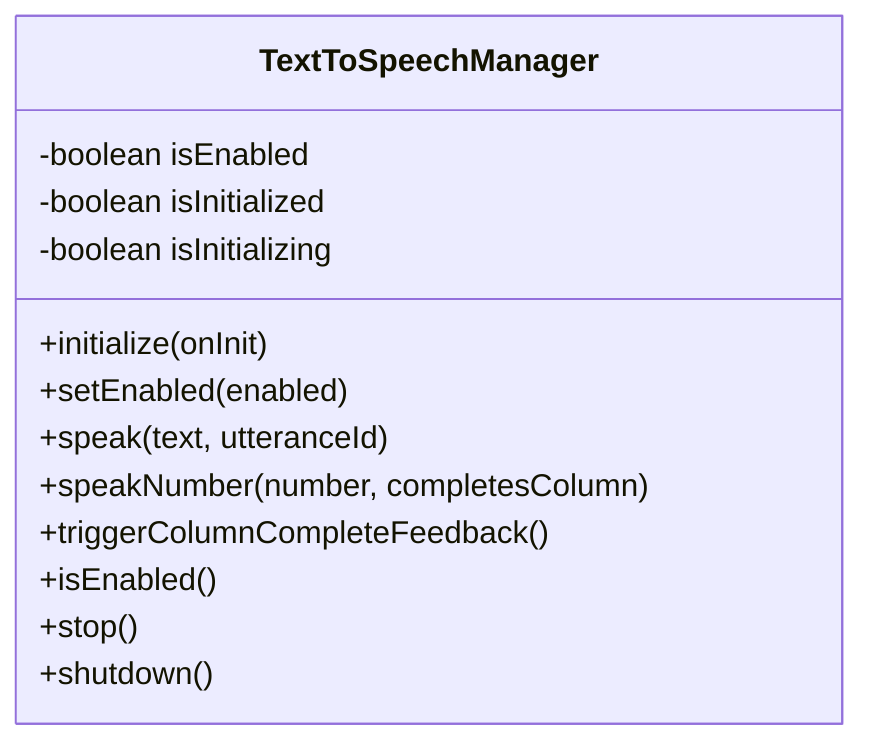
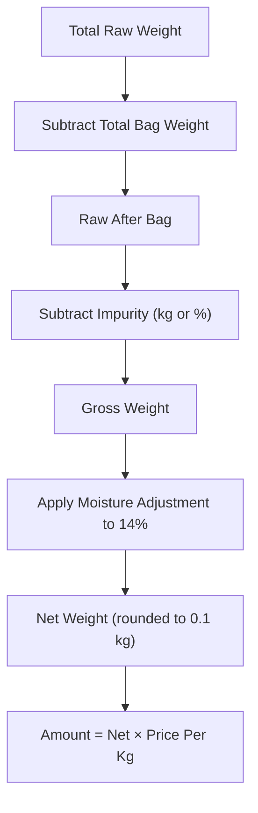
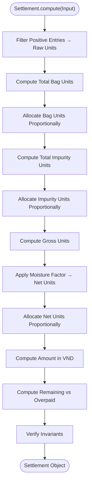
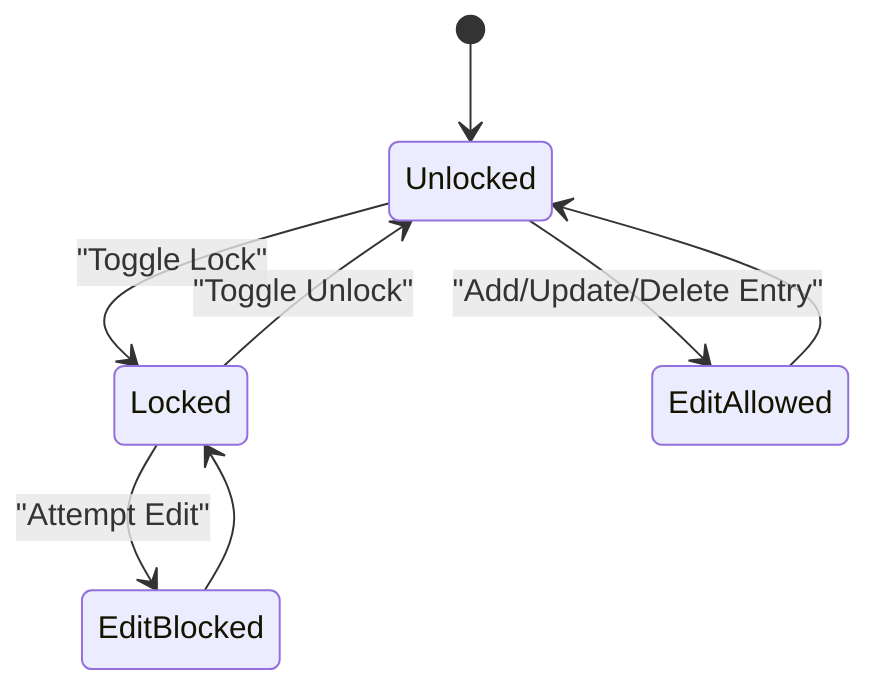
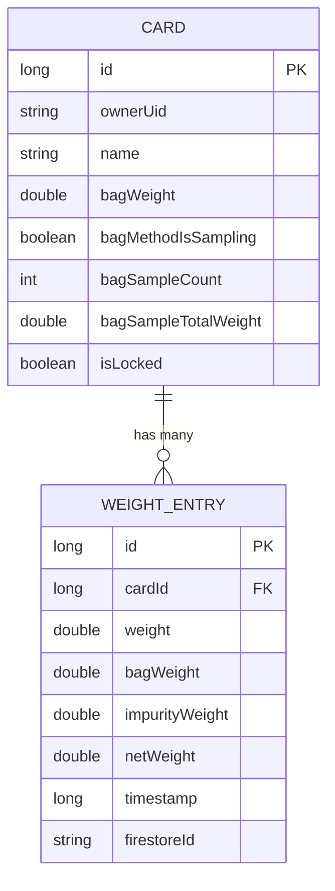
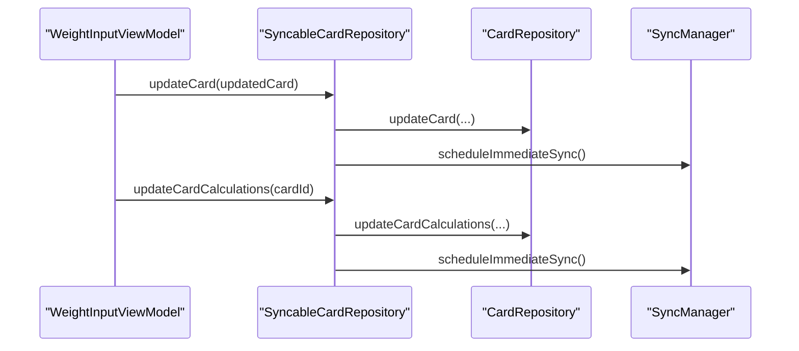
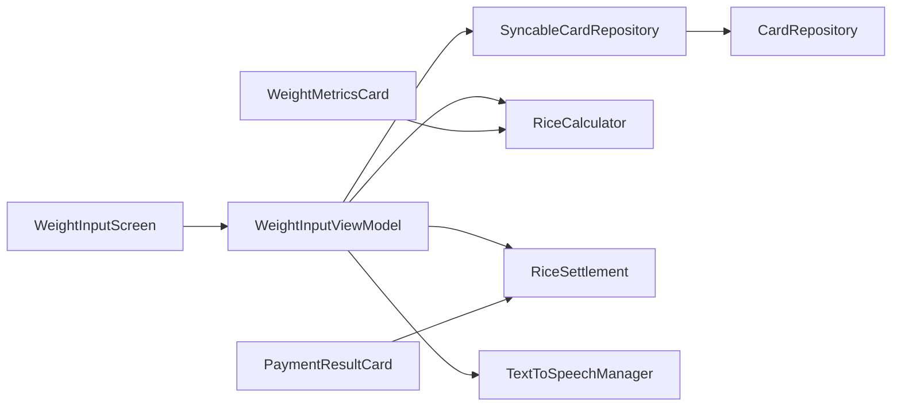

# Rice Weighing System

<cite>
**Referenced Files in This Document**   
- [WeightEntry.kt](file://app/src/main/java/com/giathinh/canlua/data/model/WeightEntry.kt)
- [Card.kt](file://app/src/main/java/com/giathinh/canlua/data/model/Card.kt)
- [WeightInputScreen.kt](file://app/src/main/java/com/giathinh/canlua/ui/screen/WeightInputScreen.kt)
- [WeightInputViewModel.kt](file://app/src/main/java/com/giathinh/canlua/ui/viewmodel/WeightInputViewModel.kt)
- [WeightInputUiState.kt](file://app/src/main/java/com/giathinh/canlua/ui/viewmodel/WeightInputUiState.kt)
- [RiceCalculator.kt](file://app/src/main/java/com/giathinh/canlua/util/RiceCalculator.kt)
- [RiceSettlement.kt](file://app/src/main/java/com/giathinh/canlua/util/RiceSettlement.kt)
- [TextToSpeechManager.kt](file://app/src/main/java/com/giathinh/canlua/util/TextToSpeechManager.kt)
- [WeightMetricsCard.kt](file://app/src/main/java/com/giathinh/canlua/ui/component/weight/WeightMetricsCard.kt)
- [PaymentResultCard.kt](file://app/src/main/java/com/giathinh/canlua/ui/component/weight/PaymentResultCard.kt)
- [SyncableCardRepository.kt](file://app/src/main/java/com/giathinh/canlua/repository/SyncableCardRepository.kt)
- [CardRepository.kt](file://app/src/main/java/com/giathinh/canlua/repository/CardRepository.kt)
</cite>

## Table of Contents
1. [Introduction](#introduction)
2. [Project Structure](#project-structure)
3. [Core Components](#core-components)
4. [Architecture Overview](#architecture-overview)
5. [Detailed Component Analysis](#detailed-component-analysis)
6. [Dependency Analysis](#dependency-analysis)
7. [Performance Considerations](#performance-considerations)
8. [Troubleshooting Guide](#troubleshooting-guide)
9. [Conclusion](#conclusion)

## Introduction
This document explains the rice weighing system that powers Cân Lúa Mobile’s core field workflow. It covers the smart weight entry interface, audio feedback, hands-free operation, financial calculation engine, settlement algorithms, slip locking, the `WeightEntry` model, bag weight tracking, and integration with the card and repository layers. The implementation follows Kotlin 2.3 / Jetpack Compose offline-first MVVM architecture with unidirectional data flow via `StateFlow` and coroutines, Room persistence, and bidirectional cloud sync through Firebase Firestore and Supabase.

## Project Structure
The rice weighing feature spans UI, view model, domain utilities, data models, and repositories:

**Diagram sources**
- [WeightInputScreen.kt:60-120](file://app/src/main/java/com/giathinh/canlua/ui/screen/WeightInputScreen.kt#L60-L120)
- [WeightInputViewModel.kt:25-60](file://app/src/main/java/com/giathinh/canlua/ui/viewmodel/WeightInputViewModel.kt#L25-L60)
- [SyncableCardRepository.kt:10-24](file://app/src/main/java/com/giathinh/canlua/repository/SyncableCardRepository.kt#L10-L24)
- [CardRepository.kt:174-199](file://app/src/main/java/com/giathinh/canlua/repository/CardRepository.kt#L174-L199)
- [RiceCalculator.kt:8-122](file://app/src/main/java/com/giathinh/canlua/util/RiceCalculator.kt#L8-L122)
- [RiceSettlement.kt:19-87](file://app/src/main/java/com/giathinh/canlua/util/RiceSettlement.kt#L19-L87)
- [TextToSpeechManager.kt:12-45](file://app/src/main/java/com/giathinh/canlua/util/TextToSpeechManager.kt#L12-L45)
- [WeightMetricsCard.kt:48-69](file://app/src/main/java/com/giathinh/canlua/ui/component/weight/WeightMetricsCard.kt#L48-L69)
- [PaymentResultCard.kt:27-40](file://app/src/main/java/com/giathinh/canlua/ui/component/weight/PaymentResultCard.kt#L27-L40)

**Section sources**
- [WeightInputScreen.kt:60-120](file://app/src/main/java/com/giathinh/canlua/ui/screen/WeightInputScreen.kt#L60-L120)
- [WeightInputViewModel.kt:25-60](file://app/src/main/java/com/giathinh/canlua/ui/viewmodel/WeightInputViewModel.kt#L25-L60)
- [SyncableCardRepository.kt:10-24](file://app/src/main/java/com/giathinh/canlua/repository/SyncableCardRepository.kt#L10-L24)

## Core Components
- Smart weight entry grid: 5×5 cells per table, auto-jumping decimals, haptic feedback, focus management, and locked-state protection.
- Real-time metrics: total raw weight, bag deduction, impurity deduction, moisture adjustment, net weight, unit price, and total amount.
- Financial card: deposit, paid amount, remaining amount, and “paid full” toggle.
- Calculation engine: standard-moisture conversion, bag sampling mode, impurity handling, and VND payment math.
- Settlement engine: integer-unit accounting to avoid floating-point drift, largest-remainder allocation, and invariant verification.
- Audio feedback: Text-to-Speech for digits and column completion tones.
- Data layer: `WeightEntry` rows linked to a `Card`, persisted via Room, guarded by lock state, and scheduled for cloud sync.

**Section sources**
- [WeightInputScreen.kt:563-777](file://app/src/main/java/com/giathinh/canlua/ui/screen/WeightInputScreen.kt#L563-L777)
- [WeightMetricsCard.kt:48-436](file://app/src/main/java/com/giathinh/canlua/ui/component/weight/WeightMetricsCard.kt#L48-L436)
- [PaymentResultCard.kt:27-175](file://app/src/main/java/com/giathinh/canlua/ui/component/weight/PaymentResultCard.kt#L27-L175)
- [RiceCalculator.kt:8-122](file://app/src/main/java/com/giathinh/canlua/util/RiceCalculator.kt#L8-L122)
- [RiceSettlement.kt:19-219](file://app/src/main/java/com/giathinh/canlua/util/RiceSettlement.kt#L19-L219)
- [TextToSpeechManager.kt:12-177](file://app/src/main/java/com/giathinh/canlua/util/TextToSpeechManager.kt#L12-L177)
- [WeightEntry.kt:7-30](file://app/src/main/java/com/giathinh/canlua/data/model/WeightEntry.kt#L7-L30)
- [Card.kt:20-106](file://app/src/main/java/com/giathinh/canlua/data/model/Card.kt#L20-L106)

## Architecture Overview
The weighing flow is a unidirectional pipeline: user input updates UI state, which triggers ViewModel actions; the ViewModel persists changes through the repository, recalculates totals, and optionally speaks feedback.

**Diagram sources**
- [WeightInputScreen.kt:148-175](file://app/src/main/java/com/giathinh/canlua/ui/screen/WeightInputScreen.kt#L148-L175)
- [WeightInputViewModel.kt:97-112](file://app/src/main/java/com/giathinh/canlua/ui/viewmodel/WeightInputViewModel.kt#L97-L112)
- [SyncableCardRepository.kt:55-61](file://app/src/main/java/com/giathinh/canlua/repository/SyncableCardRepository.kt#L55-L61)
- [CardRepository.kt:174-182](file://app/src/main/java/com/giathinh/canlua/repository/CardRepository.kt#L174-L182)
- [TextToSpeechManager.kt:82-90](file://app/src/main/java/com/giathinh/canlua/util/TextToSpeechManager.kt#L82-L90)

## Detailed Component Analysis

### Smart Weight Entry Interface
The screen composes a scrollable list of 5×5 tables. Each cell accepts numeric input, auto-confirms after a fixed number of digits, formats the value with one decimal place, and jumps focus to the next logical cell. When the last cell of a column is filled, it can prompt adding another table.

Key behaviors:
- Auto-jump decimals: digits are parsed into a single-decimal kilogram value.
- Hands-free friendly: large tappable cells, clear borders, IME-aware scrolling, and optional TTS digit feedback.
- Locked protection: locked cards disable editing and show a warning when tapped.
- Performance: low refresh rate request, lazy composition of grids, stable callbacks, and persistent lists to minimize recomposition.

**Diagram sources**
- [WeightInputScreen.kt:654-660](file://app/src/main/java/com/giathinh/canlua/ui/screen/WeightInputScreen.kt#L654-L660)
- [WeightInputScreen.kt:720-772](file://app/src/main/java/com/giathinh/canlua/ui/screen/WeightInputScreen.kt#L720-L772)

**Section sources**
- [WeightInputScreen.kt:148-175](file://app/src/main/java/com/giathinh/canlua/ui/screen/WeightInputScreen.kt#L148-L175)
- [WeightInputScreen.kt:563-777](file://app/src/main/java/com/giathinh/canlua/ui/screen/WeightInputScreen.kt#L563-L777)

### Audio Feedback and Hands-Free Operation
Text-to-Speech is initialized lazily after the screen animation finishes to avoid blocking the main thread. Digit-by-digit speech can be enabled via settings. When a column completes (every fifth entry), the manager plays a confirmation tone and haptic feedback.

**Diagram sources**
- [TextToSpeechManager.kt:12-177](file://app/src/main/java/com/giathinh/canlua/util/TextToSpeechManager.kt#L12-L177)

**Section sources**
- [WeightInputScreen.kt:226-245](file://app/src/main/java/com/giathinh/canlua/ui/screen/WeightInputScreen.kt#L226-L245)
- [WeightInputViewModel.kt:87-91](file://app/src/main/java/com/giathinh/canlua/ui/viewmodel/WeightInputViewModel.kt#L87-L91)
- [TextToSpeechManager.kt:21-45](file://app/src/main/java/com/giathinh/canlua/util/TextToSpeechManager.kt#L21-L45)
- [TextToSpeechManager.kt:66-74](file://app/src/main/java/com/giathinh/canlua/util/TextToSpeechManager.kt#L66-L74)
- [TextToSpeechManager.kt:82-90](file://app/src/main/java/com/giathinh/canlua/util/TextToSpeechManager.kt#L82-L90)

### Financial Calculation Engine
The engine computes:
- Standard-weight conversion to 14% moisture baseline.
- Net weight after deducting bag weight and impurity.
- Total amount as net weight multiplied by unit price.
- Remaining amount after subtracting paid and deposit amounts.

Two modes are supported:
- Bag deduction: either unit bag weight times bag count, or sample-based average bag weight.
- Impurity: absolute kilograms or percentage (legacy compatibility).

**Diagram sources**
- [RiceCalculator.kt:16-38](file://app/src/main/java/com/giathinh/canlua/util/RiceCalculator.kt#L16-L38)
- [RiceCalculator.kt:52-64](file://app/src/main/java/com/giathinh/canlua/util/RiceCalculator.kt#L52-L64)
- [RiceCalculator.kt:70-77](file://app/src/main/java/com/giathinh/canlua/util/RiceCalculator.kt#L70-L77)
- [RiceCalculator.kt:83-106](file://app/src/main/java/com/giathinh/canlua/util/RiceCalculator.kt#L83-L106)
- [RiceCalculator.kt:108-120](file://app/src/main/java/com/giathinh/canlua/util/RiceCalculator.kt#L108-L120)

**Section sources**
- [RiceCalculator.kt:8-122](file://app/src/main/java/com/giathinh/canlua/util/RiceCalculator.kt#L8-L122)
- [WeightMetricsCard.kt:116-144](file://app/src/main/java/com/giathinh/canlua/ui/component/weight/WeightMetricsCard.kt#L116-L144)
- [WeightInputScreen.kt:178-207](file://app/src/main/java/com/giathinh/canlua/ui/screen/WeightInputScreen.kt#L178-L207)

### Settlement Engine and Payment Processing
`RiceSettlement` provides precision-safe settlement using integer units where 1 unit equals 0.01 kg. It allocates bag weight, impurity, and net weight across lines so that line sums equal totals exactly. Money is computed once in VND using `BigDecimal`. It also separates overpayment from remaining balance and verifies invariants.

Key formulas:
- Raw units: sum of positive entry weights converted to units.
- Bag allocation: proportional distribution ensuring Σ bag units == total bag units.
- Impurity allocation: proportional to weight after bag deduction.
- Moisture adjustment: factor `(100 - moisture) / (100 - standardMoisture)` applied to gross weight.
- Amount: `netUnits × pricePerKg / 100`, rounded once.
- Remaining vs overpaid: `remaining = max(0, amount - paid - deposit)`, `overpaid = max(0, paid + deposit - amount)`.

**Diagram sources**
- [RiceSettlement.kt:89-184](file://app/src/main/java/com/giathinh/canlua/util/RiceSettlement.kt#L89-L184)
- [RiceSettlement.kt:198-217](file://app/src/main/java/com/giathinh/canlua/util/RiceSettlement.kt#L198-L217)

**Section sources**
- [RiceSettlement.kt:19-219](file://app/src/main/java/com/giathinh/canlua/util/RiceSettlement.kt#L19-L219)
- [PaymentResultCard.kt:31-175](file://app/src/main/java/com/giathinh/canlua/ui/component/weight/PaymentResultCard.kt#L31-L175)

### Slip Locking Mechanism
Locking prevents unauthorized modifications after confirmation:
- UI shows a lock/unlock icon; locked state disables editing and displays warnings on attempted edits.
- Repository methods check `isLocked` before inserting, updating, or deleting weight entries.
- ViewModel toggles the card’s lock flag and refreshes the current card.

**Diagram sources**
- [WeightInputScreen.kt:371-386](file://app/src/main/java/com/giathinh/canlua/ui/screen/WeightInputScreen.kt#L371-L386)
- [WeightInputScreen.kt:708-716](file://app/src/main/java/com/giathinh/canlua/ui/screen/WeightInputScreen.kt#L708-L716)
- [CardRepository.kt:174-199](file://app/src/main/java/com/giathinh/canlua/repository/CardRepository.kt#L174-L199)
- [WeightInputViewModel.kt:247-256](file://app/src/main/java/com/giathinh/canlua/ui/viewmodel/WeightInputViewModel.kt#L247-L256)

**Section sources**
- [WeightInputScreen.kt:371-386](file://app/src/main/java/com/giathinh/canlua/ui/screen/WeightInputScreen.kt#L371-L386)
- [WeightInputScreen.kt:506-556](file://app/src/main/java/com/giathinh/canlua/ui/screen/WeightInputScreen.kt#L506-L556)
- [WeightInputScreen.kt:708-716](file://app/src/main/java/com/giathinh/canlua/ui/screen/WeightInputScreen.kt#L708-L716)
- [CardRepository.kt:174-199](file://app/src/main/java/com/giathinh/canlua/repository/CardRepository.kt#L174-L199)
- [WeightInputViewModel.kt:247-256](file://app/src/main/java/com/giathinh/canlua/ui/viewmodel/WeightInputViewModel.kt#L247-L256)

### WeightEntry Model Structure and Bag Weight Tracking
`WeightEntry` represents each bag row:
- Fields include card reference, raw weight, bag weight, impurity weight, net weight, timestamp, and Firestore ID.
- Bag weight tracking is stored at the card level (`Card.bagWeight`) and supports two modes:
  - Unit bag weight: total bag weight equals bag count times unit bag weight.
  - Sampling mode: weigh a sample of bags to compute average unit bag weight.

**Diagram sources**
- [Card.kt:20-106](file://app/src/main/java/com/giathinh/canlua/data/model/Card.kt#L20-L106)
- [WeightEntry.kt:7-30](file://app/src/main/java/com/giathinh/canlua/data/model/WeightEntry.kt#L7-L30)

**Section sources**
- [WeightEntry.kt:7-30](file://app/src/main/java/com/giathinh/canlua/data/model/WeightEntry.kt#L7-L30)
- [Card.kt:20-106](file://app/src/main/java/com/giathinh/canlua/data/model/Card.kt#L20-L106)
- [WeightMetricsCard.kt:116-144](file://app/src/main/java/com/giathinh/canlua/ui/component/weight/WeightMetricsCard.kt#L116-L144)

### Integration with the Card System and Repository
The ViewModel orchestrates:
- Loading the card and its weight entries.
- Updating card-level fields (bag weight, impurity, moisture, price).
- Adding weight entries and triggering recalculation.
- Synchronizing local mutations to cloud via WorkManager.

**Diagram sources**
- [WeightInputViewModel.kt:181-245](file://app/src/main/java/com/giathinh/canlua/ui/viewmodel/WeightInputViewModel.kt#L181-L245)
- [SyncableCardRepository.kt:42-45](file://app/src/main/java/com/giathinh/canlua/repository/SyncableCardRepository.kt#L42-L45)
- [SyncableCardRepository.kt:82-85](file://app/src/main/java/com/giathinh/canlua/repository/SyncableCardRepository.kt#L82-L85)

**Section sources**
- [WeightInputViewModel.kt:61-81](file://app/src/main/java/com/giathinh/canlua/ui/viewmodel/WeightInputViewModel.kt#L61-L81)
- [WeightInputViewModel.kt:181-245](file://app/src/main/java/com/giathinh/canlua/ui/viewmodel/WeightInputViewModel.kt#L181-L245)
- [SyncableCardRepository.kt:10-24](file://app/src/main/java/com/giathinh/canlua/repository/SyncableCardRepository.kt#L10-L24)

## Dependency Analysis
The weighing system depends on:
- UI components for input and display.
- ViewModel for state orchestration and TTS control.
- Calculator and settlement utilities for domain math.
- Repository for persistence and sync scheduling.
- Models for data contracts.

**Diagram sources**
- [WeightInputScreen.kt:60-120](file://app/src/main/java/com/giathinh/canlua/ui/screen/WeightInputScreen.kt#L60-L120)
- [WeightInputViewModel.kt:25-60](file://app/src/main/java/com/giathinh/canlua/ui/viewmodel/WeightInputViewModel.kt#L25-L60)
- [SyncableCardRepository.kt:10-24](file://app/src/main/java/com/giathinh/canlua/repository/SyncableCardRepository.kt#L10-L24)
- [RiceCalculator.kt:8-122](file://app/src/main/java/com/giathinh/canlua/util/RiceCalculator.kt#L8-L122)
- [RiceSettlement.kt:19-219](file://app/src/main/java/com/giathinh/canlua/util/RiceSettlement.kt#L19-L219)
- [TextToSpeechManager.kt:12-177](file://app/src/main/java/com/giathinh/canlua/util/TextToSpeechManager.kt#L12-L177)
- [WeightMetricsCard.kt:48-436](file://app/src/main/java/com/giathinh/canlua/ui/component/weight/WeightMetricsCard.kt#L48-L436)
- [PaymentResultCard.kt:27-175](file://app/src/main/java/com/giathinh/canlua/ui/component/weight/PaymentResultCard.kt#L27-L175)

**Section sources**
- [WeightInputScreen.kt:60-120](file://app/src/main/java/com/giathinh/canlua/ui/screen/WeightInputScreen.kt#L60-L120)
- [WeightInputViewModel.kt:25-60](file://app/src/main/java/com/giathinh/canlua/ui/viewmodel/WeightInputViewModel.kt#L25-L60)
- [SyncableCardRepository.kt:10-24](file://app/src/main/java/com/giathinh/canlua/repository/SyncableCardRepository.kt#L10-L24)

## Performance Considerations
- Low refresh rate on the weighing screen reduces battery usage during heavy numeric input.
- Lazy initialization of the grid and TTS avoids blocking the initial animation.
- Stable callbacks and persistent lists reduce recompositions across grid cells.
- Debounced writes for impurity and moisture inputs reduce database churn while typing.
- Column totals and table totals use `remember` to compute only when their inputs change.
- Repository operations run on IO dispatchers; calculations run on Default dispatcher where appropriate.

[No sources needed since this section provides general guidance]

## Troubleshooting Guide
Common issues and resolutions:
- Invalid weight input:
  - Non-positive values are ignored; ensure entered digits parse to a positive decimal kilogram value.
  - Maximum bag weight guard prevents unrealistic entries.
- Locked card edits:
  - Attempting to edit a locked card shows a warning; unlock first before modifying entries.
- Moisture or impurity anomalies:
  - Moisture outside valid ranges disables conversion; verify input percentages.
  - Impurity exceeding available weight is clamped and warned.
- Settlement discrepancies:
  - Use `RiceSettlement.verify()` to validate invariants; warnings indicate data inconsistencies.
- TTS not speaking:
  - Ensure TTS is enabled in settings and initialized successfully; language support must be present.

**Section sources**
- [WeightInputViewModel.kt:97-112](file://app/src/main/java/com/giathinh/canlua/ui/viewmodel/WeightInputViewModel.kt#L97-L112)
- [WeightInputScreen.kt:708-716](file://app/src/main/java/com/giathinh/canlua/ui/screen/WeightInputScreen.kt#L708-L716)
- [RiceSettlement.kt:74-86](file://app/src/main/java/com/giathinh/canlua/util/RiceSettlement.kt#L74-L86)
- [TextToSpeechManager.kt:21-45](file://app/src/main/java/com/giathinh/canlua/util/TextToSpeechManager.kt#L21-L45)

## Conclusion
The rice weighing system combines a field-optimized input interface, robust financial calculations, and precise settlement accounting. It protects data integrity through locking, ensures real-time responsiveness with performance-conscious UI patterns, and integrates seamlessly with the card and repository layers for offline-first persistence and cloud sync. Operators benefit from auto-jumping decimals, audio feedback, and clear visual indicators for totals, deductions, and payment status.

[No sources needed since this section summarizes without analyzing specific files]