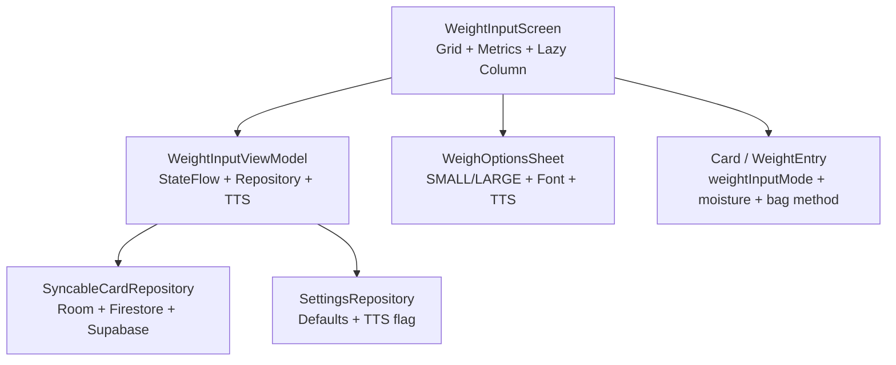
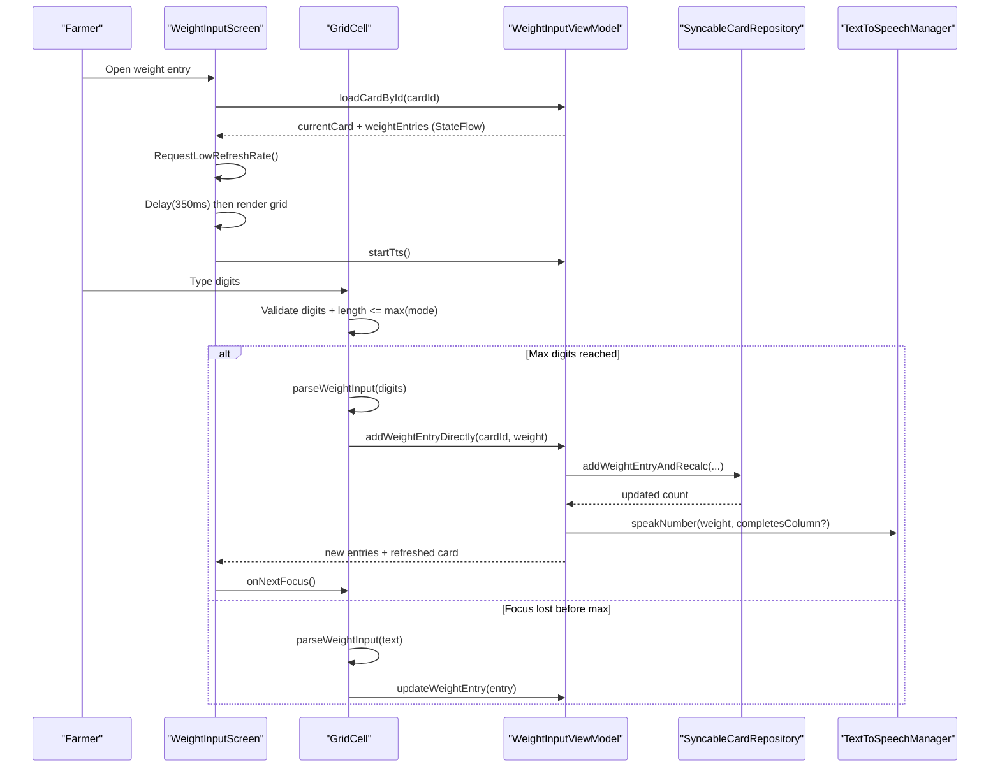
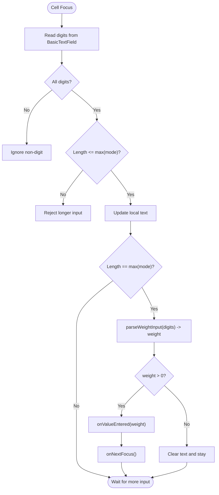
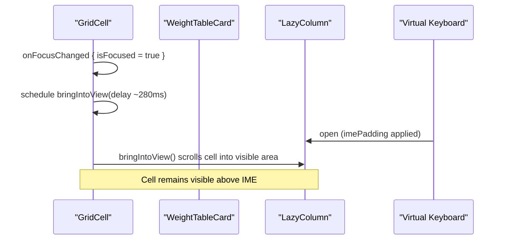
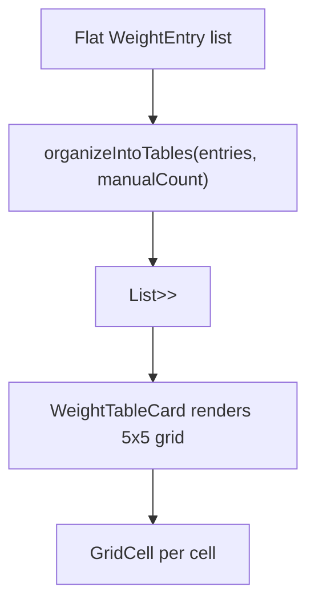
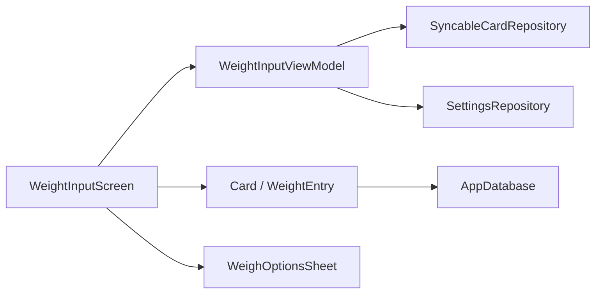

# Smart Weight Entry Interface

<cite>
**Referenced Files in This Document**
- [WeightInputScreen.kt](file://app/src/main/java/com/giathinh/canlua/ui/screen/WeightInputScreen.kt)
- [WeightInputViewModel.kt](file://app/src/main/java/com/giathinh/canlua/ui/viewmodel/WeightInputViewModel.kt)
- [WeightInputUiState.kt](file://app/src/main/java/com/giathinh/canlua/ui/viewmodel/WeightInputUiState.kt)
- [WeighOptionsSheet.kt](file://app/src/main/java/com/giathinh/canlua/ui/component/weight/WeighOptionsSheet.kt)
- [Card.kt](file://app/src/main/java/com/giathinh/canlua/data/model/Card.kt)
- [AppDatabase.kt](file://app/src/main/java/com/giathinh/canlua/data/database/AppDatabase.kt)
- [SettingsRepository.kt](file://app/src/main/java/com/giathinh/canlua/repository/SettingsRepository.kt)
</cite>

## Table of Contents
1. [Introduction](#introduction)
2. [Project Structure](#project-structure)
3. [Core Components](#core-components)
4. [Architecture Overview](#architecture-overview)
5. [Detailed Component Analysis](#detailed-component-analysis)
6. [Dependency Analysis](#dependency-analysis)
7. [Performance Considerations](#performance-considerations)
8. [Troubleshooting Guide](#troubleshooting-guide)
9. [Conclusion](#conclusion)

## Introduction
This document explains the smart weight entry interface optimized for field conditions. It focuses on a grid-based input system with auto-jumping decimals, hands-free operation through text-to-speech and haptics, and robust keyboard handling for outdoor use. The documentation covers the GridCell component implementation, focus management, automatic scrolling when the virtual keyboard appears, input validation, two input modes SMALL and LARGE, column-major data layout, lazy initialization after animation completion, practical workflows, error handling, and accessibility features designed for farmers working in challenging environments.

## Project Structure
The smart weight entry feature is implemented using Jetpack Compose and MVVM:
- UI layer: screen composition, grid rendering, cell interaction, and scroll behavior.
- ViewModel layer: state flows, persistence calls, table organization, and TTS coordination.
- Data model and configuration: card-level settings including input mode, moisture, bag method, and defaults.

**Diagram sources**
- [WeightInputScreen.kt:58-108](file://app/src/main/java/com/giathinh/canlua/ui/screen/WeightInputScreen.kt#L58-L108)
- [WeightInputViewModel.kt:24-58](file://app/src/main/java/com/giathinh/canlua/ui/viewmodel/WeightInputViewModel.kt#L24-L58)
- [WeighOptionsSheet.kt:63-108](file://app/src/main/java/com/giathinh/canlua/ui/component/weight/WeighOptionsSheet.kt#L63-L108)
- [Card.kt:100-105](file://app/src/main/java/com/giathinh/canlua/data/model/Card.kt#L100-L105)

**Section sources**
- [WeightInputScreen.kt:58-108](file://app/src/main/java/com/giathinh/canlua/ui/screen/WeightInputScreen.kt#L58-L108)
- [WeightInputViewModel.kt:24-58](file://app/src/main/java/com/giathinh/canlua/ui/viewmodel/WeightInputViewModel.kt#L24-L58)
- [WeighOptionsSheet.kt:63-108](file://app/src/main/java/com/giathinh/canlua/ui/component/weight/WeighOptionsSheet.kt#L63-L108)
- [Card.kt:100-105](file://app/src/main/java/com/giathinh/canlua/data/model/Card.kt#L100-L105)

## Core Components
- WeightInputScreen: orchestrates metrics, table tabs, grid rendering, and performance optimizations like low refresh rate and lazy grid initialization.
- WeightTableCard: renders a 5x5 grid per table, computes totals, and manages focus movement across cells.
- GridCell: handles digit-only input, auto-confirm at max digits, decimal conversion, focus change, bring-into-view scrolling, and locked-state protection.
- WeightInputViewModel: exposes StateFlows for card, entries, tables; organizes entries into column-major grids; persists updates; coordinates TTS feedback.
- WeighOptionsSheet: allows users to choose SMALL or LARGE input mode, font scale, impurity unit, bag deduction method, and TTS enablement.

Key responsibilities:
- Input validation: digits only, length limits based on mode, zero-weight rejection.
- Auto-jump: confirm and move focus when max digits reached.
- Hands-free: optional TTS reads digits and announces completed columns.
- Accessibility: high-contrast borders, large tappable areas, clear focused states, IME padding, and scroll-to-visible behavior.

**Section sources**
- [WeightInputScreen.kt:563-777](file://app/src/main/java/com/giathinh/canlua/ui/screen/WeightInputScreen.kt#L563-L777)
- [WeightInputViewModel.kt:43-48](file://app/src/main/java/com/giathinh/canlua/ui/viewmodel/WeightInputViewModel.kt#L43-L48)
- [WeighOptionsSheet.kt:478-523](file://app/src/main/java/com/giathinh/canlua/ui/component/weight/WeighOptionsSheet.kt#L478-L523)

## Architecture Overview
The flow begins when the user opens the weight entry screen. The screen requests low refresh rate to save battery during heavy typing, loads card data via ViewModel, and lazily initializes the grid after an enter animation completes. Each cell uses BasicTextField configured for numeric input with Next action. When the maximum number of digits is entered, the value is parsed, validated, committed, and focus moves to the next cell. Completed columns trigger optional TTS announcements.

**Diagram sources**
- [WeightInputScreen.kt:100-108](file://app/src/main/java/com/giathinh/canlua/ui/screen/WeightInputScreen.kt#L100-L108)
- [WeightInputScreen.kt:226-245](file://app/src/main/java/com/giathinh/canlua/ui/screen/WeightInputScreen.kt#L226-L245)
- [WeightInputScreen.kt:654-777](file://app/src/main/java/com/giathinh/canlua/ui/screen/WeightInputScreen.kt#L654-L777)
- [WeightInputViewModel.kt:97-112](file://app/src/main/java/com/giathinh/canlua/ui/viewmodel/WeightInputViewModel.kt#L97-L112)

## Detailed Component Analysis

### Grid-Based Input System and Auto-Jumping Decimals
- Numeric-only input: BasicTextField accepts only digits. Non-digit characters are ignored.
- Mode-dependent digit limit: SMALL allows 3 digits; LARGE allows 4 digits.
- Decimal placement: Input digits represent tenths; parsing divides by 10 to produce a single-decimal weight (e.g., “503” becomes 50.3).
- Auto-confirm: When the input reaches the maximum digit count, the value is parsed and committed immediately.
- Auto-focus jump: After commit, focus moves to the next cell following a column-major traversal order. If the last cell of a column is reached, focus wraps to the next column; if the last cell of the last column is reached, it triggers adding a new table.

**Diagram sources**
- [WeightInputScreen.kt:654-660](file://app/src/main/java/com/giathinh/canlua/ui/screen/WeightInputScreen.kt#L654-L660)
- [WeightInputScreen.kt:720-772](file://app/src/main/java/com/giathinh/canlua/ui/screen/WeightInputScreen.kt#L720-L772)

**Section sources**
- [WeightInputScreen.kt:654-777](file://app/src/main/java/com/giathinh/canlua/ui/screen/WeightInputScreen.kt#L654-L777)

### Focus Management and Automatic Scrolling
- FocusRequester per cell: Each GridCell has its own FocusRequester managed by WeightTableCard.
- Column-major navigation: When moving focus, the logic goes down rows within the same column, then wraps to the next column; finally, it can request a new table.
- Bring-into-view: On focus gain, the cell schedules a delayed scroll to ensure visibility once the IME panel appears. This avoids being hidden behind the keyboard.
- IME padding: The LazyColumn applies imePadding so the content area retracts when the keyboard is shown.

**Diagram sources**
- [WeightInputScreen.kt:742-752](file://app/src/main/java/com/giathinh/canlua/ui/screen/WeightInputScreen.kt#L742-L752)
- [WeightInputScreen.kt:624-635](file://app/src/main/java/com/giathinh/canlua/ui/screen/WeightInputScreen.kt#L624-L635)

**Section sources**
- [WeightInputScreen.kt:624-635](file://app/src/main/java/com/giathinh/canlua/ui/screen/WeightInputScreen.kt#L624-L635)
- [WeightInputScreen.kt:742-752](file://app/src/main/java/com/giathinh/canlua/ui/screen/WeightInputScreen.kt#L742-L752)

### Input Validation and Error Handling
- Digit-only enforcement: Only numeric characters are accepted.
- Length constraints: SMALL mode caps at 3 digits; LARGE mode caps at 4 digits.
- Zero-weight rejection: Parsed weights must be greater than zero; otherwise, the input is cleared without committing.
- Consecutive entry rule: The screen enforces sequential entry; writing to a non-consecutive index shows a warning toast.
- Locked state protection: Locked cards prevent editing; tapping a locked cell displays a warning message.

Practical examples:
- SMALL mode: entering “503” yields 50.3 kg and jumps to the next cell.
- LARGE mode: entering “1503” yields 150.3 kg and jumps to the next cell.
- Invalid input: letters or exceeding max digits are ignored; zero values do not commit.
- Locked card: attempting to edit shows a warning and prevents changes.

**Section sources**
- [WeightInputScreen.kt:654-660](file://app/src/main/java/com/giathinh/canlua/ui/screen/WeightInputScreen.kt#L654-L660)
- [WeightInputScreen.kt:720-772](file://app/src/main/java/com/giathinh/canlua/ui/screen/WeightInputScreen.kt#L720-L772)
- [WeightInputScreen.kt:148-175](file://app/src/main/java/com/giathinh/canlua/ui/screen/WeightInputScreen.kt#L148-L175)

### Two Input Modes: SMALL and LARGE
- SMALL mode: intended for smaller batches; auto-confirms after 3 digits.
- LARGE mode: intended for larger batches (≥100 kg); auto-confirms after 4 digits.
- Mode selection: Users select SMALL or LARGE in the weigh options sheet; the choice is persisted in Card.weightInputMode and used by GridCell to determine max digits.

Configuration references:
- Card.model includes weightInputMode with documented behavior for SMALL and LARGE.
- Database migration adds weightInputMode column with default SMALL.
- SettingsRepository exposes default weightInputMode preference.

**Section sources**
- [Card.kt:100-105](file://app/src/main/java/com/giathinh/canlua/data/model/Card.kt#L100-L105)
- [AppDatabase.kt:366-377](file://app/src/main/java/com/giathinh/canlua/data/database/AppDatabase.kt#L366-L377)
- [SettingsRepository.kt:137-189](file://app/src/main/java/com/giathinh/canlua/repository/SettingsRepository.kt#L137-L189)
- [WeighOptionsSheet.kt:478-523](file://app/src/main/java/com/giathinh/canlua/ui/component/weight/WeighOptionsSheet.kt#L478-L523)

### Column-Major Data Structure for Efficient Weight Entry
- Layout: Each table is a 5x5 grid. Data is organized in column-major order to match natural reading and entry patterns.
- Index calculation: For a given table index and cell position, the entry index is computed as (tableIndex * 25) + (colIdx * 5) + rowIdx.
- Table organization: The ViewModel transforms the flat list of WeightEntry into nested lists representing tables and columns, preserving column-major mapping.

**Diagram sources**
- [WeightInputViewModel.kt:272-292](file://app/src/main/java/com/giathinh/canlua/ui/viewmodel/WeightInputViewModel.kt#L272-L292)
- [WeightInputScreen.kt:610-618](file://app/src/main/java/com/giathinh/canlua/ui/screen/WeightInputScreen.kt#L610-L618)

**Section sources**
- [WeightInputViewModel.kt:272-292](file://app/src/main/java/com/giathinh/canlua/ui/viewmodel/WeightInputViewModel.kt#L272-L292)
- [WeightInputScreen.kt:610-618](file://app/src/main/java/com/giathinh/canlua/ui/screen/WeightInputScreen.kt#L610-L618)

### Performance Optimizations
- Low refresh rate: The screen requests 60Hz to conserve battery during heavy typing sessions.
- Lazy grid initialization: The grid and TTS engine are initialized after a 350ms delay to avoid blocking the main thread during the enter animation.
- Stable callbacks and immutable lists: Callbacks are stabilized with rememberUpdatedState; table data is converted to PersistentList to minimize recompositions.
- IME stability: Top bar uses heightIn(min) to reduce measure/layout churn when the keyboard toggles.

**Section sources**
- [WeightInputScreen.kt:100-108](file://app/src/main/java/com/giathinh/canlua/ui/screen/WeightInputScreen.kt#L100-L108)
- [WeightInputScreen.kt:226-245](file://app/src/main/java/com/giathinh/canlua/ui/screen/WeightInputScreen.kt#L226-L245)
- [WeightInputScreen.kt:121-148](file://app/src/main/java/com/giathinh/canlua/ui/screen/WeightInputScreen.kt#L121-L148)
- [WeightInputScreen.kt:320-324](file://app/src/main/java/com/giathinh/canlua/ui/screen/WeightInputScreen.kt#L320-L324)

### Hands-Free Operation and Accessibility Features
- Text-to-Speech: Optional TTS reads each digit as typed and announces when a column is completed. Enabled/disabled via settings and coordinated by ViewModel.
- Haptic feedback: Subtle haptics accompany text cursor movement and confirm actions.
- High contrast and large touch targets: Focused cells have thicker borders; filled cells use distinct background colors; minimum heights ensure comfortable tapping.
- Large font support: Font scale slider allows SMALL/NORMAL/LARGE/XLARGE sizes; options sheet adapts layout for larger fonts.

**Section sources**
- [WeightInputViewModel.kt:87-91](file://app/src/main/java/com/giathinh/canlua/ui/viewmodel/WeightInputViewModel.kt#L87-L91)
- [WeightInputViewModel.kt:103-110](file://app/src/main/java/com/giathinh/canlua/ui/viewmodel/WeightInputViewModel.kt#L103-L110)
- [WeightInputScreen.kt:687-706](file://app/src/main/java/com/giathinh/canlua/ui/screen/WeightInputScreen.kt#L687-L706)
- [WeighOptionsSheet.kt:212-268](file://app/src/main/java/com/giathinh/canlua/ui/component/weight/WeighOptionsSheet.kt#L212-L268)

### Practical Weight Entry Workflows
- Small batch workflow:
  - Select SMALL mode in options.
  - Enter up to 3 digits per cell; value auto-commits and focus jumps.
  - Complete a column to receive TTS confirmation.
- Large batch workflow:
  - Select LARGE mode in options.
  - Enter up to 4 digits per cell; value auto-commits and focus jumps.
  - Use larger font scale for better readability under sunlight.
- Editing existing entries:
  - Unlock the card to edit.
  - Tap a cell to modify; focus brings cell into view.
  - Changes persist and recalculate totals.

**Section sources**
- [WeighOptionsSheet.kt:478-523](file://app/src/main/java/com/giathinh/canlua/ui/component/weight/WeighOptionsSheet.kt#L478-L523)
- [WeightInputScreen.kt:687-777](file://app/src/main/java/com/giathinh/canlua/ui/screen/WeightInputScreen.kt#L687-L777)

## Dependency Analysis
The smart weight entry interface depends on several modules:
- UI components depend on ViewModel for state and repository interactions.
- ViewModel depends on repository for persistence and on settings for defaults and TTS flags.
- Data models define card-level configuration including input mode and moisture.
- Database schema includes migration for weightInputMode.

**Diagram sources**
- [WeightInputScreen.kt:58-108](file://app/src/main/java/com/giathinh/canlua/ui/screen/WeightInputScreen.kt#L58-L108)
- [WeightInputViewModel.kt:24-58](file://app/src/main/java/com/giathinh/canlua/ui/viewmodel/WeightInputViewModel.kt#L24-L58)
- [Card.kt:100-105](file://app/src/main/java/com/giathinh/canlua/data/model/Card.kt#L100-L105)
- [AppDatabase.kt:366-377](file://app/src/main/java/com/giathinh/canlua/data/database/AppDatabase.kt#L366-L377)

**Section sources**
- [WeightInputScreen.kt:58-108](file://app/src/main/java/com/giathinh/canlua/ui/screen/WeightInputScreen.kt#L58-L108)
- [WeightInputViewModel.kt:24-58](file://app/src/main/java/com/giathinh/canlua/ui/viewmodel/WeightInputViewModel.kt#L24-L58)
- [Card.kt:100-105](file://app/src/main/java/com/giathinh/canlua/data/model/Card.kt#L100-L105)
- [AppDatabase.kt:366-377](file://app/src/main/java/com/giathinh/canlua/data/database/AppDatabase.kt#L366-L377)

## Performance Considerations
- Prefer SMALL mode for faster auto-commit on small batches; LARGE mode accommodates heavier weights but requires one extra digit.
- Keep TTS enabled for hands-free operation; disable if battery conservation is critical.
- Use larger font scales in bright outdoor conditions to improve legibility.
- Avoid unnecessary recompositions by relying on stable callbacks and immutable table structures already provided.

[No sources needed since this section provides general guidance]

## Troubleshooting Guide
Common issues and resolutions:
- Input not committing: Ensure digits are entered up to the mode’s maximum length; verify that parsed weight is greater than zero.
- Cell hidden by keyboard: Confirm that bring-into-view is triggered; check that LazyColumn has imePadding applied.
- Cannot edit locked card: Unlock the card first; locked state prevents edits and shows a warning.
- Wrong mode selected: Adjust SMALL/LARGE in the weigh options sheet to match expected batch size.
- TTS not speaking: Verify TTS is enabled in settings and that the device supports speech output.

**Section sources**
- [WeightInputScreen.kt:720-772](file://app/src/main/java/com/giathinh/canlua/ui/screen/WeightInputScreen.kt#L720-L772)
- [WeightInputScreen.kt:708-716](file://app/src/main/java/com/giathinh/canlua/ui/screen/WeightInputScreen.kt#L708-L716)
- [WeighOptionsSheet.kt:478-523](file://app/src/main/java/com/giathinh/canlua/ui/component/weight/WeighOptionsSheet.kt#L478-L523)

## Conclusion
The smart weight entry interface delivers a robust, field-ready experience tailored for farmers. Its grid-based input system with auto-jumping decimals, hands-free TTS feedback, and optimized keyboard handling ensures efficient and accessible weight recording. The column-major data structure aligns with natural entry patterns, while performance optimizations keep the app responsive even under demanding conditions. By supporting SMALL and LARGE input modes, high-contrast visuals, and scalable fonts, the interface remains usable in diverse environments.

[No sources needed since this section summarizes without analyzing specific files]