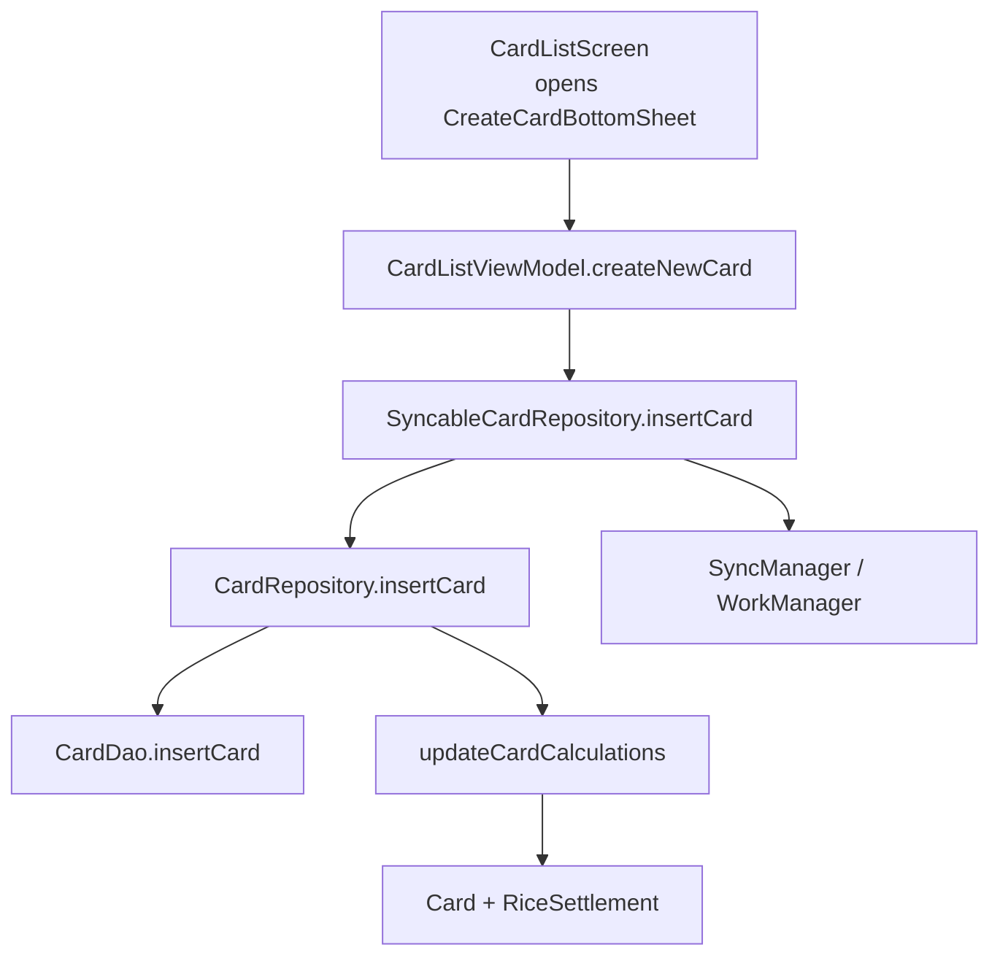
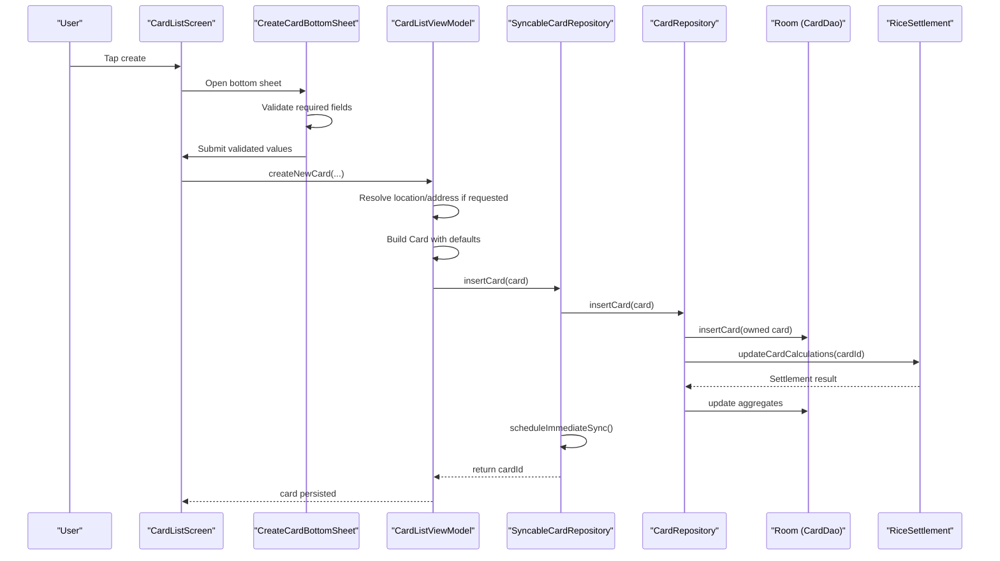
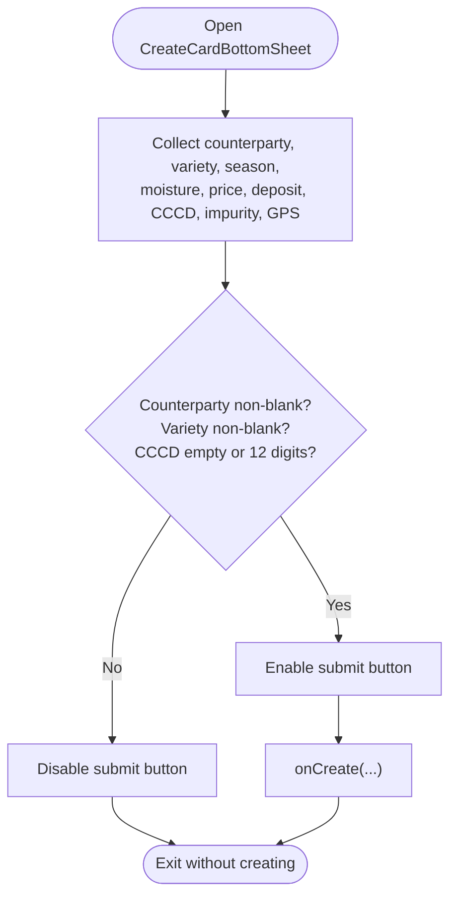
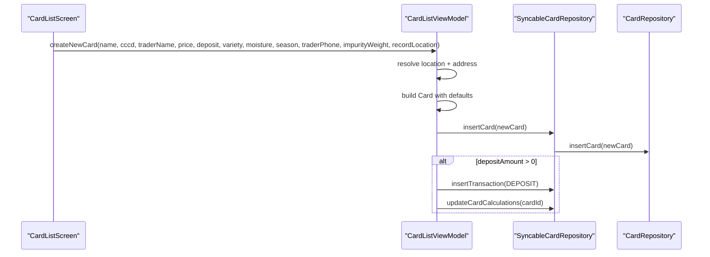
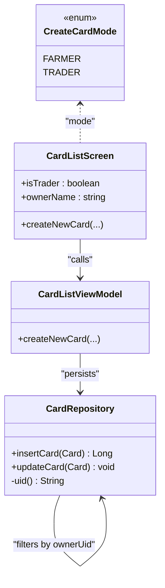
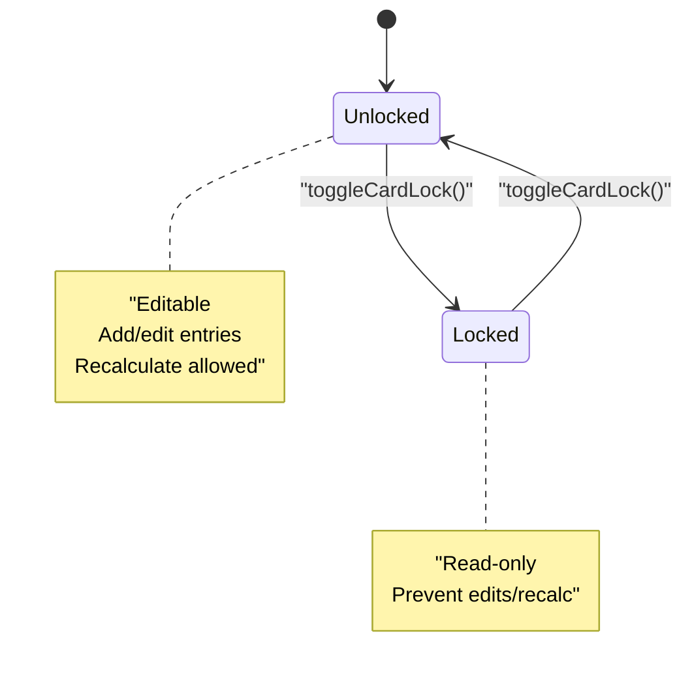
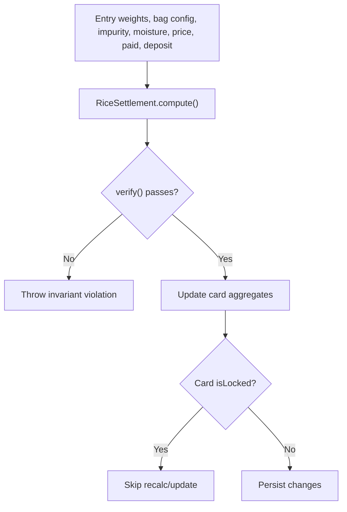
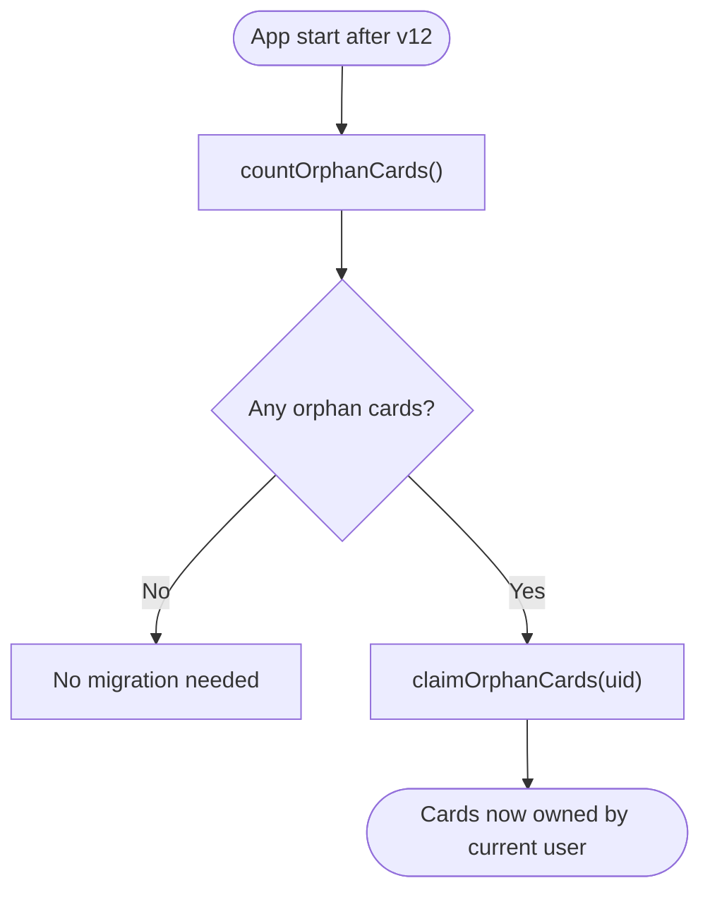
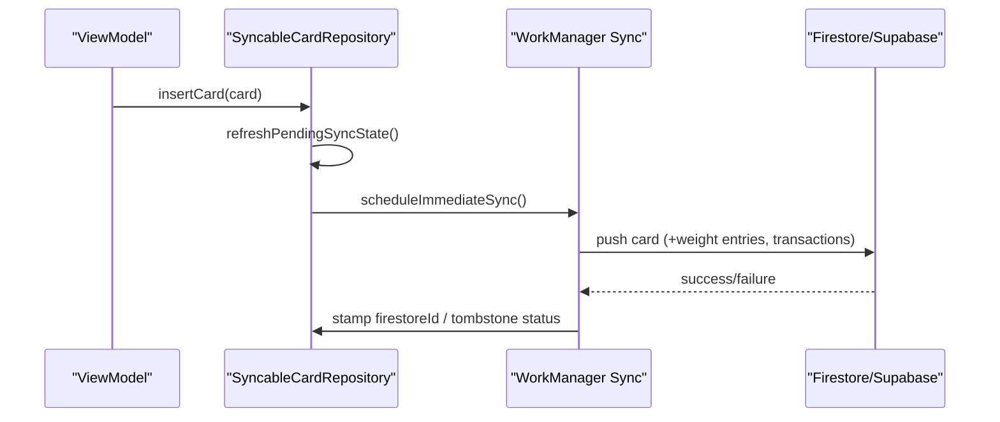
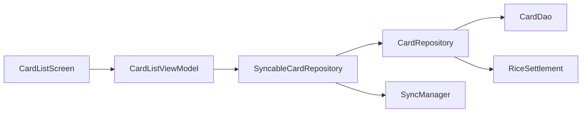

# Card Creation & Lifecycle Management

<cite>
**Referenced Files in This Document**   
- [CreateCardDialog.kt](file://app/src/main/java/com/giathinh/canlua/ui/component/CreateCardDialog.kt)
- [CardListScreen.kt](file://app/src/main/java/com/giathinh/canlua/ui/screen/CardListScreen.kt)
- [CardListViewModel.kt](file://app/src/main/java/com/giathinh/canlua/ui/viewmodel/CardListViewModel.kt)
- [Card.kt](file://app/src/main/java/com/giathinh/canlua/data/model/Card.kt)
- [CardDao.kt](file://app/src/main/java/com/giathinh/canlua/data/dao/CardDao.kt)
- [CardRepository.kt](file://app/src/main/java/com/giathinh/canlua/repository/CardRepository.kt)
- [SyncableCardRepository.kt](file://app/src/main/java/com/giathinh/canlua/repository/SyncableCardRepository.kt)
- [RiceSettlement.kt](file://app/src/main/java/com/giathinh/canlua/util/RiceSettlement.kt)
- [CardDetailScreen.kt](file://app/src/main/java/com/giathinh/canlua/ui/screen/CardDetailScreen.kt)
</cite>

## Table of Contents
1. [Introduction](#introduction)
2. [Project Structure](#project-structure)
3. [Core Components](#core-components)
4. [Architecture Overview](#architecture-overview)
5. [Detailed Component Analysis](#detailed-component-analysis)
6. [Dependency Analysis](#dependency-analysis)
7. [Performance Considerations](#performance-considerations)
8. [Troubleshooting Guide](#troubleshooting-guide)
9. [Conclusion](#conclusion)

## Introduction
This document explains the card creation and lifecycle management system for the rice weighing application. It covers the complete flow from opening the creation dialog to persisting a new card, computing totals, enforcing validation rules, handling role-based behavior, and managing card state transitions. It also documents data integrity constraints, orphan card claiming, cross-device sync considerations, and practical guidance for programmatic creation, bulk operations, and legacy migration.

The app follows Kotlin 2.3 / Jetpack Compose offline-first architecture with MVVM and unidirectional data flow via StateFlow and coroutines. Local persistence uses AndroidX Room; cloud sync is bidirectional to Firebase Firestore and Supabase through WorkManager. The app supports FARMER, TRADER, and GUEST roles, with role-dependent UI and ownership semantics.

## Project Structure
Card creation spans UI components, ViewModels, repositories, DAOs, domain models, and calculation utilities:

**Diagram sources**
- [CardListScreen.kt:406-437](file://app/src/main/java/com/giathinh/canlua/ui/screen/CardListScreen.kt#L406-L437)
- [CardListViewModel.kt:81-150](file://app/src/main/java/com/giathinh/canlua/ui/viewmodel/CardListViewModel.kt#L81-L150)
- [SyncableCardRepository.kt:36-40](file://app/src/main/java/com/giathinh/canlua/repository/SyncableCardRepository.kt#L36-L40)
- [CardRepository.kt:56-68](file://app/src/main/java/com/giathinh/canlua/repository/CardRepository.kt#L56-L68)
- [CardDao.kt:24-25](file://app/src/main/java/com/giathinh/canlua/data/dao/CardDao.kt#L24-L25)
- [CardRepository.kt:242-310](file://app/src/main/java/com/giathinh/canlua/repository/CardRepository.kt#L242-L310)
- [RiceSettlement.kt:89-184](file://app/src/main/java/com/giathinh/canlua/util/RiceSettlement.kt#L89-L184)

**Section sources**
- [CardListScreen.kt:100-114](file://app/src/main/java/com/giathinh/canlua/ui/screen/CardListScreen.kt#L100-L114)
- [CardListViewModel.kt:24-29](file://app/src/main/java/com/giathinh/canlua/ui/viewmodel/CardListViewModel.kt#L24-L29)
- [CardRepository.kt:26-44](file://app/src/main/java/com/giathinh/canlua/repository/CardRepository.kt#L26-L44)

## Core Components
- **CreateCardBottomSheet**: Role-aware modal form that collects counterparty identity, rice variety, season label, moisture percentage, price, deposit, optional CCCD, impurity weight, and GPS opt-in.
- **CardListViewModel**: Transforms UI input into a `Card`, applies defaults, optionally captures location, persists via repository, and creates an initial deposit transaction when applicable.
- **CardRepository**: Enforces per-user isolation, encrypts sensitive fields, stamps timestamps, protects locked cards, and computes totals using `RiceSettlement`.
- **Card model**: Room entity with fields for identity, weights, financials, rice variety, moisture, season, GPS, sync identifiers, conflict timestamp, weigh-mode flags, and bag sampling configuration.
- **CardDao**: Room queries filtering by `ownerUid`, supporting filters, statistics, orphan claiming, and cross-device dedup helpers.
- **SyncableCardRepository**: Decorator that marks mutations pending and schedules background sync.
- **RiceSettlement**: Deterministic calculation engine ensuring no rounding drift across lines and totals.

**Section sources**
- [CreateCardDialog.kt:87-104](file://app/src/main/java/com/giathinh/canlua/ui/component/CreateCardDialog.kt#L87-L104)
- [CardListViewModel.kt:81-150](file://app/src/main/java/com/giathinh/canlua/ui/viewmodel/CardListViewModel.kt#L81-L150)
- [CardRepository.kt:56-85](file://app/src/main/java/com/giathinh/canlua/repository/CardRepository.kt#L56-L85)
- [Card.kt:8-106](file://app/src/main/java/com/giathinh/canlua/data/model/Card.kt#L8-L106)
- [CardDao.kt:11-18](file://app/src/main/java/com/giathinh/canlua/data/dao/CardDao.kt#L11-L18)
- [SyncableCardRepository.kt:10-24](file://app/src/main/java/com/giathinh/canlua/repository/SyncableCardRepository.kt#L10-L24)
- [RiceSettlement.kt:8-18](file://app/src/main/java/com/giathinh/canlua/util/RiceSettlement.kt#L8-L18)

## Architecture Overview
The creation workflow is offline-first: UI validates inputs, ViewModel builds a domain `Card`, Repository writes to Room and triggers sync, and background workers push to Firestore/Supabase idempotently.

**Diagram sources**
- [CardListScreen.kt:406-437](file://app/src/main/java/com/giathinh/canlua/ui/screen/CardListScreen.kt#L406-L437)
- [CreateCardDialog.kt:557-586](file://app/src/main/java/com/giathinh/canlua/ui/component/CreateCardDialog.kt#L557-L586)
- [CardListViewModel.kt:81-150](file://app/src/main/java/com/giathinh/canlua/ui/viewmodel/CardListViewModel.kt#L81-L150)
- [SyncableCardRepository.kt:36-40](file://app/src/main/java/com/giathinh/canlua/repository/SyncableCardRepository.kt#L36-L40)
- [CardRepository.kt:56-85](file://app/src/main/java/com/giathinh/canlua/repository/CardRepository.kt#L56-L85)
- [CardRepository.kt:242-310](file://app/src/main/java/com/giathinh/canlua/repository/CardRepository.kt#L242-L310)

## Detailed Component Analysis

### CreateCardDialog Behavior and Validation
`CreateCardBottomSheet` adapts labels and roles based on `CreateCardMode`:
- FARMER mode: owner is farmer, counterparty is trader.
- TRADER mode: owner is trader, counterparty is farmer.

Validation rules enforced before submission:
- Counterparty name must be non-blank.
- Rice variety must be non-blank.
- CCCD is optional but must be empty or exactly 12 digits.
- Moisture, price, deposit, and impurity weight are numeric; invalid parsing falls back to zero.

Additional behaviors:
- Contact picker can populate counterparty phone/name if permission granted.
- Location recording is opt-in; requires fine/coarse location permissions.
- Help dialogs explain CCCD, impurity weight, and moisture.

**Diagram sources**
- [CreateCardDialog.kt:221-225](file://app/src/main/java/com/giathinh/canlua/ui/component/CreateCardDialog.kt#L221-L225)
- [CreateCardDialog.kt:557-586](file://app/src/main/java/com/giathinh/canlua/ui/component/CreateCardDialog.kt#L557-L586)

**Section sources**
- [CreateCardDialog.kt:67-104](file://app/src/main/java/com/giathinh/canlua/ui/component/CreateCardDialog.kt#L67-L104)
- [CreateCardDialog.kt:149-154](file://app/src/main/java/com/giathinh/canlua/ui/component/CreateCardDialog.kt#L149-L154)
- [CreateCardDialog.kt:304-380](file://app/src/main/java/com/giathinh/canlua/ui/component/CreateCardDialog.kt#L304-L380)
- [CreateCardDialog.kt:395-489](file://app/src/main/java/com/giathinh/canlua/ui/component/CreateCardDialog.kt#L395-L489)
- [CreateCardDialog.kt:491-535](file://app/src/main/java/com/giathinh/canlua/ui/component/CreateCardDialog.kt#L491-L535)
- [CreateCardDialog.kt:557-586](file://app/src/main/java/com/giathinh/canlua/ui/component/CreateCardDialog.kt#L557-L586)

### Form Data Mapping and Programmatic Creation
When the user submits, `CardListScreen` maps role-specific names and phone numbers, then calls `CardListViewModel.createNewCard`. The ViewModel:
- Trims the card name.
- Optionally fetches current GPS coordinates and reverse geocodes to field address.
- Computes default bag weight from settings (sampling vs unit bag).
- Builds a `Card` with rice variety, moisture, season, price, deposit, CCCD, trader info, and weigh-mode defaults.
- Persists via `SyncableCardRepository.insertCard`.
- If deposit > 0, inserts a deposit transaction and recalculates totals.

**Diagram sources**
- [CardListScreen.kt:412-437](file://app/src/main/java/com/giathinh/canlua/ui/screen/CardListScreen.kt#L412-L437)
- [CardListViewModel.kt:81-150](file://app/src/main/java/com/giathinh/canlua/ui/viewmodel/CardListViewModel.kt#L81-L150)
- [SyncableCardRepository.kt:36-40](file://app/src/main/java/com/giathinh/canlua/repository/SyncableCardRepository.kt#L36-L40)

**Section sources**
- [CardListScreen.kt:406-437](file://app/src/main/java/com/giathinh/canlua/ui/screen/CardListScreen.kt#L406-L437)
- [CardListViewModel.kt:81-150](file://app/src/main/java/com/giathinh/canlua/ui/viewmodel/CardListViewModel.kt#L81-L150)

### Required Fields and Validation Rules
- **Rice variety**: Must be non-blank.
- **Season label**: Optional at creation; used for filtering and statistics later.
- **Moisture percentage**: Numeric; invalid values default to zero.
- **Counterparty name**: Must be non-blank.
- **CCCD**: Optional; if provided, must be exactly 12 digits.
- **Price and deposit**: Numeric; invalid values default to zero.
- **Impurity weight**: Numeric; invalid values default to zero.

These rules are enforced in the dialog’s local validation and further protected by repository guards and calculation invariants.

**Section sources**
- [CreateCardDialog.kt:221-225](file://app/src/main/java/com/giathinh/canlua/ui/component/CreateCardDialog.kt#L221-L225)
- [CreateCardDialog.kt:351-380](file://app/src/main/java/com/giathinh/canlua/ui/component/CreateCardDialog.kt#L351-L380)
- [CreateCardDialog.kt:395-489](file://app/src/main/java/com/giathinh/canlua/ui/component/CreateCardDialog.kt#L395-L489)

### Role-Based Permissions and Ownership
- Owner is read-only and derived from profile.
- Counterparty is entered manually.
- FARMER mode: owner = farmer, counterparty = trader.
- TRADER mode: owner = trader, counterparty = farmer.
- Per-user isolation: all DAO queries filter by `ownerUid`; repository injects current user UID.

**Diagram sources**
- [CreateCardDialog.kt:67-72](file://app/src/main/java/com/giathinh/canlua/ui/component/CreateCardDialog.kt#L67-L72)
- [CardListScreen.kt:181-187](file://app/src/main/java/com/giathinh/canlua/ui/screen/CardListScreen.kt#L181-L187)
- [CardRepository.kt:26-46](file://app/src/main/java/com/giathinh/canlua/repository/CardRepository.kt#L26-L46)

**Section sources**
- [CreateCardDialog.kt:67-117](file://app/src/main/java/com/giathinh/canlua/ui/component/CreateCardDialog.kt#L67-L117)
- [CardListScreen.kt:181-187](file://app/src/main/java/com/giathinh/canlua/ui/screen/CardListScreen.kt#L181-L187)
- [CardRepository.kt:26-46](file://app/src/main/java/com/giathinh/canlua/repository/CardRepository.kt#L26-L46)

### Card Status States and Business Implications
The codebase implements a two-state lock mechanism rather than explicit DRAFT/LOCKED/SETTLED enums:
- **Unlocked (`isLocked = false`)**: Editable; users can add/edit weight entries, edit card metadata, and delete under certain conditions.
- **Locked (`isLocked = true`)**: Read-only; prevents further edits, recalculation, and most destructive actions. Locking is performed via DAO and toggled from the detail screen.

There is no explicit SETTLED state in the model; settlement calculations are computed by `RiceSettlement` and reflected in financial fields (`totalAmount`, `remainingAmount`, `overpaidAmount`). Payment completion is tracked by `isPaid`, which gates deletion and influences UI behavior.

**Diagram sources**
- [CardDao.kt:37-38](file://app/src/main/java/com/giathinh/canlua/data/dao/CardDao.kt#L37-L38)
- [CardDetailScreen.kt:727-736](file://app/src/main/java/com/giathinh/canlua/ui/screen/CardDetailScreen.kt#L727-L736)
- [CardRepository.kt:74-85](file://app/src/main/java/com/giathinh/canlua/repository/CardRepository.kt#L74-L85)

**Section sources**
- [Card.kt:50-50](file://app/src/main/java/com/giathinh/canlua/data/model/Card.kt#L50-L50)
- [CardDao.kt:37-38](file://app/src/main/java/com/giathinh/canlua/data/dao/CardDao.kt#L37-L38)
- [CardRepository.kt:74-85](file://app/src/main/java/com/giathinh/canlua/repository/CardRepository.kt#L74-L85)
- [CardDetailScreen.kt:727-736](file://app/src/main/java/com/giathinh/canlua/ui/screen/CardDetailScreen.kt#L727-L736)

### Data Integrity Constraints and Calculation Invariants
- All monetary computations use integer VND internally to avoid floating-point drift.
- Weight allocations use Largest Remainder Method so line-level sums equal totals exactly.
- `RiceSettlement.verify()` asserts invariants; violations indicate code errors, not user input errors.
- Repository guards prevent updates to locked cards and recalculation after locking.
- Sensitive ID fields (e.g., CCCD) are encrypted/decrypted at repository boundary.

**Diagram sources**
- [RiceSettlement.kt:89-184](file://app/src/main/java/com/giathinh/canlua/util/RiceSettlement.kt#L89-L184)
- [RiceSettlement.kt:74-86](file://app/src/main/java/com/giathinh/canlua/util/RiceSettlement.kt#L74-L86)
- [CardRepository.kt:242-310](file://app/src/main/java/com/giathinh/canlua/repository/CardRepository.kt#L242-L310)

**Section sources**
- [RiceSettlement.kt:8-18](file://app/src/main/java/com/giathinh/canlua/util/RiceSettlement.kt#L8-L18)
- [RiceSettlement.kt:74-86](file://app/src/main/java/com/giathinh/canlua/util/RiceSettlement.kt#L74-L86)
- [CardRepository.kt:242-310](file://app/src/main/java/com/giathinh/canlua/repository/CardRepository.kt#L242-L310)

### Orphan Card Claiming and Legacy Migration
Cards created before per-user isolation may have empty `ownerUid`. The repository provides a one-shot migration:
- `claimOrphanCardsForCurrentUser()` assigns all orphan cards to the currently signed-in user.
- DAO methods support counting and updating orphan rows.
- This is idempotent and safe to call after v12 upgrade.

Cross-device deduplication:
- `firestoreId` is assigned after successful push to Firestore.
- `findOrphanFirestoreMatch()` matches pre-sync cards by composite key to avoid duplicates.
- `getByFirestoreId()` enables dedup during pull.

**Diagram sources**
- [CardRepository.kt:368-380](file://app/src/main/java/com/giathinh/canlua/repository/CardRepository.kt#L368-L380)
- [CardDao.kt:130-146](file://app/src/main/java/com/giathinh/canlua/data/dao/CardDao.kt#L130-L146)
- [CardDao.kt:170-191](file://app/src/main/java/com/giathinh/canlua/data/dao/CardDao.kt#L170-L191)

**Section sources**
- [CardRepository.kt:368-380](file://app/src/main/java/com/giathinh/canlua/repository/CardRepository.kt#L368-L380)
- [CardDao.kt:130-146](file://app/src/main/java/com/giathinh/canlua/data/dao/CardDao.kt#L130-L146)
- [CardDao.kt:170-191](file://app/src/main/java/com/giathinh/canlua/data/dao/CardDao.kt#L170-L191)

### Cross-Device Sync Considerations During Creation
- Local mutation triggers `refreshPendingSyncState()` and `scheduleImmediateSync()`.
- Background worker batches pushes to Firestore/Supabase; new cards receive Firestore IDs.
- Conflict resolution uses `lastModifiedMs` to compare local vs cloud timestamps.
- Deletion tombstones prevent “resurrection” after pull; they also track whether cloud deletion succeeded.

**Diagram sources**
- [SyncableCardRepository.kt:21-24](file://app/src/main/java/com/giathinh/canlua/repository/SyncableCardRepository.kt#L21-L24)
- [CardRepository.kt:87-129](file://app/src/main/java/com/giathinh/canlua/repository/CardRepository.kt#L87-L129)
- [CardRepository.kt:60-68](file://app/src/main/java/com/giathinh/canlua/repository/CardRepository.kt#L60-L68)

**Section sources**
- [SyncableCardRepository.kt:10-24](file://app/src/main/java/com/giathinh/canlua/repository/SyncableCardRepository.kt#L10-L24)
- [CardRepository.kt:87-129](file://app/src/main/java/com/giathinh/canlua/repository/CardRepository.kt#L87-L129)

### Practical Examples

#### Programmatic Card Creation
To create a card programmatically:
- Build a `Card` with required fields: `name`, `riceVariety`, `seasonLabel`, `moisturePercent`, `pricePerKg`, `depositAmount`, and optional CCCD/trader info.
- Call `SyncableCardRepository.insertCard(card)`.
- If deposit > 0, call `insertTransaction` with type `DEPOSIT`, then `updateCardCalculations(cardId)`.

Key responsibilities:
- ViewModel resolves location and defaults.
- Repository enforces ownership and encryption.
- Calculation engine ensures totals are consistent.

**Section sources**
- [CardListViewModel.kt:81-150](file://app/src/main/java/com/giathinh/canlua/ui/viewmodel/CardListViewModel.kt#L81-L150)
- [CardRepository.kt:56-85](file://app/src/main/java/com/giathinh/canlua/repository/CardRepository.kt#L56-L85)

#### Bulk Operations
Bulk creation should:
- Batch `insertCard` calls within a coroutine scope.
- For each card with deposit, batch `insertTransaction` and `updateCardCalculations`.
- Avoid blocking UI; emit progress via StateFlow or SharedFlow.
- Respect premium quotas and daily limits enforced by UI and repository.

Note: The repository does not expose a dedicated bulk API; callers should orchestrate multiple insertions while respecting concurrency and error handling.

**Section sources**
- [CardListViewModel.kt:81-150](file://app/src/main/java/com/giathinh/canlua/ui/viewmodel/CardListViewModel.kt#L81-L150)
- [CardRepository.kt:56-85](file://app/src/main/java/com/giathinh/canlua/repository/CardRepository.kt#L56-L85)

#### Migration Handling for Legacy Cards
- After upgrading to v12+, call `claimOrphanCardsForCurrentUser()` once per sign-in session.
- Use `countOrphanCards()` to decide whether migration is necessary.
- Ensure UI reflects newly claimed cards immediately via reactive flows.

**Section sources**
- [CardRepository.kt:368-380](file://app/src/main/java/com/giathinh/canlua/repository/CardRepository.kt#L368-L380)
- [CardDao.kt:130-146](file://app/src/main/java/com/giathinh/canlua/data/dao/CardDao.kt#L130-L146)

## Dependency Analysis
The card creation pipeline depends on several modules:

**Diagram sources**
- [CardListScreen.kt:406-437](file://app/src/main/java/com/giathinh/canlua/ui/screen/CardListScreen.kt#L406-L437)
- [CardListViewModel.kt:81-150](file://app/src/main/java/com/giathinh/canlua/ui/viewmodel/CardListViewModel.kt#L81-L150)
- [SyncableCardRepository.kt:36-40](file://app/src/main/java/com/giathinh/canlua/repository/SyncableCardRepository.kt#L36-L40)
- [CardRepository.kt:56-85](file://app/src/main/java/com/giathinh/canlua/repository/CardRepository.kt#L56-L85)
- [CardDao.kt:24-25](file://app/src/main/java/com/giathinh/canlua/data/dao/CardDao.kt#L24-L25)
- [RiceSettlement.kt:89-184](file://app/src/main/java/com/giathinh/canlua/util/RiceSettlement.kt#L89-L184)

**Section sources**
- [CardListScreen.kt:406-437](file://app/src/main/java/com/giathinh/canlua/ui/screen/CardListScreen.kt#L406-L437)
- [CardListViewModel.kt:81-150](file://app/src/main/java/com/giathinh/canlua/ui/viewmodel/CardListViewModel.kt#L81-L150)
- [SyncableCardRepository.kt:36-40](file://app/src/main/java/com/giathinh/canlua/repository/SyncableCardRepository.kt#L36-L40)
- [CardRepository.kt:56-85](file://app/src/main/java/com/giathinh/canlua/repository/CardRepository.kt#L56-L85)

## Performance Considerations
- Calculations are wrapped in database transactions to avoid race conditions and lost updates.
- `RiceSettlement` uses integer arithmetic to minimize floating-point errors.
- Only dirty weight entries are updated to reduce write amplification.
- Sync batching groups card, entry, and transaction operations to respect Firestore limits.

[No sources needed since this section provides general guidance]

## Troubleshooting Guide
Common issues and resolutions:
- **Submit disabled**: Ensure counterparty name and rice variety are non-blank; validate CCCD length if provided.
- **Locked card edits blocked**: Unlock the card first; locked cards prevent recalculation and edits.
- **Deleted card reappears**: Check tombstone status; ensure cloud deletion flag is managed correctly.
- **Duplicate cards after login/logout**: Use `findOrphanFirestoreMatch()` to deduplicate pre-sync cards.
- **Incorrect totals**: Verify `RiceSettlement.verify()` invariants; check moisture, impurity, and bag configuration.

**Section sources**
- [CreateCardDialog.kt:221-225](file://app/src/main/java/com/giathinh/canlua/ui/component/CreateCardDialog.kt#L221-L225)
- [CardRepository.kt:74-85](file://app/src/main/java/com/giathinh/canlua/repository/CardRepository.kt#L74-L85)
- [CardRepository.kt:87-129](file://app/src/main/java/com/giathinh/canlua/repository/CardRepository.kt#L87-L129)
- [CardDao.kt:170-191](file://app/src/main/java/com/giathinh/canlua/data/dao/CardDao.kt#L170-L191)
- [RiceSettlement.kt:74-86](file://app/src/main/java/com/giathinh/canlua/util/RiceSettlement.kt#L74-L86)

## Conclusion
The card creation and lifecycle system combines robust UI validation, role-aware ownership, deterministic calculations, and offline-first persistence with reliable cloud sync. While explicit DRAFT/LOCKED/SETTLED states are not modeled, the `isLocked` flag and payment state provide clear boundaries between editable and finalized cards. Data integrity is enforced through transactional updates, cryptographic protection of sensitive fields, and strict calculation invariants. Orphan claiming and cross-device deduplication ensure data consistency across upgrades and devices. For bulk operations and programmatic creation, follow the established ViewModel and Repository patterns to maintain correctness and performance.