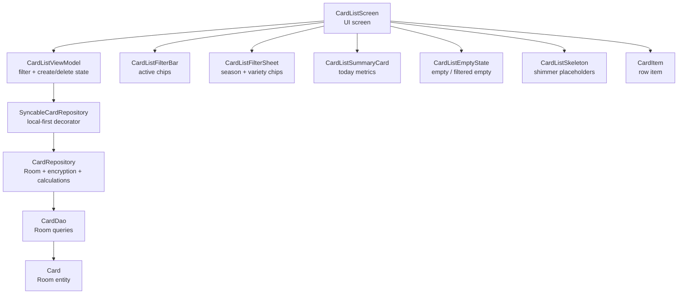
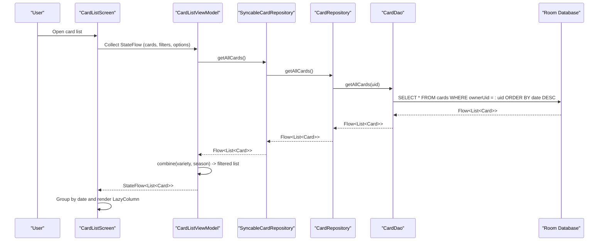
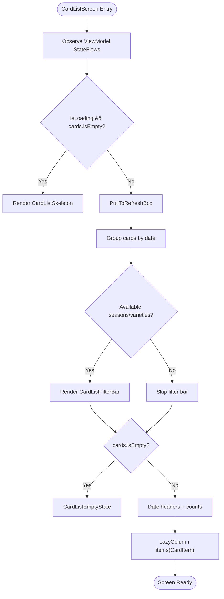
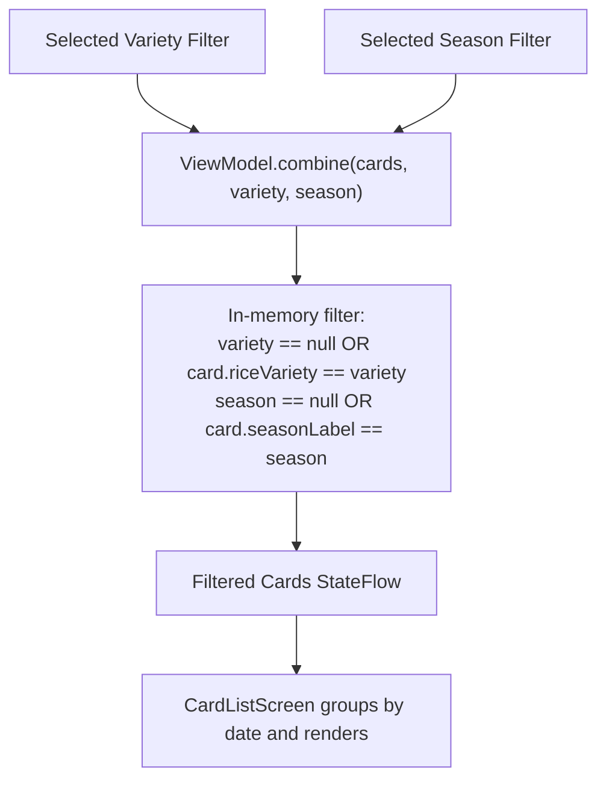
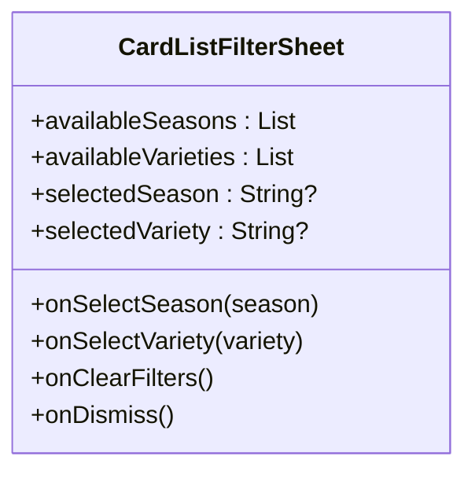
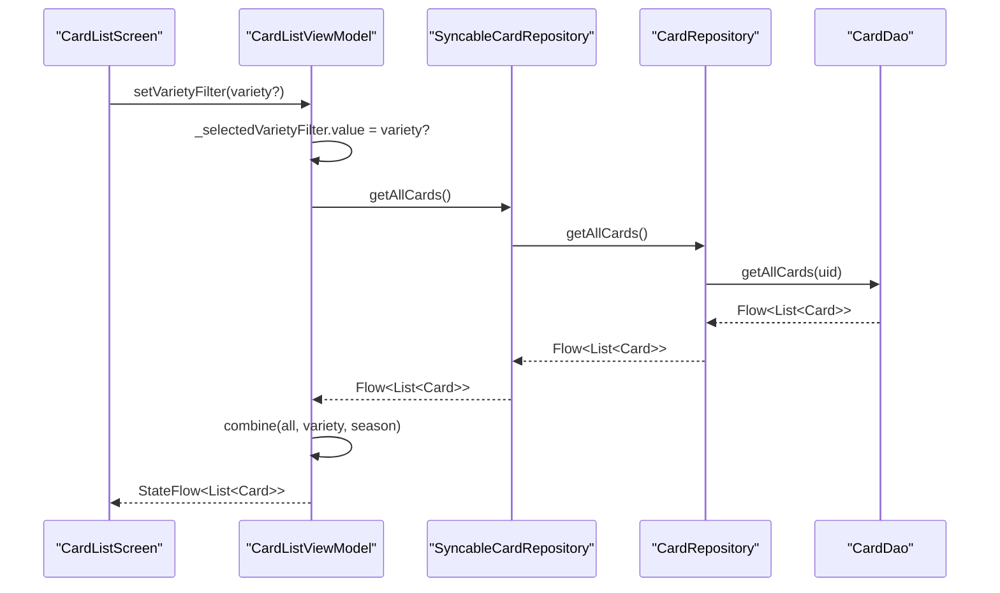
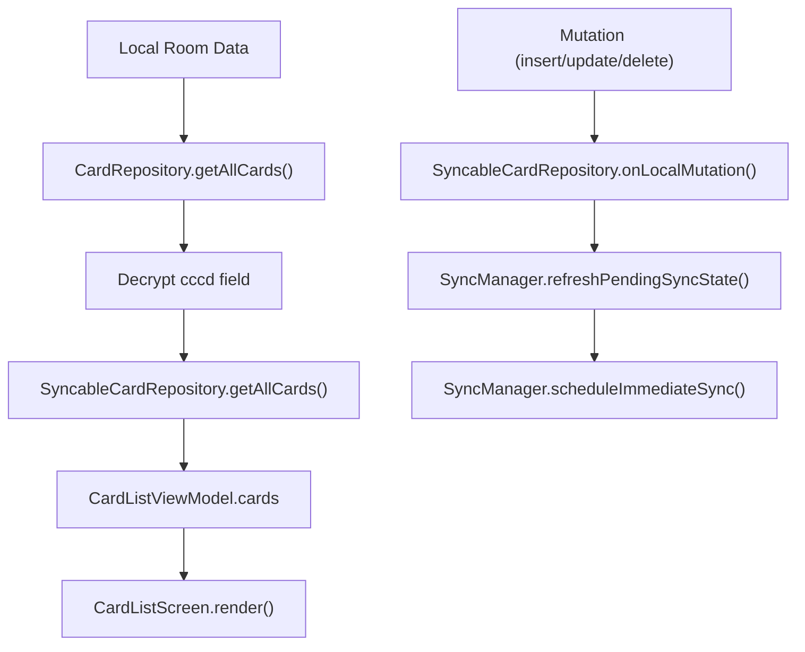
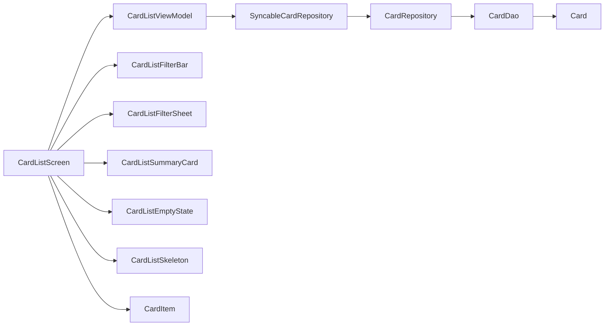

# Card List Interface & Filtering

<cite>
**Referenced Files in This Document**   
- [CardListScreen.kt](file://app/src/main/java/com/giathinh/canlua/ui/screen/CardListScreen.kt)
- [CardListViewModel.kt](file://app/src/main/java/com/giathinh/canlua/ui/viewmodel/CardListViewModel.kt)
- [CardListFilterSheet.kt](file://app/src/main/java/com/giathinh/canlua/ui/component/cardlist/CardListFilterSheet.kt)
- [CardListFilterBar.kt](file://app/src/main/java/com/giathinh/canlua/ui/component/cardlist/CardListFilterBar.kt)
- [CardListSummaryCard.kt](file://app/src/main/java/com/giathinh/canlua/ui/component/cardlist/CardListSummaryCard.kt)
- [CardListEmptyState.kt](file://app/src/main/java/com/giathinh/canlua/ui/component/cardlist/CardListEmptyState.kt)
- [CardListSkeleton.kt](file://app/src/main/java/com/giathinh/canlua/ui/component/cardlist/CardListSkeleton.kt)
- [CardItem.kt](file://app/src/main/java/com/giathinh/canlua/ui/component/CardItem.kt)
- [SyncableCardRepository.kt](file://app/src/main/java/com/giathinh/canlua/repository/SyncableCardRepository.kt)
- [CardRepository.kt](file://app/src/main/java/com/giathinh/canlua/repository/CardRepository.kt)
- [CardDao.kt](file://app/src/main/java/com/giathinh/canlua/data/dao/CardDao.kt)
- [Card.kt](file://app/src/main/java/com/giathinh/canlua/data/model/Card.kt)
</cite>

## Table of Contents
1. [Introduction](#introduction)
2. [Project Structure](#project-structure)
3. [Core Components](#core-components)
4. [Architecture Overview](#architecture-overview)
5. [Detailed Component Analysis](#detailed-component-analysis)
6. [Dependency Analysis](#dependency-analysis)
7. [Performance Considerations](#performance-considerations)
8. [Troubleshooting Guide](#troubleshooting-guide)
9. [Conclusion](#conclusion)

## Introduction
This document explains the card list interface and filtering system for an offline-first Android app built with Kotlin, Jetpack Compose, Room, and MVVM. The card list displays weighing records grouped by date, supports rice variety and season filters, shows today’s summary metrics, and integrates with a filter sheet UI. Data is loaded from local Room storage via reactive flows; cloud sync to Firebase Firestore and Supabase is handled separately through a repository decorator that schedules background WorkManager jobs.

The implementation emphasizes:
- Offline-first data display using Room `Flow`.
- Reactive filtering driven by ViewModel state.
- Lazy rendering through Compose `LazyColumn`.
- Clear separation between UI, ViewModel, repository, DAO, and model layers.

## Project Structure
The card list feature spans UI screens, UI components, a ViewModel, repositories, DAOs, and domain models:

**Diagram sources**
- [CardListScreen.kt:100-480](file://app/src/main/java/com/giathinh/canlua/ui/screen/CardListScreen.kt#L100-L480)
- [CardListViewModel.kt:25-169](file://app/src/main/java/com/giathinh/canlua/ui/viewmodel/CardListViewModel.kt#L25-L169)
- [SyncableCardRepository.kt:17-86](file://app/src/main/java/com/giathinh/canlua/repository/SyncableCardRepository.kt#L17-L86)
- [CardRepository.kt:37-406](file://app/src/main/java/com/giathinh/canlua/repository/CardRepository.kt#L37-L406)
- [CardDao.kt:17-293](file://app/src/main/java/com/giathinh/canlua/data/dao/CardDao.kt#L17-L293)
- [Card.kt:8-107](file://app/src/main/java/com/giathinh/canlua/data/model/Card.kt#L8-L107)
- [CardListFilterBar.kt:31-120](file://app/src/main/java/com/giathinh/canlua/ui/component/cardlist/CardListFilterBar.kt#L31-L120)
- [CardListFilterSheet.kt:34-169](file://app/src/main/java/com/giathinh/canlua/ui/component/cardlist/CardListFilterSheet.kt#L34-L169)
- [CardListSummaryCard.kt:43-248](file://app/src/main/java/com/giathinh/canlua/ui/component/cardlist/CardListSummaryCard.kt#L43-L248)
- [CardListEmptyState.kt:39-168](file://app/src/main/java/com/giathinh/canlua/ui/component/cardlist/CardListEmptyState.kt#L39-L168)
- [CardListSkeleton.kt:44-216](file://app/src/main/java/com/giathinh/canlua/ui/component/cardlist/CardListSkeleton.kt#L44-L216)
- [CardItem.kt:68-360](file://app/src/main/java/com/giathinh/canlua/ui/component/CardItem.kt#L68-L360)

**Section sources**
- [CardListScreen.kt:100-480](file://app/src/main/java/com/giathinh/canlua/ui/screen/CardListScreen.kt#L100-L480)
- [CardListViewModel.kt:25-169](file://app/src/main/java/com/giathinh/canlua/ui/viewmodel/CardListViewModel.kt#L25-L169)
- [SyncableCardRepository.kt:17-86](file://app/src/main/java/com/giathinh/canlua/repository/SyncableCardRepository.kt#L17-L86)
- [CardRepository.kt:37-406](file://app/src/main/java/com/giathinh/canlua/repository/CardRepository.kt#L37-L406)
- [CardDao.kt:17-293](file://app/src/main/java/com/giathinh/canlua/data/dao/CardDao.kt#L17-L293)
- [Card.kt:8-107](file://app/src/main/java/com/giathinh/canlua/data/model/Card.kt#L8-L107)

## Core Components
- **CardListScreen**: Main Compose screen that owns navigation, pull-to-refresh, premium quota gating, delete confirmation, filter sheet visibility, and grouping cards by date. It observes ViewModel state and renders summary, filter bar, skeleton, empty states, and card items.
- **CardListViewModel**: Holds reactive filter state (`selectedVarietyFilter`, `selectedSeasonFilter`), exposes combined filtered cards, available options, and actions like creating or deleting cards.
- **CardListFilterSheet**: Modal bottom sheet offering horizontal scrollable filter chips for seasons and rice varieties.
- **CardListFilterBar**: Inline active filter chips showing current selections and allowing per-filter or clear-all actions.
- **CardListSummaryCard**: Today’s summary card showing card count, total weight, total amount, optional average price, bag count, and yield hints.
- **CardListEmptyState**: Empty-state UI for no data or filtered-empty scenarios.
- **CardListSkeleton**: Shimmer-based placeholder matching the real layout structure to reduce visual shift during loading.
- **CardItem**: Row component displaying card details, payment status, moisture, bag weight, impurity, and swipe-to-delete behavior.
- **SyncableCardRepository**: Local-first decorator wrapping `CardRepository`; triggers pending sync scheduling after mutations.
- **CardRepository**: Room-backed repository handling CRUD, encryption/decryption of sensitive fields, calculation updates, and distinct value queries.
- **CardDao**: Room DAO exposing reactive queries for cards, distinct varieties, suggested varieties, distinct seasons, and aggregation stats.
- **Card**: Room entity representing a weighing record, including rice variety, season label, GPS, contact info, sync identifiers, and settlement-related fields.

**Section sources**
- [CardListScreen.kt:100-480](file://app/src/main/java/com/giathinh/canlua/ui/screen/CardListScreen.kt#L100-L480)
- [CardListViewModel.kt:25-169](file://app/src/main/java/com/giathinh/canlua/ui/viewmodel/CardListViewModel.kt#L25-L169)
- [CardListFilterSheet.kt:34-169](file://app/src/main/java/com/giathinh/canlua/ui/component/cardlist/CardListFilterSheet.kt#L34-L169)
- [CardListFilterBar.kt:31-120](file://app/src/main/java/com/giathinh/canlua/ui/component/cardlist/CardListFilterBar.kt#L31-L120)
- [CardListSummaryCard.kt:43-248](file://app/src/main/java/com/giathinh/canlua/ui/component/cardlist/CardListSummaryCard.kt#L43-L248)
- [CardListEmptyState.kt:39-168](file://app/src/main/java/com/giathinh/canlua/ui/component/cardlist/CardListEmptyState.kt#L39-L168)
- [CardListSkeleton.kt:44-216](file://app/src/main/java/com/giathinh/canlua/ui/component/cardlist/CardListSkeleton.kt#L44-L216)
- [CardItem.kt:68-360](file://app/src/main/java/com/giathinh/canlua/ui/component/CardItem.kt#L68-L360)
- [SyncableCardRepository.kt:17-86](file://app/src/main/java/com/giathinh/canlua/repository/SyncableCardRepository.kt#L17-L86)
- [CardRepository.kt:37-406](file://app/src/main/java/com/giathinh/canlua/repository/CardRepository.kt#L37-L406)
- [CardDao.kt:17-293](file://app/src/main/java/com/giathinh/canlua/data/dao/CardDao.kt#L17-L293)
- [Card.kt:8-107](file://app/src/main/java/com/giathinh/canlua/data/model/Card.kt#L8-L107)

## Architecture Overview
The card list follows MVVM with unidirectional data flow:

**Diagram sources**
- [CardListScreen.kt:124-136](file://app/src/main/java/com/giathinh/canlua/ui/screen/CardListScreen.kt#L124-L136)
- [CardListViewModel.kt:43-53](file://app/src/main/java/com/giathinh/canlua/ui/viewmodel/CardListViewModel.kt#L43-L53)
- [SyncableCardRepository.kt:26-32](file://app/src/main/java/com/giathinh/canlua/repository/SyncableCardRepository.kt#L26-L32)
- [CardRepository.kt:48-50](file://app/src/main/java/com/giathinh/canlua/repository/CardRepository.kt#L48-L50)
- [CardDao.kt:18-19](file://app/src/main/java/com/giathinh/canlua/data/dao/CardDao.kt#L18-L19)

## Detailed Component Analysis

### CardListScreen Architecture
The screen composes:
- Pull-to-refresh wrapper triggering refresh and sync.
- Skeleton while loading and no data.
- Summary card computed from today’s cards.
- Optional filter bar when season or variety options exist.
- Empty state for no data or filtered-empty results.
- Grouped date headers and lazy-rendered card items.
- Floating action button gated by premium quota logic.
- Delete confirmation dialog and filter sheet.

Key behaviors:
- Uses `rememberLazyListState` and scroll direction to control FAB visibility.
- Groups cards by formatted date string for section headers.
- Observes profile role to adjust default labels and creation mode.
- Integrates analytics and haptic feedback on interactions.

**Diagram sources**
- [CardListScreen.kt:148-156](file://app/src/main/java/com/giathinh/canlua/ui/screen/CardListScreen.kt#L148-L156)
- [CardListScreen.kt:221-250](file://app/src/main/java/com/giathinh/canlua/ui/screen/CardListScreen.kt#L221-L250)
- [CardListScreen.kt:251-380](file://app/src/main/java/com/giathinh/canlua/ui/screen/CardListScreen.kt#L251-L380)

**Section sources**
- [CardListScreen.kt:100-480](file://app/src/main/java/com/giathinh/canlua/ui/screen/CardListScreen.kt#L100-L480)

### Filtering Capabilities
Current filtering supports:
- Rice variety filter: selected via filter sheet or cleared via filter bar.
- Season label filter: selected via filter sheet or cleared via filter bar.
- Combined filtering: both filters can be active simultaneously.
- Clearing: single filter clear chip or clear-all chip when multiple filters are active.

Data source:
- Available varieties and seasons come from repository DAO queries returning distinct values.
- Suggested varieties are derived from recent usage patterns.

Filter application:
- ViewModel combines repository cards with selected filters using `combine`.
- Filtering occurs in-memory after Room returns the full user-scoped list.

Limitations:
- No date range filter in the current ViewModel pipeline.
- No payment status filter in the current ViewModel pipeline.
- No real-time search text input in the current ViewModel pipeline.

**Diagram sources**
- [CardListViewModel.kt:37-53](file://app/src/main/java/com/giathinh/canlua/ui/viewmodel/CardListViewModel.kt#L37-L53)
- [CardListScreen.kt:278-289](file://app/src/main/java/com/giathinh/canlua/ui/screen/CardListScreen.kt#L278-L289)

**Section sources**
- [CardListViewModel.kt:37-79](file://app/src/main/java/com/giathinh/canlua/ui/viewmodel/CardListViewModel.kt#L37-L79)
- [CardListFilterBar.kt:31-120](file://app/src/main/java/com/giathinh/canlua/ui/component/cardlist/CardListFilterBar.kt#L31-L120)
- [CardListFilterSheet.kt:34-169](file://app/src/main/java/com/giathinh/canlua/ui/component/cardlist/CardListFilterSheet.kt#L34-L169)

### CardListFilterSheet UI Component
The filter sheet provides:
- Title and clear button when any filter is active.
- Horizontal scrollable row of season chips including “All seasons”.
- Horizontal scrollable row of variety chips including “All” and a grass icon for the selected variety.
- Selection toggles: tapping a chip selects it; tapping again deselects it.

Accessibility considerations:
- Icons use `contentDescription = null` for decorative icons.
- Text labels are localized via string resources.
- Chips follow Material 3 styling for selection states.

**Diagram sources**
- [CardListFilterSheet.kt:34-169](file://app/src/main/java/com/giathinh/canlua/ui/component/cardlist/CardListFilterSheet.kt#L34-L169)

**Section sources**
- [CardListFilterSheet.kt:34-169](file://app/src/main/java/com/giathinh/canlua/ui/component/cardlist/CardListFilterSheet.kt#L34-L169)

### Filter State Management
State ownership:
- ViewModel holds `_selectedVarietyFilter` and `_selectedSeasonFilter` as `MutableStateFlow`.
- Exposed as immutable `StateFlow` to UI.
- Actions `setVarietyFilter`, `setSeasonFilter`, and `clearFilters` update state.

Reactive pipeline:
- `cards` is a `StateFlow` created by combining repository cards with both filters.
- Each filter change recomputes the filtered list.
- `stateIn(viewModelScope, SharingStarted.WhileSubscribed(5_000), ...)` ensures streams are started lazily and stopped when not observed.

**Diagram sources**
- [CardListViewModel.kt:37-53](file://app/src/main/java/com/giathinh/canlua/ui/viewmodel/CardListViewModel.kt#L37-L53)
- [CardListViewModel.kt:68-79](file://app/src/main/java/com/giathinh/canlua/ui/viewmodel/CardListViewModel.kt#L68-L79)
- [SyncableCardRepository.kt:26-32](file://app/src/main/java/com/giathinh/canlua/repository/SyncableCardRepository.kt#L26-L32)
- [CardRepository.kt:48-50](file://app/src/main/java/com/giathinh/canlua/repository/CardRepository.kt#L48-L50)
- [CardDao.kt:18-19](file://app/src/main/java/com/giathinh/canlua/data/dao/CardDao.kt#L18-L19)

**Section sources**
- [CardListViewModel.kt:31-79](file://app/src/main/java/com/giathinh/canlua/ui/viewmodel/CardListViewModel.kt#L31-L79)

### Real-Time Search Functionality
There is no real-time search text input implemented in the current ViewModel or screen. Filtering is limited to exact matches on rice variety and season label. If search is added, it should:
- Introduce a new `MutableStateFlow<String?>` for search query.
- Combine query with existing filters.
- Apply substring or tokenized matching in-memory after Room retrieval.
- Debounce input to avoid excessive recomposition.

[No sources needed since this section proposes conceptual extensions without analyzing specific files]

### Sorting Options
Current sorting:
- Room query orders cards by `date DESC`.
- Screen groups by date and renders sections accordingly.

Additional sorting strategies could include:
- Sort by total amount descending.
- Sort by most recent modification time.
- Sort by payment status (paid first).

These would require changes in DAO ordering or post-retrieval sorting in ViewModel.

[No sources needed since this section provides general guidance]

### Pagination Strategies
Current pagination:
- Uses Compose `LazyColumn` with `items(items = cardsInDay, key = { it.id })`.
- No explicit page size or cursor-based pagination.

For large datasets:
- Implement cursor-based pagination at DAO level using `LIMIT` and `OFFSET` or timestamp-based cursors.
- Use `LazyListState` to detect end-of-list and load next page.
- Maintain stable keys and preserve scroll position across filter changes.

[No sources needed since this section provides general guidance]

### Offline-First Data Display Patterns
Patterns used:
- Room `Flow` streams provide reactive local data.
- Repository decrypts sensitive fields before exposing to ViewModel.
- Syncable repository triggers background sync after mutations.
- UI remains functional without network; sync status is observable but not required for basic listing.

**Diagram sources**
- [CardRepository.kt:48-50](file://app/src/main/java/com/giathinh/canlua/repository/CardRepository.kt#L48-L50)
- [SyncableCardRepository.kt:21-24](file://app/src/main/java/com/giathinh/canlua/repository/SyncableCardRepository.kt#L21-L24)
- [CardListViewModel.kt:43-53](file://app/src/main/java/com/giathinh/canlua/ui/viewmodel/CardListViewModel.kt#L43-L53)
- [CardListScreen.kt:124-136](file://app/src/main/java/com/giathinh/canlua/ui/screen/CardListScreen.kt#L124-L136)

**Section sources**
- [CardRepository.kt:48-50](file://app/src/main/java/com/giathinh/canlua/repository/CardRepository.kt#L48-L50)
- [SyncableCardRepository.kt:21-24](file://app/src/main/java/com/giathinh/canlua/repository/SyncableCardRepository.kt#L21-L24)

### Examples of Custom Filter Implementations
To extend filtering:
- Add a new filter type (e.g., payment status):
  - Add `MutableStateFlow<Boolean?>` in ViewModel.
  - Update `cards` combine block to include the new condition.
  - Add UI controls in filter sheet and filter bar.
- Add date range filter:
  - Add start/end date `StateFlow`s.
  - Convert dates to epoch milliseconds and compare with `card.date.time`.
  - Debounce date changes to avoid frequent recompositions.

Implementation references:
- Existing variety/season filters show how to add `StateFlow` and combine conditions.
- Filter sheet demonstrates chip-based selection UI.
- Filter bar demonstrates active chip rendering and clear actions.

**Section sources**
- [CardListViewModel.kt:37-53](file://app/src/main/java/com/giathinh/canlua/ui/viewmodel/CardListViewModel.kt#L37-L53)
- [CardListFilterSheet.kt:78-164](file://app/src/main/java/com/giathinh/canlua/ui/component/cardlist/CardListFilterSheet.kt#L78-L164)
- [CardListFilterBar.kt:40-89](file://app/src/main/java/com/giathinh/canlua/ui/component/cardlist/CardListFilterBar.kt#L40-L89)

### Performance Tuning for Thousands of Records
Optimizations already present:
- Room indexes on `ownerUid`, composite `(ownerUid, date)`, and `(ownerUid, riceVariety)`.
- `LazyColumn` with stable keys.
- Shared formatter instances in `CardItem` to reduce object allocation.
- `stateIn(..., SharingStarted.WhileSubscribed(5_000))` to avoid unnecessary stream subscriptions.

Recommended enhancements:
- Move heavy computations off the main thread using `Dispatchers.Default` where appropriate.
- Debounce rapid filter changes.
- Consider server-side or Room-side pagination for very large lists.
- Avoid recomputation by caching derived data in ViewModel with `derivedStateOf`.

**Section sources**
- [Card.kt:11-18](file://app/src/main/java/com/giathinh/canlua/data/model/Card.kt#L11-L18)
- [CardItem.kt:52-57](file://app/src/main/java/com/giathinh/canlua/ui/component/CardItem.kt#L52-L57)
- [CardListViewModel.kt:43-53](file://app/src/main/java/com/giathinh/canlua/ui/viewmodel/CardListViewModel.kt#L43-L53)

### Accessibility Considerations
- Section headers use semantics heading to improve TalkBack navigation.
- Icons are marked decorative where appropriate.
- Text uses localized strings for consistent accessibility descriptions.
- Swipe-to-delete includes content descriptions for delete action.

**Section sources**
- [CardListScreen.kt:334-341](file://app/src/main/java/com/giathinh/canlua/ui/screen/CardListScreen.kt#L334-L341)
- [CardListFilterSheet.kt:95-100](file://app/src/main/java/com/giathinh/canlua/ui/component/cardlist/CardListFilterSheet.kt#L95-L100)
- [CardItem.kt:121-127](file://app/src/main/java/com/giathinh/canlua/ui/component/CardItem.kt#L121-L127)
- [CardItem.kt:325-329](file://app/src/main/java/com/giathinh/canlua/ui/component/CardItem.kt#L325-L329)

## Dependency Analysis
Component relationships:

**Diagram sources**
- [CardListScreen.kt:100-480](file://app/src/main/java/com/giathinh/canlua/ui/screen/CardListScreen.kt#L100-L480)
- [CardListViewModel.kt:25-169](file://app/src/main/java/com/giathinh/canlua/ui/viewmodel/CardListViewModel.kt#L25-L169)
- [SyncableCardRepository.kt:17-86](file://app/src/main/java/com/giathinh/canlua/repository/SyncableCardRepository.kt#L17-L86)
- [CardRepository.kt:37-406](file://app/src/main/java/com/giathinh/canlua/repository/CardRepository.kt#L37-L406)
- [CardDao.kt:17-293](file://app/src/main/java/com/giathinh/canlua/data/dao/CardDao.kt#L17-L293)
- [Card.kt:8-107](file://app/src/main/java/com/giathinh/canlua/data/model/Card.kt#L8-L107)

**Section sources**
- [CardListScreen.kt:100-480](file://app/src/main/java/com/giathinh/canlua/ui/screen/CardListScreen.kt#L100-L480)
- [CardListViewModel.kt:25-169](file://app/src/main/java/com/giathinh/canlua/ui/viewmodel/CardListViewModel.kt#L25-L169)
- [SyncableCardRepository.kt:17-86](file://app/src/main/java/com/giathinh/canlua/repository/SyncableCardRepository.kt#L17-L86)
- [CardRepository.kt:37-406](file://app/src/main/java/com/giathinh/canlua/repository/CardRepository.kt#L37-L406)
- [CardDao.kt:17-293](file://app/src/main/java/com/giathinh/canlua/data/dao/CardDao.kt#L17-L293)
- [Card.kt:8-107](file://app/src/main/java/com/giathinh/canlua/data/model/Card.kt#L8-L107)

## Performance Considerations
- Use Room indexes to speed up queries by `ownerUid`, date ordering, and variety lookups.
- Keep filter logic simple and in-memory after Room retrieval to avoid complex SQL combinations unless necessary.
- Debounce user inputs for search or date ranges.
- Prefer `LazyColumn` with stable keys to minimize recompositions.
- Share expensive objects like formatters across components.
- Use `stateIn` with `WhileSubscribed` to avoid leaking streams when screens are not visible.

[No sources needed since this section provides general guidance]

## Troubleshooting Guide
Common issues and resolutions:
- Filters not applying:
  - Verify ViewModel filter state is updated via `setVarietyFilter` or `setSeasonFilter`.
  - Ensure `cards` combine block includes the new filter if extending functionality.
- Empty list despite data existing:
  - Check Room index and query correctness.
  - Confirm `ownerUid` isolation is correct; unsign-in or auth transitions may return empty flows.
- Slow list rendering:
  - Ensure `LazyColumn` uses stable keys.
  - Avoid heavy computations inside `items` lambda; move to ViewModel or cache with `remember`.
- Sync not occurring:
  - Verify `SyncableCardRepository.onLocalMutation()` is called after writes.
  - Check WorkManager scheduling and network availability.

**Section sources**
- [CardListViewModel.kt:68-79](file://app/src/main/java/com/giathinh/canlua/ui/viewmodel/CardListViewModel.kt#L68-L79)
- [CardRepository.kt:48-50](file://app/src/main/java/com/giathinh/canlua/repository/CardRepository.kt#L48-L50)
- [SyncableCardRepository.kt:21-24](file://app/src/main/java/com/giathinh/canlua/repository/SyncableCardRepository.kt#L21-L24)

## Conclusion
The card list interface provides a robust, offline-first experience with reactive filtering by rice variety and season. The architecture cleanly separates UI, state management, repository, and persistence layers. While current filtering does not include date ranges or payment status, the codebase offers clear extension points. Performance is supported by Room indexes, lazy rendering, and efficient state streaming. Future enhancements such as real-time search, advanced sorting, and pagination can be integrated following the established patterns.