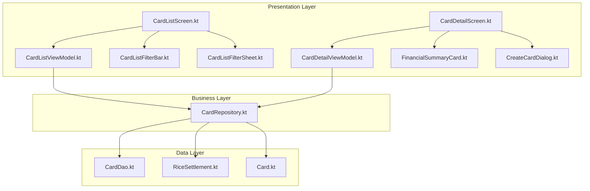
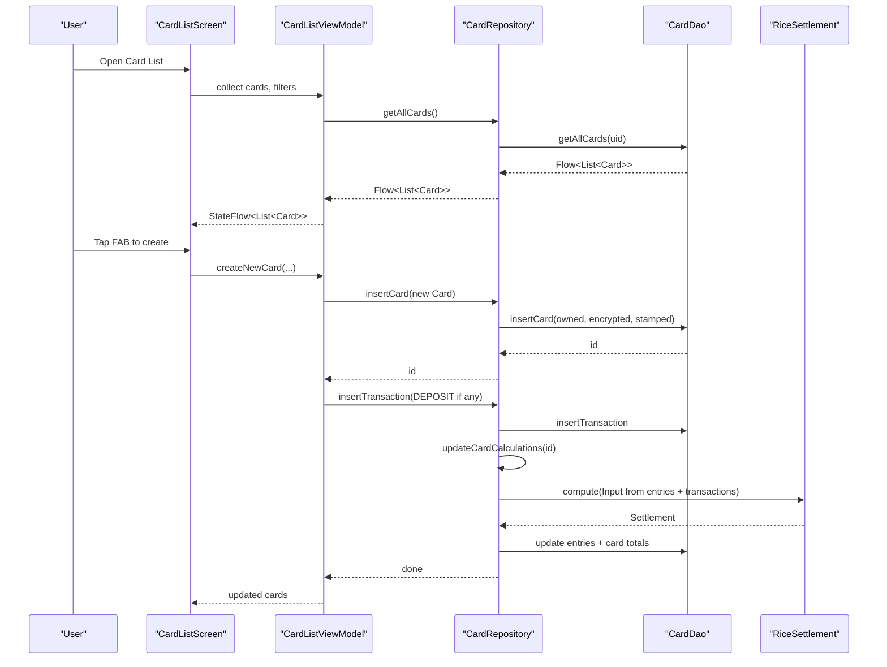
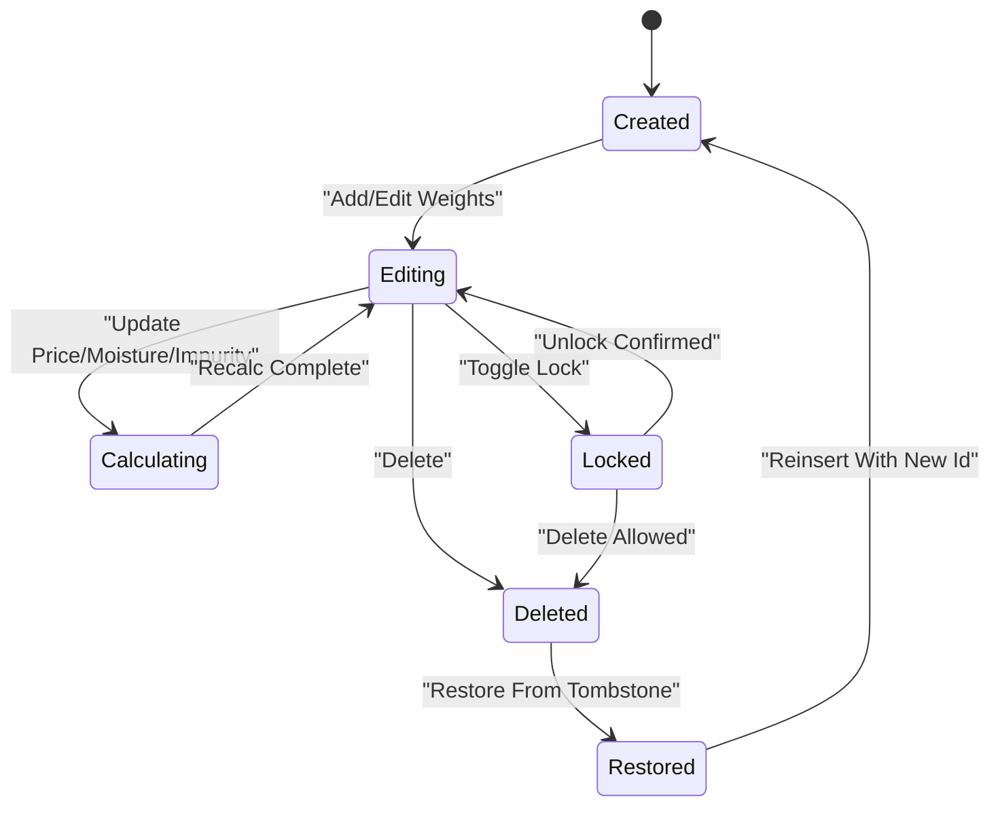
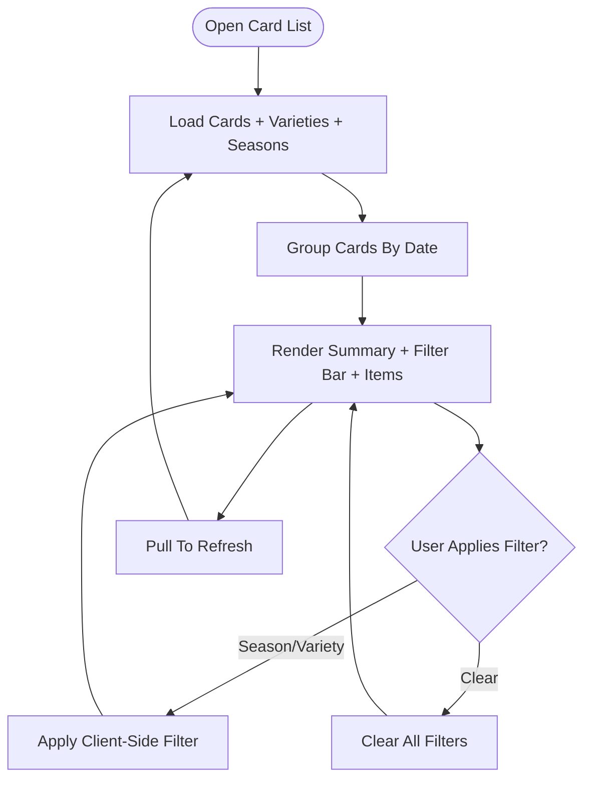
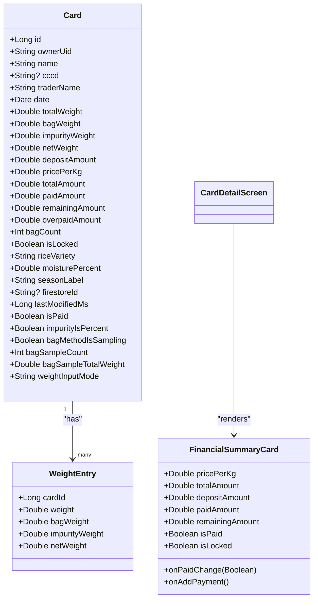
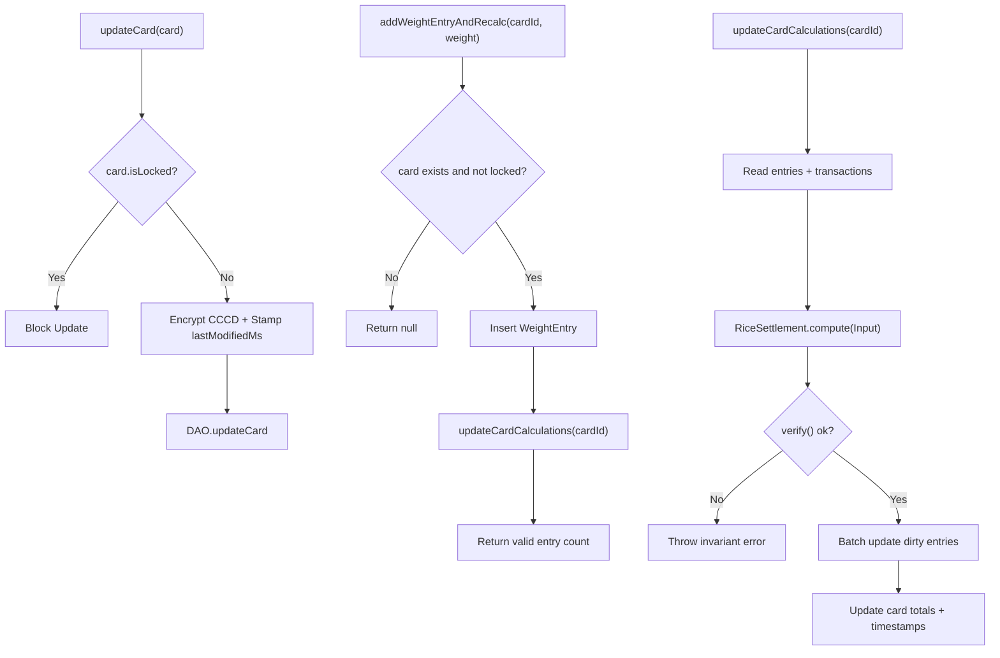
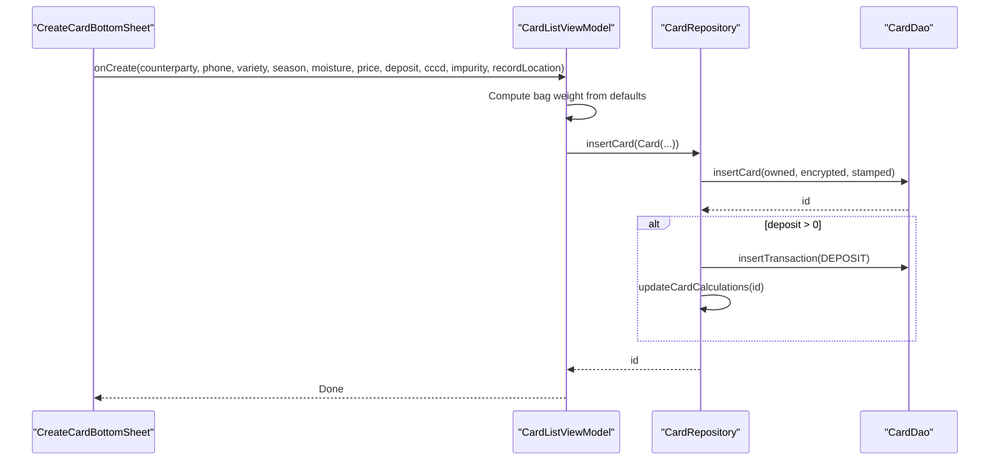
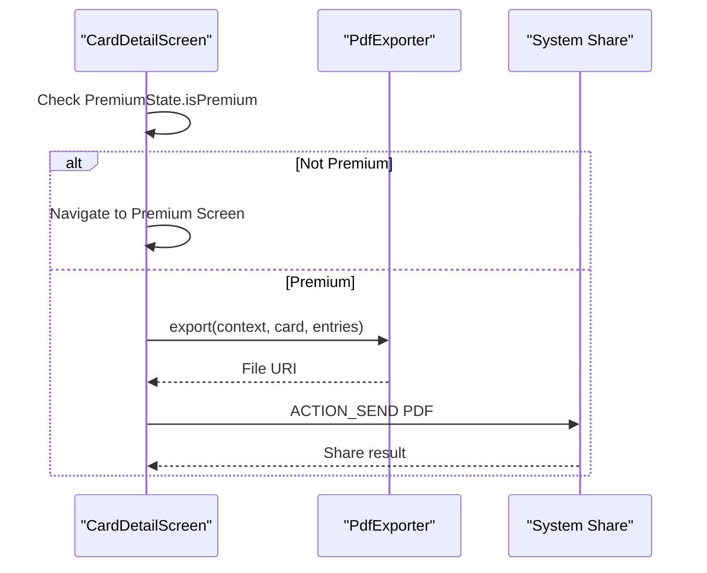
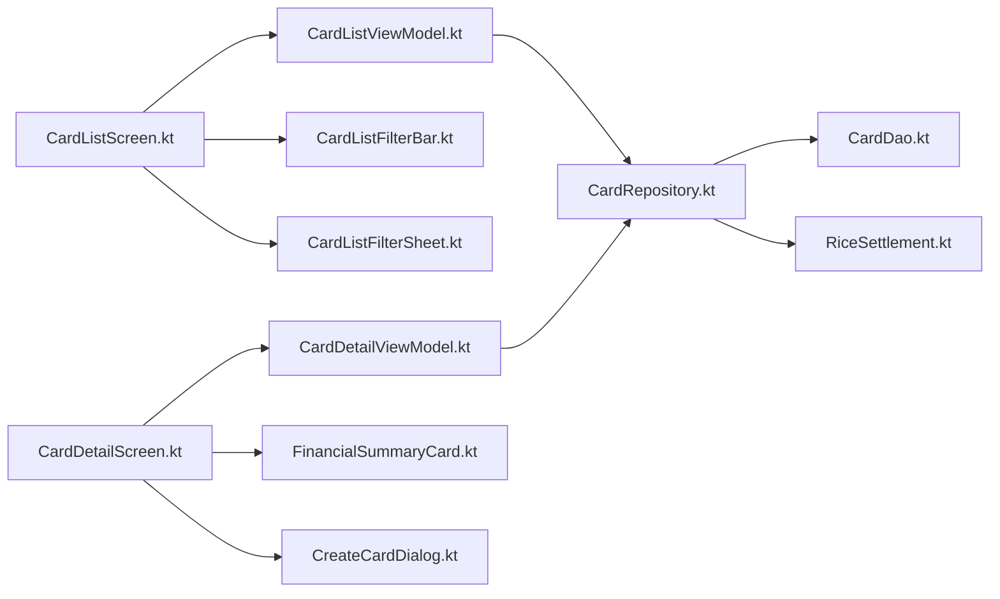

# Season Management

<cite>
**Referenced Files in This Document**   
- [Card.kt](file://app/src/main/java/com/giathinh/canlua/data/model/Card.kt)
- [CardDao.kt](file://app/src/main/java/com/giathinh/canlua/data/dao/CardDao.kt)
- [CardRepository.kt](file://app/src/main/java/com/giathinh/canlua/repository/CardRepository.kt)
- [RiceSettlement.kt](file://app/src/main/java/com/giathinh/canlua/util/RiceSettlement.kt)
- [CardListScreen.kt](file://app/src/main/java/com/giathinh/canlua/ui/screen/CardListScreen.kt)
- [CardDetailScreen.kt](file://app/src/main/java/com/giathinh/canlua/ui/screen/CardDetailScreen.kt)
- [CardListViewModel.kt](file://app/src/main/java/com/giathinh/canlua/ui/viewmodel/CardListViewModel.kt)
- [CardDetailViewModel.kt](file://app/src/main/java/com/giathinh/canlua/ui/viewmodel/CardDetailViewModel.kt)
- [CreateCardDialog.kt](file://app/src/main/java/com/giathinh/canlua/ui/component/CreateCardDialog.kt)
- [CardListFilterBar.kt](file://app/src/main/java/com/giathinh/canlua/ui/component/cardlist/CardListFilterBar.kt)
- [CardListFilterSheet.kt](file://app/src/main/java/com/giathinh/canlua/ui/component/cardlist/CardListFilterSheet.kt)
- [FinancialSummaryCard.kt](file://app/src/main/java/com/giathinh/canlua/ui/component/detail/FinancialSummaryCard.kt)
</cite>

## Table of Contents
1. [Introduction](#introduction)
2. [Project Structure](#project-structure)
3. [Core Components](#core-components)
4. [Architecture Overview](#architecture-overview)
5. [Detailed Component Analysis](#detailed-component-analysis)
6. [Dependency Analysis](#dependency-analysis)
7. [Performance Considerations](#performance-considerations)
8. [Troubleshooting Guide](#troubleshooting-guide)
9. [Conclusion](#conclusion)

## Introduction
This document explains the season management system for rice weighing records and yield tracking. The system centers on a Card entity that represents one weighing record, with supporting UI for listing, filtering, creating, editing, exporting, and settling cards. It uses an offline-first architecture: local Room persistence, ViewModel-driven StateFlow state, and repository logic that integrates with DAOs, settlement calculations, and cloud sync infrastructure.

The documentation covers:
- Card as the primary weighing record container
- Creation workflows, status management, and lifecycle states
- Card list interface with filtering by season and variety
- Card detail view with weighing history, financial summary, and settlement information
- CardRepository business logic for CRUD, validation, locking, and recalculation
- Practical examples of card creation, status transitions, export, and performance optimization

## Project Structure
The season management feature spans data models, DAOs, repositories, ViewModels, Compose screens, and reusable UI components:

**Diagram sources**
- [Card.kt:1-107](file://app/src/main/java/com/giathinh/canlua/data/model/Card.kt#L1-L107)
- [CardDao.kt:1-293](file://app/src/main/java/com/giathinh/canlua/data/dao/CardDao.kt#L1-L293)
- [CardRepository.kt:1-406](file://app/src/main/java/com/giathinh/canlua/repository/CardRepository.kt#L1-L406)
- [RiceSettlement.kt:1-219](file://app/src/main/java/com/giathinh/canlua/util/RiceSettlement.kt#L1-L219)
- [CardListScreen.kt:1-480](file://app/src/main/java/com/giathinh/canlua/ui/screen/CardListScreen.kt#L1-L480)
- [CardDetailScreen.kt:1-800](file://app/src/main/java/com/giathinh/canlua/ui/screen/CardDetailScreen.kt#L1-L800)
- [CardListViewModel.kt:1-169](file://app/src/main/java/com/giathinh/canlua/ui/viewmodel/CardListViewModel.kt#L1-L169)
- [CardDetailViewModel.kt:1-296](file://app/src/main/java/com/giathinh/canlua/ui/viewmodel/CardDetailViewModel.kt#L1-L296)
- [CreateCardDialog.kt:1-717](file://app/src/main/java/com/giathinh/canlua/ui/component/CreateCardDialog.kt#L1-L717)
- [CardListFilterBar.kt:1-120](file://app/src/main/java/com/giathinh/canlua/ui/component/cardlist/CardListFilterBar.kt#L1-L120)
- [CardListFilterSheet.kt:1-169](file://app/src/main/java/com/giathinh/canlua/ui/component/cardlist/CardListFilterSheet.kt#L1-L169)
- [FinancialSummaryCard.kt:1-272](file://app/src/main/java/com/giathinh/canlua/ui/component/detail/FinancialSummaryCard.kt#L1-L272)

**Section sources**
- [Card.kt:1-107](file://app/src/main/java/com/giathinh/canlua/data/model/Card.kt#L1-L107)
- [CardDao.kt:1-293](file://app/src/main/java/com/giathinh/canlua/data/dao/CardDao.kt#L1-L293)
- [CardRepository.kt:1-406](file://app/src/main/java/com/giathinh/canlua/repository/CardRepository.kt#L1-L406)
- [CardListScreen.kt:1-480](file://app/src/main/java/com/giathinh/canlua/ui/screen/CardListScreen.kt#L1-L480)
- [CardDetailScreen.kt:1-800](file://app/src/main/java/com/giathinh/canlua/ui/screen/CardDetailScreen.kt#L1-L800)
- [CardListViewModel.kt:1-169](file://app/src/main/java/com/giathinh/canlua/ui/viewmodel/CardListViewModel.kt#L1-L169)
- [CardDetailViewModel.kt:1-296](file://app/src/main/java/com/giathinh/canlua/ui/viewmodel/CardDetailViewModel.kt#L1-L296)

## Core Components
- Card: Immutable Room entity representing a single weighing record. It includes owner isolation, identity fields, weight totals, bag handling, impurity and moisture settings, financial fields, GPS location, contact/address metadata, cross-device sync identifiers, modification timestamps, paid flag, per-card weigh modes, and input mode configuration.
- CardDao: Room DAO providing per-user queries, filtering by rice variety, season statistics, top traders, trader history, orphan card migration, Firestore ID mapping, and premium daily count.
- CardRepository: Business layer for CRUD, locked-card guards, tombstone-based deletion and recovery, weight entry operations, transaction integration, calculation orchestration via RiceSettlement, season stats, and premium gating helpers.
- RiceSettlement: Deterministic settlement engine using integer units to avoid floating-point drift, largest remainder allocation, moisture adjustment, VND rounding once, and invariant verification.

Key responsibilities:
- Card: Data contract and persistence schema.
- CardDao: Indexed queries and aggregation.
- CardRepository: Ownership stamping, encryption, locking, atomic updates, and reconciliation.
- RiceSettlement: Single source of truth for weight-to-money conversion.

**Section sources**
- [Card.kt:1-107](file://app/src/main/java/com/giathinh/canlua/data/model/Card.kt#L1-L107)
- [CardDao.kt:1-293](file://app/src/main/java/com/giathinh/canlua/data/dao/CardDao.kt#L1-L293)
- [CardRepository.kt:1-406](file://app/src/main/java/com/giathinh/canlua/repository/CardRepository.kt#L1-L406)
- [RiceSettlement.kt:1-219](file://app/src/main/java/com/giathinh/canlua/util/RiceSettlement.kt#L1-L219)

## Architecture Overview
The app follows MVVM + Clean Architecture with unidirectional data flow through StateFlow and coroutines. Screens observe ViewModel state; ViewModels call SyncableCardRepository (wrapping CardRepository); Repository calls Room DAOs and utility calculators. Cloud sync is handled elsewhere; this section focuses on local season management flows.

**Diagram sources**
- [CardListScreen.kt:100-480](file://app/src/main/java/com/giathinh/canlua/ui/screen/CardListScreen.kt#L100-L480)
- [CardListViewModel.kt:25-169](file://app/src/main/java/com/giathinh/canlua/ui/viewmodel/CardListViewModel.kt#L25-L169)
- [CardRepository.kt:56-152](file://app/src/main/java/com/giathinh/canlua/repository/CardRepository.kt#L56-L152)
- [CardRepository.kt:214-310](file://app/src/main/java/com/giathinh/canlua/repository/CardRepository.kt#L214-L310)
- [CardDao.kt:18-31](file://app/src/main/java/com/giathinh/canlua/data/dao/CardDao.kt#L18-L31)
- [RiceSettlement.kt:89-184](file://app/src/main/java/com/giathinh/canlua/util/RiceSettlement.kt#L89-L184)

## Detailed Component Analysis

### Card Entity Lifecycle and Status Management
Card is the primary container for a weighing record. Its lifecycle includes:
- Creation: Owner UID stamping, timestamping, optional GPS capture, default weigh options, and optional deposit transaction.
- Editing: Guarded by lock state; changes to price, impurity, moisture trigger recalculation.
- Weighing: Weight entries are added or edited; each change triggers recalculation.
- Locking: Locked cards prevent further edits and recalculations; unlock requires explicit confirmation.
- Deletion: Tombstone-based soft delete with recovery support; cloud deletion coordination is managed by higher-level sync logic.
- Payment: Paid flag can be toggled when unlocked; payments add Transaction rows and recalculate remaining amounts.

**Diagram sources**
- [CardRepository.kt:60-85](file://app/src/main/java/com/giathinh/canlua/repository/CardRepository.kt#L60-L85)
- [CardRepository.kt:103-152](file://app/src/main/java/com/giathinh/canlua/repository/CardRepository.kt#L103-L152)
- [CardRepository.kt:242-310](file://app/src/main/java/com/giathinh/canlua/repository/CardRepository.kt#L242-L310)
- [CardDetailScreen.kt:671-786](file://app/src/main/java/com/giathinh/canlua/ui/screen/CardDetailScreen.kt#L671-L786)

**Section sources**
- [Card.kt:1-107](file://app/src/main/java/com/giathinh/canlua/data/model/Card.kt#L1-L107)
- [CardRepository.kt:60-85](file://app/src/main/java/com/giathinh/canlua/repository/CardRepository.kt#L60-L85)
- [CardRepository.kt:103-152](file://app/src/main/java/com/giathinh/canlua/repository/CardRepository.kt#L103-L152)
- [CardRepository.kt:242-310](file://app/src/main/java/com/giathinh/canlua/repository/CardRepository.kt#L242-L310)
- [CardDetailScreen.kt:671-786](file://app/src/main/java/com/giathinh/canlua/ui/screen/CardDetailScreen.kt#L671-L786)

### Card List Interface: Filtering, Sorting, Search
The card list screen groups cards by date, shows a summary header, supports pull-to-refresh, and provides filtering by season and rice variety. Filters are applied client-side over the reactive card list.

Key behaviors:
- Grouping by formatted date with friendly labels for today/yesterday.
- Summary header showing today’s card count, total kg, total amount, average price, and bag count.
- Filter bar with active chips and clear-all option.
- Filter sheet offering “All seasons” and “All varieties” plus selectable values.
- Premium quota gate before creating new cards for free users.

**Diagram sources**
- [CardListScreen.kt:118-480](file://app/src/main/java/com/giathinh/canlua/ui/screen/CardListScreen.kt#L118-L480)
- [CardListFilterBar.kt:31-120](file://app/src/main/java/com/giathinh/canlua/ui/component/cardlist/CardListFilterBar.kt#L31-L120)
- [CardListFilterSheet.kt:34-169](file://app/src/main/java/com/giathinh/canlua/ui/component/cardlist/CardListFilterSheet.kt#L34-L169)
- [CardListViewModel.kt:43-79](file://app/src/main/java/com/giathinh/canlua/ui/viewmodel/CardListViewModel.kt#L43-L79)

**Section sources**
- [CardListScreen.kt:118-480](file://app/src/main/java/com/giathinh/canlua/ui/screen/CardListScreen.kt#L118-L480)
- [CardListFilterBar.kt:31-120](file://app/src/main/java/com/giathinh/canlua/ui/component/cardlist/CardListFilterBar.kt#L31-L120)
- [CardListFilterSheet.kt:34-169](file://app/src/main/java/com/giathinh/canlua/ui/component/cardlist/CardListFilterSheet.kt#L34-L169)
- [CardListViewModel.kt:43-79](file://app/src/main/java/com/giathinh/canlua/ui/viewmodel/CardListViewModel.kt#L43-L79)

### Card Detail View: History, Financials, Settlement
The detail screen displays:
- Card info including trader name/phone, rice variety, season label, created/updated timestamps, field address, and GPS coordinates.
- Weight summary with totals, bag count, bag weight, impurity, moisture, and net weight.
- Financial summary with unit price, total amount, deposit, paid, remaining, and paid toggle.
- Bag entries table paginated into chunks for large datasets.
- Actions: edit card, add/edit/delete weight entries, add payment, toggle lock, delete card, export PDF.

**Diagram sources**
- [Card.kt:1-107](file://app/src/main/java/com/giathinh/canlua/data/model/Card.kt#L1-L107)
- [FinancialSummaryCard.kt:39-272](file://app/src/main/java/com/giathinh/canlua/ui/component/detail/FinancialSummaryCard.kt#L39-L272)
- [CardDetailScreen.kt:110-800](file://app/src/main/java/com/giathinh/canlua/ui/screen/CardDetailScreen.kt#L110-L800)

**Section sources**
- [CardDetailScreen.kt:110-800](file://app/src/main/java/com/giathinh/canlua/ui/screen/CardDetailScreen.kt#L110-L800)
- [FinancialSummaryCard.kt:39-272](file://app/src/main/java/com/giathinh/canlua/ui/component/detail/FinancialSummaryCard.kt#L39-L272)

### CardRepository Business Logic: CRUD, Validation, Integration
Responsibilities:
- Per-user isolation via ownerUid stamping and decryption of sensitive fields.
- Insert/update with lastModifiedMs stamping and encrypted CCCD storage.
- Locked-card guard preventing edits and recalculations.
- Soft delete with tombstone snapshot and recovery workflow.
- Weight entry CRUD with automatic recalculation.
- Transaction integration for deposits and payments.
- Calculation orchestration using RiceSettlement with invariant checks.
- Season statistics, variety suggestions, top traders, and premium daily counts.

**Diagram sources**
- [CardRepository.kt:60-85](file://app/src/main/java/com/giathinh/canlua/repository/CardRepository.kt#L60-L85)
- [CardRepository.kt:176-204](file://app/src/main/java/com/giathinh/canlua/repository/CardRepository.kt#L176-L204)
- [CardRepository.kt:242-310](file://app/src/main/java/com/giathinh/canlua/repository/CardRepository.kt#L242-L310)
- [RiceSettlement.kt:89-184](file://app/src/main/java/com/giathinh/canlua/util/RiceSettlement.kt#L89-L184)

**Section sources**
- [CardRepository.kt:1-406](file://app/src/main/java/com/giathinh/canlua/repository/CardRepository.kt#L1-L406)
- [RiceSettlement.kt:1-219](file://app/src/main/java/com/giathinh/canlua/util/RiceSettlement.kt#L1-L219)

### Card Creation Workflow
End-to-end creation path:
1. User opens CreateCardBottomSheet.
2. Form validates counterparty name, rice variety, and optional CCCD length.
3. Optional GPS permission and reverse geocoding populate field address.
4. ViewModel computes default bag weight based on weigh defaults.
5. Repository inserts Card with ownerUid, encrypted CCCD, and timestamps.
6. If deposit > 0, a DEPOSIT Transaction is inserted and calculations refreshed.

**Diagram sources**
- [CreateCardDialog.kt:87-613](file://app/src/main/java/com/giathinh/canlua/ui/component/CreateCardDialog.kt#L87-L613)
- [CardListViewModel.kt:81-150](file://app/src/main/java/com/giathinh/canlua/ui/viewmodel/CardListViewModel.kt#L81-L150)
- [CardRepository.kt:60-68](file://app/src/main/java/com/giathinh/canlua/repository/CardRepository.kt#L60-L68)
- [CardRepository.kt:210-228](file://app/src/main/java/com/giathinh/canlua/repository/CardRepository.kt#L210-L228)

**Section sources**
- [CreateCardDialog.kt:87-613](file://app/src/main/java/com/giathinh/canlua/ui/component/CreateCardDialog.kt#L87-L613)
- [CardListViewModel.kt:81-150](file://app/src/main/java/com/giathinh/canlua/ui/viewmodel/CardListViewModel.kt#L81-L150)
- [CardRepository.kt:60-68](file://app/src/main/java/com/giathinh/canlua/repository/CardRepository.kt#L60-L68)

### Export Functionality
PDF export is available from the detail screen:
- Requires premium subscription; otherwise redirects to premium screen.
- Exports card and weight entries to a file and shares via system chooser.
- Errors are logged and surfaced via toast messages.

**Diagram sources**
- [CardDetailScreen.kt:695-726](file://app/src/main/java/com/giathinh/canlua/ui/screen/CardDetailScreen.kt#L695-L726)

**Section sources**
- [CardDetailScreen.kt:695-726](file://app/src/main/java/com/giathinh/canlua/ui/screen/CardDetailScreen.kt#L695-L726)

## Dependency Analysis
High-level dependencies among core modules:

**Diagram sources**
- [CardListScreen.kt:1-480](file://app/src/main/java/com/giathinh/canlua/ui/screen/CardListScreen.kt#L1-L480)
- [CardDetailScreen.kt:1-800](file://app/src/main/java/com/giathinh/canlua/ui/screen/CardDetailScreen.kt#L1-L800)
- [CardListViewModel.kt:1-169](file://app/src/main/java/com/giathinh/canlua/ui/viewmodel/CardListViewModel.kt#L1-L169)
- [CardDetailViewModel.kt:1-296](file://app/src/main/java/com/giathinh/canlua/ui/viewmodel/CardDetailViewModel.kt#L1-L296)
- [CardRepository.kt:1-406](file://app/src/main/java/com/giathinh/canlua/repository/CardRepository.kt#L1-L406)
- [CardDao.kt:1-293](file://app/src/main/java/com/giathinh/canlua/data/dao/CardDao.kt#L1-L293)
- [RiceSettlement.kt:1-219](file://app/src/main/java/com/giathinh/canlua/util/RiceSettlement.kt#L1-L219)
- [CardListFilterBar.kt:1-120](file://app/src/main/java/com/giathinh/canlua/ui/component/cardlist/CardListFilterBar.kt#L1-L120)
- [CardListFilterSheet.kt:1-169](file://app/src/main/java/com/giathinh/canlua/ui/component/cardlist/CardListFilterSheet.kt#L1-L169)
- [FinancialSummaryCard.kt:1-272](file://app/src/main/java/com/giathinh/canlua/ui/component/detail/FinancialSummaryCard.kt#L1-L272)
- [CreateCardDialog.kt:1-717](file://app/src/main/java/com/giathinh/canlua/ui/component/CreateCardDialog.kt#L1-L717)

**Section sources**
- [CardListScreen.kt:1-480](file://app/src/main/java/com/giathinh/canlua/ui/screen/CardListScreen.kt#L1-L480)
- [CardDetailScreen.kt:1-800](file://app/src/main/java/com/giathinh/canlua/ui/screen/CardDetailScreen.kt#L1-L800)
- [CardListViewModel.kt:1-169](file://app/src/main/java/com/giathinh/canlua/ui/viewmodel/CardListViewModel.kt#L1-L169)
- [CardDetailViewModel.kt:1-296](file://app/src/main/java/com/giathinh/canlua/ui/viewmodel/CardDetailViewModel.kt#L1-L296)
- [CardRepository.kt:1-406](file://app/src/main/java/com/giathinh/canlua/repository/CardRepository.kt#L1-L406)
- [CardDao.kt:1-293](file://app/src/main/java/com/giathinh/canlua/data/dao/CardDao.kt#L1-L293)
- [RiceSettlement.kt:1-219](file://app/src/main/java/com/giathinh/canlua/util/RiceSettlement.kt#L1-L219)

## Performance Considerations
- Indexing: Card entity defines indexes on ownerUid, composite ownerUid+date, and ownerUid+riceVariety to accelerate list queries and variety filters.
- Reactive streams: DAO returns Flow; ViewModels use combine and stateIn to minimize recomposition and unnecessary work.
- Batch updates: updateCardCalculations batches dirty weight entries and updates card totals in a single transaction.
- Large datasets: Detail screen chunks weight entries into pages of 25 items and uses pager navigation to reduce rendering load.
- Numeric precision: RiceSettlement uses Long units (0.01 kg) and rounds VND once to avoid drift and repeated rounding costs.
- Premium gating: Daily card count query avoids scanning all cards by using a since timestamp.

Recommendations:
- Keep filter operations client-side only after initial load to avoid extra DB queries.
- Avoid frequent recalculations; batch related updates (e.g., multiple weight entries) before calling updateCardCalculations.
- Use suggested varieties and distinct seasons from DAO to limit UI dropdown sizes.
- For very large bags tables, consider virtualized lists or pagination beyond current chunking.

[No sources needed since this section provides general guidance]

## Troubleshooting Guide
Common issues and resolutions:
- Locked card cannot be edited: Repository blocks updates and recalculations when isLocked is true. Unlock via detail screen confirmation dialog before editing.
- Invariant violation during recalculation: RiceSettlement.verify throws when computed totals do not match sums; check inputs (bag weight vs raw weight, impurity exceeding post-bag weight, invalid moisture).
- Missing GPS data: Field address and coordinates may be absent; request location permissions and refresh field location from detail screen.
- PDF export blocked: Premium subscription required; navigate to premium screen if not subscribed.
- Delete blocked for unpaid cards: Detail screen prevents deletion until card is marked paid.

Operational tips:
- Use tombstone restore to recover deleted cards; note that restored cards do not include child weight entries.
- When updating deposit or paid amounts, ensure transactions are inserted so totals reflect correctly.
- After changing price, impurity, or moisture, always trigger updateCardCalculations to keep totals consistent.

**Section sources**
- [CardRepository.kt:74-85](file://app/src/main/java/com/giathinh/canlua/repository/CardRepository.kt#L74-L85)
- [CardRepository.kt:242-310](file://app/src/main/java/com/giathinh/canlua/repository/CardRepository.kt#L242-L310)
- [CardDetailScreen.kt:671-786](file://app/src/main/java/com/giathinh/canlua/ui/screen/CardDetailScreen.kt#L671-L786)
- [CardDetailScreen.kt:695-726](file://app/src/main/java/com/giathinh/canlua/ui/screen/CardDetailScreen.kt#L695-L726)

## Conclusion
The season management system provides a robust, offline-first workflow for managing rice weighing records across seasons. Card serves as the central domain model, with CardRepository enforcing ownership, locking, and deterministic settlement calculations. The UI layers offer intuitive creation, filtering, detailed inspection, and export capabilities. With indexed queries, reactive streams, and careful numeric handling, the system scales well for typical farming and trading workflows while maintaining data integrity and user experience.

[No sources needed since this section summarizes without analyzing specific files]