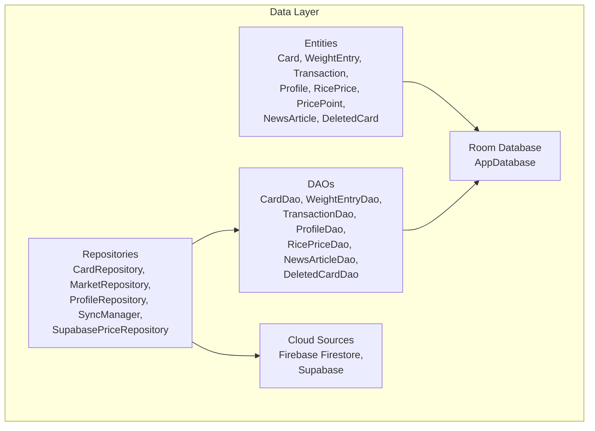
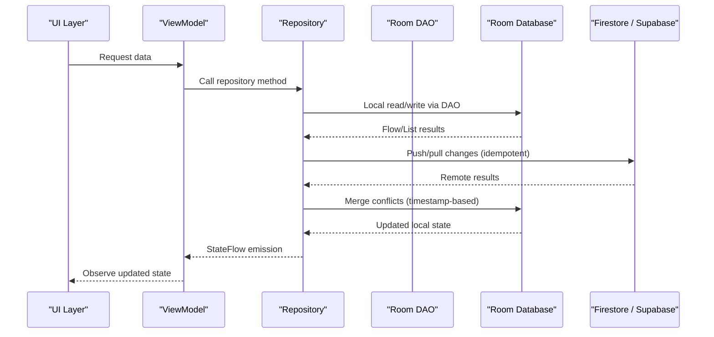
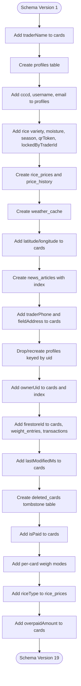
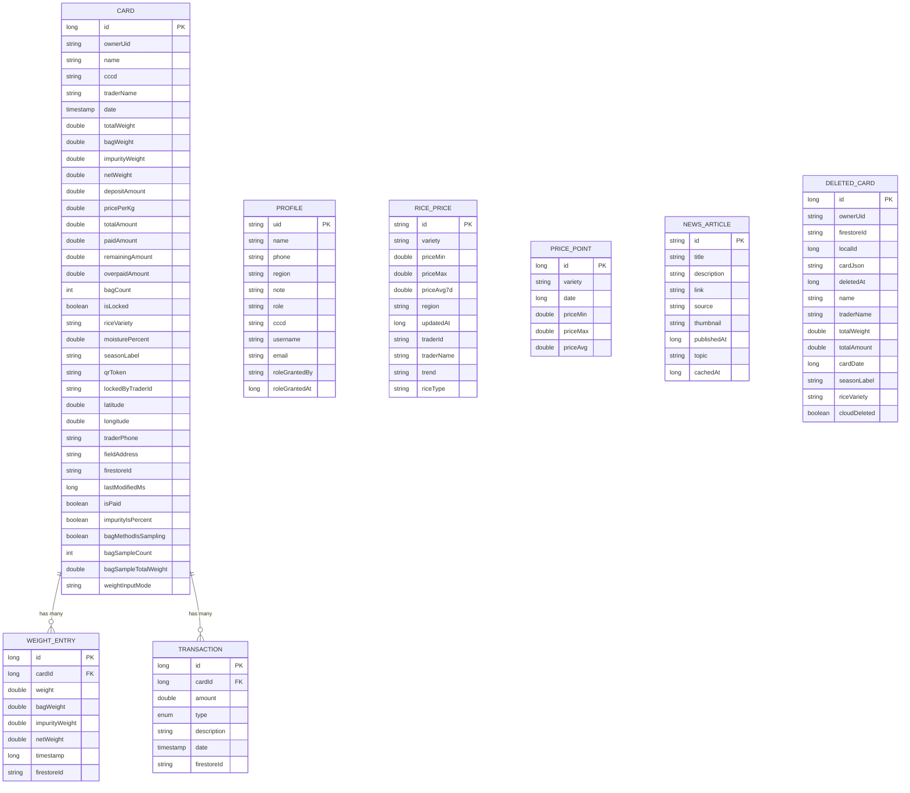
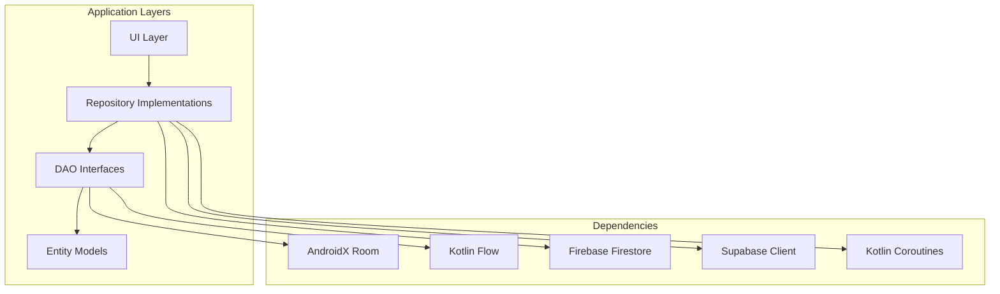

# Data Layer

<cite>
**Referenced Files in This Document**
- [AppDatabase.kt](file://app/src/main/java/com/giathinh/canlua/data/database/AppDatabase.kt)
- [Card.kt](file://app/src/main/java/com/giathinh/canlua/data/model/Card.kt)
- [WeightEntry.kt](file://app/src/main/java/com/giathinh/canlua/data/model/WeightEntry.kt)
- [Transaction.kt](file://app/src/main/java/com/giathinh/canlua/data/model/Transaction.kt)
- [Profile.kt](file://app/src/main/java/com/giathinh/canlua/data/model/Profile.kt)
- [RicePrice.kt](file://app/src/main/java/com/giathinh/canlua/data/model/RicePrice.kt)
- [DeletedCard.kt](file://app/src/main/java/com/giathinh/canlua/data/model/DeletedCard.kt)
- [NewsArticle.kt](file://app/src/main/java/com/giathinh/canlua/data/model/NewsArticle.kt)
- [CardDao.kt](file://app/src/main/java/com/giathinh/canlua/data/dao/CardDao.kt)
- [WeightEntryDao.kt](file://app/src/main/java/com/giathinh/canlua/data/dao/WeightEntryDao.kt)
- [TransactionDao.kt](file://app/src/main/java/com/giathinh/canlua/data/dao/TransactionDao.kt)
- [ProfileDao.kt](file://app/src/main/java/com/giathinh/canlua/data/dao/ProfileDao.kt)
- [RicePriceDao.kt](file://app/src/main/java/com/giathinh/canlua/data/dao/RicePriceDao.kt)
- [NewsArticleDao.kt](file://app/src/main/java/com/giathinh/canlua/data/dao/NewsArticleDao.kt)
- [DeletedCardDao.kt](file://app/src/main/java/com/giathinh/canlua/data/dao/DeletedCardDao.kt)
</cite>

## Table of Contents
1. Introduction
2. Project Structure
3. Core Components
4. Architecture Overview
5. Detailed Component Analysis
6. Dependency Analysis
7. Performance Considerations
8. Troubleshooting Guide
9. Conclusion

## Introduction
This document describes the data layer for Cân Lúa Mobile, an offline-first Android application built with Kotlin 2.3 and Jetpack Compose. The data layer centers on AndroidX Room 2.8.4 as the local database, with a DAO layer providing type-safe access to entities. It also documents how repositories abstract multiple data sources including the local Room database, Firebase Firestore, and Supabase, while maintaining full offline functionality and bidirectional sync.

Key design goals:
- Offline-first persistence using Room with schema versioning and explicit migrations.
- Type-safe data access through DAOs with Flow-based reactive queries.
- Repository pattern that coordinates local storage, cloud synchronization, and business rules.
- Strong per-user data isolation and conflict resolution during cross-device sync.
- Idempotent operations and tombstone-based deletion handling.

## Project Structure
The data layer is organized into clear packages:
- `data/database`: Room database definition, migration chain, and database factory.
- `data/model`: Room entity definitions and related domain models.
- `data/dao`: Type-safe DAO interfaces for each entity.
- `data/firestore`: Firestore-specific model mappings used by sync logic.
- `data/remote`: HTTP client and Supabase integration.
- `repository`: Repository implementations coordinating local and remote sources.

**Diagram sources**
- [AppDatabase.kt:24-46](file://app/src/main/java/com/giathinh/canlua/data/database/AppDatabase.kt#L24-L46)
- [Card.kt:8-106](file://app/src/main/java/com/giathinh/canlua/data/model/Card.kt#L8-L106)
- [WeightEntry.kt:7-30](file://app/src/main/java/com/giathinh/canlua/data/model/WeightEntry.kt#L7-L30)
- [Transaction.kt:8-36](file://app/src/main/java/com/giathinh/canlua/data/model/Transaction.kt#L8-L36)
- [Profile.kt:13-26](file://app/src/main/java/com/giathinh/canlua/data/model/Profile.kt#L13-L26)
- [RicePrice.kt:11-37](file://app/src/main/java/com/giathinh/canlua/data/model/RicePrice.kt#L11-L37)
- [NewsArticle.kt:11-31](file://app/src/main/java/com/giathinh/canlua/data/model/NewsArticle.kt#L11-L31)
- [DeletedCard.kt:26-53](file://app/src/main/java/com/giathinh/canlua/data/model/DeletedCard.kt#L26-L53)

**Section sources**
- [AppDatabase.kt:24-46](file://app/src/main/java/com/giathinh/canlua/data/database/AppDatabase.kt#L24-L46)

## Core Components
This section summarizes the core data components:
- Entities define the persistent schema with primary keys, foreign keys, indexes, and constraints.
- DAOs provide type-safe queries, reactive streams via Flow, and CRUD operations.
- The database class manages schema versioning and migrations from v1 to v19 (with explicit migration chain documented).
- Repositories coordinate local and remote data sources and implement offline-first strategies.

Entity overview:
- Card: Central record for rice weighing and sales, with user isolation, GPS, pricing, payment state, and per-card weigh modes.
- WeightEntry: Child records of card weigh batches with net weight calculations.
- Transaction: Financial transactions linked to cards (deposit, payment, refund).
- Profile: User profile keyed by Firebase UID with role metadata.
- RicePrice and PricePoint: Read-only market price data and historical points.
- NewsArticle: Cached news items with topic indexing.
- DeletedCard: Tombstone table for deleted cards to prevent resurrection during sync.

**Section sources**
- [Card.kt:8-106](file://app/src/main/java/com/giathinh/canlua/data/model/Card.kt#L8-L106)
- [WeightEntry.kt:7-30](file://app/src/main/java/com/giathinh/canlua/data/model/WeightEntry.kt#L7-L30)
- [Transaction.kt:8-36](file://app/src/main/java/com/giathinh/canlua/data/model/Transaction.kt#L8-L36)
- [Profile.kt:13-26](file://app/src/main/java/com/giathinh/canlua/data/model/Profile.kt#L13-L26)
- [RicePrice.kt:11-37](file://app/src/main/java/com/giathinh/canlua/data/model/RicePrice.kt#L11-L37)
- [NewsArticle.kt:11-31](file://app/src/main/java/com/giathinh/canlua/data/model/NewsArticle.kt#L11-L31)
- [DeletedCard.kt:26-53](file://app/src/main/java/com/giathinh/canlua/data/model/DeletedCard.kt#L26-L53)

## Architecture Overview
The data architecture follows MVVM + Clean Architecture principles:
- UI observes StateFlow exposed by ViewModels.
- ViewModels call Repositories for data operations.
- Repositories coordinate Room DAOs and cloud services (Firestore, Supabase).
- Room provides reactive streams via Flow for real-time updates.
- WorkManager schedules idempotent sync tasks.

**Diagram sources**
- [CardDao.kt:18-28](file://app/src/main/java/com/giathinh/canlua/data/dao/CardDao.kt#L18-L28)
- [WeightEntryDao.kt:9-24](file://app/src/main/java/com/giathinh/canlua/data/dao/WeightEntryDao.kt#L9-L24)
- [TransactionDao.kt:9-19](file://app/src/main/java/com/giathinh/canlua/data/dao/TransactionDao.kt#L9-L19)
- [ProfileDao.kt:12-24](file://app/src/main/java/com/giathinh/canlua/data/dao/ProfileDao.kt#L12-L24)
- [RicePriceDao.kt:14-33](file://app/src/main/java/com/giathinh/canlua/data/dao/RicePriceDao.kt#L14-L33)
- [NewsArticleDao.kt:14-28](file://app/src/main/java/com/giathinh/canlua/data/dao/NewsArticleDao.kt#L14-L28)
- [DeletedCardDao.kt:13-40](file://app/src/main/java/com/giathinh/canlua/data/dao/DeletedCardDao.kt#L13-L40)

## Detailed Component Analysis

### Room Schema and Migrations
The Room database defines 8 entities and maintains an explicit migration chain from version 1 to v19. Key aspects:
- Version declaration and entity list are defined in the database annotation.
- Migration objects implement incremental schema changes with SQL statements.
- Journal mode is set to WRITE_AHEAD_LOGGING for performance.

Migration highlights:
- v1→v2: Add traderName to cards.
- v2→v3: Create profiles table.
- v3→v4: Add cccd, username, email to profiles.
- v4→v5: Add rice variety, moisture, season, QR token, lockedByTraderId to cards.
- v5→v6: Create rice_prices and price_history tables.
- v6→v7: Create weather_cache table.
- v7→v8: Add latitude/longitude to cards.
- v8→v9: Create news_articles table with index.
- v9→v10: Add traderPhone and fieldAddress to cards.
- v10→v11: Drop and recreate profiles keyed by uid.
- v11→v12: Add ownerUid to cards and index for per-user isolation.
- v12→v13: Add firestoreId to cards, weight_entries, transactions for dedup.
- v13→v14: Add lastModifiedMs to cards for conflict resolution.
- v14→v15: Create deleted_cards tombstone table.
- v15→v16: Add isPaid to cards.
- v16→v17: Add per-card weigh modes (impurityIsPercent, bagMethodIsSampling, bagSampleCount, bagSampleTotalWeight, weightInputMode).
- v17→v18: Add riceType to rice_prices.
- v18→v19: Add overpaidAmount to cards.

**Diagram sources**
- [AppDatabase.kt:84-398](file://app/src/main/java/com/giathinh/canlua/data/database/AppDatabase.kt#L84-L398)

**Section sources**
- [AppDatabase.kt:24-82](file://app/src/main/java/com/giathinh/canlua/data/database/AppDatabase.kt#L24-L82)
- [AppDatabase.kt:84-398](file://app/src/main/java/com/giathinh/canlua/data/database/AppDatabase.kt#L84-L398)

### Entity Relationships and Constraints
The entities form a relational structure with clear ownership and referential integrity:
- Card is the central entity with per-user isolation via ownerUid.
- WeightEntry and Transaction are child entities linked to Card via foreign keys with CASCADE delete.
- Profile is keyed by uid for multi-account isolation.
- RicePrice and PricePoint are independent read-only market data.
- NewsArticle is cached content with topic indexing.
- DeletedCard stores tombstones for deleted cards to prevent sync resurrection.

**Diagram sources**
- [Card.kt:8-106](file://app/src/main/java/com/giathinh/canlua/data/model/Card.kt#L8-L106)
- [WeightEntry.kt:7-30](file://app/src/main/java/com/giathinh/canlua/data/model/WeightEntry.kt#L7-L30)
- [Transaction.kt:8-36](file://app/src/main/java/com/giathinh/canlua/data/model/Transaction.kt#L8-L36)
- [Profile.kt:13-26](file://app/src/main/java/com/giathinh/canlua/data/model/Profile.kt#L13-L26)
- [RicePrice.kt:11-37](file://app/src/main/java/com/giathinh/canlua/data/model/RicePrice.kt#L11-L37)
- [NewsArticle.kt:11-31](file://app/src/main/java/com/giathinh/canlua/data/model/NewsArticle.kt#L11-L31)
- [DeletedCard.kt:26-53](file://app/src/main/java/com/giathinh/canlua/data/model/DeletedCard.kt#L26-L53)

**Section sources**
- [Card.kt:8-106](file://app/src/main/java/com/giathinh/canlua/data/model/Card.kt#L8-L106)
- [WeightEntry.kt:7-30](file://app/src/main/java/com/giathinh/canlua/data/model/WeightEntry.kt#L7-L30)
- [Transaction.kt:8-36](file://app/src/main/java/com/giathinh/canlua/data/model/Transaction.kt#L8-L36)
- [Profile.kt:13-26](file://app/src/main/java/com/giathinh/canlua/data/model/Profile.kt#L13-L26)
- [RicePrice.kt:11-37](file://app/src/main/java/com/giathinh/canlua/data/model/RicePrice.kt#L11-L37)
- [NewsArticle.kt:11-31](file://app/src/main/java/com/giathinh/canlua/data/model/NewsArticle.kt#L11-L31)
- [DeletedCard.kt:26-53](file://app/src/main/java/com/giathinh/canlua/data/model/DeletedCard.kt#L26-L53)

### DAO Layer Design
DAOs provide type-safe access to the Room database with reactive Flow streams:
- CardDao: Comprehensive queries for card management, filtering, aggregation, and sync support.
- WeightEntryDao: Batch operations and totals for weigh entries.
- TransactionDao: Financial transaction management and sums.
- ProfileDao: User profile CRUD with REPLACE conflict strategy.
- RicePriceDao: Upsert and history management for market prices.
- NewsArticleDao: Topic-based observation and cleanup.
- DeletedCardDao: Tombstone management for deleted cards.

Key patterns:
- All card-related queries filter by ownerUid for per-user isolation.
- Flow-based reactive queries enable real-time UI updates.
- Bulk operations reduce database transaction overhead.
- Sync-related methods support cross-device deduplication.

```mermaid
classDiagram
class CardDao {
+getAllCards(uid) Flow<List<Card>>
+getCardById(id, uid) Card?
+insertCard(card) Long
+updateCard(card) void
+deleteCard(card) void
+deleteCardById(id, uid) void
+lockCard(cardId, traderId) void
+getCardsByRiceVariety(variety, uid) Flow<List<Card>>
+getDistinctRiceVarieties(uid) Flow<List<String>>
+getSuggestedRiceVarieties(uid) Flow<List<String>>
+getDistinctSeasons(uid) Flow<List<String>>
+getSeasonStats(season, uid) Flow<SeasonStatsRaw>
+getOverallStats(uid) Flow<SeasonStatsRaw>
+getVarietyBreakdown(season, uid) Flow<List<VarietyStat>>
+getTopTraders(season, uid) Flow<List<TraderStat>>
+getAllSeasonsComparison(uid) Flow<List<SeasonStatsWithLabel>>
+getTraderHistory(uid) Flow<List<TraderHistoryItem>>
+claimOrphanCards(uid) Int
+countOrphanCards() Int
+getByFirestoreId(fsId) Card?
+updateFirestoreId(localId, fsId) void
+getAllCardsForOwnerSync(uid) List<Card>
+countCardsSince(uid, sinceMs) Int
+findOrphanFirestoreMatch(uid, date, name, totalWeight) Card?
+getUnsyncedCards(uid) List<Card>
+countUnsyncedCards(uid) Int
}
class WeightEntryDao {
+getWeightEntriesByCardId(cardId) Flow<List<WeightEntry>>
+getWeightEntriesByCardIdSync(cardId) List<WeightEntry>
+insertWeightEntry(entry) Long
+updateWeightEntry(entry) void
+updateWeightEntries(entries) void
+deleteWeightEntry(entry) void
+deleteWeightEntriesByCardId(cardId) void
+getTotalNetWeightByCardId(cardId) Double?
+getTotalRawWeightByCardId(cardId) Double?
+getBagCountByCardId(cardId) Int
+getByFirestoreId(fsId) WeightEntry?
+updateFirestoreId(localId, fsId) void
+countUnsyncedWeightEntries() Int
}
class TransactionDao {
+getTransactionsByCardId(cardId) Flow<List<Transaction>>
+insertTransaction(transaction) Long
+updateTransaction(transaction) void
+deleteTransaction(transaction) void
+deleteTransactionsByCardId(cardId) void
+getTotalPaidAmountByCardId(cardId) Double?
+getTotalDepositAmountByCardId(cardId) Double?
+getByFirestoreId(fsId) Transaction?
+updateFirestoreId(localId, fsId) void
+countUnsyncedTransactions() Int
}
class ProfileDao {
+insert(profile) Long
+getProfileByUid(uid) Flow<Profile?>
+deleteByUid(uid) void
+getLatestProfile() Flow<Profile?>
}
class RicePriceDao {
+getAllPrices() Flow<List<RicePrice>>
+getPriceByVariety(variety) Flow<RicePrice?>
+upsertAll(prices) void
+countPrices() Int
+clear() void
+getHistory(variety, sinceMs) Flow<List<PricePoint>>
+insertHistory(points) void
+clearHistory() void
}
class NewsArticleDao {
+observeByTopic(topic, limit) Flow<List<NewsArticle>>
+upsertAll(items) void
+deleteOlderThan(cutoffMs) void
+getNewestCachedAt() Long?
+count() Int
}
class DeletedCardDao {
+insert(deletedCard) Long
+observe(uid) Flow<List<DeletedCard>>
+isTombstoned(uid, fsId) Boolean
+getByFirestoreId(uid, fsId) DeletedCard?
+getById(id) DeletedCard?
+markCloudDeleted(id) void
+getPendingCloudDeletes(uid) List<DeletedCard>
+purge(id) void
+purgeAllForOwner(uid) Int
+countForOwner(uid) Flow<Int>
}
CardDao --> Card : "CRUD"
WeightEntryDao --> WeightEntry : "CRUD"
TransactionDao --> Transaction : "CRUD"
ProfileDao --> Profile : "CRUD"
RicePriceDao --> RicePrice : "CRUD"
RicePriceDao --> PricePoint : "CRUD"
NewsArticleDao --> NewsArticle : "CRUD"
DeletedCardDao --> DeletedCard : "CRUD"
```

**Diagram sources**
- [CardDao.kt:16-293](file://app/src/main/java/com/giathinh/canlua/data/dao/CardDao.kt#L16-L293)
- [WeightEntryDao.kt:7-51](file://app/src/main/java/com/giathinh/canlua/data/dao/WeightEntryDao.kt#L7-L51)
- [TransactionDao.kt:7-40](file://app/src/main/java/com/giathinh/canlua/data/dao/TransactionDao.kt#L7-L40)
- [ProfileDao.kt:10-32](file://app/src/main/java/com/giathinh/canlua/data/dao/ProfileDao.kt#L10-L32)
- [RicePriceDao.kt:11-37](file://app/src/main/java/com/giathinh/canlua/data/dao/RicePriceDao.kt#L11-L37)
- [NewsArticleDao.kt:10-35](file://app/src/main/java/com/giathinh/canlua/data/dao/NewsArticleDao.kt#L10-L35)
- [DeletedCardDao.kt:10-53](file://app/src/main/java/com/giathinh/canlua/data/dao/DeletedCardDao.kt#L10-L53)

**Section sources**
- [CardDao.kt:16-293](file://app/src/main/java/com/giathinh/canlua/data/dao/CardDao.kt#L16-L293)
- [WeightEntryDao.kt:7-51](file://app/src/main/java/com/giathinh/canlua/data/dao/WeightEntryDao.kt#L7-L51)
- [TransactionDao.kt:7-40](file://app/src/main/java/com/giathinh/canlua/data/dao/TransactionDao.kt#L7-L40)
- [ProfileDao.kt:10-32](file://app/src/main/java/com/giathinh/canlua/data/dao/ProfileDao.kt#L10-L32)
- [RicePriceDao.kt:11-37](file://app/src/main/java/com/giathinh/canlua/data/dao/RicePriceDao.kt#L11-L37)
- [NewsArticleDao.kt:10-35](file://app/src/main/java/com/giathinh/canlua/data/dao/NewsArticleDao.kt#L10-L35)
- [DeletedCardDao.kt:10-53](file://app/src/main/java/com/giathinh/canlua/data/dao/DeletedCardDao.kt#L10-L53)

### Repository Pattern and Multi-Source Coordination
Repositories abstract data access across multiple sources:
- Local Room database for offline-first persistence.
- Firebase Firestore for cloud sync and cross-device sharing.
- Supabase for additional data services (e.g., market prices).

Key responsibilities:
- Coordinate insert/update/delete operations across local and remote sources.
- Implement idempotent operations to handle network failures gracefully.
- Manage conflict resolution using timestamps (lastModifiedMs vs syncTimestamp).
- Handle tombstone-based deletion to prevent card resurrection.
- Provide reactive StateFlow emissions to UI layers.

Offline-first strategy:
- All writes succeed locally first.
- Background sync tasks push changes to cloud when available.
- Pull operations merge remote data with local changes using conflict resolution.
- App remains fully functional without network connectivity.

**Section sources**
- [Card.kt:67-82](file://app/src/main/java/com/giathinh/canlua/data/model/Card.kt#L67-L82)
- [DeletedCard.kt:6-24](file://app/src/main/java/com/giathinh/canlua/data/model/DeletedCard.kt#L6-L24)

### Data Validation Rules and Business Constraints
Validation and constraints ensure data integrity:
- Per-user isolation enforced via ownerUid in all card queries.
- Foreign key relationships between Card and child entities (WeightEntry, Transaction).
- Primary keys define unique identifiers for all entities.
- Indexes optimize common query patterns (ownerUid, firestoreId, topic+publishedAt).
- Business rules include:
  - Impurity calculation supports both percentage and absolute weight modes.
  - Bag weight calculation supports sampling method for large batches.
  - Payment tracking includes deposit, payment, refund, and overpaid amounts.
  - Moisture percentage affects quality classification (>14% considered wet).
  - Season labeling groups cards for dashboard analytics.

Performance optimizations:
- Composite indexes for common query patterns.
- Bulk update operations to reduce transaction overhead.
- Flow-based reactive queries for efficient UI updates.
- WAL journal mode for concurrent write performance.

**Section sources**
- [Card.kt:11-18](file://app/src/main/java/com/giathinh/canlua/data/model/Card.kt#L11-L18)
- [WeightEntry.kt:7-17](file://app/src/main/java/com/giathinh/canlua/data/model/WeightEntry.kt#L7-L17)
- [Transaction.kt:8-18](file://app/src/main/java/com/giathinh/canlua/data/model/Transaction.kt#L8-L18)
- [NewsArticle.kt:11-13](file://app/src/main/java/com/giathinh/canlua/data/model/NewsArticle.kt#L11-L13)
- [CardDao.kt:201-273](file://app/src/main/java/com/giathinh/canlua/data/dao/CardDao.kt#L201-L273)

### Caching Strategies and Data Lifecycle Management
Caching and lifecycle management ensure optimal performance:
- Weather cache table stores offline weather data with expiration.
- News articles are cached with topic-based indexing and cleanup policies.
- Rice price history maintains time-series data for chart visualization.
- Tombstone table preserves deleted card data for recovery and sync consistency.

Lifecycle patterns:
- Cache entries have timestamps for expiration and cleanup.
- Background workers periodically refresh cached data.
- Cleanup operations remove stale data based on age thresholds.
- Tombstones persist until explicitly purged or cloud deletion succeeds.

**Section sources**
- [AppDatabase.kt:164-185](file://app/src/main/java/com/giathinh/canlua/data/database/AppDatabase.kt#L164-L185)
- [NewsArticleDao.kt:27-31](file://app/src/main/java/com/giathinh/canlua/data/dao/NewsArticleDao.kt#L27-L31)
- [DeletedCardDao.kt:38-40](file://app/src/main/java/com/giathinh/canlua/data/dao/DeletedCardDao.kt#L38-L40)

### Data Security and Access Control
Security measures protect sensitive data:
- Per-user data isolation prevents cross-user data leakage.
- Profile keyed by Firebase UID ensures account separation.
- Sensitive fields like CCCD (citizen ID) are stored securely in profiles.
- Role-based access control supports FARMER, TRADER, and GUEST roles.
- Data encryption can be applied at the application level for sensitive fields.

Access control mechanisms:
- All card queries filtered by ownerUid parameter.
- Profile queries use uid-based lookup instead of LIMIT 1.
- Role metadata tracks grant source and timestamp for audit purposes.

**Section sources**
- [Card.kt:23-29](file://app/src/main/java/com/giathinh/canlua/data/model/Card.kt#L23-L29)
- [Profile.kt:6-12](file://app/src/main/java/com/giathinh/canlua/data/model/Profile.kt#L6-L12)
- [CardDao.kt:11-15](file://app/src/main/java/com/giathinh/canlua/data/dao/CardDao.kt#L11-L15)
- [ProfileDao.kt:15-21](file://app/src/main/java/com/giathinh/canlua/data/dao/ProfileDao.kt#L15-L21)

## Dependency Analysis
The data layer exhibits clear dependency patterns:
- DAOs depend only on entity models.
- Repositories depend on DAOs and external services.
- Database depends on all entity classes.
- External dependencies include Room, Firestore SDK, and Supabase client.

**Diagram sources**
- [AppDatabase.kt:24-46](file://app/src/main/java/com/giathinh/canlua/data/database/AppDatabase.kt#L24-L46)
- [CardDao.kt:1-9](file://app/src/main/java/com/giathinh/canlua/data/dao/CardDao.kt#L1-L9)
- [WeightEntryDao.kt:1-5](file://app/src/main/java/com/giathinh/canlua/data/dao/WeightEntryDao.kt#L1-L5)
- [TransactionDao.kt:1-5](file://app/src/main/java/com/giathinh/canlua/data/dao/TransactionDao.kt#L1-L5)

**Section sources**
- [AppDatabase.kt:24-46](file://app/src/main/java/com/giathinh/canlua/data/database/AppDatabase.kt#L24-L46)

## Performance Considerations
Performance optimizations implemented in the data layer:
- Write-Ahead Logging (WAL) enabled for concurrent write performance.
- Strategic indexing on frequently queried columns (ownerUid, firestoreId, topic+publishedAt).
- Bulk operations reduce database transaction overhead.
- Flow-based reactive queries minimize unnecessary recomputation.
- Composite queries aggregate data at the database level rather than in memory.
- Cache tables store expensive-to-compute data with expiration policies.

Query optimization techniques:
- Use of DISTINCT and GROUP BY for efficient aggregation.
- LIMIT clauses to restrict result sets.
- Indexed lookups for firestoreId-based deduplication.
- Efficient date range queries for premium quota checks.

**Section sources**
- [AppDatabase.kt:77](file://app/src/main/java/com/giathinh/canlua/data/database/AppDatabase.kt#L77)
- [CardDao.kt:42-55](file://app/src/main/java/com/giathinh/canlua/data/dao/CardDao.kt#L42-L55)
- [WeightEntryDao.kt:21-24](file://app/src/main/java/com/giathinh/canlua/data/dao/WeightEntryDao.kt#L21-L24)

## Troubleshooting Guide
Common issues and resolutions:
- **Data leakage between users**: Ensure all card queries include ownerUid filter.
- **Card resurrection after deletion**: Verify tombstone table contains the deleted card's firestoreId.
- **Sync conflicts**: Check lastModifiedMs timestamps to determine which version wins.
- **Missing orphan cards**: Run claimOrphanCards migration for cards created before v12.
- **Slow queries**: Verify appropriate indexes exist for frequently queried columns.
- **Cache staleness**: Check cache expiration policies and background refresh jobs.

Debugging utilities:
- Count orphan cards to verify migration success.
- Check tombstone existence before insert operations.
- Monitor unsynced item counts for sync health.
- Validate profile queries use uid-based lookup.

**Section sources**
- [CardDao.kt:131-146](file://app/src/main/java/com/giathinh/canlua/data/dao/CardDao.kt#L131-L146)
- [DeletedCardDao.kt:20-25](file://app/src/main/java/com/giathinh/canlua/data/dao/DeletedCardDao.kt#L20-L25)
- [ProfileDao.kt:26-31](file://app/src/main/java/com/giathinh/canlua/data/dao/ProfileDao.kt#L26-L31)

## Conclusion
The Cân Lúa Mobile data layer implements a robust, offline-first architecture centered on AndroidX Room with comprehensive migration support. The DAO layer provides type-safe access with reactive streams, while repositories coordinate multiple data sources including local storage, Firebase Firestore, and Supabase. Key features include per-user data isolation, conflict resolution through timestamps, tombstone-based deletion handling, and extensive performance optimizations. The system maintains full functionality without network connectivity while supporting seamless cross-device synchronization when connectivity is available.