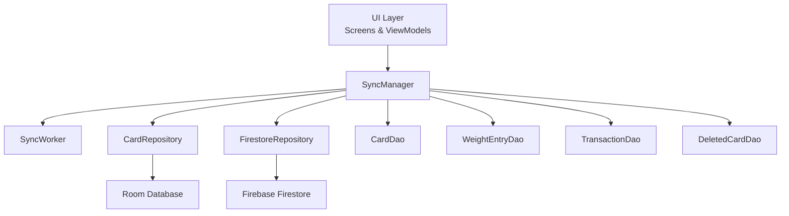
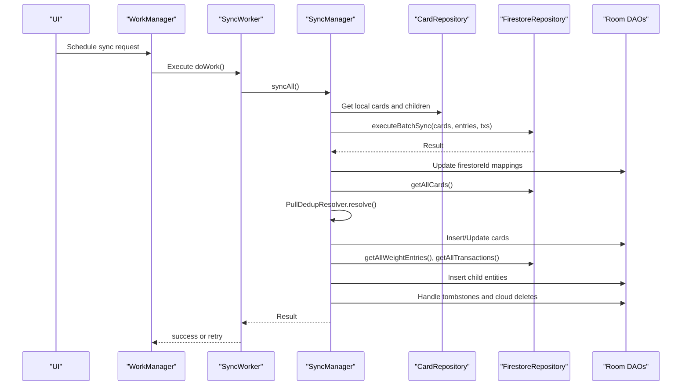
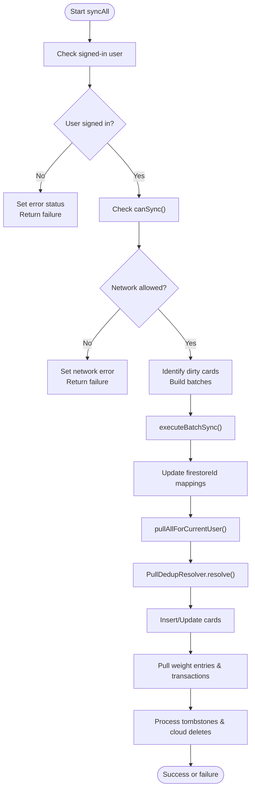
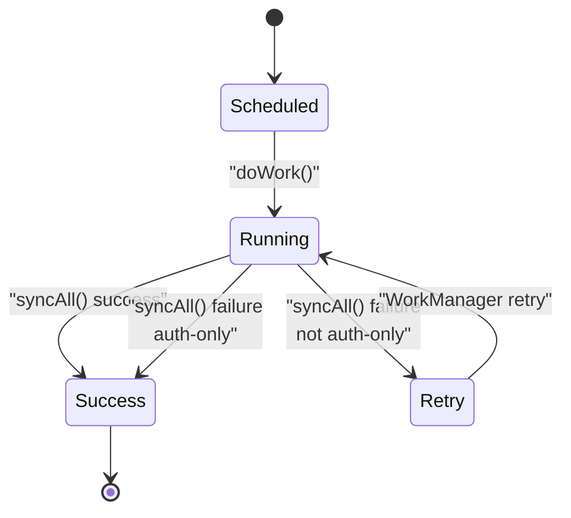
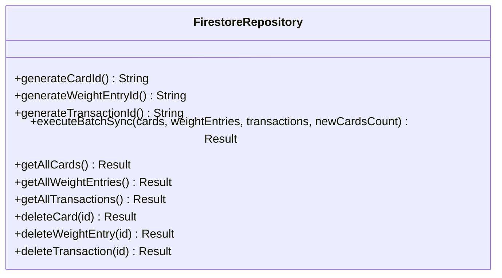
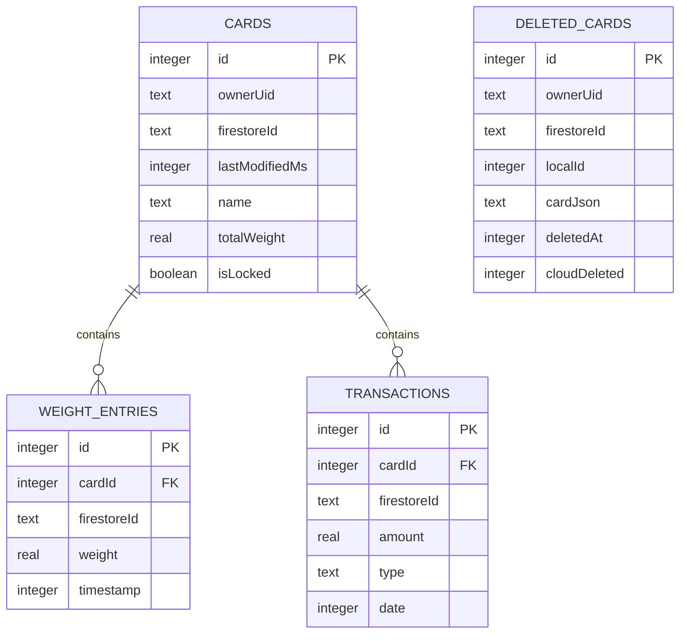
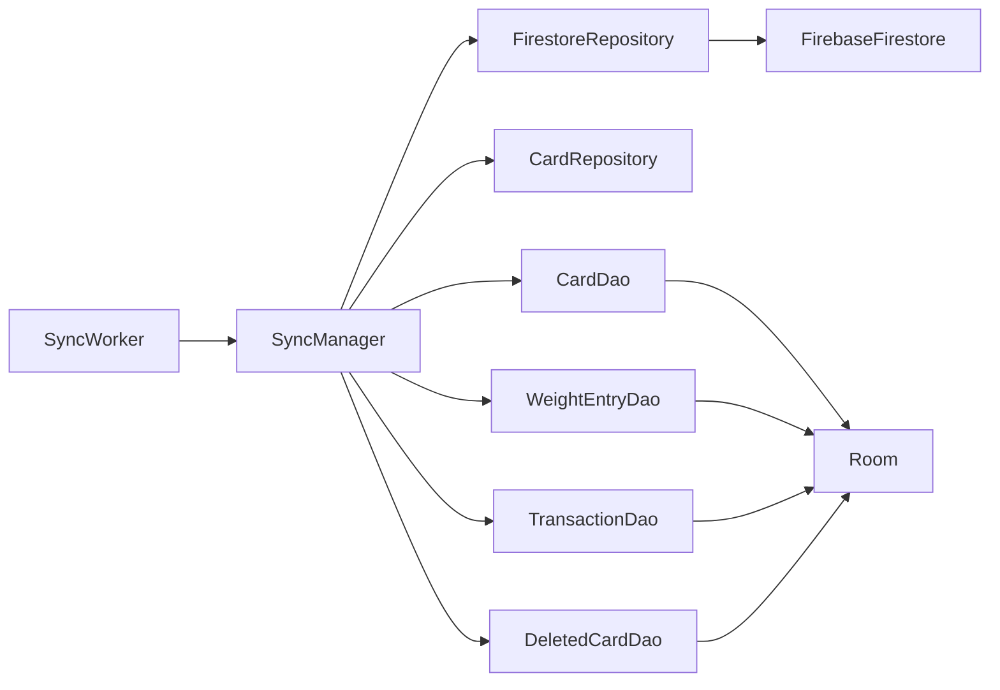

# Data Synchronization

<cite>
**Referenced Files in This Document**   
- [SyncManager.kt](file://app/src/main/java/com/giathinh/canlua/repository/SyncManager.kt)
- [SyncWorker.kt](file://app/src/main/java/com/giathinh/canlua/repository/SyncWorker.kt)
- [PullDedupResolver.kt](file://app/src/main/java/com/giathinh/canlua/repository/PullDedupResolver.kt)
- [FirestoreRepository.kt](file://app/src/main/java/com/giathinh/canlua/repository/FirestoreRepository.kt)
- [AppDatabase.kt](file://app/src/main/java/com/giathinh/canlua/data/database/AppDatabase.kt)
- [CardDao.kt](file://app/src/main/java/com/giathinh/canlua/data/dao/CardDao.kt)
- [DeletedCardDao.kt](file://app/src/main/java/com/giathinh/canlua/data/dao/DeletedCardDao.kt)
- [TransactionDao.kt](file://app/src/main/java/com/giathinh/canlua/data/dao/TransactionDao.kt)
- [WeightEntryDao.kt](file://app/src/main/java/com/giathinh/canlua/data/dao/WeightEntryDao.kt)
- [Card.kt](file://app/src/main/java/com/giathinh/canlua/data/model/Card.kt)
- [FirestoreCard.kt](file://app/src/main/java/com/giathinh/canlua/data/firestore/FirestoreCard.kt)
- [FirestoreTransaction.kt](file://app/src/main/java/com/giathinh/canlua/data/firestore/FirestoreTransaction.kt)
- [FirestoreWeightEntry.kt](file://app/src/main/java/com/giathinh/canlua/data/firestore/FirestoreWeightEntry.kt)
</cite>

## Table of Contents
1. [Introduction](#introduction)
2. [Project Structure](#project-structure)
3. [Core Components](#core-components)
4. [Architecture Overview](#architecture-overview)
5. [Detailed Component Analysis](#detailed-component-analysis)
6. [Dependency Analysis](#dependency-analysis)
7. [Performance Considerations](#performance-considerations)
8. [Troubleshooting Guide](#troubleshooting-guide)
9. [Conclusion](#conclusion)

## Introduction
This document explains the bidirectional synchronization system used by Cân Lúa Mobile to keep local Room data consistent with cloud backends while preserving full offline functionality. The app is an offline-first Android application built with Kotlin, Jetpack Compose, MVVM, and Clean Architecture. Local persistence uses AndroidX Room; background sync is scheduled idempotently through WorkManager. The current implementation documents a Firestore-backed bidirectional sync path that includes push of local changes, pull of remote changes, deduplication via `firestoreId`, timestamp-based conflict resolution using `lastModifiedMs`, and a tombstone system for soft deletes. Supabase is part of the broader project architecture but is not directly involved in the core sync flow analyzed here.

The synchronization design ensures:
- The app remains fully usable without network connectivity.
- Background sync runs only when allowed by user settings and device constraints.
- Duplicate records are prevented during pull operations.
- Conflicts between local and cloud edits are resolved deterministically.
- Soft deletes propagate across devices through a tombstone mechanism.
- Retry and error recovery patterns avoid infinite loops and preserve user data integrity.

## Project Structure
The synchronization logic spans repository, DAO, database, model, and worker layers:



**Diagram sources**
- [SyncManager.kt:36-130](file://app/src/main/java/com/giathinh/canlua/repository/SyncManager.kt#L36-L130)
- [SyncWorker.kt:10-30](file://app/src/main/java/com/giathinh/canlua/repository/SyncWorker.kt#L10-L30)
- [FirestoreRepository.kt:21-85](file://app/src/main/java/com/giathinh/canlua/repository/FirestoreRepository.kt#L21-L85)
- [CardDao.kt:148-198](file://app/src/main/java/com/giathinh/canlua/data/dao/CardDao.kt#L148-L198)
- [DeletedCardDao.kt:10-40](file://app/src/main/java/com/giathinh/canlua/data/dao/DeletedCardDao.kt#L10-L40)

**Section sources**
- [SyncManager.kt:36-130](file://app/src/main/java/com/giathinh/canlua/repository/SyncManager.kt#L36-L130)
- [FirestoreRepository.kt:21-85](file://app/src/main/java/com/giathinh/canlua/repository/FirestoreRepository.kt#L21-L85)
- [AppDatabase.kt:24-46](file://app/src/main/java/com/giathinh/canlua/data/database/AppDatabase.kt#L24-L46)

## Core Components
The synchronization system is centered around these components:

| Component | Responsibility | Key Behavior |
|---|---|---|
| SyncManager | Orchestrates bidirectional sync, scheduling, status, and mapping | Pushes dirty cards, weight entries, and transactions; pulls remote cards and children; applies dedup and tombstones; updates last sync time |
| SyncWorker | Background execution wrapper | Runs SyncManager.syncAll() and handles retry logic |
| PullDedupResolver | Pure decision logic for pull deduplication | Chooses Insert, Update, or Skip based on firestoreId match and lastModifiedMs comparison |
| FirestoreRepository | Cloud I/O abstraction | Batch writes, reads, deletes, and realtime observation for Firestore collections |
| Room DAOs | Local persistence access | Provide per-user isolation, firestoreId mapping, unsynced counts, orphan matching, and tombstone queries |
| AppDatabase | Room schema and migrations | Defines entities, indexes, and migration chain including sync-related fields |
| Models | Domain and cloud representations | Carry firestoreId, lastModifiedMs, userId, and syncTimestamp where applicable |

**Section sources**
- [SyncManager.kt:36-557](file://app/src/main/java/com/giathinh/canlua/repository/SyncManager.kt#L36-L557)
- [SyncWorker.kt:10-30](file://app/src/main/java/com/giathinh/canlua/repository/SyncWorker.kt#L10-L30)
- [PullDedupResolver.kt:21-73](file://app/src/main/java/com/giathinh/canlua/repository/PullDedupResolver.kt#L21-L73)
- [FirestoreRepository.kt:21-357](file://app/src/main/java/com/giathinh/canlua/repository/FirestoreRepository.kt#L21-L357)
- [CardDao.kt:148-198](file://app/src/main/java/com/giathinh/canlua/data/dao/CardDao.kt#L148-L198)
- [DeletedCardDao.kt:10-40](file://app/src/main/java/com/giathinh/canlua/data/dao/DeletedCardDao.kt#L10-L40)
- [AppDatabase.kt:24-46](file://app/src/main/java/com/giathinh/canlua/data/database/AppDatabase.kt#L24-L46)

## Architecture Overview
The sync architecture follows an offline-first pattern:

1. User actions modify local Room data immediately.
2. Changes are marked as pending for sync.
3. WorkManager schedules SyncWorker under network constraints.
4. SyncWorker calls SyncManager.syncAll().
5. SyncManager pushes dirty local data to Firestore in batches.
6. After push, SyncManager pulls all cards from Firestore.
7. Pull deduplication decides whether to insert, update, or skip each card.
8. Child entities (weight entries and transactions) are synced after parent cards.
9. Tombstones prevent re-insertion of deleted cards and coordinate cloud deletion.
10. Success updates last sync time and pending state; errors log analytics and may retry.



**Diagram sources**
- [SyncWorker.kt:17-29](file://app/src/main/java/com/giathinh/canlua/repository/SyncWorker.kt#L17-L29)
- [SyncManager.kt:139-310](file://app/src/main/java/com/giathinh/canlua/repository/SyncManager.kt#L139-L310)
- [FirestoreRepository.kt:45-85](file://app/src/main/java/com/giathinh/canlua/repository/FirestoreRepository.kt#L45-L85)
- [PullDedupResolver.kt:45-73](file://app/src/main/java/com/giathinh/canlua/repository/PullDedupResolver.kt#L45-L73)

## Detailed Component Analysis

### SyncManager: Bidirectional Sync Orchestrator
SyncManager coordinates the complete sync lifecycle:

- **Scheduling:** Creates a unique WorkManager job named `sync-immediate` with exponential backoff and network constraints. It respects auto-sync settings and Wi-Fi-only preferences.
- **Online checks:** Uses ConnectivityManager to determine general internet connectivity and Wi-Fi/metered transport.
- **Pending state detection:** Counts unsynced cards, weight entries, transactions, and pending cloud deletes to expose `hasPendingSyncData`.
- **Push phase:** Identifies dirty cards by missing `firestoreId`, missing cloud match, or newer local `lastModifiedMs`. Batches up to ~400 operations before committing to Firestore.
- **Mapping update:** After successful batch commit, maps local Room ids to Firestore ids for cards, weight entries, and transactions.
- **Pull phase:** Fetches all cards, groups weight entries and transactions by card, applies tombstone filtering, resolves deduplication, inserts or updates cards, then inserts child entities.
- **Tombstone handling:** Processes pending cloud deletes by deleting related weight entries and transactions, deleting the card, and marking tombstones as cloud-deleted.
- **Status and analytics:** Updates `SyncStatus`, last sync time, pending state, and logs success/failure metrics.



**Diagram sources**
- [SyncManager.kt:139-310](file://app/src/main/java/com/giathinh/canlua/repository/SyncManager.kt#L139-L310)
- [SyncManager.kt:313-412](file://app/src/main/java/com/giathinh/canlua/repository/SyncManager.kt#L313-L412)

**Section sources**
- [SyncManager.kt:58-130](file://app/src/main/java/com/giathinh/canlua/repository/SyncManager.kt#L58-L130)
- [SyncManager.kt:139-310](file://app/src/main/java/com/giathinh/canlua/repository/SyncManager.kt#L139-L310)
- [SyncManager.kt:313-412](file://app/src/main/java/com/giathinh/canlua/repository/SyncManager.kt#L313-L412)

### SyncWorker: Background Execution and Retry Policy
SyncWorker is a Hilt-injected CoroutineWorker that delegates work to SyncManager:

- Executes `syncAll()` inside `doWork()`.
- Returns `Result.success()` on success.
- Treats “no user signed in” as a non-retryable condition to avoid retry loops.
- For other failures, returns `Result.retry()` so WorkManager applies its configured backoff policy.



**Diagram sources**
- [SyncWorker.kt:17-29](file://app/src/main/java/com/giathinh/canlua/repository/SyncWorker.kt#L17-L29)

**Section sources**
- [SyncWorker.kt:10-30](file://app/src/main/java/com/giathinh/canlua/repository/SyncWorker.kt#L10-L30)

### PullDedupResolver: Idempotent Pull Decision Logic
PullDedupResolver is a pure object that determines how to handle a pulled Firestore card:

- **Case 1 — firestoreId match:** If a local card exists with the same `firestoreId`, compare `lastModifiedMs`. If cloud is newer, return Update; otherwise return Skip to preserve local edits.
- **Case 2 — composite key match:** If no firestoreId match, try matching by ownerUid, date, name, and totalWeight. This supports legacy cards created before v13 sync. Return Update and stamp the firestoreId.
- **Case 3 — new card:** If neither match exists, return Insert.

```mermaid
flowchart TD
Start([resolve(fsCard)]) --> BlankId{"fsCard.id blank?"}
BlankId --> |Yes| SkipBlank["Skip(blank_firestore_id)"]
BlankId --> |No| FsMatch{"Local by firestoreId?"}
FsMatch --> |Yes| Compare["cloudNewer = fsCard.lastModifiedMs > local.lastModifiedMs"]
Compare --> Newer{"Cloud newer?"}
Newer --> |Yes| UpdateFs["Update(localId, reason=FIRESTORE_ID_MATCH_NEWER)"]
Newer --> |No| SkipLocal["Skip(local_newer_or_equal)"]
FsMatch --> |No| Composite["byCompositeKey()"]
Composite --> Found{"Orphan found?"}
Found --> |Yes| UpdateComp["Update(localId, reason=COMPOSITE_KEY_MATCH)"]
Found --> |No| Insert["Insert(fsCard)"]
```

**Diagram sources**
- [PullDedupResolver.kt:45-73](file://app/src/main/java/com/giathinh/canlua/repository/PullDedupResolver.kt#L45-L73)

**Section sources**
- [PullDedupResolver.kt:21-73](file://app/src/main/java/com/giathinh/canlua/repository/PullDedupResolver.kt#L21-L73)

### FirestoreRepository: Cloud Abstraction and Batch Writes
FirestoreRepository provides the cloud interface for sync:

- Generates Firestore document ids for cards, weight entries, and transactions.
- Performs batch writes with `userId` and `syncTimestamp` metadata.
- Increments profile `cardCount` when new cards are pushed.
- Provides read methods for all cards, weight entries, and transactions.
- Supports delete operations for cards, weight entries, and transactions.
- Includes realtime observation flows for trader-related cards and transactions.



**Diagram sources**
- [FirestoreRepository.kt:41-85](file://app/src/main/java/com/giathinh/canlua/repository/FirestoreRepository.kt#L41-L85)
- [FirestoreRepository.kt:121-142](file://app/src/main/java/com/giathinh/canlua/repository/FirestoreRepository.kt#L121-L142)
- [FirestoreRepository.kt:189-261](file://app/src/main/java/com/giathinh/canlua/repository/FirestoreRepository.kt#L189-L261)

**Section sources**
- [FirestoreRepository.kt:21-85](file://app/src/main/java/com/giathinh/canlua/repository/FirestoreRepository.kt#L21-L85)
- [FirestoreRepository.kt:121-142](file://app/src/main/java/com/giathinh/canlua/repository/FirestoreRepository.kt#L121-L142)
- [FirestoreRepository.kt:189-261](file://app/src/main/java/com/giathinh/canlua/repository/FirestoreRepository.kt#L189-L261)

### Room Schema and Migration Chain
AppDatabase defines the persistent layer used by sync:

- Entities include cards, weight entries, transactions, profiles, rice prices, price points, news articles, and deleted cards.
- Version 19 includes explicit migration steps covering per-user isolation, cross-device sync fields, conflict resolution timestamps, tombstone table, and additional card fields.
- Critical sync-related migrations:
  - v12→v13 adds `firestoreId` columns and indexes for deduplication.
  - v13→v14 adds `lastModifiedMs` for timestamp-based conflict resolution.
  - v14→v15 creates `deleted_cards` tombstone table for soft deletes.



**Diagram sources**
- [AppDatabase.kt:24-46](file://app/src/main/java/com/giathinh/canlua/data/database/AppDatabase.kt#L24-L46)
- [AppDatabase.kt:288-349](file://app/src/main/java/com/giathinh/canlua/data/database/AppDatabase.kt#L288-L349)

**Section sources**
- [AppDatabase.kt:24-46](file://app/src/main/java/com/giathinh/canlua/data/database/AppDatabase.kt#L24-L46)
- [AppDatabase.kt:288-349](file://app/src/main/java/com/giathinh/canlua/data/database/AppDatabase.kt#L288-L349)

### DAOs: Local Persistence Contracts
DAOs provide the local data access surface required by sync:

- **CardDao:** Per-user card queries, firestoreId lookup and stamping, unsynced card counting, orphan matching by composite key.
- **WeightEntryDao:** firestoreId lookup and stamping, unsynced entry counting.
- **TransactionDao:** firestoreId lookup and stamping, unsynced transaction counting.
- **DeletedCardDao:** tombstone insertion, tombstoned check, pending cloud delete listing, cloud-deleted marking, purge operations.

**Section sources**
- [CardDao.kt:148-198](file://app/src/main/java/com/giathinh/canlua/data/dao/CardDao.kt#L148-L198)
- [WeightEntryDao.kt:43-49](file://app/src/main/java/com/giathinh/canlua/data/dao/WeightEntryDao.kt#L43-L49)
- [TransactionDao.kt:32-38](file://app/src/main/java/com/giathinh/canlua/data/dao/TransactionDao.kt#L32-L38)
- [DeletedCardDao.kt:10-40](file://app/src/main/java/com/giathinh/canlua/data/dao/DeletedCardDao.kt#L10-L40)

### Models: Identity and Conflict Fields
Models carry the identity and conflict-resolution fields used by sync:

- **Card:** Contains `firestoreId` for cross-device deduplication and `lastModifiedMs` for conflict resolution.
- **FirestoreCard / FirestoreTransaction / FirestoreWeightEntry:** Include `userId` and `syncTimestamp` metadata written to Firestore during sync.

**Section sources**
- [Card.kt:70-82](file://app/src/main/java/com/giathinh/canlua/data/model/Card.kt#L70-L82)
- [FirestoreTransaction.kt:18-18](file://app/src/main/java/com/giathinh/canlua/data/firestore/FirestoreTransaction.kt#L18-L18)
- [FirestoreWeightEntry.kt:18-18](file://app/src/main/java/com/giathinh/canlua/data/firestore/FirestoreWeightEntry.kt#L18-L18)

## Dependency Analysis
The sync system has clear layering and dependency direction:



**Diagram sources**
- [SyncWorker.kt:10-15](file://app/src/main/java/com/giathinh/canlua/repository/SyncWorker.kt#L10-L15)
- [SyncManager.kt:36-45](file://app/src/main/java/com/giathinh/canlua/repository/SyncManager.kt#L36-L45)
- [FirestoreRepository.kt:21-25](file://app/src/main/java/com/giathinh/canlua/repository/FirestoreRepository.kt#L21-L25)

Key observations:
- SyncWorker depends only on SyncManager.
- SyncManager depends on both local DAOs and cloud repository.
- FirestoreRepository abstracts Firebase Firestore.
- DAOs depend on Room and models.
- PullDedupResolver is decoupled from runtime dependencies and can be tested purely.

**Section sources**
- [SyncWorker.kt:10-15](file://app/src/main/java/com/giathinh/canlua/repository/SyncWorker.kt#L10-L15)
- [SyncManager.kt:36-45](file://app/src/main/java/com/giathinh/canlua/repository/SyncManager.kt#L36-L45)
- [FirestoreRepository.kt:21-25](file://app/src/main/java/com/giathinh/canlua/repository/FirestoreRepository.kt#L21-L25)

## Performance Considerations
The sync implementation includes several performance-oriented patterns:

- **Batched cloud writes:** SyncManager groups cards, weight entries, and transactions into batches capped at approximately 400 operations before calling FirestoreRepository.executeBatchSync. This reduces network round trips and Firestore write overhead.
- **Client-side sorting:** FirestoreRepository avoids server-side ordering that would require composite indexes. Instead, it sorts weight entries and transactions client-side, which is acceptable given typical dataset sizes per card.
- **Unique work scheduling:** WorkManager.enqueueUniqueWork prevents duplicate sync jobs from accumulating when multiple changes occur rapidly.
- **Exponential backoff:** BackoffPolicy.EXPONENTIAL with a 30-second initial delay helps reduce retry storms and battery drain.
- **Per-user isolation:** DAO queries filter by ownerUid, reducing scan scope and improving query performance.
- **Indexes:** FirestoreId and ownerUid indexes support fast deduplication and per-user queries.
- **Selective pull:** Tombstone checks skip deleted cards early, avoiding unnecessary insert/update work.
- **Analytics and observability:** Success and failure paths log duration and card counts, enabling monitoring of sync performance over time.

Recommendations for large datasets:
- Monitor batch size thresholds if card count grows significantly.
- Consider pagination or incremental sync tokens if Firestore collection size becomes large.
- Use WorkManager constraints such as UNMETERED for Wi-Fi-only sync to conserve mobile data and battery.
- Avoid frequent manual triggers; rely on automatic scheduling and pending-state checks.

[No sources needed since this section provides general guidance]

## Troubleshooting Guide
Common sync issues and their handling:

| Symptom | Likely Cause | Resolution Path |
|---|---|---|
| Sync never starts | Auto-sync disabled or user not signed in | Verify settingsRepository.isAutoSyncEnabled() and FirebaseAuth.currentUser |
| Sync fails due to network | Not connected or Wi-Fi-only setting active | Check canSync() and isWifiConnected(); adjust user preference |
| Duplicate cards appear after logout/login | Legacy cards without firestoreId | PullDedupResolver composite-key match stamps firestoreId and updates existing row |
| Local edits disappear after pull | Cloud version considered newer | Ensure lastModifiedMs is updated on local edits; verify PullDedupResolver comparison |
| Deleted cards reappear | Tombstone not applied or cloud delete not propagated | Check deleted_cards tombstone and pending cloud deletes; ensure markCloudDeleted is called |
| Retry loop after sign-out | Non-auth error treated as retryable | SyncWorker treats “no user signed in” as success to stop retries |
| Slow sync with many cards | Large batch or heavy network usage | Review batch size, network constraints, and analytics logs |

**Section sources**
- [SyncManager.kt:139-154](file://app/src/main/java/com/giathinh/canlua/repository/SyncManager.kt#L139-L154)
- [SyncManager.kt:313-321](file://app/src/main/java/com/giathinh/canlua/repository/SyncManager.kt#L313-L321)
- [PullDedupResolver.kt:55-68](file://app/src/main/java/com/giathinh/canlua/repository/PullDedupResolver.kt#L55-L68)
- [SyncWorker.kt:22-28](file://app/src/main/java/com/giathinh/canlua/repository/SyncWorker.kt#L22-L28)

## Conclusion
Cân Lúa Mobile’s synchronization system implements a robust offline-first design with WorkManager-driven background sync, Firestore-backed bidirectional data flow, idempotent pull deduplication, timestamp-based conflict resolution, and a tombstone system for soft deletes. SyncManager orchestrates push and pull phases, FirestoreRepository abstracts cloud operations, and Room DAOs enforce per-user isolation and identity mapping. PullDedupResolver provides deterministic behavior for merge decisions, while SyncWorker ensures resilient retry semantics. Together, these components maintain data consistency across devices while keeping the app fully functional without network connectivity.

[No sources needed since this section summarizes without analyzing specific files]