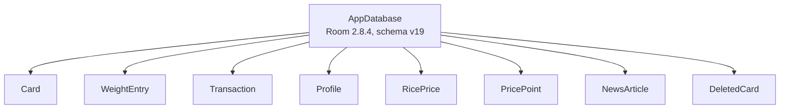
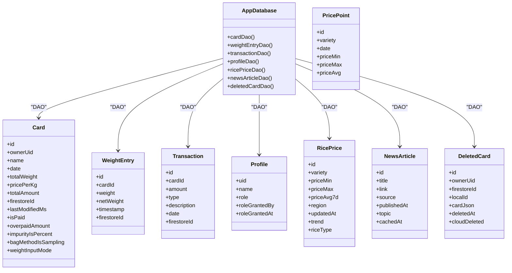
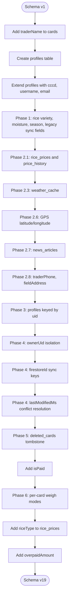
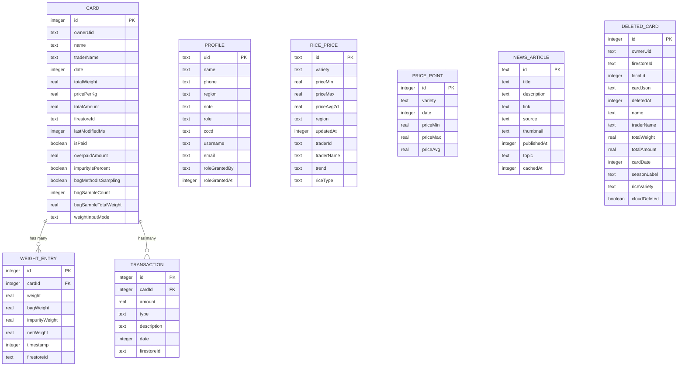
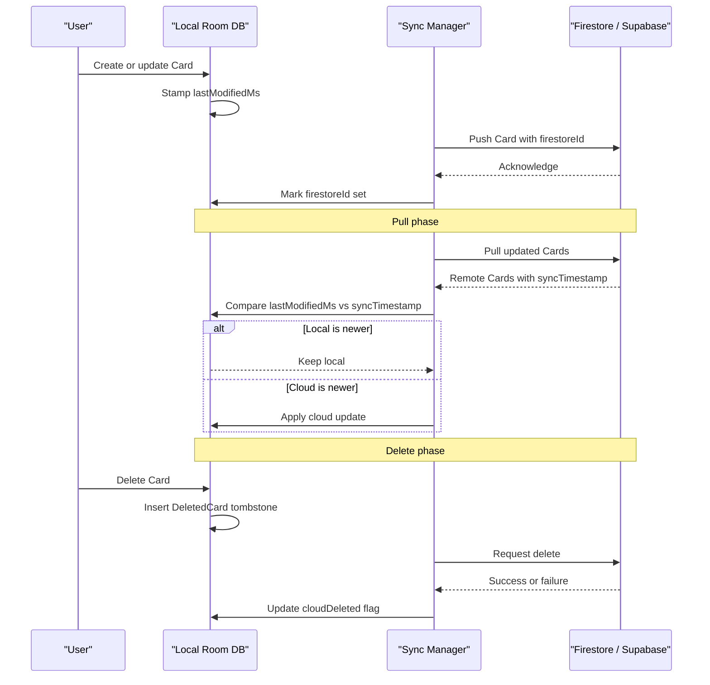

# Database Schema & Migrations

<cite>
**Referenced Files in This Document**
- [AppDatabase.kt](file://app/src/main/java/com/giathinh/canlua/data/database/AppDatabase.kt)
- [Card.kt](file://app/src/main/java/com/giathinh/canlua/data/model/Card.kt)
- [WeightEntry.kt](file://app/src/main/java/com/giathinh/canlua/data/model/WeightEntry.kt)
- [Transaction.kt](file://app/src/main/java/com/giathinh/canlua/data/model/Transaction.kt)
- [Profile.kt](file://app/src/main/java/com/giathinh/canlua/data/model/Profile.kt)
- [RicePrice.kt](file://app/src/main/java/com/giathinh/canlua/data/model/RicePrice.kt)
- [NewsArticle.kt](file://app/src/main/java/com/giathinh/canlua/data/model/NewsArticle.kt)
- [DeletedCard.kt](file://app/src/main/java/com/giathinh/canlua/data/model/DeletedCard.kt)
</cite>

## Table of Contents
1. [Introduction](#introduction)
2. [Project Structure](#project-structure)
3. [Core Components](#core-components)
4. [Architecture Overview](#architecture-overview)
5. [Detailed Component Analysis](#detailed-component-analysis)
6. [Migration Chain v1 → v19](#migration-chain-v1--v19)
7. [Dependency Analysis](#dependency-analysis)
8. [Performance Considerations](#performance-considerations)
9. [Data Integrity Rules](#data-integrity-rules)
10. [Offline-First Architecture Implications](#offline-first-architecture-implications)
11. [Troubleshooting Guide](#troubleshooting-guide)
12. [Conclusion](#conclusion)

## Introduction
This document describes the AndroidX Room 2.8.4 database schema and migration history for Cân Lúa Mobile. The current schema is version 19 and contains eight entities: `Card`, `WeightEntry`, `Transaction`, `Profile`, `RicePrice`, `PricePoint`, `NewsArticle`, and `DeletedCard`. The database supports an offline-first, MVVM + Clean Architecture design with bidirectional sync to Firebase Firestore and Supabase, while remaining fully functional without network access.

The schema evolved through a deliberate migration chain from version 1 to 19, adding per-user data isolation, cross-device deduplication, conflict resolution timestamps, deleted-card tombstones, per-card weighing modes, payment overpayment tracking, and market price metadata.

## Project Structure
The Room layer is centered on `AppDatabase`, which declares all entities, exposes DAOs, configures type converters, and registers the complete migration chain. Each entity lives under `data.model` and maps directly to a Room table.

**Diagram sources**
- [AppDatabase.kt:24-46](file://app/src/main/java/com/giathinh/canlua/data/database/AppDatabase.kt#L24-L46)

**Section sources**
- [AppDatabase.kt:24-46](file://app/src/main/java/com/giathinh/canlua/data/database/AppDatabase.kt#L24-L46)

## Core Components
The database stores user-owned agricultural card records, their weight entries and financial transactions, user profiles keyed by Firebase UID, rice market prices and historical price points, cached news articles, and tombstone records for deleted cards.

Key responsibilities:
- `Card`: central business record for a rice weighing session, including weights, pricing, ownership, location, sync identifiers, conflict timestamp, payment state, and per-card weighing configuration.
- `WeightEntry`: child line items attached to a card, representing individual weighings or bag-level measurements.
- `Transaction`: financial events linked to a card, such as deposit, payment, or refund.
- `Profile`: per-Firebase-UID user profile with role metadata.
- `RicePrice`: current rice variety pricing snapshot.
- `PricePoint`: daily historical price point used for charts.
- `NewsArticle`: cached RSS-derived agricultural news.
- `DeletedCard`: tombstone preserving deleted card snapshots and enabling safe offline-first sync.

**Section sources**
- [Card.kt:8-106](file://app/src/main/java/com/giathinh/canlua/data/model/Card.kt#L8-L106)
- [WeightEntry.kt:7-30](file://app/src/main/java/com/giathinh/canlua/data/model/WeightEntry.kt#L7-L30)
- [Transaction.kt:8-36](file://app/src/main/java/com/giathinh/canlua/data/model/Transaction.kt#L8-L36)
- [Profile.kt:13-26](file://app/src/main/java/com/giathinh/canlua/data/model/Profile.kt#L13-L26)
- [RicePrice.kt:11-37](file://app/src/main/java/com/giathinh/canlua/data/model/RicePrice.kt#L11-L37)
- [NewsArticle.kt:11-31](file://app/src/main/java/com/giathinh/canlua/data/model/NewsArticle.kt#L11-L31)
- [DeletedCard.kt:26-53](file://app/src/main/java/com/giathinh/canlua/data/model/DeletedCard.kt#L26-L53)

## Architecture Overview
At runtime, `AppDatabase` provides DAO accessors for each domain area. The database uses write-ahead logging and a single application-scoped singleton instance. Type conversion for dates is centralized through `DateConverter`.

**Diagram sources**
- [AppDatabase.kt:24-46](file://app/src/main/java/com/giathinh/canlua/data/database/AppDatabase.kt#L24-L46)
- [Card.kt:8-106](file://app/src/main/java/com/giathinh/canlua/data/model/Card.kt#L8-L106)
- [WeightEntry.kt:7-30](file://app/src/main/java/com/giathinh/canlua/data/model/WeightEntry.kt#L7-L30)
- [Transaction.kt:8-36](file://app/src/main/java/com/giathinh/canlua/data/model/Transaction.kt#L8-L36)
- [Profile.kt:13-26](file://app/src/main/java/com/giathinh/canlua/data/model/Profile.kt#L13-L26)
- [RicePrice.kt:11-37](file://app/src/main/java/com/giathinh/canlua/data/model/RicePrice.kt#L11-L37)
- [NewsArticle.kt:11-31](file://app/src/main/java/com/giathinh/canlua/data/model/NewsArticle.kt#L11-L31)
- [DeletedCard.kt:26-53](file://app/src/main/java/com/giathinh/canlua/data/model/DeletedCard.kt#L26-L53)

## Detailed Component Analysis

### Card Entity
`Card` is the core entity for a rice weighing session. It includes:
- Identity and ownership: auto-generated local primary key `id`, plus `ownerUid` for per-user isolation.
- Business fields: name, date, weights (`totalWeight`, `bagWeight`, `impurityWeight`, `netWeight`), pricing (`depositAmount`, `pricePerKg`, `totalAmount`, `paidAmount`, `remainingAmount`, `overpaidAmount`), bag count, and lock state.
- Agricultural metadata: rice variety, moisture percentage, season label, optional QR token, and legacy trader lock field.
- Location and contact: latitude, longitude, trader phone, and field address.
- Sync and conflict handling: nullable `firestoreId` for cross-device deduplication, `lastModifiedMs` for last-modified conflict resolution, and `isPaid` for settlement state.
- Per-card weighing configuration: impurity input mode, bag sampling method, sample count and total weight, and numeric input mode.

Indexes:
- Single-column index on `ownerUid`.
- Composite index on `(ownerUid, date)` for ordered card lists per user.
- Composite index on `(ownerUid, riceVariety)` for variety-based queries and suggestions.

Constraints and defaults:
- Primary key is auto-incrementing `id`.
- Many fields have sensible defaults so existing rows remain valid after migrations.
- Nullable fields are used where data may not yet exist (e.g., GPS, cloud IDs).

Complexity considerations:
- High read volume for owner-filtered lists makes the composite indexes important.
- Denormalized fields like `totalWeight` and `totalAmount` reduce recomputation at query time but must be kept consistent by repository logic.

**Section sources**
- [Card.kt:8-106](file://app/src/main/java/com/giathinh/canlua/data/model/Card.kt#L8-L106)

### WeightEntry Entity
`WeightEntry` represents individual weight measurements tied to a card.

Relationships:
- Foreign key to `Card.id` with cascade delete, ensuring child entries disappear when a card is removed.
- Index on `cardId` for efficient lookup of entries belonging to a card.

Fields:
- Auto-generated primary key `id`.
- `cardId` linking to parent card.
- Measurement fields: raw weight, bag weight, impurity weight, and computed net weight.
- Timestamp for ordering and auditability.
- Nullable `firestoreId` for cross-device deduplication.

Design rationale:
- Keeping granular entries allows detailed reporting and correction of individual weigh-ins.
- Cascade deletion preserves referential integrity without manual cleanup.

**Section sources**
- [WeightEntry.kt:7-30](file://app/src/main/java/com/giathinh/canlua/data/model/WeightEntry.kt#L7-L30)

### Transaction Entity
`Transaction` records financial events associated with a card.

Relationships:
- Foreign key to `Card.id` with cascade delete.
- Index on `cardId` for fast transaction listing per card.

Fields:
- Auto-generated primary key `id`.
- `cardId` foreign key.
- Amount, typed enum `TransactionType` (deposit, payment, refund), optional description, and date.
- Nullable `firestoreId` for sync deduplication.

Design rationale:
- Typed transaction categories simplify UI and reporting.
- Storing both amount and type enables settlement reconciliation.

**Section sources**
- [Transaction.kt:8-36](file://app/src/main/java/com/giathinh/canlua/data/model/Transaction.kt#L8-L36)

### Profile Entity
`Profile` stores user account information keyed by Firebase UID.

Primary key:
- `uid` is the primary key, replacing earlier auto-increment IDs to prevent multiple accounts on one device from overwriting each other’s roles.

Fields:
- Name, phone, region, note, role, ID number, username, email.
- Role governance fields: `roleGrantedBy` and `roleGrantedAt`, supporting admin-granted roles and audit trails.

Design rationale:
- UID-keyed profiles enforce per-account isolation.
- Governance fields prepare for future admin-controlled role assignment flows.

**Section sources**
- [Profile.kt:13-26](file://app/src/main/java/com/giathinh/canlua/data/model/Profile.kt#L13-L26)

### RicePrice and PricePoint Entities
`RicePrice` represents current market price snapshots per variety, region, and trend.

Fields:
- String primary key `id`.
- Variety, min/max/7-day average price, region, update timestamp, optional trader identity, trend, and rice type.

`PricePoint` represents daily historical price data for charting.

Fields:
- Auto-generated primary key `id`.
- Variety, epoch date, min/max/average price.

Design rationale:
- Separate current snapshot and historical series support both dashboard summaries and trend charts.
- Optional trader fields allow mock data versus user-provided market data.

**Section sources**
- [RicePrice.kt:11-37](file://app/src/main/java/com/giathinh/canlua/data/model/RicePrice.kt#L11-L37)

### NewsArticle Entity
`NewsArticle` caches agricultural news fetched from RSS feeds.

Primary key:
- `id` is derived from content hashing to avoid duplicates across sources.

Fields:
- Title, description, link, source, thumbnail, publication timestamp, topic, and cache timestamp.

Index:
- Composite index on `(topic, publishedAt)` optimizes filtered and sorted news queries.

Design rationale:
- Hash-based IDs provide stable deduplication.
- Topic-indexed queries improve performance for category browsing.

**Section sources**
- [NewsArticle.kt:11-31](file://app/src/main/java/com/giathinh/canlua/data/model/NewsArticle.kt#L11-L31)

### DeletedCard Entity
`DeletedCard` is a tombstone table for soft-deleted cards.

Purpose:
- Prevents “resurrection” of deleted cards during pull sync when the cloud document still exists.
- Preserves a readable history of deleted cards and enables restoration.

Fields:
- Auto-generated primary key `id`.
- Ownership and sync keys: `ownerUid`, `firestoreId`, and old `localId`.
- Full serialized card snapshot `cardJson`.
- Deletion timestamp and denormalized display fields.
- `cloudDeleted` flag indicating whether the remote delete has succeeded.

Indexes:
- Index on `ownerUid` for per-user deleted-card lists.
- Index on `firestoreId` for fast dedup checks against cloud documents.

Design rationale:
- Tombstone strategy resolves the offline-first deletion race condition.
- Denormalized fields avoid JSON parsing overhead in list views.

**Section sources**
- [DeletedCard.kt:26-53](file://app/src/main/java/com/giathinh/canlua/data/model/DeletedCard.kt#L26-L53)

## Migration Chain v1 → v19
The database starts at version 1 and progresses to version 19. The following table summarizes each migration, its purpose, and its schema impact.

| Version | Migration | Purpose | Schema Changes |
|---|---|---|---|
| 1 → 2 | `MIGRATION_1_2` | Add trader name to cards | Adds `traderName TEXT NOT NULL DEFAULT ''` to `cards` |
| 2 → 3 | `MIGRATION_2_3` | Create profiles table | Creates `profiles` with id, name, phone, region, note, role |
| 3 → 4 | `MIGRATION_3_4` | Extend profiles | Adds `cccd`, `username`, `email` to `profiles` |
| 4 → 5 | `MIGRATION_4_5` | Phase 1: rice variety, moisture, season, legacy sync fields | Adds `riceVariety`, `moisturePercent`, `seasonLabel`, `qrToken`, `lockedByTraderId` to `cards` |
| 5 → 6 | `MIGRATION_5_6` | Phase 2.1: market module | Creates `rice_prices` and `price_history` tables |
| 6 → 7 | `MIGRATION_6_7` | Phase 2.3: offline weather cache | Creates `weather_cache` table |
| 7 → 8 | `MIGRATION_7_8` | Phase 2.6: GPS location per card | Adds `latitude`, `longitude` to `cards` |
| 8 → 9 | `MIGRATION_8_9` | Phase 2.7: news feed | Creates `news_articles` table and index on `(topic, publishedAt)` |
| 9 → 10 | `MIGRATION_9_10` | Phase 2.8: trader phone and field address | Adds `traderPhone`, `fieldAddress` to `cards` |
| 10 → 11 | `MIGRATION_10_11` | Phase 3: profile keyed by Firebase UID | Drops and recreates `profiles` with `uid` primary key and governance fields |
| 11 → 12 | `MIGRATION_11_12` | Phase 4: per-user data isolation | Adds `ownerUid` to `cards` and creates index on `ownerUid` |
| 12 → 13 | `MIGRATION_12_13` | Phase 4: cross-device sync support | Adds `firestoreId` and indexes to `cards`, `weight_entries`, `transactions` |
| 13 → 14 | `MIGRATION_13_14` | Phase 4: conflict resolution with lastModifiedMs | Adds `lastModifiedMs` to `cards` and seeds default values |
| 14 → 15 | `MIGRATION_14_15` | Phase 5: tombstone table for deleted cards | Creates `deleted_cards` table with indexes on `ownerUid` and `firestoreId` |
| 15 → 16 | `MIGRATION_15_16` | Payment state tracking | Adds `isPaid` to `cards` |
| 16 → 17 | `MIGRATION_16_17` | Phase 6: per-card weigh modes | Adds impurity percent toggle, bag sampling method, sample count/weight, and input mode to `cards` |
| 17 → 18 | `MIGRATION_17_18` | Market price metadata | Adds `riceType` to `rice_prices` |
| 18 → 19 | `MIGRATION_18_19` | Overpayment tracking | Adds `overpaidAmount` to `cards` |

Critical migrations explained:

- **Per-user data isolation (MIGRATION_11_12)**: Adds `ownerUid` to `cards` and indexes it. Cards created before this migration have empty `ownerUid` and are considered orphaned; they are later claimed by the first user who logs in after the update. All card queries filter by `ownerUid`, preventing data leakage between users on shared devices.

- **Cross-device sync support (MIGRATION_12_13)**: Adds `firestoreId` to `cards`, `weight_entries`, and `transactions`, along with indexes. This identifier is used for deduplication when pulling data onto new devices, because local auto-increment IDs differ across devices.

- **Conflict resolution with lastModifiedMs (MIGRATION_13_14)**: Adds `lastModifiedMs` to `cards` and initializes missing values. Repository logic stamps this timestamp on insert/update, and pull conflicts compare local vs cloud timestamps so newer changes win instead of blanket cloud-wins behavior.

- **Tombstone table for deleted cards (MIGRATION_14_15)**: Creates `deleted_cards` with indexes on `ownerUid` and `firestoreId`. Before deleting a card, the app writes a tombstone containing the full serialized card snapshot. During pull sync, tombstones prevent reinsertion of locally deleted cards whose cloud documents still exist.

- **Per-card weigh modes (MIGRATION_16_17)**: Adds toggles and parameters controlling how impurity, bag weight, and numeric input behave per card. Defaults preserve legacy calculation behavior so existing cards remain unaffected.

**Diagram sources**
- [AppDatabase.kt:84-398](file://app/src/main/java/com/giathinh/canlua/data/database/AppDatabase.kt#L84-L398)

**Section sources**
- [AppDatabase.kt:84-398](file://app/src/main/java/com/giathinh/canlua/data/database/AppDatabase.kt#L84-L398)

## Dependency Analysis
The strongest relational dependency is between `Card` and its children:

- `WeightEntry.cardId` references `Card.id` with cascade delete.
- `Transaction.cardId` references `Card.id` with cascade delete.

Other entities are largely independent:
- `Profile` is standalone and keyed by Firebase UID.
- `RicePrice` and `PricePoint` are market data entities without foreign keys.
- `NewsArticle` is a cached content entity.
- `DeletedCard` mirrors selected card fields but does not maintain a foreign key to active `cards`; it references `ownerUid` and optionally `firestoreId` for sync semantics.

**Diagram sources**
- [Card.kt:8-106](file://app/src/main/java/com/giathinh/canlua/data/model/Card.kt#L8-L106)
- [WeightEntry.kt:7-30](file://app/src/main/java/com/giathinh/canlua/data/model/WeightEntry.kt#L7-L30)
- [Transaction.kt:8-36](file://app/src/main/java/com/giathinh/canlua/data/model/Transaction.kt#L8-L36)
- [Profile.kt:13-26](file://app/src/main/java/com/giathinh/canlua/data/model/Profile.kt#L13-L26)
- [RicePrice.kt:11-37](file://app/src/main/java/com/giathinh/canlua/data/model/RicePrice.kt#L11-L37)
- [NewsArticle.kt:11-31](file://app/src/main/java/com/giathinh/canlua/data/model/NewsArticle.kt#L11-L31)
- [DeletedCard.kt:26-53](file://app/src/main/java/com/giathinh/canlua/data/model/DeletedCard.kt#L26-L53)

**Section sources**
- [WeightEntry.kt:7-30](file://app/src/main/java/com/giathinh/canlua/data/model/WeightEntry.kt#L7-L30)
- [Transaction.kt:8-36](file://app/src/main/java/com/giathinh/canlua/data/model/Transaction.kt#L8-L36)

## Performance Considerations
- Write-ahead logging is enabled via `JournalMode.WRITE_AHEAD_LOGGING`, improving concurrent read/write performance.
- Indexes are strategically placed:
  - `ownerUid` and composite `(ownerUid, date)` optimize per-user card listing and sorting.
  - `(ownerUid, riceVariety)` supports variety filtering and suggestion queries.
  - `cardId` indexes speed up child lookups for weight entries and transactions.
  - `idx_news_topic_published` accelerates news filtering and chronological ordering.
  - `index_deleted_cards_ownerUid` and `index_deleted_cards_firestoreId` support deleted-card listing and sync dedup.
- Denormalized fields in `DeletedCard` avoid repeated JSON parsing for list rendering.
- Default values minimize migration-time data rewriting and reduce null-handling complexity.
- The schema avoids unnecessary foreign keys for reference data like market prices and news, favoring simpler updates and caching strategies.

[No sources needed since this section provides general guidance]

## Data Integrity Rules
- Referential integrity:
  - Deleting a `Card` cascades to related `WeightEntry` and `Transaction` rows.
- Primary keys:
  - `Card`, `WeightEntry`, `Transaction`, and `PricePoint` use auto-increment integers.
  - `Profile`, `RicePrice`, and `NewsArticle` use string identifiers.
  - `DeletedCard` uses auto-increment integers for tombstone ordering.
- Offline-first constraints:
  - `firestoreId` is nullable until synced, allowing local-only creation.
  - `ownerUid` enforces per-user isolation; orphaned cards have empty strings and are claimed later.
  - `lastModifiedMs` prevents stale cloud data from overwriting newer local edits.
  - `DeletedCard` tombstones prevent resurrected deletions during pull sync.
- Settlement integrity:
  - `overpaidAmount` captures payments exceeding owed amounts separately from clamped remaining balances.
  - `isPaid` provides a quick settlement state indicator.
- Weigh-mode integrity:
  - Per-card flags control interpretation of impurity and bag calculations, keeping legacy behavior intact through defaults.

**Section sources**
- [Card.kt:8-106](file://app/src/main/java/com/giathinh/canlua/data/model/Card.kt#L8-L106)
- [WeightEntry.kt:7-30](file://app/src/main/java/com/giathinh/canlua/data/model/WeightEntry.kt#L7-L30)
- [Transaction.kt:8-36](file://app/src/main/java/com/giathinh/canlua/data/model/Transaction.kt#L8-L36)
- [DeletedCard.kt:26-53](file://app/src/main/java/com/giathinh/canlua/data/model/DeletedCard.kt#L26-L53)

## Offline-First Architecture Implications
The schema is designed around offline-first principles:

- Local persistence is authoritative until sync succeeds.
- Cross-device deduplication relies on `firestoreId`, not Room auto-increment IDs.
- Conflict resolution uses `lastModifiedMs` to choose the newer change rather than blindly accepting cloud data.
- Tombstones ensure that deletions survive network failures and subsequent pulls.
- Per-user isolation via `ownerUid` ensures shared devices do not leak data between accounts.
- Cached market data, news, and weather enable full functionality without connectivity.
- WorkManager-driven sync runs idempotently, relying on these schema features to avoid inconsistent states.

**Diagram sources**
- [Card.kt:67-82](file://app/src/main/java/com/giathinh/canlua/data/model/Card.kt#L67-L82)
- [DeletedCard.kt:6-24](file://app/src/main/java/com/giathinh/canlua/data/model/DeletedCard.kt#L6-L24)
- [AppDatabase.kt:288-314](file://app/src/main/java/com/giathinh/canlua/data/database/AppDatabase.kt#L288-L314)
- [AppDatabase.kt:325-349](file://app/src/main/java/com/giathinh/canlua/data/database/AppDatabase.kt#L325-L349)

[No additional section sources beyond diagram sources]

## Troubleshooting Guide
Common schema-related issues and resolutions:

- Orphaned cards visible to wrong users:
  - Cause: cards created before `MIGRATION_11_12` have empty `ownerUid`.
  - Resolution: claim orphan cards for the first logged-in user after update; verify DAO filters include `ownerUid`.

- Deleted card reappears after pull:
  - Cause: tombstone not written or sync deletes cloud doc before tombstone check.
  - Resolution: ensure tombstone insertion happens before remote delete attempt; verify `DeletedCard.firestoreId` matches cloud document.

- Cross-device duplicate cards:
  - Cause: missing or inconsistent `firestoreId`.
  - Resolution: confirm push sets `firestoreId` and pull deduplicates by that field.

- Conflicting edits overwritten:
  - Cause: using cloud-wins logic instead of `lastModifiedMs` comparison.
  - Resolution: compare local `lastModifiedMs` with cloud `syncTimestamp` and keep newer.

- Incorrect weighing calculations after update:
  - Cause: per-card weigh mode defaults misinterpreted.
  - Resolution: respect `impurityIsPercent`, `bagMethodIsSampling`, `bagSampleCount`, `bagSampleTotalWeight`, and `weightInputMode` defaults.

- Missing market or news data:
  - Cause: cache tables not populated or expired.
  - Resolution: refresh market prices and news; verify `rice_prices`, `price_history`, and `news_articles` tables.

**Section sources**
- [AppDatabase.kt:272-276](file://app/src/main/java/com/giathinh/canlua/data/database/AppDatabase.kt#L272-L276)
- [AppDatabase.kt:288-296](file://app/src/main/java/com/giathinh/canlua/data/database/AppDatabase.kt#L288-L296)
- [AppDatabase.kt:309-314](file://app/src/main/java/com/giathinh/canlua/data/database/AppDatabase.kt#L309-L314)
- [AppDatabase.kt:325-349](file://app/src/main/java/com/giathinh/canlua/data/database/AppDatabase.kt#L325-L349)
- [AppDatabase.kt:371-378](file://app/src/main/java/com/giathinh/canlua/data/database/AppDatabase.kt#L371-L378)

## Conclusion
Cân Lúa Mobile’s Room schema is a carefully evolved offline-first data model. It begins with basic card and profile storage and grows into a robust system supporting per-user isolation, cross-device synchronization, conflict resolution, deleted-card tombstones, per-card weighing configuration, and market data caching. The migration chain from version 1 to 19 reflects deliberate architectural decisions prioritizing data integrity, performance, and resilience in offline environments. Future extensions should continue to rely on explicit migration steps, clear primary and indexed keys, and conservative defaults that preserve existing behavior.

[No sources needed since this section summarizes without analyzing specific files]