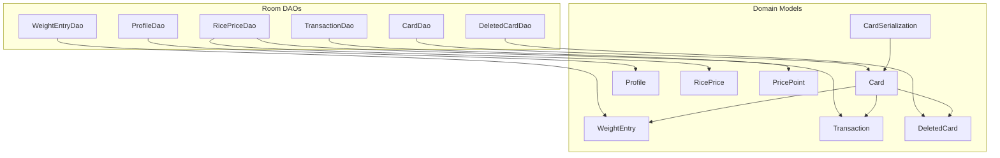
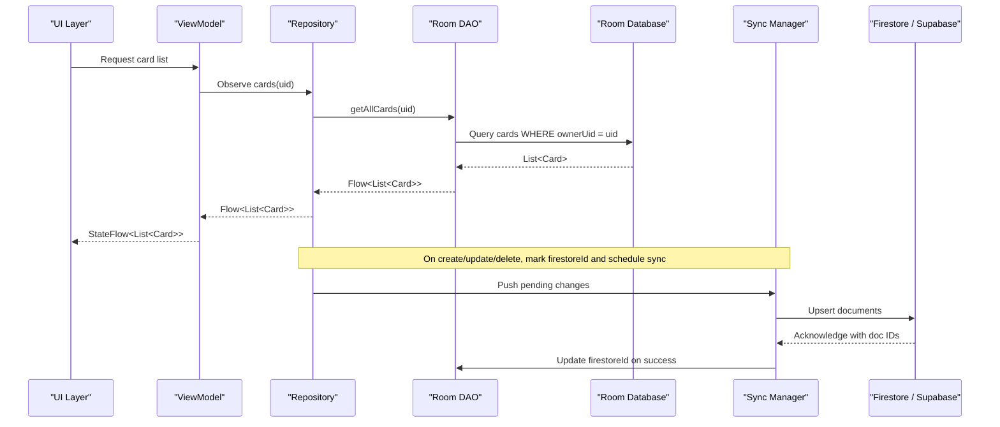
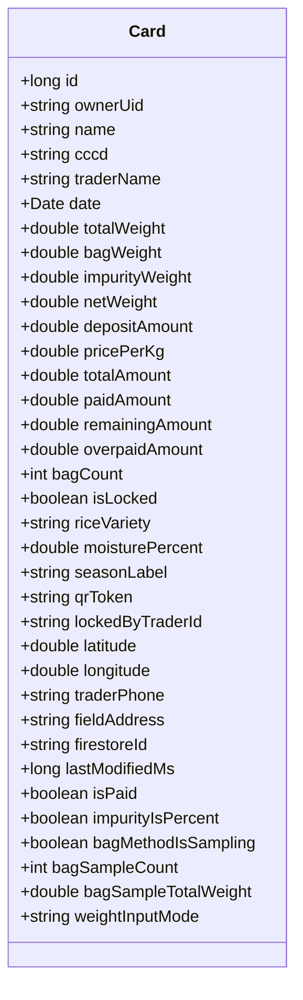
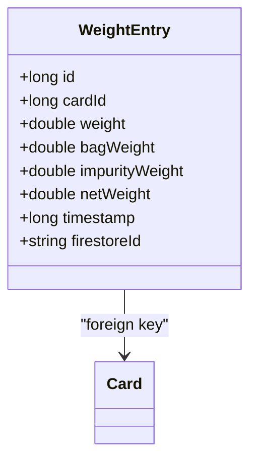
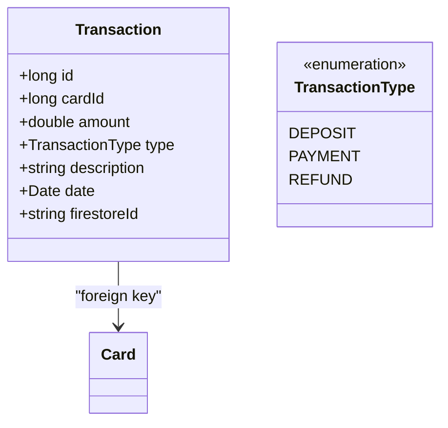
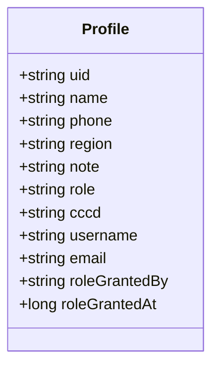
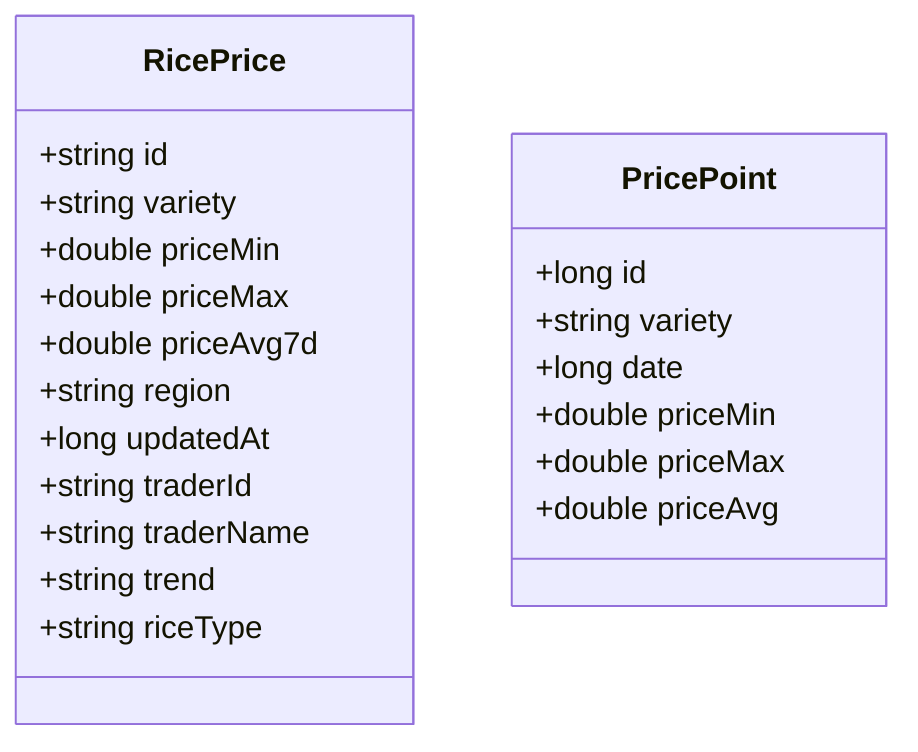
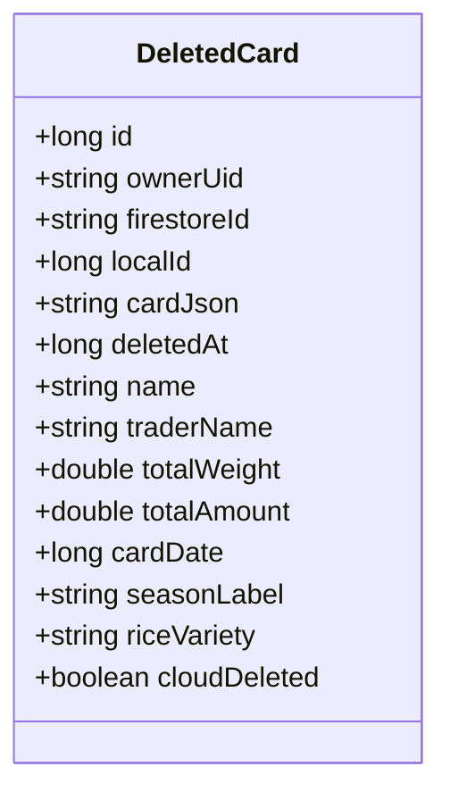
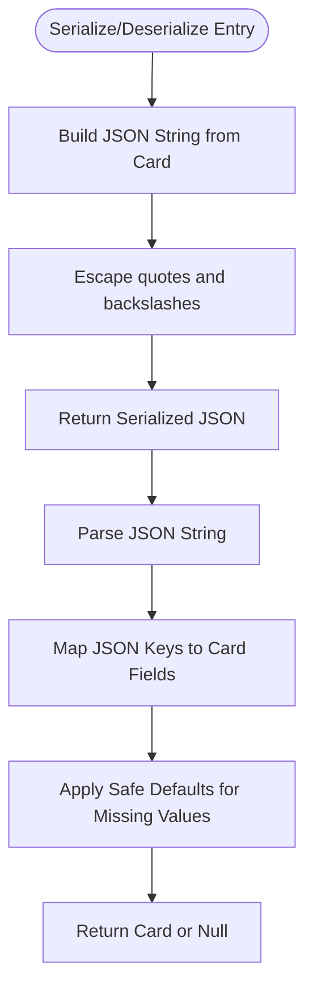
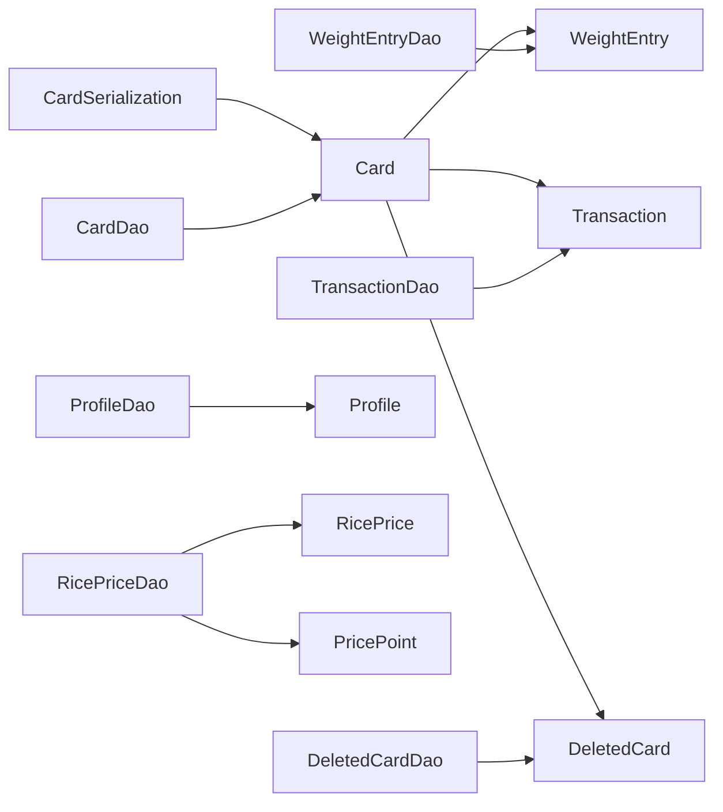

# Domain Data Models

<cite>
**Referenced Files in This Document**
- [Card.kt](file://app/src/main/java/com/giathinh/canlua/data/model/Card.kt)
- [WeightEntry.kt](file://app/src/main/java/com/giathinh/canlua/data/model/WeightEntry.kt)
- [Transaction.kt](file://app/src/main/java/com/giathinh/canlua/data/model/Transaction.kt)
- [Profile.kt](file://app/src/main/java/com/giathinh/canlua/data/model/Profile.kt)
- [RicePrice.kt](file://app/src/main/java/com/giathinh/canlua/data/model/RicePrice.kt)
- [DeletedCard.kt](file://app/src/main/java/com/giathinh/canlua/data/model/DeletedCard.kt)
- [CardSerialization.kt](file://app/src/main/java/com/giathinh/canlua/data/model/CardSerialization.kt)
- [CardDao.kt](file://app/src/main/java/com/giathinh/canlua/data/dao/CardDao.kt)
- [WeightEntryDao.kt](file://app/src/main/java/com/giathinh/canlua/data/dao/WeightEntryDao.kt)
- [TransactionDao.kt](file://app/src/main/java/com/giathinh/canlua/data/dao/TransactionDao.kt)
- [ProfileDao.kt](file://app/src/main/java/com/giathinh/canlua/data/dao/ProfileDao.kt)
- [RicePriceDao.kt](file://app/src/main/java/com/giathinh/canlua/data/dao/RicePriceDao.kt)
- [DeletedCardDao.kt](file://app/src/main/java/com/giathinh/canlua/data/dao/DeletedCardDao.kt)
</cite>

## Table of Contents
1. [Introduction](#introduction)
2. [Project Structure](#project-structure)
3. [Core Components](#core-components)
4. [Architecture Overview](#architecture-overview)
5. [Detailed Component Analysis](#detailed-component-analysis)
6. [Dependency Analysis](#dependency-analysis)
7. [Performance Considerations](#performance-considerations)
8. [Troubleshooting Guide](#troubleshooting-guide)
9. [Conclusion](#conclusion)

## Introduction
This document describes the domain data models used by Cân Lúa Mobile for weighing records, financial summaries, user profiles, market prices, and deleted-record tombstones. The app is an offline-first Android application using Kotlin, Jetpack Compose, Room, and MVVM with unidirectional data flow through StateFlow and coroutines. Local persistence uses Room schema version 18 with eight entities and an explicit migration chain. Cloud synchronization is bidirectional to Firebase Firestore and Supabase, scheduled idempotently via WorkManager, while the app remains fully functional without network access.

The core domain revolves around a Card representing a weighing session with financial calculations, WeightEntry entries for individual bags, Transaction records for deposits and payments, Profile for role-based access control, RicePrice for market pricing, and DeletedCard as tombstone records for safe deletion during offline-first sync.

## Project Structure
The domain models live under `data/model`, their Room DAOs under `data/dao`, and serialization helpers alongside the model layer. Each entity is annotated with Room annotations, defines primary keys, foreign keys where needed, and indexes for query performance. DAOs expose reactive Flow APIs for UI observation and suspend functions for repository operations.

**Diagram sources**
- [Card.kt:8-106](file://app/src/main/java/com/giathinh/canlua/data/model/Card.kt#L8-L106)
- [WeightEntry.kt:7-30](file://app/src/main/java/com/giathinh/canlua/data/model/WeightEntry.kt#L7-L30)
- [Transaction.kt:8-36](file://app/src/main/java/com/giathinh/canlua/data/model/Transaction.kt#L8-L36)
- [Profile.kt:13-26](file://app/src/main/java/com/giathinh/canlua/data/model/Profile.kt#L13-L26)
- [RicePrice.kt:11-37](file://app/src/main/java/com/giathinh/canlua/data/model/RicePrice.kt#L11-L37)
- [DeletedCard.kt:26-53](file://app/src/main/java/com/giathinh/canlua/data/model/DeletedCard.kt#L26-L53)
- [CardSerialization.kt:6-94](file://app/src/main/java/com/giathinh/canlua/data/model/CardSerialization.kt#L6-L94)
- [CardDao.kt:16-275](file://app/src/main/java/com/giathinh/canlua/data/dao/CardDao.kt#L16-L275)
- [WeightEntryDao.kt:7-51](file://app/src/main/java/com/giathinh/canlua/data/dao/WeightEntryDao.kt#L7-L51)
- [TransactionDao.kt:7-40](file://app/src/main/java/com/giathinh/canlua/data/dao/TransactionDao.kt#L7-L40)
- [ProfileDao.kt:10-32](file://app/src/main/java/com/giathinh/canlua/data/dao/ProfileDao.kt#L10-L32)
- [RicePriceDao.kt:11-37](file://app/src/main/java/com/giathinh/canlua/data/dao/RicePriceDao.kt#L11-L37)
- [DeletedCardDao.kt:10-53](file://app/src/main/java/com/giathinh/canlua/data/dao/DeletedCardDao.kt#L10-L53)

**Section sources**
- [Card.kt:8-106](file://app/src/main/java/com/giathinh/canlua/data/model/Card.kt#L8-L106)
- [WeightEntry.kt:7-30](file://app/src/main/java/com/giathinh/canlua/data/model/WeightEntry.kt#L7-L30)
- [Transaction.kt:8-36](file://app/src/main/java/com/giathinh/canlua/data/model/Transaction.kt#L8-L36)
- [Profile.kt:13-26](file://app/src/main/java/com/giathinh/canlua/data/model/Profile.kt#L13-L26)
- [RicePrice.kt:11-37](file://app/src/main/java/com/giathinh/canlua/data/model/RicePrice.kt#L11-L37)
- [DeletedCard.kt:26-53](file://app/src/main/java/com/giathinh/canlua/data/model/DeletedCard.kt#L26-L53)
- [CardSerialization.kt:6-94](file://app/src/main/java/com/giathinh/canlua/data/model/CardSerialization.kt#L6-L94)
- [CardDao.kt:16-275](file://app/src/main/java/com/giathinh/canlua/data/dao/CardDao.kt#L16-L275)
- [WeightEntryDao.kt:7-51](file://app/src/main/java/com/giathinh/canlua/data/dao/WeightEntryDao.kt#L7-L51)
- [TransactionDao.kt:7-40](file://app/src/main/java/com/giathinh/canlua/data/dao/TransactionDao.kt#L7-L40)
- [ProfileDao.kt:10-32](file://app/src/main/java/com/giathinh/canlua/data/dao/ProfileDao.kt#L10-L32)
- [RicePriceDao.kt:11-37](file://app/src/main/java/com/giathinh/canlua/data/dao/RicePriceDao.kt#L11-L37)
- [DeletedCardDao.kt:10-53](file://app/src/main/java/com/giathinh/canlua/data/dao/DeletedCardDao.kt#L10-L53)

## Core Components
This section summarizes each domain model, its responsibilities, key fields, and how it participates in business logic and sync.

- Card: A weighing record with identity, weights, financial amounts, metadata (rice variety, moisture, season), GPS location, contact/address info, sync identifiers, timestamps, payment state, and per-card configuration for impurity calculation, bag sampling, and weight input behavior. It is immutable at runtime and indexed for efficient per-user queries.
- WeightEntry: Individual bag measurements linked to a Card, including raw weight, bag weight, impurity weight, net weight, timestamp, and optional Firestore ID for deduplication.
- Transaction: Payment/deposit/refund records linked to a Card, including amount, type enum, description, date, and optional Firestore ID.
- Profile: User profile keyed by Firebase UID, storing name, phone, region, notes, role, identification number, username, email, and role grant metadata. Role controls feature access across FARMER, TRADER, and GUEST portals.
- RicePrice: Market price data per rice variety, including min/max/average prices, region, update timestamp, optional trader attribution, trend indicator, and rice type. PricePoint stores historical daily points for charting.
- DeletedCard: Tombstone snapshot of a deleted Card, including owner isolation, Firestore ID, local ID, serialized JSON, deletion timestamp, denormalized display fields, and cloud deletion status.

**Section sources**
- [Card.kt:8-106](file://app/src/main/java/com/giathinh/canlua/data/model/Card.kt#L8-L106)
- [WeightEntry.kt:7-30](file://app/src/main/java/com/giathinh/canlua/data/model/WeightEntry.kt#L7-L30)
- [Transaction.kt:8-36](file://app/src/main/java/com/giathinh/canlua/data/model/Transaction.kt#L8-L36)
- [Profile.kt:13-26](file://app/src/main/java/com/giathinh/canlua/data/model/Profile.kt#L13-L26)
- [RicePrice.kt:11-37](file://app/src/main/java/com/giathinh/canlua/data/model/RicePrice.kt#L11-L37)
- [DeletedCard.kt:26-53](file://app/src/main/java/com/giathinh/canlua/data/model/DeletedCard.kt#L26-L53)

## Architecture Overview
The domain models are persisted through Room DAOs and consumed by repositories and viewmodels. The architecture follows MVVM + Clean Architecture with unidirectional data flow. Cards are isolated per user via `ownerUid`. Sync identifiers (`firestoreId`) enable cross-device deduplication. Deleted cards are preserved as tombstones to prevent resurrection after pull sync.

**Diagram sources**
- [CardDao.kt:18-22](file://app/src/main/java/com/giathinh/canlua/data/dao/CardDao.kt#L18-L22)
- [Card.kt:20-106](file://app/src/main/java/com/giathinh/canlua/data/model/Card.kt#L20-L106)

## Detailed Component Analysis

### Card Model
Card represents a complete weighing session and financial summary. It includes:
- Identity and ownership: auto-generated `id` and `ownerUid` for per-user isolation; legacy orphan handling assigns empty `ownerUid` before migration v12.
- Weights and quantities: `totalWeight`, `bagWeight`, `impurityWeight`, `netWeight`, `bagCount`.
- Financials: `depositAmount`, `pricePerKg`, `totalAmount`, `paidAmount`, `remainingAmount`, `overpaidAmount`.
- Metadata: `name`, `cccd`, `traderName`, `date`, `riceVariety`, `moisturePercent`, `seasonLabel`.
- Location and contact: `latitude`, `longitude`, `traderPhone`, `fieldAddress`.
- Sync and conflict resolution: `firestoreId`, `lastModifiedMs`, `isPaid`.
- Per-card configuration: `impurityIsPercent`, `bagMethodIsSampling`, `bagSampleCount`, `bagSampleTotalWeight`, `weightInputMode`.
- Locking: `isLocked` and legacy `lockedByTraderId`.

Validation and constraints:
- Immutability via `@Immutable` ensures stable snapshots for UI and sync.
- Composite indices optimize per-user ordering and filtering by rice variety.
- Numeric fields default to zero to avoid null arithmetic issues.
- Overpaid amount is explicitly tracked and not clamped to zero.

Business rules visible in DAO aggregation:
- Impurity calculation adapts to `impurityIsPercent` and bag sampling mode.
- Moisture thresholds classify wet vs dry cards.
- Season statistics aggregate revenue, paid amounts, remaining balances, average price/moisture, total bags, and impurity totals.

**Diagram sources**
- [Card.kt:8-106](file://app/src/main/java/com/giathinh/canlua/data/model/Card.kt#L8-L106)

**Section sources**
- [Card.kt:8-106](file://app/src/main/java/com/giathinh/canlua/data/model/Card.kt#L8-L106)
- [CardDao.kt:18-191](file://app/src/main/java/com/giathinh/canlua/data/dao/CardDao.kt#L18-L191)
- [CardDao.kt:200-274](file://app/src/main/java/com/giathinh/canlua/data/dao/CardDao.kt#L200-L274)

### WeightEntry Model
WeightEntry captures per-bag measurements within a Card:
- Foreign key relationship to Card with cascade delete.
- Fields: `cardId`, `weight`, `bagWeight`, `impurityWeight`, `netWeight`, `timestamp`, `firestoreId`.
- Index on `cardId` optimizes retrieval by card.

Validation and constraints:
- Net weight is derived conceptually as `weight - bagWeight - impurityWeight`.
- Timestamp defaults to current time for ordering.
- Firestore ID enables deduplication during pull sync.

**Diagram sources**
- [WeightEntry.kt:7-30](file://app/src/main/java/com/giathinh/canlua/data/model/WeightEntry.kt#L7-L30)
- [Card.kt:8-106](file://app/src/main/java/com/giathinh/canlua/data/model/Card.kt#L8-L106)

**Section sources**
- [WeightEntry.kt:7-30](file://app/src/main/java/com/giathinh/canlua/data/model/WeightEntry.kt#L7-L30)
- [WeightEntryDao.kt:7-51](file://app/src/main/java/com/giathinh/canlua/data/dao/WeightEntryDao.kt#L7-L51)

### Transaction Model
Transaction records financial movements tied to a Card:
- Foreign key relationship to Card with cascade delete.
- Fields: `cardId`, `amount`, `type`, `description`, `date`, `firestoreId`.
- Enum `TransactionType` supports DEPOSIT, PAYMENT, REFUND.

Validation and constraints:
- Amounts are summed by type per card to compute totals.
- Firestore ID enables deduplication during pull sync.

**Diagram sources**
- [Transaction.kt:8-36](file://app/src/main/java/com/giathinh/canlua/data/model/Transaction.kt#L8-L36)
- [Card.kt:8-106](file://app/src/main/java/com/giathinh/canlua/data/model/Card.kt#L8-L106)

**Section sources**
- [Transaction.kt:8-36](file://app/src/main/java/com/giathinh/canlua/data/model/Transaction.kt#L8-L36)
- [TransactionDao.kt:7-40](file://app/src/main/java/com/giathinh/canlua/data/dao/TransactionDao.kt#L7-L40)

### Profile Model
Profile stores user identity and role-based access:
- Primary key is Firebase UID to isolate profiles per account.
- Fields include name, phone, region, note, role, cccd, username, email, and role grant metadata (`roleGrantedBy`, `roleGrantedAt`).
- Default role is FARMER; admin or system grants can change roles.

Validation and constraints:
- Role values are strings intended to represent FARMER, TRADER, GUEST.
- Grant metadata supports future admin-grant workflows.

**Diagram sources**
- [Profile.kt:13-26](file://app/src/main/java/com/giathinh/canlua/data/model/Profile.kt#L13-L26)

**Section sources**
- [Profile.kt:13-26](file://app/src/main/java/com/giathinh/canlua/data/model/Profile.kt#L13-L26)
- [ProfileDao.kt:10-32](file://app/src/main/java/com/giathinh/canlua/data/dao/ProfileDao.kt#L10-L32)

### RicePrice and PricePoint Models
RicePrice captures market pricing data:
- Primary key is string `id`.
- Fields include variety, min/max/average prices, region, update timestamp, optional trader attribution, trend, and rice type.

PricePoint captures historical daily points:
- Auto-generated primary key.
- Fields include variety, date (epoch ms), min/max/average prices.

Validation and constraints:
- Upsert semantics allow replacing existing records.
- History queries filter by variety and date range.

**Diagram sources**
- [RicePrice.kt:11-37](file://app/src/main/java/com/giathinh/canlua/data/model/RicePrice.kt#L11-L37)

**Section sources**
- [RicePrice.kt:11-37](file://app/src/main/java/com/giathinh/canlua/data/model/RicePrice.kt#L11-L37)
- [RicePriceDao.kt:11-37](file://app/src/main/java/com/giathinh/canlua/data/dao/RicePriceDao.kt#L11-L37)

### DeletedCard Model
DeletedCard acts as a tombstone for soft-deleted Cards:
- Stores owner isolation, Firestore ID, local ID, serialized JSON snapshot, deletion timestamp, denormalized display fields, and cloud deletion status.
- Indices on `ownerUid` and `firestoreId` support fast lookup and deduplication.

Validation and constraints:
- Tombstone prevents resurrection during pull sync when Firestore still contains the document.
- Background worker retries cloud deletion until successful.
- Denormalized fields allow quick list rendering without parsing JSON.

**Diagram sources**
- [DeletedCard.kt:26-53](file://app/src/main/java/com/giathinh/canlua/data/model/DeletedCard.kt#L26-L53)

**Section sources**
- [DeletedCard.kt:26-53](file://app/src/main/java/com/giathinh/canlua/data/model/DeletedCard.kt#L26-L53)
- [DeletedCardDao.kt:10-53](file://app/src/main/java/com/giathinh/canlua/data/dao/DeletedCardDao.kt#L10-L53)

### CardSerialization System
CardSerialization provides lightweight JSON serialization/deserialization for Card objects to support cloud sync compatibility and tombstone storage:
- `serialize()` builds a compact JSON string with all relevant Card fields.
- `deserializeCard(json)` parses JSON back into a Card with safe fallbacks for missing or malformed fields.
- Helper functions escape strings and handle nullable values safely.

Validation and constraints:
- Deserialization uses `runCatching` to return null on parse errors.
- Missing numeric fields default to zero; missing strings default to empty; booleans default to false.
- `weightInputMode` falls back to "SMALL" if blank.

**Diagram sources**
- [CardSerialization.kt:6-94](file://app/src/main/java/com/giathinh/canlua/data/model/CardSerialization.kt#L6-L94)

**Section sources**
- [CardSerialization.kt:6-94](file://app/src/main/java/com/giathinh/canlua/data/model/CardSerialization.kt#L6-L94)

## Dependency Analysis
The domain models have clear dependency relationships:
- WeightEntry depends on Card via foreign key.
- Transaction depends on Card via foreign key.
- DeletedCard references Card via serialized JSON and denormalized fields.
- DAOs depend on their respective models and expose reactive Flow APIs.
- CardSerialization depends on Card for serialization.

**Diagram sources**
- [Card.kt:8-106](file://app/src/main/java/com/giathinh/canlua/data/model/Card.kt#L8-L106)
- [WeightEntry.kt:7-30](file://app/src/main/java/com/giathinh/canlua/data/model/WeightEntry.kt#L7-L30)
- [Transaction.kt:8-36](file://app/src/main/java/com/giathinh/canlua/data/model/Transaction.kt#L8-L36)
- [DeletedCard.kt:26-53](file://app/src/main/java/com/giathinh/canlua/data/model/DeletedCard.kt#L26-L53)
- [CardSerialization.kt:6-94](file://app/src/main/java/com/giathinh/canlua/data/model/CardSerialization.kt#L6-L94)
- [CardDao.kt:16-275](file://app/src/main/java/com/giathinh/canlua/data/dao/CardDao.kt#L16-L275)
- [WeightEntryDao.kt:7-51](file://app/src/main/java/com/giathinh/canlua/data/dao/WeightEntryDao.kt#L7-L51)
- [TransactionDao.kt:7-40](file://app/src/main/java/com/giathinh/canlua/data/dao/TransactionDao.kt#L7-L40)
- [ProfileDao.kt:10-32](file://app/src/main/java/com/giathinh/canlua/data/dao/ProfileDao.kt#L10-L32)
- [RicePriceDao.kt:11-37](file://app/src/main/java/com/giathinh/canlua/data/dao/RicePriceDao.kt#L11-L37)
- [DeletedCardDao.kt:10-53](file://app/src/main/java/com/giathinh/canlua/data/dao/DeletedCardDao.kt#L10-L53)

**Section sources**
- [Card.kt:8-106](file://app/src/main/java/com/giathinh/canlua/data/model/Card.kt#L8-L106)
- [WeightEntry.kt:7-30](file://app/src/main/java/com/giathinh/canlua/data/model/WeightEntry.kt#L7-L30)
- [Transaction.kt:8-36](file://app/src/main/java/com/giathinh/canlua/data/model/Transaction.kt#L8-L36)
- [DeletedCard.kt:26-53](file://app/src/main/java/com/giathinh/canlua/data/model/DeletedCard.kt#L26-L53)
- [CardSerialization.kt:6-94](file://app/src/main/java/com/giathinh/canlua/data/model/CardSerialization.kt#L6-L94)
- [CardDao.kt:16-275](file://app/src/main/java/com/giathinh/canlua/data/dao/CardDao.kt#L16-L275)
- [WeightEntryDao.kt:7-51](file://app/src/main/java/com/giathinh/canlua/data/dao/WeightEntryDao.kt#L7-L51)
- [TransactionDao.kt:7-40](file://app/src/main/java/com/giathinh/canlua/data/dao/TransactionDao.kt#L7-L40)
- [ProfileDao.kt:10-32](file://app/src/main/java/com/giathinh/canlua/data/dao/ProfileDao.kt#L10-L32)
- [RicePriceDao.kt:11-37](file://app/src/main/java/com/giathinh/canlua/data/dao/RicePriceDao.kt#L11-L37)
- [DeletedCardDao.kt:10-53](file://app/src/main/java/com/giathinh/canlua/data/dao/DeletedCardDao.kt#L10-L53)

## Performance Considerations
- Room indices on `ownerUid`, composite `(ownerUid, date)`, and `(ownerUid, riceVariety)` optimize per-user listing and filtering.
- Bulk updates for WeightEntry reduce transaction overhead.
- Aggregation queries in CardDao compute season stats efficiently using SQL aggregates.
- DAOs expose Flow for reactive UI updates, minimizing polling.
- Firestore ID fields enable idempotent sync operations, reducing redundant writes.

[No sources needed since this section provides general guidance]

## Troubleshooting Guide
Common issues and resolutions:
- Orphan cards: Cards with empty `ownerUid` are migrated to the first logged-in user via `claimOrphanCards`. If users share devices, ensure proper login order and migration execution.
- Resurrected cards after pull: Tombstones in `deleted_cards` prevent re-insertion. Verify `cloudDeleted` flag and background retry logic.
- Sync conflicts: Use `lastModifiedMs` and Firestore timestamps to resolve conflicts; newer wins.
- Invalid JSON deserialization: `deserializeCard` returns null on parse errors; validate JSON structure and ensure all required fields are present.
- Role leakage: Always use `getProfileByUid` to fetch profiles by Firebase UID; avoid deprecated `getLatestProfile`.

**Section sources**
- [CardDao.kt:131-146](file://app/src/main/java/com/giathinh/canlua/data/dao/CardDao.kt#L131-L146)
- [DeletedCardDao.kt:20-40](file://app/src/main/java/com/giathinh/canlua/data/dao/DeletedCardDao.kt#L20-L40)
- [CardSerialization.kt:43-79](file://app/src/main/java/com/giathinh/canlua/data/model/CardSerialization.kt#L43-L79)
- [ProfileDao.kt:15-31](file://app/src/main/java/com/giathinh/canlua/data/dao/ProfileDao.kt#L15-L31)

## Conclusion
The Cân Lúa Mobile domain models provide a robust foundation for weighing records, financial tracking, user profiles, market prices, and safe deletion handling. The design emphasizes immutability, per-user isolation, offline-first persistence, and idempotent cloud synchronization. Validation, sanitization, and type safety are enforced through Room constraints, safe defaults, and careful serialization. Role-based access patterns are supported by Profile fields and DAO isolation, enabling FARMER, TRADER, and GUEST portals. The architecture scales well with efficient indexing, reactive flows, and clear separation between domain models, DAOs, and higher layers.

[No sources needed since this section summarizes without analyzing specific files]