# Repository Layer

<cite>
**Referenced Files in This Document**
- [AppDatabase.kt](file://app/src/main/java/com/giathinh/canlua/data/database/AppDatabase.kt)
- [Card.kt](file://app/src/main/java/com/giathinh/canlua/data/model/Card.kt)
- [WeightEntry.kt](file://app/src/main/java/com/giathinh/canlua/data/model/WeightEntry.kt)
- [Transaction.kt](file://app/src/main/java/com/giathinh/canlua/data/model/Transaction.kt)
- [FirestoreCard.kt](file://app/src/main/java/com/giathinh/canlua/data/firestore/FirestoreCard.kt)
- [FirestoreWeightEntry.kt](file://app/src/main/java/com/giathinh/canlua/data/firestore/FirestoreWeightEntry.kt)
- [FirestoreTransaction.kt](file://app/src/main/java/com/giathinh/canlua/data/firestore/FirestoreTransaction.kt)
- [AuthManager.kt](file://app/src/main/java/com/giathinh/canlua/repository/AuthManager.kt)
- [SettingsRepository.kt](file://app/src/main/java/com/giathinh/canlua/repository/SettingsRepository.kt)
- [KnowledgeBaseRepository.kt](file://app/src/main/java/com/giathinh/canlua/repository/KnowledgeBaseRepository.kt)
- [CardRepository.kt](file://app/src/main/java/com/giathinh/canlua/repository/CardRepository.kt)
- [SyncableCardRepository.kt](file://app/src/main/java/com/giathinh/canlua/repository/SyncableCardRepository.kt)
- [FirestoreRepository.kt](file://app/src/main/java/com/giathinh/canlua/repository/FirestoreRepository.kt)
- [SupabasePriceRepository.kt](file://app/src/main/java/com/giathinh/canlua/repository/SupabasePriceRepository.kt)
- [SyncManager.kt](file://app/src/main/java/com/giathinh/canlua/repository/SyncManager.kt)
- [PullDedupResolver.kt](file://app/src/main/java/com/giathinh/canlua/repository/PullDedupResolver.kt)
</cite>

## Table of Contents
1. [Introduction](#introduction)
2. [Project Structure](#project-structure)
3. [Core Components](#core-components)
4. [Architecture Overview](#architecture-overview)
5. [Detailed Component Analysis](#detailed-component-analysis)
6. [Dependency Analysis](#dependency-analysis)
7. [Performance Considerations](#performance-considerations)
8. [Troubleshooting Guide](#troubleshooting-guide)
9. [Conclusion](#conclusion)

## Introduction
This document explains the repository layer for Cân Lúa Mobile, an offline-first Kotlin 2.3 / Jetpack Compose Android app using MVVM and Clean Architecture with unidirectional data flow via StateFlow and coroutines. The repository layer abstracts multiple data sources:
- Local Room database (schema v19 with eight entities and explicit migrations).
- Firebase Firestore for bidirectional cloud sync.
- Supabase for read-only market price data.
- Network APIs through a shared HTTP client.
- Local knowledge base assets for AI RAG-lite context.

The unified interface pattern provides consistent data access regardless of source. The offline-first strategy prioritizes local Room data and synchronizes with cloud backends idempotently via WorkManager. Authentication is managed by AuthManager, settings persistence by SettingsRepository, and knowledge base access by KnowledgeBaseRepository. Error handling uses Result types, Flow-based reactive streams, and WorkManager retry policies. Caching occurs at the Room layer and in memory where appropriate. Data transformation pipelines convert between domain models, Room entities, and Firestore DTOs. Repositories compose cleanly with ViewModels through StateFlow and coroutines.

## Project Structure
The repository layer sits above data access objects and remote clients, providing business-level operations and orchestration. Key directories include:
- `data/database`: Room database definition and migrations.
- `data/model`: Domain entities persisted locally.
- `data/firestore`: Firestore DTOs mirroring domain entities.
- `repository`: Unified repositories, sync orchestration, and cross-cutting concerns.

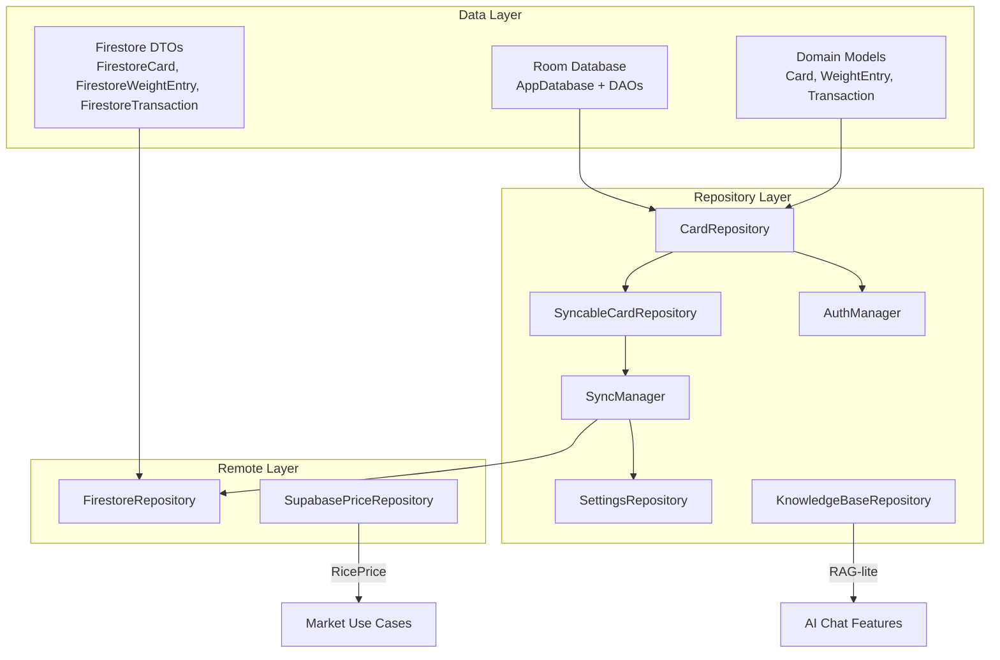

**Diagram sources**
- [AppDatabase.kt:24-46](file://app/src/main/java/com/giathinh/canlua/data/database/AppDatabase.kt#L24-L46)
- [Card.kt:8-106](file://app/src/main/java/com/giathinh/canlua/data/model/Card.kt#L8-L106)
- [WeightEntry.kt:7-30](file://app/src/main/java/com/giathinh/canlua/data/model/WeightEntry.kt#L7-L30)
- [Transaction.kt:8-36](file://app/src/main/java/com/giathinh/canlua/data/model/Transaction.kt#L8-L36)
- [FirestoreCard.kt:7-65](file://app/src/main/java/com/giathinh/canlua/data/firestore/FirestoreCard.kt#L7-L65)
- [FirestoreWeightEntry.kt:7-20](file://app/src/main/java/com/giathinh/canlua/data/firestore/FirestoreWeightEntry.kt#L7-L20)
- [FirestoreTransaction.kt:7-20](file://app/src/main/java/com/giathinh/canlua/data/firestore/FirestoreTransaction.kt#L7-L20)
- [FirestoreRepository.kt:21-43](file://app/src/main/java/com/giathinh/canlua/repository/FirestoreRepository.kt#L21-L43)
- [SupabasePriceRepository.kt:22-31](file://app/src/main/java/com/giathinh/canlua/repository/SupabasePriceRepository.kt#L22-L31)
- [CardRepository.kt:36-44](file://app/src/main/java/com/giathinh/canlua/repository/CardRepository.kt#L36-L44)
- [SyncableCardRepository.kt:16-24](file://app/src/main/java/com/giathinh/canlua/repository/SyncableCardRepository.kt#L16-L24)
- [SyncManager.kt:35-45](file://app/src/main/java/com/giathinh/canlua/repository/SyncManager.kt#L35-L45)
- [AuthManager.kt:12-15](file://app/src/main/java/com/giathinh/canlua/repository/AuthManager.kt#L12-L15)
- [SettingsRepository.kt:15-18](file://app/src/main/java/com/giathinh/canlua/repository/SettingsRepository.kt#L15-L18)
- [KnowledgeBaseRepository.kt:20-23](file://app/src/main/java/com/giathinh/canlua/repository/KnowledgeBaseRepository.kt#L20-L23)

**Section sources**
- [AppDatabase.kt:24-46](file://app/src/main/java/com/giathinh/canlua/data/database/AppDatabase.kt#L24-L46)
- [Card.kt:8-106](file://app/src/main/java/com/giathinh/canlua/data/model/Card.kt#L8-L106)
- [WeightEntry.kt:7-30](file://app/src/main/java/com/giathinh/canlua/data/model/WeightEntry.kt#L7-L30)
- [Transaction.kt:8-36](file://app/src/main/java/com/giathinh/canlua/data/model/Transaction.kt#L8-L36)
- [FirestoreCard.kt:7-65](file://app/src/main/java/com/giathinh/canlua/data/firestore/FirestoreCard.kt#L7-L65)
- [FirestoreWeightEntry.kt:7-20](file://app/src/main/java/com/giathinh/canlua/data/firestore/FirestoreWeightEntry.kt#L7-L20)
- [FirestoreTransaction.kt:7-20](file://app/src/main/java/com/giathinh/canlua/data/firestore/FirestoreTransaction.kt#L7-L20)
- [FirestoreRepository.kt:21-43](file://app/src/main/java/com/giathinh/canlua/repository/FirestoreRepository.kt#L21-L43)
- [SupabasePriceRepository.kt:22-31](file://app/src/main/java/com/giathinh/canlua/repository/SupabasePriceRepository.kt#L22-L31)
- [CardRepository.kt:36-44](file://app/src/main/java/com/giathinh/canlua/repository/CardRepository.kt#L36-L44)
- [SyncableCardRepository.kt:16-24](file://app/src/main/java/com/giathinh/canlua/repository/SyncableCardRepository.kt#L16-L24)
- [SyncManager.kt:35-45](file://app/src/main/java/com/giathinh/canlua/repository/SyncManager.kt#L35-L45)
- [AuthManager.kt:12-15](file://app/src/main/java/com/giathinh/canlua/repository/AuthManager.kt#L12-L15)
- [SettingsRepository.kt:15-18](file://app/src/main/java/com/giathinh/canlua/repository/SettingsRepository.kt#L15-L18)
- [KnowledgeBaseRepository.kt:20-23](file://app/src/main/java/com/giathinh/canlua/repository/KnowledgeBaseRepository.kt#L20-L23)

## Core Components
- CardRepository: Per-user isolation, encrypted ID fields, transactional updates, calculation pipeline, and reactive flows.
- SyncableCardRepository: Decorator that triggers pending sync state refresh and WorkManager scheduling after local mutations.
- FirestoreRepository: Firestore CRUD, batch writes, realtime listeners, and analytics counters.
- SupabasePriceRepository: Read-only fetch of active rice prices from Supabase with error logging and DTO mapping.
- SyncManager: Bidirectional sync orchestration, WorkManager scheduling, conflict resolution, tombstone handling, and status/state flows.
- AuthManager: Firebase auth state flow, sign-in/sign-out, and user identity checks.
- SettingsRepository: SharedPreferences-backed settings with reactive Flow exposure and preference change listeners.
- KnowledgeBaseRepository: Asset-based knowledge corpus search for AI RAG-lite context.

Key responsibilities:
- Abstracting data sources behind consistent interfaces.
- Ensuring offline-first behavior with local Room as primary store.
- Orchestrating background sync with idempotent WorkManager jobs.
- Providing reactive UI state via StateFlow and Flow.
- Handling errors with Result types and robust fallbacks.

**Section sources**
- [CardRepository.kt:26-44](file://app/src/main/java/com/giathinh/canlua/repository/CardRepository.kt#L26-L44)
- [SyncableCardRepository.kt:10-24](file://app/src/main/java/com/giathinh/canlua/repository/SyncableCardRepository.kt#L10-L24)
- [FirestoreRepository.kt:21-43](file://app/src/main/java/com/giathinh/canlua/repository/FirestoreRepository.kt#L21-L43)
- [SupabasePriceRepository.kt:14-31](file://app/src/main/java/com/giathinh/canlua/repository/SupabasePriceRepository.kt#L14-L31)
- [SyncManager.kt:35-57](file://app/src/main/java/com/giathinh/canlua/repository/SyncManager.kt#L35-L57)
- [AuthManager.kt:12-35](file://app/src/main/java/com/giathinh/canlua/repository/AuthManager.kt#L12-L35)
- [SettingsRepository.kt:15-68](file://app/src/main/java/com/giathinh/canlua/repository/SettingsRepository.kt#L15-L68)
- [KnowledgeBaseRepository.kt:10-23](file://app/src/main/java/com/giathinh/canlua/repository/KnowledgeBaseRepository.kt#L10-L23)

## Architecture Overview
The repository layer implements a layered architecture:
- Presentation (ViewModels) consumes repository Flows and StateFlows.
- Repository layer orchestrates local Room reads/writes and cloud sync.
- Data layer includes DAOs, Firestore DTOs, and remote clients.

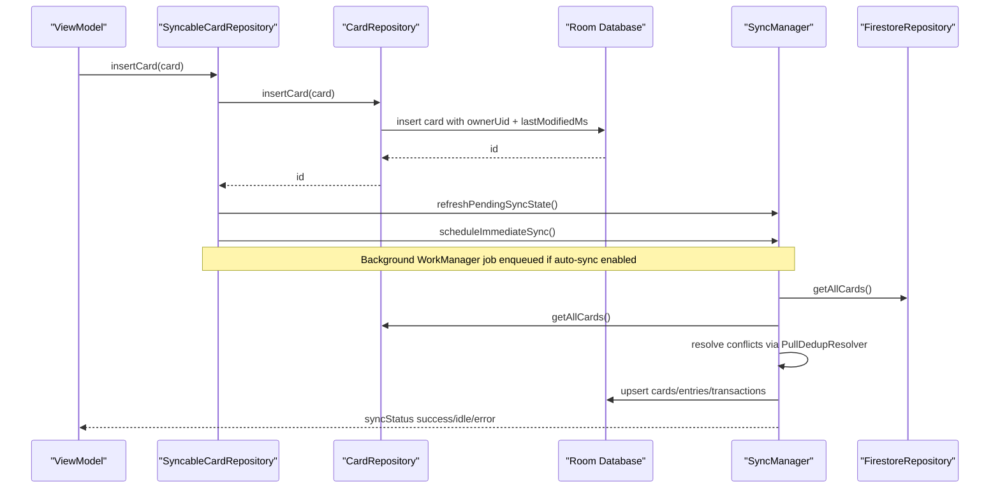

**Diagram sources**
- [SyncableCardRepository.kt:36-40](file://app/src/main/java/com/giathinh/canlua/repository/SyncableCardRepository.kt#L36-L40)
- [CardRepository.kt:60-68](file://app/src/main/java/com/giathinh/canlua/repository/CardRepository.kt#L60-L68)
- [SyncManager.kt:102-130](file://app/src/main/java/com/giathinh/canlua/repository/SyncManager.kt#L102-L130)
- [SyncManager.kt:139-311](file://app/src/main/java/com/giathinh/canlua/repository/SyncManager.kt#L139-L311)
- [FirestoreRepository.kt:121-133](file://app/src/main/java/com/giathinh/canlua/repository/FirestoreRepository.kt#L121-L133)
- [PullDedupResolver.kt:45-73](file://app/src/main/java/com/giathinh/canlua/repository/PullDedupResolver.kt#L45-L73)

## Detailed Component Analysis

### CardRepository
Responsibilities:
- Per-user isolation using AuthManager currentUser UID.
- Encrypted sensitive fields (e.g., CCCD) before persisting.
- Transactional updates ensuring consistency across related tables.
- Calculation pipeline using RiceSettlement to compute totals and per-entry metrics.
- Reactive Flow APIs for UI consumption.

Key patterns:
- uid() helper ensures queries are scoped to current user; empty string returns empty results during auth transitions.
- Tombstone mechanism prevents “resurrection” of deleted cards after pull sync.
- Locked card guard prevents modifications after locking.

Complexity considerations:
- updateCardCalculations performs batch updates only on dirty entries to minimize writes.
- All heavy computations run within transactions to avoid race conditions.

Error handling:
- Guard clauses return null or early exits when card not found or locked.
- Invariant checks ensure calculation correctness.

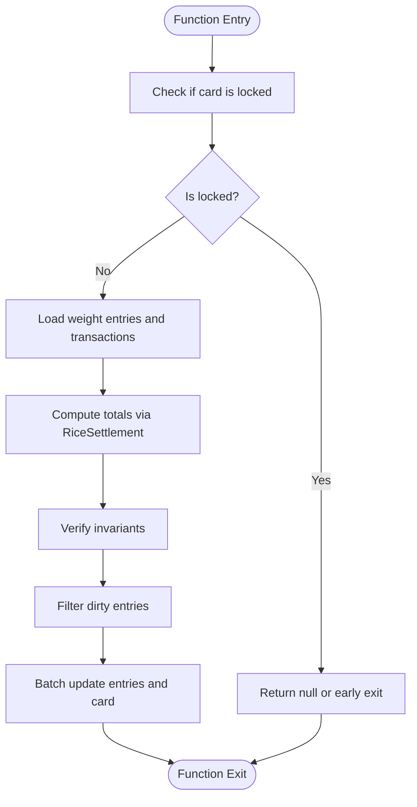

**Diagram sources**
- [CardRepository.kt:242-310](file://app/src/main/java/com/giathinh/canlua/repository/CardRepository.kt#L242-L310)

**Section sources**
- [CardRepository.kt:26-44](file://app/src/main/java/com/giathinh/canlua/repository/CardRepository.kt#L26-L44)
- [CardRepository.kt:60-85](file://app/src/main/java/com/giathinh/canlua/repository/CardRepository.kt#L60-L85)
- [CardRepository.kt:103-152](file://app/src/main/java/com/giathinh/canlua/repository/CardRepository.kt#L103-L152)
- [CardRepository.kt:176-204](file://app/src/main/java/com/giathinh/canlua/repository/CardRepository.kt#L176-L204)
- [CardRepository.kt:214-310](file://app/src/main/java/com/giathinh/canlua/repository/CardRepository.kt#L214-L310)

### SyncableCardRepository
Responsibilities:
- Decorator around CardRepository to trigger sync workflows after local mutations.
- Exposes same Flow-based APIs for seamless integration with ViewModels.

Pattern:
- onLocalMutation calls refreshPendingSyncState and scheduleImmediateSync.
- Read-through methods delegate directly to CardRepository.

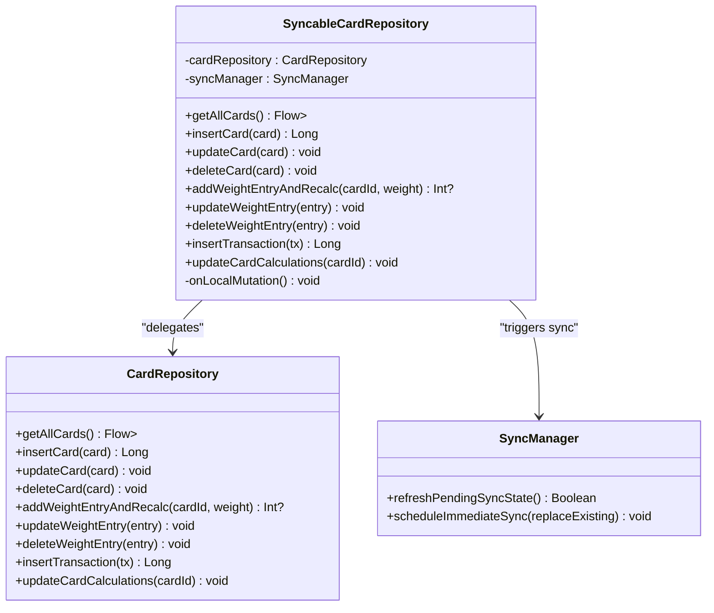

**Diagram sources**
- [SyncableCardRepository.kt:16-86](file://app/src/main/java/com/giathinh/canlua/repository/SyncableCardRepository.kt#L16-L86)
- [CardRepository.kt:36-44](file://app/src/main/java/com/giathinh/canlua/repository/CardRepository.kt#L36-L44)
- [SyncManager.kt:86-130](file://app/src/main/java/com/giathinh/canlua/repository/SyncManager.kt#L86-L130)

**Section sources**
- [SyncableCardRepository.kt:10-24](file://app/src/main/java/com/giathinh/canlua/repository/SyncableCardRepository.kt#L10-L24)
- [SyncableCardRepository.kt:36-86](file://app/src/main/java/com/giathinh/canlua/repository/SyncableCardRepository.kt#L36-L86)

### FirestoreRepository
Responsibilities:
- Firestore CRUD operations for cards, weight entries, and transactions.
- Batch writes to reduce network overhead.
- Realtime listeners for trader-specific cards and transactions.
- Analytics counters for AI usage and card creation.

Key patterns:
- userId derived from FirebaseAuth.currentUser.
- Client-side sorting avoids composite index requirements.
- Chunked whereIn queries for transactions to respect Firestore limits.

Error handling:
- All operations return Result<T>, wrapping exceptions.
- Snapshot listeners emit empty lists on errors to prevent crashes.

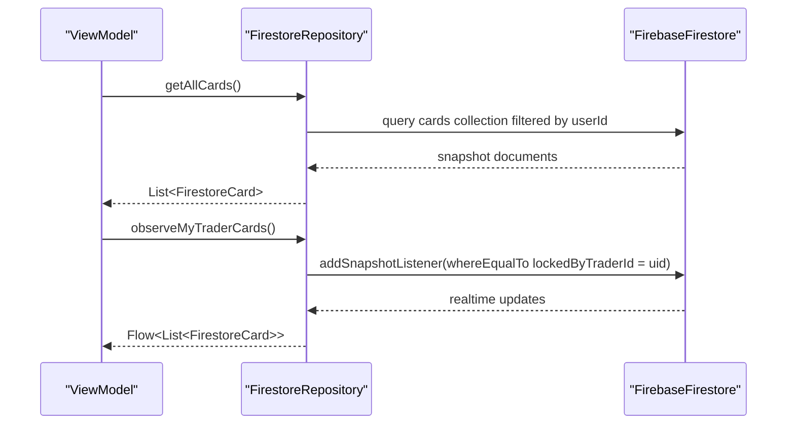

**Diagram sources**
- [FirestoreRepository.kt:121-133](file://app/src/main/java/com/giathinh/canlua/repository/FirestoreRepository.kt#L121-L133)
- [FirestoreRepository.kt:268-293](file://app/src/main/java/com/giathinh/canlua/repository/FirestoreRepository.kt#L268-L293)

**Section sources**
- [FirestoreRepository.kt:21-43](file://app/src/main/java/com/giathinh/canlua/repository/FirestoreRepository.kt#L21-L43)
- [FirestoreRepository.kt:45-85](file://app/src/main/java/com/giathinh/canlua/repository/FirestoreRepository.kt#L45-L85)
- [FirestoreRepository.kt:89-142](file://app/src/main/java/com/giathinh/canlua/repository/FirestoreRepository.kt#L89-L142)
- [FirestoreRepository.kt:146-201](file://app/src/main/java/com/giathinh/canlua/repository/FirestoreRepository.kt#L146-L201)
- [FirestoreRepository.kt:205-261](file://app/src/main/java/com/giathinh/canlua/repository/FirestoreRepository.kt#L205-L261)
- [FirestoreRepository.kt:268-327](file://app/src/main/java/com/giathinh/canlua/repository/FirestoreRepository.kt#L268-L327)

### SupabasePriceRepository
Responsibilities:
- Fetch active rice prices from Supabase PostgreSQL table.
- Map DTOs to domain RicePrice model.
- Log network and Supabase-specific errors.

Behavior:
- Returns empty list on network error, allowing callers to fall back to Room cache.
- Uses Gson TypeToken for parameterized generic deserialization.

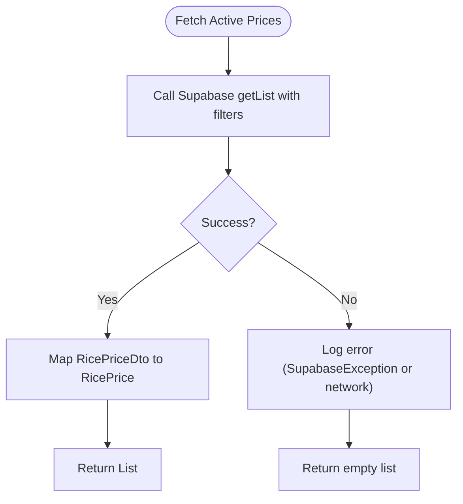

**Diagram sources**
- [SupabasePriceRepository.kt:37-59](file://app/src/main/java/com/giathinh/canlua/repository/SupabasePriceRepository.kt#L37-L59)
- [SupabasePriceRepository.kt:63-89](file://app/src/main/java/com/giathinh/canlua/repository/SupabasePriceRepository.kt#L63-L89)

**Section sources**
- [SupabasePriceRepository.kt:14-31](file://app/src/main/java/com/giathinh/canlua/repository/SupabasePriceRepository.kt#L14-L31)
- [SupabasePriceRepository.kt:37-59](file://app/src/main/java/com/giathinh/canlua/repository/SupabasePriceRepository.kt#L37-L59)
- [SupabasePriceRepository.kt:63-89](file://app/src/main/java/com/giathinh/canlua/repository/SupabasePriceRepository.kt#L63-L89)

### SyncManager
Responsibilities:
- Orchestrate bidirectional sync between Room and Firestore.
- Schedule WorkManager jobs based on connectivity and user settings.
- Resolve conflicts using PullDedupResolver.
- Manage tombstones for deleted cards and clean up cloud resources.
- Expose sync status and timing via StateFlow.

Key workflows:
- syncAll: Push dirty local cards to Firestore in batches, then pull cloud changes.
- pullAllForCurrentUser: Deduplicate and upsert cloud data into Room, handle deletions.
- scheduleImmediateSync: Enqueue unique work with constraints (Wi-Fi or mobile depending on settings).

Error handling:
- Sets SyncStatus.Error with messages and logs analytics events.
- Gracefully handles partial failures and retries via exponential backoff.

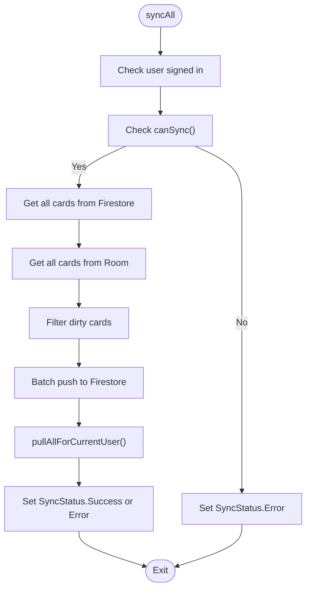

**Diagram sources**
- [SyncManager.kt:139-311](file://app/src/main/java/com/giathinh/canlua/repository/SyncManager.kt#L139-L311)
- [SyncManager.kt:313-412](file://app/src/main/java/com/giathinh/canlua/repository/SyncManager.kt#L313-L412)
- [PullDedupResolver.kt:45-73](file://app/src/main/java/com/giathinh/canlua/repository/PullDedupResolver.kt#L45-L73)

**Section sources**
- [SyncManager.kt:35-57](file://app/src/main/java/com/giathinh/canlua/repository/SyncManager.kt#L35-L57)
- [SyncManager.kt:86-130](file://app/src/main/java/com/giathinh/canlua/repository/SyncManager.kt#L86-L130)
- [SyncManager.kt:139-311](file://app/src/main/java/com/giathinh/canlua/repository/SyncManager.kt#L139-L311)
- [SyncManager.kt:313-412](file://app/src/main/java/com/giathinh/canlua/repository/SyncManager.kt#L313-L412)
- [PullDedupResolver.kt:6-20](file://app/src/main/java/com/giathinh/canlua/repository/PullDedupResolver.kt#L6-L20)
- [PullDedupResolver.kt:45-73](file://app/src/main/java/com/giathinh/canlua/repository/PullDedupResolver.kt#L45-L73)

### AuthManager
Responsibilities:
- Provide current FirebaseUser and authentication state via Flow.
- Handle anonymous and email/password sign-in/sign-up.
- Sign out users.

Key patterns:
- callbackFlow wraps FirebaseAuth.AuthStateListener to emit real-time auth state changes.
- Suspend functions wrap Firebase tasks with await() and return Result.

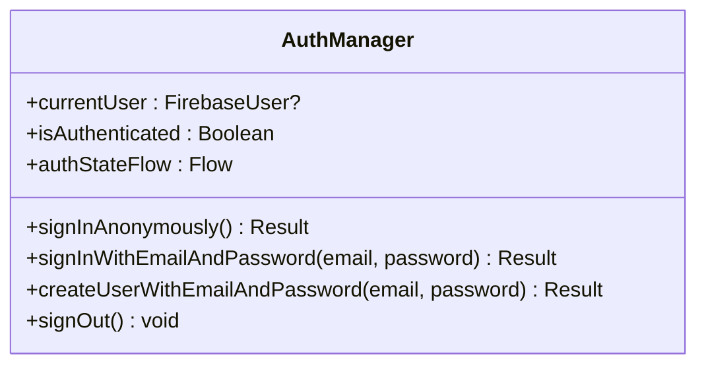

**Diagram sources**
- [AuthManager.kt:12-35](file://app/src/main/java/com/giathinh/canlua/repository/AuthManager.kt#L12-L35)
- [AuthManager.kt:37-72](file://app/src/main/java/com/giathinh/canlua/repository/AuthManager.kt#L37-L72)

**Section sources**
- [AuthManager.kt:12-35](file://app/src/main/java/com/giathinh/canlua/repository/AuthManager.kt#L12-L35)
- [AuthManager.kt:37-72](file://app/src/main/java/com/giathinh/canlua/repository/AuthManager.kt#L37-L72)

### SettingsRepository
Responsibilities:
- Persist app-wide settings (theme, language, font scale, TTS, guest mode, sync preferences).
- Expose reactive Flow for each setting.
- Listen to SharedPreferences changes and update internal StateFlow accordingly.

Key patterns:
- MutableStateFlow backed by SharedPreferences values.
- OnSharedPreferenceChangeListener updates flows atomically.

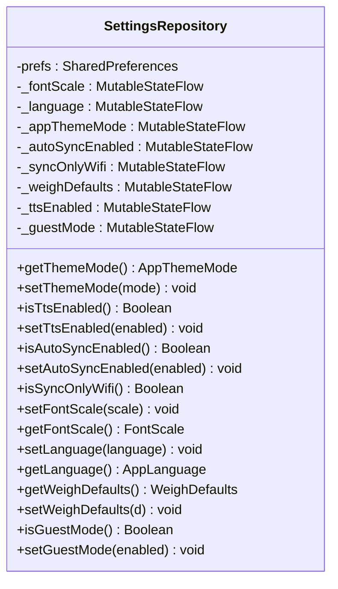

**Diagram sources**
- [SettingsRepository.kt:15-68](file://app/src/main/java/com/giathinh/canlua/repository/SettingsRepository.kt#L15-L68)
- [SettingsRepository.kt:70-162](file://app/src/main/java/com/giathinh/canlua/repository/SettingsRepository.kt#L70-L162)

**Section sources**
- [SettingsRepository.kt:15-68](file://app/src/main/java/com/giathinh/canlua/repository/SettingsRepository.kt#L15-L68)
- [SettingsRepository.kt:70-162](file://app/src/main/java/com/giathinh/canlua/repository/SettingsRepository.kt#L70-L162)
- [SettingsRepository.kt:164-190](file://app/src/main/java/com/giathinh/canlua/repository/SettingsRepository.kt#L164-L190)

### KnowledgeBaseRepository
Responsibilities:
- Load knowledge corpus from JSON assets for farmer and trader audiences.
- Perform keyword-based search with normalization (lowercase, diacritics removal).
- Rank entries by score and return top matches for RAG-lite context injection.

Key patterns:
- Lazy loading of asset files.
- Fallback to empty list if assets are missing or malformed.
- Simple scoring algorithm suitable for small corpora (~10-30 topics).

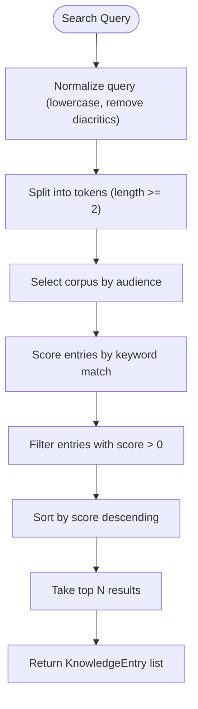

**Diagram sources**
- [KnowledgeBaseRepository.kt:45-53](file://app/src/main/java/com/giathinh/canlua/repository/KnowledgeBaseRepository.kt#L45-L53)
- [KnowledgeBaseRepository.kt:59-81](file://app/src/main/java/com/giathinh/canlua/repository/KnowledgeBaseRepository.kt#L59-L81)
- [KnowledgeBaseRepository.kt:83-104](file://app/src/main/java/com/giathinh/canlua/repository/KnowledgeBaseRepository.kt#L83-L104)

**Section sources**
- [KnowledgeBaseRepository.kt:10-23](file://app/src/main/java/com/giathinh/canlua/repository/KnowledgeBaseRepository.kt#L10-L23)
- [KnowledgeBaseRepository.kt:38-53](file://app/src/main/java/com/giathinh/canlua/repository/KnowledgeBaseRepository.kt#L38-L53)
- [KnowledgeBaseRepository.kt:59-81](file://app/src/main/java/com/giathinh/canlua/repository/KnowledgeBaseRepository.kt#L59-L81)
- [KnowledgeBaseRepository.kt:83-104](file://app/src/main/java/com/giathinh/canlua/repository/KnowledgeBaseRepository.kt#L83-L104)

## Dependency Analysis
The repository layer exhibits clear separation of concerns:
- CardRepository depends on Room DAOs and AuthManager for per-user scoping.
- SyncableCardRepository composes CardRepository and SyncManager to trigger sync workflows.
- SyncManager orchestrates FirestoreRepository and Room DAOs, using SettingsRepository for policy decisions.
- FirestoreRepository depends on Firebase services.
- SupabasePriceRepository depends on SupabaseClient and configuration.
- KnowledgeBaseRepository depends on Context for asset access.

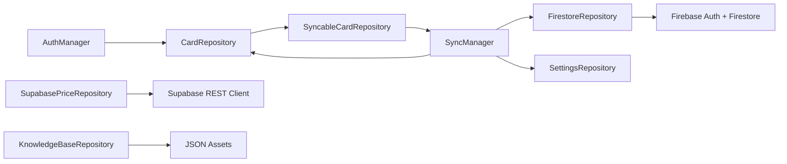

**Diagram sources**
- [CardRepository.kt:36-44](file://app/src/main/java/com/giathinh/canlua/repository/CardRepository.kt#L36-L44)
- [SyncableCardRepository.kt:16-24](file://app/src/main/java/com/giathinh/canlua/repository/SyncableCardRepository.kt#L16-L24)
- [SyncManager.kt:35-45](file://app/src/main/java/com/giathinh/canlua/repository/SyncManager.kt#L35-L45)
- [FirestoreRepository.kt:21-25](file://app/src/main/java/com/giathinh/canlua/repository/FirestoreRepository.kt#L21-L25)
- [SupabasePriceRepository.kt:22-27](file://app/src/main/java/com/giathinh/canlua/repository/SupabasePriceRepository.kt#L22-L27)
- [KnowledgeBaseRepository.kt:20-23](file://app/src/main/java/com/giathinh/canlua/repository/KnowledgeBaseRepository.kt#L20-L23)

**Section sources**
- [CardRepository.kt:36-44](file://app/src/main/java/com/giathinh/canlua/repository/CardRepository.kt#L36-L44)
- [SyncableCardRepository.kt:16-24](file://app/src/main/java/com/giathinh/canlua/repository/SyncableCardRepository.kt#L16-L24)
- [SyncManager.kt:35-45](file://app/src/main/java/com/giathinh/canlua/repository/SyncManager.kt#L35-L45)
- [FirestoreRepository.kt:21-25](file://app/src/main/java/com/giathinh/canlua/repository/FirestoreRepository.kt#L21-L25)
- [SupabasePriceRepository.kt:22-27](file://app/src/main/java/com/giathinh/canlua/repository/SupabasePriceRepository.kt#L22-L27)
- [KnowledgeBaseRepository.kt:20-23](file://app/src/main/java/com/giathinh/canlua/repository/KnowledgeBaseRepository.kt#L20-L23)

## Performance Considerations
- Room database uses indexes on ownerUid, date, riceVariety, and firestoreId to optimize queries.
- Batch writes to Firestore reduce network overhead and respect API limits.
- Client-side sorting avoids composite index requirements in Firestore.
- Tombstone mechanism prevents unnecessary re-insertion of deleted cards.
- SettingsRepository uses SharedPreferences with reactive Flow updates to minimize redundant reads.
- KnowledgeBaseRepository loads assets lazily and uses simple scoring for fast searches on small corpora.

[No sources needed since this section provides general guidance]

## Troubleshooting Guide
Common issues and strategies:
- Authentication transitions: CardRepository returns empty results when uid is blank to avoid crashes during sign-in/out.
- Network errors: FirestoreRepository emits empty lists from snapshot listeners; SupabasePriceRepository logs errors and returns empty lists for fallback.
- Sync failures: SyncManager sets SyncStatus.Error and logs analytics events; WorkManager retries with exponential backoff.
- Conflict resolution: PullDedupResolver handles firestoreId matches, composite key matches, and new card inserts.
- Tombstone cleanup: SyncManager marks tombstones as cloud-deleted after successful deletion and purges them post-recovery.

**Section sources**
- [CardRepository.kt:45-50](file://app/src/main/java/com/giathinh/canlua/repository/CardRepository.kt#L45-L50)
- [FirestoreRepository.kt:268-293](file://app/src/main/java/com/giathinh/canlua/repository/FirestoreRepository.kt#L268-L293)
- [SupabasePriceRepository.kt:37-59](file://app/src/main/java/com/giathinh/canlua/repository/SupabasePriceRepository.kt#L37-L59)
- [SyncManager.kt:139-311](file://app/src/main/java/com/giathinh/canlua/repository/SyncManager.kt#L139-L311)
- [PullDedupResolver.kt:45-73](file://app/src/main/java/com/giathinh/canlua/repository/PullDedupResolver.kt#L45-L73)

## Conclusion
The repository layer in Cân Lúa Mobile provides a robust, offline-first abstraction over multiple data sources. It ensures consistent data access through unified interfaces, prioritizes local Room storage, and synchronizes with Firebase Firestore and Supabase in a controlled, idempotent manner. Authentication, settings, and knowledge base access are encapsulated in dedicated repositories. Error handling, caching, and data transformation pipelines are designed for reliability and performance. Composition patterns enable clean integration with ViewModels via StateFlow and coroutines, supporting a responsive and resilient user experience.

[No sources needed since this section summarizes without analyzing specific files]