# Deployment & Distribution

<cite>
**Referenced Files in This Document**
- [app/build.gradle.kts](file://app/build.gradle.kts)
- [settings.gradle.kts](file://settings.gradle.kts)
- [app/proguard-rules.pro](file://app/proguard-rules.pro)
- [AndroidManifest.xml](file://app/src/main/AndroidManifest.xml)
- [CanLuaApplication.kt](file://app/src/main/java/com/giathinh/canlua/CanLuaApplication.kt)
- [FirebaseRemoteConfigManager.kt](file://app/src/main/java/com/giathinh/canlua/util/FirebaseRemoteConfigManager.kt)
- [AnalyticsHelper.kt](file://app/src/main/java/com/giathinh/canlua/util/AnalyticsHelper.kt)
- [PerformanceTracker.kt](file://app/src/main/java/com/giathinh/canlua/util/PerformanceTracker.kt)
- [network_security_config.xml](file://app/src/main/res/xml/network_security_config.xml)
</cite>

## Table of Contents
1. [Introduction](#introduction)
2. [Project Structure](#project-structure)
3. [Core Components](#core-components)
4. [Architecture Overview](#architecture-overview)
5. [Detailed Component Analysis](#detailed-component-analysis)
6. [Dependency Analysis](#dependency-analysis)
7. [Performance Considerations](#performance-considerations)
8. [Troubleshooting Guide](#troubleshooting-guide)
9. [Conclusion](#conclusion)
10. [Appendices](#appendices)

## Introduction
This document explains how to build, sign, optimize, and distribute Cân Lúa Mobile for production. It covers Gradle build variants, code signing, ProGuard/R8 configuration, Firebase deployment (hosting and remote configuration), Google Play Store release preparation, environment configuration, crash reporting with Crashlytics, analytics, performance monitoring, rollback strategies, update mechanisms, Android version compatibility, and security best practices for production deployments.

The app is a Kotlin 2.3 / Jetpack Compose offline-first Android application targeting minSdk 24 and targetSdk 37, using MVVM + Clean Architecture with StateFlow and coroutines. Local persistence uses AndroidX Room 2.8.4 with schema v18 and an explicit migration chain. Cloud sync is bidirectional to Firebase Firestore and Supabase via WorkManager; the app remains fully functional without network.

## Project Structure
At a high level:
- The Android module is `:app`.
- Build configuration, dependencies, and build types are defined in `app/build.gradle.kts`.
- Global plugin management and repositories are defined in `settings.gradle.kts`.
- Runtime behavior, Firebase initialization, and background work wiring are in `CanLuaApplication.kt`.
- Remote configuration is managed by `FirebaseRemoteConfigManager.kt`.
- Telemetry and performance instrumentation live in `AnalyticsHelper.kt` and `PerformanceTracker.kt`.
- App manifest and network security policy are in `AndroidManifest.xml` and `network_security_config.xml`.
- Code shrinking and obfuscation rules are in `app/proguard-rules.pro`.

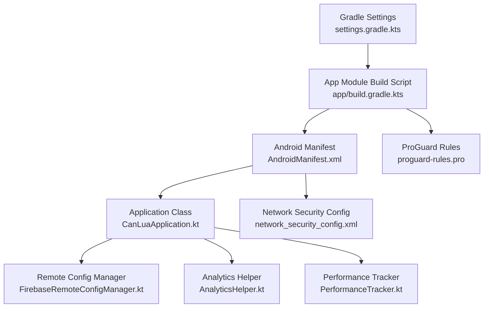

**Diagram sources**
- [settings.gradle.kts:1-22](file://settings.gradle.kts#L1-L22)
- [app/build.gradle.kts:1-214](file://app/build.gradle.kts#L1-L214)
- [AndroidManifest.xml:1-98](file://app/src/main/AndroidManifest.xml#L1-L98)
- [app/proguard-rules.pro:1-66](file://app/proguard-rules.pro#L1-L66)
- [CanLuaApplication.kt:1-125](file://app/src/main/java/com/giathinh/canlua/CanLuaApplication.kt#L1-L125)
- [FirebaseRemoteConfigManager.kt:1-152](file://app/src/main/java/com/giathinh/canlua/util/FirebaseRemoteConfigManager.kt#L1-L152)
- [AnalyticsHelper.kt:1-101](file://app/src/main/java/com/giathinh/canlua/util/AnalyticsHelper.kt#L1-L101)
- [PerformanceTracker.kt:1-259](file://app/src/main/java/com/giathinh/canlua/util/PerformanceTracker.kt#L1-L259)
- [network_security_config.xml:1-45](file://app/src/main/res/xml/network_security_config.xml#L1-L45)

**Section sources**
- [settings.gradle.kts:1-22](file://settings.gradle.kts#L1-L22)
- [app/build.gradle.kts:1-214](file://app/build.gradle.kts#L1-L214)

## Core Components
- Build system and variants:
  - Plugins include Android Application, Hilt, KSP, Kotlin Compose, Google Services, Firebase Crashlytics, and Firebase Performance.
  - Default config sets namespace, compileSdk, minSdk, targetSdk, versionCode/versionName derived from Git commit count, and injects secrets into BuildConfig as Base64-encoded strings.
  - Build types define debug and release; release enables R8 minify and resource shrinker, applies ProGuard rules, and references a signing config named `debug` (must be replaced with a production signing config).
- Secrets and environment:
  - Secrets are loaded from `local.properties` and injected into `BuildConfig` and `AndroidManifest` placeholders.
- Runtime initialization:
  - Application class installs Firebase App Check (Debug or Play Integrity provider depending on build type), initializes Analytics, Premium state, and Remote Config, then schedules background sync based on user preferences.
- Telemetry and performance:
  - Analytics helper centralizes Firebase Analytics events and Crashlytics non-fatal logs.
  - Performance tracker measures screen traces, load traces, and frame metrics, sending data to Firebase Performance.

**Section sources**
- [app/build.gradle.kts:5-13](file://app/build.gradle.kts#L5-L13)
- [app/build.gradle.kts:15-62](file://app/build.gradle.kts#L15-L62)
- [app/build.gradle.kts:64-84](file://app/build.gradle.kts#L64-L84)
- [AndroidManifest.xml:30-38](file://app/src/main/AndroidManifest.xml#L30-L38)
- [CanLuaApplication.kt:53-77](file://app/src/main/java/com/giathinh/canlua/CanLuaApplication.kt#L53-L77)
- [AnalyticsHelper.kt:1-101](file://app/src/main/java/com/giathinh/canlua/util/AnalyticsHelper.kt#L1-L101)
- [PerformanceTracker.kt:1-259](file://app/src/main/java/com/giathinh/canlua/util/PerformanceTracker.kt#L1-L259)

## Architecture Overview
The deployment pipeline integrates Gradle, Firebase services, and runtime components:

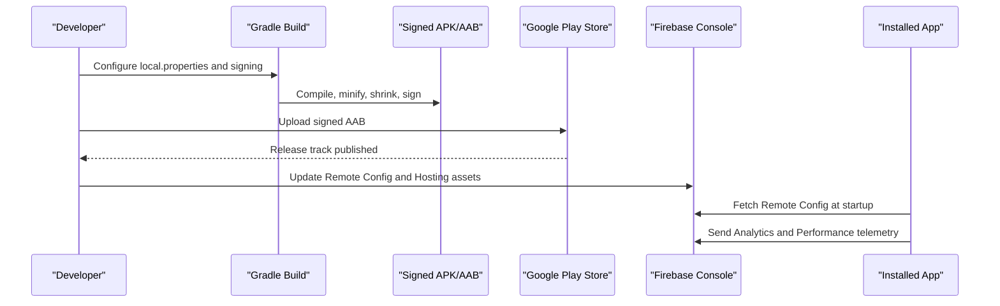

**Diagram sources**
- [app/build.gradle.kts:15-62](file://app/build.gradle.kts#L15-L62)
- [app/build.gradle.kts:64-84](file://app/build.gradle.kts#L64-L84)
- [CanLuaApplication.kt:53-77](file://app/src/main/java/com/giathinh/canlua/CanLuaApplication.kt#L53-L77)
- [FirebaseRemoteConfigManager.kt:57-81](file://app/src/main/java/com/giathinh/canlua/util/FirebaseRemoteConfigManager.kt#L57-L81)

## Detailed Component Analysis

### Gradle Build Configuration and Variants
- Plugins:
  - Android Application, Hilt, KSP, Kotlin Compose, Google Services, Firebase Crashlytics, Firebase Performance.
- Default config:
  - Namespace: `com.giathinh.canlua`
  - compileSdk/targetSdk: 37
  - minSdk: 24
  - versionCode/versionName derived from Git commit count.
  - BuildConfig fields for API keys and tokens (Base64-encoded where appropriate).
  - Manifest placeholder for Maps API key.
- Build types:
  - Debug: no minification.
  - Release: minify enabled, resource shrinker enabled, ProGuard rules applied, signing config referenced as `debug` (replace with production keystore).
- Dependencies:
  - Firebase BoM and modules for Firestore, Auth, Analytics, Crashlytics, Performance, Storage, Remote Config, App Check.
  - Networking, UI, location, permissions, markdown rendering, Coil, Browser, DataStore, Security Crypto, Ads SDKs.

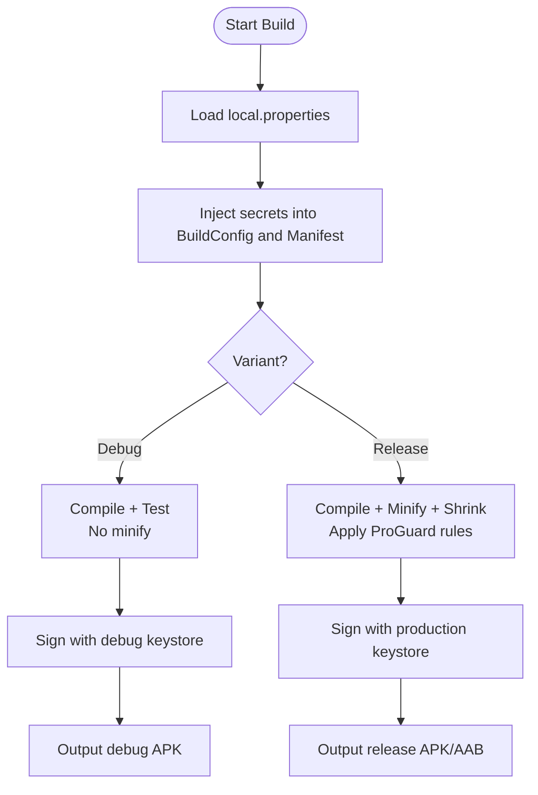

**Diagram sources**
- [app/build.gradle.kts:15-62](file://app/build.gradle.kts#L15-L62)
- [app/build.gradle.kts:64-84](file://app/build.gradle.kts#L64-L84)

**Section sources**
- [app/build.gradle.kts:5-13](file://app/build.gradle.kts#L5-L13)
- [app/build.gradle.kts:15-62](file://app/build.gradle.kts#L15-L62)
- [app/build.gradle.kts:64-84](file://app/build.gradle.kts#L64-L84)
- [app/build.gradle.kts:99-210](file://app/build.gradle.kts#L99-L210)

### Code Signing Setup for Production APKs
- Current configuration references `signingConfigs.getByName("debug")` for release builds. For production:
  - Create a production keystore file and store its path securely outside the repository.
  - Add a `signingConfigs` block in `app/build.gradle.kts` referencing the keystore path, alias, and passwords via environment variables or secure secret managers.
  - Assign the production signing config to the release build type.
  - Generate both APK and AAB outputs; prefer AAB for Google Play Store distribution.

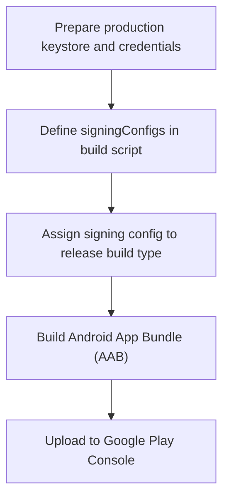

**Diagram sources**
- [app/build.gradle.kts:64-84](file://app/build.gradle.kts#L64-L84)

**Section sources**
- [app/build.gradle.kts:64-84](file://app/build.gradle.kts#L64-L84)

### ProGuard/R8 Configuration for Obfuscation and Optimization
- Enabled in release builds with default optimization rules and project-specific rules.
- Key keep rules protect:
  - Generic signatures, annotations, source file info.
  - Credential Manager and Google ID classes.
  - Firestore and Gson model classes under `data.firestore` and `data.model`.
  - DTOs and serialization models used by JSON parsing.
  - Room entity fields and constructors.
  - Hilt injection points.
  - Markwon reflection-based extensions.
- Debug logs stripped while preserving critical logs for Crashlytics and logcat.

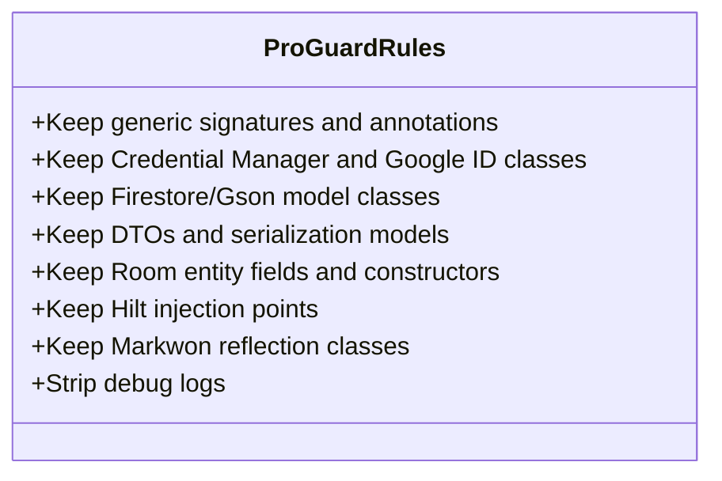

**Diagram sources**
- [app/proguard-rules.pro:1-66](file://app/proguard-rules.pro#L1-L66)

**Section sources**
- [app/build.gradle.kts:64-84](file://app/build.gradle.kts#L64-L84)
- [app/proguard-rules.pro:1-66](file://app/proguard-rules.pro#L1-L66)

### Firebase Deployment: Hosting Static Assets and Remote Configuration
- Remote Configuration:
  - Initialized in Application startup with a 30-minute minimum fetch interval.
  - Provides typed accessors for feature flags and URLs (e.g., early adopter settings, tutorial video URL, website URL).
  - Supports force fetch for immediate updates when needed.
- Hosting static assets:
  - The app declares deep links to `canluavn.web.app` and `canluavn.firebaseapp.com`, indicating Firebase Hosting usage.
  - Ensure hosting site is configured and assets are updated via Firebase CLI or console.

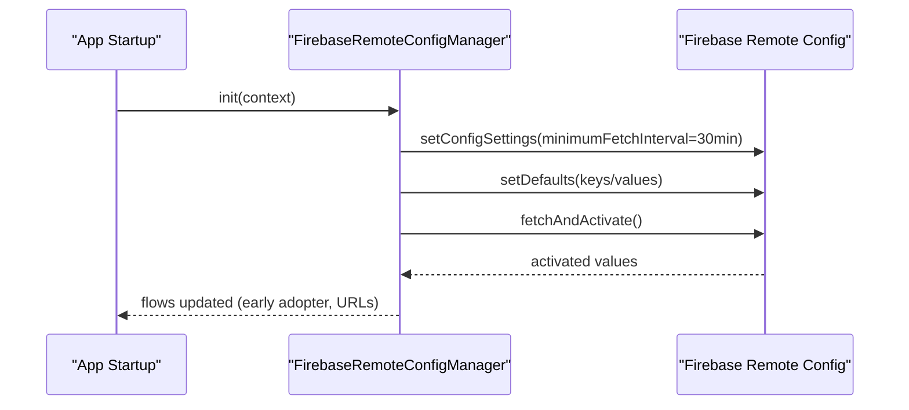

**Diagram sources**
- [CanLuaApplication.kt:53-77](file://app/src/main/java/com/giathinh/canlua/CanLuaApplication.kt#L53-L77)
- [FirebaseRemoteConfigManager.kt:57-81](file://app/src/main/java/com/giathinh/canlua/util/FirebaseRemoteConfigManager.kt#L57-L81)

**Section sources**
- [AndroidManifest.xml:51-61](file://app/src/main/AndroidManifest.xml#L51-L61)
- [FirebaseRemoteConfigManager.kt:1-152](file://app/src/main/java/com/giathinh/canlua/util/FirebaseRemoteConfigManager.kt#L1-L152)
- [CanLuaApplication.kt:53-77](file://app/src/main/java/com/giathinh/canlua/CanLuaApplication.kt#L53-L77)

### Google Play Store Release Preparation
- App Bundle generation:
  - Use Gradle tasks to generate AAB (`bundleRelease`).
  - Ensure signing config is correctly assigned to release builds.
- Version management:
  - versionCode and versionName are derived from Git commit count; ensure CI pipeline increments commits consistently.
- Store listing preparation:
  - Prepare screenshots, descriptions, and metadata in Google Play Console.
  - Verify deep links and domain verification for hosted assets.

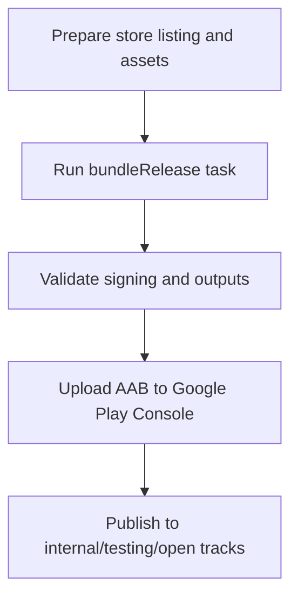

**Diagram sources**
- [app/build.gradle.kts:42-47](file://app/build.gradle.kts#L42-L47)
- [app/build.gradle.kts:64-84](file://app/build.gradle.kts#L64-L84)

**Section sources**
- [app/build.gradle.kts:42-47](file://app/build.gradle.kts#L42-L47)
- [app/build.gradle.kts:64-84](file://app/build.gradle.kts#L64-L84)

### Environment Configuration for Different Targets
- Secrets loading:
  - `local.properties` contains keys such as MAPS_API_KEY, APP_HANDSHAKE_TOKEN, OPENROUTER_API_KEY, TELEGRAM_BOT_TOKEN, TELEGRAM_ADMIN_CHAT_ID, SUPABASE_URL, SUPABASE_ANON_KEY.
  - These are injected into BuildConfig and manifest placeholders.
- Build-type differentiation:
  - Debug builds skip minification and use Debug App Check provider if available; release builds use Play Integrity App Check provider.
- Network security:
  - Cleartext traffic is disabled by default; specific CDN domains are whitelisted for news images.

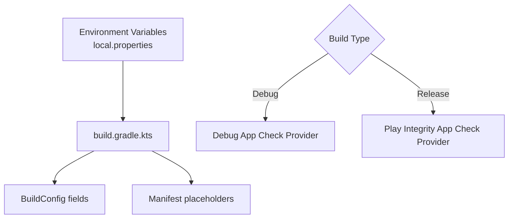

**Diagram sources**
- [app/build.gradle.kts:15-62](file://app/build.gradle.kts#L15-L62)
- [CanLuaApplication.kt:55-63](file://app/src/main/java/com/giathinh/canlua/CanLuaApplication.kt#L55-L63)
- [network_security_config.xml:1-45](file://app/src/main/res/xml/network_security_config.xml#L1-L45)

**Section sources**
- [app/build.gradle.kts:15-62](file://app/build.gradle.kts#L15-L62)
- [AndroidManifest.xml:30-38](file://app/src/main/AndroidManifest.xml#L30-L38)
- [CanLuaApplication.kt:55-63](file://app/src/main/java/com/giathinh/canlua/CanLuaApplication.kt#L55-L63)
- [network_security_config.xml:1-45](file://app/src/main/res/xml/network_security_config.xml#L1-L45)

### Crash Reporting, Analytics, and Performance Monitoring
- Crashlytics:
  - Integrated via Firebase Crashlytics plugin and dependency.
  - Non-fatal exceptions logged through `AnalyticsHelper.logNonFatal`.
  - User identification and custom keys set via `setUser` and `setPremium`.
- Analytics:
  - Centralized event logging with semantic names and parameters.
  - User properties for role and premium status.
- Performance Monitoring:
  - Screen traces measure duration, CPU, RAM.
  - Load traces measure Time to First Render.
  - Frame metrics aggregation captures slow/frozen frames.

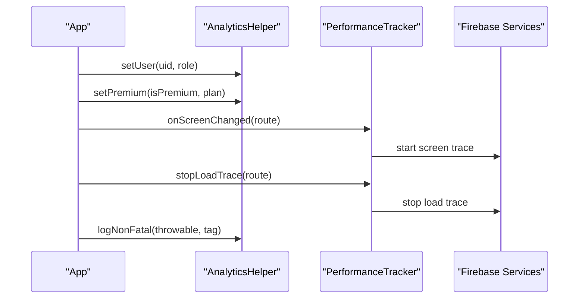

**Diagram sources**
- [AnalyticsHelper.kt:24-46](file://app/src/main/java/com/giathinh/canlua/util/AnalyticsHelper.kt#L24-L46)
- [AnalyticsHelper.kt:86-99](file://app/src/main/java/com/giathinh/canlua/util/AnalyticsHelper.kt#L86-L99)
- [PerformanceTracker.kt:71-90](file://app/src/main/java/com/giathinh/canlua/util/PerformanceTracker.kt#L71-L90)
- [PerformanceTracker.kt:172-198](file://app/src/main/java/com/giathinh/canlua/util/PerformanceTracker.kt#L172-L198)

**Section sources**
- [AnalyticsHelper.kt:1-101](file://app/src/main/java/com/giathinh/canlua/util/AnalyticsHelper.kt#L1-L101)
- [PerformanceTracker.kt:1-259](file://app/src/main/java/com/giathinh/canlua/util/PerformanceTracker.kt#L1-L259)

### Rollback Strategies, Update Mechanisms, and Compatibility
- Rollback strategies:
  - Use Google Play’s internal testing or closed tracks to validate releases before open rollout.
  - Maintain previous stable versions in Play Console for quick rollback if issues arise.
- Update mechanisms:
  - Firebase Remote Config can toggle features or change URLs without requiring app updates.
  - Hosting static assets can be updated independently of app releases.
- Compatibility considerations:
  - minSdk 24 ensures broad device support.
  - targetSdk 37 aligns with latest platform behaviors; verify permission handling and background execution constraints.
  - Network security defaults enforce HTTPS; only explicitly whitelisted domains allow cleartext.

**Section sources**
- [app/build.gradle.kts:42-47](file://app/build.gradle.kts#L42-L47)
- [network_security_config.xml:1-45](file://app/src/main/res/xml/network_security_config.xml#L1-L45)
- [FirebaseRemoteConfigManager.kt:57-81](file://app/src/main/java/com/giathinh/canlua/util/FirebaseRemoteConfigManager.kt#L57-L81)

### Security Best Practices for Production Deployments
- API key management:
  - Keep secrets in `local.properties` and never commit them.
  - Inject secrets into BuildConfig and manifest placeholders; avoid hardcoding in source.
- Sensitive data handling:
  - Do not log PII; use hashed identifiers and business metrics in analytics.
  - Use Firebase App Check to protect backend resources.
- Network security:
  - Disable cleartext globally; whitelist only necessary domains.
  - Use HTTPS for all external communications.

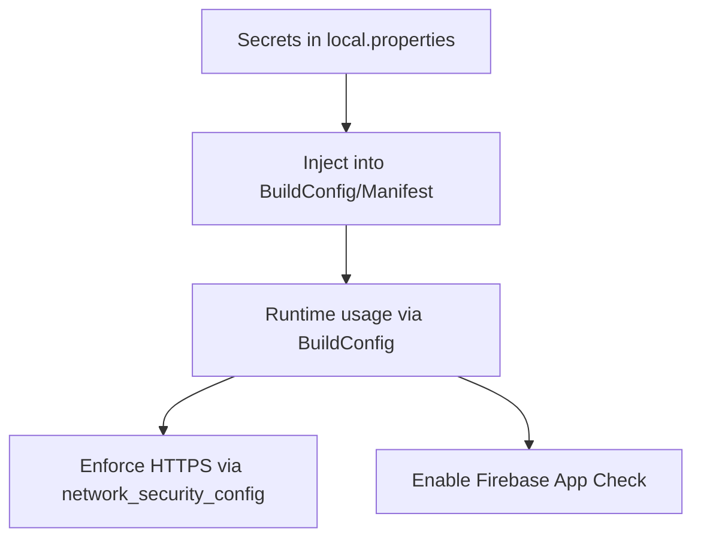

**Diagram sources**
- [app/build.gradle.kts:15-62](file://app/build.gradle.kts#L15-L62)
- [AndroidManifest.xml:30-38](file://app/src/main/AndroidManifest.xml#L30-L38)
- [network_security_config.xml:1-45](file://app/src/main/res/xml/network_security_config.xml#L1-L45)
- [CanLuaApplication.kt:55-63](file://app/src/main/java/com/giathinh/canlua/CanLuaApplication.kt#L55-L63)

**Section sources**
- [app/build.gradle.kts:15-62](file://app/build.gradle.kts#L15-L62)
- [AndroidManifest.xml:30-38](file://app/src/main/AndroidManifest.xml#L30-L38)
- [network_security_config.xml:1-45](file://app/src/main/res/xml/network_security_config.xml#L1-L45)
- [CanLuaApplication.kt:55-63](file://app/src/main/java/com/giathinh/canlua/CanLuaApplication.kt#L55-L63)

## Dependency Analysis
High-level dependency relationships relevant to deployment:

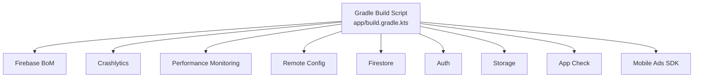

**Diagram sources**
- [app/build.gradle.kts:99-210](file://app/build.gradle.kts#L99-L210)

**Section sources**
- [app/build.gradle.kts:99-210](file://app/build.gradle.kts#L99-L210)

## Performance Considerations
- Release builds enable R8 minification and resource shrinking to reduce APK size and improve startup time.
- Avoid over-minifying assets required at runtime (knowledge JSON files); resource shrinker is enabled but care must be taken to preserve assets.
- Performance tracking includes screen traces, load traces, and frame metrics; ensure proper lifecycle hooks are in place to start and stop traces accurately.

[No sources needed since this section provides general guidance]

## Troubleshooting Guide
- Build failures due to missing secrets:
  - Ensure `local.properties` exists with required keys; verify they are injected into BuildConfig and manifest placeholders.
- Crashlytics symbol mapping issues:
  - Confirm ProGuard rules are applied and symbols are uploaded during release builds.
- Remote Config not updating:
  - Check minimum fetch interval and network connectivity; use force fetch for immediate updates during testing.
- Network errors for news images:
  - Verify domain whitelisting in `network_security_config.xml`; ensure HTTPS is used where possible.

**Section sources**
- [app/build.gradle.kts:15-62](file://app/build.gradle.kts#L15-L62)
- [app/proguard-rules.pro:1-66](file://app/proguard-rules.pro#L1-L66)
- [FirebaseRemoteConfigManager.kt:111-118](file://app/src/main/java/com/giathinh/canlua/util/FirebaseRemoteConfigManager.kt#L111-L118)
- [network_security_config.xml:1-45](file://app/src/main/res/xml/network_security_config.xml#L1-L45)

## Conclusion
Cân Lúa Mobile’s deployment pipeline leverages Gradle for multi-variant builds, Firebase for remote configuration and telemetry, and ProGuard/R8 for code optimization. Production releases require secure signing, careful secret management, and adherence to network security policies. With Firebase Hosting and Remote Config, teams can update content and features without app revisions. Proper analytics, crash reporting, and performance monitoring provide visibility into user experience and stability across Android versions.

[No sources needed since this section summarizes without analyzing specific files]

## Appendices
- Recommended CI steps:
  - Install JDK 11, configure Android SDK, read secrets from secure vaults, run tests, build AAB, sign with production keystore, upload to Google Play Console.
- Checklist for production release:
  - Verify signing config, minSdk/targetSdk, ProGuard rules, Firebase services initialized, Remote Config defaults, network security policy, and store listing completeness.

[No sources needed since this section provides general guidance]