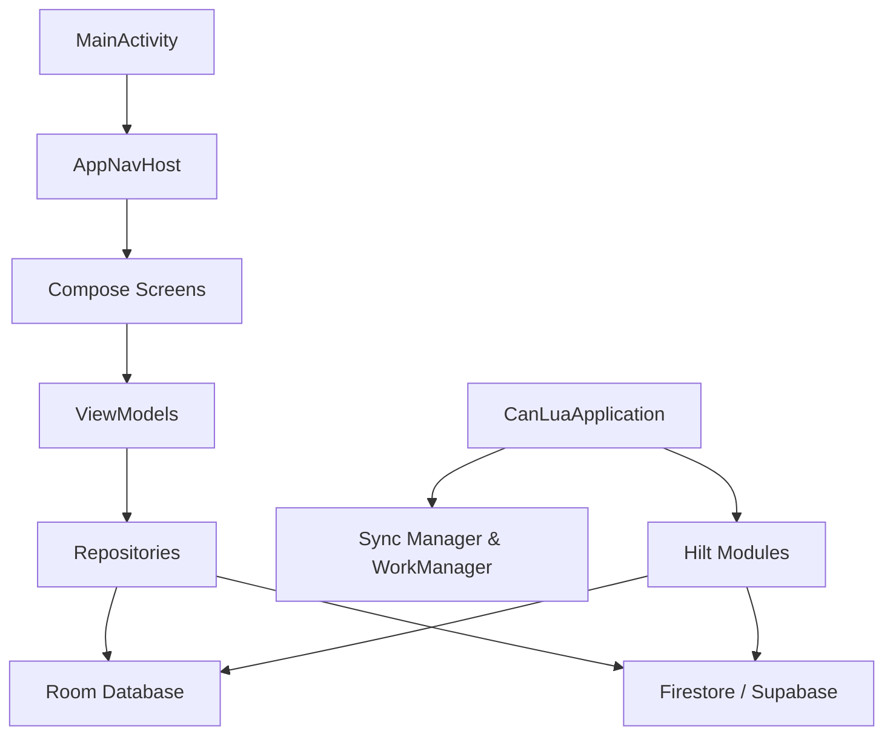
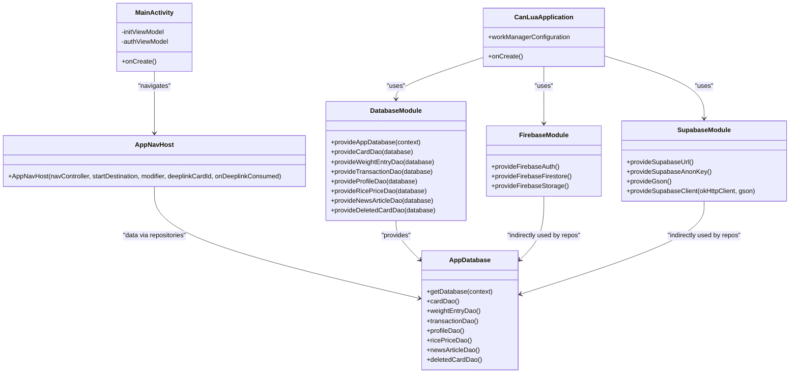
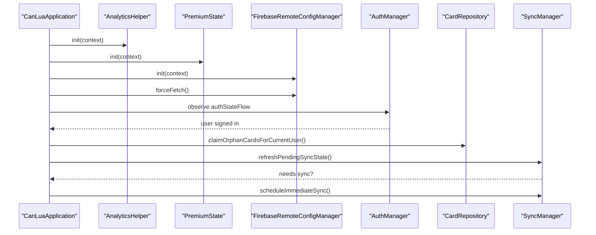
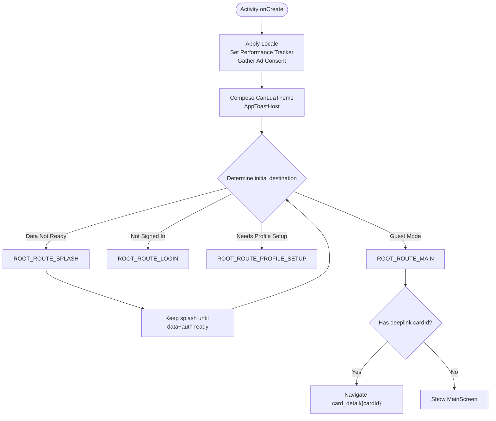
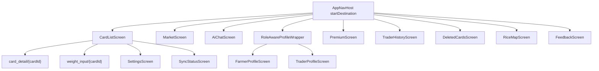
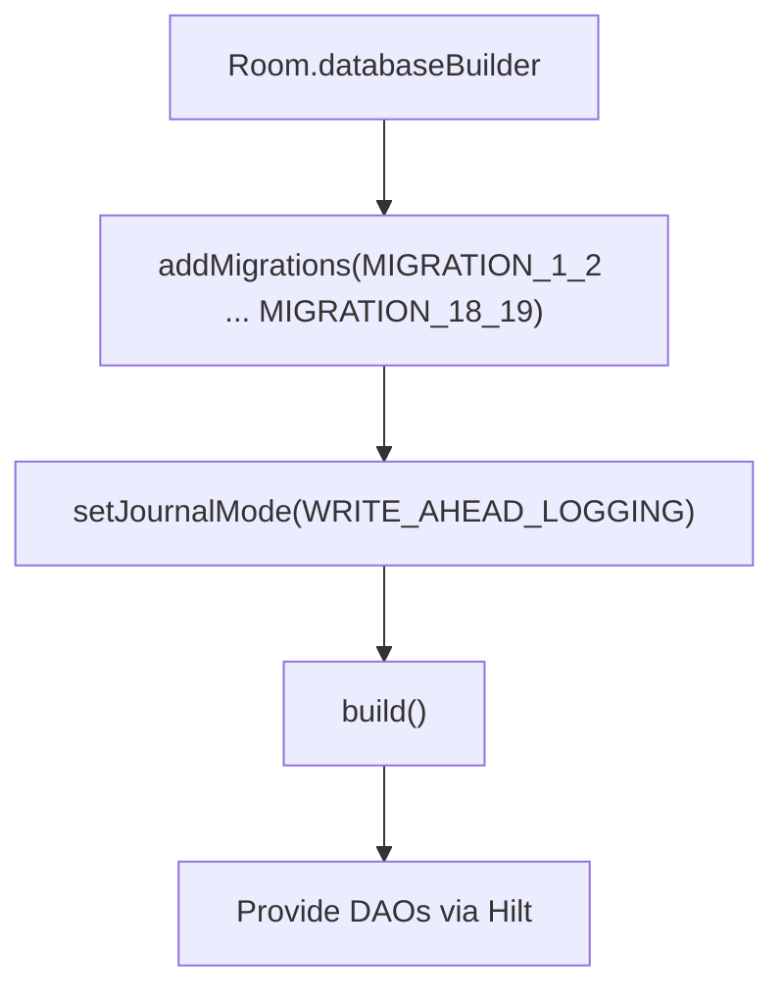
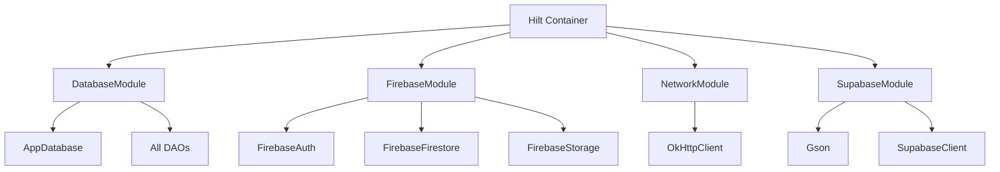
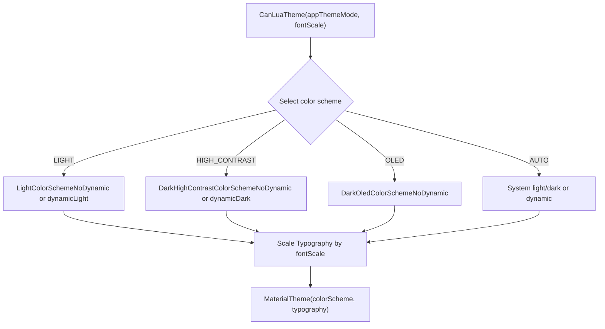
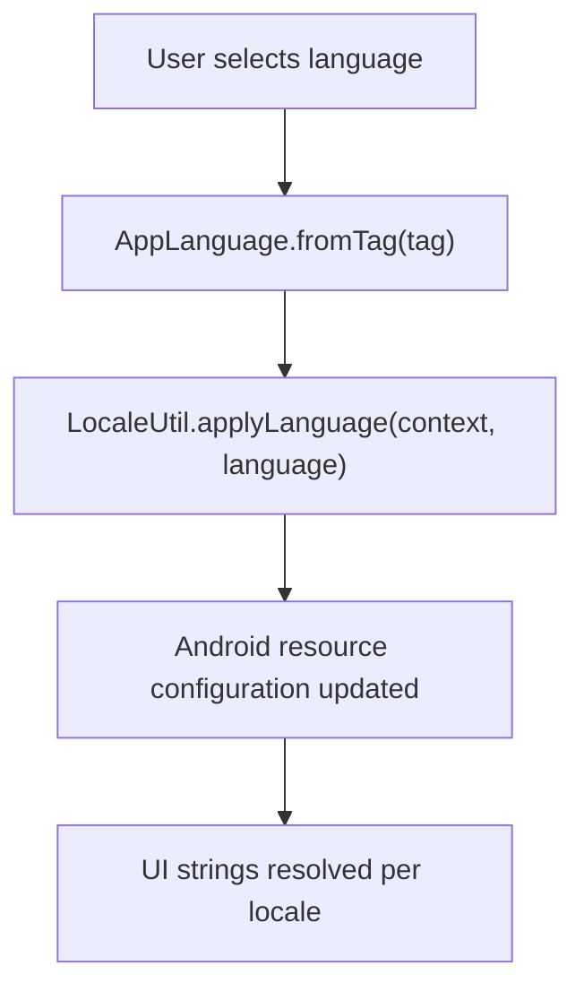
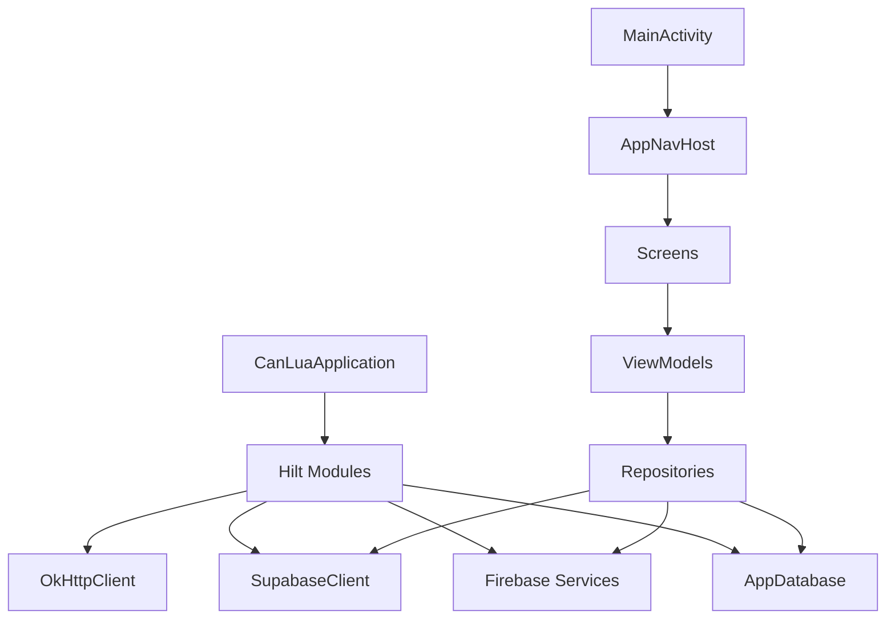

# Developer Guide

<cite>
**Referenced Files in This Document**
- [MainActivity.kt](file://app/src/main/java/com/giathinh/canlua/MainActivity.kt)
- [CanLuaApplication.kt](file://app/src/main/java/com/giathinh/canlua/CanLuaApplication.kt)
- [AppNavHost.kt](file://app/src/main/java/com/giathinh/canlua/ui/navigation/AppNavHost.kt)
- [AppDatabase.kt](file://app/src/main/java/com/giathinh/canlua/data/database/AppDatabase.kt)
- [DatabaseModule.kt](file://app/src/main/java/com/giathinh/canlua/di/DatabaseModule.kt)
- [FirebaseModule.kt](file://app/src/main/java/com/giathinh/canlua/di/FirebaseModule.kt)
- [NetworkModule.kt](file://app/src/main/java/com/giathinh/canlua/di/NetworkModule.kt)
- [SupabaseModule.kt](file://app/src/main/java/com/giathinh/canlua/di/SupabaseModule.kt)
- [Theme.kt](file://app/src/main/java/com/giathinh/canlua/ui/theme/Theme.kt)
- [AppColors.kt](file://app/src/main/java/com/giathinh/canlua/ui/theme/AppColors.kt)
- [Type.kt](file://app/src/main/java/com/giathinh/canlua/ui/theme/Type.kt)
- [AppLanguage.kt](file://app/src/main/java/com/giathinh/canlua/data/model/AppLanguage.kt)
- [LocaleUtil.kt](file://app/src/main/java/com/giathinh/canlua/util/LocaleUtil.kt)
- [strings.xml](file://app/src/main/res/values/strings.xml)
- [strings-en.xml](file://app/src/main/res/values-en/strings.xml)
</cite>

## Table of Contents
1. [Introduction](#introduction)
2. [Project Structure](#project-structure)
3. [Core Components](#core-components)
4. [Architecture Overview](#architecture-overview)
5. [Detailed Component Analysis](#detailed-component-analysis)
6. [Dependency Analysis](#dependency-analysis)
7. [Performance Considerations](#performance-considerations)
8. [Troubleshooting Guide](#troubleshooting-guide)
9. [Conclusion](#conclusion)
10. [Appendices](#appendices)

## Introduction
This developer guide explains how to contribute to Cân Lúa Mobile, an offline-first Android app built with Kotlin 2.3 and Jetpack Compose. The app follows MVVM + Clean Architecture with unidirectional data flow via StateFlow and coroutines. Local persistence uses AndroidX Room (schema v19), while cloud sync is bidirectional to Firebase Firestore and Supabase through WorkManager. The app supports three roles — FARMER, TRADER, and GUEST — and integrates AI features through OpenRouter with RAG context from local knowledge JSON files.

The guide covers coding standards, contribution workflow, debugging, localization, shared components, theme system, performance, testing, and extension examples.

## Project Structure
The project is organized by feature and layer:
- Application entry points: `CanLuaApplication` for global initialization and `MainActivity` for navigation and UI composition.
- Data layer: Room database, DAOs, models, converters, and remote clients.
- Repository layer: Business logic and data orchestration.
- UI layer: Compose screens, reusable components, navigation, theming, and utilities.
- Dependency injection: Hilt modules for database, network, Firebase, and Supabase.

**Diagram sources**
- [CanLuaApplication.kt:28-77](file://app/src/main/java/com/giathinh/canlua/CanLuaApplication.kt#L28-L77)
- [MainActivity.kt:39-145](file://app/src/main/java/com/giathinh/canlua/MainActivity.kt#L39-L145)
- [AppNavHost.kt:31-136](file://app/src/main/java/com/giathinh/canlua/ui/navigation/AppNavHost.kt#L31-L136)
- [AppDatabase.kt:24-46](file://app/src/main/java/com/giathinh/canlua/data/database/AppDatabase.kt#L24-L46)
- [FirebaseModule.kt:12-33](file://app/src/main/java/com/giathinh/canlua/di/FirebaseModule.kt#L12-L33)
- [SupabaseModule.kt:14-40](file://app/src/main/java/com/giathinh/canlua/di/SupabaseModule.kt#L14-L40)

**Section sources**
- [CanLuaApplication.kt:28-77](file://app/src/main/java/com/giathinh/canlua/CanLuaApplication.kt#L28-L77)
- [MainActivity.kt:39-145](file://app/src/main/java/com/giathinh/canlua/MainActivity.kt#L39-L145)
- [AppNavHost.kt:31-136](file://app/src/main/java/com/giathinh/canlua/ui/navigation/AppNavHost.kt#L31-L136)

## Core Components
- Application bootstrap: Initializes analytics, premium state, Firebase Remote Config, early adopter eligibility, and sync scheduling.
- Main activity: Applies language, theme, font scale, and routes users through splash, auth, profile setup, and main app.
- Navigation host: Central route table for tabs and sub-screens with consistent transitions and role-aware wrappers.
- Database: Room schema v19 with explicit migrations; entities include cards, weight entries, transactions, profiles, rice prices, price history, news articles, and deleted cards.
- Dependency injection: Hilt modules provide database instances, DAOs, Firebase services, OkHttp client, and Supabase client.

Key responsibilities:
- Offline-first data access via Room.
- Bidirectional sync to Firestore and Supabase.
- Role-based UI routing (Farmer/Trader/Guest).
- Theme and typography scaling for accessibility.
- Localization across Vietnamese, English, Khmer, Lao, and Chinese.

**Section sources**
- [CanLuaApplication.kt:28-77](file://app/src/main/java/com/giathinh/canlua/CanLuaApplication.kt#L28-L77)
- [MainActivity.kt:39-145](file://app/src/main/java/com/giathinh/canlua/MainActivity.kt#L39-L145)
- [AppNavHost.kt:31-136](file://app/src/main/java/com/giathinh/canlua/ui/navigation/AppNavHost.kt#L31-L136)
- [AppDatabase.kt:24-46](file://app/src/main/java/com/giathinh/canlua/data/database/AppDatabase.kt#L24-L46)
- [DatabaseModule.kt:18-75](file://app/src/main/java/com/giathinh/canlua/di/DatabaseModule.kt#L18-L75)
- [FirebaseModule.kt:12-33](file://app/src/main/java/com/giathinh/canlua/di/FirebaseModule.kt#L12-L33)
- [SupabaseModule.kt:14-40](file://app/src/main/java/com/giathinh/canlua/di/SupabaseModule.kt#L14-L40)

## Architecture Overview
The app implements MVVM + Clean Architecture:
- UI layer: Compose screens and reusable components observe ViewModel state.
- ViewModels: Manage UI state, orchestrate repository calls, and expose StateFlow.
- Repositories: Abstract data sources and implement business rules.
- Data sources: Room DAOs for local storage; Firestore and Supabase clients for cloud sync.
- DI: Hilt provides singletons and scoped dependencies.

**Diagram sources**
- [CanLuaApplication.kt:28-77](file://app/src/main/java/com/giathinh/canlua/CanLuaApplication.kt#L28-L77)
- [MainActivity.kt:39-145](file://app/src/main/java/com/giathinh/canlua/MainActivity.kt#L39-L145)
- [AppNavHost.kt:31-136](file://app/src/main/java/com/giathinh/canlua/ui/navigation/AppNavHost.kt#L31-L136)
- [AppDatabase.kt:24-46](file://app/src/main/java/com/giathinh/canlua/data/database/AppDatabase.kt#L24-L46)
- [DatabaseModule.kt:18-75](file://app/src/main/java/com/giathinh/canlua/di/DatabaseModule.kt#L18-L75)
- [FirebaseModule.kt:12-33](file://app/src/main/java/com/giathinh/canlua/di/FirebaseModule.kt#L12-L33)
- [SupabaseModule.kt:14-40](file://app/src/main/java/com/giathinh/canlua/di/SupabaseModule.kt#L14-L40)

## Detailed Component Analysis

### Application Bootstrap and Initialization
- Initializes Firebase App Check provider based on build type.
- Starts analytics, premium state, and remote config.
- Schedules orphan card claims and auto-sync behavior.
- Observes auto-sync preferences to schedule or cancel background sync.

**Diagram sources**
- [CanLuaApplication.kt:53-77](file://app/src/main/java/com/giathinh/canlua/CanLuaApplication.kt#L53-L77)
- [CanLuaApplication.kt:93-124](file://app/src/main/java/com/giathinh/canlua/CanLuaApplication.kt#L93-L124)

**Section sources**
- [CanLuaApplication.kt:28-77](file://app/src/main/java/com/giathinh/canlua/CanLuaApplication.kt#L28-L77)
- [CanLuaApplication.kt:93-124](file://app/src/main/java/com/giathinh/canlua/CanLuaApplication.kt#L93-L124)

### Main Activity and Root Navigation
- Applies locale, theme mode, and font scale before composing UI.
- Controls splash screen retention until data and auth states are ready.
- Routes users to login, profile setup, or main app depending on auth and guest mode.
- Handles deep links to shareable card detail pages.

**Diagram sources**
- [MainActivity.kt:45-145](file://app/src/main/java/com/giathinh/canlua/MainActivity.kt#L45-L145)

**Section sources**
- [MainActivity.kt:39-145](file://app/src/main/java/com/giathinh/canlua/MainActivity.kt#L39-L145)

### App Navigation Host
- Defines all top-level routes and tab destinations.
- Provides consistent enter/exit/pop transitions.
- Wraps account/profile screens with role awareness (Farmer vs Trader).
- Supports deep link consumption and navigation parameters.

**Diagram sources**
- [AppNavHost.kt:31-136](file://app/src/main/java/com/giathinh/canlua/ui/navigation/AppNavHost.kt#L31-L136)
- [AppNavHost.kt:139-150](file://app/src/main/java/com/giathinh/canlua/ui/navigation/AppNavHost.kt#L139-L150)

**Section sources**
- [AppNavHost.kt:31-136](file://app/src/main/java/com/giathinh/canlua/ui/navigation/AppNavHost.kt#L31-L136)
- [AppNavHost.kt:139-150](file://app/src/main/java/com/giathinh/canlua/ui/navigation/AppNavHost.kt#L139-L150)

### Room Database and Migrations
- Schema version 19 with 8 entities: Card, WeightEntry, Transaction, Profile, RicePrice, PricePoint, NewsArticle, DeletedCard.
- Explicit migration chain from v1 to v19 covering per-user isolation, cross-device deduplication, conflict resolution, tombstone deletion, weigh modes, and overpaid amount tracking.
- Journal mode set to WRITE_AHEAD_LOGGING for improved concurrency.

**Diagram sources**
- [AppDatabase.kt:48-82](file://app/src/main/java/com/giathinh/canlua/data/database/AppDatabase.kt#L48-L82)
- [AppDatabase.kt:84-398](file://app/src/main/java/com/giathinh/canlua/data/database/AppDatabase.kt#L84-L398)

**Section sources**
- [AppDatabase.kt:24-46](file://app/src/main/java/com/giathinh/canlua/data/database/AppDatabase.kt#L24-L46)
- [AppDatabase.kt:48-82](file://app/src/main/java/com/giathinh/canlua/data/database/AppDatabase.kt#L48-L82)
- [AppDatabase.kt:84-398](file://app/src/main/java/com/giathinh/canlua/data/database/AppDatabase.kt#L84-L398)

### Dependency Injection Modules
- DatabaseModule: Provides AppDatabase instance and all DAOs; also provides TextToSpeechManager and SettingsRepository.
- FirebaseModule: Provides FirebaseAuth, FirebaseFirestore, and FirebaseStorage.
- NetworkModule: Provides OkHttpClient with timeouts, logging, User-Agent header, and retry interceptor.
- SupabaseModule: Provides Gson, Supabase URL/key, and SupabaseClient.

**Diagram sources**
- [DatabaseModule.kt:18-75](file://app/src/main/java/com/giathinh/canlua/di/DatabaseModule.kt#L18-L75)
- [FirebaseModule.kt:12-33](file://app/src/main/java/com/giathinh/canlua/di/FirebaseModule.kt#L12-L33)
- [NetworkModule.kt:13-76](file://app/src/main/java/com/giathinh/canlua/di/NetworkModule.kt#L13-L76)
- [SupabaseModule.kt:14-40](file://app/src/main/java/com/giathinh/canlua/di/SupabaseModule.kt#L14-L40)

**Section sources**
- [DatabaseModule.kt:18-75](file://app/src/main/java/com/giathinh/canlua/di/DatabaseModule.kt#L18-L75)
- [FirebaseModule.kt:12-33](file://app/src/main/java/com/giathinh/canlua/di/FirebaseModule.kt#L12-L33)
- [NetworkModule.kt:13-76](file://app/src/main/java/com/giathinh/canlua/di/NetworkModule.kt#L13-L76)
- [SupabaseModule.kt:14-40](file://app/src/main/java/com/giathinh/canlua/di/SupabaseModule.kt#L14-L40)

### Theme System and Design Guidelines
- Theme modes: LIGHT, HIGH_CONTRAST, OLED, AUTO.
- Dynamic color support on Android 12+.
- Typography scaling via FontScale for accessibility.
- Color palette centered around green primary, gold accent, and neutral surfaces with dark-mode variants.

**Diagram sources**
- [Theme.kt:77-120](file://app/src/main/java/com/giathinh/canlua/ui/theme/Theme.kt#L77-L120)
- [Theme.kt:123-151](file://app/src/main/java/com/giathinh/canlua/ui/theme/Theme.kt#L123-L151)

**Section sources**
- [Theme.kt:23-120](file://app/src/main/java/com/giathinh/canlua/ui/theme/Theme.kt#L23-L120)
- [AppColors.kt:14-166](file://app/src/main/java/com/giathinh/canlua/ui/theme/AppColors.kt#L14-L166)
- [Type.kt:9-104](file://app/src/main/java/com/giathinh/canlua/ui/theme/Type.kt#L9-L104)

### Localization and Internationalization
- Supported languages: Vietnamese, English, Khmer, Lao, Chinese.
- Language selection via AppLanguage enum and LocaleUtil.applyLanguage using AppCompatDelegate.setApplicationLocales.
- String resources provided in values/ and values-en/.

**Diagram sources**
- [AppLanguage.kt:6-22](file://app/src/main/java/com/giathinh/canlua/data/model/AppLanguage.kt#L6-L22)
- [LocaleUtil.kt:8-19](file://app/src/main/java/com/giathinh/canlua/util/LocaleUtil.kt#L8-L19)

**Section sources**
- [AppLanguage.kt:6-22](file://app/src/main/java/com/giathinh/canlua/data/model/AppLanguage.kt#L6-L22)
- [LocaleUtil.kt:8-19](file://app/src/main/java/com/giathinh/canlua/util/LocaleUtil.kt#L8-L19)
- [strings.xml:1-800](file://app/src/main/res/values/strings.xml#L1-L800)
- [strings-en.xml:1-800](file://app/src/main/res/values-en/strings.xml#L1-L800)

## Dependency Analysis
- Tight coupling between application bootstrap and dependency modules.
- MainActivity depends on navigation host and viewmodels for routing.
- AppNavHost composes multiple screens and delegates role-aware rendering.
- DatabaseModule centralizes Room and DAO provisioning.
- NetworkModule encapsulates OkHttp configuration and retry logic.
- FirebaseModule and SupabaseModule isolate third-party SDK usage.

**Diagram sources**
- [CanLuaApplication.kt:28-77](file://app/src/main/java/com/giathinh/canlua/CanLuaApplication.kt#L28-L77)
- [MainActivity.kt:39-145](file://app/src/main/java/com/giathinh/canlua/MainActivity.kt#L39-L145)
- [AppNavHost.kt:31-136](file://app/src/main/java/com/giathinh/canlua/ui/navigation/AppNavHost.kt#L31-L136)
- [DatabaseModule.kt:18-75](file://app/src/main/java/com/giathinh/canlua/di/DatabaseModule.kt#L18-L75)
- [FirebaseModule.kt:12-33](file://app/src/main/java/com/giathinh/canlua/di/FirebaseModule.kt#L12-L33)
- [NetworkModule.kt:13-76](file://app/src/main/java/com/giathinh/canlua/di/NetworkModule.kt#L13-L76)
- [SupabaseModule.kt:14-40](file://app/src/main/java/com/giathinh/canlua/di/SupabaseModule.kt#L14-L40)

**Section sources**
- [CanLuaApplication.kt:28-77](file://app/src/main/java/com/giathinh/canlua/CanLuaApplication.kt#L28-L77)
- [MainActivity.kt:39-145](file://app/src/main/java/com/giathinh/canlua/MainActivity.kt#L39-L145)
- [AppNavHost.kt:31-136](file://app/src/main/java/com/giathinh/canlua/ui/navigation/AppNavHost.kt#L31-L136)
- [DatabaseModule.kt:18-75](file://app/src/main/java/com/giathinh/canlua/di/DatabaseModule.kt#L18-L75)
- [FirebaseModule.kt:12-33](file://app/src/main/java/com/giathinh/canlua/di/FirebaseModule.kt#L12-L33)
- [NetworkModule.kt:13-76](file://app/src/main/java/com/giathinh/canlua/di/NetworkModule.kt#L13-L76)
- [SupabaseModule.kt:14-40](file://app/src/main/java/com/giathinh/canlua/di/SupabaseModule.kt#L14-L40)

## Performance Considerations
- Use WRITE_AHEAD_LOGGING for Room to improve concurrent writes.
- Prefer StateFlow and lifecycle-aware collection to avoid leaks and unnecessary recompositions.
- Keep network timeouts reasonable and use retry interceptors judiciously.
- Avoid heavy operations on the main thread; offload to IO dispatchers.
- Profile UI performance with Android Studio Profiler and Layout Inspector.
- Monitor memory usage and avoid retaining large objects in long-lived scopes.

[No sources needed since this section provides general guidance]

## Troubleshooting Guide
Common issues and resolutions:
- Splash screen not dismissing: Ensure both data readiness and auth state are satisfied before hiding splash.
- Language not applying: Verify LocaleUtil.applyLanguage is called with correct AppLanguage tag and that resource folders exist.
- Theme not switching: Confirm LocalAppThemeMode is provided and isAppInDarkTheme logic matches selected mode.
- Network failures: Check OkHttpClient timeouts, retry interceptor behavior, and server responses.
- Room migration errors: Validate migration scripts and ensure entity changes match SQL statements.

**Section sources**
- [MainActivity.kt:45-145](file://app/src/main/java/com/giathinh/canlua/MainActivity.kt#L45-L145)
- [LocaleUtil.kt:8-19](file://app/src/main/java/com/giathinh/canlua/util/LocaleUtil.kt#L8-L19)
- [Theme.kt:77-120](file://app/src/main/java/com/giathinh/canlua/ui/theme/Theme.kt#L77-L120)
- [NetworkModule.kt:13-76](file://app/src/main/java/com/giathinh/canlua/di/NetworkModule.kt#L13-L76)
- [AppDatabase.kt:84-398](file://app/src/main/java/com/giathinh/canlua/data/database/AppDatabase.kt#L84-L398)

## Conclusion
Cân Lúa Mobile follows a robust MVVM + Clean Architecture with offline-first data handling, bidirectional cloud sync, and comprehensive localization. Contributors should adhere to the established layering, naming conventions, and design guidelines outlined here. Use the provided modules and components to extend features safely and maintain consistency across screens and workflows.

[No sources needed since this section summarizes without analyzing specific files]

## Appendices

### Coding Standards and Contribution Workflow
- Kotlin style: Follow official Kotlin style guides; prefer idiomatic functions, sealed classes for state, and coroutines for async work.
- Compose patterns: Keep composables small and focused; extract reusable components under ui/component; manage state in ViewModels.
- File organization: Group by feature (ui/screen, ui/component, data/model, repository, di); keep related concerns together.
- Branching strategy: Use feature branches named after ticket IDs; merge into develop; release via tagged releases.
- Commit messages: Use imperative mood and reference tickets; include scope and brief description.
- Code review: Require at least one reviewer; check architecture adherence, test coverage, and performance implications.

[No sources needed since this section provides general guidance]

### Testing Guidelines
- Unit tests: Place under app/src/test; cover ViewModels, repositories, and utility functions.
- Instrumented tests: Place under app/src/androidTest; test UI interactions and integration flows.
- Mock external dependencies: Use Mockito or similar for network and Firebase calls.
- Coverage targets: Aim for high coverage on critical paths like sync, calculations, and UI state transitions.

[No sources needed since this section provides general guidance]

### Extending Features and Adding Screens
- Add a new screen: Create a Composable under ui/screen, define a route in AppNavHost, and wire navigation from existing screens.
- Extend a feature: Implement repository methods, expose StateFlow in ViewModel, and compose UI components.
- Integrate additional services: Add Hilt module, configure client, and update repositories to consume the service.

[No sources needed since this section provides general guidance]