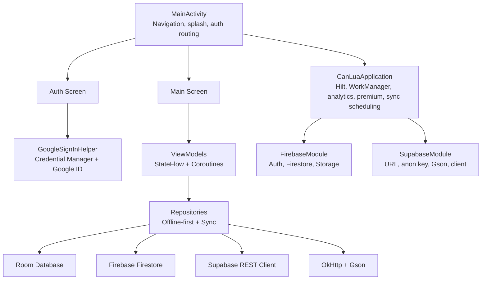
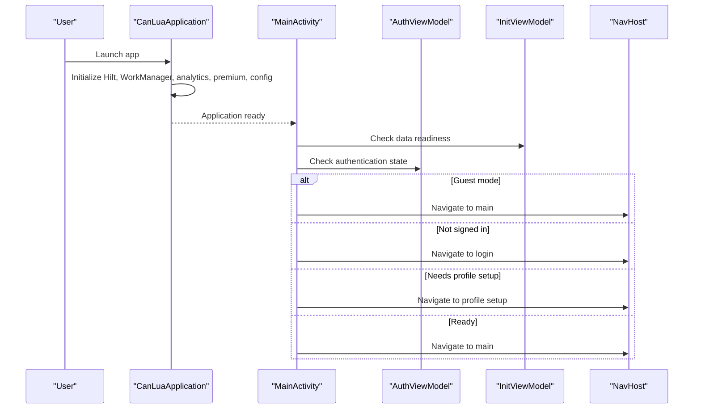

# Getting Started

<cite>
**Referenced Files in This Document**
- [app/build.gradle.kts](file://app/build.gradle.kts)
- [gradle.properties](file://gradle.properties)
- [gradle/wrapper/gradle-wrapper.properties](file://gradle/wrapper/gradle-wrapper.properties)
- [app/src/main/AndroidManifest.xml](file://app/src/main/AndroidManifest.xml)
- [app/src/main/java/com/giathinh/canlua/MainActivity.kt](file://app/src/main/java/com/giathinh/canlua/MainActivity.kt)
- [app/src/main/java/com/giathinh/canlua/CanLuaApplication.kt](file://app/src/main/java/com/giathinh/canlua/CanLuaApplication.kt)
- [app/src/main/java/com/giathinh/canlua/auth/GoogleSignInHelper.kt](file://app/src/main/java/com/giathinh/canlua/auth/GoogleSignInHelper.kt)
- [app/src/main/java/com/giathinh/canlua/data/remote/SupabaseClient.kt](file://app/src/main/java/com/giathinh/canlua/data/remote/SupabaseClient.kt)
- [app/src/main/java/com/giathinh/canlua/di/FirebaseModule.kt](file://app/src/main/java/com/giathinh/canlua/di/FirebaseModule.kt)
- [app/src/main/java/com/giathinh/canlua/di/SupabaseModule.kt](file://app/src/main/java/com/giathinh/canlua/di/SupabaseModule.kt)
</cite>

## Table of Contents
1. [Introduction](#introduction)
2. [Prerequisites](#prerequisites)
3. [Project Purpose and Target Users](#project-purpose-and-target-users)
4. [Architecture Overview](#architecture-overview)
5. [Installation Steps](#installation-steps)
6. [Initial Configuration](#initial-configuration)
7. [Building the App](#building-the-app)
8. [Running on Emulator or Device](#running-on-emulator-or-device)
9. [First Launch Flow](#first-launch-flow)
10. [Troubleshooting Guide](#troubleshooting-guide)
11. [Next Steps for Developers](#next-steps-for-developers)

## Introduction
Cân Lúa Mobile is an offline-first Android app built with Kotlin 2.3, Jetpack Compose, MVVM, and Clean Architecture. It helps farmers, traders, and guests in the Mekong Delta region manage rice weighing, seasonal records, market prices, news, and AI-assisted insights while remaining fully usable without internet access.

The app uses:
- Local persistence through AndroidX Room.
- Bidirectional sync to Firebase Firestore and Supabase.
- Scheduled background sync via WorkManager.
- Google Sign-In through modern Credential Manager and Google Identity APIs.
- AI chat powered by OpenRouter (Gemini Flash) with local knowledge assets.

This guide focuses on setting up the project locally so you can build, run, and explore the codebase.

## Prerequisites
Before starting, ensure your development environment meets these requirements:

| Requirement | Expected Value / Notes |
|---|---|
| IDE | Android Studio (latest stable recommended) |
| Language | Kotlin 2.3 |
| Minimum SDK | `minSdk = 24` |
| Target SDK | `targetSdk = 37` |
| Compile SDK | `compileSdk = 37` |
| Gradle Wrapper | Gradle 9.5.1 |
| JVM Arguments | `-Xmx2048m -Dfile.encoding=UTF-8` |
| AndroidX | Enabled |
| KSP Incremental Compilation | Disabled globally to avoid Windows storage registration issues |

Key configuration evidence:
- The app module sets `compileSdk = 37`, `minSdk = 24`, and `targetSdk = 37`.
- The Gradle wrapper requests Gradle 9.5.1.
- Project-wide Gradle settings enable AndroidX, set JVM arguments, and disable KSP incremental compilation.

**Section sources**
- [app/build.gradle.kts:38-47](file://app/build.gradle.kts#L38-L47)
- [gradle/wrapper/gradle-wrapper.properties:1-7](file://gradle/wrapper/gradle-wrapper.properties#L1-L7)
- [gradle.properties:1-18](file://gradle.properties#L1-L18)

## Project Purpose and Target Users
Cân Lúa Mobile is designed around three user roles:

| Role | Primary Use Case |
|---|---|
| Farmer | Record weigh-ins, track seasons, view financial summaries, and get AI advice based on local agronomy knowledge. |
| Trader | View market data, price trends, and trader-specific features where available. |
| Guest | Explore limited functionality without signing in. |

The app is intentionally offline-first: core weighing, card management, season tracking, and local analytics work without network access. Cloud services are used for sync, authentication, remote configuration, ads, maps, and optional shared data.

**Section sources**
- [app/build.gradle.kts:136-149](file://app/build.gradle.kts#L136-L149)
- [app/src/main/java/com/giathinh/canlua/MainActivity.kt:78-141](file://app/src/main/java/com/giathinh/canlua/MainActivity.kt#L78-L141)

## Architecture Overview
At a high level, the app follows MVVM + Clean Architecture:

- **UI Layer**: Jetpack Compose screens, navigation, theme, and UI state collection.
- **ViewModel Layer**: StateFlow-based state, coroutine-driven logic, and UI orchestration.
- **Repository Layer**: Business rules, offline-first data handling, and coordination between local and remote sources.
- **Data Layer**: Room database, Firestore, Supabase REST client, HTTP networking, and local assets.
- **Dependency Injection**: Hilt provides singletons such as Firebase clients, Supabase client, Gson, and WorkManager integration.



**Diagram sources**
- [app/src/main/java/com/giathinh/canlua/MainActivity.kt:39-145](file://app/src/main/java/com/giathinh/canlua/MainActivity.kt#L39-L145)
- [app/src/main/java/com/giathinh/canlua/CanLuaApplication.kt:28-77](file://app/src/main/java/com/giathinh/canlua/CanLuaApplication.kt#L28-L77)
- [app/src/main/java/com/giathinh/canlua/auth/GoogleSignInHelper.kt:39-100](file://app/src/main/java/com/giathinh/canlua/auth/GoogleSignInHelper.kt#L39-L100)
- [app/src/main/java/com/giathinh/canlua/data/remote/SupabaseClient.kt:22-26](file://app/src/main/java/com/giathinh/canlua/data/remote/SupabaseClient.kt#L22-L26)
- [app/src/main/java/com/giathinh/canlua/di/FirebaseModule.kt:12-33](file://app/src/main/java/com/giathinh/canlua/di/FirebaseModule.kt#L12-L33)
- [app/src/main/java/com/giathinh/canlua/di/SupabaseModule.kt:14-39](file://app/src/main/java/com/giathinh/canlua/di/SupabaseModule.kt#L14-L39)

## Installation Steps
Follow these steps to clone and prepare the repository locally.

### Step 1: Clone the Repository
Open a terminal or command prompt and clone the repository into your preferred location:

```bash
git clone <repository-url>
cd appCanLua
```

After cloning, open the project root in Android Studio. Android Studio should detect the Gradle wrapper and start syncing dependencies automatically.

### Step 2: Verify Gradle and Android SDK
Ensure Android Studio can resolve:
- Java 11 compatibility.
- Android SDK for compile/target SDK 37.
- Gradle 9.5.1 from the wrapper.

If dependency resolution fails, try:
- Syncing the Gradle project.
- Updating Android SDK platforms and tools.
- Validating the JDK path in Android Studio settings.

**Section sources**
- [app/build.gradle.kts:85-88](file://app/build.gradle.kts#L85-L88)
- [gradle/wrapper/gradle-wrapper.properties:1-7](file://gradle/wrapper/gradle-wrapper.properties#L1-L7)

## Initial Configuration
Cân Lúa Mobile requires several external services. Some are optional for basic offline use, but most features will not work correctly without proper configuration.

### Required File: `local.properties`
Create a file named `local.properties` at the repository root if it does not exist. The app reads API keys from this file and injects them into `BuildConfig`.

Add the following keys:

| Key | Purpose | Where to Get It |
|---|---|---|
| `MAPS_API_KEY` | Google Maps rendering and location features | Google Cloud Console → Maps SDK for Android |
| `OPENROUTER_API_KEY` | AI chat via OpenRouter (Gemini Flash) | OpenRouter account |
| `SUPABASE_URL` | Supabase project base URL | Supabase project dashboard |
| `SUPABASE_ANON_KEY` | Public read access to Supabase tables | Supabase project dashboard |
| `APP_HANDSHAKE_TOKEN` | Internal handshake token used by the app | Provided by maintainers |
| `TELEGRAM_BOT_TOKEN` | Telegram bot notification token | BotFather on Telegram |
| `TELEGRAM_ADMIN_CHAT_ID` | Admin chat identifier for notifications | Telegram bot admin setup |

Important security note:
- Do not commit `local.properties` to version control.
- The build script loads values from `local.properties` and falls back to empty strings when missing.

**Section sources**
- [app/build.gradle.kts:15-27](file://app/build.gradle.kts#L15-L27)
- [app/build.gradle.kts:51-58](file://app/build.gradle.kts#L51-L58)

### Firebase Setup
The app uses Firebase Authentication, Firestore, Analytics, Crashlytics, Performance Monitoring, Storage, Remote Config, and App Check.

Required Firebase setup:
1. Create a Firebase project.
2. Add an Android app with package name `com.giathinh.canlua`.
3. Download `google-services.json` and place it in `app/`.
4. Enable Google Authentication in Firebase Authentication.
5. Configure Firestore rules and collections according to your backend needs.
6. If using Crashlytics or Performance Monitoring, follow Firebase setup prompts in Android Studio.
7. For App Check, the app uses Play Integrity in release builds and a debug provider in debug builds.

The app also expects a default web client ID string resource for Google Sign-In.

**Section sources**
- [app/build.gradle.kts:136-146](file://app/build.gradle.kts#L136-L146)
- [app/src/main/java/com/giathinh/canlua/di/FirebaseModule.kt:12-33](file://app/src/main/java/com/giathinh/canlua/di/FirebaseModule.kt#L12-L33)
- [app/src/main/java/com/giathinh/canlua/auth/GoogleSignInHelper.kt:41-43](file://app/src/main/java/com/giathinh/canlua/auth/GoogleSignInHelper.kt#L41-L43)

### Google Sign-In Configuration
Cân Lúa Mobile uses modern Credential Manager and Google Identity APIs instead of legacy Google Sign-In.

Configuration checklist:
1. Ensure `google-services.json` is present and valid.
2. Provide a valid `default_web_client_id` string resource.
3. Enable Google Sign-In in Firebase Authentication.
4. Verify that the SHA-1 fingerprint matches your debug/release keystore if required by Google Cloud.
5. Test sign-in on a device or emulator with Google Play Services installed.

The helper checks network availability before attempting sign-in and provides fallback flows when credentials are unavailable.

**Section sources**
- [app/src/main/java/com/giathinh/canlua/auth/GoogleSignInHelper.kt:39-100](file://app/src/main/java/com/giathinh/canlua/auth/GoogleSignInHelper.kt#L39-L100)
- [app/src/main/java/com/giathinh/canlua/auth/GoogleSignInHelper.kt:102-145](file://app/src/main/java/com/giathinh/canlua/auth/GoogleSignInHelper.kt#L102-L145)

### Supabase Configuration
Supabase is used as a lightweight REST backend for selected features. The app constructs REST calls using OkHttp and Gson.

Configuration checklist:
1. Create a Supabase project.
2. Copy the project URL into `SUPABASE_URL`.
3. Copy the anon key into `SUPABASE_ANON_KEY`.
4. Ensure RLS policies allow public reads where needed.
5. Keep service-role writes out of the app; the Supabase client exposes an upsert method intended for server-side or admin use.

**Section sources**
- [app/build.gradle.kts:56-58](file://app/build.gradle.kts#L56-L58)
- [app/src/main/java/com/giathinh/canlua/data/remote/SupabaseClient.kt:14-26](file://app/src/main/java/com/giathinh/canlua/data/remote/SupabaseClient.kt#L14-L26)
- [app/src/main/java/com/giathinh/canlua/data/remote/SupabaseClient.kt:72-101](file://app/src/main/java/com/giathinh/canlua/data/remote/SupabaseClient.kt#L72-L101)
- [app/src/main/java/com/giathinh/canlua/di/SupabaseModule.kt:18-28](file://app/src/main/java/com/giathinh/canlua/di/SupabaseModule.kt#L18-L28)

### Google Maps Configuration
Google Maps requires a valid API key. The manifest uses a placeholder resolved from `local.properties`.

Configuration checklist:
1. Enable Maps SDK for Android in Google Cloud.
2. Generate an Android API key restricted to Maps SDK for Android.
3. Add the key to `local.properties` as `MAPS_API_KEY`.
4. Build the app so the key is embedded into `BuildConfig` and the manifest placeholder.

**Section sources**
- [app/build.gradle.kts:20-20](file://app/build.gradle.kts#L20-L20)
- [app/build.gradle.kts:60-62](file://app/build.gradle.kts#L60-L62)
- [app/src/main/AndroidManifest.xml:30-33](file://app/src/main/AndroidManifest.xml#L30-L33)

## Building the App
You can build the app from Android Studio or the command line.

### Build from Android Studio
1. Open the project root in Android Studio.
2. Wait for Gradle sync to complete.
3. Select the `debug` build variant.
4. Click Run.

### Build from Command Line
From the repository root:

```bash
./gradlew assembleDebug
```

On Windows, use:

```cmd
gradlew.bat assembleDebug
```

The debug build disables minification for faster iteration and clearer crash logs. The release build enables minification and shrinking, though resource shrinking is disabled because it could remove local AI knowledge assets.

**Section sources**
- [app/build.gradle.kts:64-83](file://app/build.gradle.kts#L64-L83)
- [app/build.gradle.kts:89-92](file://app/build.gradle.kts#L89-L92)

## Running on Emulator or Device
### Recommended Device Setup
For full functionality:
- Use an emulator or device with Google Play Services.
- Install a Google account for sign-in testing.
- Enable location permissions if you want map and location-related features.
- Connect to the internet for Firebase, Supabase, OpenRouter, and Ads.

### Offline Testing
Because the app is offline-first, you can test core weighing, cards, seasons, and local UI behavior without network access. However, cloud-dependent features such as sync, authentication, AI chat, maps, and news will not work without proper configuration and connectivity.

**Section sources**
- [app/src/main/AndroidManifest.xml:5-11](file://app/src/main/AndroidManifest.xml#L5-L11)
- [app/src/main/java/com/giathinh/canlua/auth/GoogleSignInHelper.kt:49-54](file://app/src/main/java/com/giathinh/canlua/auth/GoogleSignInHelper.kt#L49-L54)

## First Launch Flow
When you launch Cân Lúa Mobile for the first time:

1. The application initializes Hilt, WorkManager, analytics, premium state, and Firebase Remote Config.
2. Splash screen remains visible until local data and authentication state are ready.
3. If guest mode is enabled, the app navigates directly to the main screen.
4. If the user is not signed in, the app shows the authentication screen.
5. After successful sign-in, the app may require profile setup depending on stored state.
6. Once authenticated and data-ready, the app navigates to the main screen.



**Diagram sources**
- [app/src/main/java/com/giathinh/canlua/CanLuaApplication.kt:53-77](file://app/src/main/java/com/giathinh/canlua/CanLuaApplication.kt#L53-L77)
- [app/src/main/java/com/giathinh/canlua/MainActivity.kt:45-58](file://app/src/main/java/com/giathinh/canlua/MainActivity.kt#L45-L58)
- [app/src/main/java/com/giathinh/canlua/MainActivity.kt:78-141](file://app/src/main/java/com/giathinh/canlua/MainActivity.kt#L78-L141)

## Troubleshooting Guide

### Missing `local.properties`
**Symptoms:**
- Maps do not load.
- AI chat fails.
- Supabase calls fail.
- Build succeeds but runtime features are broken.

**Resolution:**
- Create `local.properties` at the repository root.
- Add all required keys listed in the Initial Configuration section.
- Rebuild the app after adding the file.

**Section sources**
- [app/build.gradle.kts:15-27](file://app/build.gradle.kts#L15-L27)
- [app/build.gradle.kts:51-58](file://app/build.gradle.kts#L51-L58)

### Missing `google-services.json`
**Symptoms:**
- Firebase initialization errors.
- Authentication fails.
- Firestore or Storage cannot be accessed.
- Crashlytics or Performance Monitoring not working.

**Resolution:**
- Add a valid `google-services.json` file to `app/`.
- Ensure the package name matches `com.giathinh.canlua`.
- Sync Gradle and rebuild.

**Section sources**
- [app/build.gradle.kts:136-146](file://app/build.gradle.kts#L136-L146)

### Google Sign-In Fails
**Symptoms:**
- Sign-in returns developer error.
- No credential available.
- Token parsing fails.
- Network-related errors appear even when connected.

**Resolution:**
- Verify `default_web_client_id` exists in string resources.
- Enable Google Sign-In in Firebase Authentication.
- Confirm SHA-1 fingerprints match your keystore.
- Test on a device or emulator with Google Play Services.
- Check network availability; the helper explicitly handles offline scenarios.

**Section sources**
- [app/src/main/java/com/giathinh/canlua/auth/GoogleSignInHelper.kt:41-43](file://app/src/main/java/com/giathinh/canlua/auth/GoogleSignInHelper.kt#L41-L43)
- [app/src/main/java/com/giathinh/canlua/auth/GoogleSignInHelper.kt:49-99](file://app/src/main/java/com/giathinh/canlua/auth/GoogleSignInHelper.kt#L49-L99)
- [app/src/main/java/com/giathinh/canlua/auth/GoogleSignInHelper.kt:163-184](file://app/src/main/java/com/giathinh/canlua/auth/GoogleSignInHelper.kt#L163-L184)

### Google Maps Blank or Error Tiles
**Symptoms:**
- Map area is blank.
- Map tiles fail to load.
- Location features do not work.

**Resolution:**
- Ensure `MAPS_API_KEY` is set in `local.properties`.
- Verify the key is enabled for Maps SDK for Android.
- Rebuild the app so the manifest placeholder is resolved.

**Section sources**
- [app/build.gradle.kts:20-20](file://app/build.gradle.kts#L20-L20)
- [app/build.gradle.kts:60-62](file://app/build.gradle.kts#L60-L62)
- [app/src/main/AndroidManifest.xml:30-33](file://app/src/main/AndroidManifest.xml#L30-L33)

### Supabase Connection Errors
**Symptoms:**
- Supabase list or upsert operations fail.
- HTTP errors from Supabase REST API.
- JSON parsing warnings.

**Resolution:**
- Verify `SUPABASE_URL` and `SUPABASE_ANON_KEY` are correct.
- Ensure RLS policies allow the expected public reads.
- Avoid using service-role keys from the app; they are intended for server-side operations.

**Section sources**
- [app/src/main/java/com/giathinh/canlua/data/remote/SupabaseClient.kt:35-70](file://app/src/main/java/com/giathinh/canlua/data/remote/SupabaseClient.kt#L35-L70)
- [app/src/main/java/com/giathinh/canlua/data/remote/SupabaseClient.kt:72-101](file://app/src/main/java/com/giathinh/canlua/data/remote/SupabaseClient.kt#L72-L101)
- [app/src/main/java/com/giathinh/canlua/di/SupabaseModule.kt:18-28](file://app/src/main/java/com/giathinh/canlua/di/SupabaseModule.kt#L18-L28)

### Dependency Resolution Failures
**Symptoms:**
- Gradle sync fails.
- Dependencies cannot be downloaded.
- KSP incremental compilation crashes on Windows.

**Resolution:**
- Update Android SDK platforms and tools.
- Validate JDK path.
- Keep `ksp.incremental=false` in `gradle.properties`.
- Invalidate caches and restart Android Studio if needed.

**Section sources**
- [gradle.properties:1-18](file://gradle.properties#L1-L18)

### WorkManager Initialization Issues
**Symptoms:**
- Background sync workers fail to initialize.
- NoSuchMethodException related to worker constructors.

**Resolution:**
- The app disables WorkManager’s default startup initializer and configures HiltWorkerFactory in the application class.
- Ensure the app entry point is `CanLuaApplication`.
- Do not override WorkManager initialization outside the provided configuration.

**Section sources**
- [app/src/main/AndroidManifest.xml:64-79](file://app/src/main/AndroidManifest.xml#L64-L79)
- [app/src/main/java/com/giathinh/canlua/CanLuaApplication.kt:28-51](file://app/src/main/java/com/giathinh/canlua/CanLuaApplication.kt#L28-L51)

## Next Steps for Developers
Once the app runs successfully:

- Explore the Compose UI under `ui/screen` and `ui/component`.
- Review ViewModels under `ui/viewmodel` to understand StateFlow-driven UI state.
- Inspect repositories under `repository` for offline-first logic and sync coordination.
- Study the data layer under `data` for Room entities, DAOs, Firestore models, and Supabase client usage.
- Use Hilt modules under `di` to understand how Firebase, Supabase, and networking components are injected.
- Run unit tests under `src/test` and instrumented tests under `src/androidTest`.

This structure supports newcomers learning Android architecture while giving experienced developers a clear path to extend features safely.