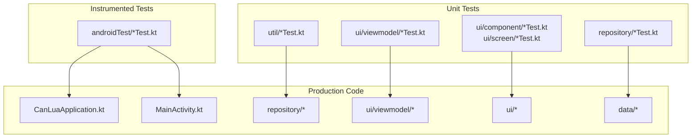
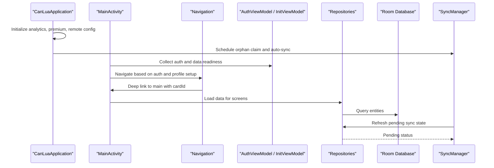
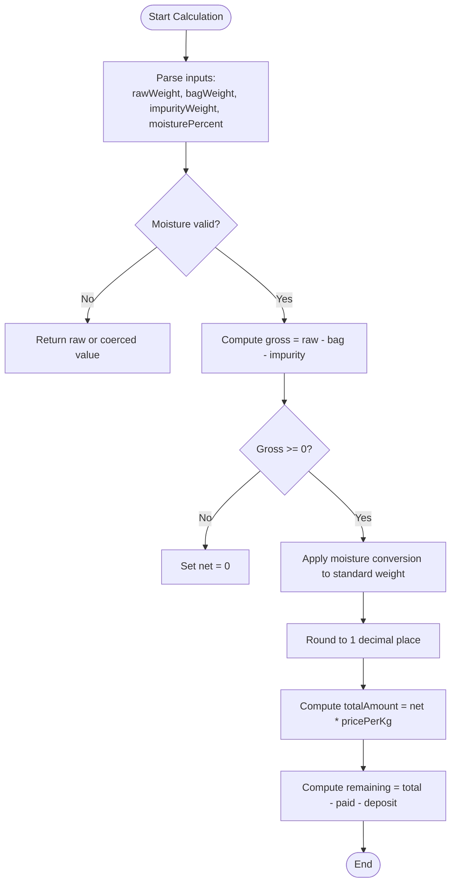
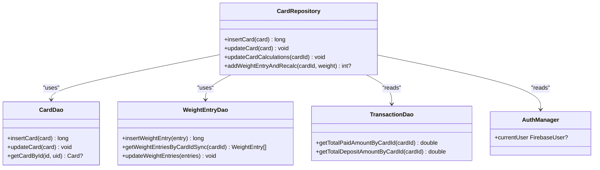
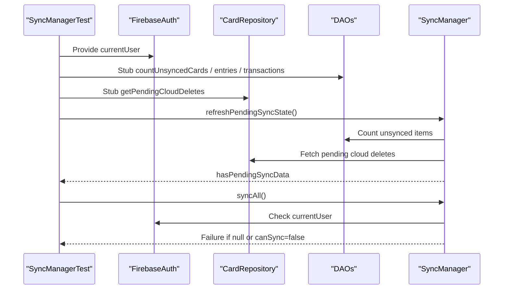
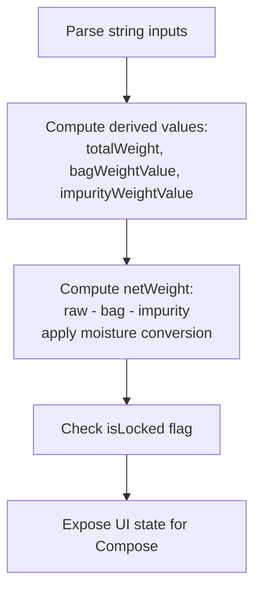
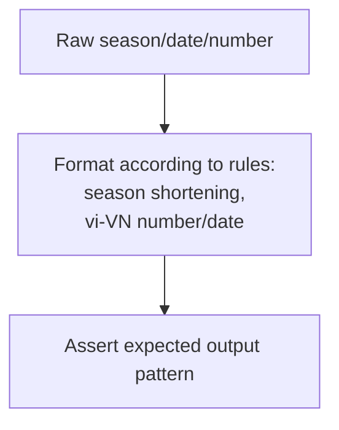
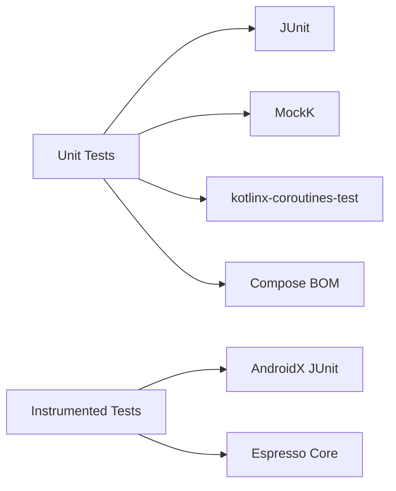

# Testing Strategy

<cite>
**Referenced Files in This Document**
- [CanLuaApplication.kt](file://app/src/main/java/com/giathinh/canlua/CanLuaApplication.kt)
- [MainActivity.kt](file://app/src/main/java/com/giathinh/canlua/MainActivity.kt)
- [libs.versions.toml](file://gradle/libs.versions.toml)
- [RiceCalculatorTest.kt](file://app/src/test/java/com/giathinh/canlua/util/RiceCalculatorTest.kt)
- [RiceCalculatorEdgeCaseTest.kt](file://app/src/test/java/com/giathinh/canlua/util/RiceCalculatorEdgeCaseTest.kt)
- [MoneyFormatterTest.kt](file://app/src/test/java/com/giathinh/canlua/util/MoneyFormatterTest.kt)
- [CardRepositoryTest.kt](file://app/src/test/java/com/giathinh/canlua/repository/CardRepositoryTest.kt)
- [SyncManagerTest.kt](file://app/src/test/java/com/giathinh/canlua/repository/SyncManagerTest.kt)
- [WeightInputUiStateTest.kt](file://app/src/test/java/com/giathinh/canlua/ui/viewmodel/WeightInputUiStateTest.kt)
- [SeasonComparisonBarChartTest.kt](file://app/src/test/java/com/giathinh/canlua/ui/component/dashboard/SeasonComparisonBarChartTest.kt)
- [MapFormattersTest.kt](file://app/src/test/java/com/giathinh/canlua/ui/screen/map/MapFormattersTest.kt)
- [ExampleInstrumentedTest.kt](file://app/src/androidTest/java/com/GiaThinh/canlua/ExampleInstrumentedTest.kt)
</cite>

## Table of Contents
1. Introduction
2. Project Structure
3. Core Components
4. Architecture Overview
5. Detailed Component Analysis
6. Dependency Analysis
7. Performance Considerations
8. Troubleshooting Guide
9. Conclusion
10. Appendices

## Introduction
This document defines the testing strategy for Cân Lúa Mobile, an offline-first Android application built with Kotlin 2.3 and Jetpack Compose. The app follows MVVM and Clean Architecture with unidirectional data flow using StateFlow and coroutines. Local persistence uses AndroidX Room 2.8.4 (schema v18), while cloud sync is bidirectional to Firebase Firestore and Supabase via WorkManager. The app supports three roles: FARMER, TRADER, and GUEST, and includes AI chat powered by OpenRouter with RAG context from local knowledge JSON files.

The testing pyramid emphasizes:
- Unit tests for business logic, utilities, repositories, and ViewModels.
- UI tests for Compose components and screen flows.
- Integration tests for database operations, network calls, background services, and end-to-end scenarios.

## Project Structure
Testing sources are organized under standard Gradle source sets:
- app/src/test: JVM unit tests for pure logic, ViewModels, repositories, and formatting helpers.
- app/src/androidTest: Instrumented tests that run on a device or emulator.

**Diagram sources**
- [CanLuaApplication.kt:1-125](file://app/src/main/java/com/giathinh/canlua/CanLuaApplication.kt#L1-L125)
- [MainActivity.kt:1-152](file://app/src/main/java/com/giathinh/canlua/MainActivity.kt#L1-L152)

**Section sources**
- [CanLuaApplication.kt:1-125](file://app/src/main/java/com/giathinh/canlua/CanLuaApplication.kt#L1-L125)
- [MainActivity.kt:1-152](file://app/src/main/java/com/giathinh/canlua/MainActivity.kt#L1-L152)

## Core Components
This section highlights key testable components and their responsibilities:
- Business logic and domain calculations: RiceCalculator and MoneyFormatter.
- Repository layer: CardRepository orchestrates DAOs, encryption, and settlement calculations.
- Sync orchestration: SyncManager coordinates pending sync state and triggers.
- ViewModel state: WeightInputUiState exposes computed UI values for input screens.
- UI formatting helpers: MapFormatters and dashboard formatters used by Compose screens.

Key testing focus areas:
- Agricultural domain math: moisture conversion, bag sampling, impurity handling, pricing.
- Financial correctness: money formatting and rounding behavior.
- Offline-first integrity: idempotent sync, locked cards, transaction preservation.
- UI state derivation: parsing, validation, and computed properties.

**Section sources**
- [RiceCalculatorTest.kt:1-325](file://app/src/test/java/com/giathinh/canlua/util/RiceCalculatorTest.kt#L1-L325)
- [MoneyFormatterTest.kt:1-228](file://app/src/test/java/com/giathinh/canlua/util/MoneyFormatterTest.kt#L1-L228)
- [CardRepositoryTest.kt:1-220](file://app/src/test/java/com/giathinh/canlua/repository/CardRepositoryTest.kt#L1-L220)
- [SyncManagerTest.kt:1-129](file://app/src/test/java/com/giathinh/canlua/repository/SyncManagerTest.kt#L1-L129)
- [WeightInputUiStateTest.kt:1-206](file://app/src/test/java/com/giathinh/canlua/ui/viewmodel/WeightInputUiStateTest.kt#L1-L206)
- [MapFormattersTest.kt:1-156](file://app/src/test/java/com/giathinh/canlua/ui/screen/map/MapFormattersTest.kt#L1-L156)
- [SeasonComparisonBarChartTest.kt:1-38](file://app/src/test/java/com/giathinh/canlua/ui/component/dashboard/SeasonComparisonBarChartTest.kt#L1-L38)

## Architecture Overview
The testing strategy aligns with the app’s architecture:
- Application bootstrap initializes analytics, premium state, remote config, and sync scheduling.
- MainActivity drives navigation and composes the UI tree, coordinating AuthViewModel, InitViewModel, and SettingsViewModel.
- Repositories encapsulate Room DAOs, encryption, and settlement logic; they are isolated behind interfaces for mocking.
- SyncManager integrates with WorkManager and repositories to keep local and cloud data consistent.

**Diagram sources**
- [CanLuaApplication.kt:53-124](file://app/src/main/java/com/giathinh/canlua/CanLuaApplication.kt#L53-L124)
- [MainActivity.kt:45-141](file://app/src/main/java/com/giathinh/canlua/MainActivity.kt#L45-L141)

## Detailed Component Analysis

### Business Logic Testing: Rice Calculator and Money Formatter
Focus areas:
- Moisture conversion to standard weight at 14%.
- Net weight calculation including bag and impurity deductions.
- Total amount and remaining amount computations.
- Vietnamese money formatting and localization labels.

**Diagram sources**
- [RiceCalculatorTest.kt:21-176](file://app/src/test/java/com/giathinh/canlua/util/RiceCalculatorTest.kt#L21-L176)
- [RiceCalculatorEdgeCaseTest.kt:92-194](file://app/src/test/java/com/giathinh/canlua/util/RiceCalculatorEdgeCaseTest.kt#L92-L194)

Testing patterns:
- Deterministic assertions with tolerance for floating-point rounding.
- Realistic agricultural scenarios (e.g., Đông Xuân vs Hè Thu moisture levels).
- Regression tests guarding against incorrect formulas that could harm farmers financially.
- Edge cases for zero, negative, and extreme moisture values.

**Section sources**
- [RiceCalculatorTest.kt:1-325](file://app/src/test/java/com/giathinh/canlua/util/RiceCalculatorTest.kt#L1-L325)
- [RiceCalculatorEdgeCaseTest.kt:1-326](file://app/src/test/java/com/giathinh/canlua/util/RiceCalculatorEdgeCaseTest.kt#L1-L326)
- [MoneyFormatterTest.kt:1-228](file://app/src/test/java/com/giathinh/canlua/util/MoneyFormatterTest.kt#L1-L228)

### Repository Testing: CardRepository
Focus areas:
- Inserting and updating cards with ownerUid, lastModifiedMs, and CCCD encryption.
- Preserving original transaction dates during updates.
- Recalculating aggregates using WeightEntry and Transaction DAOs.
- Handling locked cards and preventing modifications.

**Diagram sources**
- [CardRepositoryTest.kt:32-69](file://app/src/test/java/com/giathinh/canlua/repository/CardRepositoryTest.kt#L32-L69)
- [CardRepositoryTest.kt:71-187](file://app/src/test/java/com/giathinh/canlua/repository/CardRepositoryTest.kt#L71-L187)

Mock strategies:
- MockK for DAOs, AuthManager, and Room extension functions.
- Capturing arguments to verify side effects like encryption and timestamps.
- Verifying transactional behavior via mocked RoomDatabaseKt.withTransaction.

**Section sources**
- [CardRepositoryTest.kt:1-220](file://app/src/test/java/com/giathinh/canlua/repository/CardRepositoryTest.kt#L1-L220)

### Sync Orchestration Testing: SyncManager
Focus areas:
- Refreshing pending sync state based on unsynced counts and cloud deletes.
- Guarding syncAll when user is not authenticated or canSync is false.
- Observing sync status transitions.

**Diagram sources**
- [SyncManagerTest.kt:45-127](file://app/src/test/java/com/giathinh/canlua/repository/SyncManagerTest.kt#L45-L127)

**Section sources**
- [SyncManagerTest.kt:1-129](file://app/src/test/java/com/giathinh/canlua/repository/SyncManagerTest.kt#L1-L129)

### ViewModel State Testing: WeightInputUiState
Focus areas:
- Parsing numeric strings into doubles for totalWeight, bagWeightValue, impurityWeightValue.
- Computing netWeight with moisture conversion via RiceCalculator.
- Handling edge cases like empty fields, large realistic loads, and locked states.

**Diagram sources**
- [WeightInputUiStateTest.kt:22-131](file://app/src/test/java/com/giathinh/canlua/ui/viewmodel/WeightInputUiStateTest.kt#L22-L131)
- [WeightInputUiStateTest.kt:133-169](file://app/src/test/java/com/giathinh/canlua/ui/viewmodel/WeightInputUiStateTest.kt#L133-L169)

**Section sources**
- [WeightInputUiStateTest.kt:1-206](file://app/src/test/java/com/giathinh/canlua/ui/viewmodel/WeightInputUiStateTest.kt#L1-L206)

### UI Formatting and Compose-Adjacent Tests
Focus areas:
- Season label formatting for dashboard charts.
- Number and date formatting for map displays.
- Ensuring locale-specific output stability across environments.

**Diagram sources**
- [SeasonComparisonBarChartTest.kt:8-36](file://app/src/test/java/com/giathinh/canlua/ui/component/dashboard/SeasonComparisonBarChartTest.kt#L8-L36)
- [MapFormattersTest.kt:28-154](file://app/src/test/java/com/giathinh/canlua/ui/screen/map/MapFormattersTest.kt#L28-L154)

**Section sources**
- [SeasonComparisonBarChartTest.kt:1-38](file://app/src/test/java/com/giathinh/canlua/ui/component/dashboard/SeasonComparisonBarChartTest.kt#L1-L38)
- [MapFormattersTest.kt:1-156](file://app/src/test/java/com/giathinh/canlua/ui/screen/map/MapFormattersTest.kt#L1-L156)

## Dependency Analysis
Testing dependencies are declared centrally and include JUnit, MockK, Coroutines Test, and Compose BOM. Instrumented tests use AndroidX Test and Espresso.

**Diagram sources**
- [libs.versions.toml:71-154](file://gradle/libs.versions.toml#L71-L154)

**Section sources**
- [libs.versions.toml:71-154](file://gradle/libs.versions.toml#L71-L154)

## Performance Considerations
Guidance for performance and memory testing:
- Use kotlinx-coroutines-test to avoid real dispatchers in unit tests and ensure deterministic execution.
- Prefer pure-JVM tests for formatting and calculation logic to reduce overhead.
- For instrumented tests, limit heavy UI interactions and prefer semantic assertions over snapshotting where possible.
- Profile critical flows using Android Studio Profiler and benchmark modules when available.
- Monitor memory leaks in Activities and ViewModels; clear references in onDestroy and avoid retaining Contexts.

[No sources needed since this section provides general guidance]

## Troubleshooting Guide
Common issues and resolutions:
- Room extension mocks: Ensure mockkStatic wraps androidx.room.RoomDatabaseKt and coAnswers executes the block synchronously in tests.
- Locale drift: Set Locale.setDefault(Locale.US) in test setUp to stabilize formatting outputs.
- Network variability: Mock repository methods and DAOs; do not rely on live network in unit tests.
- Background tasks: Use spyk to observe SyncManager behavior without executing WorkManager jobs.
- Device fragmentation: Run instrumented tests on representative devices/emulators and validate deep links and navigation paths.

**Section sources**
- [CardRepositoryTest.kt:54-69](file://app/src/test/java/com/giathinh/canlua/repository/CardRepositoryTest.kt#L54-L69)
- [MapFormattersTest.kt:22-26](file://app/src/test/java/com/giathinh/canlua/ui/screen/map/MapFormattersTest.kt#L22-L26)
- [SyncManagerTest.kt:32-43](file://app/src/test/java/com/giathinh/canlua/repository/SyncManagerTest.kt#L32-L43)

## Conclusion
Cân Lúa Mobile’s testing strategy prioritizes correctness in agricultural calculations and financial outcomes, robust repository behavior under offline-first conditions, and stable UI formatting across locales. The test pyramid ensures fast feedback for pure logic, focused coverage for repositories and ViewModels, and targeted integration checks for sync and navigation. By leveraging MockK, Coroutines Test, and structured unit tests, the team can maintain confidence in domain-critical features while preparing for Compose UI and end-to-end scenarios.

[No sources needed since this section summarizes without analyzing specific files]

## Appendices

### Example Scenarios for Effective Tests
- Agricultural domain logic:
  - Verify moisture conversion at 14% and higher percentages.
  - Validate bag sampling method and impurity handling in kg mode.
  - Confirm per-entry vs global net weight consistency within rounding tolerances.
- Financial calculations:
  - Ensure totalAmount and remainingAmount reflect correct arithmetic and rounding.
  - Validate Vietnamese money formatting for typical farmer card amounts.
- AI chat functionality:
  - Mock OpenRouter API responses and RAG context loading from assets.
  - Verify message state transitions and error handling in ViewModel.

[No sources needed since this section provides general guidance]

### Continuous Integration Testing Pipelines
Recommended pipeline stages:
- Build and lint.
- Run JVM unit tests (fast path).
- Run instrumented tests on emulators/devices.
- Generate test reports and upload artifacts.
- Gate merges on passing tests and code quality checks.

[No sources needed since this section provides general guidance]