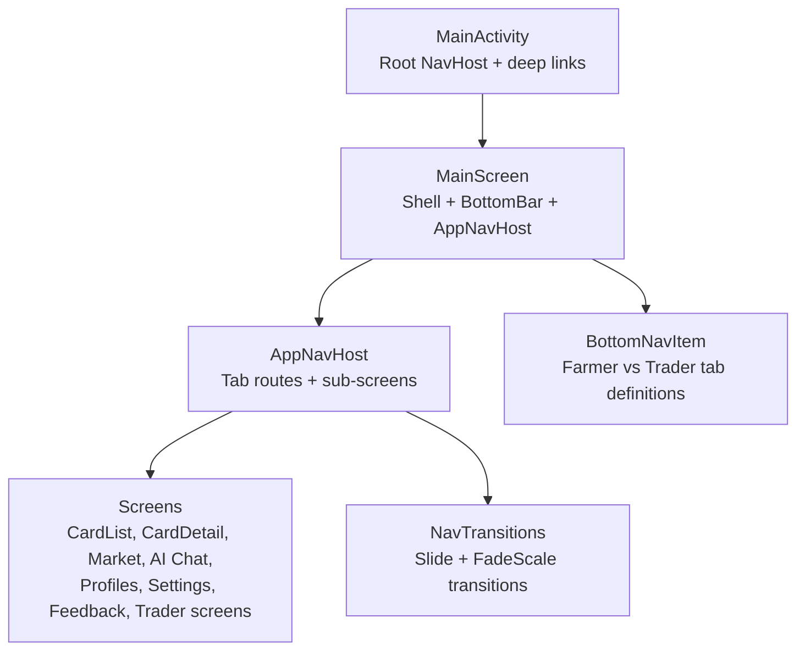
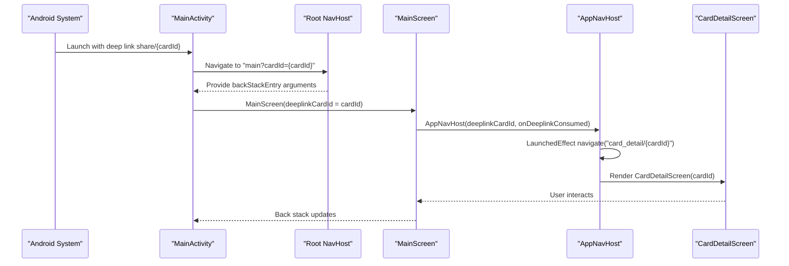
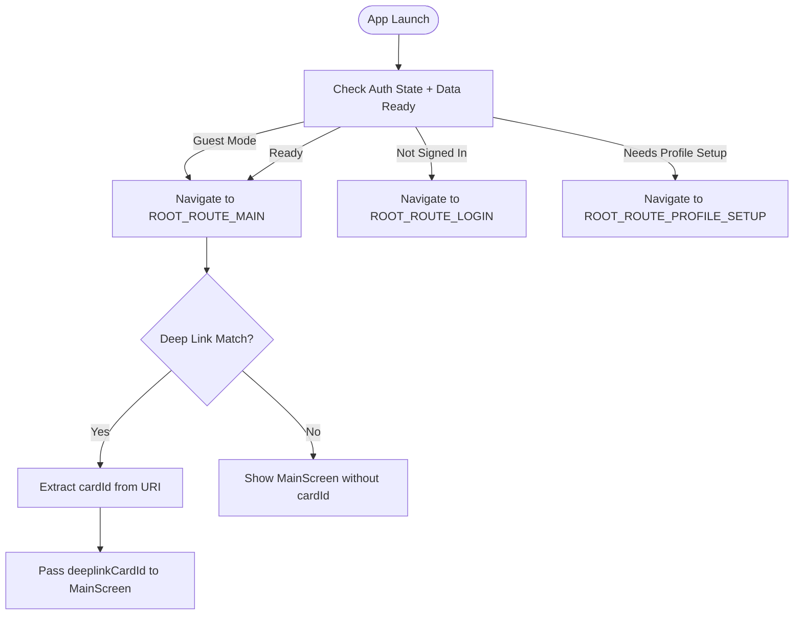
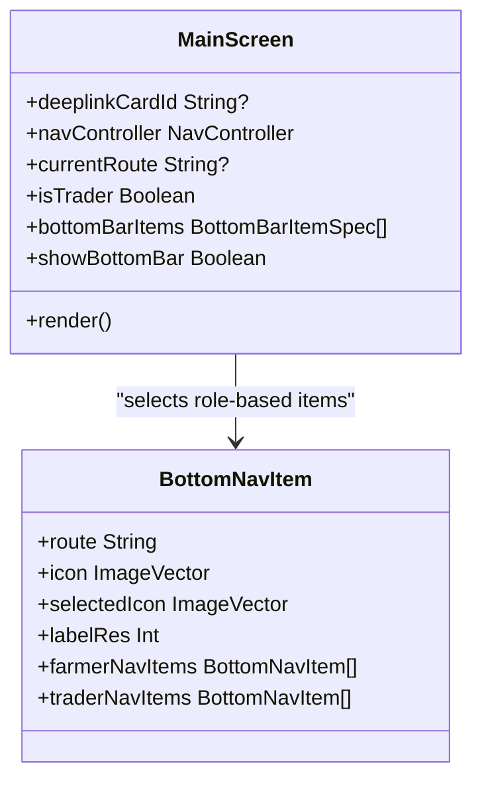
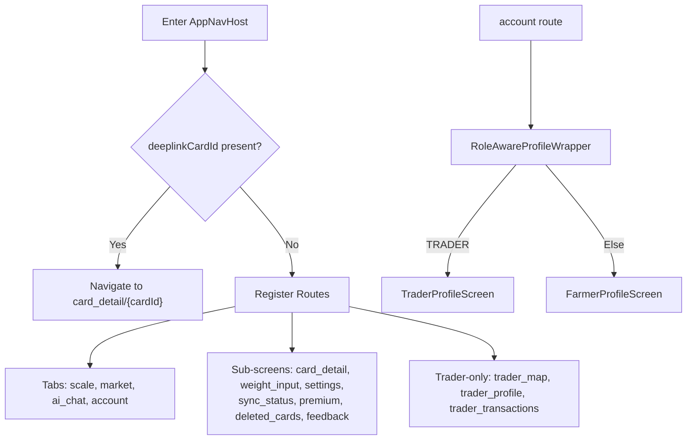
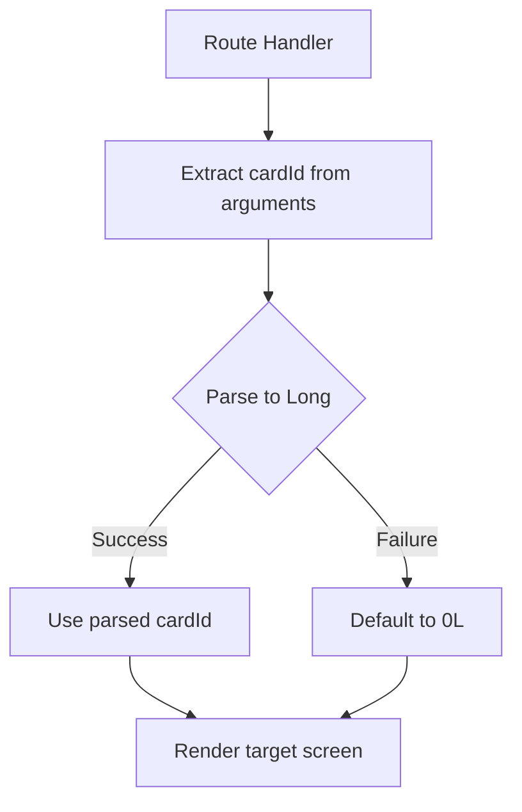
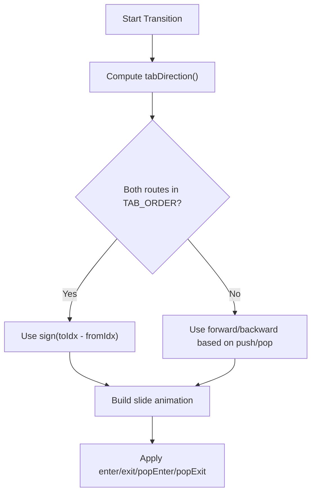
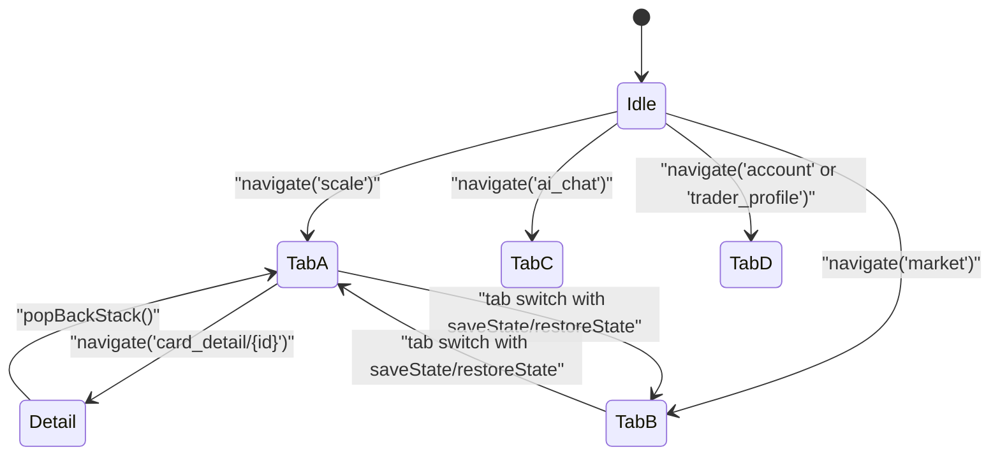
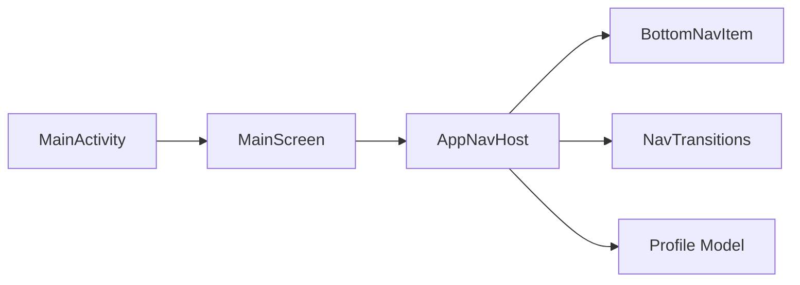

# Navigation & Routing

<cite>
**Referenced Files in This Document**
- [MainActivity.kt](file://app/src/main/java/com/giathinh/canlua/MainActivity.kt)
- [MainScreen.kt](file://app/src/main/java/com/giathinh/canlua/ui/MainScreen.kt)
- [AppNavHost.kt](file://app/src/main/java/com/giathinh/canlua/ui/navigation/AppNavHost.kt)
- [BottomNavItem.kt](file://app/src/main/java/com/giathinh/canlua/ui/navigation/BottomNavItem.kt)
- [NavTransitions.kt](file://app/src/main/java/com/giathinh/canlua/ui/navigation/NavTransitions.kt)
- [Profile.kt](file://app/src/main/java/com/giathinh/canlua/data/model/Profile.kt)
</cite>

## Table of Contents
1. [Introduction](#introduction)
2. [Project Structure](#project-structure)
3. [Core Components](#core-components)
4. [Architecture Overview](#architecture-overview)
5. [Detailed Component Analysis](#detailed-component-analysis)
6. [Dependency Analysis](#dependency-analysis)
7. [Performance Considerations](#performance-considerations)
8. [Troubleshooting Guide](#troubleshooting-guide)
9. [Guidelines for Adding Destinations and Transitions](#guidelines-for-adding-destinations-and-transitions)
10. [Navigation Testing Strategies](#navigation-testing-strategies)
11. [Conclusion](#conclusion)

## Introduction
This document explains the Compose Navigation implementation used by Cân Lúa Mobile. It covers:
- The root navigation graph that routes between splash, login, profile setup, and the main app shell.
- The main `AppNavHost` configuration with role-aware routing for FARMER, TRADER, and GUEST users.
- Deep linking support for shared cards and how card IDs flow into detail screens.
- Bottom navigation structure using `BottomNavItem`, including separate item sets for farmer and trader roles.
- Navigation transitions, back stack behavior, and tab state preservation.
- Navigation argument handling, parameter validation, and error handling for invalid routes.
- Practical guidelines for adding new destinations, implementing custom transitions, and keeping navigation consistent across roles.
- Testing and debugging strategies for complex routing scenarios.

The app follows Kotlin 2.3 / Jetpack Compose offline-first architecture with MVVM and unidirectional data flow. Role-based portals serve FARMER, TRADER, and GUEST users, while AI features use OpenRouter with local knowledge assets.

## Project Structure
Navigation-related code is concentrated under `ui.navigation`, with the entry point in `MainActivity`, the authenticated shell in `MainScreen`, and the main content host in `AppNavHost`. Transition logic is centralized in `NavTransitions`, and bottom bar items are defined in `BottomNavItem`.

**Diagram sources**
- [MainActivity.kt:110-142](file://app/src/main/java/com/giathinh/canlua/MainActivity.kt#L110-L142)
- [MainScreen.kt:325-366](file://app/src/main/java/com/giathinh/canlua/ui/MainScreen.kt#L325-L366)
- [AppNavHost.kt:45-136](file://app/src/main/java/com/giathinh/canlua/ui/navigation/AppNavHost.kt#L45-L136)
- [BottomNavItem.kt:25-70](file://app/src/main/java/com/giathinh/canlua/ui/navigation/BottomNavItem.kt#L25-L70)
- [NavTransitions.kt:41-109](file://app/src/main/java/com/giathinh/canlua/ui/navigation/NavTransitions.kt#L41-L109)

**Section sources**
- [MainActivity.kt:34-38](file://app/src/main/java/com/giathinh/canlua/MainActivity.kt#L34-L38)
- [MainScreen.kt:71-79](file://app/src/main/java/com/giathinh/canlua/ui/MainScreen.kt#L71-L79)
- [AppNavHost.kt:27-38](file://app/src/main/java/com/giathinh/canlua/ui/navigation/AppNavHost.kt#L27-L38)
- [BottomNavItem.kt:18-24](file://app/src/main/java/com/giathinh/canlua/ui/navigation/BottomNavItem.kt#L18-L24)
- [NavTransitions.kt:13-28](file://app/src/main/java/com/giathinh/canlua/ui/navigation/NavTransitions.kt#L13-L28)

## Core Components
- **Root navigation**: `MainActivity` defines the top-level route graph, including splash, login, profile setup, and the main screen. It also declares deep link patterns for shared cards.
- **Main shell**: `MainScreen` owns the `NavController`, determines whether the user is a trader or farmer, selects the appropriate bottom navigation items, manages top bar visibility, and hosts `AppNavHost`.
- **Content host**: `AppNavHost` registers all tab routes and sub-screen routes, applies default transitions, handles initial deep-link-driven navigation to card details, and provides a role-aware profile wrapper.
- **Bottom navigation model**: `BottomNavItem` defines route strings, icons, labels, and two role-specific item lists: one for farmers and one for traders.
- **Transitions**: `NavTransitions` centralizes slide and fade-scale animations, with tab-aware direction logic so switching tabs feels directional and sub-screen navigation uses forward/backward semantics.

**Section sources**
- [MainActivity.kt:110-142](file://app/src/main/java/com/giathinh/canlua/MainActivity.kt#L110-L142)
- [MainScreen.kt:96-149](file://app/src/main/java/com/giathinh/canlua/ui/MainScreen.kt#L96-L149)
- [AppNavHost.kt:45-136](file://app/src/main/java/com/giathinh/canlua/ui/navigation/AppNavHost.kt#L45-L136)
- [BottomNavItem.kt:25-70](file://app/src/main/java/com/giathinh/canlua/ui/navigation/BottomNavItem.kt#L25-L70)
- [NavTransitions.kt:41-109](file://app/src/main/java/com/giathinh/canlua/ui/navigation/NavTransitions.kt#L41-L109)

## Architecture Overview
The navigation architecture separates concerns across three layers:

1. **Root layer (`MainActivity`)**: Determines whether to show splash, login, profile setup, or main app. It also parses deep links for shared cards and passes the card ID into `MainScreen`.
2. **Shell layer (`MainScreen`)**: Manages UI chrome (top bar, offline banner, bottom bar), selects role-appropriate navigation items, and controls tab navigation with state preservation.
3. **Content layer (`AppNavHost`)**: Defines the navigable destinations, applies default transitions, and routes to role-aware screens.

**Diagram sources**
- [MainActivity.kt:132-141](file://app/src/main/java/com/giathinh/canlua/MainActivity.kt#L132-L141)
- [MainScreen.kt:325-331](file://app/src/main/java/com/giathinh/canlua/ui/MainScreen.kt#L325-L331)
- [AppNavHost.kt:39-44](file://app/src/main/java/com/giathinh/canlua/ui/navigation/AppNavHost.kt#L39-L44)
- [AppNavHost.kt:62-68](file://app/src/main/java/com/giathinh/canlua/ui/navigation/AppNavHost.kt#L62-L68)

## Detailed Component Analysis

### Root Navigation and Deep Linking
`MainActivity` defines four root routes: splash, login, profile setup, and main. The main route accepts an optional query parameter `cardId`. Deep links for shared cards are declared on the main route, supporting both web app and Firebase hosting domains. When a deep link matches, the activity extracts `cardId` and passes it to `MainScreen`.

Key behaviors:
- Splash remains visible until initialization and authentication state are ready.
- Guest mode bypasses login and goes directly to the main shell.
- Profile setup is shown when required before entering the main shell.
- Deep links only apply to the main route; other root routes do not declare deep links.

**Diagram sources**
- [MainActivity.kt:45-58](file://app/src/main/java/com/giathinh/canlua/MainActivity.kt#L45-L58)
- [MainActivity.kt:78-108](file://app/src/main/java/com/giathinh/canlua/MainActivity.kt#L78-L108)
- [MainActivity.kt:132-141](file://app/src/main/java/com/giathinh/canlua/MainActivity.kt#L132-L141)

**Section sources**
- [MainActivity.kt:34-38](file://app/src/main/java/com/giathinh/canlua/MainActivity.kt#L34-L38)
- [MainActivity.kt:78-108](file://app/src/main/java/com/giathinh/canlua/MainActivity.kt#L78-L108)
- [MainActivity.kt:132-141](file://app/src/main/java/com/giathinh/canlua/MainActivity.kt#L132-L141)

### Main Shell and Bottom Navigation
`MainScreen` creates a `NavController`, tracks the current route, determines whether the user is a trader, and selects the correct set of bottom navigation items. It hides the bottom bar when needed, computes top bar titles and actions based on the current route, and renders `AppNavHost`.

Important aspects:
- Role detection uses the profile’s role field.
- Farmer items: Scale, Market, AI Chat, Account.
- Trader items: Scale, Market, AI Chat, Map, Trader Profile.
- Tab switching uses `popUpTo(startDestination)` with `saveState = true`, `launchSingleTop = true`, and `restoreState = true` to preserve tab state.
- Bottom bar visibility considers IME visibility, scroll visibility, and specific routes like sync status.

**Diagram sources**
- [MainScreen.kt:96-149](file://app/src/main/java/com/giathinh/canlua/ui/MainScreen.kt#L96-L149)
- [MainScreen.kt:351-366](file://app/src/main/java/com/giathinh/canlua/ui/MainScreen.kt#L351-L366)
- [BottomNavItem.kt:25-70](file://app/src/main/java/com/giathinh/canlua/ui/navigation/BottomNavItem.kt#L25-L70)

**Section sources**
- [MainScreen.kt:71-79](file://app/src/main/java/com/giathinh/canlua/ui/MainScreen.kt#L71-L79)
- [MainScreen.kt:96-149](file://app/src/main/java/com/giathinh/canlua/ui/MainScreen.kt#L96-L149)
- [MainScreen.kt:151-187](file://app/src/main/java/com/giathinh/canlua/ui/MainScreen.kt#L151-L187)
- [MainScreen.kt:325-366](file://app/src/main/java/com/giathinh/canlua/ui/MainScreen.kt#L325-L366)

### AppNavHost Configuration and Role-Based Routing
`AppNavHost` is the primary destination container. It:
- Accepts a `startDestination`, usually the first tab route.
- Handles an initial deep link by navigating to `card_detail/{cardId}` and consuming the value.
- Registers shared routes: scale list, card detail, weight input, settings, sync status, market, AI chat, premium, deleted cards, feedback.
- Registers trader-only routes: trader map, trader profile, trader transactions.
- Provides `RoleAwareProfileWrapper`, which reads the profile and renders either `TraderProfileScreen` or `FarmerProfileScreen`.

Role-aware routing behavior:
- The account tab always routes through `RoleAwareProfileWrapper`.
- Trader-only routes exist but can be reached via explicit navigation or role-specific bottom items.
- Shared screens may read `profile.role` internally to adjust UI, even though the route is common.

**Diagram sources**
- [AppNavHost.kt:32-44](file://app/src/main/java/com/giathinh/canlua/ui/navigation/AppNavHost.kt#L32-L44)
- [AppNavHost.kt:57-136](file://app/src/main/java/com/giathinh/canlua/ui/navigation/AppNavHost.kt#L57-L136)
- [AppNavHost.kt:139-150](file://app/src/main/java/com/giathinh/canlua/ui/navigation/AppNavHost.kt#L139-L150)

**Section sources**
- [AppNavHost.kt:27-38](file://app/src/main/java/com/giathinh/canlua/ui/navigation/AppNavHost.kt#L27-L38)
- [AppNavHost.kt:57-136](file://app/src/main/java/com/giathinh/canlua/ui/navigation/AppNavHost.kt#L57-L136)
- [AppNavHost.kt:139-150](file://app/src/main/java/com/giathinh/canlua/ui/navigation/AppNavHost.kt#L139-L150)

### Navigation Arguments, Parameter Validation, and Error Handling
Argument handling occurs in route handlers:
- `card_detail/{cardId}` extracts `cardId` from the back stack entry and converts it to a long. If conversion fails, it defaults to `0L`.
- `weight_input/{cardId}` uses the same pattern.

Validation and error handling characteristics:
- There is no explicit validation that `cardId` is positive or exists in the database.
- Invalid or missing numeric values fall back to `0L`, which may cause downstream screens to handle empty or default states.
- No fallback route or error screen is shown for malformed parameters.

Recommendations:
- Add explicit validation for positive IDs.
- Return a clear error state or redirect to a safe fallback if the card does not exist.
- Consider typed route parameters instead of string parsing where possible.

**Diagram sources**
- [AppNavHost.kt:62-68](file://app/src/main/java/com/giathinh/canlua/ui/navigation/AppNavHost.kt#L62-L68)
- [AppNavHost.kt:70-76](file://app/src/main/java/com/giathinh/canlua/ui/navigation/AppNavHost.kt#L70-L76)

**Section sources**
- [AppNavHost.kt:62-76](file://app/src/main/java/com/giathinh/canlua/ui/navigation/AppNavHost.kt#L62-L76)

### Navigation Transitions and Animations
`NavTransitions` defines:
- A tab order containing all relevant routes, including farmer and trader tabs.
- Direction calculation based on index differences.
- Slide-in/slide-out helpers for horizontal movement.
- Four transition hooks: enter, exit, pop enter, pop exit.

Behavior:
- Tab-to-tab navigation uses the tab order to determine direction.
- Sub-screen navigation defaults to forward/backward semantics depending on push/pop context.
- Duration is 300ms with FastOutSlowIn easing.

`AppNavHost` applies these transitions as defaults for all composable destinations.

**Diagram sources**
- [NavTransitions.kt:41-64](file://app/src/main/java/com/giathinh/canlua/ui/navigation/NavTransitions.kt#L41-L64)
- [NavTransitions.kt:66-76](file://app/src/main/java/com/giathinh/canlua/ui/navigation/NavTransitions.kt#L66-L76)
- [NavTransitions.kt:82-109](file://app/src/main/java/com/giathinh/canlua/ui/navigation/NavTransitions.kt#L82-L109)
- [AppNavHost.kt:49-55](file://app/src/main/java/com/giathinh/canlua/ui/navigation/AppNavHost.kt#L49-L55)

**Section sources**
- [NavTransitions.kt:13-28](file://app/src/main/java/com/giathinh/canlua/ui/navigation/NavTransitions.kt#L13-L28)
- [NavTransitions.kt:41-109](file://app/src/main/java/com/giathinh/canlua/ui/navigation/NavTransitions.kt#L41-L109)
- [AppNavHost.kt:49-55](file://app/src/main/java/com/giathinh/canlua/ui/navigation/AppNavHost.kt#L49-L55)

### Back Stack Management and Tab State Preservation
Back stack behavior is primarily controlled in `MainScreen`:
- Tab clicks navigate with `popUpTo(startDestination).saveState = true`, `launchSingleTop = true`, and `restoreState = true`.
- This preserves each tab’s scroll position, filters, and internal state.
- Sub-screen navigation pushes onto the back stack normally.
- Top bar back button is used for specific routes like trader transactions.

Implications:
- Switching tabs does not recreate screens unnecessarily.
- Returning to a previously visited tab restores its state.
- Deep-linked card detail navigation adds a sub-screen on top of the start tab.

**Diagram sources**
- [MainScreen.kt:351-366](file://app/src/main/java/com/giathinh/canlua/ui/MainScreen.kt#L351-L366)
- [AppNavHost.kt:62-76](file://app/src/main/java/com/giathinh/canlua/ui/navigation/AppNavHost.kt#L62-L76)

**Section sources**
- [MainScreen.kt:351-366](file://app/src/main/java/com/giathinh/canlua/ui/MainScreen.kt#L351-L366)

## Dependency Analysis
The navigation layer depends on:
- `MainActivity` for root routing and deep link extraction.
- `MainScreen` for shell behavior, role detection, and bottom navigation state.
- `AppNavHost` for destination registration and role-aware profile rendering.
- `BottomNavItem` for route constants and role-specific tab lists.
- `NavTransitions` for animation behavior.
- `Profile` model for role values such as FARMER, TRADER, and GUEST.

**Diagram sources**
- [MainActivity.kt:110-142](file://app/src/main/java/com/giathinh/canlua/MainActivity.kt#L110-L142)
- [MainScreen.kt:325-366](file://app/src/main/java/com/giathinh/canlua/ui/MainScreen.kt#L325-L366)
- [AppNavHost.kt:45-150](file://app/src/main/java/com/giathinh/canlua/ui/navigation/AppNavHost.kt#L45-L150)
- [BottomNavItem.kt:25-70](file://app/src/main/java/com/giathinh/canlua/ui/navigation/BottomNavItem.kt#L25-L70)
- [NavTransitions.kt:41-109](file://app/src/main/java/com/giathinh/canlua/ui/navigation/NavTransitions.kt#L41-L109)
- [Profile.kt:20-20](file://app/src/main/java/com/giathinh/canlua/data/model/Profile.kt#L20-L20)

**Section sources**
- [MainActivity.kt:110-142](file://app/src/main/java/com/giathinh/canlua/MainActivity.kt#L110-L142)
- [MainScreen.kt:325-366](file://app/src/main/java/com/giathinh/canlua/ui/MainScreen.kt#L325-L366)
- [AppNavHost.kt:45-150](file://app/src/main/java/com/giathinh/canlua/ui/navigation/AppNavHost.kt#L45-L150)
- [BottomNavItem.kt:25-70](file://app/src/main/java/com/giathinh/canlua/ui/navigation/BottomNavItem.kt#L25-L70)
- [NavTransitions.kt:41-109](file://app/src/main/java/com/giathinh/canlua/ui/navigation/NavTransitions.kt#L41-L109)
- [Profile.kt:20-20](file://app/src/main/java/com/giathinh/canlua/data/model/Profile.kt#L20-L20)

## Performance Considerations
- Using `rememberNavController()` in `MainScreen` ensures a single navigation controller instance per shell.
- Tab state preservation avoids recreating heavy screens when switching tabs.
- Centralized transitions reduce duplicated animation code and keep motion consistent.
- Deep link handling happens early, avoiding unnecessary recompositions after the card ID is consumed.

[No sources needed since this section provides general guidance]

## Troubleshooting Guide
Common issues and diagnostics:

- **Deep link opens wrong screen**:
  - Verify the deep link matches the main route pattern.
  - Confirm `cardId` is extracted and passed to `MainScreen`.
  - Check that `AppNavHost` navigates to `card_detail/{cardId}` and consumes the value.

- **Invalid card ID causes unexpected behavior**:
  - Current parsing falls back to `0L` on failure.
  - Inspect the target screen’s handling of `0L`.
  - Add validation and error states if needed.

- **Tab state resets unexpectedly**:
  - Ensure tab navigation uses `saveState = true`, `launchSingleTop = true`, and `restoreState = true`.
  - Avoid recreating the `NavController` during recomposition.

- **Transition direction feels wrong**:
  - Check whether both routes are in `TAB_ORDER`.
  - For non-tab navigation, verify push/pop context.

- **Bottom bar disappears incorrectly**:
  - Review `showBottomBar` logic, IME visibility, and `BottomBarVisibility`.
  - Confirm route membership in the allowed list.

**Section sources**
- [MainActivity.kt:132-141](file://app/src/main/java/com/giathinh/canlua/MainActivity.kt#L132-L141)
- [AppNavHost.kt:39-44](file://app/src/main/java/com/giathinh/canlua/ui/navigation/AppNavHost.kt#L39-L44)
- [AppNavHost.kt:62-76](file://app/src/main/java/com/giathinh/canlua/ui/navigation/AppNavHost.kt#L62-L76)
- [MainScreen.kt:351-366](file://app/src/main/java/com/giathinh/canlua/ui/MainScreen.kt#L351-L366)
- [NavTransitions.kt:41-64](file://app/src/main/java/com/giathinh/canlua/ui/navigation/NavTransitions.kt#L41-L64)

## Guidelines for Adding Destinations and Transitions

### Adding a New Navigation Destination
1. Decide whether the route is shared or role-specific.
2. If shared, register it in `AppNavHost`.
3. If trader-only, register it alongside other trader routes.
4. If the route requires parameters, define the route pattern and extract parameters safely.
5. Add validation and error handling for invalid parameters.
6. Update top bar title and visibility logic in `MainScreen` if the route affects chrome.
7. If the route should appear in the bottom bar, add it to the appropriate `BottomNavItem` list.

**Section sources**
- [AppNavHost.kt:57-136](file://app/src/main/java/com/giathinh/canlua/ui/navigation/AppNavHost.kt#L57-L136)
- [MainScreen.kt:164-187](file://app/src/main/java/com/giathinh/canlua/ui/MainScreen.kt#L164-L187)
- [BottomNavItem.kt:52-69](file://app/src/main/java/com/giathinh/canlua/ui/navigation/BottomNavItem.kt#L52-L69)

### Implementing Custom Transitions
1. Define transition logic in `NavTransitions` or a dedicated transition file.
2. Use tab-aware direction if the transition should respect bottom bar order.
3. Apply the transition at the `NavHost` level for consistency, or override per destination when necessary.
4. Test both push and pop contexts to ensure forward/backward semantics.

**Section sources**
- [NavTransitions.kt:41-109](file://app/src/main/java/com/giathinh/canlua/ui/navigation/NavTransitions.kt#L41-L109)
- [AppNavHost.kt:49-55](file://app/src/main/java/com/giathinh/canlua/ui/navigation/AppNavHost.kt#L49-L55)

### Maintaining Navigation Consistency Across Roles
- Keep shared routes stable; let screens adapt UI based on `profile.role`.
- Use `RoleAwareProfileWrapper` for routes that must render different profiles.
- Maintain separate bottom item lists for farmer and trader roles.
- Avoid hardcoding role checks inside every screen; centralize role-dependent navigation decisions where possible.

**Section sources**
- [AppNavHost.kt:139-150](file://app/src/main/java/com/giathinh/canlua/ui/navigation/AppNavHost.kt#L139-L150)
- [MainScreen.kt:96-149](file://app/src/main/java/com/giathinh/canlua/ui/MainScreen.kt#L96-L149)
- [BottomNavItem.kt:52-69](file://app/src/main/java/com/giathinh/canlua/ui/navigation/BottomNavItem.kt#L52-L69)
- [Profile.kt:20-20](file://app/src/main/java/com/giathinh/canlua/data/model/Profile.kt#L20-L20)

## Navigation Testing Strategies
Recommended approaches:

- **Deep link tests**:
  - Simulate launching the app with `https://canluavn.web.app/share/{cardId}` and `https://canluavn.firebaseapp.com/share/{cardId}`.
  - Assert that `MainScreen` receives the expected `cardId`.
  - Assert that `AppNavHost` navigates to `card_detail/{cardId}` and consumes the value.

- **Role-based routing tests**:
  - Mock profile state with FARMER and TRADER roles.
  - Assert that `RoleAwareProfileWrapper` renders the correct profile screen.
  - Assert that bottom navigation items match the selected role.

- **Back stack and tab state tests**:
  - Navigate between tabs and assert state preservation.
  - Push a sub-screen and pop back to verify animation and state restoration.

- **Parameter validation tests**:
  - Provide valid, invalid, and missing `cardId` values.
  - Assert fallback behavior and error handling.

- **Transition tests**:
  - Verify slide direction for tab switches.
  - Verify forward/backward semantics for sub-screen navigation.

[No sources needed since this section provides general guidance]

## Conclusion
Cân Lúa Mobile’s navigation system cleanly separates root routing, shell behavior, and content destinations. Deep links for shared cards flow from `MainActivity` through `MainScreen` into `AppNavHost`, which then navigates to card detail screens. Role-based routing is handled through profile-aware wrappers and distinct bottom navigation item sets for farmers and traders. Transitions are centralized and tab-aware, while back stack management preserves tab state. To extend the system safely, follow the guidelines for adding destinations, implementing transitions, and maintaining consistency across roles. Robust testing should cover deep links, role routing, back stack behavior, parameter validation, and transition correctness.

[No sources needed since this section summarizes without analyzing specific files]