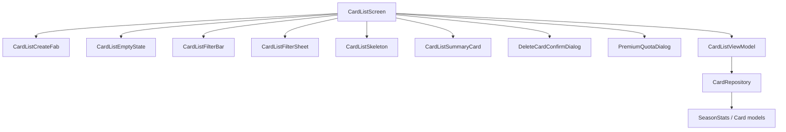
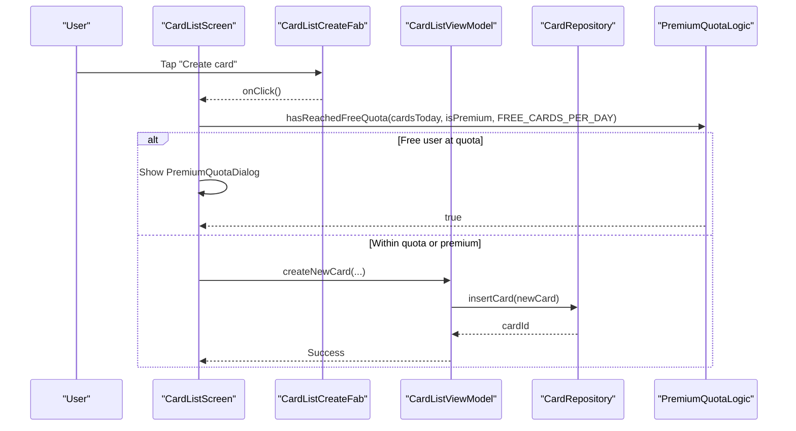
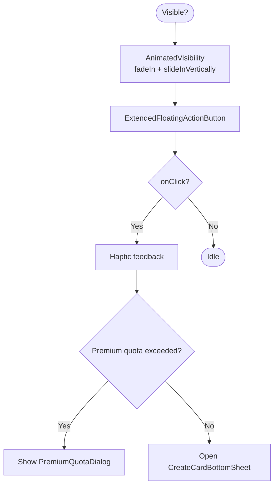
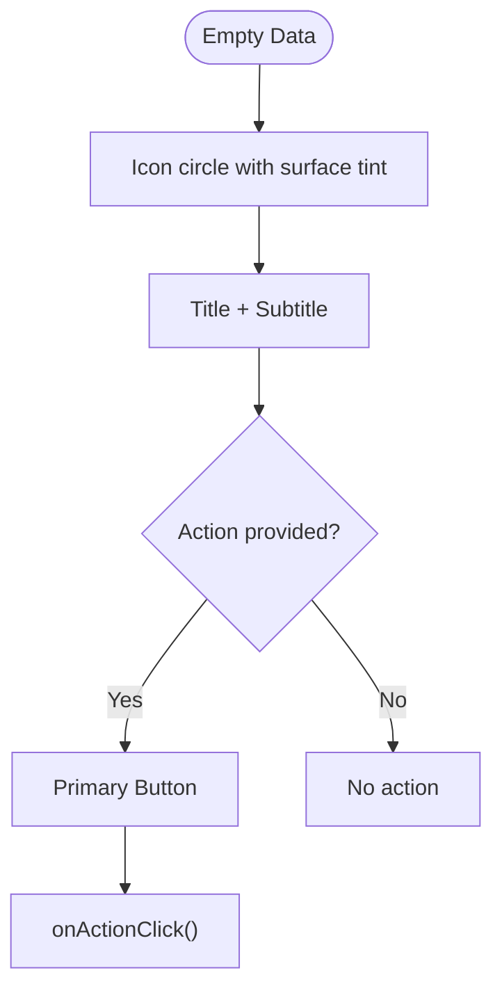
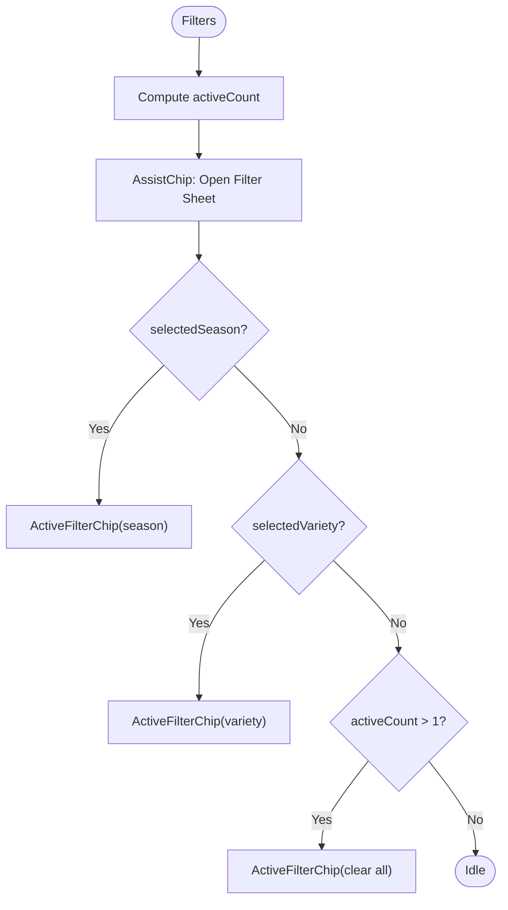
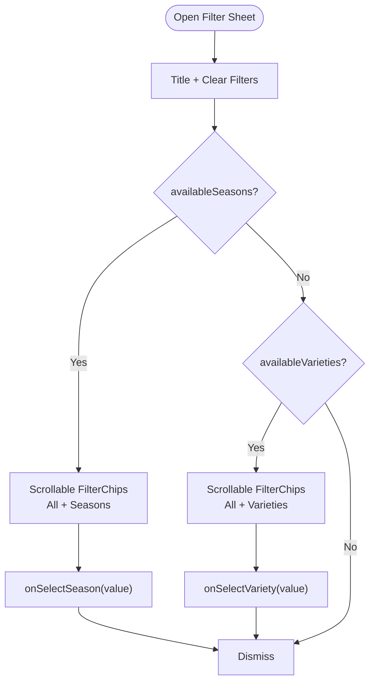
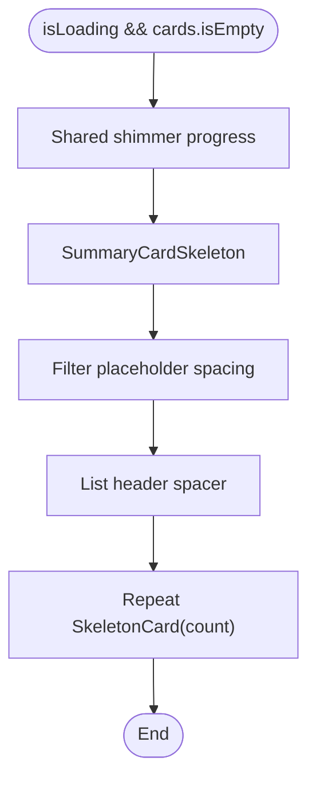
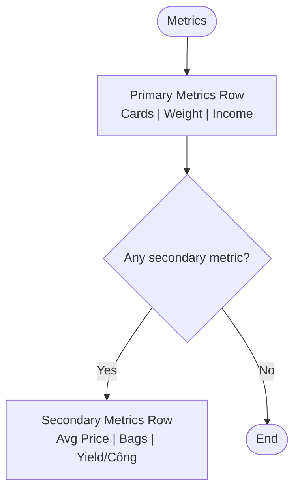
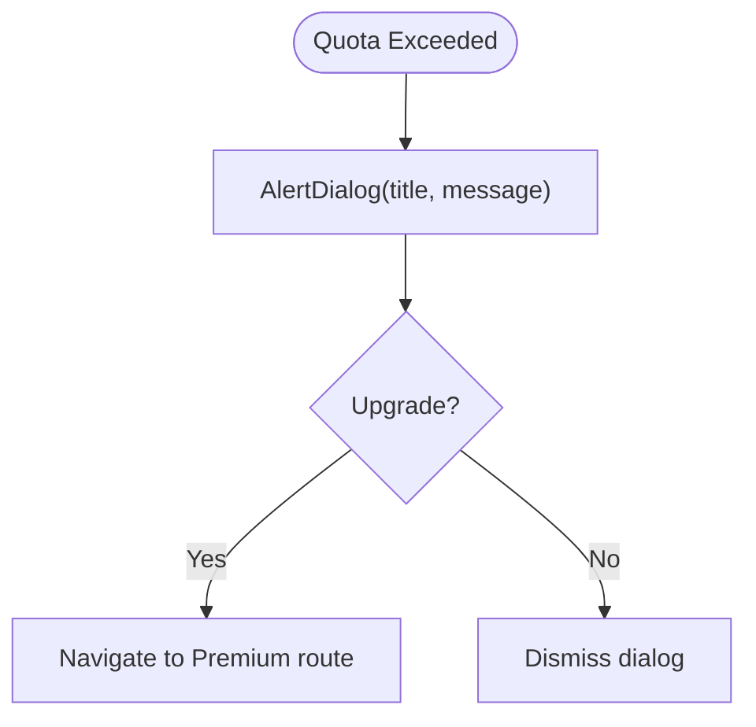
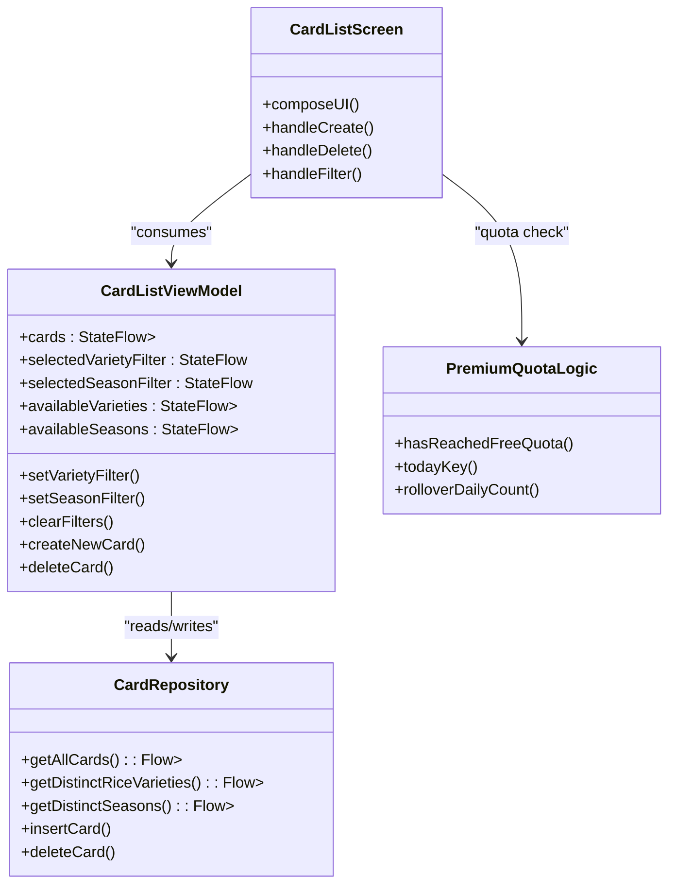

# Card List Components

<cite>
**Referenced Files in This Document**   
- [CardListCreateFab.kt](file://app/src/main/java/com/giathinh/canlua/ui/component/cardlist/CardListCreateFab.kt)
- [CardListEmptyState.kt](file://app/src/main/java/com/giathinh/canlua/ui/component/cardlist/CardListEmptyState.kt)
- [CardListFilterBar.kt](file://app/src/main/java/com/giathinh/canlua/ui/component/cardlist/CardListFilterBar.kt)
- [CardListFilterSheet.kt](file://app/src/main/java/com/giathinh/canlua/ui/component/cardlist/CardListFilterSheet.kt)
- [CardListSkeleton.kt](file://app/src/main/java/com/giathinh/canlua/ui/component/cardlist/CardListSkeleton.kt)
- [CardListSummaryCard.kt](file://app/src/main/java/com/giathinh/canlua/ui/component/cardlist/CardListSummaryCard.kt)
- [DeleteCardConfirmDialog.kt](file://app/src/main/java/com/giathinh/canlua/ui/component/cardlist/DeleteCardConfirmDialog.kt)
- [PremiumQuotaDialog.kt](file://app/src/main/java/com/giathinh/canlua/ui/component/cardlist/PremiumQuotaDialog.kt)
- [CardListScreen.kt](file://app/src/main/java/com/giathinh/canlua/ui/screen/CardListScreen.kt)
- [CardListViewModel.kt](file://app/src/main/java/com/giathinh/canlua/ui/viewmodel/CardListViewModel.kt)
- [CardRepository.kt](file://app/src/main/java/com/giathinh/canlua/repository/CardRepository.kt)
- [SeasonStats.kt](file://app/src/main/java/com/giathinh/canlua/data/model/SeasonStats.kt)
- [PremiumQuotaLogic.kt](file://app/src/main/java/com/giathinh/canlua/util/PremiumQuotaLogic.kt)
</cite>

## Table of Contents
1. [Introduction](#introduction)
2. [Project Structure](#project-structure)
3. [Core Components](#core-components)
4. [Architecture Overview](#architecture-overview)
5. [Detailed Component Analysis](#detailed-component-analysis)
6. [Dependency Analysis](#dependency-analysis)
7. [Performance Considerations](#performance-considerations)
8. [Troubleshooting Guide](#troubleshooting-guide)
9. [Conclusion](#conclusion)

## Introduction
This document explains the card list component subsystem used for managing weighing records in an offline-first agricultural app. It covers the floating action button for creating new cards, empty state handling, a comprehensive filtering system for season and variety, skeleton loading states, aggregated statistics, safe deletion confirmation, and premium quota gating. The components follow Material Design 3 theming, use Jetpack Compose, and integrate with a ViewModel using StateFlow for unidirectional data flow.

## Project Structure
The card list UI is composed under `ui/component/cardlist` and orchestrated by `CardListScreen`, which consumes `CardListViewModel`. Filtering options are sourced from repository flows that expose distinct seasons and rice varieties. Premium gating logic is implemented as pure functions and shared through application-level premium state.

**Diagram sources**
- [CardListScreen.kt:100-480](file://app/src/main/java/com/giathinh/canlua/ui/screen/CardListScreen.kt#L100-L480)
- [CardListCreateFab.kt:31-90](file://app/src/main/java/com/giathinh/canlua/ui/component/cardlist/CardListCreateFab.kt#L31-L90)
- [CardListEmptyState.kt:38-102](file://app/src/main/java/com/giathinh/canlua/ui/component/cardlist/CardListEmptyState.kt#L38-L102)
- [CardListFilterBar.kt:30-89](file://app/src/main/java/com/giathinh/canlua/ui/component/cardlist/CardListFilterBar.kt#L30-L89)
- [CardListFilterSheet.kt:32-167](file://app/src/main/java/com/giathinh/canlua/ui/component/cardlist/CardListFilterSheet.kt#L32-L167)
- [CardListSkeleton.kt:43-79](file://app/src/main/java/com/giathinh/canlua/ui/component/cardlist/CardListSkeleton.kt#L43-L79)
- [CardListSummaryCard.kt:42-168](file://app/src/main/java/com/giathinh/canlua/ui/component/cardlist/CardListSummaryCard.kt#L42-L168)
- [DeleteCardConfirmDialog.kt:26-74](file://app/src/main/java/com/giathinh/canlua/ui/component/cardlist/DeleteCardConfirmDialog.kt#L26-L74)
- [PremiumQuotaDialog.kt:25-73](file://app/src/main/java/com/giathinh/canlua/ui/component/cardlist/PremiumQuotaDialog.kt#L25-L73)
- [CardListViewModel.kt:24-79](file://app/src/main/java/com/giathinh/canlua/ui/viewmodel/CardListViewModel.kt#L24-L79)
- [CardRepository.kt:315-338](file://app/src/main/java/com/giathinh/canlua/repository/CardRepository.kt#L315-L338)

**Section sources**
- [CardListScreen.kt:100-480](file://app/src/main/java/com/giathinh/canlua/ui/screen/CardListScreen.kt#L100-L480)
- [CardListViewModel.kt:24-79](file://app/src/main/java/com/giathinh/canlua/ui/viewmodel/CardListViewModel.kt#L24-L79)
- [CardRepository.kt:315-338](file://app/src/main/java/com/giathinh/canlua/repository/CardRepository.kt#L315-L338)

## Core Components
- CardListCreateFab: A spring-animated extended floating action button to initiate new weighing records. Visibility reacts to scroll direction and empty state.
- CardListEmptyState: A centered layout with icon, title, subtitle, and optional action button; supports sync prompts and filter-clear actions.
- CardListFilterBar: Horizontal chip bar showing active filters (season, variety), filter count, and clear controls.
- CardListFilterSheet: Modal bottom sheet offering selectable chips for “All” and specific seasons or varieties.
- CardListSkeleton: Shimmer-based placeholders mirroring summary and list structure to reduce layout shift during loading.
- CardListSummaryCard: Aggregated daily metrics including card count, total weight, total income, average price per kilogram, bag count, and estimated yield per area unit.
- DeleteCardConfirmDialog: Confirmation dialog for destructive card deletion with contextual messaging.
- PremiumQuotaDialog: Dialog gating free users who reached their daily card creation limit, prompting upgrade.

**Section sources**
- [CardListCreateFab.kt:31-90](file://app/src/main/java/com/giathinh/canlua/ui/component/cardlist/CardListCreateFab.kt#L31-L90)
- [CardListEmptyState.kt:38-102](file://app/src/main/java/com/giathinh/canlua/ui/component/cardlist/CardListEmptyState.kt#L38-L102)
- [CardListFilterBar.kt:30-89](file://app/src/main/java/com/giathinh/canlua/ui/component/cardlist/CardListFilterBar.kt#L30-L89)
- [CardListFilterSheet.kt:32-167](file://app/src/main/java/com/giathinh/canlua/ui/component/cardlist/CardListFilterSheet.kt#L32-L167)
- [CardListSkeleton.kt:43-79](file://app/src/main/java/com/giathinh/canlua/ui/component/cardlist/CardListSkeleton.kt#L43-L79)
- [CardListSummaryCard.kt:42-168](file://app/src/main/java/com/giathinh/canlua/ui/component/cardlist/CardListSummaryCard.kt#L42-L168)
- [DeleteCardConfirmDialog.kt:26-74](file://app/src/main/java/com/giathinh/canlua/ui/component/cardlist/DeleteCardConfirmDialog.kt#L26-L74)
- [PremiumQuotaDialog.kt:25-73](file://app/src/main/java/com/giathinh/canlua/ui/component/cardlist/PremiumQuotaDialog.kt#L25-L73)

## Architecture Overview
The screen composes all card list components and manages local UI state while delegating business logic to `CardListViewModel`. Repository flows provide distinct seasons and varieties, which the ViewModel combines with selected filters to derive the displayed card list. Premium gating uses pure quota logic and application-level premium state.

**Diagram sources**
- [CardListScreen.kt:385-436](file://app/src/main/java/com/giathinh/canlua/ui/screen/CardListScreen.kt#L385-L436)
- [CardListViewModel.kt:81-150](file://app/src/main/java/com/giathinh/canlua/ui/viewmodel/CardListViewModel.kt#L81-L150)
- [CardRepository.kt:60-68](file://app/src/main/java/com/giathinh/canlua/repository/CardRepository.kt#L60-L68)
- [PremiumQuotaLogic.kt:43-46](file://app/src/main/java/com/giathinh/canlua/util/PremiumQuotaLogic.kt#L43-L46)

## Detailed Component Analysis

### CardListCreateFab
- Purpose: Launches the card creation workflow via a spring-animated extended FAB.
- Behavior: Animated visibility based on scroll direction and empty state; uses theme tokens for color, shape, and elevation.
- Accessibility: TODO notes indicate missing content description for TalkBack; consider adding descriptive text.
- Integration: Screen handles premium gating before opening the creation dialog.

**Diagram sources**
- [CardListCreateFab.kt:40-90](file://app/src/main/java/com/giathinh/canlua/ui/component/cardlist/CardListCreateFab.kt#L40-L90)
- [CardListScreen.kt:385-436](file://app/src/main/java/com/giathinh/canlua/ui/screen/CardListScreen.kt#L385-L436)

**Section sources**
- [CardListCreateFab.kt:31-90](file://app/src/main/java/com/giathinh/canlua/ui/component/cardlist/CardListCreateFab.kt#L31-L90)
- [CardListScreen.kt:385-436](file://app/src/main/java/com/giathinh/canlua/ui/screen/CardListScreen.kt#L385-L436)

### CardListEmptyState
- Purpose: Displays guidance when no cards exist, with optional sync prompt and primary action button.
- Behavior: Shows icon, title, subtitle, and optional action button styled with theme tokens.
- Usage: In filtered-empty scenarios, it offers a clear-filter action; otherwise, it can trigger card creation or sync.

**Diagram sources**
- [CardListEmptyState.kt:49-102](file://app/src/main/java/com/giathinh/canlua/ui/component/cardlist/CardListEmptyState.kt#L49-L102)

**Section sources**
- [CardListEmptyState.kt:38-102](file://app/src/main/java/com/giathinh/canlua/ui/component/cardlist/CardListEmptyState.kt#L38-L102)
- [CardListScreen.kt:292-323](file://app/src/main/java/com/giathinh/canlua/ui/screen/CardListScreen.kt#L292-L323)

### CardListFilterBar
- Purpose: Shows active filters (season, variety), filter count, and clear controls.
- Behavior: Uses AssistChip for opening the filter sheet; ActiveFilterChip renders removable chips for each active filter.
- Theming: Active filters use primary color; inactive uses surface container.

**Diagram sources**
- [CardListFilterBar.kt:40-89](file://app/src/main/java/com/giathinh/canlua/ui/component/cardlist/CardListFilterBar.kt#L40-L89)
- [CardListFilterBar.kt:92-119](file://app/src/main/java/com/giathinh/canlua/ui/component/cardlist/CardListFilterBar.kt#L92-L119)

**Section sources**
- [CardListFilterBar.kt:30-119](file://app/src/main/java/com/giathinh/canlua/ui/component/cardlist/CardListFilterBar.kt#L30-L119)
- [CardListScreen.kt:278-289](file://app/src/main/java/com/giathinh/canlua/ui/screen/CardListScreen.kt#L278-L289)

### CardListFilterSheet
- Purpose: Modal bottom sheet for selecting season and variety filters.
- Behavior: Provides “All” chips plus individual options; clears filters via a dedicated action.
- UX: Scrollable rows of FilterChips with selected state styling.

**Diagram sources**
- [CardListFilterSheet.kt:47-76](file://app/src/main/java/com/giathinh/canlua/ui/component/cardlist/CardListFilterSheet.kt#L47-L76)
- [CardListFilterSheet.kt:78-165](file://app/src/main/java/com/giathinh/canlua/ui/component/cardlist/CardListFilterSheet.kt#L78-L165)

**Section sources**
- [CardListFilterSheet.kt:32-167](file://app/src/main/java/com/giathinh/canlua/ui/component/cardlist/CardListFilterSheet.kt#L32-L167)
- [CardListScreen.kt:468-479](file://app/src/main/java/com/giathinh/canlua/ui/screen/CardListScreen.kt#L468-L479)

### CardListSkeleton
- Purpose: Provides shimmer placeholders matching the real layout to minimize visual jump.
- Behavior: Renders a summary skeleton and multiple list skeletons synchronized via shared shimmer progress.
- Accessibility: Sets semantics contentDescription to “Loading”.

**Diagram sources**
- [CardListSkeleton.kt:43-79](file://app/src/main/java/com/giathinh/canlua/ui/component/cardlist/CardListSkeleton.kt#L43-L79)
- [CardListSkeleton.kt:82-132](file://app/src/main/java/com/giathinh/canlua/ui/component/cardlist/CardListSkeleton.kt#L82-L132)
- [CardListSkeleton.kt:137-182](file://app/src/main/java/com/giathinh/canlua/ui/component/cardlist/CardListSkeleton.kt#L137-L182)

**Section sources**
- [CardListSkeleton.kt:43-182](file://app/src/main/java/com/giathinh/canlua/ui/component/cardlist/CardListSkeleton.kt#L43-L182)
- [CardListScreen.kt:222-224](file://app/src/main/java/com/giathinh/canlua/ui/screen/CardListScreen.kt#L222-L224)

### CardListSummaryCard
- Purpose: Displays aggregated daily statistics with optional secondary metrics.
- Behavior: Shows primary metrics (card count, total kg, total amount) and conditionally renders secondary metrics (average price per kg, bag count, estimated yield per cong).
- Theming: Uses top accent strip, surface containers, and consistent typography.

**Diagram sources**
- [CardListSummaryCard.kt:58-134](file://app/src/main/java/com/giathinh/canlua/ui/component/cardlist/CardListSummaryCard.kt#L58-L134)
- [CardListSummaryCard.kt:136-165](file://app/src/main/java/com/giathinh/canlua/ui/component/cardlist/CardListSummaryCard.kt#L136-L165)

**Section sources**
- [CardListSummaryCard.kt:42-168](file://app/src/main/java/com/giathinh/canlua/ui/component/cardlist/CardListSummaryCard.kt#L42-L168)
- [CardListScreen.kt:266-275](file://app/src/main/java/com/giathinh/canlua/ui/screen/CardListScreen.kt#L266-L275)

### DeleteCardConfirmDialog
- Purpose: Confirms destructive deletion with contextual message using card display name.
- Behavior: Styled AlertDialog with error-colored confirm button and cancel dismiss.

**Diagram sources**
- [DeleteCardConfirmDialog.kt:32-73](file://app/src/main/java/com/giathinh/canlua/ui/component/cardlist/DeleteCardConfirmDialog.kt#L32-L73)
- [CardListScreen.kt:440-454](file://app/src/main/java/com/giathinh/canlua/ui/screen/CardListScreen.kt#L440-L454)

**Section sources**
- [DeleteCardConfirmDialog.kt:26-74](file://app/src/main/java/com/giathinh/canlua/ui/component/cardlist/DeleteCardConfirmDialog.kt#L26-L74)
- [CardListScreen.kt:440-454](file://app/src/main/java/com/giathinh/canlua/ui/screen/CardListScreen.kt#L440-L454)

### PremiumQuotaDialog
- Purpose: Gates free users who reached the daily card creation limit.
- Behavior: Shows current daily count and free limit; navigates to premium screen on upgrade.

**Diagram sources**
- [PremiumQuotaDialog.kt:32-72](file://app/src/main/java/com/giathinh/canlua/ui/component/cardlist/PremiumQuotaDialog.kt#L32-L72)
- [CardListScreen.kt:456-466](file://app/src/main/java/com/giathinh/canlua/ui/screen/CardListScreen.kt#L456-L466)

**Section sources**
- [PremiumQuotaDialog.kt:25-73](file://app/src/main/java/com/giathinh/canlua/ui/component/cardlist/PremiumQuotaDialog.kt#L25-L73)
- [CardListScreen.kt:456-466](file://app/src/main/java/com/giathinh/canlua/ui/screen/CardListScreen.kt#L456-L466)

## Dependency Analysis
The card list subsystem depends on ViewModel flows for data and filters, repository methods for domain operations, and utility logic for premium gating.

**Diagram sources**
- [CardListScreen.kt:100-480](file://app/src/main/java/com/giathinh/canlua/ui/screen/CardListScreen.kt#L100-L480)
- [CardListViewModel.kt:24-169](file://app/src/main/java/com/giathinh/canlua/ui/viewmodel/CardListViewModel.kt#L24-L169)
- [CardRepository.kt:48-68](file://app/src/main/java/com/giathinh/canlua/repository/CardRepository.kt#L48-L68)
- [PremiumQuotaLogic.kt:10-46](file://app/src/main/java/com/giathinh/canlua/util/PremiumQuotaLogic.kt#L10-L46)

**Section sources**
- [CardListViewModel.kt:24-169](file://app/src/main/java/com/giathinh/canlua/ui/viewmodel/CardListViewModel.kt#L24-L169)
- [CardRepository.kt:48-68](file://app/src/main/java/com/giathinh/canlua/repository/CardRepository.kt#L48-L68)
- [PremiumQuotaLogic.kt:10-46](file://app/src/main/java/com/giathinh/canlua/util/PremiumQuotaLogic.kt#L10-L46)

## Performance Considerations
- Use skeleton placeholders to avoid layout shifts during initial load.
- Combine repository flows with filter StateFlows to compute derived lists efficiently.
- Avoid recomposition overhead by keeping immutable domain models and stable keys in lists.
- Limit shimmer animations to shared progress to reduce redundant recompositions.

[No sources needed since this section provides general guidance]

## Troubleshooting Guide
- FAB not visible: Check scroll direction and empty state logic; ensure BottomBarVisibility is updated correctly.
- Filters not applied: Verify ViewModel’s combine logic and that availableSeasons/availableVarieties flows emit values.
- Deletion errors: Observe deleteEvents from ViewModel; handle success/error toasts accordingly.
- Premium gate always shown: Validate PremiumState and daily count; ensure rollover logic resets counts correctly.

**Section sources**
- [CardListScreen.kt:150-159](file://app/src/main/java/com/giathinh/canlua/ui/screen/CardListScreen.kt#L150-L159)
- [CardListViewModel.kt:43-53](file://app/src/main/java/com/giathinh/canlua/ui/viewmodel/CardListViewModel.kt#L43-L53)
- [CardListViewModel.kt:152-161](file://app/src/main/java/com/giathinh/canlua/ui/viewmodel/CardListViewModel.kt#L152-L161)
- [PremiumQuotaLogic.kt:18-24](file://app/src/main/java/com/giathinh/canlua/util/PremiumQuotaLogic.kt#L18-L24)

## Conclusion
The card list component subsystem provides a cohesive set of UI primitives for creating, filtering, viewing, and deleting weighing records. It integrates cleanly with ViewModel-driven state, repository-backed data, and Material Design 3 theming. With careful attention to accessibility, performance, and error handling, it delivers a robust experience for agricultural users across varied network conditions.

[No sources needed since this section summarizes without analyzing specific files]