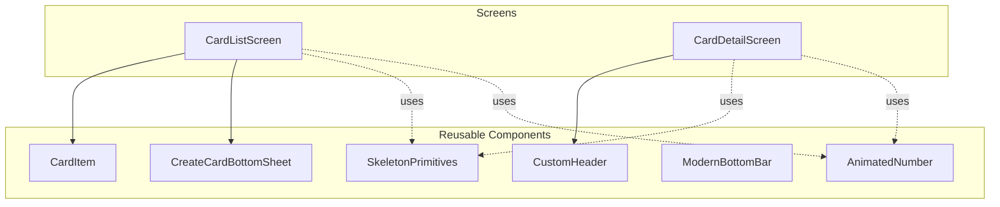
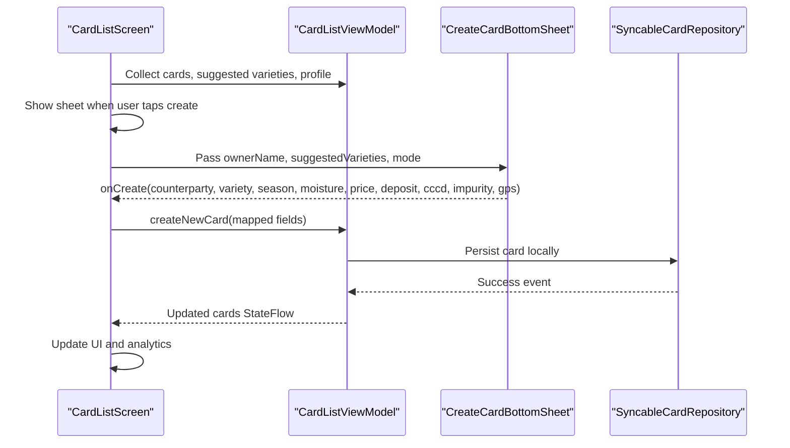
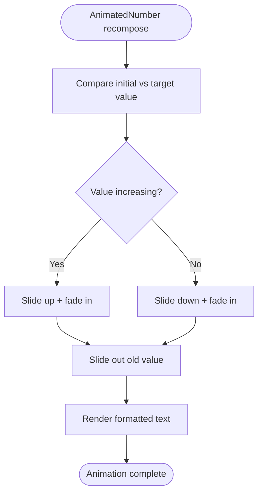
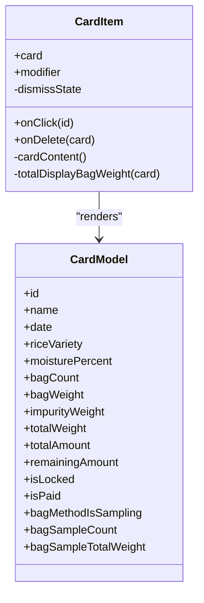
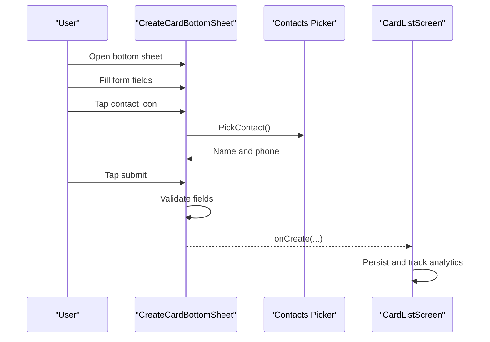
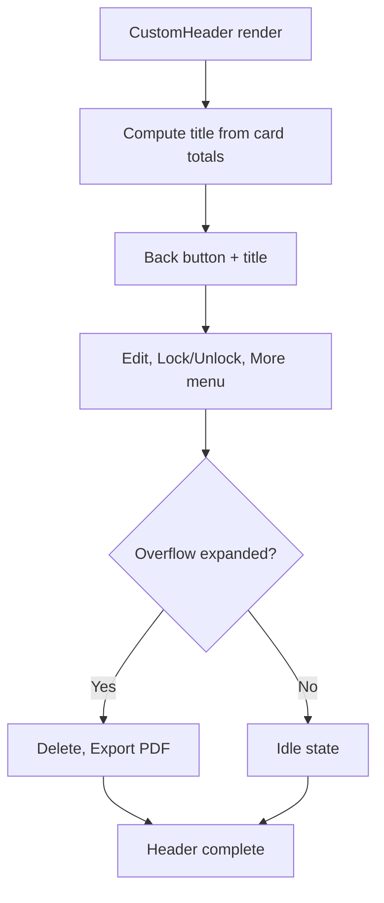
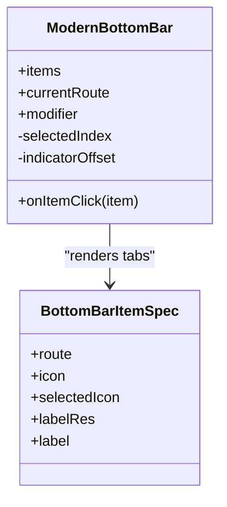
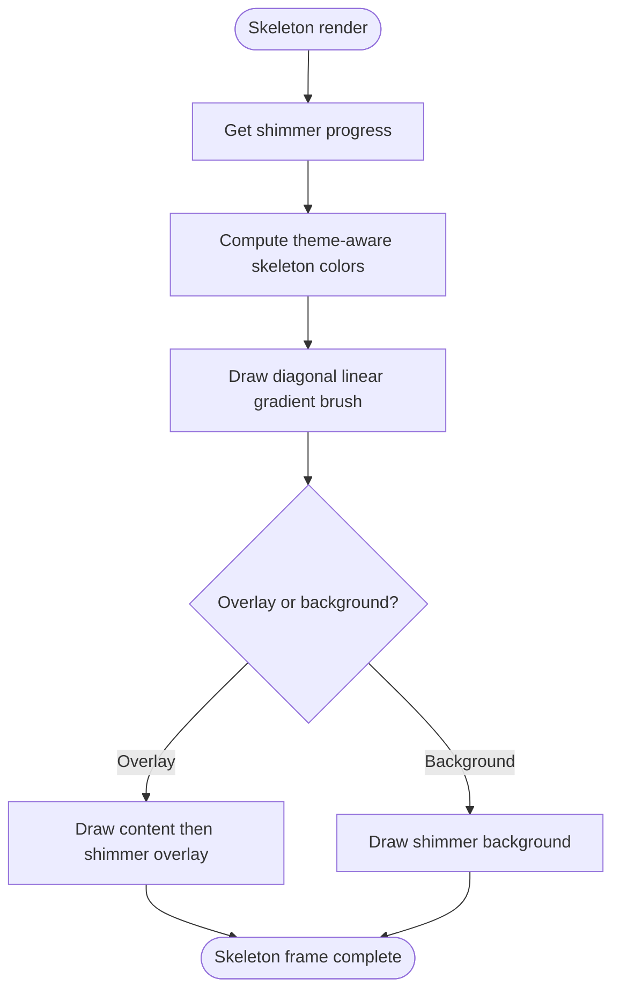
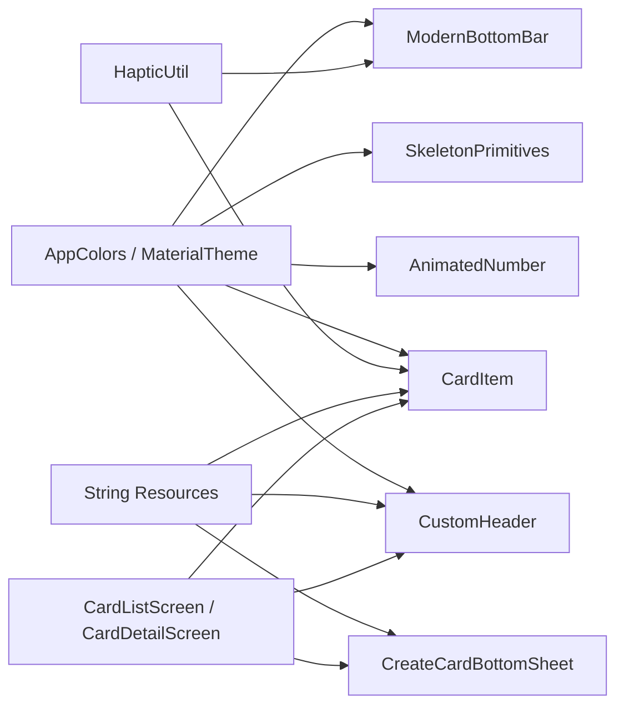

# Reusable Compose Components

<cite>
**Referenced Files in This Document**   
- [AnimatedNumber.kt](file://app/src/main/java/com/giathinh/canlua/ui/component/AnimatedNumber.kt)
- [CardItem.kt](file://app/src/main/java/com/giathinh/canlua/ui/component/CardItem.kt)
- [CreateCardDialog.kt](file://app/src/main/java/com/giathinh/canlua/ui/component/CreateCardDialog.kt)
- [CustomHeader.kt](file://app/src/main/java/com/giathinh/canlua/ui/component/CustomHeader.kt)
- [ModernBottomBar.kt](file://app/src/main/java/com/giathinh/canlua/ui/component/ModernBottomBar.kt)
- [SkeletonPrimitives.kt](file://app/src/main/java/com/giathinh/canlua/ui/component/SkeletonPrimitives.kt)
- [CardListScreen.kt](file://app/src/main/java/com/giathinh/canlua/ui/screen/CardListScreen.kt)
- [CardDetailScreen.kt](file://app/src/main/java/com/giathinh/canlua/ui/screen/CardDetailScreen.kt)
</cite>

## Table of Contents
1. [Introduction](#introduction)
2. [Project Structure](#project-structure)
3. [Core Components](#core-components)
4. [Architecture Overview](#architecture-overview)
5. [Detailed Component Analysis](#detailed-component-analysis)
6. [Dependency Analysis](#dependency-analysis)
7. [Performance Considerations](#performance-considerations)
8. [Troubleshooting Guide](#troubleshooting-guide)
9. [Conclusion](#conclusion)

## Introduction
This document explains the reusable Jetpack Compose component library used by Cân Lúa Mobile for weighing records, financial displays, navigation, and loading states. The components are designed around Material Design 3, MVVM state management, offline-first data flow, and performance-conscious composition patterns.

The library covers:
- Animated number transitions for financial and weight displays.
- A swipeable card item for weighing records with locked/paid states.
- A role-aware bottom-sheet dialog for creating new weighing cards.
- A detail-screen header with edit, lock, delete, and PDF export actions.
- A floating capsule bottom navigation bar with animated selection.
- Shared shimmer skeleton primitives for consistent loading placeholders.

These components integrate with the app’s theme, accessibility labels, haptic feedback, and screen-level view models through unidirectional data flow.

## Project Structure
The reusable components live under `ui/component`, while screens consume them from `ui/screen`. Screens hold UI state, collect StateFlow from view models, and pass props to these components.

**Diagram sources**
- [CardListScreen.kt:100-480](file://app/src/main/java/com/giathinh/canlua/ui/screen/CardListScreen.kt#L100-L480)
- [CardDetailScreen.kt:88-789](file://app/src/main/java/com/giathinh/canlua/ui/screen/CardDetailScreen.kt#L88-L789)
- [AnimatedNumber.kt:29-104](file://app/src/main/java/com/giathinh/canlua/ui/component/AnimatedNumber.kt#L29-L104)
- [CardItem.kt:67-340](file://app/src/main/java/com/giathinh/canlua/ui/component/CardItem.kt#L67-L340)
- [CreateCardDialog.kt:87-613](file://app/src/main/java/com/giathinh/canlua/ui/component/CreateCardDialog.kt#L87-L613)
- [CustomHeader.kt:66-224](file://app/src/main/java/com/giathinh/canlua/ui/component/CustomHeader.kt#L66-L224)
- [ModernBottomBar.kt:68-250](file://app/src/main/java/com/giathinh/canlua/ui/component/ModernBottomBar.kt#L68-L250)
- [SkeletonPrimitives.kt:34-201](file://app/src/main/java/com/giathinh/canlua/ui/component/SkeletonPrimitives.kt#L34-L201)

**Section sources**
- [CardListScreen.kt:100-480](file://app/src/main/java/com/giathinh/canlua/ui/screen/CardListScreen.kt#L100-L480)
- [CardDetailScreen.kt:88-789](file://app/src/main/java/com/giathinh/canlua/ui/screen/CardDetailScreen.kt#L88-L789)

## Core Components
This section summarizes each component’s purpose, prop interface, internal state model, customization options, and integration points.

### AnimatedNumber
Purpose:
- Displays numeric values with a vertical slide transition that indicates whether the value increased or decreased.
- Suitable for live-updating weight and money displays where tactile motion improves readability.

Key props:
- Numeric value (`Double` or `Int`).
- Formatter function that converts the numeric value into displayed text.
- Modifier, text style, color, and optional font weight.

Internal behavior:
- Uses an animated content transition with slide-in/slide-out plus fade.
- Direction is determined by comparing target and initial values.
- Animation duration is short to avoid jank during frequent recompositions.

Accessibility:
- Renders as standard text; accessibility depends on parent context.
- For financial counters, pair with semantic labels at the screen level.

Usage example pattern:
- Pass a formatter that localizes numbers and currency units.
- Use it inside summary cards or detail rows where values update frequently.

**Section sources**
- [AnimatedNumber.kt:22-64](file://app/src/main/java/com/giathinh/canlua/ui/component/AnimatedNumber.kt#L22-L64)
- [AnimatedNumber.kt:69-104](file://app/src/main/java/com/giathinh/canlua/ui/component/AnimatedNumber.kt#L69-L104)

### CardItem
Purpose:
- Displays a single weighing record card with name, date, rice variety, moisture, bag weight, impurity, total weight, bag count, amount, remaining amount, and paid status.
- Supports click-to-navigate and swipe-to-delete when allowed.

Key props:
- Card model containing weighing record data.
- Click callback receiving the card identifier.
- Delete callback receiving the full card model.
- Modifier for layout control.

State and interaction:
- Swipe-to-delete is guarded by card lock and payment state.
- Haptic feedback is triggered on tap and delete attempts.
- Locked and paid states change card background colors.

Composition pattern:
- Card content is extracted into a reusable composable block so both locked and unlocked branches can reuse it without duplicating layout logic.
- Swipe layer is only added when deletion is permitted, avoiding visual artifacts.

Accessibility:
- Icons and chevrons include content descriptions.
- Text overflows are handled for long names.

Usage example pattern:
- Render inside a grouped list where each group represents a date.
- Provide stable keys based on card identifiers.

**Section sources**
- [CardItem.kt:52-57](file://app/src/main/java/com/giathinh/canlua/ui/component/CardItem.kt#L52-L57)
- [CardItem.kt:67-340](file://app/src/main/java/com/giathinh/canlua/ui/component/CardItem.kt#L67-L340)
- [CardItem.kt:342-358](file://app/src/main/java/com/giathinh/canlua/ui/component/CardItem.kt#L342-L358)

### CreateCardBottomSheet
Purpose:
- Bottom-sheet form for creating a new weighing card.
- Supports two roles: farmer and trader, swapping owner and counterparty labels accordingly.

Key props:
- Owner name (read-only header).
- Suggested rice varieties from the database.
- Dismiss callback.
- Create callback returning validated form fields.
- Mode enum controlling role-specific labels.

Internal state:
- Local mutable state for counterparty name, phone, rice variety, season, CCCD, raw numeric inputs, help dialogs, and GPS location opt-in.
- Permission launchers for contacts and location.
- Validation requiring non-empty counterparty name, rice variety, and either empty or exactly 12-digit CCCD.

Input handling:
- Phone input filters digits and allows limited characters.
- Numeric fields use a thousand-separator transformation for price and deposit.
- CCCD and impurity/moisture fields validate length and digit-only input.

Navigation and permissions:
- Contacts picker fills name and phone when available.
- Location permission request toggles GPS recording flag.

Event handling:
- Submit triggers haptic confirmation, validates, formats raw strings into doubles, and calls the parent create callback before dismissing.

Usage example pattern:
- Show conditionally based on premium quota and user role.
- Map returned fields into the domain model before persisting via the view model.

**Section sources**
- [CreateCardDialog.kt:67-104](file://app/src/main/java/com/giathinh/canlua/ui/component/CreateCardDialog.kt#L67-L104)
- [CreateCardDialog.kt:119-225](file://app/src/main/java/com/giathinh/canlua/ui/component/CreateCardDialog.kt#L119-L225)
- [CreateCardDialog.kt:228-613](file://app/src/main/java/com/giathinh/canlua/ui/component/CreateCardDialog.kt#L228-L613)
- [CreateCardDialog.kt:618-658](file://app/src/main/java/com/giathinh/canlua/ui/component/CreateCardDialog.kt#L618-L658)
- [CreateCardDialog.kt:664-716](file://app/src/main/java/com/giathinh/canlua/ui/component/CreateCardDialog.kt#L664-L716)

### CustomHeader
Purpose:
- Detail-screen top bar showing back navigation, dynamic title summarizing weight and bag count, edit, lock/unlock, and overflow menu for delete and PDF export.

Key props:
- Card model.
- Back, edit, delete, export, and lock toggle callbacks.
- Overflow visibility and change callback.
- Collapse fraction for scroll-driven header height changes.
- Optional last entry time and add action.

Behavior:
- Title is computed from card totals and bag count.
- Edit icon is dimmed when the card is locked.
- Lock icon switches between locked and unlocked visuals.
- Overflow menu toggles a dropdown with delete and export actions.

Integration:
- Used by the detail screen to coordinate navigation, locking, deletion, and PDF export.
- Works with scroll-based collapse state managed by the screen.

Accessibility:
- Action icons include content descriptions.
- Menu items are labeled through string resources.

Usage example pattern:
- Wrap with a height modifier driven by scroll position.
- Gate destructive actions behind lock/payment checks at the screen layer.

**Section sources**
- [CustomHeader.kt:43-64](file://app/src/main/java/com/giathinh/canlua/ui/component/CustomHeader.kt#L43-L64)
- [CustomHeader.kt:66-224](file://app/src/main/java/com/giathinh/canlua/ui/component/CustomHeader.kt#L66-L224)

### ModernBottomBar
Purpose:
- Floating capsule-style bottom navigation bar following Material Design 3 principles.
- Provides animated indicator pill, selected tab scaling, color transitions, and haptic feedback.

Key props:
- List of navigation item specs including route, icons, label resource, and selected icon.
- Current route for determining selected index.
- Item click callback.
- Modifier for layout.

Internal behavior:
- Computes selected index from current route.
- Animates indicator pill using spring physics.
- Animates tab scale and color based on selection.
- Triggers haptic feedback on item clicks.

Data model:
- Navigation spec separates route and display metadata from UI rendering.

Accessibility:
- Tabs expose semantics for selected state.
- Icon content descriptions come from localized labels.

Usage example pattern:
- Build the item list once and pass it down.
- Route changes should be handled by the parent navigation controller.

**Section sources**
- [ModernBottomBar.kt:57-174](file://app/src/main/java/com/giathinh/canlua/ui/component/ModernBottomBar.kt#L57-L174)
- [ModernBottomBar.kt:176-250](file://app/src/main/java/com/giathinh/canlua/ui/component/ModernBottomBar.kt#L176-L250)

### SkeletonPrimitives
Purpose:
- Shared shimmer and skeleton primitives for loading placeholders across the app.
- Provides synchronized shimmer progress, theme-adaptive colors, overlay shimmer, background shimmer, and ready-to-use skeleton boxes.

Key APIs:
- Shimmer progress provider for global synchronization.
- Theme-aware skeleton color computation.
- Modifier-based shimmer overlay and background effects.
- ShimmerBox and DefaultSkeleton composables.

Theming:
- Colors adapt to light/dark mode using surface luminance and brand green accents.
- Gradient shimmer highlights differ per theme but maintain subtle brand presence.

Usage example pattern:
- Wrap placeholder layouts with shimmer modifiers.
- Use ShimmerBox for rounded rectangles or circles.
- Use DefaultSkeleton for full-screen loading indicators.

**Section sources**
- [SkeletonPrimitives.kt:34-55](file://app/src/main/java/com/giathinh/canlua/ui/component/SkeletonPrimitives.kt#L34-L55)
- [SkeletonPrimitives.kt:57-102](file://app/src/main/java/com/giathinh/canlua/ui/component/SkeletonPrimitives.kt#L57-L102)
- [SkeletonPrimitives.kt:104-165](file://app/src/main/java/com/giathinh/canlua/ui/component/SkeletonPrimitives.kt#L104-L165)
- [SkeletonPrimitives.kt:167-201](file://app/src/main/java/com/giathinh/canlua/ui/component/SkeletonPrimitives.kt#L167-L201)

## Architecture Overview
The component library follows a clear separation between screens and reusable UI pieces. Screens manage lifecycle, state collection, and business events; components focus on presentation, interaction, and animation.

**Diagram sources**
- [CardListScreen.kt:100-480](file://app/src/main/java/com/giathinh/canlua/ui/screen/CardListScreen.kt#L100-L480)
- [CreateCardDialog.kt:87-613](file://app/src/main/java/com/giathinh/canlua/ui/component/CreateCardDialog.kt#L87-L613)

## Detailed Component Analysis

### AnimatedNumber Analysis
Implementation pattern:
- Two overloaded functions for Double and Int values.
- Animated content transition compares initial and target values to determine direction.
- Slide and fade animations run together with size transform to prevent clipping.

Complexity:
- Animation cost is proportional to text layout changes.
- Short duration reduces recomposition pressure during rapid updates.

Optimization opportunities:
- Avoid passing unstable formatter lambdas; memoize formatting logic at the screen layer.
- Combine with derived state to reduce unnecessary transitions.

Error handling:
- No explicit error paths; relies on valid numeric input from parent.

Performance implications:
- Frequent recompositions are acceptable due to lightweight animation and short duration.
- Prefer stable styles and colors to minimize recomposition scope.

**Diagram sources**
- [AnimatedNumber.kt:38-63](file://app/src/main/java/com/giathinh/canlua/ui/component/AnimatedNumber.kt#L38-L63)
- [AnimatedNumber.kt:78-103](file://app/src/main/java/com/giathinh/canlua/ui/component/AnimatedNumber.kt#L78-L103)

**Section sources**
- [AnimatedNumber.kt:22-64](file://app/src/main/java/com/giathinh/canlua/ui/component/AnimatedNumber.kt#L22-L64)
- [AnimatedNumber.kt:69-104](file://app/src/main/java/com/giathinh/canlua/ui/component/AnimatedNumber.kt#L69-L104)

### CardItem Analysis
Implementation pattern:
- Single composable renders a card with conditional sections for variety, moisture, bag weight, and impurity.
- Swipe-to-delete is wrapped only when deletion is allowed.
- Haptic feedback enhances tap and delete interactions.

State management:
- Swipe state is local to the item.
- Deletion requires unlocked and paid card state.

Composition pattern:
- Card content is extracted into a nested composable block to avoid duplication between locked and unlocked branches.

Accessibility:
- Content descriptions are provided for icons and navigation cues.
- Text overflow is handled for long titles.

Performance considerations:
- Singleton formatters and locale instances reduce object creation.
- Stable lambda parameters allow parent to share handlers across list items.

**Diagram sources**
- [CardItem.kt:67-340](file://app/src/main/java/com/giathinh/canlua/ui/component/CardItem.kt#L67-L340)
- [CardItem.kt:342-358](file://app/src/main/java/com/giathinh/canlua/ui/component/CardItem.kt#L342-L358)

**Section sources**
- [CardItem.kt:52-57](file://app/src/main/java/com/giathinh/canlua/ui/component/CardItem.kt#L52-L57)
- [CardItem.kt:67-340](file://app/src/main/java/com/giathinh/canlua/ui/component/CardItem.kt#L67-L340)
- [CardItem.kt:342-358](file://app/src/main/java/com/giathinh/canlua/ui/component/CardItem.kt#L342-L358)

### CreateCardBottomSheet Analysis
Implementation pattern:
- Modal bottom sheet with scrollable form sections.
- Role-aware labels swap owner and counterparty fields.
- Input validation ensures required fields and CCCD format.

State management:
- Local mutable state for all form fields.
- Help flags control inline explanation dialogs.
- Permission launchers handle contacts and location access.

Event handling:
- Contact picker populates name and phone.
- Submit maps raw strings to typed values and invokes parent callback.
- Premium gating and analytics are handled at the screen layer.

Customization options:
- Mode controls role orientation.
- Suggestions combine database results with defaults.
- Visual transformation formats large numbers.

**Diagram sources**
- [CreateCardDialog.kt:156-204](file://app/src/main/java/com/giathinh/canlua/ui/component/CreateCardDialog.kt#L156-L204)
- [CreateCardDialog.kt:221-225](file://app/src/main/java/com/giathinh/canlua/ui/component/CreateCardDialog.kt#L221-L225)
- [CreateCardDialog.kt:557-586](file://app/src/main/java/com/giathinh/canlua/ui/component/CreateCardDialog.kt#L557-L586)

**Section sources**
- [CreateCardDialog.kt:67-104](file://app/src/main/java/com/giathinh/canlua/ui/component/CreateCardDialog.kt#L67-L104)
- [CreateCardDialog.kt:119-225](file://app/src/main/java/com/giathinh/canlua/ui/component/CreateCardDialog.kt#L119-L225)
- [CreateCardDialog.kt:228-613](file://app/src/main/java/com/giathinh/canlua/ui/component/CreateCardDialog.kt#L228-L613)
- [CreateCardDialog.kt:618-658](file://app/src/main/java/com/giathinh/canlua/ui/component/CreateCardDialog.kt#L618-L658)
- [CreateCardDialog.kt:664-716](file://app/src/main/java/com/giathinh/canlua/ui/component/CreateCardDialog.kt#L664-L716)

### CustomHeader Analysis
Implementation pattern:
- Fixed-height header with left-aligned back and title, right-aligned action row.
- Overflow menu provides delete and PDF export actions.
- Title dynamically reflects card totals.

State management:
- Overflow visibility is controlled by parent.
- Actions are delegated to parent callbacks.

Accessibility:
- All interactive elements have content descriptions.
- Menu items are clearly labeled.

Responsive design:
- Title truncates gracefully for long summaries.
- Action spacing is compact to fit small screens.

**Diagram sources**
- [CustomHeader.kt:81-93](file://app/src/main/java/com/giathinh/canlua/ui/component/CustomHeader.kt#L81-L93)
- [CustomHeader.kt:100-224](file://app/src/main/java/com/giathinh/canlua/ui/component/CustomHeader.kt#L100-L224)

**Section sources**
- [CustomHeader.kt:43-64](file://app/src/main/java/com/giathinh/canlua/ui/component/CustomHeader.kt#L43-L64)
- [CustomHeader.kt:66-224](file://app/src/main/java/com/giathinh/canlua/ui/component/CustomHeader.kt#L66-L224)

### ModernBottomBar Analysis
Implementation pattern:
- Floating capsule surface with circular shape and shadow.
- Indicator pill animates horizontally using spring physics.
- Tab items animate scale and color based on selection.

State management:
- Selected index is derived from current route.
- Indicator offset is animated independently.

Accessibility:
- Tabs expose selected semantics.
- Labels are localized via string resources.

Performance considerations:
- Animations use spring and tween specs tuned for smoothness.
- Haptic feedback adds tactile confirmation without heavy computation.

**Diagram sources**
- [ModernBottomBar.kt:68-174](file://app/src/main/java/com/giathinh/canlua/ui/component/ModernBottomBar.kt#L68-L174)
- [ModernBottomBar.kt:244-250](file://app/src/main/java/com/giathinh/canlua/ui/component/ModernBottomBar.kt#L244-L250)

**Section sources**
- [ModernBottomBar.kt:57-174](file://app/src/main/java/com/giathinh/canlua/ui/component/ModernBottomBar.kt#L57-L174)
- [ModernBottomBar.kt:176-250](file://app/src/main/java/com/giathinh/canlua/ui/component/ModernBottomBar.kt#L176-L250)

### SkeletonPrimitives Analysis
Implementation pattern:
- Global shimmer progress via CompositionLocal.
- Theme-aware skeleton colors computed from surface luminance.
- Modifier-based shimmer overlay and background drawing.
- Ready-to-use skeleton box and default full-screen skeleton.

State management:
- Infinite transition drives shimmer progress.
- Progress can be passed explicitly to synchronize multiple skeletons.

Theming:
- Light mode uses white highlight with subtle brand tint.
- Dark mode uses surface variant highlights with brand overlay.

Performance considerations:
- drawWithCache minimizes repeated brush allocations.
- Shared progress avoids multiple infinite transitions.

**Diagram sources**
- [SkeletonPrimitives.kt:43-55](file://app/src/main/java/com/giathinh/canlua/ui/component/SkeletonPrimitives.kt#L43-L55)
- [SkeletonPrimitives.kt:75-102](file://app/src/main/java/com/giathinh/canlua/ui/component/SkeletonPrimitives.kt#L75-L102)
- [SkeletonPrimitives.kt:109-165](file://app/src/main/java/com/giathinh/canlua/ui/component/SkeletonPrimitives.kt#L109-L165)

**Section sources**
- [SkeletonPrimitives.kt:34-55](file://app/src/main/java/com/giathinh/canlua/ui/component/SkeletonPrimitives.kt#L34-L55)
- [SkeletonPrimitives.kt:57-102](file://app/src/main/java/com/giathinh/canlua/ui/component/SkeletonPrimitives.kt#L57-L102)
- [SkeletonPrimitives.kt:104-165](file://app/src/main/java/com/giathinh/canlua/ui/component/SkeletonPrimitives.kt#L104-L165)
- [SkeletonPrimitives.kt:167-201](file://app/src/main/java/com/giathinh/canlua/ui/component/SkeletonPrimitives.kt#L167-L201)

## Dependency Analysis
Component dependencies are intentionally shallow. Most components depend on Material Design 3, app theme colors, and utility helpers like haptics and string resources. Screens provide domain data and handle side effects.

**Diagram sources**
- [CardItem.kt:41-50](file://app/src/main/java/com/giathinh/canlua/ui/component/CardItem.kt#L41-L50)
- [CreateCardDialog.kt:62-65](file://app/src/main/java/com/giathinh/canlua/ui/component/CreateCardDialog.kt#L62-L65)
- [CustomHeader.kt:37-41](file://app/src/main/java/com/giathinh/canlua/ui/component/CustomHeader.kt#L37-L41)
- [ModernBottomBar.kt:54-55](file://app/src/main/java/com/giathinh/canlua/ui/component/ModernBottomBar.kt#L54-L55)
- [SkeletonPrimitives.kt:30-30](file://app/src/main/java/com/giathinh/canlua/ui/component/SkeletonPrimitives.kt#L30-L30)
- [CardListScreen.kt:60-68](file://app/src/main/java/com/giathinh/canlua/ui/screen/CardListScreen.kt#L60-L68)
- [CardDetailScreen.kt:67-75](file://app/src/main/java/com/giathinh/canlua/ui/screen/CardDetailScreen.kt#L67-L75)

**Section sources**
- [CardItem.kt:41-50](file://app/src/main/java/com/giathinh/canlua/ui/component/CardItem.kt#L41-L50)
- [CreateCardDialog.kt:62-65](file://app/src/main/java/com/giathinh/canlua/ui/component/CreateCardDialog.kt#L62-L65)
- [CustomHeader.kt:37-41](file://app/src/main/java/com/giathinh/canlua/ui/component/CustomHeader.kt#L37-L41)
- [ModernBottomBar.kt:54-55](file://app/src/main/java/com/giathinh/canlua/ui/component/ModernBottomBar.kt#L54-L55)
- [SkeletonPrimitives.kt:30-30](file://app/src/main/java/com/giathinh/canlua/ui/component/SkeletonPrimitives.kt#L30-L30)
- [CardListScreen.kt:60-68](file://app/src/main/java/com/giathinh/canlua/ui/screen/CardListScreen.kt#L60-L68)
- [CardDetailScreen.kt:67-75](file://app/src/main/java/com/giathinh/canlua/ui/screen/CardDetailScreen.kt#L67-L75)

## Performance Considerations
- Recomposition prevention:
  - Memoize formatters and derived values at the screen layer.
  - Pass stable lambda handlers to list items to avoid recreating closures.
  - Use remember for expensive computations such as grouped lists and suggestions.

- Memory-efficient animations:
  - Keep animation durations short for frequently updating numbers.
  - Use shared shimmer progress to avoid multiple infinite transitions.
  - Prefer spring animations for natural motion with minimal overhead.

- List performance:
  - Provide stable keys for list items.
  - Extract reusable content blocks to reduce layout duplication.
  - Avoid heavy work inside item composition; delegate to view models.

- Accessibility and responsiveness:
  - Ensure content descriptions for all interactive elements.
  - Handle text overflow and truncation for variable-length data.
  - Respect system density and navigation bar insets.

[No sources needed since this section provides general guidance]

## Troubleshooting Guide
Common issues and resolutions:
- Swipe-to-delete not appearing:
  - Verify the card is unlocked and paid; deletion is disabled otherwise.
  - Check that the card model contains expected state flags.

- Number formatting inconsistencies:
  - Ensure formatters use the correct locale and are memoized.
  - Confirm that raw numeric inputs are parsed safely.

- Shimmer desynchronization:
  - Share shimmer progress via the CompositionLocal or pass explicit progress to child skeletons.
  - Avoid creating multiple independent shimmer transitions.

- Bottom navigation not highlighting:
  - Ensure current route matches the item route exactly.
  - Recompute selected index when routes change.

- Header actions blocked unexpectedly:
  - Check lock and payment state gates at the screen layer.
  - Confirm that overflow visibility is properly toggled.

**Section sources**
- [CardItem.kt:77-88](file://app/src/main/java/com/giathinh/canlua/ui/component/CardItem.kt#L77-L88)
- [CardItem.kt:308-339](file://app/src/main/java/com/giathinh/canlua/ui/component/CardItem.kt#L308-L339)
- [CreateCardDialog.kt:221-225](file://app/src/main/java/com/giathinh/canlua/ui/component/CreateCardDialog.kt#L221-L225)
- [SkeletonPrimitives.kt:43-55](file://app/src/main/java/com/giathinh/canlua/ui/component/SkeletonPrimitives.kt#L43-L55)
- [ModernBottomBar.kt:81-84](file://app/src/main/java/com/giathinh/canlua/ui/component/ModernBottomBar.kt#L81-L84)
- [CustomHeader.kt:167-220](file://app/src/main/java/com/giathinh/canlua/ui/component/CustomHeader.kt#L167-L220)

## Conclusion
Cân Lúa Mobile’s reusable Compose components provide a consistent, accessible, and performant foundation for weighing record workflows. They emphasize clean composition patterns, role-aware forms, Material Design 3 theming, and efficient animations. By keeping state in screens and view models, these components remain focused on presentation and interaction, making them easy to test, customize, and extend across the application.

[No sources needed since this section summarizes without analyzing specific files]